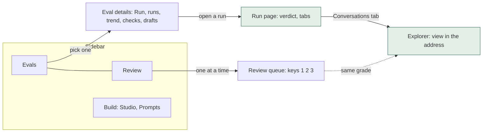

# F53 The admin portal, organised by job

> **Plan.** How the admin portal is reorganised around the three jobs you come to it for: *how is this eval
> doing*, *what happened in this run*, and *grade what's waiting*. The review that led here, with the screenshots
> and the three options, is `plans/admin-revamp/admin-revamp.html` in the Claude project; Louis picked option B on
> 2026-11-03 and asked for it to be built unattended, one pull request per child, merged when CI is green.

Status: **approved 2026-11-03** (Louis: "you can just implement this unattended pr and merge").

## Context: what the review found

The portal's parts are good: live runs, a cost before you press Run, a blind review. What makes it hard to use is
the map, checked on `main` at `123ed1f`:

1. One eval has three names (*check* on Benchmarks, *eval* on Evals, *benchmark* in the sidebar and the address)
   and two pages that send you to each other.
2. The run page gives its answer last: pass rates and trends are folded at the bottom, and nothing says whether the
   run is better or worse than the one before.
3. The explorer is five levels deep and the address never changes, so Back leaves the run and a view can't be linked.
4. Grading an answer is about seven clicks away, once per run, and nothing says how many answers are waiting.
5. The studio's steps have no order, and *Try* asks for a run id typed from memory.

GOAL skills: **12 Evaluation** (the eval workflow) and **16 Human in the loop** (people grading answers).

## The three children, in order

| Child | What | Done when | Plan |
|---|---|---|---|
| **F53.1** The run page | A verdict header (passed of total per mode, the change against the run before, cost and requests, how many answers wait for a grade); the page's blocks as tabs; the tab and the explorer's level in the address, so Back goes up a level and a link opens the same view | Opening `…?tab=conversations&view=conversation&task=bobotie` shows that conversation; pressing Back in the explorer goes up one level; the header says the change against the previous run | **Done 2026-11-03**; its lasting parts are [ADR 0065](../adr/0065-the-view-is-in-the-address.md) and the project doc. Picks taken during the build: the tab bar is `RunTabBar` (not `RunTabs`, which is the tab's parser); the "to review" filter is part of the place (`review=true`), so the verdict's "to grade" link opens the list filtered |
| **F53.2** One Evals page | A list pane (every eval, its last result, the change since the run before) and a details pane for the chosen one (Run with its estimate, the live run, its runs as a table, the trend, what it checks, its drafts); the Benchmarks page retired, the run page at `/admin/runs/{id}`, the old Afrikaans addresses dropped (ADR 0049); a thin live-run strip on every admin page | `/admin` opens the Evals page on the eval that ran last; a run can be started from the details pane and followed; no page is called Benchmarks | **Done 2026-11-03**; its lasting parts are the project doc and the Puls guide. Picks taken during the build (each the recommended option, reversible in review): one page, not two (the list pane makes the second page needless); the list shows the last run's pass@k per mode with its move against that mode's run before, from the list reply alone; the chosen eval in the address, the eval that ran last when none is named; a strip in the layout that polls the current run every ten seconds while it goes; the live-run panel above the details, not inside them, so it keeps following while another eval is opened; the runs table a card under the details |
| **F53.3** The review queue | A Review page: every answer waiting for a person, across runs, one at a time, graded with the keys 1, 2 and 3, the next opening by itself; a side list of done and left; the count in the sidebar; one new API route that lists what waits | An answer graded on the Review page is the next thing the run page shows as graded; the sidebar's count falls by one | written when it starts |

The studio's numbered steps (compose, check, try, publish) and a run picked from a list for *Try* are a small last
step of F53.3 if the budget allows, else they stay on the TODO as a leftover.

## What is settled, and what stays open

Settled by the pick of option B: one Evals page in list/details shape (Microsoft's list/details pattern), a run
page that opens on its verdict (Shneiderman's *overview first*), a review queue (LangSmith's annotation queue), the
view in the address, and nothing kept for compatibility (ADR 0049). The design choices inside each child are put to
Louis as findings on the child's plan; since the build is unattended, each child takes the recommended option and
names it, so Louis can reverse one in review.

Open, not part of any child: rings or bars on the run overview; the name *Studio* (the chat has one too); whether
`LouisAgent.Admin` becomes its own package now (option C, parked for Phase 10).

## How the children fit

F53.1 builds P and X; F53.2 builds E and D and moves the run page's address; F53.3 builds R and Q.

## Verification

Every child: its tests first, the puls and web.shared suites green, the golden files regenerated and their diff read,
`FileSizeTests`, `RazorHasNoCodeTests`, `PortalReadsNoScoreKeyTests` and `ArchitectureTests` green. No paid run:
nothing here asks a model. The pages are checked by rendering them from the test snapshots with the app's own CSS,
as the review did.

## Concepts

- **URL as state** (F53.1): what the page shows is in its address, so the browser's history, Back and a shared link
  all work for free. Skill 12's portal, and the general web rule that a view you can't link to is a view you can't
  share.
- **List/details** (F53.2): one list, one selected item, side by side on a wide screen; Microsoft's guidance for
  "locate and prioritise a large collection".
- **An annotation queue** (F53.3): a reviewer's job as a queue with a done count, keyboard shortcuts and "next opens
  by itself"; skill 16, human in the loop.

---
[Plans](README.md) · [TODO](../../TODO.md) · [Goal](../GOAL.md)
