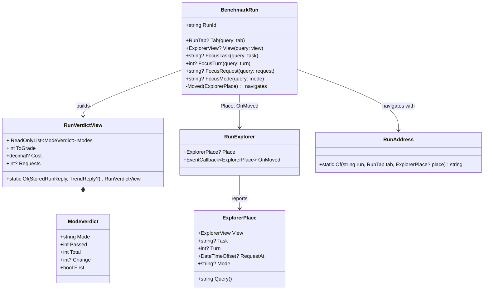
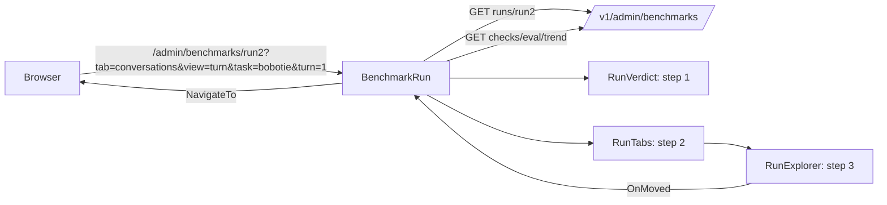
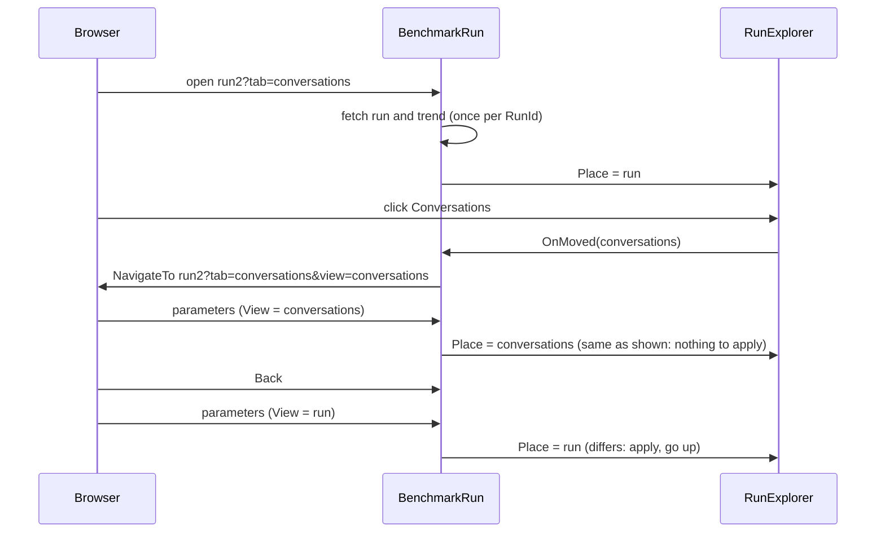
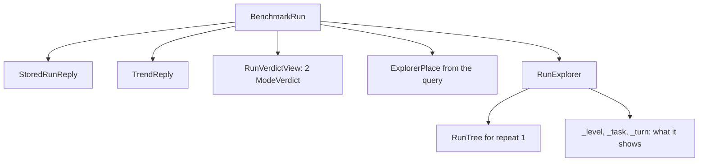

# F53.1 The run page: a verdict, tabs, and the view in the address

> **Plan.** The first child of [F53](F53-admin-by-job.md): the run page opens on its answer, its blocks become tabs,
> and the tab and the explorer's level live in the address. Branch `claude/project-thread-7kq7hy` (the thread's
> branch, as Louis asked for an unattended build), one pull request to `main`.

Status: **approved 2026-11-03** with F53 (unattended; each finding below takes the recommended option).

## Context

`BenchmarkRun.razor` stacks ten blocks: head, store banner, Notes, Results by category, Explore the run, Judge
against people, Pass rates, Trend, Trend by category, What it ran with. The explorer (`RunExplorer`) keeps where you
are in a private field (`_level`), so the address only carries `?task=`, which opens one conversation when the page
loads (`OpenTask`). The trend the page already fetches (`TrendReply`) holds every earlier run of the eval, per mode,
with its score (the share of conversations that passed) and its conversation count.

## Findings, each with the recommended option taken

### A. Where does the explorer's place live?

| | Option | Pattern | What it changes | What it costs |
|---|---|---|---|---|
| **A1 (taken)** | The explorer keeps its own state and **reports every move** to the page (`OnMoved`); the page writes the place into the address; the address, read back as parameters, is applied when it differs from what the explorer shows | Controlled component with a reported state (React's "lifting state up", kept partial so the explorer still works alone) | The explorer's own tests keep passing (they render it alone); the page owns the address | Two copies of the place, kept equal by one comparison in `OnParametersSet` |
| A2 | The explorer **navigates itself** (`NavigationManager`) and reads its place only from the address | URL as the single state | One copy | The explorer can't be rendered without a page; every component test changes |
| A3 | Blazor's **`NavigationLock` and history API** by hand | — | — | More code than A1 for the same result |

Sources: React docs, *Sharing state between components*; Microsoft, *ASP.NET Core Blazor routing* (query strings as
parameters with `SupplyParameterFromQuery`).

### B. How is the previous run found?

| | Option | Pattern | What it changes | What it costs |
|---|---|---|---|---|
| **B1 (taken)** | From the **trend the page already fetches**: per mode, the point before this run's point in time | Reuse (ADR 0030) | No API change | A run outside the trend's last 20 has no "before" and says so |
| B2 | A new field on `StoredRunReply`: the previous run's totals | Explicit | Always there | An API change for one number the page already has |

### C. Tabs or folds?

| | Option | What it changes | What it costs |
|---|---|---|---|
| **C1 (taken)** | **Tabs**, one block each, the tab in the address (`?tab=`) | One thing on the page at a time; the verdict always on top | A person who wants two blocks at once switches |
| C2 | Keep the folds, only reorder | Smallest | The page stays long; the address can't name a block |

## Design

### What changes

1. **A verdict header** (`RunVerdict.razor`, under the head): per mode, passed of total this run and the change
   against the run before (▲ 2, ▼ 1, = same, or "first run"), and one line with the run's cost and requests; "N to
   grade" with a link to the Conversations tab filtered to *To review* when answers wait. The numbers are worked out
   in `RunVerdictView.Of(run, trend)`, a Presentation Model with its own tests.
2. **Tabs** (`RunTab`, an enum with wire names: `summary`, `conversations`, `judge`, `notes`, `settings`): the
   Summary tab holds the results by category, the pass rates and the two trends; Conversations the explorer; Judge
   the agreement panel (or a line saying no judge has a human review); Notes the notes; Settings what it ran with.
   The tab comes from `?tab=`, Summary by default.
3. **The explorer's place in the address** (`ExplorerPlace`: a view with wire names `run`, `conversations`,
   `conversation`, `turn`, `request`, the task, the turn number, and for a request its time and mode): the explorer
   raises `OnMoved` on every move; the page navigates to the same run with the new query; the parameters come back
   through `SupplyParameterFromQuery` and the explorer applies them when they differ from what it shows. The old
   `?task=` becomes `?tab=conversations&view=conversation&task=…`; the summary table's links say so.
4. **No refetch on a query change**: the page fetches the run only when `RunId` changes.

### Interface design

### Architecture

### Communication, the main case

### Objects in memory, the main case

### Namespace map

| Type | Folder | Namespace | Step |
|---|---|---|---|
| `RunTab` (enum) | `src/louis-agent.puls/Admin/RunPage/` | `LouisAgent.Puls.Admin.RunPage` | 2 |
| `RunAddress` | `src/louis-agent.puls/Admin/RunPage/` | `LouisAgent.Puls.Admin.RunPage` | 3 |
| `ModeVerdict`, `RunVerdictView` | `src/louis-agent.puls/Admin/Verdict/` | `LouisAgent.Puls.Admin.Verdict` | 1 |
| `VerdictText` | `src/louis-agent.puls/Admin/Verdict/` | `LouisAgent.Puls.Admin.Verdict` | 1 |
| `ExplorerView` (enum), `ExplorerPlace` | `src/louis-agent.puls/Admin/Explorer/Place/` | `LouisAgent.Puls.Admin.Explorer.Place` | 3 |
| `RunVerdict.razor(.cs)` | `src/louis-agent.puls/Components/Admin/RunPage/` | `LouisAgent.Puls.Components.Admin.RunPage` | 1 |
| `RunTabs.razor(.cs)` | `src/louis-agent.puls/Components/Admin/RunPage/` | `LouisAgent.Puls.Components.Admin.RunPage` | 2 |
| `RunVerdictViewTests` | `tests/louis-agent.puls.tests/Admin/Verdict/` | `LouisAgent.Puls.Tests.Admin.Verdict` | 1 |
| `RunAddressTests`, `RunTabTests` | `tests/louis-agent.puls.tests/Admin/RunPage/` | `LouisAgent.Puls.Tests.Admin.RunPage` | 2, 3 |
| `ExplorerPlaceTests` | `tests/louis-agent.puls.tests/Admin/Explorer/Place/` | `LouisAgent.Puls.Tests.Admin.Explorer.Place` | 3 |
| `BenchmarkRunTabsTests`, `RunExplorerPlaceTests` | `tests/louis-agent.puls.tests/Pages/Admin/`, `Components/Admin/` | as their folders | 2, 3 |

## Steps

1. **The verdict** — test: `RunVerdictView.Of` gives per mode passed of total, the change against the trend's point
   before this run (and "first" when there is none), the cost, the requests and the answers waiting for a grade;
   then the component under the head. Commit `feat(f53.1): step 1 - the run's verdict on top`.
2. **Tabs** — test: `?tab=notes` renders the notes panel and not the explorer; no tab renders the summary; an unknown
   tab is the summary. Commit `feat(f53.1): step 2 - the run page as tabs`.
3. **The view in the address** — tests: `ExplorerPlace` writes and reads its query; the explorer raises `OnMoved`
   when a level opens; a changed `Place` parameter moves the explorer; the page navigates on a move and doesn't fetch
   the run again. The summary table's task links carry the tab and view. Golden files regenerated. Commit
   `feat(f53.1): step 3 - the explorer's view in the address`.
4. **Docs** — the project doc's admin paragraph, this plan's lasting parts into ADR 0065 (*the view is in the
   address*), the TODO line. Commit `docs(f53.1): step 4 - the run page in the docs`.

## Verification

`dotnet test tests/louis-agent.puls.tests`, `tests/louis-agent.web.shared.tests` and the core ratchets; the page
rendered from its snapshot with the app's CSS and looked at. Nothing paid.

## Concepts

**URL as state** (skill 12's portal, and the web's own rule): a view you can link to is a view you can share and
come back to; the browser's history becomes your undo. **Presentation Model** (Fowler) for the verdict: the numbers
are worked out in a plain class with tests, the component only places them.

---
[Plans](README.md) · [F53](F53-admin-by-job.md)
