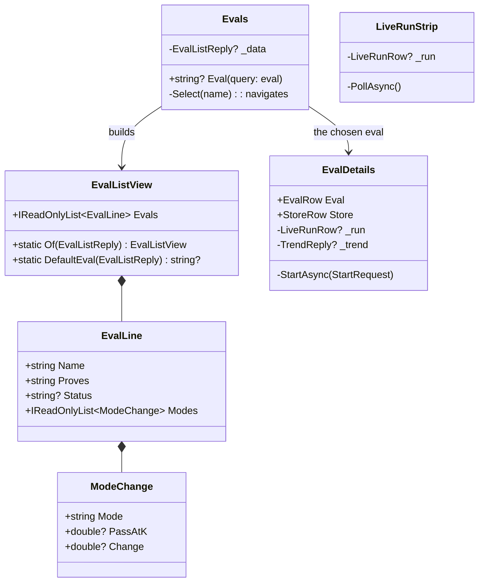

# F53.2 One Evals page: list and details

> **Plan.** The second child of [F53](F53-admin-by-job.md): one home per eval. The Evals page becomes a list of every
> eval beside the details of the chosen one (its runs, the Run button and the live run, its trend, what it checks,
> its drafts); the Benchmarks page is retired; the run page moves to `/admin/runs/{id}`; a thin live-run strip sits
> on every admin page. Branch `claude/project-thread-7kq7hy` (the thread's branch, unattended), one pull request to
> `main` after F53.1's.

Status: **approved 2026-11-03** with F53 (unattended; each finding below takes the recommended option).

## Context

An eval had three names and two pages: *Benchmarks* (`/admin`: the checks as cards with Run, the live run, a check's
runs) and *Evals* (`/admin/evals`: every eval as a tall card with its latest run, a timeline, what it checks), each
linking to the other for what it lacked. The run page lived at `/admin/benchmarks/{id}`, and `/admin/maatstawwe`
still opened the old Afrikaans addresses. The Evals list (`GET /v1/admin/evals`) already carries, per eval, what it
proves, whether it has a manual, its graders, modes and models, its drafts and its newest runs with each mode's
rates; a trend is `GET /v1/admin/evals/{eval}/trend` and the manual `GET /v1/admin/benchmarks/{check}/manual`. No
API change is needed.

## Findings, each with the recommended option taken

### A. One page or two?

| | Option | Pattern | What it changes | What it costs |
|---|---|---|---|---|
| **A1 (taken)** | **One page, list and details**: the list pane names every eval with its last result; the details pane holds everything about the chosen one | Microsoft's list/details ("locate and prioritise a large collection"); the master-detail of every admin kit | One home per eval; the Benchmarks page goes; the sidebar has one entry | A wide page; on a phone the list stacks above the details |
| A2 | Two pages kept, renamed and cross-linked better | — | Smallest | The two names stay, and the jump between them |
| A3 | A page per eval (`/admin/evals/{name}`) with an index | Hub and spoke | Clean addresses | An index page that is the list again, and a third page |

Sources: Microsoft Learn, *List/details pattern*; Nielsen Norman Group, *Progressive disclosure*.

### B. What the list says per eval

| | Option | What it changes | What it costs |
|---|---|---|---|
| **B1 (taken)** | Name, what it proves, the last run's status, and per mode the last run's **pass@k with the change against the run before** (▲ ▼ =), from the rates the list already carries | No API change; the same "better or worse" the run page's verdict gives | pass@k, not passed of total (the list has no counts); a run from before the rates says "no rates" |
| B2 | A new list reply with passed of total per run | Matches the verdict to the number | An API change and a second read of every conversation per eval |

### C. Where the chosen eval lives

| | Option | What it changes | What it costs |
|---|---|---|---|
| **C1 (taken)** | In the address, `?eval=`; none opens the eval that ran last (the Benchmarks page's `RunEstimate.DefaultCheck` rule) | A link opens an eval; Back goes to the one before ([ADR 0065](../adr/0065-the-view-is-in-the-address.md)) | The page reads its query as the run page does |
| C2 | A field on the page | Smallest | Not linkable |

### D. The live run on every page

| | Option | What it changes | What it costs |
|---|---|---|---|
| **D1 (taken)** | A **strip** in the layout (`LiveRunStrip`): one line (the eval, its status, a link to its details) from `GET …/runs/current`, read when the layout opens and again every ten seconds while a run is going | You see a run is going from any admin page | A small read every ten seconds while a run runs |
| D2 | The live panel itself on every page | The whole table everywhere | Heavy, and the panel follows the run's events |
| D3 | Nothing outside the Evals page | Smallest | The review found "nothing says a run is going" |

### E. The run page's address

Taken: `/admin/runs/{id}`, written by one class (`RunAddress.Of(run)`), every link through it; `/admin/benchmarks/…`
and `/admin/maatstawwe…` are gone ([ADR 0049](../adr/0049-nothing-is-compatible-before-a-sale.md): nothing kept for
links already shared). The API's own routes don't move (`/v1/admin/benchmarks/…` stays; CL17's endpoints-by-toolset
is its own cleanup).

## Design

```mermaid
flowchart LR
  Browser -->|/admin?eval=puls-cook| Page[Evals page]
  Page -->|GET /v1/admin/evals| API
  Page --> List[EvalList: every eval, its last result]
  Page --> Details[EvalDetails: the chosen eval]
  Details -->|GET …/evals/{eval}/trend| API
  Details -->|POST …/benchmarks/{eval}/runs| API
  Details --> Live[LiveRunPanel]
  Details --> Runs[RunsList]
  Details --> Checks[EvalChecks, DraftList]
  Layout[AdminLayout] --> Strip[LiveRunStrip: GET …/runs/current]
  Runs -->|/admin/runs/{id}| RunPage[Run page: F53.1]
```



### Namespace map

| Type | Folder | Namespace | Step |
|---|---|---|---|
| `RunAddress.Of(run)` | `src/louis-agent.puls/Admin/RunPage/` | as is | 1 |
| `EvalLine`, `ModeChange`, `EvalListView` | `src/louis-agent.puls/Admin/Evals/` | `LouisAgent.Puls.Admin.Evals` | 2 |
| `EvalList.razor(.cs)`, `EvalListItem.razor(.cs)` | `src/louis-agent.puls/Components/Admin/EvalsPage/List/` | `LouisAgent.Puls.Components.Admin.EvalsPage.List` | 2 |
| `EvalDetails.razor(.cs)`, `EvalRunControls.razor(.cs)` | `src/louis-agent.puls/Components/Admin/EvalsPage/Details/` | `LouisAgent.Puls.Components.Admin.EvalsPage.Details` | 2, 3 |
| `LiveRunStrip.razor(.cs)` | `src/louis-agent.puls/Components/Admin/LiveRun/` (with `LiveRunPanel`, moved from `BenchmarksPage/LiveRun/`) | `LouisAgent.Puls.Components.Admin.LiveRun` | 4 |
| `RunsList`, `ManualDialog`, `AdminGate`, `StoreBanner` | moved out of `BenchmarksPage/` into `Components/Admin/Runs/`, `EvalsPage/Details/`, `Components/Admin/Head/` | as their folders | 3 |
| Tests | `tests/louis-agent.puls.tests/` mirroring each | as their folders | each |

## Steps

1. **The run page at `/admin/runs/{id}`** — test: `RunAddress.Of("run 1")` is `admin/runs/run%201`; the page answers
   at the new route; no `.razor` holds `admin/benchmarks/` or `maatstawwe` (a ratchet in the puls tests, like
   `PortalReadsJsonTests`). Every link goes through `RunAddress`; goldens regenerated. Commit
   `feat(f53.2): step 1 - the run page at /admin/runs`.
2. **The list and the details** — test: `EvalListView.Of` gives per eval the last run's status and per mode pass@k
   with the change against the run before, "no rates" for a run from before them, and the default eval is the one
   that ran last; the page at `?eval=` shows that eval's details and the list marks it; no `?eval=` opens the
   default. `EvalDetails` holds the scorecard, the timeline, the trend, what it checks and the drafts. Commit
   `feat(f53.2): step 2 - the Evals page as list and details`.
3. **Run from the details** — the Run controls (repeats, the estimate, the manual), the live run and the runs table
   move into the details pane; the Benchmarks page and its parts go. Tests: the Benchmarks page's tests move to the
   details (a run started from the pane is followed; the manual opens; the runs table names the eval). Commit
   `feat(f53.2): step 3 - run an eval from its details`.
4. **The strip and the sidebar** — `LiveRunStrip` in the layout, read on open and every ten seconds while a run is
   going; the sidebar *Measure: Evals* and *Build: Studio, Prompts*, the placeholder note gone; the profile menu and
   the studio link to `admin`. Test: the strip shows a running run and nothing when there is none. Commit
   `feat(f53.2): step 4 - a live-run strip on every admin page`.
5. **Docs** — the project doc, the Puls guide, the changelog, the TODO; this plan deleted. Commit
   `docs(f53.2): step 5 - one Evals page in the docs`.

## Verification

`dotnet test tests/louis-agent.puls.tests`, `tests/louis-agent.web.shared.tests`, the core ratchets; the pages
rendered from their snapshots with the app's CSS at desktop and phone width. Nothing paid: a run is never started.

## Concepts

**List/details** (skill 12's portal): one list, one chosen item, side by side; the list says enough to choose
(the last result and its direction), the details hold the rest. **Polling at a slow rate** for a strip that only has
to say "a run is going": the panel that follows the run keeps its event stream; the strip asks once in a while.

---
[Plans](README.md) · [F53](F53-admin-by-job.md)
