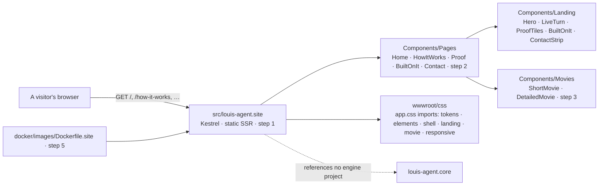
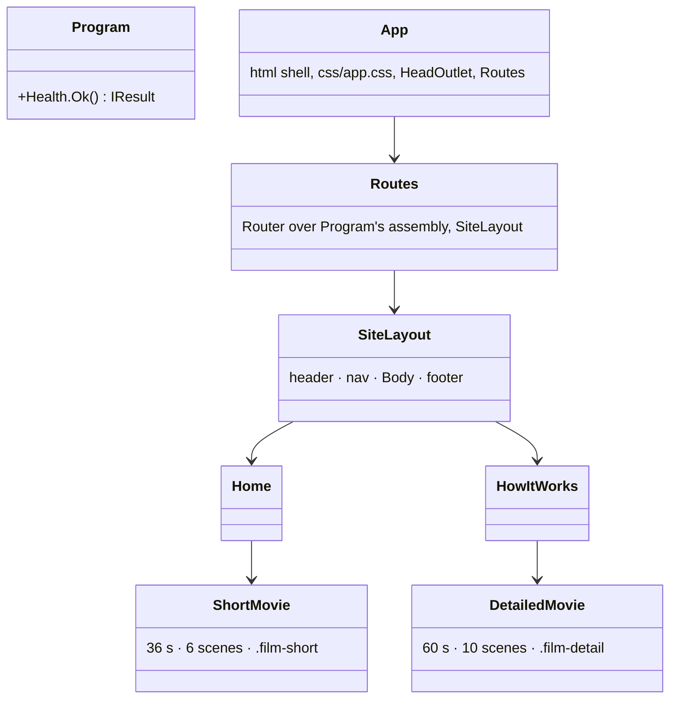
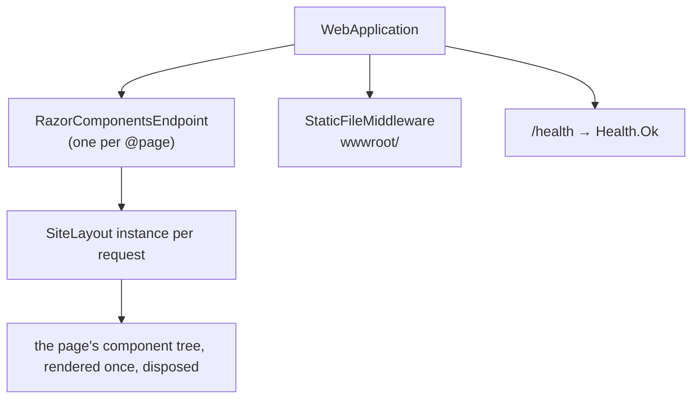

# F54 The engine's website

> **Plan.** How the engine's public site is built: a new `src/louis-agent.site` project, static server-rendered
> Razor pages in the Console theme (black, white and metallic grays), two CSS films of how the engine works, one PR.
> Louis, 2026-11-03: "start a project for the agent website so long", "this is for the engine Puls runs on", "black
> and white with metallic grays", "modern, sleek", "we need animations of how the engine works", "implement console
> theme on your own with the 2 animations". The designs he picked from:
> [the canvas](https://claude.ai/artifact/1q6PNLbRJmGLHR5yedp12B) (C · Console, and the two 3D films).

## Context

The engine is to be sold to .NET teams after Phase 9 (TODO: F44, Phase 10 the engine as a package). Nothing public
says what it is yet; the README is for someone already in the repo. Louis asked for the site now, as a side track
beside F52 and the admin revamp, so that it's ready when the package is. It does not move the phase order.

Puls has its own landing page and is not the reader here. The site shows **only what works today** (the same rule as
Puls's front end): the engine, identities and packs, the hosts, the ledger, the guards, the evals, the traces. The
package, budgets, accounts and orchestration beyond the POC are left out or sit in one honest "heading for" line.

## Design

**What it is.** A plain website: five pages, no accounts, no API calls, no JavaScript of our own. Static server
rendering (ASP.NET Core's Razor components with no WebAssembly and no interactivity) because the site is content,
the whole thing stays C#, and a page is HTML and CSS a search engine and a phone read without a runtime. The two
films are CSS keyframes: the parts of the engine as slabs on a floor seen from above (CSS 3D transforms), a light
travelling between them as the turn, a flat card with each scene's facts and a caption strip. Nothing in them
moves by script, so they play the same everywhere and cost nothing to serve. The pattern is the one the repo's web
apps already follow: markup in `.razor`, no `@code`, a stylesheet per concern under 200 lines, tokens first.

**Three options Louis saw for the build** (2026-11-03): A Blazor static server rendering (picked, recommended),
B DocFX (a docs-site look, custom template needed for a landing page; its API reference can still come in Phase 10),
C hand-written HTML (no components, every page copied by hand). For the films: CSS keyframes (picked, cheapest,
works everywhere), a Three.js scene (real 3D, a different build), or a rendered video (no text, no resize). The
MP4 exports Louis asked for are made from the same CSS by a headless browser, frame by frame.

**What the site talks about, and where it comes from.** Every sentence on the site is from the README, the arc42
architecture (`docs/architecture/`), the ADRs or a learning write-up; every number from the ledger or an eval run
(`docs/learning/13-cost-and-token-economics.md`, `12-evaluation.md`). The detailed film's six slabs inside core are
the chat pipeline's middleware in its real order (`louis-agent.core/Agent/Turns/ChatPipeline.cs`), and a test
holds that order.

### Architecture



### Interface



No C# interfaces: the site holds one static method (`Health.Ok`) and markup. The contract that matters is the
CSS: `stage.css` is what the two films share (the stage, a part, the light, the card, the strip), and each film's
file adds its positions, its camera and its timing under its own class (`.film-short`, `.film-detail`), with every
keyframe name ending in the film's letter so the two never share one (`SiteStylesheetTests` holds it).

### Communication

```mermaid
sequenceDiagram
    participant B as Browser
    participant K as Kestrel
    participant R as Razor (static SSR)
    B->>K: GET /how-it-works
    K->>R: render HowItWorks in SiteLayout
    R-->>K: HTML (DetailedMovie markup inline)
    K-->>B: 200 text/html
    B->>K: GET css/app.css (+ its imports), Google Fonts
    K-->>B: the stylesheets
    Note over B: the films run as CSS animations; no script, no further request
```

### Objects at run time



### Namespace map

| Type or file | Folder | Namespace | Step |
|---|---|---|---|
| `Program`, `Health` | `src/louis-agent.site/` | (top level) | 1 |
| `App`, `Routes`, `_Imports` | `src/louis-agent.site/Components/` | `LouisAgent.Site.Components` | 1 |
| `SiteLayout` | `Components/Layout/` | `LouisAgent.Site.Components.Layout` | 1 |
| `Home`, `HowItWorks`, `Proof`, `BuiltOnItPage`, `Contact` | `Components/Pages/` | `LouisAgent.Site.Components.Pages` | 2 |
| `Hero`, `LiveTurn`, `ProofTiles`, `BuiltOnIt`, `ContactStrip` | `Components/Landing/` | `LouisAgent.Site.Components.Landing` | 2 |
| `ShortMovie`, `DetailedMovie` | `Components/Movies/` | `LouisAgent.Site.Components.Movies` | 3 |
| `SitePagesTests` | `tests/louis-agent.site.tests/Pages/` | `LouisAgent.Site.Tests.Pages` | 1, 2 |
| `ShortMovieTests`, `DetailedMovieTests` (+ goldens) | `tests/louis-agent.site.tests/Movies/` | `LouisAgent.Site.Tests.Movies` | 3 |
| `SiteStylesheetTests` | `tests/louis-agent.site.tests/Styles/` | `LouisAgent.Site.Tests.Styles` | 4 |

### Folder tree, after

```
src/louis-agent.site/
├── louis-agent.site.csproj      # Microsoft.NET.Sdk.Web, no project references, links its two docs
├── Program.cs                   # AddRazorComponents, MapRazorComponents<App>, /health
├── Components/
│   ├── App.razor · Routes.razor · _Imports.razor
│   ├── Layout/SiteLayout.razor
│   ├── Pages/   Home · HowItWorks · Proof · BuiltOnItPage · Contact
│   ├── Landing/ Hero · LiveTurn · ProofTiles · BuiltOnIt · ContactStrip
│   └── Movies/  ShortMovie · DetailedMovie
└── wwwroot/css/
    ├── app.css                  # the import list, in cascade order
    ├── settings/tokens.css · base/elements.css
    ├── layout/shell.css · layout/responsive.css
    ├── landing/hero.css · live-turn.css · sections.css
    └── movie/stage.css · short.css · detail.css
tests/louis-agent.site.tests/    # Pages/ · Movies/ (+ two goldens) · Styles/
docker/images/Dockerfile.site
```

## Steps

Louis asked for the whole thing in one go ("implement console theme on your own with the 2 animations, show me when
done"), so the steps below are the commits of one PR, each reviewable on its own.

1. **The site.** `src/louis-agent.site`: the project, the Console theme (tokens, elements, the shell), the five
   pages with the landing parts, and the two films (`ShortMovie`, `DetailedMovie` with `stage.css`, `short.css`,
   `detail.css`); in the solution.
2. **The tests.** `SitePagesTests` (every page answers with its title and its film, no Blazor script, `/health`),
   `ShortMovieTests` and `DetailedMovieTests` (the scenes counted, the parts numbered in order, core's slabs in the
   pipeline's order, the markup pinned to goldens), `SiteStylesheetTests` (every area file imported, tokens first,
   each film's keyframes its own).
3. **Shipping.** `Dockerfile.site`, the design doc, the how-to, this plan, ADR 0066, the TODO line and the index rows.
4. **Finishing.** Louis's review, the write-up (skill 18), the plan deleted, the CHANGELOG line, on merge.

Steps 1 and 2 are one slice each rather than test-first pairs because Louis asked for the whole site in one go;
the tests were written against the markup as it was built and all 21 were green before the first commit.

## Verification

- `dotnet test tests/louis-agent.site.tests` (21 tests), `FileSizeTests`, `ArchitectureTests`, `ClaudeMdSizeTests`
  in core's tests, `RazorHasNoCodeTests` in web.shared's.
- Looked at in a headless browser at 1440 px and 390 px (no sideways scroll), and the films rendered frame by frame
  at each scene's midpoint. No paid run: the site calls no model.

## Concepts

| Step | Concept | GOAL.md skill |
|---|---|---|
| 1, 5 | A host that is content only: static server rendering, a container with a health check | 18 Testing and shipping |
| 3 | Explaining the agent loop and the guards to a reader who hasn't seen the code | 6 The agent loop, 7 Context engineering |
| 3 | The measured numbers as the product's proof | 12 Evaluation, 13 Cost and token economics |

---
[Docs index](../README.md) · Related: [Plans](README.md) · [The site's design doc](../projects/louis-agent.site.md)
