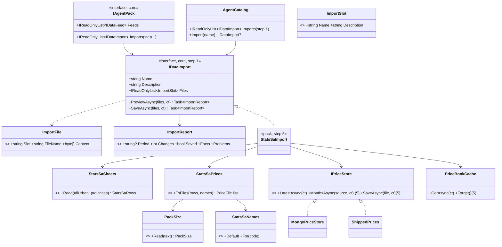
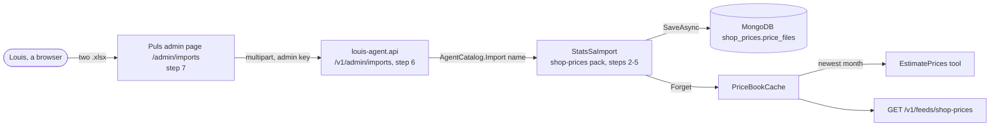
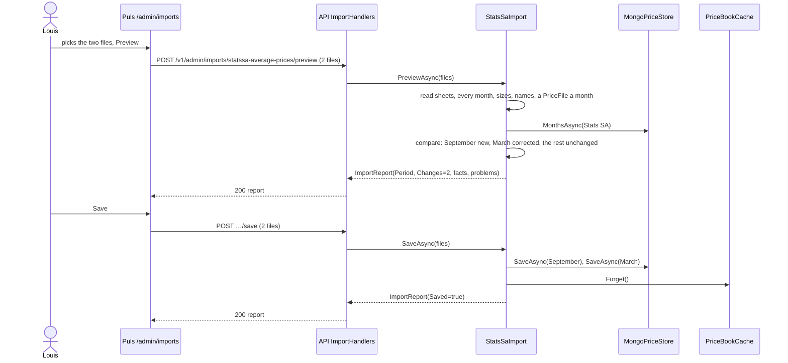
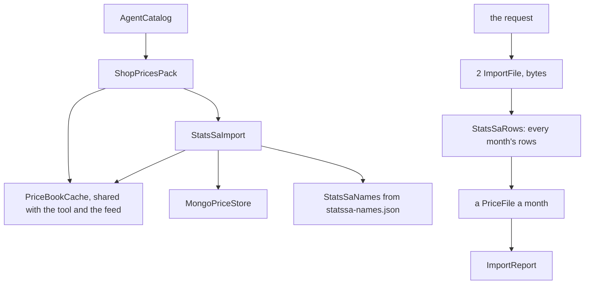

# F55 Stats SA's prices uploaded in the admin portal

> **What this answers:** how a new release of Stats SA's average prices reaches the cook without a code change or a
> deploy. Louis downloads the two spreadsheets when Stats SA publishes (it doesn't every month), uploads them on an
> admin page, checks a preview and saves; the `shop-prices` store then holds every month in them, Stats SA's
> corrections to earlier months included, and the cook prices from the newest.
> Branch `claude/project-thread-gugq59`, scope `f55`, one commit per step, one PR to `main`. ADR **0071** (the next
> free on `main` on 2026-11-04).

Status: **approved 2026-11-04 16:54** on all four findings, each as recommended: **A1** packs declare imports,
**B1** a names file by Stats SA's code, **C1** a stored month is replaced only when ticked, **D1** the newest month only.
**C1 and D1 were then replaced during the build** (17:05, *Approved during the build*): every month in the sheets is
taken, and Save writes the new months and the corrected ones the preview lists (**F1**); **E1** older months fill gaps.

## The goal, in Louis's words

"I need to upload it via admin", "cause they do not release one every month" (2026-11-04). It replaces the TODO's
*Stats SA's monthly refresh* (a C# command).

GOAL skills **16** (human in the loop: a person checks the preview before the data is stored), **18** (shipping: new
data without a release) and the data side of **7** (what the agent grounds its answer on, kept fresh).

## Context: what we have today, checked on `main` (e887469)

- **The pack ships one month by hand.** `packs/louis-agent.pack.shop-prices/Prices/Data/statssa-average-prices.json`
  is August 2026: 220 products, 463 packs, national and per province, each product with the names a shopping list
  may call it by. It was made by hand from the two spreadsheets.
- **The store already keeps months.** `MongoPriceStore` keeps one document per source and month
  (`PriceFileDocument`, id `{date} {source}`), seeds the shipped tables it doesn't have and never overwrites one;
  `PriceBookCache` reads the newest month of each source at most once an hour (ADR 0069).
- **Packs already plug data into the API without the API knowing them.** `IDataFeed` and `IAgentPack.Feeds`
  (ADR 0070): the API serves `AgentCatalog.Feeds` at `/v1/feeds/{name}`.
- **An Excel reader is already in core.** `ExcelDataReader` 3.9.0 (MIT), used by `DocumentText` for `ReadTable`.
- **The spreadsheets** (P0141, August 2026 release, checked 2026-11-04):
  - *Wide*: one row per product and pack, one column per month from `M201701` to `M202608`; a release adds columns.
  - All urban areas (sheet *Average prices*, 391 rows): `H05` the product's code (`01111201`), `H06` its name
    (`White Rice`), `H08` the pack (`1 Kilogram`), then the months.
  - Provinces (sheet *Provinces*, 2,455 rows): the same, `H09` the province (`Kwa-Zulu Natal`), `Province_code`.
  - A blank cell is no price. Sizes are loose (`1,5 Kilogram`, `1.75 Kilogram`, `10 X 18 Gram`, `1 Unit`), and so
    are names (`Onions  - fresh`; the shipped file tidied 14 of them).
  - **The names a list uses** (`mince`, `maalvleis`) are not in the sheets.

## Design

### What changes

1. **Core: packs declare imports (A1).** `IDataImport` beside `IDataFeed`: a name, a description, the files it takes,
   `PreviewAsync` and `SaveAsync`. `IAgentPack.Imports` (default none), `AgentCatalog.Imports` and `Import(name)`.
   Its answer, `ImportReport`, is plain data: the period, how many things saving writes (`Changes`, 0 when all is
   stored), whether it was saved, facts (label and value) and problems. A wrong file is a problem in the report, never a thrown exception, as a tool's
   failure is text (ADR 0005). Pattern: Plugin (Fowler, PoEAA), the same seam as feeds.
2. **The pack reads the sheets.** `StatsSaSheets` reads both uploads with ExcelDataReader into `StatsSaRow` records
   (code, product, size, region, month, price), every month with prices (F1).
3. **Sizes and names in plain code** (ADR 0057, no regex): `PackSize.Read` turns `1,5 Kilogram` into 1500 g, `10 X 18
   Gram` into 180 g, `1 Unit` into 1 each; a size it can't read is `Other` with no amount, never a guess.
   `StatsSaProduct.Tidy` turns `Onions  - fresh` into `Onions - fresh`.
4. **The names file (B1).** `Prices/Data/statssa-names.json`, keyed by Stats SA's code: the product's tidy name and
   the names a list may use. Made once from today's shipped file and reviewed in git like `own-prices.json`. A product
   with no entry gets its own tidy name only, and the preview lists it.
5. **The converter.** `StatsSaPrices.ToFiles` builds one `PriceFile` per month from the rows and the names. Its
   proof: the August sheets' August month gives the shipped August file.
6. **Saved into the store (F1).** The import compares each month with the stored one: new, corrected (its prices
   differ) or unchanged. `IPriceStore.SaveAsync(file)` inserts or replaces one month; the shipped tables in memory
   can't save, and say so (Save needs `SHOP_PRICES_MONGO_URL`).
   `PriceBookCache.Forget()` drops the book, so the next tool call reads the new month. `StatsSaImport` is the pack's
   `IDataImport`.
7. **The API** (generic, admin key): `GET /v1/admin/imports`, `POST /v1/admin/imports/{name}/preview` and
   `POST /v1/admin/imports/{name}/save` (multipart: one part per file slot; 10 MB a file).
8. **The admin page** `/admin/imports` in Puls: each import, its file pickers, Preview, the report (new months,
   corrected months and what changed in them), and Save, off when there are no changes.

### Interface design



```csharp
// core, Agent/Catalog/Imports (step 1)
public interface IDataImport
{
    string Name { get; }                      // "statssa-average-prices"
    string Description { get; }
    IReadOnlyList<ImportSlot> Files { get; }  // "all-urban", "provinces"
    Task<ImportReport> PreviewAsync(IReadOnlyList<ImportFile> files, CancellationToken cancellationToken);
    Task<ImportReport> SaveAsync(IReadOnlyList<ImportFile> files, CancellationToken cancellationToken);
}
public sealed record ImportSlot(string Name, string Description);
public sealed record ImportFile(string Slot, string FileName, byte[] Content);
public sealed record ImportFact(string Label, string Value);
public sealed record ImportReport(string? Period, int Changes, bool Saved,
    IReadOnlyList<ImportFact> Facts, IReadOnlyList<string> Problems);
```

### Architecture



### Communication (the main case: a new month saved)



### Objects held in memory (one save)



### Namespace map

| Type | Folder | Namespace | Step |
|---|---|---|---|
| `IDataImport`, `ImportSlot`, `ImportFile`, `ImportFact`, `ImportReport` | `louis-agent.core/Agent/Catalog/Imports/` (its own folder: `Catalog/` would pass six files) | `LouisAgent.Core.Agent.Catalog.Imports` | 1 |
| `IAgentPack.Imports`, `AgentCatalog.Imports`/`Import` (changed) | `louis-agent.core/Agent/Catalog/` | `LouisAgent.Core.Agent.Catalog` | 1 |
| `FakeImport`, `FakePack(imports:)` | `tests/louis-agent.testing/` | `LouisAgent.Testing` | 1 |
| `AgentCatalogTests` (more cases) | `tests/louis-agent.core.tests/Agent/Catalog/` | `LouisAgent.Core.Tests.Agent.Catalog` | 1 |
| `StatsSaRow`, `StatsSaRows`, `StatsSaSheets` | `packs/louis-agent.pack.shop-prices/Prices/StatsSa/` | `LouisAgent.Packs.ShopPrices.Prices.StatsSa` | 2 |
| `PackSize`, `StatsSaProduct` | same | same | 3 |
| `StatsSaNames`, `StatsSaPrices`; `Prices/Data/statssa-names.json` | same | same | 4 |
| `IPriceStore.MonthsAsync`/`SaveAsync`, `PriceBookCache.Forget` (changed) | `Prices/Store/` | `LouisAgent.Packs.ShopPrices.Prices.Store` | 5 |
| `StatsSaImport` | `packs/louis-agent.pack.shop-prices/Imports/` | `LouisAgent.Packs.ShopPrices.Imports` | 5 |
| `ShopPriceImportMessage` | `Messages/` | `LouisAgent.Packs.ShopPrices.Messages` | 5 |
| tests of each, mirrored | `tests/louis-agent.pack.shop-prices.tests/…`, a trimmed `.xlsx` fixture pair | mirrored | 2-5 |
| `ImportEndpoints`, `ImportHandlers` | `src/louis-agent.api/Endpoints/Admin/Imports/` | `LouisAgent.Api.Endpoints.Admin.Imports` | 6 |
| `ImportListing`, `ImportReportReply` | `src/louis-agent.api.contracts/Admin/` | `LouisAgent.Api.Contracts.Admin` | 6 |
| `Imports.razor`, `Imports.razor.cs`; `Admin/Imports/` helpers | `src/louis-agent.puls/Pages/Admin/`, `src/louis-agent.puls/Admin/Imports/` | `LouisAgent.Puls.Pages.Admin`, `LouisAgent.Puls.Admin.Imports` | 7 |

### Folder trees (the shop-prices pack)

Today:

```
packs/louis-agent.pack.shop-prices/
├── Estimates/  Feeds/  Messages/  Prompts/  Tools/
└── Prices/  Data/  Files/  Regions/  Store/
```

After step 5:

```
packs/louis-agent.pack.shop-prices/
├── Estimates/  Feeds/  Imports/ (new)  Messages/  Prompts/  Tools/
└── Prices/  Data/ (+ statssa-names.json)  Files/  Regions/  StatsSa/ (new)  Store/
```

## Steps

Each step is one commit, test first (seen failing, then passing), and stops for Louis's review.

1. **Core: packs declare imports.** `IDataImport` and its records, `IAgentPack.Imports`, `AgentCatalog.Imports` and
   `Import(name)`, a name taken twice refused. *Test:* a catalogue lists a pack's import, finds it by name (case
   ignored), refuses two of the same name.
2. **Read the sheets.** `StatsSaSheets.Read(allUrban, provinces)` gives every month with prices and its rows; a
   blank cell is no row; a sheet without `H05`/`H06`/`H08` or the month columns is a problem, not a throw. *Test:* a
   trimmed fixture pair (a few products, two months).
3. **Sizes and names tidied.** `PackSize.Read` and `StatsSaProduct.Tidy`. *Test:* every size in the August sheets
   reads (`1,5`, `1.75`, `10 X 18`, `Unit`, litres, millilitres); an unknown one is `Other`.
4. **The names file and the converter.** `statssa-names.json` made from today's shipped file; `StatsSaPrices.ToFiles`.
   *Test:* the August sheets' August month gives the shipped August file, product for product and price for price.
5. **Saved into the store.** `MonthsAsync`/`SaveAsync` on both stores, `PriceBookCache.Forget`, `StatsSaImport`, the
   pack lists it. *Test:* the preview lists new, corrected (with the prices that changed) and unchanged months and the
   unnamed products; save writes only the new and corrected ones, a second upload of the same files changes nothing,
   and the cache reads the new month; integration test on CI's MongoDB.
6. **Older months fill the gaps (E1).** `IPriceStore.MonthsAsync` hands over every stored month of each source,
   newest first; `PriceBook` prices a line from the newest month that has that product and pack in that province (or
   nationally), and the estimate names the month it used (`± R62, Aug 2026`). *Test:* a product missing from September
   is priced from August and says August; one in September uses September.
7. **The API.** The three routes behind the admin key, typed answers, `ApiRoutesSnapshot.json` regenerated. *Test:*
   list, preview and save over HTTP with the fixture files; an unknown import is 404, a missing file 400.
8. **The admin page.** `/admin/imports` with the pickers, Preview, the report and Save. *Test:* the page's view model
   (what is shown when, Save off when there are no changes). The page blends in with the admin pages we have
   (Louis, 2026-11-04 17:05: their layout, styles and components, no new look).
9. **Docs.** ADR 0071 *Packs take data uploads*, the pack's and the API's design docs, `config/.env.example` if a
   setting is added, the TODO's refresh line removed, the CHANGELOG, a short write-up, this plan deleted.

## Approved during the build

- **2026-11-04 17:04, E1, older months fill the gaps** (Louis: "when doing estimates on prices and we do not find one
  for the current month we take the most recent month we have"). With no upload for the current month, the newest
  stored month was already used; now a product or province blank in the newest month is priced from the newest
  month that has it, read time, never copied into a newer month, and the estimate names that month. New step 6;
  the API, the page and the docs move to 7, 8 and 9. E2 (carry forward on save: a copied price looks new) and E3 (no
  fallback, `?`) were the other options.

- **2026-11-04 17:05, F1, every month and Stats SA's corrections** (Louis: "we need to pick up the corrections";
  each release repeats every month back to 2017 and may correct one). Replaces D1 (newest month only) and C1 (a
  stored month replaced only when ticked): the import reads every month, compares each with the stored one, and the
  preview lists the new months, the corrected ones with the prices that changed, and the unchanged; Save writes the
  new and the corrected, nothing else. The tick goes: the preview is the check, and a second upload of the same
  release changes nothing. `ImportReport.AlreadyStored` became `Changes`, and `SaveAsync` lost `replace` (step 1).
  F2 (corrections only when ticked) and F3 (keep the replaced prices as history) were the other options.

## Verification

**Done when:** Louis uploads the August files on `/admin/imports`, the preview shows January 2017 to August 2026,
Save stores them, `EstimatePrices` and `GET /v1/feeds/shop-prices` read August, and a later release with a
correction to an earlier month uploads the same way with no code change.


- The tests above; the whole solution built and tested before the PR; CI green.
- Free manual check: run the API with a local MongoDB, upload the August files on `/admin/imports`, see *August 2026,
  220 products*, Save, then `GET /v1/feeds/shop-prices` shows the stored month. No paid run is needed.

## Concepts

- **Human in the loop** (skill 16): the preview is the check before the data becomes what the agent says.
- **Data as content, not code** (skills 7, 18): new grounding data arrives without a build, the same as evals as files.
- **A plugin seam** (ADR 0027, 0070): the API takes uploads for any pack without naming one.
