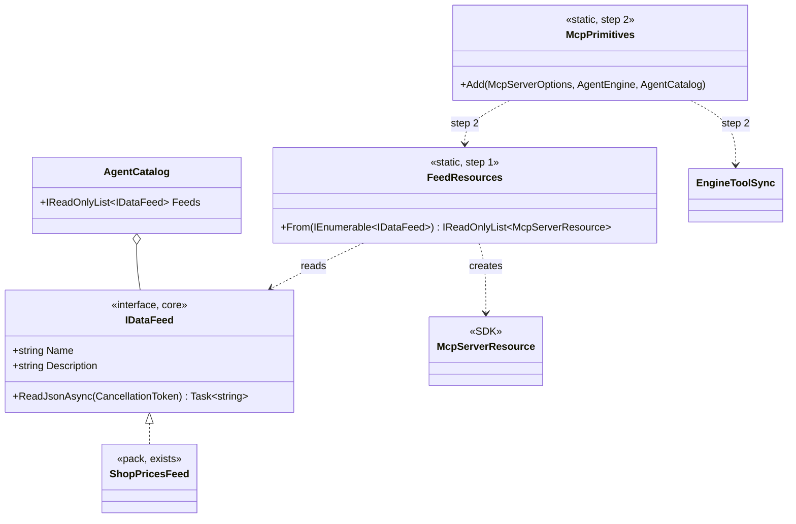
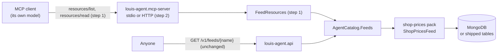
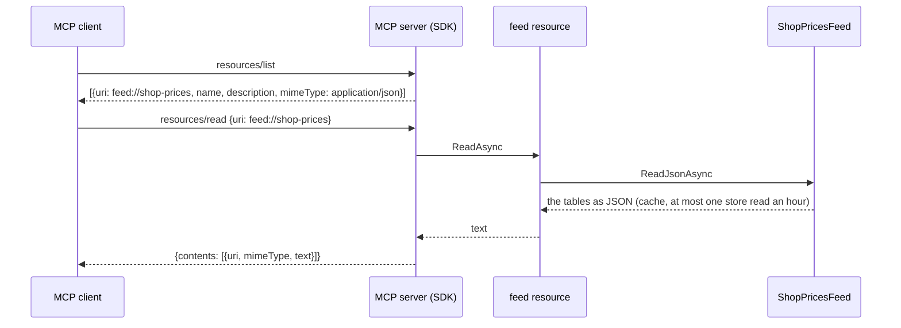
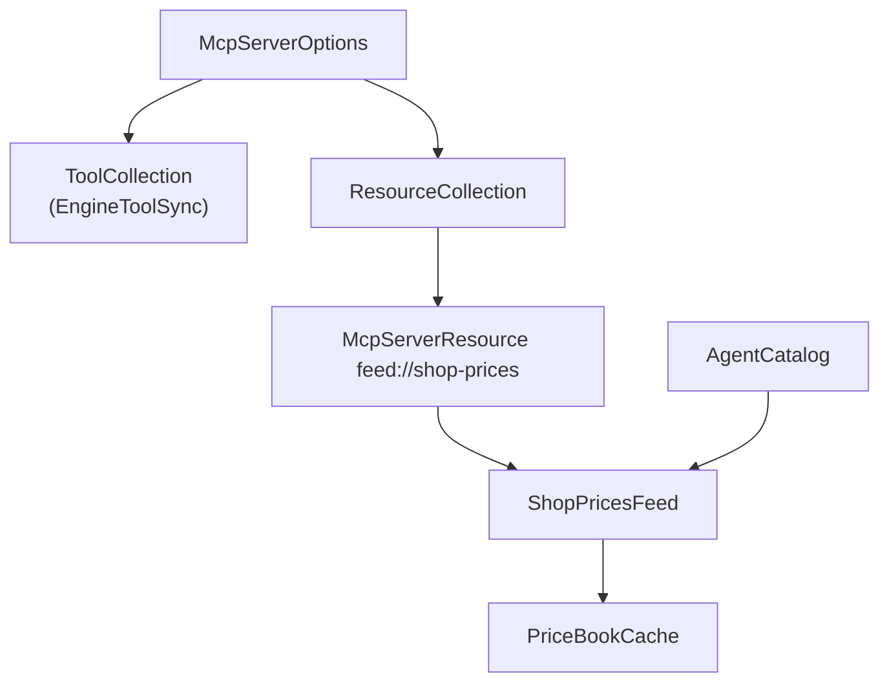

# F56 The packs' feeds as MCP resources

> **What this answers:** how an MCP client (Claude Desktop, Rider, another agent's SDK) reads the data a pack
> publishes, the way anyone reads it from the API at `/v1/feeds/{name}` today. The MCP server lists every feed in the
> catalogue as an MCP **resource** and reads it on request, without naming a pack.
> Branch `claude/project-thread-9uiwyw`, scope `f56`, one commit per step, one PR to `main`. ADR **0072** (the next
> free on `main` on 2026-11-04).

Status: **picked 2026-11-04 18:04 to 18:07**, every finding as recommended: **A1** one resource per feed, **B1** `feed://{name}`, **C1** a real client in memory, **D1** behind the MCP key.

## The goal, in Louis's words

Item 1 of the open list (2026-11-04): "The MCP server would publish `shop-prices` the same way the API does". It
closes the TODO line *The MCP server publishes the packs' feeds as MCP resources* and ADR 0070's consequence "the MCP
server doesn't yet".

GOAL skill **11** (protocols): the third of MCP's three server primitives. We publish **tools** (the model calls them)
and no **prompts**; **resources** are data the *application* chooses to put in front of the model, read by a URI.

## Context: what we have today, checked on `main` (9083490)

- **Feeds are a core shape.** `IDataFeed` (`louis-agent.core/Agent/Catalog/`): `Name`, `Description`,
  `ReadJsonAsync`. A pack lists its own (`IAgentPack.Feeds`); `AgentCatalog.Feeds` gathers them and refuses a name
  twice; `Feed(name)` finds one. One feed exists: `shop-prices` (`ShopPricesFeed`, through the tool's hourly cache).
- **The API serves them open**: `GET /v1/feeds` lists, `GET /v1/feeds/{name}` reads (`InfoHandlers`), 404 for a name no
  pack publishes. ADR 0070 already says a feed "maps one to one to an MCP resource".
- **The MCP server** (`src/louis-agent.mcp-server/Program.cs`, one file): builds the engine from
  `Plugins.FromEnvironment()` with `AgentHost.BuildToolHost(catalog)`, mirrors the engine's tools with
  `EngineToolSync`, adds `SkillsToolProvider`. Two transports, stdio and Streamable HTTP, each registers the same
  things on its own. It never keeps the catalogue: it passes it straight to `BuildToolHost`.
- **No tests of its own.** The project doc says so; its auth is core's `HostAuth`, its tools are tested where they live.
- **The SDK** (ModelContextProtocol 2.2.0): `McpServerResource.Create(delegate, McpServerResourceCreateOptions)`
  builds a resource from a method, `McpServerOptions.ResourceCollection` holds them, as `ToolCollection` holds the
  tools; the server then answers `resources/list` and `resources/read` itself. It also has an in-memory pair of
  transports, so a test can run a real client against a real server inside the test process.

## Findings (Louis picks one option each)

**A. How the feeds become resources.**
- **A1 One resource per feed, built at start-up** (Adapter, GoF: `FeedResources` turns each `IDataFeed` into the
  SDK's `McpServerResource` with `McpServerResource.Create`). The list shows each feed with its description; feeds
  don't change while the server runs, so no sync is needed. Cost: one small static class. *Recommended*: it is the
  SDK's own primitive, the same shape as `EngineToolSync` for tools, and `resources/list` tells a client everything.
- **A2 One resource template `feed://{name}`** (Template Method by URI): one entry that reads any name. Cost: a client
  sees a template, not the feeds, so it must already know the names; `resources/list` stays empty.
- **A3 Hand-written `resources/list` and `resources/read` handlers over the catalogue** (Gateway, Fowler). Full
  control. Cost: we redo what the SDK does (matching URIs, the not-found error), more code to keep.

**B. The URI a feed is read by.**
- **B1 `feed://shop-prices`** *Recommended*: short, names no product (core names none, ADR 0027), and the name is
  the feed's own, as in the API's path.
- **B2 `louis-agent://feeds/shop-prices`**: says whose it is; the product's name in every URI, which the engine
  package (Phase 10) would have to rename.
- **B3 The API's own URL** (`https://…/v1/feeds/shop-prices`): one address for both. Cost: the MCP server must know
  where the API is, and MCP says an `https://` resource is one a client may fetch itself, so a client may skip us.

**C. How it is tested.**
- **C1 A new test project, `tests/louis-agent.mcp-server.tests`**, that runs a real MCP client against the server's
  setup over the SDK's in-memory transport, with `FakeFeed`s: list shows them, read returns the JSON, an unknown
  URI is the protocol's error. *Recommended*: it proves the protocol, not only our mapping, and gives the server the
  tests the project doc says it lacks. Cost: a new project in the solution and CI (NUnit, as every other).
- **C2 Test only the mapping** (`FeedResources.From` gives resources with the right URI and description), in the same
  new project, no client. Cheaper; doesn't prove a client can read one.
- **C3 No unit test**, a hand check with a client, as the server is checked today. Cheapest; breaks rule *test first*.

**D. Who may read them over HTTP.** The API serves feeds open (ADR 0070); the MCP server's HTTP endpoint is one path
behind a key.
- **D1 Behind the key, like everything on the MCP server** *Recommended*: one gate, no change to the auth; the data
  stays open on the API for anyone without a key. Over stdio there is no key anyway.
- **D2 Open `resources/*` without the key**: the middleware would read each JSON-RPC body to decide. Cost: a second auth
  rule that parses requests, the kind of special case FX18 removed.
- **D3 A second, open MCP endpoint that has only the feeds** (`/feeds` beside `/`). Cost: two MCP servers in one host,
  more to explain and test.

## Design (A1, B1, C1, D1, as picked)

- **`FeedResources`** (`src/louis-agent.mcp-server/Resources/`): `From(IEnumerable<IDataFeed>)` gives one
  `McpServerResource` per feed: URI `feed://{name}`, name the feed's name, description the feed's, MIME type
  `application/json`, read by calling `ReadJsonAsync`. A feed already answers with what it has and doesn't throw for
  a store that's down (`IDataFeed`), so the resource adds no error handling of its own.
- **One registration for both transports**: `Program.cs` keeps the catalogue and both transports call one
  `McpPrimitives.Add(options, engine, catalog)` (tools sync and resources), so neither transport can miss one. It moves
  `EngineToolSync` and `SkillsToolProvider` out of `Program.cs` into `Tools/`, as the guide already asks a new class to.
- **The scheme** `feed` is an enum member (`ResourceScheme.Feed`, `[WireName("feed")]`, ADR 0043), written with `.Wire()`.

### Interface design



### Architecture



### Communication (a client reads the prices)



### Objects (the main case in memory)



### Namespace map

| Type | Folder | Namespace | Step |
|---|---|---|---|
| `FeedResources` | `src/louis-agent.mcp-server/Resources/` | `LouisAgent.McpServer.Resources` | 1 |
| `ResourceScheme` (enum) | `src/louis-agent.mcp-server/Resources/` | `LouisAgent.McpServer.Resources` | 1 |
| `FeedResourcesTests` | `tests/louis-agent.mcp-server.tests/Resources/` | `LouisAgent.McpServer.Tests.Resources` | 1 |
| `McpPrimitives` | `src/louis-agent.mcp-server/` | `LouisAgent.McpServer` | 2 |
| `EngineToolSync`, `SkillsToolProvider` (moved) | `src/louis-agent.mcp-server/Tools/` | `LouisAgent.McpServer.Tools` | 2 |

### Folder tree after

```
src/louis-agent.mcp-server/
├── Messages/            (as today)
├── Resources/           FeedResources.cs, ResourceScheme.cs     (step 1)
├── Tools/               EngineToolSync.cs, SkillsToolProvider.cs (step 2, moved)
├── McpPrimitives.cs     (step 2)
└── Program.cs           (transports and auth only)
tests/louis-agent.mcp-server.tests/   (new, step 1)
└── Resources/FeedResourcesTests.cs
```

## Steps

1. **Feeds become resources** (`feat(f56): step 1`). Test first: a new `tests/louis-agent.mcp-server.tests`; an
   in-memory client against a server set up with `FeedResources.From([FakeFeed…])` lists `feed://{name}` with the
   description and `application/json`, reads back the fake's JSON, and gets the protocol's error for `feed://nope`.
   Then `FeedResources` and `ResourceScheme`. The project goes in the solution and CI's test list.
2. **The server publishes them** (`feat(f56): step 2`). Test first: `McpPrimitives.Add` puts the catalogue's feeds in
   the resource collection and the engine's tools in the tool collection. Then `Program.cs` keeps the catalogue, both
   transports call `McpPrimitives.Add`, and `EngineToolSync` and `SkillsToolProvider` move to `Tools/`.
3. **Docs** (`docs(f56): step 3`). ADR 0072; the project doc (diagram, structure, tests), the guide (*Publish a feed*:
   nothing to do), AGENT_COMMUNICATION's MCP part, ADR 0070's consequence, the TODO line removed, a section in
   `docs/learning/11-protocols.md`, this plan deleted.

## Verification

- `dotnet test` for the new project, core and the API; the whole solution before the PR.
- Free hand check: run the server over stdio with `PACKS=shop-prices`, send `initialize`, `resources/list` and
  `resources/read` as JSON-RPC lines, and see the August tables come back (no model, no money).
- CI green on the PR.

## Concepts

- **Resources vs tools** (skill 11): a tool is chosen by the model and may act; a resource is data chosen by the
  application (or the user) and only read. The same price tables are both: the `EstimatePrices` tool for the
  model, the `feed://shop-prices` resource for the app.
- **One shape, two protocols** (ADR 0028 paying off): because a feed is a name, a description and its text, HTTP and
  MCP each publish it with a few lines and no pack changes.
- **Testing a protocol in process** (skill 18): a real client and server over in-memory streams, no ports, no process.
