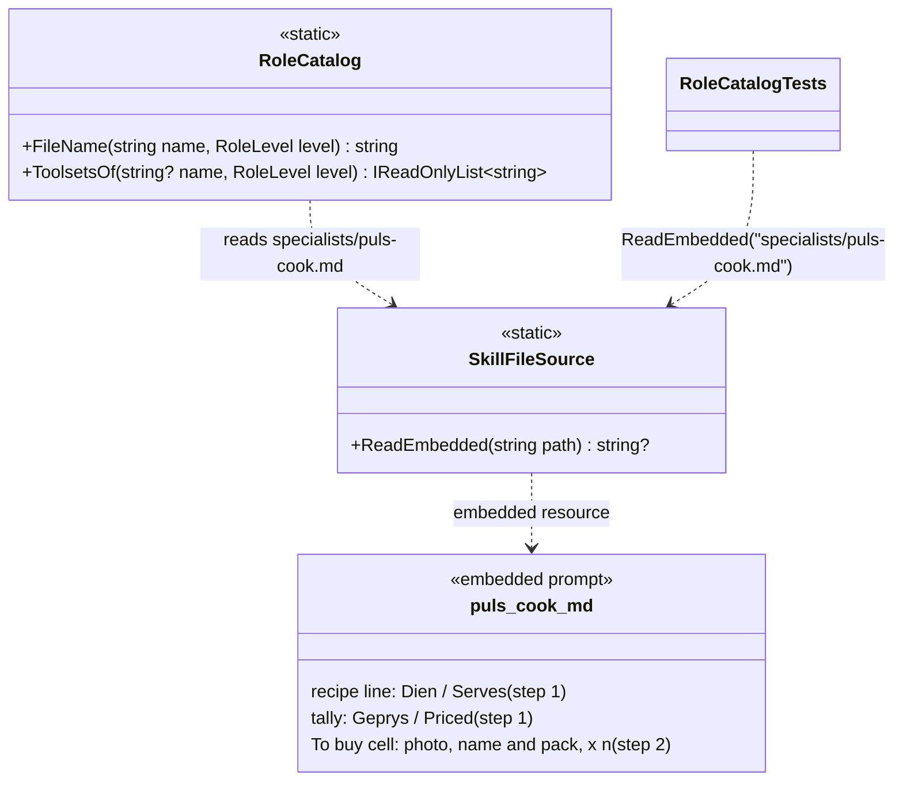
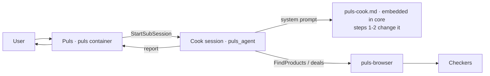
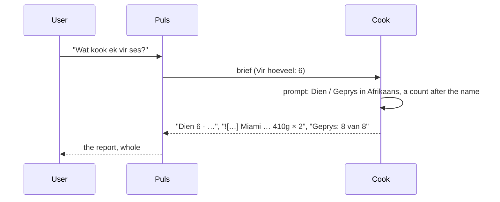

# FX17 · The cook's labels in the task's language, and a count after the name: plan

> Approved 2026-10-18 (Louis: "yes, go ahead", then "continue until done push and build containers wait for merge") ·
> Branch: `fix/FX17-cook-labels-and-counts` off `main` (F34 merged 2026-10-18, PR #61) · Fix:
> [FX17](../fixes/FX17-cook-labels-and-counts.md)

## Context

Cook check `d94597a51d4d` (F34's last run) showed the cook mixing languages in two fixed labels, and once putting a
count before a photo:

- Afrikaans answers said **"Serves 4 · ongeveer 1 uur"**: the prompt fixes the recipe line as
  `Serves {n} · {total time}`.
- The English answer said **"Geprys: 5 van 5"**: the prompt fixes the tally as `Geprys: {n} van {m} bestanddele`.
- One row of the "for six" follow-up read `2 × ![photo] Miami … 410g`: the rule says the photo comes first, but not
  where a count goes.

The cause is the same each time: the prompt gives one literal form, and the model copies it.

## Design

- **Both labels in both languages** in `puls-cook.md`, written in the task's language: *Dien {n} · {tyd}* /
  *Serves {n} · {time}*, and *Geprys: {n} van {m} bestanddele* / *Priced: {n} of {m} ingredients*. This is how the
  prompt already gives the no-catalogue line and the pantry line.
- **A count goes after the name and pack:** ` Miami Italian Style Diced Tomatoes 410g × 2`. The photo stays
  first, always.
- **Considered:** a rule alone ("labels in the task's language"; the model copies examples better than it follows
  rules), and a count column (it changes the list's shape, which the scorer and the portal read).
- **Reuse:** no code; the prompt's own pattern for its two-language lines.

## Steps (one commit each, test first, stop after each)

| # | Step | Test first | GOAL skill |
|---|---|---|---|
| 1 | Labels in the task's language: `puls-cook.md` (the recipe line, the `Geprys`/`Priced` tally, the pantry line's example), and the manual's mention of *Geprys* (`benchmarks/cook/HANDLEIDING.md`) | `RoleCatalogTests`: both forms of each label, and not the one-language form alone | 2 Prompt and context design |
| 2 | Count after the name: the *To buy* cell's rule and example with `× 2` | `RoleCatalogTests`: the rule (a count after the name and pack, never before the photo) and the `× 2` example | 2 Prompt and context design |

The golden file (`ModelRequestSnapshot.json`) pins Puls's prompt and tools, not the cook's; each step checks it
stays unchanged rather than assuming so.

### Namespace map

| Type | Folder | Namespace | Step | Change |
|---|---|---|---|---|
| `RoleCatalogTests` | `tests/louis-agent.core.tests/Skills/Roles/` | `LouisAgent.Core.Tests.Skills.Roles` | 1, 2 | tests added |

No C# type is added, moved or changed; `puls-cook.md` is content in `louis-agent.core/Prompts/specialists/`.

### Interfaces

### Architecture

### Communication

## Verification

- Each step's test fails first on the old wording, then passes; every suite stays green; the golden file unchanged.
- Puls rebuilt after the last step, so an Afrikaans and an English meal can be checked by hand.
- A benchmark run is optional, on Louis's go.

## Risks

- The model may still copy the wrong language now and then; both forms side by side make it less likely, and the next
  run shows it.
- *Geprys* is the cook's own claim, which the scorer doesn't read, so changing it can't break scoring.

## Approved during the build

- **2026-10-18, a follow-up's card names the cook (Louis, on "Oorgedra aan sub-1": "this must say puls-cook?", then
  "put it in the FX17 branch").** `ContinueSubSession` names the handle, not the role, so the card showed `sub-1` and the
  line under it `BESIG` until the answer's footer came. Each session's `message_start` carries its role
  (`session_role`, since `role` is Claude's speaker), the web app keeps it on the sub-turn (`Turn.Role`), and
  `Delegation` takes it when the call names none: the card says *puls-cook*, the line *Soek bestanddele* / *Bou resep*.

---
[Plans](README.md) · Previous: [F34 Shop deals](F34-shop-deals.md)
