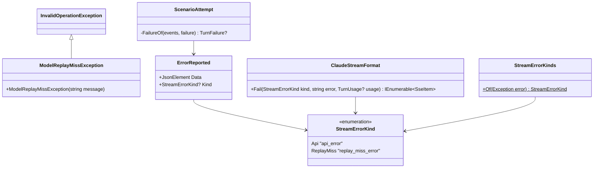
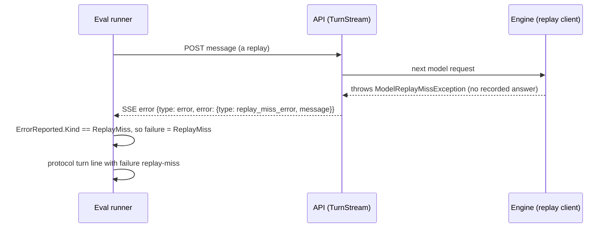

# FX26 · A replay miss is marked `replay-miss`: plan

> Approved 2026-10-29 (Louis: "yes, commit the plan and start step 1") · Branch: `fix/FX26-replay-miss-kind`,
> branched from `feature/F18-evals`'s tip after step 2 (Louis's pick: the code it touches, the replay and the eval
> runner's failure kinds, exists only there; the plan and steps 1 and 2 stay on F18 too) · Fix:
> [FX26](../fixes/FX26-replay-miss-kind.md)

## Context

F18's first v2 baseline (step 5.5) replayed the cook run for free. Every model request that had a recording was a
hit, but a delegating turn missed: `InvalidOperationException: No recorded model answer for this request in trial
'5d1fd231c9b1:puls-cook:1/cook-af': message 3 (tool) changed. The model was not called.` The turn shows that error,
yet its `failure` is empty, though the contract has `TurnFailure.ReplayMiss` for exactly this. So a miss counts as the
agent's own failed turn (grades fail) instead of the infrastructure's (the trial is left out, as a timeout is).

Why: the miss is thrown inside the API, by the engine's model replay client, as a plain `InvalidOperationException`.
The API streams every failed turn with the same `error.type`, `api_error`, and the exception's text. The runner's
failure kinds (`TurnFailures.Of`) only see the runner's own exceptions, so a streamed error never becomes a failure.

The cause of the miss itself (the sub-session's tool result changes between record and replay) is a separate fix.

## Design (Louis's picks, 2026-10-29)

- **A typed kind on the wire** (pick 1 of 3; Fowler's *Replace Error Code with Exception*, and a typed error kind as
  Claude's error event names its `error.type`): the engine throws a named `ModelReplayMissException`; the API's stream
  writes it with `error.type` `replay_miss_error`; the runner reads the kind and marks the turn `ReplayMiss`.
- **The kind lives in `louis-agent.session-stream`** (pick 1 of 3; ADR 0043, a name two parts share is one enum where
  both see it): a public `StreamErrorKind` (`api_error`, `replay_miss_error`), which the API's stream writes and
  `ErrorReported` reads once with `SettingChoice`. The API's own `ApiErrorKind` (its HTTP answers) stays as it is.
- Rejected: matching the message text (two processes agreeing through a sentence, against ADR 0024); any error in a
  replay counted as a miss (labels instead of knowing).

### Interface design



```csharp
public sealed class ModelReplayMissException(string message) : InvalidOperationException(message);
public enum StreamErrorKind { [WireName("api_error")] Api, [WireName("replay_miss_error")] ReplayMiss }
public sealed record ErrorReported(JsonElement Data) : SessionEvent("error", Data)
{ public StreamErrorKind? Kind { get; } }                    // from data.error.type; null when unknown
internal static class StreamErrorKinds { public static StreamErrorKind Of(Exception error); }
public IEnumerable<SseItem<string>> Fail(StreamErrorKind kind, string error, TurnUsage? usage);
```

### Architecture

```mermaid
flowchart LR
    subgraph API process
        R[ModelReplayChatClient] -- throws --> X[ModelReplayMissException]
        X --> T[TurnStream catch]
        T -- StreamErrorKinds.Of --> F[ClaudeStreamFormat.Fail]
    end
    F -- "SSE error: type replay_miss_error" --> C[EvalApiClient]
    subgraph Eval runner
        C --> E[ErrorReported.Kind]
        E --> S[ScenarioAttempt]
        S -- "TurnFailure.ReplayMiss" --> P[ProtocolWriter.Turn]
    end
    P --> A[API recorder / store]
```



### Communication



### Types

| Type | New / changed | Folder | Namespace | Step |
|---|---|---|---|---|
| `ModelReplayMissException` | new | `louis-agent.core/Llm/Replay/` | `LouisAgent.Core.Llm.Replay` | 1 |
| `ModelReplayChatClient` | changed: throws it | `louis-agent.core/Llm/Replay/` | `LouisAgent.Core.Llm.Replay` | 1 |
| `StreamErrorKind` | new | `louis-agent.session-stream/` | `LouisAgent.SessionStream` | 2 |
| `ErrorReported` | changed: `Kind` | `louis-agent.session-stream/` | `LouisAgent.SessionStream` | 2 |
| `StreamErrorKinds` | new | `src/louis-agent.api/Sessions/Streaming/` | `LouisAgent.Api.Sessions.Streaming` | 3 |
| `ClaudeStreamFormat`, `TurnStream` | changed: the kind | `src/louis-agent.api/Sessions/…` | as today | 3 |
| `ScenarioAttempt` | changed: the streamed kind | `evals/louis-agent.evals/Running/` | `LouisAgent.Evals.Running` | 4 |

## Steps

One commit each, test first, seen failing; each shown before it is committed.

1. **The engine names a replay miss.** `ModelReplayMissException : InvalidOperationException`, thrown where the replay
   client throws today, the message unchanged. Test: a miss throws `ModelReplayMissException` (core.tests).
2. **The stream's error kinds.** `StreamErrorKind` in session-stream; `ErrorReported.Kind` read once from
   `data.error.type` with `SettingChoice` (null for a kind it doesn't know). Test: `replay_miss_error` reads
   `ReplayMiss`, `api_error` reads `Api`, an unknown type reads null (session-stream.tests).
3. **The API streams the kind.** `StreamErrorKinds.Of` maps `ModelReplayMissException` to `ReplayMiss`, anything else to
   `Api`; `ClaudeStreamFormat.Fail` writes `error.type` from the kind's wire name. Test: a turn whose model request
   throws the miss streams `"type":"replay_miss_error"`; any other failure still streams `api_error` (api.tests; the
   stream golden unchanged).
4. **The runner marks the turn.** When a turn's stream ends with an `ErrorReported` whose `Kind` is `ReplayMiss`, the
   turn's failure is `TurnFailure.ReplayMiss` (unless the runner's own exception already set one). Test: a canned turn
   ending in that error writes a turn line with `failure: replay-miss`; an `api_error` leaves it empty
   (evals.tests). Then the fix doc, *Finishing a fix*.

## Done when

A replay whose model request has no recording writes its turn with `failure: replay-miss`, so the trial counts as
infrastructure, not as a failed answer; every other failed turn is unchanged.

## Approved during the build

- 2026-10-29: the fix moved to its own branch, `fix/FX26-replay-miss-kind`, from F18's tip after step 2 (Louis:
  "branch from here"); the plan and steps 1 and 2 stay on F18 too.
- 2026-10-29: the cause of the miss itself (the sub-session footer's usage) is a fix of its own, FX27, branched from
  this fix's tip (Louis's pick).
