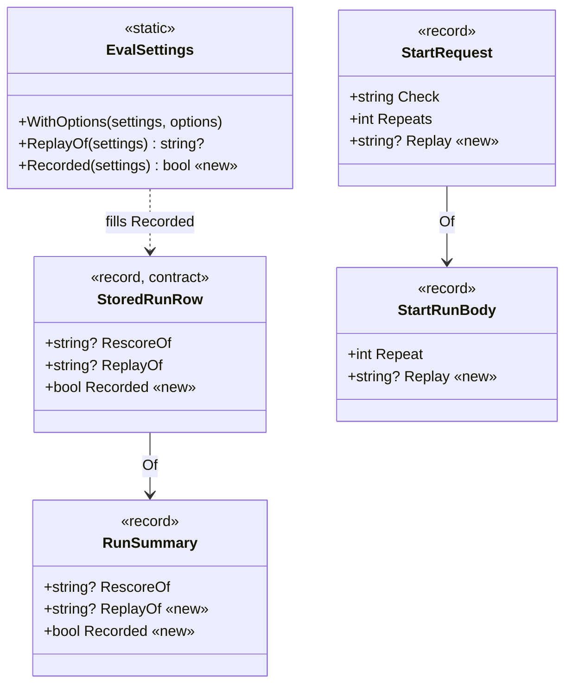
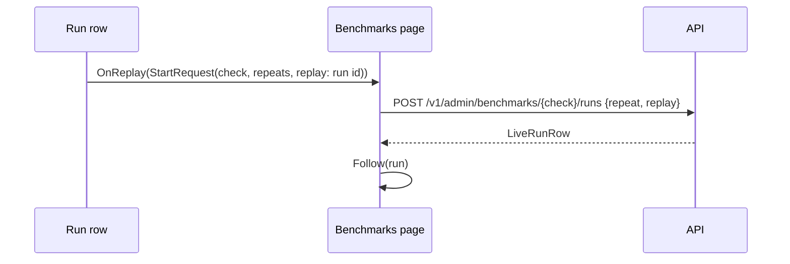

# FX28 · A replay is marked on the Benchmarks page, and can be started there: plan

> **Plan.** How the Benchmarks page learns that a run was a replay, keeps it out of the estimate, and gets a Replay
> button. Louis, 2026-10-29: "You can implement FX28 alone and merge and pr", "and then you continue with FX28
> unattended" · Branch `fix/FX28-replay-runs-marked`, from `refactor/CL26-eval-card` (it builds on CL26's
> `StoredRunRow.ReplayOf`) · Fix doc: [FX28-replay-runs-marked.md](../fixes/FX28-replay-runs-marked.md).

## Context

A replay (`{"repeat": 1, "replay": "{runId}"}`) plays a recording's web and model answers back for nothing; it checks
the harness, not the model. The Benchmarks page could not tell one from a recorded run, took its R0 as the check's
estimate, and could not start one. CL26 gave the contract `StoredRunRow.ReplayOf`, read from the run's `replay_of`
setting, and used it on the Evals page; this fix brings the Benchmarks page level and adds the button.

## Design

- **Where "recorded" comes from** (the choice: a `Recorded` flag on the row, computed by `EvalSettings`; or the raw
  `web` setting on the row, which puts the wire word `record` in the web app; or the page asking the API per run).
  The flag, by Information Expert (GRASP, as CL26 chose for `ReplayOf`): `EvalSettings` writes the `web` setting, so
  it reads it back and parses the mode once (`SettingChoice.TryParse`, ADR 0024); the web app never sees the word.
- **The note and the button are components beside the re-score ones** (`ReplayedFrom` beside `RescoredFrom`,
  `ReplayButton` beside `RescoreButton`), so the row reads the same for both. The button does not post itself: it
  raises a `StartRequest` with `Replay` set, and the page's one start path posts it and follows the run (a re-score
  posts its own route because the runner starts it differently).
- **The body** (`StartRunBody`) gains `Replay`, left off the wire when null (`JsonIgnore` when writing null), so a
  plain run still posts `{"repeat": n}`.
- **The estimate** leaves a replay out exactly as it leaves a re-score out: neither asked a model.

## Steps

0. **The docs.** The fix doc, this plan, their README rows, the TODO line. Commit `docs(fx28): the fix doc and the plan`.
1. **The row says it was recorded.** Test first (`EvalRunOptionsTests`, `AdminRowsTests`, `EvalReplyJsonTests` and the
   reply fixture), then `EvalSettings.Recorded` and `StoredRunRow.Recorded`. Commit `fix(fx28): step 1 - the run row says it was recorded`.
2. **The page knows a replay.** Test first (`RunSummaryTests`, `RunEstimateTests`, `RunListItemTests`,
   `CheckCardTests`), then `RunSummary.ReplayOf` and `Recorded`, `RunEstimate`, `ReplayedFrom`, the chip. Commit
   `fix(fx28): step 2 - a replay is marked and left out of the estimate`.
3. **The Replay button.** Test first (`StartRunBodyTests`, `RunListItemTests`), then `StartRequest.Replay`,
   `StartRunBody.Replay`, `ReplayButton`, the callbacks up to the page. Commit `fix(fx28): step 3 - a Replay button on a recorded run`.
4. **Finish.** *Confirmed* and *Lesson*, then the fold (the fixes README row, the lesson in `fixes-lessons.md`, the
   design docs, CHANGELOG, TODO), the fix doc and this plan deleted. Commit `docs(fx28): finished - the fold`.

## Done when

A replay's row and the card's *Last run* line say *replay of {run}* with a link; the Run button's estimate comes from
the last recorded run, never a replay or a re-score; a recorded run's row has a Replay button that starts the replay
and the page follows it; a plain run still posts `{"repeat": n}`.

## Diagrams

### Interface design



### Architecture

```mermaid
flowchart LR
    Store[(Eval store)] --> Of["AdminRunReplies.Of<br/>(ReplayOf, Recorded)"]
    Of -->|GET /v1/admin/benchmarks| Page[Benchmarks page]
    Page --> Card["CheckCard<br/>(replay chip, RunEstimate)"]
    Page --> List[RunsList]
    List --> Row["RunListItem<br/>(ReplayedFrom, ReplayButton)"]
    Row -->|StartRequest with Replay| Page
    Page -->|POST {check}/runs {repeat, replay}| API[API]
```

### Communication



---
[Plans](README.md) · [Docs index](../README.md)
