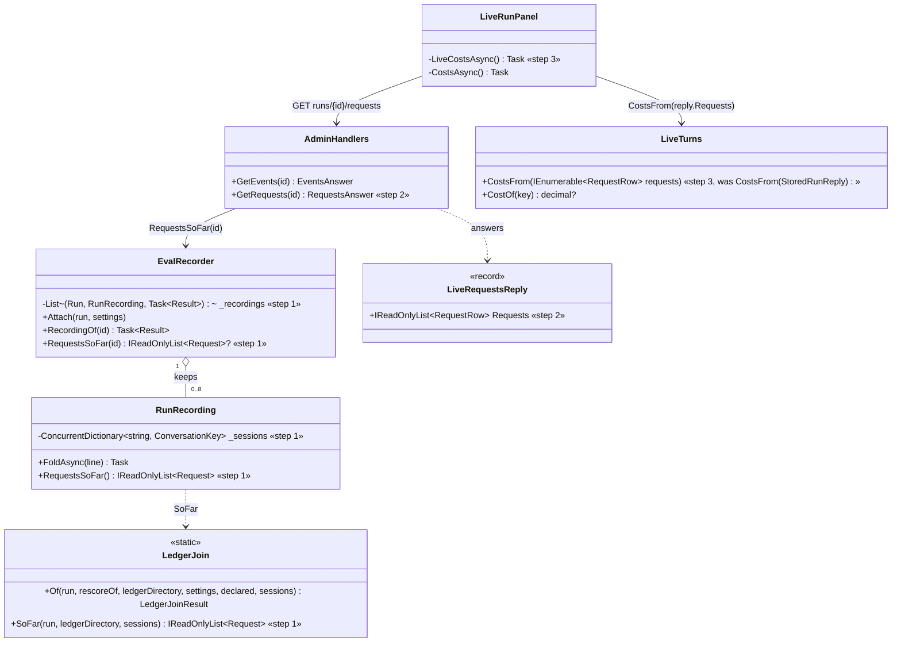
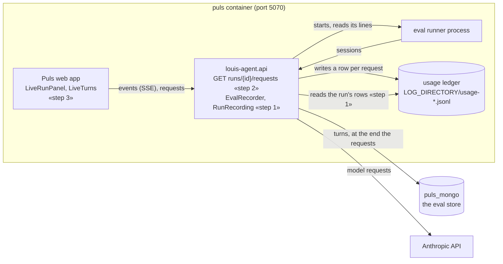
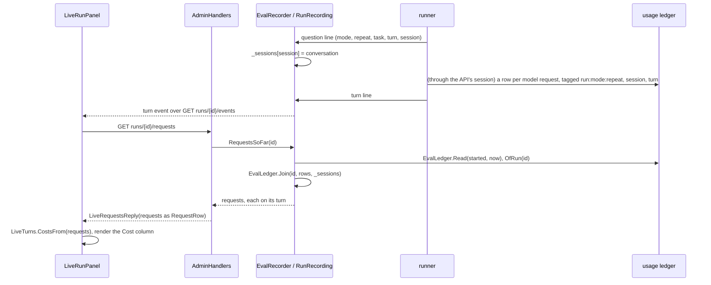
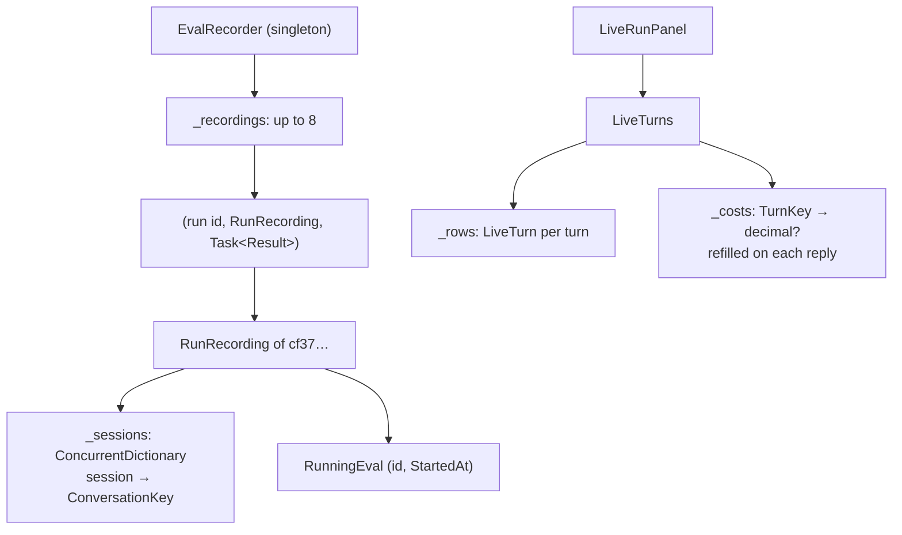

# FX34 · A live run shows each turn's cost as the turn ends

> **For:** [FX34](../fixes/FX34-live-turn-cost.md) · **Branch:** `fix/FX34-live-turn-cost` · **Approved:** —

## Context

On the Benchmarks page, a run in progress shows a row per turn with its role, calls and seconds, but its *Cost* stays
"—" until the whole run has ended (Louis, 2026-11-03, a five-repeat puls-cook run on `claude-haiku-5-5`). The table
takes each turn's cost from the stored run's requests (`LiveRunPanel.CostsAsync`, `LiveTurns.CostsFrom`), and the
recording writes those only when the run ends (`RunRecording.JoinLedgerAsync`). So a paid run spends its money with the
page showing nothing, and "—" means both "not priced yet" and "no price known".

Louis picked, of three, the API reading the ledger live (2026-11-03; the others were the recording saving a cost on each
turn, and the runner pricing its own turns, which can't: the agent's requests are written to the ledger by the API's
sessions, not by the runner).

## Design

**What changes.** While a run is being recorded, the API can say what the run's requests are so far:
`GET /v1/admin/benchmarks/runs/{id}/requests` reads the ledger's rows of the run up to now and places each on its turn
with the same `EvalLedger.Join` the end of the run uses, through the recording's own session map. The panel asks for
them each time a turn ends, and sums them per turn with the same `LiveTurns.CostsFrom` it uses at the end, so the live
cost and the final cost come from one join and one sum and can't disagree.

**Why this way.** The ledger stays the one source of cost (ADR 0007): nothing is priced twice and nothing new is
stored. The recording already knows every session's conversation from its question (before the turn ends), so the
route needs no second map and no read of the store. The reply is the stored run's own `RequestRow`, so the panel has
one sum for both.

**What stays.** The protocol (no field on `TurnEvent`), the store, the end-of-run join and the stored run's reply. A
ledger that can't be read mid-run gives no requests, so the costs stay "—" and the run's end says why, as today.

**The details.**

- `RunRecording._sessions` becomes a `ConcurrentDictionary`: the route reads it while the run's fold writes it.
- `CostsFrom` starts from empty each time, so asking again after every turn never counts a request twice.
- The panel asks after a turn's end only, one request at a time; a turn that ends while one is out is covered by the
  next.
- A run this API isn't recording (another process's, or one past the last eight) answers 404, as `/events` does.

### Interface design



```csharp
// louis-agent.api, Evals/Store/Recording (step 1)
internal static class LedgerJoin
{
    public static IReadOnlyList<Request> SoFar(RunningEval run, string? ledgerDirectory,
        IReadOnlyDictionary<string, ConversationKey> sessions);
}
internal sealed class RunRecording
{
    public IReadOnlyList<Request> RequestsSoFar();
}
public sealed class EvalRecorder
{
    public IReadOnlyList<Request>? RequestsSoFar(string id);
}

// louis-agent.api, Endpoints/Admin/Runs (step 2)
using RequestsAnswer = Results<JsonHttpResult<LiveRequestsReply>, JsonHttpResult<ApiError>>;
internal sealed class AdminHandlers
{
    public RequestsAnswer GetRequests(string id);
}

// louis-agent.api.contracts, Admin/Runs/TurnRows.cs (step 2)
public sealed record LiveRequestsReply(IReadOnlyList<RequestRow> Requests);

// louis-agent.puls, Admin/LiveRuns (step 3)
public sealed class LiveTurns
{
    public void CostsFrom(IEnumerable<RequestRow> requests);
}
```

### Architecture



### Communication (the main case: a turn ends while the run goes on)



### Objects (the main case)



### Namespace map

| Type | Change | Folder | Namespace | Step |
|---|---|---|---|---|
| `LedgerJoin` | `SoFar` added | `src/louis-agent.api/Evals/Store/Recording/` | `LouisAgent.Api.Evals.Store.Recording` | 1 |
| `RunRecording` | thread-safe sessions, `RequestsSoFar` | same | same | 1 |
| `EvalRecorder` | keeps each recording, `RequestsSoFar(id)` | same | same | 1 |
| `EvalRecorderTests` | the requests so far, on their turns | `tests/louis-agent.api.tests/Evals/Store/Recording/` | `LouisAgent.Api.Tests.Evals.Store.Recording` | 1 |
| `LiveRequestsReply` | new record | `src/louis-agent.api.contracts/Admin/Runs/` (`TurnRows.cs`) | `LouisAgent.Api.Contracts.Admin.Runs` | 2 |
| `AdminHandlers` | `GetRequests` | `src/louis-agent.api/Endpoints/Admin/Runs/` | `LouisAgent.Api.Endpoints.Admin.Runs` | 2 |
| `AdminEndpoints` | maps `/runs/{id}/requests` | same | same | 2 |
| `AdminHandlersTests` | the route: 200 while recorded, 404 otherwise | `tests/louis-agent.api.tests/Endpoints/` | `LouisAgent.Api.Tests.Endpoints` | 2 |
| `ApiRoutesSnapshot.json` | the new route (golden) | `tests/louis-agent.api.tests/Endpoints/Routing/` | — | 2 |
| `LiveTurns` | `CostsFrom(requests)`, refilled each time | `src/louis-agent.puls/Admin/LiveRuns/` | `LouisAgent.Puls.Admin.LiveRuns` | 3 |
| `LiveRunPanel` | asks after each turn's end | `src/louis-agent.puls/Components/Admin/BenchmarksPage/LiveRun/` | `LouisAgent.Puls.Components.Admin.BenchmarksPage.LiveRun` | 3 |
| `LiveTurnsTests` | a turn's cost while the run goes, no double count | `tests/louis-agent.puls.tests/Admin/LiveRuns/` | `LouisAgent.Puls.Tests.Admin.LiveRuns` | 3 |

No folder is added or split; no file passes 200 lines of code (`RunRecording` is the closest, and gains a property and
one line).

## Steps

Each step is one commit with its test, written and seen failing first, then a stop for Louis's review.

0. **The plan and the fix doc** (docs only): this file, [FX34](../fixes/FX34-live-turn-cost.md), its row in the fixes
   README and its TODO line.
1. **The recording says its requests so far.** `LedgerJoin.SoFar`, `RunRecording.RequestsSoFar` and
   `EvalRecorder.RequestsSoFar(id)`. Test first: a run attached to a recorder with a ledger folder holding two rows of
   its session, a question line folded and no end yet, gives both requests on that turn with their costs; an unknown
   id gives none.
2. **The route.** `GET …/runs/{id}/requests` on `AdminHandlers`, answering `LiveRequestsReply`, under both prefixes;
   the routes golden regenerated and its diff reviewed. Test first: 200 with the rows while the run is recorded, 404
   for a run that isn't.
3. **The panel shows them.** `LiveTurns.CostsFrom(IEnumerable<RequestRow>)` (the end of the run passes
   `stored.Requests`), `LiveRunPanel` asks after each turn's end. Test first: a turn's cost shows from a reply before
   the run's end, and the same reply taken twice counts each request once.
4. **Finishing the fix** (docs): the fix doc's *Confirmed* from a free run (below), *Finishing a fix* (its row folded,
   the lesson in [Lessons from the fixes](../learning/fixes-lessons.md), the CHANGELOG, the TODO line out, this plan
   deleted).

## Verification

- The api, contracts and puls test projects per step; the whole solution before the PR (the known
  `AChildThatReadsItsInput_GetsIt` failure on Windows aside).
- **Free:** a replay of a recorded puls-cook run on 5070 (the Run button's *replay*, the judge on local Ollama): the
  Cost column fills turn by turn while it runs. A replay asks no paid model, so each turn shows what its ledger rows
  say (F49.5's try showed a known $0); if they carry no price and the column stays "—", the fix doc says so and a paid
  check waits for Louis's go.
- The 5070 rebuild waits until the running puls-cook run (`cf37574d0f23`) has ended (a rebuild kills a run).

## Concepts

- **Cost seen while it is spent** (GOAL skill 13, *Cost and token economics*): a live run's spend shown per turn,
  from the one ledger, instead of after the money is gone.
- **One source, one join** (skill 17, *Observability*): the live view and the stored run use the same join and the
  same sum, so two screens can't tell two stories (ADR 0007).
- **Shared state between a background fold and a request** (skill 14, *Reliability*): a concurrent map where a reader
  meets a writer, instead of a plain dictionary read mid-write.

---
[Plans](README.md) · [Fixes](../fixes/README.md)
