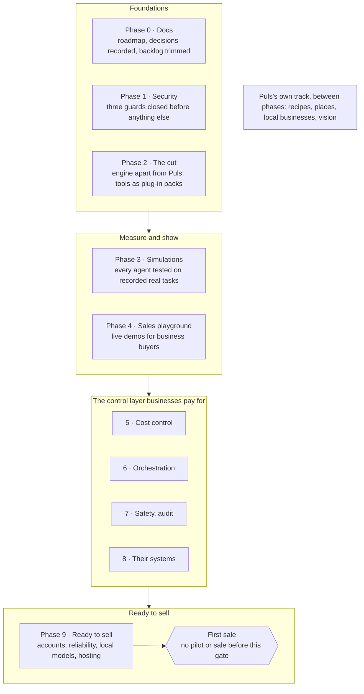

# Puls and louis-agent: plan summary

> **What this answers:** what Puls and louis-agent are, what is built, what we build next and how it makes money, in a
> form to give someone outside the project (an investor or a partner). The full plan, with the learning goals and every
> step, is [platform.md](platform.md). Copied from the shared summary on 2026-10-19.

## In one minute

Puls is a South African AI assistant that knows your town. Ask it for tonight's braai and it answers in one go with a
local recipe, which nearby shops stock the ingredients, and what they cost in rand. It runs on louis-agent, our own
agent engine, built in C# on .NET.

- **The problem.** General AI assistants know the world but not your town. Getting a local, priced, buyable answer
  takes many follow-ups, and the prices they give are often guessed.
- **What we sell.** Three things on one engine: **Puls** for the public; **configured agents**, an assistant with its
  own tools hosted for a business; and later **the engine itself**, for teams that build their own.
- **Our edge.** Local data read in code rather than guessed by the model, a South African voice (English and
  Afrikaans), and the control layer around the agent. Businesses pay for that layer: cost they can see and stop,
  answers checked in code, guards in code, every agent measured, their data on their own model, and their systems
  plugged in without code.

## What exists today

The engine and a working proof of concept are built, and their results are measured, with every model request costed
in a ledger.

| What | Result | Measured |
| --- | --- | --- |
| Puls's cook: a local recipe with shop prices | 31 of 31 answers right: 26 ingredients priced with sources, and 5 correctly left unpriced in a town with no supported shop | Run of 2026-10-18, $0.118 |
| Reading shop data in code instead of letting the model read web pages | Sourced prices went from 0 of 32 to 19 of 23, then to 31 of 31 | Three runs, 2026-10-17 to 2026-10-18 |
| Prompt caching | A demo run fell from $0.66 to $0.13, with all 10 fixes still correct | Engine benchmark |
| Tool sets per conversation | The fixed part of each request fell from about 48,500 to 24,400 tokens | Engine benchmark |

Also built: English and Afrikaans, costs shown in rand, a self-hosted web search and browser, and an admin portal that
records every benchmark run. Puls is not yet open to the public. Today it reads one shop chain (Checkers), and a sale
needs the hosting and accounts work in the last phase.

## What we build next

The roadmap runs in ten phases, one at a time, and the first sale comes only after the last one. Puls, the public
product, has its own track whose items fit between the phases.

Each step is small, tested first and reviewed before the next; any paid test run waits for the founder's go.

## How it makes money

We sell configured agents first and license the engine after the last phase. No pilot or sale starts before then;
until that point, agents are shown in simulations and priced.

| Offer | Who buys | How it is paid | When |
| --- | --- | --- | --- |
| Puls | The public in South Africa | To be decided (a credits feature is on Puls's track) | After hosting is ready |
| Configured agent | A business that wants its own assistant connected to its systems | Hosted per client, paid per use; the usage ledger already prices every request and becomes the bill | First sale after Phase 9 |
| Engine licence | Teams that build their own agents | A hosted instance or a licensed self-hosted container, extended through prompt files and MCP servers, never the raw library | After Phase 9 |

Open question: prices per offer. Phase 0 prices ten sample conversations to set them.

## Market and competition

The big South African grocers each launched an AI cook in their own app in 2026, but each covers only its own shelves.
Puls answers across shops, for the user's town.

| Competitor | What it does | Where Puls differs |
| --- | --- | --- |
| Checkers Pixie, Pick n Pay Penny, My Woolies Chef | A free AI cook inside one grocer's app | Compares across shops, and goes beyond cooking to the town's places and businesses |
| Google Ask Maps and AI Mode | Global local search; AI Mode speaks Afrikaans | Prices read from shop data in code, with sources, instead of model guesses |
| General assistants (ChatGPT and others) | Answer anything, but not locally priced | One answer with the recipe, the shops and the cost |

For businesses, the pitch is an agent connected to their own systems through MCP, an open standard, with cost and
safety controls they can see. Competitor facts come from our 2026-10 research and were not re-checked for this summary.

## Risks and how the plan answers them

| Risk | How the plan answers it |
| --- | --- |
| Local data is hard to get: one hand-built shop reader took 45 commits | One reader per website platform (Shopify, WooCommerce, structured page data), with each shop as a row of data; businesses that join can supply their own feed |
| Website terms may forbid reading | Every source is turned on only after its terms are read |
| Big grocers and Google already offer AI help | Puls competes on cross-shop, local and sourced answers, not on a better chatbot |
| AI costs grow with use | Every request is costed; caching already cut a run by 80%; budgets that warn and stop come in Phase 5 |
| Wrong answers | Answers checked in code, and every agent measured by simulations before release |
| A one-person team | Built in small reviewed steps on a standard stack (.NET, C#), with each decision recorded |

## What we are looking for

To be filled in by Louis: the ask (amount, partnership, or a pilot business), what it pays for, and contact details.

The full technical plan (about 6,400 lines, with diagrams) is available on request.

---
[Plans index](README.md) · The full plan: [platform.md](platform.md)
