# The platform plan: one engine, its identities and packs, simulations, and what we sell (approved 2026-10-19)

> Draft 2026-10-18, for Louis's review in the Claude project. His words, in the order he first said them (from the
> thread of 2026-10-18, whose every message is in `plans/platform-build/thread-digest.md` in the Claude project; his
> spelling corrected, and every word we corrected or added in brackets): "we have to make a clear cut off when it
> comes to which is the agent and which is Puls. Agent should easily be configured for say reading invoices and
> matching them to customers or become a code review agent"; "a demo package which contains examples. where puls will
> take your location and become a tour guide, a know it all for an area"; "[e]verything should be [pluggable] into the
> agent in the end"; "puls the product is a local AI when it knows your [location] it
> [becomes] a know it all in that place"; "don't be [afraid] to [challenge] me, this is important"; "we need our own
> plan for a proper orchestrator function"; "an agent is an identity"; "this layer [should be convertible] to mcp
> quickly" … "I just want it to [be] pluggable into the mcp with almost no [code]"; "price rule is a business owner a
> corporate who has their own security and data layer. recipes are small people they live [day] by day"; "why would
> [someone] buy mine?"; "we have to sell the [engine] also"; "we need examples and what we can offer"; "puls can sell
> itself, but the agent should also"; "relook our todo take [a]way what we do not need and features we do not need or
> merge them"; "demos is for selling, the playground"; "[every] demo must be in c# we call it simulations, of a real
> world [task]. So the python [scripts] must be [reworked]. They must follow C# patterns and standards, and AI
> engineering standards and patterns this is important"; "everything we talked about must be one big plan and
> executed"; "it has to be done, so [it's] right first time". Every quote of Louis in this plan follows the same rule.
>
> **This plan replaces** the CL15 draft (*Engine, identities and packs*) and the F39 draft (*A proper orchestrator
> function*): both are inside it, as Phases 2 and 6. Nothing is built until Louis approves it (question 1). **How it
> lands** (rule 3 and `docs/plans/README.md`'s conventions): Phase 0 lands this document as the **roadmap**,
> `docs/plans/platform.md`, on `docs/platform-plan`, and it is never edited afterwards except to link each phase's plan.
> One change since approval, at Louis's word (2026-10-19): Claude writes each learning write-up and Louis reads it
> afterwards ("I want you to type the lesson and will read it afterwards"), in place of "written by Louis himself,
> without the code open"; every gate below says so.
> Before a phase's first step, its section is copied, as Louis approved it, into **its own plan file on its own branch**
> (`CL15-engine-identities-packs.md`, `F18-simulations.md`, `F40-sales-playground.md`, `F39-orchestration.md`), with its
> four diagrams, namespace map and folder trees; *Approved during the build* goes in that file, never in `platform.md`.
> FX18, FX19 and FX20 are one step each, so they get fix docs, not plans (rule 3 asks a plan only for a fix of more than
> one step). Phases 5, 7, 8 and 9 are planned to the feature here; each gets a new plan file (`docs/plans/Fnn-name.md`, or
> `FXnn-name.md` for FX4), approved by Louis before its first step.
>
> **What v2 changed.** v2 folds in five independent checks of v1 (consistency, repository facts, TODO coverage, outside
> standards, Louis's asks), a completeness check against every message in the thread, the engine-changes research and
> the MCP-packs check. Every repository fact was checked at `main` 7894953 or is marked *inferred* or *unverified*. The
> challenge Louis asked for is shown in full in *Where this plan challenges you*, right after the one-page view. This
> page lives at https://claude.ai/artifact/XqtyPrTkHVN7vesA6Bp5pG, and the old CL15 page points to it. On 2026-10-19
> Louis answered question 3 (keep), and the plan now keeps F30's minions and tests them after the plan. Fifteen
> questions close the plan (*Questions for Louis*), each answered in a word or a few names; questions 2 to 15
> are answered (4: add F28's mood switch, off by default; 5: cut build mode, kept as a side note in *Later*; 6: the
> orchestrator identity is named `voorman`, not `ops`; 7: the triage simulation runs on a seeded service; 8: voorman stays on `louis-agent.core`; 9: the
> convertibility test runs the MCP SDK's own converter; 10: GOAL.md gains skill 20, *Extensibility*; 11: Puls hands off to a specialist opened for the
> place, whose few tools read sites as data; 12: packs plug in at start-up, and new chats pick up new MCP packs
> without a restart; 13: the area guide stays a Phase 4 simulation; 14: F35 starts with Drizzle and Dip, Food24, The
> Lazy Makoti and recipesfromsouthafrica.com; 15: *Vision* is its own feature after F35). Question 1 was answered *yes* on
> 2026-10-19: Louis approved the plan ("approve the plan commit it"). On 2026-10-19, after an outside review, the plan gained a recovery contract for bad data
> mid-run (Phase 6, audited in Phase 7). On 2026-10-19 the plan also took lessons from Existo, a similar one-person .NET
> agent framework built as a learning project (ADR 0030, F41, F42, F44).
>
> **The F35 draft** (`plans/F35-recipe-sources.md`, in the Claude project) was written for the old CL15 shape (Puls's
> pack `louis-agent.puls.core`, namespaces `LouisAgent.Puls.Core.Tools.Recipes…`, its lines 3-4). Before its approval
> F35 is rebased onto `packs/louis-agent.pack.recipes` (`LouisAgent.Packs.Recipes`), a green pack; its record and
> replay goes to the engine (Phase 3) and its screenshot steps to the vision feature (Puls's track). The research
> behind it, `research/sa-recipes-api.md`, is linked from F35's item.

## The plan on one page

**What we sell.** Three things, on one engine: **Puls**, the public South African assistant, a local guide on cloud
models, which sells itself; **a configured agent**, an identity and its packs hosted for a business; and **the engine
itself**, for teams that build their own. Nobody pays for an agent loop (Microsoft gives ours away as
`FunctionInvokingChatClient`). They pay for the **control layer** around it: cost they can see and stop, answers
checked in code, guards in code, every agent measured by simulations, their data on their own model, and their systems
plugged in without code. Both the agent and Puls sell, and no pilot or sale starts before Phase 9: until then a
configured agent is only shown (the playground's simulations, Phase 4) and priced (the ten conversations, Phase 0).

**What we build, in order.** Docs first; three small security fixes; Claude's write-up of what F32 to F34 taught, for Louis to read;
the cut between the engine and Puls; the Python checks rewritten as C# simulations, on recorded web pages, with a
replay cache and traces; the sales playground on top of them; then the control layer, one pillar at a time (cost,
orchestration, append-only history with drafts, approvals and audit, then someone else's MCP server); then what a sale
needs (accounts, tenants, reliability, local models, a versioned package, hosting). Puls has its own track, whose
items take their turns between the phases.

| Phase | What | The selling point it builds | GOAL skill | Paid runs (each on Louis's go) |
|---|---|---|---|---|
| 0 | **Docs:** this plan in the repo as the roadmap, ADRs 0027-0031, the TODO trimmed from 110 open lines to 62, the merged features marked, F21, F22, F25, F26 and F29 closed | | 18 | none |
| 1 | **Three doors closed:** the API and the MCP server's HTTP transport refuse to start without a key (FX18); every git call takes a list of arguments (FX19); a skill file the agent writes waits for approval (FX20) | Guards in code | 15 | none |
| 2 | **CL15 The cut:** a Puls golden first, so three goldens prove the moves (step 0); F30's minions stay in core as a specialist's toolset, and Puls's minion prompts move with Puls (step 3); two contracts (`IAgentIdentity`, `IAgentPack`); Puls an identity and shops a pack; South Africa out of core's defaults (`GetToday` and the API's place line read one `HOST_TIME_ZONE` setting); the MCP rule (every pack stays convertible to MCP, and MCP plugs in at the toolset) | Configured, not coded | 4, 18, 3 | one cook run, in step 3 (it changes text the model reads) |
| 3 | **F18 Simulations in C#:** the Python checks rewritten as C# simulations of real tasks; one session-stream reader; web pages recorded and replayed; a replay cache, so a re-run of a recorded simulation costs $0; the prompt's hash on every ledger row; traces per turn and tool call; the place and the user's words hashed in the logs (step 4f) | Measured | 12, 17, 13, 3 | one cook and one routing run (step 5, compared with the Python's last runs) |
| 4 | **F40 The sales playground:** the demo identity, its invoice and area-guide simulations (in the order Phase 0's conversations choose), and the control room that shows them live | The demos we sell with | 18, 7, 12 | one run per simulation (invoice, area guide) |
| 5 | **F7 Cost you can see and stop:** estimates, budgets that warn, ask or stop, cost per customer, checked against the bill | Cost you can see and stop | 13, 16 | one simulation run (step 2: the estimate against the actual) |
| 6 | **F39 Orchestration:** one delegation function in the engine, typed and checked results, the orchestrator as the `voorman` identity, triaging a small service with seeded bugs | Checked, not trusted | 10, 5, 6 | one live triage run against the seeded service (question 7); one rerun each of Puls's routing and cook simulations |
| 7 | **FX4 Append-only history** first (each conversation's prompt and tools frozen); then **F41 Drafts and approvals** and **F42 Safety and audit** | Checked, not trusted; guards in code | 5, 16, 15 | the injection simulations, with FX4's hand confirm on Haiku 5.5 in the same sitting (`docs/fixes/FX04-append-only-history.md:78-81`) |
| 8 | **F36 Their systems, no code:** someone else's MCP server plugged in as a one-toolset pack, listed once when the host starts; our guards around every tool on every path | Their systems, no code | 11 | none: the MCP simulation runs free on a local model (Ollama); one paid run only if the local model can't drive the tools |
| 9 | **What a sale needs:** F43 accounts, tenants and durable sessions; F8 reliability; F15 local models get everything; F44 the engine as a product, and hosting for public traffic | Your data, your model; sellable | 1, 9, 14, 15, 17, 18 | none |
| Puls | *Puls local spec*, F35 recipes, CL16 reusable roles, sources as data, places, local businesses, vision, local lookups, F23 credits, Puls's open items, F28, and more shops only with a retailer's permission | Puls sells itself | 3, 4, 7, 8, 13, 19 | per feature (CL16's cook run, F35's recipe simulation) |
| Later | F45 knowledge and retrieval, F9 long chats, F10 settings per role and per session, CL17 the coding identity, a tool added mid-chat (after FX4) | | 8, 7, 2, 18 | |

**How we work through it (the repo's rules, kept on purpose, and one gate added).** Each step is one commit with its
test, written first and seen failing; Louis reviews each step before the next, and a day holds only what he can review
line by line; every paid run waits for his go; **one feature at a time**, as GOAL.md asks (`docs/GOAL.md:61`): Puls's
track takes its turn between phases, never alongside one, and the TODO (Part 5) says which comes next; every phase ends
with a learning write-up step (Phase 1: skill 15, deny by default and arguments as data; Phase 2 step 5: skills 4 and
18, an extension point and a composition root; Phases 3 to 6 as their sections say). **A phase is done when Claude has
written its learning write-up and Louis has read it** (changed 2026-10-19, Louis: "I want you to type the lesson and
will read it afterwards"; the write-up still answers *why this design*, GOAL.md's fourth criterion, `docs/GOAL.md:53`).
**Before Phase 2,** Claude writes the F32 to F34 write-up for Louis to read: sourced
prices went from 0 of 32 (F32) to 19 of 23 (F33), then 31 of 31 rows right (F34: 26 ingredients priced with sources, and
Prince Albert's 5 rightly left unpriced, `docs/features/F34-shop-deals.md:149-151`), by reading the shop's data in code
instead of having the model read its pages (skills 7 and 12; `docs/GOAL.md:33`). The gate is there because the learning
has stalled. By GOAL.md's test (`docs/GOAL.md:44-53`) 0 of the 19 skills count as learned, since every row still has
*Missing* items (`docs/GOAL.md:22-40`) (criterion 1 also needs the covering work shipped, `docs/GOAL.md:46-47`, so Phase
0 step 3 moving planned items from *Missing* to *Planned*, as `docs/GOAL.md:16-18` asks, passes no skill; in this plan
"closes a *Missing* item" means one of today's items built and shipped); 2 write-ups exist (`docs/learning/`), and one
of them is a draft by Claude (`docs/learning/10-multi-agent-orchestration.md:1-4`); and since 2026-10-15, 1 of 242
commits went to the AI-skill track (242 counted in a full clone, non-merge commits by author date; the 1, the TODO note
`d7e2223`, is the challenge's classification; the local checkout is shallow, 437 commits). A plan this long is no reason
to go faster: on 2026-10-17 the repo took 109 commits in a day (counted the same way), more than anyone can review, and
F27 and F30 show what that costs (F27 replaced by F31 two days after it was built,
`docs/features/F27-admin-portal.md:3`; F30 built and not in use, `docs/features/F30-local-web-peer.md:3`).

## Where this plan challenges you

Louis asked for it: "Look at what I said and don't be [afraid] to [challenge] me, this is important". Two reviews did it
on 2026-10-18, and neither was shown to him in full in the thread: an independent challenge of the vision, checked
against the code and outside sources, and the engine-changes research (its *Where this disagrees with what you asked*).
This section is where he sees both, with what the plan did about each point. Numbers the challenge took from outside the
repo are marked as its own; the repository facts were checked again for this section.

**The verdict, in one line (the challenge's).** Keep your own agent and keep Puls, but drop "every website becomes a
tool": make sites rows of data behind a few fixed tools, let businesses plug in over MCP, measure the area guide before
building more platform, and restart the learning, which has stopped.

**What holds.**

- **Owning the agent paid off as learning, and you measured it:** caching took a demo run from $0.66 to $0.13 (F4),
  toolset profiles cut the prefix from about 48.5k to 24.4k tokens (F5), and delegation costs +31% (`docs/GOAL.md:31,34`).
  Your "i want to use my own agent [because] i can" is a valid reason under GOAL.md's one aim (`docs/GOAL.md:6`), and
  because our loop is already Microsoft's `FunctionInvokingChatClient` (`AgentEngine.cs:117-133`), adopting parts of
  Microsoft Agent Framework later is a step, not a rewrite. Copilot was never a real alternative for Puls: GitHub
  replaced Copilot Extensions with MCP servers, and the Copilot SDK embeds a coding agent (from the challenge; not
  checked here).
- **Your measurements already found the thesis:** the model reading shop pages priced 0 of 32 ingredients with a
  source (F32, run `663d065ccca8`), and Checkers' data read in code priced 19 of 23 (F33), then got 31 of 31 rows
  right: 26 ingredients priced with sources and Prince Albert's 5 rightly left unpriced (F34, run `d94597a51d4d`;
  `docs/features/F34-shop-deals.md:149-151`). Structured local data wins; pages read by the model lose.
- **The shape that scales is already in the code:** the shop tools take the shop as an argument (`shop`,
  `ShopTools.cs:25-26`) and the place as an input (`UserPlace.Current`, `ShopTools.cs:70`), so a new source adds no tool
  and the cached prefix stays the same (ADR 0006, 0008).
- **Local businesses joining Puls as providers is the strongest part of the vision:** it is legal and fresh, and it
  reaches businesses that live on WhatsApp, which Google doesn't already have.
- **Puls in core is a real problem,** bigger than the first CL15 draft said, so the cut is worth doing.
- **The guards are the right instincts for a public product:** shop catalogues off until their terms are read
  (`config/.env.example:47-50`, ADR 0023), backing off a shop's limit instead of working around it (F34), shop output
  framed as untrusted, only the town kept (F22), and no prompt text in the ledger.
- **Honesty is a trust edge, and it is measured:** with its cook, Puls left Prince Albert unpriced where Checkers has
  no store, while Puls alone priced it at a store that isn't the town's (`docs/features/F34-shop-deals.md:149-153`).
- **Money per answer is not the problem:** about $0.007 a turn on Haiku 5.5 (the challenge's arithmetic: $0.118 over
  about 16 turns in F34's run `d94597a51d4d`, `docs/features/F34-shop-deals.md:149`; inferred). The real costs are
  engineering per source and legal clearance.
- **The area guide is the right experiment, and a playground of measured pitches a good idea, as long as each pitch is
  an eval run** (the challenge's; question 13 is about where it sits in the order).

**The challenge's twelve points, and what this plan did with each.**

| # | The challenge, in one line (its severity) | What this plan does with it |
|---|---|---|
| 1 | Your "meaning [every website] in that [area] become a tool" can't be built the way Checkers was, and couldn't be sold: Checkers took 45 commits, 16 of them fixes (F33 and F34, counted in a full clone), covers 1 of the 4 chains in Malmesbury (`docs/features/F33-shop-catalogues.md:113-117`, `ShopKind.cs:7-10`) and stays off on the sold endpoint until its terms are read (`config/.env.example:47-50`) (**fatal**) | **Taken** (question 11, answered yes with your hand-off): "every source that knows this place answers through a specialist opened for that place, with a few tools whose sites are data". A site is an argument or a row of data, never a tool (Part 2, *Inside a pack*); shops and recipe sites become rows in *Sources as data* (Puls's track, ADR 0032); the Shoprite, Pick n Pay and Woolworths providers (`TODO.md:259-261`) wait for it |
| 2 | Your one fixed goal is learning, and it has stopped: by GOAL.md's test no skill is learned yet (the numbers are in *How we work through it*) (**major**) | **Taken, as a gate rather than a freeze:** every phase ends with your own write-up, and the F32 to F34 write-up comes before Phase 2. **Not taken:** "open no new product feature until two skills pass". The evals skill (12) is built in Phase 3, before the playground; the MCP client (skill 11) waits for Phase 8, because you said MCP only when needed: "if needed, we are [alone] in this" |
| 3 | CL15 builds a plug-in platform before testing the vision: the area guide was step 7 of 8; defer the composition project, `PACKS`, the demo and the invoice pitch, and move F36 right after the cut (**major**) | **Kept against it, in part.** The composition project and `PACKS` stay in Phase 2, and the demo identity and the invoice pitch in Phase 4, because you asked for packs pluggable on their own ("say the agent needs it it should be [pluggable]") and for a sales playground ("demos is for selling, the playground"). F36 waits for Phase 8 ("if needed, we are [alone] in this"). The area guide stays a Phase 4 simulation; question 13 asks whether to run it first by hand. **Taken:** the cut does what the challenge said it must (row 8) |
| 4 | The agent isn't what makes Puls worth choosing; the local data is, and nobody has been asked: the three big grocers launched AI cooks this year and Google answers place questions in Afrikaans (from the challenge; not checked here), and the TODO's "Validate demand" line is unticked (`TODO.md:131-135`) (**major**) | **Taken.** ADR 0030 records "we own the agent to learn; Puls's edge is local data, an SA voice and businesses that join"; Phase 0 step 4 adds 30 real local questions from Malmesbury people, answered blind by Puls, Gemini, ChatGPT and Google Maps, and we build only for the question types where they fail; *Honest about Puls* (Part 1) names the competitors |
| 5 | The businesses you picture mostly don't have websites: about 74% of township businesses use WhatsApp and 30% a website (Standard Bank, 2025, from the challenge; not checked here) (**major**) | **Taken.** Businesses that join come first among Puls's sources (Part 2, *Inside a pack*): a form, a WhatsApp listing the owner approves, a feed or an MCP server. *Local businesses* is a Puls feature with two tiers, listed and provider (Part 1, Puls's row) |
| 6 | A tool per website breaks your own engine: a chat's tools are frozen when it opens (ADR 0006, 0008), and 1,000 site tools would put about 175k tokens in every request (an estimate at 4 characters a token, from 123 tools at about 704 characters each in `ModelRequestSnapshot.json`), past the 100k tokens above which Haiku 5.5 costs five times as much (`config/prices.json:14-19`) (**major**) | **Taken:** a site is an argument (as `shop` is today) or a row, never a tool (Part 2, *Inside a pack*); the place is an input, and a change of town is appended to the chat as a new line, never a new tool list (Part 2's place rule). Question 12 asks you to confirm the answer: one tool per job with a `source` argument |
| 7 | At this pace Claude drives and you approve: 109 commits on 2026-10-17 would take about 18 hours to review at ten minutes a step (inferred), F27 was replaced two days after it was built, and F30 is built and not in use (**major**) | **Taken:** a day holds only what you can review line by line, and a phase is done only when you have read its write-up (Claude writes it, changed 2026-10-19 at your word; *How we work through it*); question 3 asked whether to remove F30, and Louis answered *keep* (2026-10-19): its minions are tested after this plan (*Later*) |
| 8 | The Puls cut as first drafted wouldn't reach "core names no product": Puls's protocol sits in the shared guides (`Prompts/toolsets/specialists.md:26-96` and `:127-139`), the shop tools tell the model "when Puls gave no place" (`ShopTools.cs:29,40,51`), and the golden file never pinned a Puls session (**major**) | **Taken (Phase 2):** a Puls golden first (step 0); Puls's protocol split out of the shared guides; a ratchet over core's model-visible text (no `puls`, no Afrikaans briefing label, no "South Africa"); `GetToday`'s and the API's South African defaults behind one `HOST_TIME_ZONE` setting; one paid cook run, on your go |
| 9 | No doc says why not the alternatives, and we hand-build what we already have: no doc names Microsoft Agent Framework, the Copilot SDK or Microsoft.Extensions.AI.Evaluation (a grep of `docs/`, `TODO.md` and `README.md` finds none), core's `RiderMcpClient` is a hand-written 199-line client that only lists tools while the official MCP SDK is already in the solution, and CL15's v6 draft planned third parties' DLLs loaded into our process (F37) (**major**) | **Taken:** ADR 0030 *Build or adopt* (Phase 0); F37 cut, so anyone else's code plugs in only as an MCP server, through F36 on the official SDK's client, which replaces `RiderMcpClient` (Phase 8); Phase 3 reuses Microsoft.Extensions.AI.Evaluation's evaluators; Microsoft.Extensions.AI's own building blocks are named where they are used (engine research, row 7 below) |
| 10 | "local AI" and "knows your [location]" claim more than exists: Puls runs on cloud Claude (`config/.env.anthropic:8`) and knows a town name said once, in the first turn (`src/louis-agent.api/Program.cs:214-216`) (**minor**) | **Taken:** Puls is described as "a local guide on cloud models" (Part 1), with your words kept as its aim ("local" means local knowledge, not a model on the phone); the landing page's pitch, which today sells reading files and the repository's history and never mentions place (`src/louis-agent.puls/Pages/LandingPage.razor:275-292`), is rewritten around place with *Puls local spec* (Puls's track); town only, as F22 chose; coarse coordinates (about 1 km) only through an ADR when a measured question needs "how far". **Not taken:** the geocoder moving into core now. It moves with the shops pack, its one user (`ShopCatalogueFactory.cs:37`), and into the places pack behind an `IGeocoder` seam when places comes, so core keeps no Nominatim and no South Africa |
| 11 | The release blockers have nothing to do with packs: the API serves everything when no key is set (`src/louis-agent.api/Program.cs:44-46`), and git commands are built as one string (`GitTools.cs:338-348`) (**minor**) | **Taken:** Phase 1 closes three doors before the cut (FX18 for the API and the MCP server's HTTP transport, FX19, FX20), and accounts, a sandbox per tenant and POPIA are F43 in Phase 9 |
| 12 | The first CL15 draft's mechanics didn't match the code: a frozen static registry can't work (`ToolsetCatalog.cs:26,124`, `SkillFileSource.cs:15,18`), `AgentHost.Start` doesn't exist, `ROLES_ENABLED` is never checked at start-up, and a composition project that references every identity puts Puls into the code-review image (**minor**) | **Taken:** one `AgentCatalog` object, built once and passed down; every `ROLES_ENABLED` name checked at start-up. **Kept:** one composition project for every host, so every host plugs in the same way (Part 2); the code-review image carries Puls's assembly but loads none of it unless `IDENTITIES` names it, and an MSBuild property (as `WebApp` does) can leave it out if image size matters |

**Where the engine research disagreed, and what this plan did.**

| # | The disagreement, in one line | What this plan does with it |
|---|---|---|
| 1 | Your "meaning [every website] in that [area] become a tool" | As the challenge's row 1 |
| 2 | v1's "Build no MCP now" sat beside its "every pack converts to MCP with almost no code", yet the export isn't almost no code: calls served over MCP skip `ToolCallGuards` (`AgentEngine.cs:117-133`), the MCP server publishes every toolset the instance can load (`AgentHost.cs:126`), no tool carries annotations, and a failure written as text arrives as a success | **Taken in part, the rule reworded:** "every pack stays convertible to MCP, and MCP plugs in at the toolset" (ADR 0028). A pack frames and bounds its own results and writes a failure as text with its reason; the guards as a decorator around every tool, and `MCP_TOOLSETS` to publish chosen packs, come with F36 in Phase 8. Phase 2 builds only the rule, the catalogue's name lookups and one convertibility test. **Not taken:** the research's MCP-shaped engine work in Phase 2 (its rows 6 and 7). Each tool's effect (`ToolEffect`, Part 3 row 19) comes in Phase 7 and our server publishes it as annotations in Phase 8, and a failure goes out as `ErrorContent`, marked `isError`, with Phase 8's guard decorator (row 24); until then a failure written as text still reaches an MCP client as a success (Part 2, rule 2). Why: you said MCP only when needed, "we [don't] have to do mcp's now, I just want it to [be] pluggable into the mcp with almost no [code]" |
| 3 | Pluggability came before measurable learning: nothing closed a GOAL *Missing* item until after the cut, v1 cut the response cache that is skill 13's only *Missing* item, and tracing, small and independent, waited for Phase 9 | **Taken in part.** Phase 3 gains a replay cache for recorded simulations (opt-in, never for live chats, a hit priced as a known $0), the prompt's hash on every ledger row (skill 3) and traces per turn and tool call (skill 17), so v1's cut cache and its Phase 9 tracing are answered. **Not taken:** the research's order, which built traces and the replay-cache seam right after Phase 1, before the cut (its next three steps). Nothing closes a *Missing* item before the cut: the replay cache is measured only on a recorded simulation, which needs Phase 3's harness and web record and replay (Part 3, rows 9 to 11), so it is built beside them; traces depend on nothing and could come earlier, but stay with Phase 3's other measurement steps. Before the cut, the learning moves through your F32 to F34 write-up (*How we work through it*). Adding extensibility to GOAL.md as skill 20 is question 10, since no *Missing* item names what Phase 2 builds |
| 4 | FX4 can't stay *Later*: v1's MCP pack listed its tools when a session opened, on an engine that chats share, and approving a skill file reloads the skills, so both would change what an open chat was started with | **Taken:** FX4 opens Phase 7, as the prerequisite of Phase 8 and of F43's durable sessions. An MCP server's tools are now listed once, when the host starts, so the MCP half no longer applies; the skill-file half stands, and until FX4 known limitation 9 holds: after `/approve` (agent-built tools today, skill files too from FX20), start a new chat |
| 5 | FX18 covered the API only; the MCP server's HTTP transport fails open the same way (`src/louis-agent.mcp-server/Program.cs:91-95`) | **Taken:** FX18 covers both |
| 6 | The composition project now, against the challenge's advice to defer it | **Kept**, as the challenge's row 3 |
| 7 | Your "i want to use my own agent [because] i can": keep the loop, but take the building blocks already in our packages | **Taken,** each named where it is used: `ApprovalRequiredAIFunction` for F41's approvals and F7's budgets that ask, `UseOpenTelemetry()` for traces, `JsonSchemaExporter` for typed results, a small subclass of `DistributedCachingChatClient` for the replay cache, Microsoft.Extensions.AI.Evaluation for model graders. Not `SummarizingChatReducer`: it rewrites history, which ADR 0008 forbids |
| 8 | A proper orchestrator won't make delegation cheaper: the +31% (`docs/GOAL.md:31`) comes from children's uncached prompts and the answer written twice | **Taken as stated:** Phase 6 says it buys correct, typed, bounded delegation in every host, not savings |
| 9 | "knows your [location]": the engine holds a town as a turn input, never coordinates | **Taken:** a change of town is a provider strategy (ADR 0003): on Anthropic models that accept one, a mid-conversation system message (not listed for Haiku 5.5, the default; unverified), elsewhere a plain line (Part 2's place rule; Phase 6 A4a) |

**The reframed vision (the challenge's, taken here).** Puls is a South African local guide. You give it your town,
and it answers questions about that place with a source and a date on every fact, using only data it is allowed to use.
Its edge is the local data, the SA voice and the businesses that join it, not the agent and not "reads every website".
louis-agent is your own engine on Microsoft.Extensions.AI, built so you learn AI engineering: a learning choice, not
the moat. In the code: sites are data, the tools are generic, and third parties come in over MCP. In the picture, a
source higher on the list is more legal, fresher and cheaper (the challenge's ranking; inferred), the same five, in the
same order, as Part 2's *Puls's sources, best first* (in *Inside a pack*, which also shows why a site is an argument,
never a tool), and the question is the challenge's example.

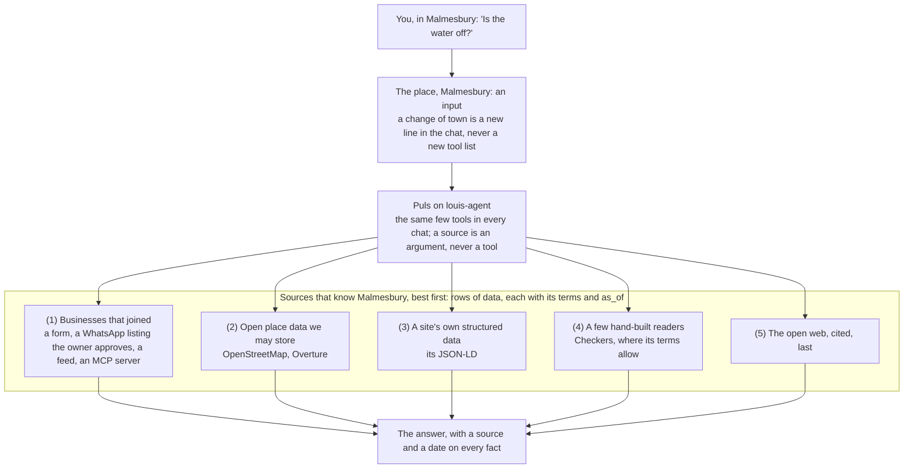

**The questions it raises** (numbered as in *Questions for Louis*):

- **11.** Answered 2026-10-19: yes, reworded with Louis's hand-off idea: "every source that knows this place answers
  through a specialist opened for that place, with a few tools whose sites are data".
- **13.** Answered 2026-10-19: **Phase 4**. The area guide is built as Phase 4 step 4's C# simulation, and no paid run
  comes before Phase 2. The challenge had recommended a hand-run eval first, as the cheapest test of the vision.
- **10.** Add extensibility (contracts, packs, plug-ins, MCP both ways) to GOAL.md as skill 20? Phase 2 closes no
  *Missing* item today, because no row names it. (**yes** / no)

The challenge's own first question, "is next year's release for businesses or a showcase?", is answered by your words
in the thread: "we have to sell the [engine] also" and "puls can sell itself, but the agent should also". Both sell, and
there is no showcase-only release (Part 1).

**What the challenge could not check** (from its own list, the points this plan relies on, kept so nobody reads these
as facts): whether Google's Ask Maps is live in South Africa; whether people would choose Puls over Google for local
questions (no user has been asked); the 175k tokens for 1,000 site tools (an estimate); effort per site, taken from
commit counts, not hours; its split of commits into product, platform and AI track (a heuristic over a full clone); the
18 hours of review on 2026-10-17 (inferred from the pace); about $0.007 a turn (arithmetic on one run, F34's
`d94597a51d4d`); Wikipedia's nearby-search limits (not checked; the area guide and *Places* call it); Overture's South
African coverage and freshness (unmeasured; it is the second of Puls's sources); and the legal points (not legal
advice; Checkers' terms and robots.txt were not read).

## Part 1 · What we sell

### Three offers on one engine

The three offers share one engine, and what a buyer pays for is the control layer around its loop, built one pillar
at a time:

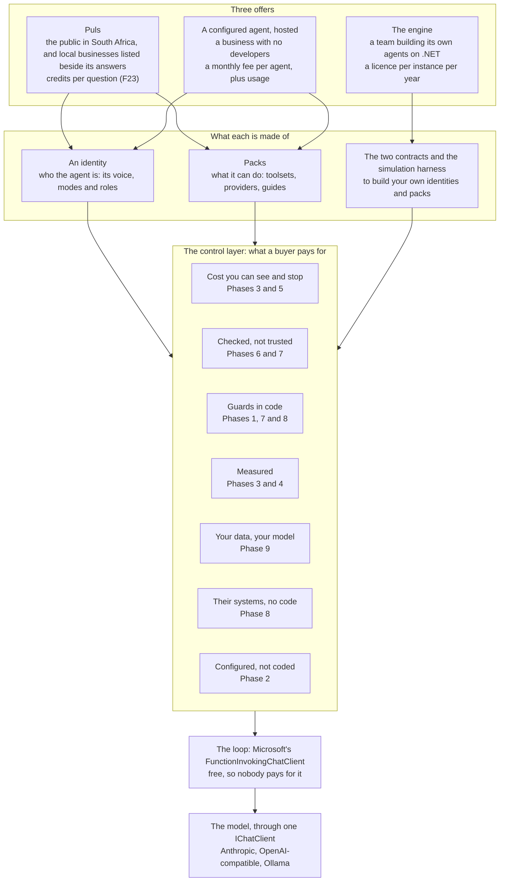

| Offer | Who buys it | What they get | How it's sold | Ready after |
|---|---|---|---|---|
| **Puls** | The public in South Africa; local businesses, to be listed or to join as a provider (Louis: "A shop can then [advertise] or become a provider like Shops/hairdressers") | A local guide on cloud models, in Louis's words "a local AI when it knows your [location] it [becomes] a know it all in that place": Afrikaans and English, SAST and rands, the cook today, the area guide and recipes next, every fact with its source | Credits bought in rand, spent per question at cost plus a margin (F23); local businesses pay to be **listed** beside an answer (name, category, municipality, hours, link), always marked as an ad and never inside the answer; **providers** send their prices or open times to a pack through their platform, a price list or their MCP server (*Local businesses*, Puls's track). Paying never changes what Puls calls cheapest or nearest, a rule that follows from the principles (`Prompts/shared/principles.md`) | Puls's track, with Phase 9's accounts |
| **A configured agent, hosted** ("Puls vir besighede") | A business with no developers: a firm's debtors desk, a tourism office, a shop owner | Its own identity (voice, roles) and packs, its simulations, the control room, hosted by us | A monthly fee per agent plus usage at cost plus a margin | Phase 9 (needs Phases 4, 5, 7 and 9); shown from Phase 4 |
| **The engine** | A software house or an IT team building its own agents on .NET | The engine as a package and a container, the two contracts, the control layer, the simulation harness, the guide, the demo as its sample | A licence per instance per year, self-hosted, with support | Phase 9 |

**Both sell.** Asked whether next year's release is for businesses or a showcase, Louis answered "we have to sell the
[engine] also" and "puls can sell itself, but the agent should also", so there is no showcase-only release.
**Learning first, selling second** (Louis, 2026-10-19: "The real thing is learning selling is secondary"): when a
sale and the learning pull apart, the learning wins, and no phase is hurried for a sale. **Order of sale (question 2,
answered yes):** configured agents first (we run them, so we see every failure), the
engine licence after Phase 9, when its contracts are versioned and its guide written. **No pilot or sale starts before
Phase 9:** until then a configured agent is only shown (the playground's simulations, Phase 4) and priced (the ten
conversations, Phase 0). **Before either:** ten conversations (five businesses, five likely Puls users) on what they'd
pay for, and 30 real local questions from Malmesbury people, answered blind by Puls (later by the area-guide
simulation), Gemini, ChatGPT and Google Maps, so we build only for the question types where they fail. That is Louis's
own task in Phase 0 step 4. Its answers choose the order in which Phase 4 runs its two pitches (invoices first by
default); if they point to a pitch this plan doesn't hold (documents with sources, for example), that pitch gets its own
plan before Phase 4 starts.

### Why someone buys the engine: the control layer

| Pillar | What we have today (checked) | What the plan adds | Phase |
|---|---|---|---|
| **Cost you can see and stop** | Every model request in the usage ledger with its tokens and its cost, priced from a dated table (F1, F2); prompt caching measured: a demo run $0.66 to $0.13 (F4, `docs/GOAL.md:34`); cost on every answer (F3) | A re-run of a recorded simulation at a known $0 through a replay cache, a miss showing exactly where what the model is sent changed (Phase 3); estimates before a run, budgets that warn, ask or stop, a cost per customer, the ledger checked against the provider's bill (Phase 5) | 3, 5 |
| **Checked, not trusted** | A price checked against its product (FX16 `VerifyQuote`); the POC orchestrator confirms a fix with git, a replay and the tests | Every child's answer typed and checked in code before anything acts on it; drafts that code validates and a person approves | 6, 7 |
| **Guards in code** | The workspace boundary, sensitive files, the address rule on every fetch and every browser request, results from outside framed as untrusted, an image output rule, limits on sub-sessions, the principles first in every prompt (`docs/GOAL.md:36`) | Auth that fails closed on the API and the MCP server, git arguments as a list, skill files the agent writes waiting for approval (Phase 1); one untrusted-content frame for every outside result, each tool's effects declared, an audit log, rate limits (OWASP LLM10:2025), an egress proxy for the browser, prompt-injection simulations (Phase 7); our guards around every tool on every path, MCP included (Phase 8) | 1, 7, 8 |
| **Measured** | F31's checks run from the admin portal, recorded with a trend per check (in Python: 1,442 lines in `benchmarks/`) | Every identity and pack ships simulations of real tasks in C#, on recorded web pages; every sales demo is a scored run; the prompt's hash on every ledger row and traces per turn and tool call. CI gates the harness and the graders (on recorded transcripts) and what the model reads (the golden files); an agent regression is caught only by a run: the paid simulations before a release, on Louis's go, or a free local-model run (F15) | 3, 4 |
| **Your data, your model** | One `IChatClient` over Anthropic, OpenAI-compatible and Ollama; triage measured on a local model (free, 2.4× slower; `docs/GOAL.md:22`) | Local models given their whole prompt (`num_ctx`); tenants; POPIA: a lawful ground for each purpose (s11, consent one of six), purpose (s13), retention (s14), security safeguards (s19), our duties as operator when we host a business's agent (ss20-21), breach notification (s22), correction and deletion on request (s24), transfers outside South Africa such as to the model provider (s72) | 9 |
| **Their systems, no code** | Our tools published to other agents by our MCP server; a hand-written 199-line client for Rider's MCP tools that only lists them (`RiderMcpClient.cs`) | Their MCP server plugged in as a one-toolset pack (orange), listed once when the host starts, allowlisted, pinned and wrapped in our guards; its annotations may only make approval stricter, never looser | 8 |
| **Configured, not coded** | Roles and modes in markdown, a role declaring its own toolsets (ADR 0025) | An agent is an identity plus packs, chosen by settings at start-up; every pack stays convertible to MCP, with little or no code when a need comes, and MCP plugs in at the toolset (ADR 0028) | 2 |

### Examples: what each offer looks like

Every example is shown by a simulation: a real task, run end to end on made-up data, scored and costed every time it
runs, so a pitch is also a measurement.

| Example | Who would buy it | Offer | The simulation that shows it | Pillars it proves | Status |
|---|---|---|---|---|---|
| A South African meal for four, priced at the shops near you | The public | Puls | `puls-cook` (Phase 3) | Measured | **Tested:** 31 of 31 rows right: 26 ingredients priced with sources and Prince Albert's 5 rightly left unpriced where Checkers has no store (F34, run `d94597a51d4d`; `docs/features/F34-shop-deals.md:149-151`) |
| A South African recipe, read from the site that published it | The public | Puls | The recipes simulation (F35, Puls's track): the same 10 SA dishes three ways (today's search snippets, `FetchUrl` of the page, `ReadRecipe` of its schema.org block) on recorded pages | Measured; cost you can see (the cost per answer from the ledger, and the share of answers that match their source) | Planned; free sources only (Louis: "it has to be free"), each site turned on after its terms are read (ADR 0023) |
| Invoices matched to customers | A firm's debtors or accounts desk | Configured agent, or the engine | `demo-invoice-batch` (Phase 4); each match becomes a draft a clerk approves (Phase 7) | Checked, cost per customer, your data (Ollama on their server) | Hypothetical, made-up invoices |
| What is here: an area guide | A tourism office, an estate agent, a guest farm; Puls's users | Configured agent; Puls | `demo-area-guide` (Phase 4), which later answers the 30 real Malmesbury questions of Phase 0 step 4 | Measured (every fact with its source and date) | Hypothetical |
| Errors fixed and confirmed | An operations team | The engine | `voorman-triage` on a small service with seeded bugs (Phase 6, question 7) | Checked, not trusted | The POC fixed 10 of 10 before CL10 (M1 baseline, `docs/GOAL.md:34`) |
| A shop's own specials answered | A shop owner, from their own catalogue | Configured agent | A shops simulation on the owner's own feed | Their systems, measured | Hypothetical; Checkers stays off on the sold endpoint until its terms are checked (ADR 0023) |
| Price rules from the distributor's own system | A distributor with its own security and data layer (Axiz-like) | The engine plus their MCP server | An MCP simulation against a test server (Phase 8), run free on a local model | Their systems, no code; guards | Hypothetical; needs their OK |
| Code review with a budget per pull request | A software house | The engine | A review simulation (CL17, later) | Cost you can stop, audit | Hypothetical; later |

### Honest about selling the engine

- **What is not a reason to buy it:** the loop. Ours is Microsoft's `FunctionInvokingChatClient`
  (`AgentEngine.cs:117-133`), and Microsoft Agent Framework 1.0, Semantic Kernel, the Claude Agent SDK and the OpenAI
  Agents SDK are free libraries, while the GitHub Copilot SDK embeds Copilot's own coding agent (their licences are
  checked in ADR 0030, not here). Existo, a free MIT .NET framework in early alpha with one maintainer, shows that a
  small .NET agent engine is something one person can build too (from its NuGet page; its code not read). A buyer
  compares us with free. ADR 0030 *Build or adopt* (Phase 0) compares all six, says what each would hide from Louis,
  and records why we keep our own loop: "we own the agent to learn; Puls's edge is local data, an SA voice and
  businesses that join". Louis: "i want to use my own agent [because] i can".
- **What is:** the control layer above, on .NET, fitted to South African buyers (POPIA, costs shown in rand, local
  models) while core's own defaults name no country (Phase 2), with simulations that show, every time they run,
  whether an agent still does its task after a change.
- **All C#, on purpose** (Louis, 2026-10-19: "first full C# plan"; "that could be a positive"): the engine, its packs
  and its simulations are one .NET codebase. Most agent frameworks are Python-first, so a .NET team that wants agents
  usually adds a Python service beside its own; ours drops into the stack it already runs, with its tooling, its CI
  and its hosting (*inferred* as a buying reason; Phase 0 step 4's conversations test it).
- **What stops a sale today:**
  - the API serves `/sessions`, `/workspace` and `/git` to anyone when no key is set
    (`src/louis-agent.api/Program.cs:44-46`), and the MCP server's HTTP transport does the same
    (`src/louis-agent.mcp-server/Program.cs:91-95`);
  - a skill file the agent writes is saved and loaded at once (`SkillTools.cs:149-153`), and its `Execution:` block runs
    through `ExecuteSkill`;
  - there are no accounts or tenants, and sessions live in memory (`src/louis-agent.api/AgentSessions.cs:138`);
  - there is no audit log and no budget, and the contracts aren't versioned;
  - there is no `THIRD-PARTY-NOTICES` for the MIT, BSD and Apache-2.0 assemblies we ship (Apache's NOTICE files
    included; checked: none in the repo). PdfPig and MongoDB.Driver are Apache-2.0 by the repo's own docs
    (`docs/plans/F22-role-tools.md:21`, `docs/features/F31-benchmarks-portal.md:59`), the MCP SDK by its nuspec, and
    Serilog by its nuget.org licence (from the standards check; not re-checked here);
  - every runtime image is the full `mcr.microsoft.com/dotnet/sdk:10.0` with git installed (`docker/Dockerfile.*`, lines
    6-9), and git is GPL-2.0 (git-scm.com/about, from the standards check), so a container handed to a self-hosting
    buyer needs those licences and their source made available, or a slimmer runtime image;
  - nothing hosts public traffic yet: where Puls and the configured agents run, uptime and alerting on the traces, and
    the running cost per month beside the ledger come with F44 in Phase 9.

  Phases 1, 5, 7 and 9 close these, so no pilot or sale starts before Phase 9.

### Honest about Puls

- **What Puls is:** "a local guide on cloud models". It runs on Claude Haiku 5.5 by default (`config/.env.anthropic:8`),
  not on the phone, and it knows the town the user shares, said once in the first turn
  (`src/louis-agent.api/Program.cs:214-216`), never coordinates (F22). Louis's words stay its aim: "puls the product is
  a local AI when it knows your [location] it [becomes] a know it all in that place". Here "local" means local knowledge.
- **How it gets there:** every source that knows the place answers through a specialist opened for that place, with a
  few tools whose sites are data (question 11, answered *yes* with Louis's hand-off idea), best first:
  businesses that join, open place data we may store, a site's own JSON-LD, a few hand-built readers where terms allow,
  and the open web, cited, last (Part 2, *Inside a pack*; *Sources as data* and *Places* on Puls's track).
- **Its edge** (ADR 0030): the local data, an SA voice and the businesses that join, not the agent, which users never
  see.
- **Who it competes with** (from the challenge; not checked here): an AI cook in each big grocer's own app, Checkers
  Pixie (Apr 2026), Pick n Pay Penny (Jul 2026) and My Woolies Chef (Jul 2026); and Google, whose Ask Maps reached 150+
  countries in August 2026 (whether South Africa is among them is unverified) and whose AI Mode speaks Afrikaans (Mar
  2026).
- **Honesty, measured:** with its cook, Puls left Prince Albert unpriced because Checkers has no store there, while
  Puls alone priced it at a store that isn't the town's
  (`docs/features/F34-shop-deals.md:149-153`, run `d94597a51d4d`).
- **How we learn whether anyone wants it:** Phase 0 step 4's ten conversations and 30 real Malmesbury questions,
  answered blind by Puls and three rivals; the TODO's own "Validate demand" line, added on 2026-10-13, is still
  unticked (`TODO.md:131-135`).

## Part 2 · The architecture

Step numbers in this part are Phase 2's. Repository facts are at `main` 7894953.

### The stack, top to bottom: one test per layer

| Layer | What it holds | Test |
|---|---|---|
| **Hosts** (`src/`) | how people and other agents reach the agent: the API (Puls's web app, the code-review app), the CLI, Rider (ACP), the MCP server (other agents, no model), the orchestrator (the `voorman` identity from Phase 6, Part B) | Is it a way *in*? |
| **Identities** (`identities/`) | **who** the agent is: its name, voice and modes (level 0), its own roles, and the packs it uses, by name. No tools of its own; it may hold workflow code over its own packs' public types (the voorman identity's `TriageWorkflow`, ADR 0027). Puls, the demo (F40), voorman (F39), the coding agent (CL17) | Is it about *this* agent's voice and users? |
| **Packs** (`packs/`) | **what** an agent can do: one capability's toolset, its providers, guide and settings (later its roles, CL16). The shops and sites it reads are rows of its data, never tools of their own | Would *more than one* identity want it? Checkers prices: Puls, the demo, a Spar owner's agent |
| **The engine** (`louis-agent.core`) | the loop, sessions, usage and prices, guards, the contracts; the generic tools (files, web, documents, the browser, specialists, minions, skills; git, dotnet, shell, Paymo and DevOps until CL17 makes them packs); and the infrastructure packs use but the model never calls: the guarded browser, record and replay (Phase 3), the schema.org (JSON-LD) reader (F35's first step), robots.txt and sitemap indexing (*Sources as data*), the MCP client (F36) | Would *every* identity need it? |
| **The model** | one `IChatClient`, picked once in `LlmClientFactory`: Anthropic (Haiku 5.5 by default), OpenAI-compatible, Ollama. Where providers differ (caching, thinking, how a change of town is said), one strategy each (ADR 0003) | Is it a provider? |

Puls is still the **product** we sell, a local guide on cloud models ("local" is local knowledge, never a model on the
phone); in the code it is an **identity**.

**What becomes reusable, and when:**

| Item | Becomes | Kind | When |
|---|---|---|---|
| Checkers (shops) | `packs/louis-agent.pack.shops`, with the town geocoder (`PlaceCoordinates`), which only the Checkers store lookup uses (`ShopCatalogueFactory.cs:37`) | green: ours, in process | Phase 2, step 4 |
| Customers (the invoice simulation) | `CustomersPack`, self-contained in `identities/louis-agent.identity.demo/Packs/Customers/` with its guide and samples until a second identity wants it, when the folder moves out whole into `packs/louis-agent.pack.customers` (Phase 4); a client's own system plugs in behind `ICustomerDirectory` (their API, or their MCP server behind our tool) | green | F40 (Phase 4) |
| Recipes | `packs/louis-agent.pack.recipes`: `FindRecipes(source, query)` searches only the sites turned on, and `ReadRecipe(url)` reads any public page's schema.org Recipe block through the guarded browser and returns it as a short table, in our process. Free, because Louis: "it has to be free", and no hosted recipe API covers South African dishes (TheMealDB returns 0 South African meals; Spoonacular's free plan is 50 points a day and Edamam has no free tier, and both forbid keeping results; `research/sa-recipes-api.md`, checked 2026-10-18) | green | F35, on Puls's track after Phase 3 |
| The cook | a reusable `cook` role in `packs/louis-agent.pack.cooking`, which requires `recipes` | green | CL16 *Reusable roles*, after F35 |
| Places | `packs/louis-agent.pack.places`: the municipality and its colours, what's nearby and how far, each fact with its source (OpenStreetMap's Nominatim reverse lookup, Wikipedia's nearby search in English and Afrikaans, the municipality's own site; tools such as `FindPlaces` and `Municipality`). It takes the geocoder from the shops pack, behind an `IGeocoder` seam in core, so shops keeps naming places by name only | green | its own feature on Puls's track, after the area-guide simulation (F40, Phase 4) |
| The orchestrator's tools and checks | `packs/louis-agent.pack.triage` (the decision tools, the error feed) and `packs/louis-agent.pack.fixing` (the `voorman-fixer` role, `ConfirmFix`) | green | F39, Phase 6 Part B |
| Git, dotnet, shell, Paymo, DevOps | the coding identity's packs | green | CL17 (Later) |
| Axiz price rules, a client's system | an MCP server plugged in as a pack; Axiz's speaks stdio only, so it runs as a child process on the same machine | **orange**: theirs, with their own security and data layer | F36 (Phase 8) |

Why the cook waits: `puls-cook.md` mixes the cook's craft with Puls's framing (its sections *How every Puls specialist
works* and *Your report to Puls*, `puls-cook.md:69,85`, and Puls's Afrikaans lines such as *Vir hoeveel*,
`puls-cook.md:17`). Reusing it means splitting that text and giving CL16 a frame mechanism of its own: the identity's
frame is loaded before a pack's role, so the cook's craft lives in the cooking pack and Puls's framing stays with Puls.
That changes what the model reads, so it is CL16, with its paid cook check, after F35 (the cooking pack requires
`recipes`).

### Inside a pack: four kinds of thing, one test each

Louis: "how would i get to which is a toolset and which not" and "how do a local shop with [it's] web site become a
provider". Four kinds of thing sit inside a pack or under it, and each has one test:

| Kind | What it is | The test | Examples |
|---|---|---|---|
| **Toolset** | a job the model calls: tools that belong together, with one guide and one setting that names its sources | Does the model call it, for one kind of job? A new *job* gets a new toolset; a new *shop* or *site* never does | `shops` (`FindProducts`, `SearchSpecials`, `SearchPromotions`); `recipes` (`FindRecipes`, `ReadRecipe`, F35) |
| **Provider** | who the job is done with, behind the toolset's interface; the model sees it only as the `shop:` or `source:` argument | Same job, a different source? | `CheckersCatalogue` behind `IShopCatalogue`; one `IRecipeSource` per recipe site (F35) |
| **Infrastructure** | what providers use; it lives in core | Does the model never call it? | the guarded browser, record and replay (Phase 3), the JSON-LD reader (F35's first step), robots.txt and the sitemap (*Sources as data*) |
| **Job** | what runs with nobody waiting | Is nobody waiting for an answer? | the nightly indexing of a site into our own catalogue of it, where its terms allow |

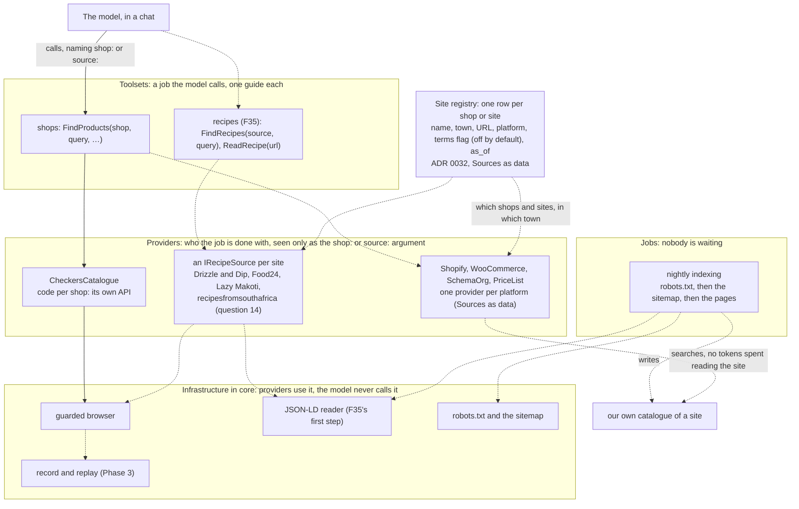

Solid arrows exist after Phase 2; dashed ones come later, each with its feature.

**A site is an argument or a row of data, never a tool.** Louis: "puls the product is a local AI when it knows your
[location] it [becomes] a know it all in that place, meaning [every website] in that [area] become a tool". This plan
keeps the first half and reads the second as "every source that knows this place answers through a specialist opened for that place, with a few tools whose sites are data"
(question 11, answered 2026-10-19), for two reasons. Tools are frozen when a chat opens: a session's toolsets are fixed when it opens
(ADR 0006) and nothing may edit what an open chat was already sent (ADR 0008), so a tool list that followed the town
would break the chat and its cached prefix. And tools cost tokens on every request: today's 123 tools take about 700
characters each (`tests/louis-agent.core.tests/Agent/ModelRequestSnapshot.json`, measured), so 1,000 site tools would
be about 175k tokens a request (an estimate at 4 characters a token, not measured), past Haiku 5.5's 100k-token line
where every price is five times higher (`config/prices.json:14-19`). The shop tools already take the shop as an
argument (`ShopTools.cs:25-26`). A site's row is data, never an enum member: ADR 0032 *Sites are data*, written with
*Sources as data* on Puls's track, is an explicit exception to ADR 0024.

**Puls hands off to a specialist opened for the place** (Louis's idea, 2026-10-19: "we could hand of to a specialist?
with only it's tools"). Puls's own tool list never changes; for a local question it opens a sub-session through
`StartSubSession(…, role, toolsets)`, as it opens the cook today, whose tools are only the few generic ones the town's
sources need (`SearchProducts`, a menu reader, opening hours), and whose brief lists that town's source rows. The
sub-session's tool list is fixed when it opens too (ADR 0006), so a town's new row is read by the next specialist,
and another town is another specialist. The hand-off costs what delegation costs (about +31% a turn and twice the time
in the F5 checks), so Puls hands off for a local question, not for every message. The tools call one reader per
*platform* with the row's `source` (below); a new site is a new row, a new platform is one new reader. The route
(which questions hand off, and the role's file) is built with *Sources as data* and *Places* on Puls's track, and
graded by the area-guide and cook simulations.

**How a local shop becomes a provider**, from least work to most:

1. **A webshop platform.** Shopify sites answer `/products.json`, and WooCommerce answers its Store API
   (`/wp-json/wc/store/v1/products`). One provider per *platform*, and the shop is a row of data: name, town, URL,
   platform.
2. **schema.org `Product` data on its pages, plus a sitemap.** One generic provider indexes it, as a job; again the
   shop is a row.
3. **Its own catalogue API, like Checkers.** Code per shop: a provider class of its own.
4. **No usable site** (only a Facebook page or a PDF leaflet). The shop sends a price list as a spreadsheet, or its
   leaflet is read as a picture (the vision feature, question 15). This is the *Puls vir besighede* sign-up path.

Why the ladder matters, in numbers: Checkers sits on rung 3, and it took 45 commits, 16 of them fixes (every commit
scoped `f33` or `f34`, counted in a full clone at `main` 7894953, since the local checkout is shallow), and it covers
1 of the 4 supermarket chains in Malmesbury, where OpenStreetMap lists Pick n Pay, Superspar and Usave
(`docs/features/F33-shop-catalogues.md:113-117`). So in *Sources as data* `ShopKind` becomes the platform (`Checkers`,
`Shopify`, `WooCommerce`, `SchemaOrg`, `PriceList`; today its one member is `Checkers`, `ShopKind.cs:9`), shops
become rows, each with a town, and the Shoprite, Pick n Pay and Woolworths providers wait for it.

**Puls's sources, best first** (higher on the list is more legal, fresher and cheaper; the ranking is the challenge's):

1. businesses that join: a form, a WhatsApp listing the owner approves, a feed, or their own MCP server (an orange
   pack);
2. open place data we may store (OpenStreetMap, Overture);
3. a site's own structured data (JSON-LD);
4. a few hand-built readers, only where the terms allow (Checkers);
5. the open web, cited, last.

Businesses joining is the main path: about 74% of township businesses use WhatsApp and 30% have websites (Standard
Bank's township informal economy report, October 2025, as the challenge cites it; not re-checked here).

**Collecting is a job, not a tool.** Louis: "an [agent] should [always] look at the [sitemap] first ain't it". Not in a
chat: there the agent searches, then reads one page (`ReadRecipe`, or `ScreenshotPage` as the fallback in the vision
feature), and it never reads a sitemap, which is only a list of addresses, often tens of thousands of them. Collecting
a site is a job with no model: it reads `robots.txt` first (obeys it and its `Crawl-delay`, and names itself with a user
agent), then the sitemap (filtered to the recipe or product paths, with `lastmod` saying what changed), then the pages,
each through the JSON-LD reader. Once *Sources as data* builds it, after F35, the same job picks the 10 to 50 pages
later simulations record; F35, which comes first, records the pages its own trials read, on Phase 3's record and
replay. `robots.txt` and the sitemap are infrastructure, never a tool.

**The place is an input, never an identity or a tool-list change.** Louis asked of the places pack "to find pulse
identity?". No: Puls is the same identity in every town. The town is an input to the places tools: it changes the
facts and the web app's look, never who Puls is or a session's tools. Today the API says the place once, in the first
message (`src/louis-agent.api/Program.cs:214-216`), and a session keeps it (`src/louis-agent.api/AgentSessions.cs:40`).
A change of town mid-chat is appended to the chat as a new line, never made by editing the system prompt or the tools
(ADR 0008). How it is said is a provider strategy (ADR 0003): on Anthropic models that accept one, a
mid-conversation `role: "system"` message, which Anthropic's docs give the system prompt's authority (the engine
research's reading; not yet tried in a run), and elsewhere a plain line. The claude-api notes
(`shared/prompt-caching.md`, *Mid-conversation system messages*, read 2026-10-18) list Opus 5.5, Sonnet 5.5, Fable 5.1
and Mythos 5.1, not Haiku 5.5, our default, so on the default model it is the plain line (unverified for Haiku 5.5),
as it is on OpenAI-compatible providers and Ollama. Phase 6's A4 makes the place a turn input in `TurnContext`, so
every host can set it, and A4a appends a change of town that way. A tool that reads the place also takes it as a
parameter (rule 3 below).
Puls's look follows the town through the web app's theme: the municipality's colours only, changed when the user stops
or opens the app, never mid-chat, and the town only, never a track of movements (*Places*, Puls's track).

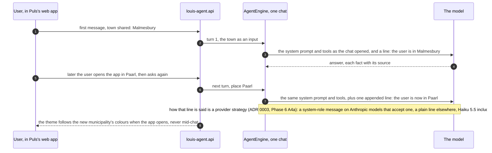

### Two contracts: who and what

**An identity is who the agent is** (`IAgentIdentity`): a name, its prompts (its modes under `agent/{name}/`, its own
specialists and its own minion roles) and the packs it uses, **by name**. It has no tools of its own:
everything it can do comes from packs. It may hold workflow code that uses its own packs' public types (the voorman
identity's `TriageWorkflow`, Phase 6). **A pack is what an agent can do** (`IAgentPack`): its toolsets
(`ToolsetDefinition`, the existing record), its prompts (its guides under `toolsets/`; roles from CL16), and the packs
it requires, **by name**. Its settings, state and messages are its own, and it never references another pack or an
identity. Core knows the two contracts, never an identity or a pack, and after Phase 2 the text the model reads from
core names no product and no country (step 2's ratchet). ADR 0027 (Phase 0) records all of it.

Names, not objects, for two reasons: a session and a role header already name toolsets by name (`shops?`, ADR 0025),
and a name lets whatever the catalogue holds as `shops` be our compiled pack today or an MCP server we named `shops`
(F36) without the identity changing, as Phase 2's `IAgentIdentity` says; recipes stay green, small sites read in our
process. Only the composition root turns names into objects.

### Plugged in two ways: an identity with its packs, or a pack on its own

Louis: "say the agent needs it it should be [pluggable]". So a pack never needs an identity to be used. Two settings,
both enums (ADR 0024), read once before the first engine is built, after `AgentHost.LoadEnvironment()`
(`AgentHost.cs:31`), so a setting made only in `config/.env` counts:

- `IDENTITIES=puls` (`demo,puls` from F40): each identity brings the packs it names;
- `PACKS=shops`: a pack plugged straight into the agent, with no identity: the coding agent, the CLI or the MCP server
  can then offer the shops toolset like any of core's. Its own settings still decide whether it can load here: the
  shops toolset needs `SHOP_CATALOGUES` and core's `BROWSER_URL` (a running headless Chrome), and without either it is
  listed as missing that setting, as today (`ToolsetCatalog.cs:75-79`).

A pack named twice (by `PACKS` and by an identity, or by two identities) is created once. Once in the catalogue, a
pack's toolsets are like core's, so any session or role may name them (`shops?`).

**One composition project for every host: `src/louis-agent.composition`.** The only project that knows every identity
and pack (`IdentityKind`, `PackKind`, `Plugins.FromEnvironment()`, which loads `config/.env` and then calls
`FromSettings(IDENTITIES, PACKS)`). Every host references it and passes
its answer to `AgentHost.Build` (the API, the CLI, Rider's ACP server) or `AgentHost.BuildToolHost` (the MCP server), so
they all plug in the same way, and a new compiled pack is one enum member and one line there; an MCP server is
configuration (`MCP_PACKS`, F36), never an enum member. The orchestrator joins in Phase 6, Part B, with `IDENTITIES=voorman`,
and builds its workflow from the catalogue's pack instances. Core references no identity or pack; a pack references no
other pack and no identity. An image built for code review still carries Puls's assembly, but loads nothing of it
unless `IDENTITIES` names it; if image size matters later, an MSBuild property (as `WebApp` does) can leave it out.

### How the switches relate

Five switches decide what one chat gets. The first four nest, each choosing among what the one before allowed; the
fifth picks the web app:

1. **`IDENTITIES` and `PACKS`** (start-up) choose what is loaded into the catalogue; F36 adds `MCP_PACKS` for orange
   packs.
2. **A toolset's settings** (start-up) decide whether it can load on this instance: the pack's own (`SHOP_CATALOGUES`)
   and the shared ones of core's it needs (`BROWSER_URL`); a toolset missing one is listed as missing it.
3. **`ROLES_ENABLED`** (start-up) narrows the roles of what is loaded (`AgentHost.cs:461-462`); from Phase 2 step 1 every
   name in it must resolve, or the host stops naming the ones it didn't find.
4. **A session's role and toolsets** (when it opens: `POST /sessions` with `"role"`, a role's `toolsets:` header) pick
   one role and its toolsets from what is offered, kept until the chat ends (ADR 0006, ADR 0025).
5. **`WebApp`** (build time: `-p:WebApp=puls`, `src/louis-agent.api/louis-agent.api.csproj:5-8`) picks the web app
   the API serves, until CL17 moves that choice to `IDENTITIES`.

The old drafts' `PRODUCTS` is gone: `IDENTITIES` replaced it.

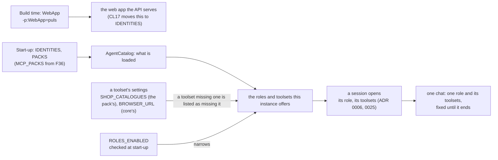

### The rule: every pack stays convertible to MCP, and MCP plugs in at the toolset

Louis: "this layer [should be convertible] to mcp quickly" and "I just want it to [be] pluggable into the mcp with almost
no [code]", then "if needed, we are [alone] in this": today he and louis-agent are the only users. So we build no MCP in
Phase 2; we keep every pack shaped so that converting it is little or no code when a real need comes, in both
directions. ADR 0028 (Phase 0) records the rule.

**Where MCP plugs in: the toolset, not the pack.** An identity names packs, a pack brings toolsets, a session or role
names toolsets (ADR 0006, 0025), and the engine registers their tools. An MCP server is one toolset whose tools run in
another process: in F36 the composition root turns each configured server into a pack holding one
`ToolsetDefinition`, and nothing below it can tell the difference. Its tools are listed **once, when the host starts**,
before the catalogue is built, never when a session opens: engines are cached per profile and every chat of an engine
shares one tool list (`AgentEngineFactory.cs:117-134`, `ToolRegistry.cs:22-26`), and `CreateTools` is synchronous
(`ToolsetDefinition.cs:30`). Start-up already blocks once like this for the price table and the exchange rates, each
bounded by a timeout (`AgentHost.LoadPrices` and `LoadRates`, `AgentHost.cs:244, 290`). So nothing in the engine
changes, every chat keeps the list it started with (ADR 0008), and `tools/list_changed` is ignored until a restart. A
server that can't be reached at start-up, or doesn't list its tools in time, is *unavailable, with its reason*, as a
missing setting is today (a `?` name skips it): one start-up timeout covers the connect and `tools/list`, because the
SDK's own `InitializationTimeout` (60 s by default, `McpClientOptions.cs:93` in ModelContextProtocol 2.2.0) covers only
the connect. A new list needs a restart. *Considered: listing when a session opens.* It threads async through
`AgentEngineFactory` and `AgentSessions`, needs the list's fingerprint in the engine key, and lets two chats of one
profile see different tools; it is right only when a server's tools differ per user, which nobody needs.

- **Out:** our MCP server already hands every engine tool straight to the MCP SDK (`McpServerTool.Create(function)`,
  `src/louis-agent.mcp-server/Program.cs:158`), so `PACKS=shops` on it, with `SHOP_CATALOGUES` and `BROWSER_URL` set,
  publishes the shop tools, beside every other toolset the instance can load (`AgentHost.cs:120-126`), `ExecuteSkill`
  and `GetToday` (`AgentEngine.cs:141,143`), the
  `skills` toolset's four tools (`AgentEngine.cs:336-342`) and the server's own three skill views (`ListSkills`,
  `GetSkillInfo`, `GetSkillDocumentation`, `src/louis-agent.mcp-server/Program.cs:185,193,209`). Calls served this way
  skip `ToolCallGuards`, which sit in the engine's chat pipeline (`AgentEngine.cs:117-133`, the invoker at `:123`),
  which is why a pack frames and bounds its own results (rule 4). Two things wait for Phase 8 (F36): the guards become
  a decorator around each `AIFunction`, so calls served over MCP get them too, and `BuildToolHost` takes a toolset
  list, so one pack can be published alone (`MCP_TOOLSETS=shops`, its guide as `McpServerOptions.ServerInstructions`,
  its annotations from Phase 7's `ToolEffect`, never from `ParallelSafe`).
- **In (F36):** each MCP server named by an identity or in `MCP_PACKS` becomes a one-toolset pack under the name we
  give it: listed once at start-up, allowlisted, its tool names prefixed and checked against our name rule (rule 7;
  MCP allows dots and 128 characters, so a name that fails is refused), pinned (the server's version when it reports
  one, and always a hash of the listed tools) and wrapped in our guards, so an identity that names it can't tell the
  difference. A stdio server runs as a child process on this machine, its exact command shown and approved, with only
  its own settings passed (`InheritEnvironmentVariables = false`; the SDK passes the whole environment by default,
  `StdioClientTransportOptions.cs:163`); an HTTP server is reached over the network through `SsrfGuard`. A server is
  always named, never discovered: today `RiderMcpClient` discovers Rider's tools in every host that calls
  `AgentHost.Build`, on by default (`AgentHost.cs:180-189`, `AgentOptions.cs:222`), and F36 replaces it.
- **Two models of MCP:** a client's system can sit *behind our tool* (our tool, description, framing and guards stay;
  the model sees our tool), or *be the pack* (F36: the server's own tools are what the model sees). The first when we
  own the task, the second when their tools are the product.

What keeps a pack convertible (it goes in `docs/CLAUDE.md`'s *Rules that always apply*, with ADR 0028):

1. **Ready when built.** Anything slow or async happens before the catalogue is built; `CreateTools` stays cheap and
   synchronous, and a pack's toolsets and tools never change afterwards (ADR 0006, 0008).
2. **Tools take plain data and return text.** Strings, numbers, booleans, enums, lists and records of those, and a
   `CancellationToken` when they wait; a `string`, `Task<string>` or `ValueTask<string>` result (`ShopTools.cs:25-53`).
   **A failure is text with its reason, never thrown:** served over MCP, the SDK replaces a thrown exception's message
   with "An error occurred invoking '…'." unless it is an `McpException` (its message is kept; an
   `McpProtocolException` becomes a protocol error) (ModelContextProtocol 2.2.0, `McpServerImpl.cs:1699-1729`). In our
   own loop the model does see a thrown message, because `IncludeDetailedErrors = true` (`AgentEngine.cs:125`), so a
   pack that throws works in process and goes quiet over MCP: that is why the rule matters. The shop tools already
   return `ErrorWithReason` (`ShopTools.cs:77-80`). A failure returned as text still reaches an MCP client with
   `isError` false, since the SDK sets it only for an `ErrorContent` result (`AIFunctionMcpServerTool.cs:298,307-310`);
   marking it belongs with Phase 8's guard decorator.
3. **Anything taken from the session also has a parameter, and no description names an identity.** `ShopTools` reads
   the user's shared place (`UserPlace.Current`, an `AsyncLocal`, `ShopTools.cs:70`) and falls back to its `area`
   parameter, so over MCP it still works with the town the model passes; `area` stops naming Puls in step 4 (today
   "when Puls gave no place", `ShopTools.cs:29,40,51`).
4. **A pack frames the outside data it returns and bounds its own output**, since calls served over MCP skip
   `ToolCallGuards`: the shops table keeps its `ShopDataStart`/`ShopDataEnd` frame (`ShopTools.cs:101,108`) and its
   20-row cap (`ShopTools.cs:18`).
5. **A pack reads its own settings and core's shared services, and names other packs.** `ShopsOptions` holds
   `SHOP_CATALOGUES` and `SHOP_STORE_CACHE`; `BROWSER_URL` and the guarded browser stay core's, through
   `ToolsetContext` (`ToolsetContext.cs:30-31`, `ToolsetCatalog.cs:75-79`). `Requires` is a list of names; no pack
   project references another pack or an identity (`ArchitectureTests`, step 2, seen failing on a fixture project the
   test reads as text: an inline string or a `.csproj.fixture` file, never a loose `.csproj` that tools would load).
6. **The guide is prose markdown with no `## Skill:` procedures**, so a server can send it as its instructions (none of
   the 13 guides has one today). Keep it short: Claude Code cuts server instructions, and the description of a tool
   that loads upfront, at 4,096 characters by default; `CLAUDE_CODE_MAX_MCP_DESCRIPTION_LENGTH` changes that, and
   before v2.1.296 the cut was 2,048 (code.claude.com/docs/en/mcp.md, read in a saved copy on 2026-10-18). `git.md`
   (4,041 characters) and `dotnet.md` (4,054) sit just under it; `shops.md` is 2,635. It stays a review note, not a
   test.
7. **Tool names are unique across core and every pack, and safe for MCP and the providers:** `^[A-Za-z0-9_-]{1,64}\z`.
   It ends in `\z`, not `$`, because in .NET `$` also matches before a final newline. The SDK's own check,
   `^[A-Za-z0-9_.-]{1,128}\z` (`AIFunctionMcpServerTool.cs:429`), allows dots and 128 characters, so ours is stricter
   on purpose; the 64 is the provider-safe bound the designs recalled, not re-checked here, so it stays one constant to
   adjust. All 123 of today's names pass (the longest is 28 characters). From step 1, a tool name in two toolsets, or
   one that takes an engine tool's name (`ExecuteSkill`, `GetToday`, `CreateSkillFile`, `ReloadSkills`, `CreateTool`,
   `ListAgentTools`), stops start-up; the message names both toolsets, or, for an engine tool, names it as the
   engine's (the engine registers those itself, `AgentEngine.cs:141,143,336-342`, so there is no second toolset). An
   orange pack's tool whose prefixed name clashes is refused alone, with a log line, before the catalogue is built
   (Phase 8), so this start-up error is the compiled packs' rule.
8. **Roles are prompts, not tools:** a pack with a role (cooking, CL16) converts its tools; its role stays with the
   identity that runs it.

`PackConvertibilityTests` (step 4, in `tests/louis-agent.composition.tests/`, over every `PackKind`) holds the shapes of
2, 3's naming (an `IdentityKind` name matched as a whole word, case ignored, so "demonstrate" is not "Demo"), 6 and 7,
through the SDK's own `McpServerTool.Create` from a test-only `ModelContextProtocol.Core` 2.2.0 (Apache-2.0; question
9, with reflection only as the fallback). `AgentCatalog` holds 7's uniqueness and `ArchitectureTests` 5's references.
Failures as text, inputs as arguments, framing and bounds, and readiness before the catalogue are a review checklist
for every new pack.

**Green and orange.** Green packs are ours, compiled, in our process: shops, recipes (small sites, read in process:
"recipes are small people they live [day] by day"), cooking, places, customers, triage and fixing. Orange packs are
someone else's MCP server, only where they have their own security and data layer ("price rule is a business owner a
corporate who has their own security and data layer"): Axiz's price rules, a client's system, a business that joins
Puls with its own server. Small sites and most local shops never run MCP servers: our green packs read them, or they
join through a form, a WhatsApp listing or a feed. An orange pack's tool annotations may only **tighten** approval
(Phase 7): a tool marked destructive, or with no annotations, asks every time; `readOnlyHint` relaxes approval only for
a server named as trusted in settings; by default every tool of an orange pack counts as an action outside the
workspace, because the MCP specification treats annotations as untrusted unless the server is trusted.

### Simulations: every identity proves itself

Louis: "[every] demo must be in c# we call it simulations, of a real world [task]". A **simulation** is one real task an
identity does, written in C#. In the field's words (Anthropic, *Demystifying evals for AI agents*,
https://www.anthropic.com/engineering/demystifying-evals-for-ai-agents, 9 Jan 2026): a **task** is a scenario (who asks,
what, from where), its made-up data that looks real, and its **success criteria**; it runs as **trials**, end to end
through the API as a user would, as many as asked; each trial leaves a **transcript** and ends in an **outcome** that
**graders** score, and the ledger gives its cost (ADR 0007). A run reports **pass@k** (passed at least once in k
trials) and **pass^k** (passed every time in k), because a sold agent needs the second. Our own addition: a task runs
in one or more *modes* (Puls alone against Puls with its cook).

The same simulation is the check before a release and the demo shown to a client. **What CI can and can't catch:** CI
gates the harness and the graders (on recorded transcripts) and what the model reads (the golden files). An agent
regression is caught only by a run: the paid simulations before a release, on Louis's go, or a free local-model run
(F15). Phase 3 adds a **replay cache** for recorded simulations only (live chats stay uncached): a re-run through the
API costs a known $0 while every request is unchanged, and a miss shows exactly where what the model is sent changed;
whether the new behaviour is good still needs a paid run, and paid trials never read the cache, since pass^k needs
independent trials. Free replays run where the recordings are, never in CI, because recorded pages stay private and out
of the repo (Phase 3).

The harness belongs to the engine (`simulations/louis-agent.simulation/`, sold with it, so a buyer writes simulations
for their own identities); the simulations belong to the identity or pack they prove
(`simulations/louis-agent.simulations.{puls,demo,voorman}/`). ADR 0029 (Phase 0) records it and amends ADR 0022: the
harness becomes C#, and the protocol and the store stand. Today's Python checks (1,442 lines in `benchmarks/`) become
Puls's first simulations (Phase 3).

### The end state

Louis: "[e]verything should be [pluggable] into the agent in the end". At the end of this plan identities and packs plug
in by settings at start-up (`IDENTITIES`, `PACKS`), never live into a running agent, and someone else's code plugs in
only as an MCP server (F36, an orange pack), never as a DLL in our process. A new MCP server reaches chats opened
after an admin refresh, with no restart, while every open chat keeps its tools (F36 step 9a; question 12). So the old road's **F37** (packs loaded as
DLLs from a folder at start-up, allow-listed and signed) is **cut**, and **F38** (tool search) **waits for a measured
need**: sites are arguments, so tool lists stay small, and a session loads only its own toolsets (ADR 0006); the
triggers to watch are the measured size of a session's tool definitions and the number of MCP servers. Core keeps only
what every identity needs: the loop, sessions, usage and prices, guards, the contracts, the infrastructure above, and
the generic tools (files, web, documents, the browser, specialists, minions, skills), once CL17
has moved git, dotnet, shell, Paymo and DevOps into the coding identity's packs. Question 12 asks Louis to confirm the
plan's three answers to his plug-in questions: **one generic tool or many?** One: a few fixed tools take the site as an
argument (`shop:`, `source:`), never a tool per site; **which orchestrator?** Both: an engine function (Phase 6, Part A,
ADR 0031) and the `voorman` identity (Part B); **when does something plug in?** At start-up, by settings, not live.

### Architecture: the whole stack

Solid arrows exist after Phase 2; dashed ones come later, each with its phase or feature.

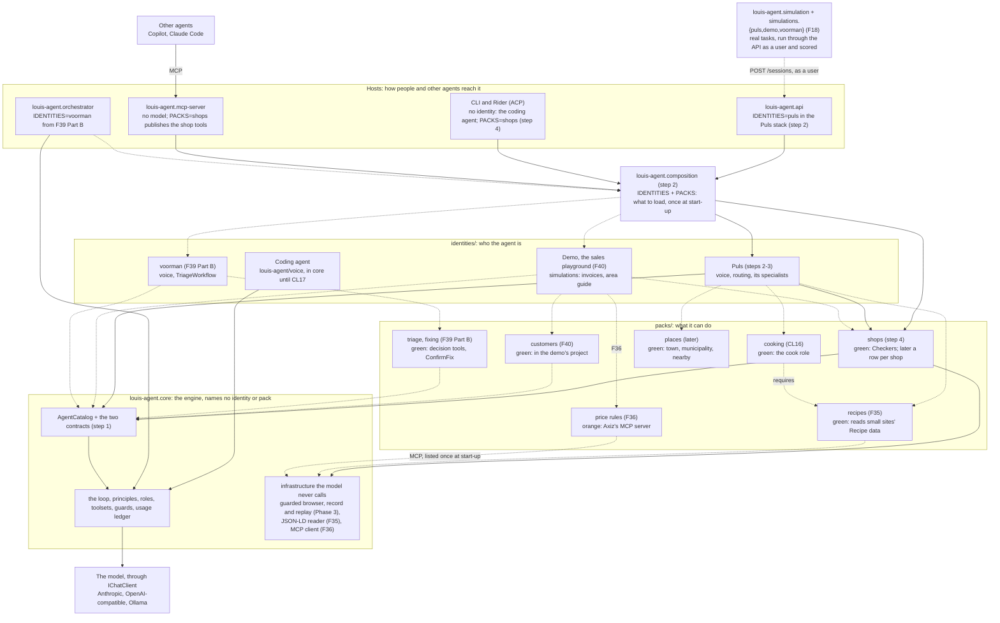

## Part 3 · What the engine changes, and the standards each change follows

Louis asked for this part in the thread: "then I also want you to show me what changes to the actual engine has to be
made in order to achieve my goals. Look at goals, make sure we are [aligned] with standards". It comes from the
engine-changes research of 2026-10-18 (`engine-research-final.md` in the Claude project, read against `main` 7894953),
with every repository fact checked again for this part, the MCP-packs check's corrections (an MCP pack's tools are
listed when the host starts, never when a session opens) and the decisions this plan has taken since. "The engine"
means `louis-agent.core`, plus the one small project it gains at the root, the session-stream reader (Phase 3). Outside
sources are cited as the standards check and the engine research read them on 2026-10-18; this part did not re-read
them, and the points still open are listed under *Unverified in this part* at its end.

**The bottom line.** The loop is sound, and it already follows the standards that matter: one Microsoft.Extensions.AI
pipeline (`AgentEngine.cs:117-133`), stopping rules in code (10 rounds, `AgentEngine.cs:120`; continuations after a
cut-off, `:241`, `:251`) and paged tool results (`WebTools.cs:130-145`). What Louis's goals need is seams, not a new
engine:

- a catalogue object instead of static lists built on first use (`ToolsetCatalog.cs:26,124`), so packs can be added
  (Phase 2);
- one turn context instead of six per-turn values, five of which only the API sets (`src/louis-agent.api/Program.cs:287-292`;
  Phase 6);
- each tool's effect declared, instead of one `ParallelSafe` flag per toolset (`ToolsetDefinition.cs:16-19,32`; Phase 7);
- each conversation's prompt and tools frozen (FX4, first in Phase 7), before anything resumes a chat;
- guards that wrap every tool on every path, the MCP export included (Phase 8).

One written rule is broken on `main` today: git arguments are built as one string (`GitTools.cs:338-348`, against ADR
0004). Two hosts also serve everything when no key is set, and a skill file the agent writes is loaded at once for
every later session. Phase 1 closes those three doors. Puls, Checkers, places, customers and the voorman identity's
workflow belong in identities and packs, never in core.

### The engine today and after

**Today.** Red marks a part that holds Puls or South Africa; orange marks a host that serves everything without a key.
Phase 1 closes those two doors and a third, in `Skills/`: skill files the agent writes. Every label was checked at
`main` 7894953; the lines are in the table below the second picture.

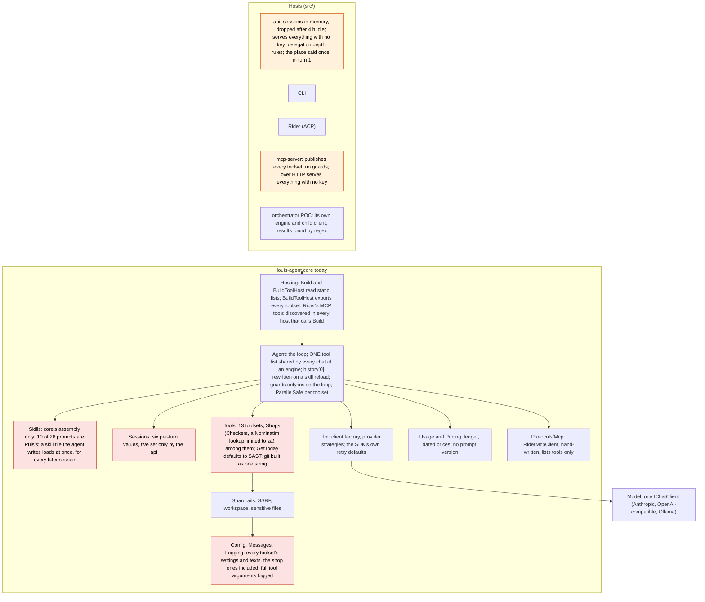

**After: the end state.** Green marks a new piece. Identities and packs sit outside core and implement its two
contracts. The bracket says when each piece arrives. Puls and shops leave core in Phase 2; git, dotnet, shell, Paymo,
DevOps and the coding identity leave only in CL17 (Later), so until then they stay in core.

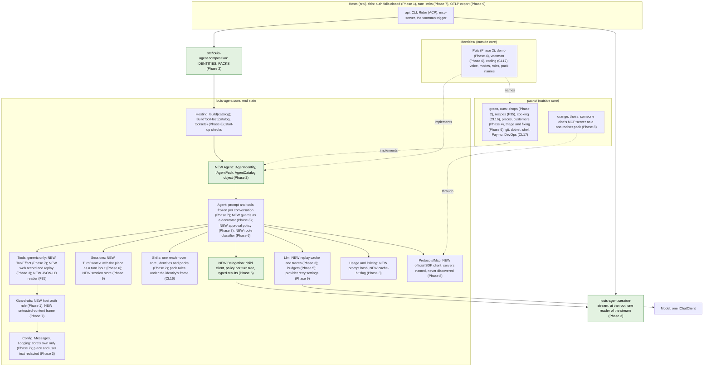

One line per concern, today and after:

| Concern | Today (checked) | After | When |
|---|---|---|---|
| `Hosting/` | `Build` and `BuildToolHost` read static lists, and `BuildToolHost` exports every toolset the instance can load (`AgentHost.cs:120-127`); Rider's MCP tools are discovered in every host that calls `Build`, on by default (`AgentHost.cs:178-189`, `AgentOptions.cs:222`) | They take the catalogue; `BuildToolHost` also takes a toolset list; every `ROLES_ENABLED` name and the no-role default mode are checked at start-up (the default stays core's `louis-agent/voice` until CL17); MCP servers are named, never discovered | Phase 2; Phase 8 |
| `Agent/` | One `Live` tool list is shared by every chat of an engine (`ToolRegistry.cs:22-26`) and sent on the loop's final request too (`ToolCallGuards.cs:85`); `history[0]` is rewritten when the skills change (`AgentEngine.cs:257-259`); guards run only as the loop's invoker (`AgentEngine.cs:123`) | The two contracts and the catalogue; each conversation keeps its own prompt and tools; guards wrap each function; an approval policy reads each tool's effect; a route classifier | Phases 2, 6, 7, 8 |
| `Delegation/` (new) | Spread across `Tools/Agents` (`SpecialistTools.cs`, 499 lines; `MinionTools.cs`) and the API host (`src/louis-agent.api/AgentSessions.cs:153-165`) | One function: the child client, one policy per turn tree, typed results | Phase 6 |
| `Sessions/` | Six per-turn `AsyncLocal`s (four here; `UsageScope` in `Usage/`, `AgentTools` in `Tools/Agents/`); every host opens `UsageScope`, only the API sets the other five; the place is fixed per session (`AgentSessions.cs:40`) | One `TurnContext` for every host, the place a turn input; later a session store | Phases 6, 9 |
| `Skills/` | Reads core's assembly only (`SkillFileSource.cs:15,18`); the default voice is hard-coded (`RoleCatalog.cs:28`); a skill file the agent writes loads at once (`SkillTools.cs:149-168,201-205`) | One reader over core, identities and packs; a written skill waits for `/approve`; pack roles under the identity's frame; later, the identity names its default mode (CL17) | Phases 1, 2; CL16; CL17 (Later) |
| `Tools/` | 13 toolsets (`ToolsetCatalog.cs:28-114`), Shops among them; `ParallelSafe` per toolset; JSON-LD dropped with every script (`WebTools.cs:417`); git built as one string | Generic tools; `ToolEffect` on each method (layer 2, below `Agent/`, so `ArchitectureTests` stays green); web record and replay; a JSON-LD reader; git as a list | Phases 1, 2, 3, 7; F35 |
| `Llm/` | The factory and the provider strategies; Anthropic's retry and timeout left at the SDK's defaults (`LlmClientFactory.cs:62-72`) | A replay cache for recorded simulations, traces, budget middleware, each provider's retry settings as a strategy | Phases 3, 5, 9 |
| `Usage/`, `Pricing/` | A ledger with no prompt version (`UsageRecord.cs:28-44`) | A prompt hash and a cache-hit flag on every row; later `ttft_ms` | Phase 3; Phase 9 |
| `Protocols/Mcp/` | A 199-line hand-written client that only lists Rider's tools (`RiderMcpClient.cs`) | The official SDK's client, as `McpPack` | Phase 8 |
| `Guardrails/` | SSRF, workspace, sensitive files; one fence written inline in C# (`WebTools.cs:140,142`) | The host auth rule; one untrusted-content frame, a message member, for every outside result | Phases 1, 7 |
| `Config/`, `Messages/`, `Logging/` | Hold the shop settings and texts; full tool arguments and part of the user's text in the logs (`ToolCallGuards.cs:38-41,63`, `ToolCallRecords.cs:15-23`) | Core's own only, the place and the user's text redacted in logs | Phases 2, 3 |

### The changes, one row each

Phase 4 adds no row: the demo identity, the customers pack and the control room all sit outside core. The rows are
numbered so the dependency graph and the standards check below can point at them.

| # | Engine change | Phase | GOAL skill: what it closes | Standard or source it follows | In the code today (checked) |
|---|---|---|---|---|---|
| 1 | **Auth fails closed (FX18).** The API, and the MCP server over HTTP, refuse to start without a key unless `AGENT_AUTH=off` (an enum, ADR 0024) says so on purpose for a development machine; one pure rule in core, `HostAuth`, holds the start-up decision and the key check for both hosts | 1 | 15: no *Missing* item names it; it removes a release blocker | Deny by default (OWASP Top 10:2021, A01 *Broken Access Control*); ADR 0004's spirit: nothing open by accident; the MCP specification's server duties (access control) | Both warn and serve without a key: `src/louis-agent.api/Program.cs:41-60`, `src/louis-agent.mcp-server/Program.cs:86-95`; the same key check written twice (`api Program.cs:228-234`, `mcp-server Program.cs:115-121`); the admin gate already fails closed, pure and tested (`src/louis-agent.api/Services/AdminGate.cs:6-8`) |
| 2 | **Git arguments as data (FX19).** Every git call takes a list; `RunGit(string)` and `EscapeForShell` are deleted; our options first, then `--end-of-options`, then the model's values, and paths after `--`; a model value that starts with `-` is refused; `SetConfig` accepts only `user.name` and `user.email` | 1 | 15: restores its *Have today* "No shell for model text" (`docs/GOAL.md:36`) | ADR 0004 *Arguments as data*; OWASP LLM05:2025 (improper output handling: model text never becomes a command line or an option); CWE-88 (argument injection); git's own `gitcli` docs (`--end-of-options`) | `GitTools.cs:338-348` (`Arguments = args`, the only string `Arguments` for a process in core and `src`), called 38 times on 36 lines; `ShowCommit` (`:37-41`, described as read-only) and `SetConfig` (`:273-278`, any key); the history tools already put `--` before the model's values (`:280-281`) |
| 3 | **Skill files wait for approval (FX20).** `CreateSkillFile` writes to `Skills/agent/functions/pending/`; the file is active in the engine that wrote it and loaded by later sessions only after `/approve {name}`, as agent-built tools are | 1 | 15; it extends 16's *Have today* "Approve agent-built tools" to skill files | OWASP Top 10 for Agentic Applications, ASI06 (memory and context poisoning: a saved skill is memory every later session loads, and its `Execution:` fence runs through `ExecuteSkill`) | Saved and loaded at once (`louis-agent.core/Agent/Tools/SkillTools.cs:149-168`; written at `:201-202`, reloaded at `:205`); agent-built tools already wait (`AgentBuiltTools.cs:12-13,30-32`); later sessions read only the top folder (`AgentHost.cs:405-406`) |
| 4 | **Two contracts and the catalogue as an object.** `IAgentIdentity` and `IAgentPack`; an `AgentCatalog` built once by the host and passed down; prompts read through one reader over core, identities and packs; every `ROLES_ENABLED` name, and the no-role default mode (`louis-agent/voice`, still core's, `RoleCatalog.cs:28`), resolved at start-up (`ROLES_ENABLED` narrowing that default, and an identity naming its default mode, wait for CL17: Phase 2's *Considered and left for CL17*); one composition project, `src/louis-agent.composition` | 2 | 4, 18; closes none, because no GOAL row names extensibility (question 10) | Composition root, open-closed, dependencies one way (ADR 0010); .NET's options and dependency-injection patterns; ADR 0027 | Static lists built on first use (`ToolsetCatalog.cs:26,124`); prompts read from core's assembly only (`SkillFileSource.cs:15,18`); the default voice hard-coded (`RoleCatalog.cs:28`) and given to a no-role session before any `ROLES_ENABLED` check, where an unknown name simply never matches (`AgentHost.cs:434-441,458-462`) |
| 5 | **Tool names through the catalogue.** `ToolNames` moves from `ToolsetCatalog`'s statics to `AgentCatalog`, through one private `NamesOf`; `ToolNamesOf` and `ToolsetOf`, whose only callers are F30's minions (`AgentEngineFactory.cs:113`, a minion's one tool; `src/louis-agent.api/AgentSessions.cs:163`), move to `AgentCatalog` with it; `AgentCatalog.ToolMethodsOf` and `AgentCatalog.FunctionOf` are the one public rule for which methods are tools and how each becomes a function; `AgentEngine` takes `ReservedToolNames`; a tool name in two toolsets, or an engine tool's name, is a start-up error | 2 (step 1) | 4 | One name, one tool; the MCP specification (a client keeps tool names unambiguous, for example by prefixing them) | Names reflected from core's static list only (`ToolsetCatalog.cs:124-126`), so after the cut `CreateTool` would accept a shop tool's name (`AgentBuiltTools.cs:71`) and an engine with shops would skip it with a warning (`:125-129`); a duplicate shows only when an engine is built (`ToolRegistry.cs:31-37`) |
| 6 | **Puls and South Africa out of core; shops a pack.** A Puls golden first; Puls's prompts and its protocol in the shared guides move to its identity; `GetToday`'s and the API's South African defaults read one setting, `HOST_TIME_ZONE`; a ratchet over core's model-visible text (no `puls`, no Afrikaans briefing label, no "South Africa"); shops becomes a pack, its Nominatim geocoder with it | 2 (steps 0, 2-5) | 3: mechanism kept apart from protocol; closes none | Anthropic, *Effective context engineering for AI agents* (the smallest set of high-signal tokens); ADR 0011 (prompts are content); ADR 0024 | 10 of the 26 prompts in `louis-agent.core/Prompts/` are Puls's; `ClockTools.cs:10-11,18-26` (SAST default, Puls named in a comment); `src/louis-agent.api/Program.cs:214-216` (fallback "Africa/Johannesburg"); `ShopTools.cs:29,40,51` name Puls; `Tools/Shops/` holds 15 files; `PlaceCoordinates.cs:27` (`countrycodes=za`), used only by `ShopCatalogueFactory.cs:37` |
| 7 | Every pack stays convertible to MCP; MCP plugs in at the toolset | 2 | 4, and 11 later; closes none | The MCP specification: plain-data parameters, text results, failures as isError results with their reason; the official ModelContextProtocol C# SDK (its McpServerTool.Create runs in the convertibility test) | ADR 0028 and `PackConvertibilityTests` over every pack (Phase 2 step 4; a test-only `ModelContextProtocol.Core` 2.2.0, question 9; names held to `^[A-Za-z0-9_-]{1,64}\z`). Today our MCP server hands each engine tool straight to the SDK (`src/louis-agent.mcp-server/Program.cs:141,158`), and `CreateTools` is synchronous (`ToolsetDefinition.cs:30`) |
| 8 | **One reader of the session stream** for every C# client, its own project at the root (`louis-agent.session-stream/`, `LouisAgent.SessionStream`, no dependencies) | 3 (steps 1a-1d) | 17, 18 | One parser per protocol; the recorded stream as its contract, its fixture moving to `tests/louis-agent.session-stream.tests/Fixtures/` (ADR 0029, which amends ADR 0022) | Read four times: by the web apps (`TurnStream.cs`), the orchestrator (`LouisAgentClient`), core (`SpecialistTools`) and the Python checks; the fixture is `benchmarks/fixtures/session-stream.sse` |
| 9 | **A simulation harness in C#**: tasks, trials, transcripts, graders; cost from the ledger, never computed by the harness; each turn's wall-clock seconds measured by the harness, as F31 does today. It sits outside core (`simulations/louis-agent.simulation/`); core gives it the seams in rows 10 to 12 | 3 | 12: "regression gates in CI" for the harness and the graders; an agent regression is still caught only by a run (Phase 3's write-up names the limit) | Microsoft.Extensions.AI.Evaluation (MIT, the family of our Microsoft.Extensions.AI 10.10); Anthropic, *Demystifying evals for AI agents* (anthropic.com/engineering/demystifying-evals-for-ai-agents, 9 Jan 2026; the page and its date checked on 2026-10-18 for Phase 3): a **task** with its **success criteria**, run as **trials**, each leaving a **transcript** and an **outcome** that **graders** score; pass@k and pass^k; code graders first, a model grader only where code can't judge. *Modes* are our own addition. CI gates the harness, the graders on recorded transcripts and the golden files | The Python checks, 1,442 lines in `benchmarks/`; the harness times each turn itself (`benchmarks/routing/run_check.py:91`, `benchmarks/cook/run_check.py:140`); `--repeat` exists (`benchmarks/routing/run_check.py:105`); CI only unit-tests the Python (`.github/workflows/ci.yml:56-58`) |
| 10 | **Web record and replay.** A decorator around `IWebBrowser`, set by `WEB_REPLAY` (`off`, `record` or `replay`; an enum, ADR 0024): every page text, captured answer and screenshot saved with its URL, time and hash under a git-ignored data folder, and referenced by hash from the simulation run, so paid shop and recipe simulations see frozen input. Live chats are never recorded, and saved pages are never served to users or committed | 3 (steps 4a, 4b) | 12: trials on the same input, so a change in score is the agent's | Recorded inputs for repeatable trials (the record-and-replay pattern that HTTP recorders use in tests; *inferred*, no single standard); ADR 0024 | `IWebBrowser` (`louis-agent.core/Tools/Web/Browsing/IWebBrowser.cs:9`) records nothing; graders on recorded transcripts don't freeze the web input |
| 11 | **A replay cache for recorded simulations**, opt-in, never for live chats: a small subclass of Microsoft.Extensions.AI's `DistributedCachingChatClient` overrides `ReadCacheAsync` and `ReadCacheStreamingAsync` and tags a hit; the usage recorder writes a tagged response as a known $0 with `cache_hit=true`. A re-run through the API costs $0 while every request is unchanged, and a miss shows exactly where what the model is sent changed; whether the new behaviour is good still needs a paid run. Paid trials never read it | 3 (step 4e) | 13: closes its only *Missing* item, "a response cache for exactly repeated requests" (`docs/GOAL.md:34`), once a hit rate is measured on a recorded simulation; 12 | ADR 0007 (a hit is a known 0, never unknown); the `IChatClient` middleware pipeline (learn.microsoft.com/dotnet/ai/ichatclient); pass^k needs independent trials (*Demystifying evals*) | No cache today; the pipeline is `AgentEngine.cs:117-133`. The caching client gives no hit signal and a hit returns the stored usage, so without the subclass the ledger would price it again (the engine research, from the package's docs; not run). Replay is free only while requests stay byte-identical: recorded tool results or stub peers, and a fixed clock |
| 12 | **The prompt's hash on every ledger row**: a hash of the system prompt and the tool list, so every record says which version of what the model read produced it; it also goes into the replay cache's key | 3 (step 4c) | 3: the versioning half of "prompt versioning, and A/B comparison of prompt changes on the evals" (`docs/GOAL.md:24`) | ADR 0007 (measure every request; no prompt text in the ledger, only its hash) | `UsageRecord.cs:28-44` has no version field |
| 13 | **Traces per turn and tool call**: `.UseOpenTelemetry()` inside `UseFunctionInvocation`, sensitive data off; `FunctionInvokingChatClient` then traces each tool call itself, so no decorator is needed; a test with an `ActivityListener` checks the span names. Exporters, dashboards and `traceparent` across processes are F44's (row 28) | 3 (step 4d) | 17: closes "tracing per turn and tool call (OpenTelemetry)" (`docs/GOAL.md:38`); the dashboards stay F44's | Microsoft.Extensions.AI's OpenTelemetry client and the OpenTelemetry GenAI semantic conventions (learn.microsoft.com/dotnet/ai/ichatclient) | No OpenTelemetry or `ActivitySource` anywhere in core or `src` (checked by search) |
| 14 | **Personal data out of the logs**: the place and the user's text redacted or hashed in log lines and oversized-result records, beside the traces' "sensitive data off" | 3 | 15: no *Missing* item names it; a release blocker for a public Puls | POPIA s13 (purpose), s14 (retention) and s19 (security safeguards); OWASP LLM02:2025 (sensitive information disclosure) | Full arguments logged for every tool call (`ToolCallGuards.cs:38-41`), plus 300 characters of each result (`:63`); oversized-result records keep 500 characters of the user's request (`Logging/ToolCallRecords.cs:15-23`) |
| 15 | **Estimates, budgets that warn, ask or stop, and a cost per customer (F7)**, read from the ledger, per session, per customer and per day; "ask" through `ApprovalRequiredAIFunction` and `ToolApprovalRequestContent`; per turn tree once row 16's limiter exists | 5 | 13 (its *Planned* estimates and budgets), 16 (budgets that ask); 6's "stop conditions beyond a round count", partly | OWASP LLM10:2025 (unbounded consumption); ADR 0007 *Measure every request* | A prompt budget for sub-sessions only (`ToolCallGuards.cs:96-102`); no budget per session, customer or day |
| 16 | **One delegation function: agents as tools, a policy per turn tree, typed results, checks in code** (F39 Part A; ADR 0031): a child client behind `IChildTransport`, with credentials per peer and an allow-list of who may delegate to whom; one limiter per turn tree; results typed from a C# record's schema (`JsonSchemaExporter`), validated strictly, a child's prose answer bounded by the guards' existing cap (ADR 0005) and framed by F42's untrusted-content frame (Phase 7), as Phase 6's A5 says; a route classifier, where forcing one tool (`ChatToolMode.RequireSpecific`) is a per-model capability (Phase 6 A6), which F15's record later holds with the rest | 6 | 10 (handoff patterns compared; parallel read-only sub-agents), 5 ("schema-validated outputs", for agents' results), 6 (routing and evaluator-optimizer built in code) | Anthropic, *Building effective agents* (workflows where the steps are known; evaluator-optimizer); its context-engineering guidance (children return short, structured results, often 1,000-2,000 tokens); OWASP LLM06:2025 (excessive agency); OWASP Agentic ASI03 (identity and privilege abuse) and ASI07 (insecure inter-agent communication) | Depth rules in the API host (`AgentSessions.cs:153-165`); the minion cap counted per instance (`MinionTools.cs:58,134-142`); a child's answer goes back whole and unfenced (`ToolMessage.cs:768-769`); one `AGENT_API_KEY` both ways (`AgentOptions.cs:168-169,243`); the orchestrator's results found by regex |
| 17 | **One `TurnContext` opened by the engine; the place a turn input** (F39 A4): it carries the six per-turn values the API sets today (usage, attachments, tool names, place, kept sub-sessions, the feed) and Phase 3's replay setting (`SessionReplay`, step 4a), so any host can keep a child and pass a place. A change of town is appended to the chat, never made by editing the prompt or the tools, and how it is said is a provider strategy (on Anthropic models that accept one, a mid-conversation system message; the claude-api notes, as Phase 6 reads them, don't list Haiku 5.5, our default, which then gets the plain line used elsewhere; ADR 0003; Phase 6 A4a). A tool that reads the place also takes it as a parameter; `UserPlace` is marked as personal information in code (its doc comment, `louis-agent.core/Sessions/UserPlace.cs:3-10`, which today says only that a host sets it when the user chose to share it, names it so under POPIA s1, and row 14's log redaction treats it so) | 6 | 7 ("context building per turn", partly), 9, 10 | Anthropic's context-engineering guidance (context assembled at run time); its preserved-thinking docs (append, never edit); ADR 0008; POPIA s1 (location about an identifiable person is personal information) | Six `AsyncLocal`s (`src/louis-agent.api/Program.cs:287-292`): every host opens `UsageScope` (CLI `ConsoleChat.cs:63,90`, Rider `AcpServer.cs:237`, the orchestrator `Program.cs:99`), and only the API sets the other five; outside the API a delegation keeps nothing for a follow-up (`SpecialistTools.cs:179-189`, `SubSessionRegistry.cs:3-7`); the place fixed per session (`AgentSessions.cs:40`) |
| 18 | **FX4 Append-only history**: each conversation keeps the system prompt and tool list it opened with, the loop's final request included; a skill reload or an approved tool reaches new chats only. It comes first in Phase 7 because Phase 8's MCP packs and F43's durable sessions both rest on a chat keeping what it opened with. Later options, as provider strategies: Anthropic's `tool_addition` and `tool_removal` blocks (beta `inline-tools-2026-09-15`) and `prefix_mismatch_behavior: "drop_block"` (beta `thinking-binding-controls-2026-08-01`) | 7 (first) | 2, 3, 9 (their *Planned* FX4 items); it unblocks 4's "adding a tool mid-conversation" | Anthropic's extended-thinking docs ("freeze system at session start", "leave the tools array as you first sent it"); ADR 0008 | `history[0]` rewritten when the skill documentation changes (`AgentEngine.cs:257-259`); every chat of an engine sent the one shared list (`:268`, `ToolRegistry.cs:22-26`), the final request too (`ToolCallGuards.cs:85`); up to 16 engines cached and shared by chats (`AgentEngineFactory.cs:34`); known limitation 9 |
| 19 | **Each tool declares its effect** (`ToolEffect`: read-only, destructive, idempotent, open-world), replacing the per-toolset `ParallelSafe`; parallel rounds, F41's approval per risk, F42's audit line and the MCP annotations our server publishes all read it. It lives in `louis-agent.core/Tools/`, and only the policy that reads it in `Agent/`; its ADR amends ADR 0026. An MCP `ReadOnly` hint comes from it, never from `ParallelSafe` | 7 | 4: the annotations half of "tool annotations ... and an output schema on every tool" (`docs/GOAL.md:25`); 16 | The MCP specification's tool annotations (`readOnlyHint`, `destructiveHint`, `idempotentHint`, `openWorldHint`; its schema defaults a bare tool to destructive and open-world); Anthropic, *Writing tools for agents*; least agency (OWASP Agentic ASI02, as the engine research cites it) | `ParallelSafe` per toolset (`ToolsetDefinition.cs:16-19,32`); `ArchitectureTests.cs:12-20` puts `Tools` at layer 2, below `Agent` at 3; tools exported bare (`src/louis-agent.mcp-server/Program.cs:158`) |
| 20 | **Typed drafts validated in code, approved by a person; approval per action and risk level (F41)**: Auto, Ask or Refuse per effect (row 19) and per identity, asked through `ApprovalRequiredAIFunction` and `ToolApprovalRequestContent` and streamed to the host; FX20's skill-file approval moves into the control room | 7 | 16: closes "approval policies per action and risk level" (`docs/GOAL.md:37`) once the hosts show the ask; 5: drafts | OWASP LLM06:2025 (human approval for high-impact actions); human in the loop; the MCP specification (a human able to deny a tool call) | Only agent-built tools wait today (`AgentBuiltTools.cs:12-13`), skill files too after FX20; the shell toolsets run any code (`ToolsetCatalog.cs:46-63`) |
| 21 | **One untrusted-content frame** (a random boundary per call, the source, `as_of`, a length cap), a `ToolMessage` member, for web pages, shops, sub-session answers and MCP results (F42) | 7 | 15: "prompt-injection defences", partly; 8, with row 32 | OWASP LLM01:2025 (segregate external content); ADR 0009 (no message text inline in C#) | One fence written inline in C# (`WebTools.cs:140,142`) and pinned by no golden; the shops' fence a message member (`ToolMessage.cs:285-286`); sub-session answers unfenced (`ToolMessage.cs:768-769`) |
| 22 | **An audit log, rate limits, an egress proxy, prompt-injection simulations (F42)**; `IncludeDetailedErrors = true` reviewed before a public Puls | 7 | 15: "prompt-injection defences and red-team tests, ... rate limiting, an audit log; ... an egress proxy" (`docs/GOAL.md:36`) | OWASP LLM01:2025, LLM02, LLM05, LLM06, and LLM10 for the rate limits; ASP.NET Core's built-in rate limiting (`Microsoft.AspNetCore.RateLimiting`, partitioned per key, in memory per instance); the MCP security best practices (an egress proxy rather than IP checks written by hand) | `IncludeDetailedErrors = true` (`AgentEngine.cs:125`); the address rule written by hand (`SsrfGuard.cs:29-34,67-70`); no audit log, no rate limit, no injection test suite |
| 23 | Someone else's MCP server as a one-toolset pack, its tools listed once when the host starts, allowlisted, pinned and wrapped in our guards | 8 | 11: closes "a full MCP client" (`docs/GOAL.md:32`) once measured | The MCP specification (annotations untrusted; clients prefix names); the ModelContextProtocol SDK's client; ADR 0006 and 0008 (every chat keeps the tool list it opened with) | `RiderMcpClient.cs` (199 lines) sends `mcp-session-id` (`:40-44`) and only lists tools; discovered tools get a `rider_` prefix (`RiderMcpToolDiscovery.cs:48`); `ToolRegistry.Add` throws on a duplicate (`:31-37`). The details F36's plan starts from are under *Row 23 in detail* |
| 24 | **Our guards on every path, and one pack published alone**: the guards become a decorator around each `AIFunction` (over Microsoft.Extensions.AI's `DelegatingAIFunction`), so the loop, the MCP export and imported MCP tools all get the log line, a timeout and the oversized-result guard; the cut-off check stays in the loop's invoker, which alone has `FunctionInvocationContext`; a failure goes out as `ErrorContent`, so MCP marks it `isError`; `BuildToolHost` takes a toolset list (`MCP_TOOLSETS=shops`), with the guide as the server's instructions and the annotations from row 19 | 8 | 11; 15 | The MCP specification (clients validate results, time out and log; servers validate inputs and sanitise outputs; execution errors are `isError` results); ADR 0005 *Guard the context* | Guards run only as the loop's invoker (`AgentEngine.cs:123`, `ToolCallGuards.cs:38-70`); the MCP server publishes raw functions (`src/louis-agent.mcp-server/Program.cs:141,158`) for every toolset the instance can load (`AgentHost.cs:120-127`); a failure is an "Error: …" string (`ToolMessage.cs:156-157`, `ErrorWithReason`, "Error: {Reason}", as the shop tools return it at `ShopTools.cs:79`), which reaches an MCP client as a success |
| 25 | **Accounts, a tenant on every session, ledger and audit row; durable sessions; a sandbox per tenant; a retention setting and a delete path (F43).** The session store is built with its MongoDB store: a core `SessionRecord` holds the identity, toolsets, role, the frozen prompt and tools, and the transcript with its thinking blocks; `ISessionStore` and a lifecycle enum live in core. Phase 6 B4's spike looks at Microsoft Agent Framework's checkpoints first | 9 | 9: closes "durable sessions, lifecycle states, resume after restart" (`docs/GOAL.md:30`); 14: "resumable runs in the core"; 15 | POPIA: a lawful ground for each purpose (s11, consent one of six), purpose (s13), retention (s14), security safeguards (s19), our duties as operator when we host a business's agent (ss20-21), breach notification (s22), correction and deletion on request (s24), transfers outside South Africa such as to the model provider (s72); Anthropic's multi-agent research system (resume from where the agent was) | Sessions in a dictionary in the API, dropped after 4 hours idle (`src/louis-agent.api/AgentSessions.cs:136-138,224`); the API already runs a MongoDB store (`MongoBenchmarkStore.cs`, `MongoDB.Driver` 3.12.0) |
| 26 | **Reliability (F8)**: retries, account limits, a fallback model, timeouts and resumable runs | 9 | 14 (its *Planned* retries, account limits and fallback; *Missing* timeouts for long tasks); 1 (fallback model) | Each provider's own retry and timeout settings, as a provider strategy (ADR 0003; for example Anthropic `ClientOptions.MaxRetries`/`Timeout`); a fallback model and the stop on an account-limit refusal as `IChatClient` middleware on Microsoft.Extensions.Resilience (Polly v8); Microsoft.Extensions.Http.Resilience only on our own `HttpClient`s (peers, web tools), never stacked on an SDK that retries, with its 10 s / 30 s timeouts raised for streams | Anthropic's `ClientOptions` set with neither (`LlmClientFactory.cs:62-72`), so its SDK retries twice by default (the package's docs, per the standards check); Ollama's client already waits 10 minutes (`:120-130`) |
| 27 | **Local models get everything (F15)**: each model's window sent to local models (`num_ctx`), and a capability record per model in place of name-prefix lists, which also says whether forcing one tool works (row 16) | 9 | 1: "a capability check per model ... measured instead of guessed from its name" (`docs/GOAL.md:22`) | The provider's own limits, from a dated table like the prices (`as_of`, ADR 0007); ADR 0003 | Capabilities guessed from model-name prefixes (`LlmClientFactory.cs:82,89`, `ThinkingBudgetModelPrefixes`; `LlmOptions.cs:16`, `KnownNoToolsPrefixes`) |
| 28 | **Traces leave the process (F44)**: an OTLP exporter, dashboards (the standalone Aspire dashboard reads OTLP with no app code), W3C `traceparent` through `HttpPeerTransport` and MCP `_meta`; `ttft_ms` and tokens per second on every ledger record, as F44's first step (F12-S1) | 9 | 17: "latency and error dashboards" | OpenTelemetry (OTLP, the GenAI conventions); W3C Trace Context | Row 13's spans stay in the process; the ledger has `DurationMs` (`UsageRecord.cs:40`) but no time to the first token |
| 29 | **Versioned public contracts, a package and a container, notices for what we ship, and hosting for public traffic (F44)** | 9 | 18: "deploy pipeline" (`docs/GOAL.md:39`) | Semantic versioning; Microsoft's PublicApiAnalyzers to declare the public surface, plus the SDK's package validation against the last released version (`EnablePackageValidation`, `PackageValidationBaselineVersion`; its CP0005 and CP0006 stop a member added to a contract interface outside a major version); notices for the MIT, BSD and Apache-2.0 assemblies we ship (Apache's NOTICE files included; Apache-2.0 §4); git in the container is GPL-2.0, so a container handed to a self-hosting buyer needs those licences and their source made available, or a slimmer runtime image | No `THIRD-PARTY-NOTICES` or NOTICE file in the repo (checked); Apache-2.0: Serilog's packages, PdfPig 0.1.16, MongoDB.Driver 3.12.0, ModelContextProtocol 2.2.0; BSD-2-Clause: Markdig 1.4.0; the rest MIT; all six runtime images are `FROM mcr.microsoft.com/dotnet/sdk:10.0` with git installed by apt (`docker/Dockerfile.{acp-server,agent,api,mcp-server,orchestrator,puls}`, lines 6-9) |
| 30 | **A JSON-LD reader over the raw HTML**, before `HtmlToText` strips every script; measured on F35's recipe pages and on about 50 Swartland business sites from OpenStreetMap's `website` tags | Puls's track (F35's first step) | 7, 8; closes none alone | JSON-LD 1.1 (w3.org/TR/json-ld11, embedding in HTML); schema.org `Recipe` and `LocalBusiness`; the measured lesson that data read in code beat pages read by the model (0 of 32, then 31 of 31; `docs/GOAL.md:33`) | The page is narrowed to `main` or `body`, then every `<script>` is removed (`WebTools.cs:413-417`, the pattern at `:463-464`), `application/ld+json` with them |
| 31 | **robots.txt and sitemap indexing**, as infrastructure a job uses, never a tool: robots.txt first (obeyed, its crawl delay honoured, a named user agent), then the sitemap (filtered by path and `lastmod`), then the pages; a chat never reads a sitemap | Puls's track (*Sources as data*) | 8 (grounding on versioned reference data), 7 | RFC 9309 (the Robots Exclusion Protocol; `Crawl-delay` is not part of it, so honouring it is our courtesy); the sitemaps.org protocol | No robots.txt or sitemap handling in the code (checked by search) |
| 32 | **Sources as data**: a `SourcedFact` record (source, URL, `as_of`, terms) returned by pack tools once a second source needs it; a terms flag that defaults to off on every site row; ADR 0032 *Sites are data* | Puls's track (*Sources as data*) | 8: "grounding on versioned reference data with its provenance" (`docs/GOAL.md:29`) | F31's "a price only with its source", generalised to every fact; ADR 0032 (written with the feature) | Only the shop catalogues are off until named (`SHOP_CATALOGUES`, `config/.env.example:47-50`); facts carry no source record |
| 33 | **A geocoder seam**: when the places feature comes, it takes the geocoder from the shops pack into the places pack behind an `IGeocoder` in core (a shared service through `ToolsetContext`), so shops keeps naming places by name only | Puls's track (*Places*) | 7 | ADR 0010 (dependencies one way); core names no country (Phase 2's ratchet) | After Phase 2, the geocoder lives in the shops pack, its one user (`ShopCatalogueFactory.cs:37`) |
| 34 | **Roles from packs, under the identity's frame (CL16)**: a pack carries roles (the cook in a cooking pack), and the identity's frame is loaded before a pack's role, a mechanism of CL16's own | Puls's track (after F35) | 3, 4 | ADR 0011 (prompts are content); ADR 0025 | Roles read only from core's assembly (`Skills/Roles/`, `SkillFileSource.cs:15,18`); `puls-cook.md` mixes the cook's craft with Puls's framing |
| 35 | **Images as input (Vision)**: `ScreenshotPage(url)` through our Chrome, returned as image `DataContent` on the turn | Puls's track (after F35; question 15) | 19: "images as input" (`docs/GOAL.md:40`) | Microsoft.Extensions.AI's `DataContent`; the Chrome DevTools Protocol's `Page.captureScreenshot` | Puls's attachments are text only (`docs/GOAL.md:40`) |
| 36 | **A tool added mid-chat without breaking it**: Anthropic's `tool_addition` and `tool_removal` blocks, as a provider strategy | Later, after FX4 | 4: "adding a tool mid-conversation without breaking thinking or the cache" | Anthropic's docs (beta `inline-tools-2026-09-15`; read, not tried) | After FX4 a new tool reaches new chats only |
| 37 | **Long chats (F9)**: "summarise, then open a new window"; Anthropic's server-side compaction (beta `compact-2026-09-04`) and context editing as provider strategies; never `SummarizingChatReducer`, which rewrites history | Later | 7: its *Planned* compaction | ADR 0008; Anthropic's compaction and context-editing docs (read, not tried) | F9 unbuilt (`TODO.md:59-61`) |
| 38 | **Settings per role and per session (F10)**: rounds, thinking and model in a role's header (ADR 0025), and `max_tool_rounds` passed when a session opens (`POST /sessions`, `StartSubSession`), as Louis asked on 2026-10-15, enforced beside FX14's `KeepWithinPromptBudget` with `MaximumIterationsPerRequest` as the ceiling | Later | 2 (thinking level per route), 6 (rounds per route) | ADR 0025; ADR 0006 (fixed when the session opens) | 10 rounds for every session (`AgentEngine.cs:120`); the guard to sit beside (`ToolCallGuards.cs:100`); the TODO's F10 line, with Louis's request (`TODO.md:62-67`) |
| 39 | **Tool search (F38)**, only when a measured need comes | Later | 4: "tool search / on-demand tool loading" | Anthropic, *Advanced tool use* (its triggers: 10 or more tools, over 10k tokens of definitions, several MCP servers); Microsoft.Extensions.AI's `HostedToolSearchTool` is experimental (`MEAI001`) | With every toolset on, 123 tools in about 87k characters (`tests/louis-agent.core.tests/Agent/ModelRequestSnapshot.json`; about 22k tokens at 4 characters a token, an estimate); a session loads only its own toolsets (ADR 0006), and sites are arguments |
| 40 | **Knowledge and retrieval (F45)**: embeddings and a vector store, only when the area-guide simulation shows retrieval failing; the frame and provenance (rows 21, 32) come first | Later | 8 | Anthropic's context-engineering guidance (just-in-time retrieval through tools) | Nothing in core |
| 41 | **The LLM provider an enum** | Cleanup, when touched | none | ADR 0024 (its sweep names the LLM provider, `docs/adr/0024-choices-are-enums.md:36`) | `Provider` is a string (`LlmOptions.cs:11-19`) |
| 42 | **`VerifyQuote`'s prices in the host's currency** (`HOST_CULTURE`) | Cleanup, after Phase 2 | none | Core names no country (Phase 2's ratchet) | The price matcher knows rands only (`WebTools.cs:474-489`), and the `product` parameter's description, which the model reads, gives a rand example, "R22.99" (`WebTools.cs:269`) |

**Row 23 in detail.** F36's plan starts from these. They come from the MCP-packs check's reading of the
ModelContextProtocol 2.2.0 source at the commit its package names; nothing was run.

- **When.** Listed when the host starts, before the catalogue is built, and again on an admin refresh for chats opened
  after it (F36 step 9a, question 12); never when a session opens.
  `tools/list_changed` is ignored until a restart, which costs nothing: under the 2026-07-28 revision it arrives only
  after the client opens `subscriptions/listen`, and the 2.2.0 client never does.
- **How long.** One start-up timeout, a linked `CancelAfter` token, covers `CreateAsync`, `ListToolsAsync` and the
  pin. Not `ConnectionTimeout`, which applies to the SSE transport only. The `server/discover` probe can spend up to 5 s
  of that budget on a server that only speaks `initialize` (`McpClientOptions.DiscoverProbeTimeout`, 5 s by default,
  `src/ModelContextProtocol.Core/Client/McpClientOptions.cs:128-139` in 2.2.0's source). `McpToolGuard` has its own
  timeout per call.
- **Pinned.** By the server's version when it reports one, and always by a hash of the listed tools. Under the
  2026-07-28 revision, 2.2.0's default (a `server/discover` probe that falls back to `initialize`, when
  `McpClientOptions.ProtocolVersion` is left unset, `McpClientOptions.cs:50-74`), `serverInfo` is optional, and
  `McpClient.ServerInfo` throws when it is missing, so it is read inside a guard.
- **Drift.** An allowlisted tool missing from the list counts as drift: unavailable, with its reason. The SDK
  silently drops a tool whose header annotations fail validation, and the listing's `ttlMs` and `cacheScope` hints
  (`ListToolsResult.TimeToLive` and `CacheScope` in the SDK, which the aggregating `ListToolsAsync` doesn't surface,
  `src/ModelContextProtocol.Core/Client/McpClient.Methods.cs:176-180`) are ignored on purpose, as `list_changed` is.
- **Failure.** The start-up boundary catches every exception that is not the caller's own cancellation, and disposes
  the client when listing or the pin fails, so a stdio child never lingers.
- **Names.** Prefixed with the id we give the server (never its `serverInfo.name`, which the specification says not to
  use for this), then checked against our rule `^[A-Za-z0-9_-]{1,64}\z` (MCP
  allows dots and 128 characters), or refused. A prefixed name that clashes with a tool already known (core's, a
  compiled pack's or an engine tool's) refuses that one tool with a log line before the catalogue is built, so the
  catalogue's start-up error (Phase 2 step 1) stays for compiled packs.
- **Transports.** A stdio server runs as a child process on this machine, its exact command shown and approved, with
  only its own settings (`InheritEnvironmentVariables = false`). An HTTP server is reached through `SsrfGuard`, and
  Phase 7's egress proxy.
- **Trust.** Annotations from an orange pack only tighten approval: a tool marked destructive, or with no annotations,
  asks every time, and `readOnlyHint` relaxes approval only for a server named as trusted in settings. By default
  every tool of an orange pack counts as an action outside the workspace (the MCP specification: annotations are
  untrusted unless the server is trusted).
- **Named, never discovered.** A server is named by an identity or `MCP_PACKS`. `RiderMcpClient`'s discovery, which
  runs in every host that calls `AgentHost.Build` today (`AgentHost.cs:178-197`; `BuildToolHost` and the
  orchestrator's own engine have none), is replaced.

**Steps the research proposed for three items no plan breaks down yet**, corrected by this plan's decisions. They are
input to their features' own plans (Phases 8 and 9 are planned to the feature), not approved steps.

- *Guards on every path (row 24, Phase 8):*
  1. A guarded function over `DelegatingAIFunction` logs the call, applies a timeout and cuts an oversized result (with
     no model, it cuts instead of summarising). Test first: a fake function that returns 60,000 characters comes back
     cut and marked, and a slow one times out with its reason.
  2. The loop wraps each function, and its invoker keeps only the cut-off check. Test first: one log line per call,
     not two; the golden files byte-equal.
  3. The MCP export publishes guarded functions, with failures as `ErrorContent`. Test first: through a test MCP
     client, an oversized result arrives cut and a failure arrives with `isError` true.
  4. `BuildToolHost(catalog, toolsets)`. Test first: `PACKS=shops`, `SHOP_CATALOGUES=checkers` and a test
     `BROWSER_URL` with `MCP_TOOLSETS=shops` publish the shop tools and nothing else.
  5. The guide becomes the server's instructions, and a convention test holds the MCP rule's "anything taken from the
     session also has a parameter". Test first: the instructions equal `shops.md`.
- *The MCP client (row 23, Phase 8; FX4 already done in Phase 7):*
  1. `McpPack` over stdio against our own MCP server, listed at host start. Test first: its tools are listed with our
     prefix, and a call goes through the guard.
  2. A name clash refuses that one tool, with a log line. Test first: a server whose tool, once prefixed, takes a
     compiled tool's name (the prefix `Find` and a tool `Products` give `FindProducts`) loads all its tools except that
     one, and the catalogue still builds.
  3. The start-up boundary. Test first: a server that never answers, and one whose listing or pin fails, leave the
     pack unavailable with its reason, and no child process behind.
  4. Approval of a stdio command. Test first: an unapproved command never starts.
  5. `RiderMcpClient` replaced. Test first: a fake Rider server, named in settings, gives today's `rider_` names.
  6. The simulation against a test server, run free on a local model, and the write-up for skill 11. HTTP and OAuth
     come later, as their own steps, when a real HTTP server is needed.
- *The session store (row 25, Phase 9):*
  1. A `SessionRecord` in `Sessions/`. Test first: it round-trips through JSON with a thinking signature byte-equal.
  2. `ISessionStore` and the lifecycle enum, with an in-memory store for tests. Test first: the allowed transitions,
     and an unknown id is a clean miss.
  3. The MongoDB store, with the contract test run against both stores, as F31 does.
  4. Resume. Test first: a chat resumed after a restart sends the request it would have sent without the restart.
  5. The 4-hour idle drop becomes a lifecycle state.

### How the changes depend on each other

An arrow means "before"; a dashed arrow means "measured on" or "extends". Rows 26, 27, 29 and 37 to 42 have no
prerequisite in this table beyond their phase, and 33 and 35 follow their Puls-track features (*Places*, *Vision*), so
they are not drawn.

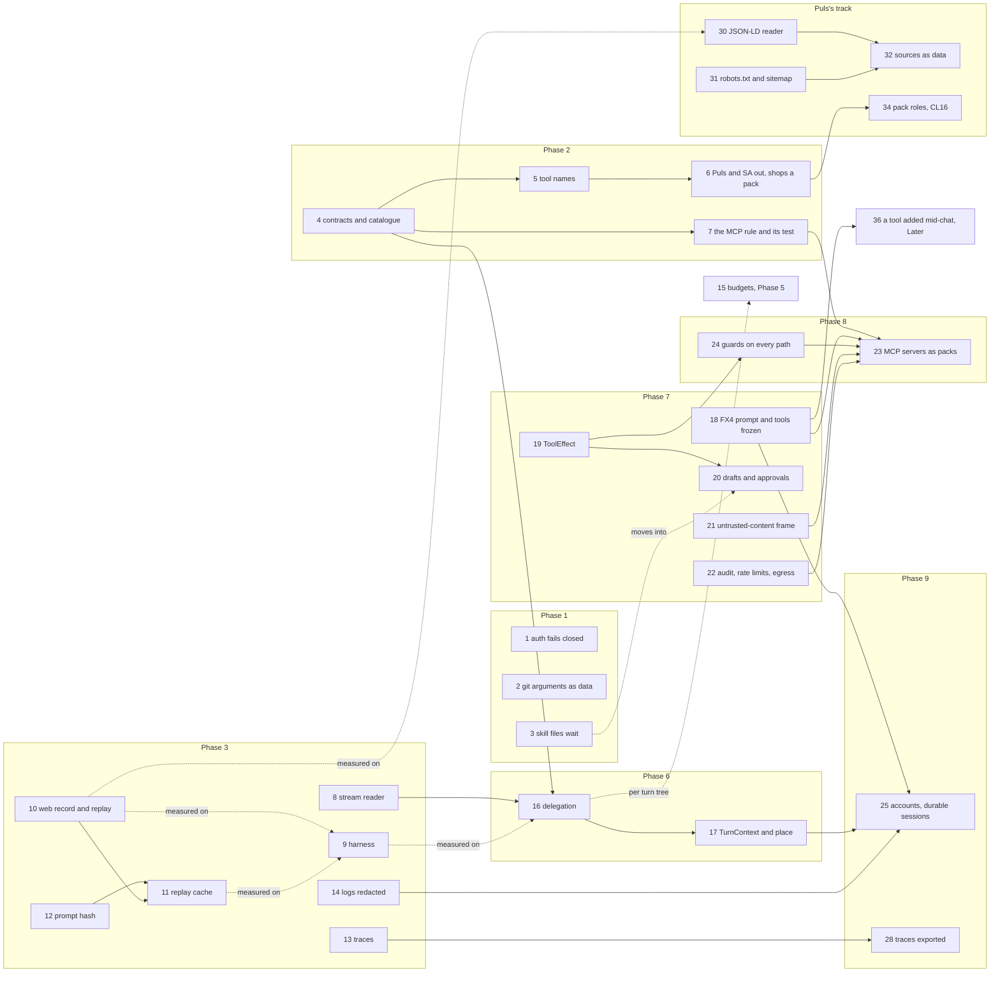

### The standards check

**What the engine meets today** (checked):

- Stopping conditions (Anthropic, *Building effective agents*): 10 rounds (`AgentEngine.cs:120`), continuations after
  a cut-off (`:241`, `:251`), and at the limit the tools stay on the request with `tool_choice: none`
  (`ToolCallGuards.cs:79-88`, FX1).
- Paging and truncation (Anthropic, *Writing tools for agents*): `WebTools.cs:130-145`, and a result over 50,000
  characters summarised (`ToolCallGuards.cs:29,65-70`).
- One `IChatClient` with a middleware pipeline (the Microsoft.Extensions.AI overview): `AgentEngine.cs:117-133`.
- Model text never reaches a shell: skill and tool arguments travel as environment variables or lists (ADR 0004).
  Git's one argument string, split by .NET rather than a shell, is the exception, and Phase 1 removes it.
- Every model request measured, with unknown prices `null`, never 0 (ADR 0007).
- No MCP Sampling, Roots or Logging is used.
- POPIA's minimality (s10): Puls's web app turns the browser's position, to two decimals (about 1 km), into a town
  name with OpenStreetMap's Nominatim, and only the town reaches the API
  (`src/louis-agent.puls/wwwroot/js/chat.js:205-227`); nothing marks it as personal information in code yet (row 17).

**Gaps**, each with the row that closes it:

| Standard | What it asks | louis-agent today (checked) | Fixed by |
|---|---|---|---|
| OWASP Top 10:2021 A01; the MCP specification's server duties | Deny by default; access control | **No.** The API and the MCP server over HTTP warn, then serve shell, files and git without a key (`src/louis-agent.api/Program.cs:41-60`, `src/louis-agent.mcp-server/Program.cs:86-95`) | 1 |
| CWE-88, OWASP LLM05:2025, ADR 0004 | Arguments as a list; a value never read as an option | **No.** `GitTools.cs:338-348`; a value starting with `-` reaches git as an option: `git show --output=<file> --stat` wrote a file outside the repository (probed on git 2.43.0, each value one argument) | 2 |
| OWASP Agentic ASI06 | Check what the agent writes for later before it is kept | **No, by design.** Skill files are saved and loaded at once (`SkillTools.cs:201-205`) | 3, then 20 |
| Anthropic, *Building effective agents* | Workflows in code where the steps are known (routing, evaluator-optimizer) | **Partly.** Routing is a prose table (`Prompts/agent/puls/voice.md:9-15`); "Only when all three pass is the fix confirmed" is prompt text (`Prompts/agent/louis-agent/voice-orchestrator.md:28-33`) | 16 |
| Anthropic's extended-thinking and preserved-thinking docs | Freeze the system prompt and tools at session start; append changes | **No.** `history[0]` is rewritten (`AgentEngine.cs:257-259`) and the shared list is sent (`:268`) | 18, 17 |
| The MCP specification; OWASP LLM06:2025 | A human can deny a tool call; approval for high-impact actions; least agency | **No.** Only agent-built tools wait (`AgentBuiltTools.cs:12-13`); the shell toolsets run any code (`ToolsetCatalog.cs:46-63`) | 19, 20 |
| Anthropic's context-engineering guidance | Compaction into a new window; clear old tool results | **No.** F9 is unbuilt (`TODO.md:59-61`) | 37 |
| The same; Anthropic's multi-agent research system | Children return condensed results (often 1,000-2,000 tokens) or references | **No.** A child's answer goes back whole (`ToolMessage.cs:768-769`) | 16 |
| Anthropic's multi-agent research system | Durable runs, resume | **No.** In memory, dropped after 4 hours idle (`AgentSessions.cs:136-138`) | 25 |
| Microsoft.Extensions.AI's OpenTelemetry client; the GenAI conventions | Tracing per turn and tool call | **No.** No OpenTelemetry or `ActivitySource` in core or `src` | 13, 28 |
| The MCP specification | Tool annotations; an output schema | **No.** Only `ParallelSafe` per toolset (`ToolsetDefinition.cs:32`); tools published bare (`src/louis-agent.mcp-server/Program.cs:158`), so the schema's defaults present each as destructive and open-world | 19; output schemas in F36's plan |
| The same | Execution errors marked `isError` | **No.** Failures are "Error: …" strings (`ToolMessage.cs:156-157`, `ErrorWithReason`, "Error: {Reason}", as the shop tools return it at `ShopTools.cs:79`) | 24 |
| The same (client duties) | Validate results, time out, log | **Partly.** Only inside the loop (`AgentEngine.cs:123`); the MCP export skips it (`src/louis-agent.mcp-server/Program.cs:141,158`) | 24 |
| The same (2026-07-28 server duties) | `server/discover`; `tools/list` in a fixed order, with `ttlMs` and `cacheScope` | ***Unverified.*** SDK 2.2.0 should serve them; not run | 24's test |
| The MCP 2026-07-28 changelog | Stateless calls: no `initialize`, no session id | Client: **no** (`RiderMcpClient.cs:40-44`) | 23 |
| The MCP authorization specification | OAuth 2.1 with PKCE and its RFCs; stdio credentials from the environment | **No** OAuth; needed only when a real HTTP server is | 23, later |
| The MCP security best practices | Block private addresses, check redirects; an egress proxy; approve local servers | **Partly.** `SsrfGuard.cs:29-34,67-70`, by hand; GOAL's skill 15 lists the browser's gaps (`docs/GOAL.md:36`) | 22, 23 |
| The MCP specification | Prefix tool names per server; treat annotations as untrusted | **Partly.** A `rider_` prefix (`RiderMcpToolDiscovery.cs:48`); a clash would throw (`ToolRegistry.cs:31-37`) | 23 |
| OWASP LLM01:2025 | Segregate external content; adversarial tests | **Partly.** Fixed fences, one inline (`WebTools.cs:140,142`); sub-session answers unfenced; no red-team suite | 21, 22 |
| OWASP Agentic ASI03, ASI07 | Per-agent credentials; typed messages between agents | **Partly.** One `AGENT_API_KEY` both ways (`AgentOptions.cs:168-169,243`); results found by regex | 16 |
| OWASP LLM10:2025 | Rate limits, quotas, timeouts | **Partly.** A prompt budget for sub-sessions only (`ToolCallGuards.cs:96-102`) | 15, 22 |
| Microsoft.Extensions.AI.Evaluation | Reuse its evaluators, reports and cache | **No.** Not referenced; the scorers are Python | 9, 11 |
| Anthropic, *Demystifying evals for AI agents* | Evals on every change, repeated trials | **Partly.** `--repeat` exists (`benchmarks/routing/run_check.py:105`); CI unit-tests the Python only (`.github/workflows/ci.yml:56-58`). CI will gate the harness, the graders and the golden files; an agent regression is caught only by a run | 9, 11 |
| POPIA s13, s14, s19 | A stated purpose; retention limits; safeguards | **No.** Full arguments and part of the user's text in logs, with no retention (`ToolCallGuards.cs:38-41,63`, `ToolCallRecords.cs:15-23`) | 14, 25 |
| POPIA s11, s72 | A lawful ground for each purpose; transfers outside South Africa | **No.** Nothing records a lawful ground for sending each turn to a model provider in the US, and Puls tells the user nothing about it | Puls's notice (the host's job) and 25, not core |
| Anthropic's SDK; Microsoft.Extensions.Http.Resilience | One retry layer; timeouts that fit streams | **Partly.** The SDK's defaults (`LlmClientFactory.cs:62-72`); Ollama's 10 minutes (`:120-130`) | 26 |
| PublicApiAnalyzers and package validation; Apache-2.0 §4; GPL-2.0 | A declared public surface; notices; source for GPL binaries we hand over | **No.** No notices; full SDK images with git | 29 |

### What the engine must not take on

- **Product logic.** Voices, routing tables, the Afrikaans briefing labels, Puls's report shapes and the voorman
  identity's `TriageWorkflow` belong to identities (ADR 0027).
- **A tool per website.** A site is an argument (`shop`, `ShopTools.cs:25-27`) or a row of data, never a tool. Tools
  are frozen per conversation (ADR 0006, 0008), so a list that followed the town would break chats and the cache.
- **Site readers and country data.** Checkers, recipe readers and customers go to packs; the Nominatim lookup limited
  to `countrycodes=za` moves with the shops pack (Phase 2), and into the places pack behind an `IGeocoder` seam when
  places comes (row 33). Core keeps no Nominatim and no South Africa.
- **Rand and SAST assumptions.** `GetToday`'s zone and the API's fallback read `HOST_TIME_ZONE` (Phase 2);
  `VerifyQuote`'s rand matcher becomes a cleanup (row 42).
- **Third parties' DLLs in our process.** F37 is cut; anyone else's code runs as an MCP server, an orange pack (row 23).
- **The rows of the source directory.** They are pack data; core holds the frame now (row 21) and the `SourcedFact`
  shape once a second source needs it (row 32).
- **Graders, simulations and suites.** They live in `simulations/` and each identity's tests; core gives the replay
  seams and the prompt hash (rows 10 to 12), and the stream reader is its own project (row 8).
- **Host concerns.** HTTP auth at the edge (core holds only the pure rule, row 1), rate limiting at the edge, accounts
  and tenants, the privacy notice and consent, the approval screens, OpenTelemetry exporters and dashboards, and the
  MongoDB store's implementation.
- **A multi-agent framework in core.** No handoff meshes, planners, MCP sampling or A2A server; A2A can come later as
  an adapter behind `IChildTransport` (ADR 0031). Microsoft Agent Framework's checkpoints are looked at in Phase 6 B4's
  spike, and ADR 0030 (*Build or adopt*, Phase 0) says why the loop stays ours: "we own the agent to learn; Puls's edge
  is local data, an SA voice and businesses that join".
- **`SummarizingChatReducer`.** It rewrites history, which ADR 0008 forbids; F9 compacts by "summarise, then open a new
  window" (row 37).
- **Embeddings and a vector store, for now** (F45, Later): only when the area-guide simulation shows retrieval failing.
- **Images, for now:** only with the vision feature on Puls's track, after F35 (row 35).

### Unverified in this part

- The git version in the container images (`mcr.microsoft.com/dotnet/sdk:10.0` with apt's git); `--end-of-options`
  needs 2.24 or later. The probe ran on git 2.43.0 locally, and each command's support for it is pinned by FX19's
  tests, not assumed.
- The OWASP Top 10:2021 A01 wording "deny by default", and the names of OWASP Agentic ASI02, ASI03, ASI06 and ASI07, as
  the standards check and the engine research cite them; not re-read here.
- That RFC 9309 leaves out `Crawl-delay`.
- Anthropic's beta names and dates (`inline-tools-2026-09-15`, `thinking-binding-controls-2026-08-01`,
  `compact-2026-09-04`): read in Anthropic's docs on 2026-10-18, not tried.
- ModelContextProtocol 2.2.0's behaviour (the 2026-07-28 revision, `server/discover`, `ServerInfo`, the dropped tools,
  the `isError` mapping): read in its source, never run; the `isError` mapping was read in source not pinned to the
  2.2.0 tag.
- *Demystifying evals for AI agents*: its page and date were checked on 2026-10-18 for Phase 3; its terms are as the
  standards check quotes them, not re-read in this part.
- About 22k tokens for 123 tools assumes 4 characters a token; no Puls session's tool count was measured.
- Whether thinking signatures survive the caching client's JSON round trip (row 11's first test).
- Anthropic's SDK retrying twice by default, and Microsoft.Extensions.Http.Resilience's 10 s and 30 s timeouts, from
  their docs as the standards check read them.
- That Microsoft.Extensions.AI's `DistributedCachingChatClient` gives no hit signal and returns the stored usage on a
  hit, from its package's docs as the engine research read them; not run.
- POPIA: not legal advice; whether a town alone identifies a person depends on what else the chat holds.

## Part 4 · The phases

### How the plan lands, and how each phase is planned

**How it lands** (rule 3 and `docs/plans/README.md`'s conventions). Phase 0 lands this document as the **roadmap**,
`docs/plans/platform.md`, on `docs/platform-plan`, and it is never edited afterwards except to link each phase's plan.
> One change since approval, at Louis's word (2026-10-19): Claude writes each learning write-up and Louis reads it
> afterwards ("I want you to type the lesson and will read it afterwards"), in place of "written by Louis himself,
> without the code open"; every gate below says so.
Before a phase's first step, its section is copied, as Louis approved it, into **its own plan file on its own
branch**, with its four diagrams, namespace map and folder trees, and that branch adds the one link to it in
`platform.md`; *Approved during the build* goes in that file, never in `platform.md`. FX18, FX19 and FX20 are one step
each, so they get fix docs, not plans (rule 3 asks a plan only for a fix of more than one step).

**Phases 0 to 4 and 6 are planned to the step** here, each with its four diagrams (architecture, interfaces, objects,
communication), a namespace map and folder trees, today and after. **Phases 5, 7, 8 and 9 are planned to the
feature:** before its first step, each gets its own plan, `docs/plans/Fnn-name.md` or `FXnn-name.md` (rule 3), with the
same diagrams, approved by Louis and committed on its branch; `platform.md` then links to it and is never rewritten for
it.

| Phase | Its plan, written before its first step | Branch |
|---|---|---|
| 0 | this roadmap itself, `docs/plans/platform.md` | `docs/platform-plan` |
| 1 | no plan: three one-step fixes, each with its fix doc | `fix/FX18-auth-fails-closed`, `fix/FX19-git-arguments-as-data`, `fix/FX20-skill-files-wait-for-approval` |
| 2 | `CL15-engine-identities-packs.md`, copied from Phase 2's section | `refactor/CL15-engine-identities-packs` |
| 3 | `F18-simulations.md`, copied from Phase 3's section | `feature/F18-simulations` |
| 4 | `F40-sales-playground.md`, copied from Phase 4's section | `feature/F40-sales-playground` |
| 5 | `F07-budgets.md`, written then | `feature/F7-budgets` |
| 6 | `F39-orchestration.md`, copied from Phase 6's section | `feature/F39-orchestration` (Part A), `feature/F39-voorman-identity` (Part B) |
| 7 | FX4's plan, `FX04-append-only-history.md` (a fix of more than one step), then `F41-drafts-and-approvals.md` and `F42-safety-and-audit.md`, each written then | `fix/FX4-append-only-history`, `feature/F41-drafts-and-approvals`, `feature/F42-safety-and-audit` |
| 8 | `F36-mcp-packs.md`, written then | `feature/F36-mcp-packs` |
| 9 | `F43-accounts-and-sessions.md`, `F08-reliability.md`, `F15-model-limits.md` and `F44-engine-as-a-product.md`, each written then | each its own `feature/` branch |
| Puls's track | each item its own feature or fix, with its own plan (F35's draft rebased first) | its own |

**How a phase ends: the learning gate.** Each step is one commit with its test, written first and seen failing, and
Louis reviews each step before the next; a day holds only what he can review line by line. Every phase ends with a
learning write-up step, and **a phase is done when Claude has written its write-up and Louis has read it** (changed
2026-10-19 at Louis's word; GOAL.md's fourth criterion, `docs/GOAL.md:53`, still asks the write-up to say *why*).
**Before Phase 2,** Claude writes the F32 to F34 write-up (end of Phase 1). The reason, with its numbers, is in *How we work through it*.

**Paid runs** are the one list in the one-page table's last column; each waits for Louis's go. Phases 0 and 1 have
none.

**The order.** Solid arrows are the order we build in; dashed arrows are what a phase or feature needs from another.

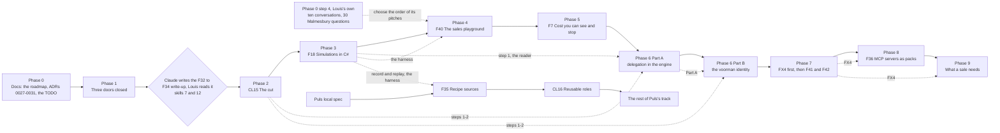

### Phase 0 · Docs: this plan, the ADRs and the TODO

Branch `docs/platform-plan`. Docs only, so no test is written first; every relative link in the changed docs is
checked to resolve, as CL4's steps did. Paid runs: none. GOAL skill 18. Louis: "draw the plan but look at the rules
for drawing a plan".

#### Context

| Today (checked) | Where |
|---|---|
| A plan is one file named `Fnn-`, `FXnn-` or `CLn-name.md`, with *Context*, *Design*, *Steps*, *Verification* and *Concepts*; three diagrams always (interface, architecture, communication) and a namespace map always; saved and committed before step 1 on its branch; kept as approved | `docs/plans/README.md`, *Conventions* |
| Rule 3: the approved plan saved to `plans/` on its branch, never rewritten; a change Louis approves during the build goes under *Approved during the build* | `docs/CLAUDE.md`, *How to work with Louis* |
| 26 ADRs, the last 0026; an ADR is never edited once accepted, except its *Status* line, whose kinds are *Proposed*, *Accepted* and *Superseded by* | `docs/adr/`, `docs/adr/README.md:49-50,58` |
| ADR 0012 leaves open "whether the real one keeps core or moves to Anthropic's Tool Runner" | `docs/adr/0012-one-orchestrator-per-microservice.md:24-25` |
| ADR 0022: the checks are scripts on one Python harness, their protocol held to `benchmarks/fixtures/session-stream.sse` | `docs/adr/0022-benchmarks-recorded-from-the-protocol.md` |
| 110 open lines in the TODO (`grep -c '^\s*- \[ \]' TODO.md`); build mode its own section | `TODO.md`, `:87` |
| F21 and F22 "built" (2026-10-13), F25 and F26 "built" (2026-10-15), F29 "planned" though all four of its steps are in git (`d79dbb1`, `ae257c5`, `d7afa23`, `28c4901`) | `docs/features/README.md:38-45` |
| *Finishing a feature*: TODO and CHANGELOG, status **done** in the doc and the table, the spec, limitations, the benchmark, user docs, decisions, the goal's map | `docs/features/README.md:124-145` |
| A fix doc has *Symptom*, *Cause*, *Fix*, *Tests*, *Confirmed* and *Lesson*; FX17 is the latest; an open fix has a TODO line that links to its doc | `docs/fixes/README.md` |
| A *Missing* skill gets a line in the TODO's backlog (*Agent architecture gaps*) until it is planned; when the TODO changes, GOAL.md's *Planned* and *Missing* columns change, not the skill | `docs/GOAL.md:16-17`, `:17-18` |
| Two learning write-ups, one a draft by Claude | `docs/learning/` |

#### Design

Louis asked for the pictures: "your plan must contain [a] comms diagram, [an architecture] diagram, object and
interface diagram, this is how i understand not by reading", then "no, [include] the text i just need to see it
also", and "this must include folder structure changes when new projects must be split". Phase 0 makes those the rules every plan
follows, and draws them for this phase too. Its "types" are documents, so its interface diagram shows the kinds of doc
and what each must hold, and its namespace map is a table of the files it adds or changes.

**Architecture: the docs after Phase 0, and which step writes each.**

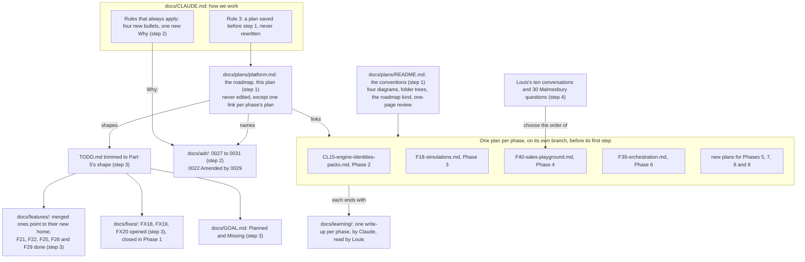

**Interfaces: the kinds of doc, and what each must hold.**

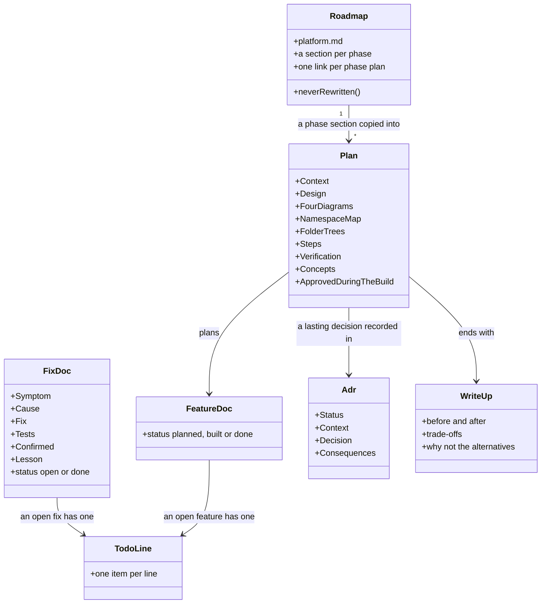

**Objects: the docs as they stand when Phase 0 is merged.**

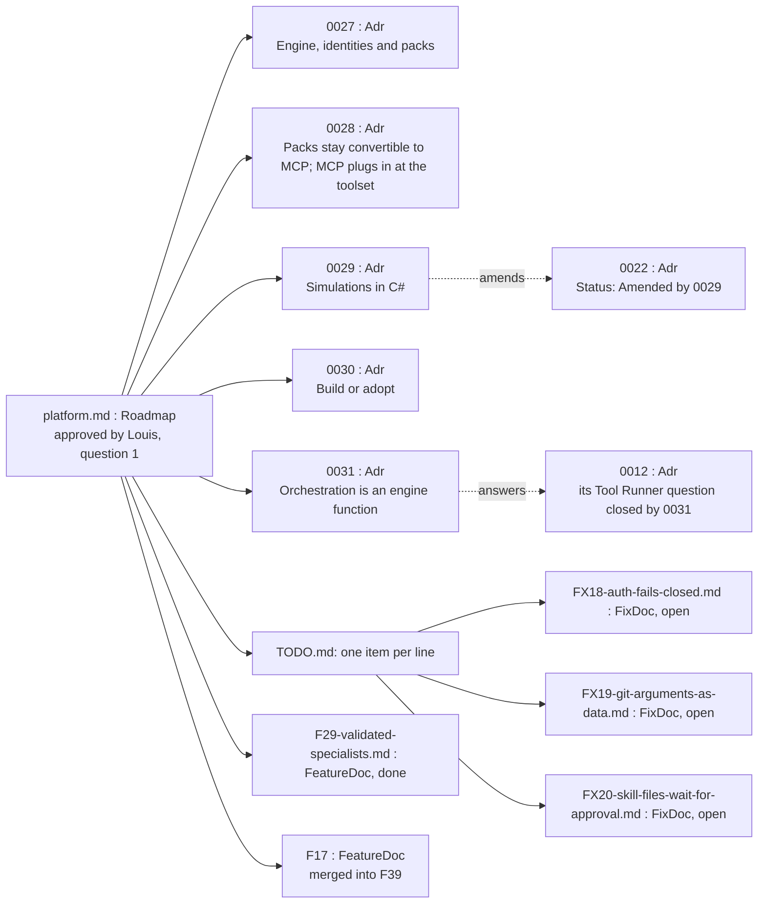

**Communication: a phase's plan, from the roadmap to its write-up.**

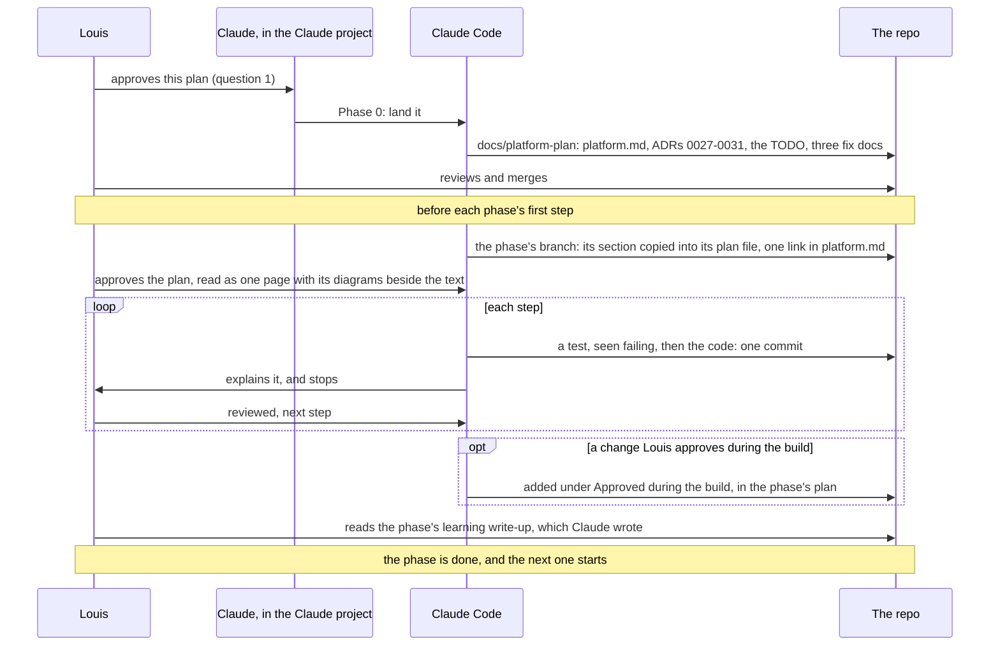

**Files this phase adds or changes** (its namespace map):

| File | Folder | What changes | Step |
|---|---|---|---|
| `platform.md` | `docs/plans/` | new: the roadmap, this plan as Louis approved it | 1 |
| `README.md` | `docs/plans/` | a row for the roadmap; the conventions gain four diagrams, folder trees, the roadmap kind, a phase's plan copied from it, the one-page review | 1 |
| `0027-engine-identities-and-packs.md`, `0028-packs-stay-convertible-to-mcp.md`, `0029-simulations-in-csharp.md`, `0030-build-or-adopt.md`, `0031-orchestration-is-an-engine-function.md` | `docs/adr/` | new (names proposed; 0028's is the one `docs/CLAUDE.md` links) | 2 |
| `0022-benchmarks-recorded-from-the-protocol.md` | `docs/adr/` | its *Status* line: Amended by 0029 | 2 |
| `README.md` | `docs/adr/` | five rows; the status kinds gain *Amended by NNNN* | 2 |
| `CLAUDE.md` | `docs/` | *Rules that always apply*: bullets for 0027, 0028, 0029 and 0031; 0030 joins the Microsoft.Extensions.AI bullet's *Why* | 2 |
| `TODO.md` | the root | trimmed to Part 5's shape, one item per line | 3 |
| `CHANGELOG.md` | the root | a line each for F21, F22, F25, F26 and F29 | 3 |
| the feature docs and `README.md` | `docs/features/` | merged ones say where they went; five closed | 3 |
| `FX18-auth-fails-closed.md`, `FX19-git-arguments-as-data.md`, `FX20-skill-files-wait-for-approval.md`, `README.md` | `docs/fixes/` | new, status open: *Symptom* and *Cause* as checked here; three rows | 3 |
| `GOAL.md` | `docs/` | *Planned* and *Missing* follow the new TODO; a row 20, *Extensibility* (question 10: yes) | 3 |

**Folder trees.** Today:

```
docs/
├── CLAUDE.md                # how we work; Rules that always apply
├── GOAL.md                  # the skill map
├── adr/                     # 0001 to 0026, README (the index)
├── features/                # 33 files: README and the feature docs
├── fixes/                   # FX01 to FX17, README
├── learning/                # 10-multi-agent-orchestration.md (a draft), 13-cost-and-token-economics.md, README
├── plans/                   # 35 files: README and one plan per feature, fix or cleanup
└── …                        # architecture/, projects/, specs/, SETUP.md and the rest, unchanged
TODO.md                      # 110 open lines
CHANGELOG.md
```

After Phase 0:

```
docs/
├── CLAUDE.md                # + four rules, one Why (step 2)
├── GOAL.md                  # Planned and Missing follow the new TODO (step 3)
├── adr/
│   ├── 0022-benchmarks-recorded-from-the-protocol.md   # Status: Amended by 0029
│   ├── 0027-engine-identities-and-packs.md             # new
│   ├── 0028-packs-stay-convertible-to-mcp.md           # new
│   ├── 0029-simulations-in-csharp.md                   # new
│   ├── 0030-build-or-adopt.md                          # new
│   ├── 0031-orchestration-is-an-engine-function.md     # new
│   └── README.md                                       # five rows; "Amended by"
├── features/                # merged ones point to their new home; F21, F22, F25, F26, F29 done
├── fixes/
│   ├── FX18-auth-fails-closed.md                       # new, open
│   ├── FX19-git-arguments-as-data.md                   # new, open
│   ├── FX20-skill-files-wait-for-approval.md           # new, open
│   └── README.md                                       # three rows
├── learning/                # unchanged until Phase 1's write-up
└── plans/
    ├── platform.md          # new: the roadmap
    └── README.md            # the conventions, extended
TODO.md                      # Part 5's shape, one item per line
CHANGELOG.md                 # five lines
```

#### Steps

| # | Step | GOAL skill |
|---|---|---|
| 1 | **The roadmap.** This plan as `docs/plans/platform.md`, with a row in the plans index. The plans' conventions gain: the **object diagram** as the fourth diagram (a `flowchart` of the instances one main case holds in memory); **folder trees**, today and after, whenever a plan adds or splits projects or folders; the **roadmap** kind of plan, `platform.md`, the one name allowed outside `Fnn`/`FXnn`/`CLn`, never edited after its approval except to link each phase's plan; a phase's section **copied**, as approved, into its own plan file on its own branch before its first step (`CL15-engine-identities-packs.md`, `F18-simulations.md`, `F40-sales-playground.md`, `F39-orchestration.md`; each copy is made on its phase's branch, not here), with its four diagrams, namespace map and folder trees, and *Approved during the build* only in that file; FX18, FX19 and FX20 get fix docs, not plans (rule 3 asks a plan only for a fix of more than one step); Phases 5, 7, 8 and 9 each get a new plan file, approved by Louis before its first step; and "**a plan is reviewed as one page with its diagrams drawn in place beside its full text**" | 18 |
| 2 | **ADRs 0027 to 0031** (below), each in the Nygard format of `docs/adr/README.md`; ADR 0022's *Status* line becomes "Amended by 0029", and the ADR README's status kinds gain *Amended by NNNN* (a later ADR changes part of a decision and the rest stands); five rows in the ADR index; `docs/CLAUDE.md`'s *Rules that always apply* gains a bullet each for 0027, 0028, 0029 and 0031, and 0030 joins the *Why* of the Microsoft.Extensions.AI bullet | 18 |
| 3 | **The TODO trimmed** to Part 5's shape, **from 110 open lines to 62**, one item per line. The merged features' docs say where they went (F6 into F7, F11 into F7, F12 into F44, F13 into F15, F16 into F9, F17 into F39, and F8-S4 into F39). **F21, F22, F25, F26 and F29 closed** as *Finishing a feature* says (status **done** in each doc and the features index, a CHANGELOG line each), their open items moved to Puls's track. Build mode's lines removed, one *Later* line kept as a side note (question 5). FX4 moved into Phase 7. FX18, FX19 and FX20 opened as fix docs (*Symptom* and *Cause*, as Phase 1 states them), each with its TODO line. GOAL.md's *Planned* and *Missing* columns follow the new TODO (what this plan now plans moves from *Missing* to *Planned*), and its sentence at `docs/GOAL.md:16-17`, which sends a *Missing* skill to the TODO's *Agent architecture gaps*, points at the new TODO's *Later* instead, which holds every *Missing* item no phase plans; a row 20, *Extensibility* (question 10: yes). The *Known limitations*' pointers name what removes each (`TODO.md:376-405`): 1 F36, 2 F43, 3 and 8 F15, 5 F42, 6 F10, 9 FX4 | 18 |
| 4 | **Louis's own, no code:** ten conversations (five businesses, five likely Puls users): what would they pay for; and 30 real local questions from Malmesbury people, answered blind by Puls (later by the area-guide simulation), Gemini, ChatGPT and Google Maps, so we build only for the question types where they fail. The answers choose the order of Phase 4's two pitches (invoices first by default); a pitch they point to that this plan doesn't hold (documents with sources, for example) gets its own plan before Phase 4 starts. Notes are kept in the Claude project without names or contact details; the repo gets the summary and the decision in F40's feature doc, and the TODO's *Validate demand* line (`TODO.md:134-135`) is ticked | none |

**The five ADRs of step 2:**

- **0027 *Engine, identities and packs*.** Context: Puls in core (10 of its 26 prompts, the shop tools, the SAST
  default) and Louis's "we have to make a clear cut off when it comes to which is the agent and which is Puls".
  Decision: core is the engine; an **identity** (`IAgentIdentity`) is who an agent is (its voice, modes and roles, and
  the packs it uses, named by name); a **pack** (`IAgentPack`) is what it can do (toolsets, providers, guides,
  settings, and the packs it requires, by name); one composition project, `src/louis-agent.composition`, knows them
  all, and hosts choose with `IDENTITIES` and `PACKS` at start-up. An identity may hold workflow code that uses its own
  packs' public types (the voorman identity's `TriageWorkflow`, Phase 6); a pack never references another pack or an
  identity (`ArchitectureTests`). Consequences: core names no product and no country; the code-review image carries
  Puls's assembly but loads none of it unless `IDENTITIES` names it. Rejected: a copy of the engine per product, packs
  loaded as DLLs from a folder (F37, cut), doing nothing.
- **0028 *Packs stay convertible to MCP; MCP plugs in at the toolset*.** The text is the MCP-packs check's (its part
  1b). Every pack is kept shaped so it can be published as an MCP server, or replaced by one, with little or no new
  code; nothing is converted until a real need comes. MCP plugs in at the toolset: in F36 the composition root turns
  each configured server into a pack with one `ToolsetDefinition`, connected and listed once when the host starts,
  before the catalogue is built, so `CreateTools` stays synchronous and every chat keeps the tool list it opened with
  (ADR 0006, 0008). A pack's tools take plain data and return text, failures included, and what they read from the
  session also arrives as a parameter; a pack frames and bounds its own results, keeps its guides as prose, reads its
  own settings and core's shared services, and names other packs instead of referencing them. Tool names are unique
  across the catalogue, MCP-safe, and come from one function, `AgentCatalog.NamesOf`; `PackConvertibilityTests` holds
  the shapes, a review checklist the behaviour. Context: Louis's "the rules must state then that this layer [should be
  convertible] to mcp quickly" and "if needed, we are [alone] in this"; the old draft's "listed once at session open"
  and why it cannot work (engines cached per profile, `AgentEngineFactory.cs:117-134`; one tool list per engine,
  `ToolRegistry.cs:22-26`; `CreateTools` synchronous, `ToolsetDefinition.cs:30`). It also records: the protocol
  revision 2026-07-28 that ModelContextProtocol 2.2.0 uses by default (a `server/discover` probe, falling back to
  `initialize`, within a 5 s probe timeout), under which `serverInfo` is optional, so a pin is "the server's version
  when it reports one, and always a hash of the listed tools"; that `list_changed` arrives only after
  `subscriptions/listen`, which the 2.2.0 client never opens, so ignoring it until a restart costs nothing; that the
  listing's `ttlMs` and `cacheScope` hints (`ListToolsResult.TimeToLive` and `CacheScope` in the SDK) are ignored on
  purpose, as `list_changed` is; that a server's list may vary with the authorization presented; that annotations are
  untrusted unless they come from a trusted server, clients should prefix names, and servers should return their tools
  in a fixed order; that an allowlisted tool missing from the list counts as drift; and that the `ReadOnly` hint never
  comes from `ParallelSafe` (it comes from Phase 7's `ToolEffect`). Consequences: a server that is down at start-up
  stays off until a restart, and an orange pack's guide is configuration read once at start-up, which refines ADR 0018
  for packs that are configuration. Rejected: building `McpPack` now; async `StartAsync`/`DisposeAsync` on
  `IAgentPack`; `CreateTools` typed to `AITool`; listing when a session opens; doing nothing. Its rule goes into
  `docs/CLAUDE.md` after *Toolsets per session* as this bullet, written there with the separator the file's other rule
  bullets use after the bold name:

  ```markdown
  - **Packs stay convertible to MCP** (CL15): a pack could be served as an MCP server, and an MCP server could stand in
    for a pack (F36); we convert only when a real need comes. MCP plugs in at the toolset: a server becomes a
    one-toolset pack, connected and listed once when the host starts, so every chat keeps its tool list. A pack's tools
    take plain data and return text, a failure as text with its reason; what they read from the session also arrives
    as a parameter, and no description names an identity; a pack frames the outside data it returns and bounds its own
    output; its guides are prose with no `## Skill:`; it reads its own settings and core's shared services, and names
    the packs it needs, never referencing their code; its tool names are unique and MCP-safe.
    `PackConvertibilityTests` holds the shapes, review the rest.
    Why: [ADR 0028](adr/0028-packs-stay-convertible-to-mcp.md).
  ```
- **0029 *Simulations in C#: one harness for checks, regressions and demos*.** Context: the Python checks (1,442 lines
  in `benchmarks/`), the stream read four times, and Louis's "[every] demo must be in c# we call it simulations, of a
  real world [task]". Decision: the harness, `simulations/louis-agent.simulation/`, belongs to the engine and is sold
  with it; the simulations belong to the identity or pack they prove (`simulations/louis-agent.simulations.{puls,demo,voorman}/`);
  the field's words (a task with success criteria, trials, transcripts, outcomes, graders, pass@k and pass^k; modes
  our addition); cost from the ledger, each turn's seconds from the harness; CI gates the harness, the graders on
  recorded transcripts and the golden files, and an agent regression is caught only by a run; a replay cache for
  recorded simulations only. It **amends ADR 0022**: the harness is C#, and the protocol's fixture moves to
  `tests/louis-agent.session-stream.tests/Fixtures/`; the protocol and the store stand.
- **0030 *Build or adopt*.** Compares six: Microsoft Agent Framework 1.0, Semantic Kernel, the GitHub Copilot SDK, the
  Claude Agent SDK, the OpenAI Agents SDK and, as a peer, Existo (below): what each gives, its licence (checked when
  the ADR is written), and what each would hide from Louis; and says why the loop stays our own on
  Microsoft.Extensions.AI. It records "we own the agent to learn; Puls's edge is local data, an SA voice and
  businesses that join", and Louis's "i want to use my own agent [because] i can". What we adopt instead of
  hand-building is named there too: `DistributedCachingChatClient` (Phase 3), `UseOpenTelemetry()` (Phase 3),
  `ApprovalRequiredAIFunction` and `ToolApprovalRequestContent` (F7, F41),
  `JsonSchemaExporter` (Phase 6), Microsoft.Extensions.AI.Evaluation (Phase 3) and the MCP SDK's client (Phase 8).
  When to look again: Phase 6 B4's spike of Microsoft Agent Framework's checkpoints. A one-day spike of one Puls flow
  on its `ChatClientAgent`, compared on the cook simulation, is an option the ADR names, not a planned step.
  The sixth is **Existo** (https://www.nuget.org/packages/Existo/, read 2026-10-19; every fact here is from its NuGet
  page, and its code was not read): a .NET 10 agent framework by one maintainer, Thiago Santos, MIT, version
  0.1.0-alpha.0.15 (last updated 2026-06-17, 302 downloads in total), which its README calls a learning project built
  from scratch, with Claude as an assistant but "not vibe coded". It is compared as a peer, not as something to adopt,
  since an early alpha with one maintainer is not a base for a product. It hand-builds its own ReAct loop (`LlmAgent`)
  and its own `ILlmProvider` for five providers, ships as many small packages (a core `Existo` plus one per provider,
  MCP, A2A, orchestration, persistence and OpenTelemetry), registers through one DI call (`services.AddExisto(...)`,
  returning an `ExistoBuilder`, with keyed `IAgentRunner`s), and its OpenTelemetry package gives a span per turn,
  child spans per tool call and metrics. The ADR records what we take from it: packages split per optional part, one
  DI entry point and OpenTelemetry metrics beside the traces (all F44, Phase 9), a timeout per tool beside its declared
  effect (`ToolEffect`, Phase 7), and a sandboxed runtime for agent-written skills to weigh in F42 (Existo runs
  runtime-created skills in TypeScript with Deno and in Python with uv). It also records what we deliberately don't
  take. We don't hand-build provider adapters, because our choice is one `IChatClient` across providers (ADR 0002,
  0003). We don't add tools to a running session, as its `ISessionToolOverlay` does, because a session keeps the
  toolsets it opened with (ADR 0006) and history is append-only (ADR 0008): FX4 shows that changing the tools mid-chat
  breaks Claude's thinking blocks and the prompt cache. And we don't rewrite history with an LLM summary, as its
  auto-compaction does (ADR 0008); F9 summarises, then opens a new window.
- **0031 *Orchestration is an engine function*.** Agents as tools, typed results, checks in code, one policy per turn
  tree; the tier stays `louis-agent.core`, which closes ADR 0012's open Tool Runner question (question 8); MCP for
  tools, A2A later at the edge, as an adapter behind `IChildTransport`; credentials per peer and an allow-list of who
  may delegate to whom (OWASP Agentic ASI03, ASI07). Written here with the others, so Phase 6's A0 no longer writes it.

#### Verification

Docs only: every relative link in the changed docs resolves; `ArchitectureTests` and `SkillsLayoutTests` are not
touched. Louis reads the roadmap as one page, with its diagrams drawn in place, before he approves it (question 1).
Paid runs: none.

#### Concepts

| Step | Concept | GOAL skill |
|---|---|---|
| 1 | A roadmap against a plan: the roadmap says what and in which order, and each plan says how, written when its turn comes | 18 |
| 2 | Architecture decision records (Nygard's format): a lasting decision kept with its context and what it cost; amending, not editing | 18 |
| 3 | Scope as a product decision: cut, merge or keep, each line with its reason | 18 |
| 4 | Validating demand before building: what people would pay for, and where the free rivals fail | none |

### Phase 1 · Three doors closed

Three fixes, each one step, test first, one commit, and its fix doc (opened in Phase 0 step 3), each on its own
branch: `fix/FX18-auth-fails-closed`, `fix/FX19-git-arguments-as-data`, `fix/FX20-skill-files-wait-for-approval`. Then
the skill-15 write-up. Paid runs: none. GOAL skill 15. Each fix finishes as *Finishing a fix* says: its doc's *Fix*,
*Tests*, *Confirmed* and *Lesson* filled in and its status **done** here and in the index, its TODO line removed and a
CHANGELOG line added.

#### Context

| Today (checked) | Where |
|---|---|
| Without `AGENT_API_KEY` the API logs a warning and serves `/sessions`, `/workspace`, `/git`, `/toolsets`, the roles routes and `/model` to anyone who can reach it; its agent runs shell commands and writes files | `src/louis-agent.api/Program.cs:41-60` |
| The MCP server over HTTP (`MCP_TRANSPORT=http`) does the same without `MCP_API_KEY` or `AGENT_API_KEY` | `src/louis-agent.mcp-server/Program.cs:86-95`; `config/.env.example:86-88` |
| The same fixed-time key check is written in both hosts | `src/louis-agent.api/Program.cs:228-234`; `src/louis-agent.mcp-server/Program.cs:115-121` |
| The admin gate already fails closed: with no key the portal is closed; pure and tested without a web host | `src/louis-agent.api/Services/AdminGate.cs:6-8`; `tests/louis-agent.api.tests/AdminGateTests.cs` |
| The settings say the API is open without the key | `config/.env.secrets.example:33-35`; `docs/SETUP.md:129-130`; `docker/docker-compose.yml:107`; `docker/docker-compose.puls.yml:47` |
| 38 calls to `RunGit(string)` on 36 lines build one argument string for `ProcessStartInfo.Arguments`, escaped by hand | `louis-agent.core/Tools/Git/GitTools.cs:338-348`, `:386-389` |
| `RunGitList` already passes a list, and the history tools put `--` before the model's values | `GitTools.cs:329`, `:280-281` |
| `CreateSkillFile` saves `Skills/agent/functions/{name}.md` and loads it at once, for every later session | `louis-agent.core/Agent/Tools/SkillTools.cs:149-168,201-205` |
| Agent-built tools wait in a `pending` folder for `/approve`; that folder is git-ignored | `louis-agent.core/Agent/Tools/AgentBuiltTools.cs:12-13,30-32,142-154`; `.gitignore:50-51` |
| `/approve` and `/reject` reach agent-built tools only | `louis-agent.core/Agent/AgentEngine.cs:303-317` |
| Core references no ASP.NET Core; the MCP server has no test project | `louis-agent.core/louis-agent.core.csproj`; `tests/` |

#### Design

**FX18 · Auth fails closed.**

- **After.** One setting, `AGENT_AUTH` (an enum, ADR 0024: `required`, the default, or `off`), parsed once with
  `SettingChoice`, and one pure rule in core, `HostAuth` in `Guardrails/`, which both hosts call:
  - with `required` and no key, the host refuses to start, before it listens, and the error names the missing setting
    and `AGENT_AUTH`;
  - with `off` and no key, it starts, and its warning says the auth is off on purpose;
  - a key that is set is always checked, whatever `AGENT_AUTH` says; a request without it is a 401, as today;
  - the fixed-time key check moves into `HostAuth` too, so both `HasApiKey` copies are deleted; core references no
    ASP.NET Core, so the hosts pass the two header values as strings;
  - the MCP server over stdio needs no key: it is a child process of its client, on the same machine.
- **Docs and settings.** `config/.env.example` documents `AGENT_AUTH`; `config/.env.secrets.example:33-35`,
  `docs/SETUP.md:129-130`, the two compose comments and the API's and MCP server's design docs
  (`docs/projects/louis-agent.api.md`, `docs/projects/louis-agent.mcp-server.md`) say the key is required;
  `docs/CLAUDE.md`'s *Quick start* adds the key and *Common errors* the new start-up error. No compose file sets `off`.
- **What changes for Louis.** His local stacks need a key: `AGENT_API_KEY` in `config/.env.secrets` (the compose
  files read it, `docker/docker-compose.yml:9-13`), entered once in each web app's settings (the browser keeps it,
  `src/louis-agent.web.shared/Services/ChatStore.cs:6-9`, and sends it as `x-api-key`, `AgentApi.cs:133`), or
  `AGENT_AUTH=off` in his own `config/.env`. The checks and the orchestrator already send the key when it is set
  (`benchmarks/puls_check/client.py:16-21`; `OrchestratorOptions.cs:60`, `LouisAgentClient.cs:84`).
- **Considered.** A random key made at start-up and printed (rejected: the MCP server's stdout is its protocol, and
  the web apps couldn't know the key); listening on localhost only when no key is set (rejected: inside a container
  the host must listen on every interface, and the compose files already publish on 127.0.0.1 only); fixing each host
  on its own (rejected: two copies of one rule drift, and `AdminGate` already shows the pure pattern).
- **Standard.** Deny by default (OWASP Top 10:2021, A01); ADR 0004's spirit, nothing open by accident.

**FX19 · Git arguments as data.**

- **Why a list alone isn't enough.** A list stops a value being split, but a value that starts with `-` is still read
  as an option. Probed on git 2.43.0 in a scratch repository, each value passed as one argument:
  - `git show --output=<file> --stat` exits 0 and writes the file, wherever it points; `ShowCommit(commitRef)` builds
    exactly `show {commitRef} --stat` (`GitTools.cs:37-41`) and is described as read-only;
  - `git config core.fsmonitor '<command>'`, then `git status`, runs the command; `SetConfig(key, value)` accepts any
    key (`:273-278`);
  - `git fetch` and `git push` take `--upload-pack`, `--receive-pack` and `--exec`, which run commands, and
    `Fetch(remote)` puts the model's value where git reads options (`:173-176`);
  - v1's planned test, a branch named `x --upload-pack=touch /tmp/p`, is refused ("is not a valid branch name") only
    because it starts with `x`, so it passes while the hole stays open.
- **After.**
  - Every call goes through `RunGitList`; `RunGit(string)` and `EscapeForShell` are deleted.
  - Our own options come first, then `--end-of-options`, then the model's values; paths come after `--`. Our options
    must come before it (`git log --end-of-options HEAD --oneline` fails), and `--end-of-options` stops the rest being
    read as options (`git fetch --end-of-options '--upload-pack=…'` was refused and ran nothing; `git config
    --end-of-options user.name x` works).
  - Any value from the model that starts with `-` is refused, with its reason, before git runs; the only exception is
    free text that travels as an option's own argument (the `-m` message of a commit, merge, tag or stash), which git
    reads as that option's value whatever it starts with.
  - `SetConfig` accepts only `user.name` and `user.email`, because keys such as `core.fsmonitor`, `core.sshCommand`,
    `core.hooksPath` and `alias.*` make git run commands; its description names the two keys.
  - Two new `ToolMessage` members for the refusals (`GitValueRefused`, `GitConfigKeyRefused`).
  - `ArchitectureTests` gains one check: no file in core sets a `ProcessStartInfo`'s `Arguments` string, so one can't
    come back.
- **Golden files.** The refusals are new `ToolMessage` members and `SetConfig`'s description changes, so
  `ToolMessageSnapshot.json` and `ModelRequestSnapshot.json` both change, and their diff is reviewed (v1's "the golden
  files stay byte-equal" no longer holds).
- **Considered.** Better quoting (rejected: ADR 0004, and no quoting stops an option); `--` alone (rejected: it
  separates revisions from paths, and git's `gitcli` docs name `--end-of-options` for this); refusing a leading `-`
  alone (kept as well, so a command that doesn't support `--end-of-options` is still covered); a deny-list of config
  keys (rejected: git adds keys that run commands, and an allow-list doesn't age).
- **Standard.** ADR 0004 *Arguments as data*; OWASP LLM05:2025; CWE-88; git's `gitcli` documentation.

**FX20 · Skill files wait for approval.**

- **Why.** A skill's `## Skill:` sections carry an `Execution:` fence that `ExecuteSkill` runs as bash, PowerShell or
  Python (`SkillTools.cs:140`), and `ExecuteSkill` is registered in every engine (`AgentEngine.cs:141`). Today text
  the model wrote once, perhaps steered by a page it read, becomes code every later session can run, with no person in
  between. It is the documented design (the tool's description, `SkillTools.cs:149-168`; `docs/CLAUDE.md`, *Adding a
  skill*; `docs/architecture/06-runtime-view.md:19-20`; `Prompts/toolsets/python.md:37`), so this fix changes
  documented behaviour on purpose, and mirrors what agent-built tools already do: "CreateTool makes one, active at once
  but only pending; the user's /approve saves it for every session and /reject discards it" (`AgentBuiltTools.cs:12-13`).
- **After.**
  - `CreateSkillFile` writes to `Skills/agent/functions/pending/{name}.md`. The file is active in the engine that
    wrote it (the engine's own list of files it wrote, `SkillTools.cs:31,203`), as a pending tool is, and its reply
    tells the model to ask the user to type `/approve {name}`.
  - Later sessions load only approved files: the loader reads the top folder only (`AgentHost.cs:405-406`), so
    `pending/` is never read.
  - `/approve {name}` moves the file into `Skills/agent/functions/` with no reload, so it causes no new rewrite of
    `history[0]`, and the engine's list follows the move; `/reject {name}` deletes it; `/tools` lists pending skill
    files beside pending tools. A skill's name is lowercase with dashes (`SkillTools.cs:250`); a name that is both a
    pending tool and a pending skill file is refused, with both named.
  - With `overwrite`, the new version waits in `pending/`, and the approved one stays loaded until the new one is
    approved.
  - `.gitignore` gains `Skills/agent/functions/pending/`, as it has `Skills/tools/pending/` (`.gitignore:50-51`).
  - Known limitation 9 still holds: `CreateSkillFile` reloads the skills, which rewrites `history[0]`
    (`AgentEngine.cs:257-259`), as it does today; FX4 (Phase 7) removes that.
- **Golden files and docs.** `CreateSkillFile`'s description and its saved reply change, so both golden files change,
  and their diff is reviewed. `docs/CLAUDE.md` (*Adding a skill*), `docs/architecture/06-runtime-view.md`,
  `Prompts/toolsets/python.md:37` and `Prompts/toolsets/self-extension.md:9` say a written skill waits for `/approve`.
- **Considered.** Not loading a pending skill even in the engine that wrote it (stricter; left to F41, which decides
  approval per risk, because today the agent writes a skill to use it at once, as it does a tool); waiting for FX4
  first, as the engine research proposed (it assumed `/approve` reloads the skills; here it only moves a file, so it
  needs no reload); the model approving its own file (rejected: a person approves, never the model).
- **Standard.** OWASP Top 10 for Agentic Applications, ASI06 (memory and context poisoning).

**Architecture: what each fix changes.**

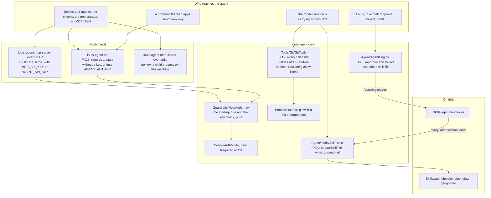

**Interfaces.**

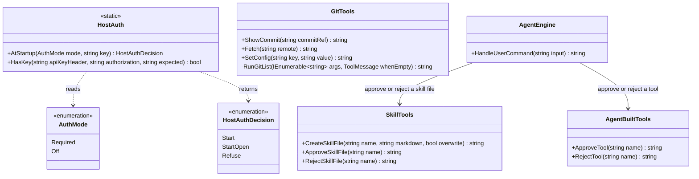

The C# signatures beside it (`key`, the two headers and `HandleUserCommand`'s return are nullable; the diagram leaves
the `?` out):

```csharp
// louis-agent.core/Config/AuthMode.cs (FX18)
public enum AuthMode { Required, Off }

// louis-agent.core/Guardrails/HostAuthDecision.cs (FX18)
public enum HostAuthDecision { Start, StartOpen, Refuse }

// louis-agent.core/Guardrails/HostAuth.cs (FX18): pure, so it is tested without a web host, as AdminGate is
public static class HostAuth
{
    public static HostAuthDecision AtStartup(AuthMode mode, string? key);
    public static bool HasKey(string? apiKeyHeader, string? authorization, string expected);   // fixed-time
}

// louis-agent.core/Agent/Tools/SkillTools.cs (FX20): the user's commands, reached through AgentEngine.HandleUserCommand
internal string ApproveSkillFile(string name);
internal string RejectSkillFile(string name);
```

**Objects: one case of each fix, in memory.**

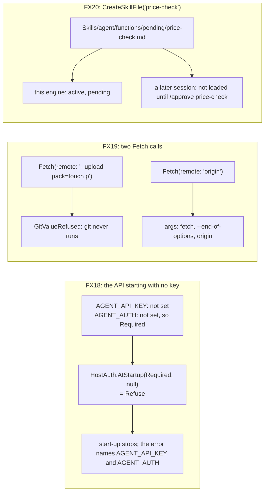

**Communication: the three fixes at work.**

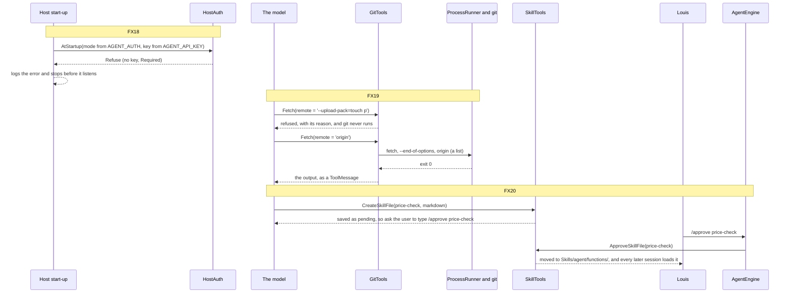

**Namespace map.**

| Type or file | Folder | Namespace | Fix |
|---|---|---|---|
| `AuthMode` (new) | `louis-agent.core/Config/` | `LouisAgent.Core.Config` | FX18 |
| `HostAuth`, `HostAuthDecision` (new) | `louis-agent.core/Guardrails/` | `LouisAgent.Core.Guardrails` | FX18 |
| `ErrorMessage.ApiKeyRequired` (new member) | `louis-agent.core/Messages/` | `LouisAgent.Core.Messages` | FX18 |
| `ApiLogMessage.NoApiKey`, `McpServerLogMessage.NoApiKey` (reworded: the auth is off on purpose) | `src/louis-agent.api/Messages/`, `src/louis-agent.mcp-server/Messages/` | `LouisAgent.Api.Messages`, `LouisAgent.McpServer.Messages` | FX18 |
| `Program` (both hosts: `HostAuth` at start-up and per request; `HasApiKey` deleted) | `src/louis-agent.api/`, `src/louis-agent.mcp-server/` | top-level statements | FX18 |
| `HostAuthTests` (new) | `tests/louis-agent.core.tests/Guardrails/` | `LouisAgent.Core.Tests.Guardrails` | FX18 |
| `GitTools` (changed; `RunGit(string)` and `EscapeForShell` deleted) | `louis-agent.core/Tools/Git/` | `LouisAgent.Core.Tools.Git` | FX19 |
| `ToolMessage.GitValueRefused`, `ToolMessage.GitConfigKeyRefused` (new members) | `louis-agent.core/Messages/` | `LouisAgent.Core.Messages` | FX19 |
| `GitToolsTests` (new cases) | `tests/louis-agent.core.tests/Tools/Git/` | `LouisAgent.Core.Tests.Tools.Git` | FX19 |
| `ArchitectureTests` (one more check) | `tests/louis-agent.core.tests/` | `LouisAgent.Core.Tests` | FX19 |
| `SkillTools` (changed: `CreateSkillFile`; new `ApproveSkillFile`, `RejectSkillFile`) | `louis-agent.core/Agent/Tools/` | `LouisAgent.Core.Agent.Tools` | FX20 |
| `SkillFiles.PendingFolder` (new constant, `agent/functions/pending`) | `louis-agent.core/Skills/` | `LouisAgent.Core.Skills` | FX20 |
| `AgentEngine.HandleUserCommand` (changed) | `louis-agent.core/Agent/` | `LouisAgent.Core.Agent` | FX20 |
| `ToolMessage.SkillFileSaved` (reworded), new `UserText` members for the skill-file commands | `louis-agent.core/Messages/` | `LouisAgent.Core.Messages` | FX20 |
| `SkillAuthoringTests` (new cases) | `tests/louis-agent.core.tests/Agent/` | `LouisAgent.Core.Tests.Agent` | FX20 |

**Folder trees.** Today, the parts Phase 1 touches:

```
louis-agent.core/
├── Agent/
│   ├── AgentEngine.cs                 # /approve and /reject reach agent-built tools only
│   └── Tools/
│       ├── AgentBuiltTools.cs         # pending tools: the pattern FX20 follows
│       └── SkillTools.cs              # CreateSkillFile saves and loads at once
├── Config/                            # SettingChoice and the settings
├── Guardrails/                        # SsrfGuard, WorkspaceBoundary, SensitiveFiles
├── Messages/                          # ErrorMessage, LogMessage, ToolMessage, UserText
├── Skills/SkillFiles.cs               # FunctionsFolder = "agent/functions"
└── Tools/Git/GitTools.cs              # RunGit(string), EscapeForShell
src/
├── louis-agent.api/Program.cs         # warns without AGENT_API_KEY; HasApiKey
└── louis-agent.mcp-server/Program.cs  # over HTTP warns without a key; HasApiKey
Skills/
├── agent/functions/                   # skill files the agent writes, loaded at once
└── tools/pending/                     # agent-built tools waiting for /approve (git-ignored)
```

After Phase 1:

```
louis-agent.core/
├── Agent/
│   ├── AgentEngine.cs                 # FX20: /approve and /reject also take a skill file
│   └── Tools/SkillTools.cs            # FX20: CreateSkillFile writes to pending/
├── Config/AuthMode.cs                 # FX18, new
├── Guardrails/
│   ├── HostAuth.cs                    # FX18, new
│   └── HostAuthDecision.cs            # FX18, new
├── Messages/                          # FX18, FX19, FX20: new and reworded members
├── Skills/SkillFiles.cs               # FX20: PendingFolder
└── Tools/Git/GitTools.cs              # FX19: every call a list
src/
├── louis-agent.api/Program.cs         # FX18: HostAuth at start-up and per request
└── louis-agent.mcp-server/Program.cs  # FX18: the same over HTTP
Skills/
├── agent/functions/
│   └── pending/                       # FX20, new, git-ignored
└── tools/pending/
tests/louis-agent.core.tests/
├── ArchitectureTests.cs               # FX19: no ProcessStartInfo.Arguments string in core
├── Agent/SkillAuthoringTests.cs       # FX20
├── Guardrails/HostAuthTests.cs        # FX18, new
└── Tools/Git/GitToolsTests.cs         # FX19
docs/
├── fixes/FX18-…, FX19-…, FX20-…       # done: Fix, Tests, Confirmed, Lesson
└── learning/15-safety-and-security.md # step 4, Louis's
```

#### Steps

| # | Step | GOAL skill |
|---|---|---|
| 1 | **FX18 Auth fails closed.** Test first, in `tests/louis-agent.core.tests/Guardrails/HostAuthTests.cs` (pure, as `AdminGateTests` is): no key and no setting refuses, naming `AGENT_API_KEY` and `AGENT_AUTH`; `AGENT_AUTH=off` with no key starts open; a key set, with `off` or without, starts and is checked; the key in `x-api-key` or as `Authorization: Bearer` passes, and a wrong one, an empty one, or one that differs only in length fails; `AGENT_AUTH=sometimes` names the setting and its two values. Seen failing: `HostAuth` doesn't exist, then each case is red until written. Then the two hosts call it, and both `HasApiKey` copies go | 15 |
| 2 | **FX19 Git arguments as data.** Test first, in `tests/louis-agent.core.tests/Tools/Git/` against a real temporary repository (skipped where git isn't installed, as `GitHistoryTests.cs:17` does): `ShowCommit("--output=<a file outside the workspace>")` writes nothing and returns the refusal; `SetConfig("core.fsmonitor", …)` is refused and the key stays unset, while `SetConfig("user.name", "x")` works; `Fetch("--upload-pack=touch <file>")` and `CreateBranch("--orphan")` are refused and no file appears; a branch named `x --upload-pack=touch <file>` arrives as one argument, which git refuses as a name; a commit message with quotes and a leading dash arrives whole (`git log -1 --format=%B`); `ArchitectureTests` is red while `GitTools.cs:348` exists. Seen failing first: today `ShowCommit` writes the file and `SetConfig` sets the key. The golden files are regenerated and their diff reviewed | 15 |
| 3 | **FX20 Skill files wait for approval.** Test first, extending `tests/louis-agent.core.tests/Agent/SkillAuthoringTests.cs`: `CreateSkillFile` writes under `pending/` and its skill can be called in the same engine; a new engine on the same folder doesn't see it; `/approve {name}` moves it, a new engine sees it, and the engine that wrote it keeps it without a reload; `/reject {name}` deletes it; `/approve` of an unknown name says so, and a name that is both a pending tool and a pending skill file is refused, naming both; with `overwrite`, the approved version stays loaded until the new one is approved. Seen failing first: today the file is written to `agent/functions/` and a new engine loads it. The golden files are regenerated and their diff reviewed | 15 |
| 4 | **The learning write-up for skill 15**, by Claude, read by Louis: deny by default (FX18), arguments as data (FX19), and why a skill the agent writes is memory a person approves (FX20); what was open before (the probe's results), what each test proves, the trade-offs (his local stacks need a key), and what didn't work (v1's test that proved nothing). `docs/learning/15-safety-and-security.md`, and a row in `docs/learning/README.md` | 15 |

**What to look at closely.** FX18: that the start-up check runs before the host listens, and that `off` never silences
a key that is set. FX19: each command's exact argument list, one by one, against the probe; `--end-of-options` needs
git 2.24 or later, and the containers' git version is unverified, so each command's form is pinned by its test rather
than assumed; and the few places where a model value is an option's own argument (`checkout -b {name}`,
`-m {message}`). FX20: that the engine's list of files it wrote follows the move, so a later `ReloadSkills` still
finds the file, and that nothing else reads `pending/`.

#### Verification

Each step: `dotnet build louis-agent-solution.sln` and `dotnet test tests/louis-agent.core.tests` (and
`tests/louis-agent.api.tests` for FX18, whose host changes); the whole solution before each pull request. FX19 and
FX20 regenerate the golden files with the command in `tests/CLAUDE.md` and review the diff. Free hand checks for FX18,
since the repo has no web-host test of `Program.cs`: the API started without a key stops with the error; with
`AGENT_AUTH=off` it starts with the warning; with a key, a request without it is a 401; the MCP server over HTTP
behaves the same. Paid runs: none.

#### Concepts

| Step | Concept | GOAL skill |
|---|---|---|
| 1 | Deny by default; failing closed at start-up rather than at the first request; one pure rule, tested without a host | 15 |
| 2 | Argument injection: a list stops splitting, not options; `--end-of-options`; an allow-list rather than a deny-list | 15 |
| 3 | Memory poisoning: what the agent writes for later sessions is untrusted until a person approves it | 15, 16 |
| 4 | Why each guard is built as it is, in the write-up Louis reads (GOAL.md's fourth criterion) | 15 |

#### Before Phase 2: the F32 to F34 write-up

Phase 2 starts only after Claude has written the F32 to F34 write-up and Louis has read it (changed 2026-10-19 at
Louis's word): no code, no paid
run. Its subject is the measured lesson in `docs/GOAL.md:33`: sourced prices went from 0 of 32 (F32, run
`663d065ccca8`) to 19 of 23 (F33, re-scored once the scorer counted prices per kg apart), then 31 of 31 (F34, run
`d94597a51d4d`), by reading the shop's data in code instead of having the model read its pages. It covers skills 7
(context engineering: a short table instead of pages) and 12 (evaluation: what the cook check measured, and the
re-score), so it is `docs/learning/07-context-engineering.md`, named after skill 7 as `docs/learning/README.md` asks,
with a row in that README. What it says: what each feature changed, what it cost, what didn't work, and why data read in
code beat pages read by the model. Phase 2's plan names this gate as its prerequisite and does not repeat it.

### Phase 2 · CL15 The cut: engine, identities and packs

> **Plan:** [CL15-engine-identities-packs.md](CL15-engine-identities-packs.md), copied on its branch (2026-10-19).

Branch `refactor/CL15-engine-identities-packs`. Before step 0 this section is copied, as Louis approved it, into
`docs/plans/CL15-engine-identities-packs.md` on that branch, with its four diagrams, namespace map and folder trees;
*Approved during the build* goes in that file, never in `platform.md` (Phase 0 step 1). The phase starts only after
Louis has read the F32 to F34 write-up (*Before Phase 2: the F32 to F34 write-up*, at the end of Phase 1), and it is
done only when he has read its own write-up, written by Claude (step 5). GOAL skills: 4, 18 and 3. Paid runs: one
cook run, in step 3, on Louis's go.

Built before F35 (recipe sources), which then builds a recipes pack, `packs/louis-agent.pack.recipes`.

An independent review of the earlier CL15 draft found it wrong in places, fixed here: Puls also lives in core's shared
guides and in text the model reads; the golden file never pinned a Puls session; `AgentHost.Start` doesn't exist (the
hosts call `Build` and `BuildToolHost`); a frozen static registry can't work as the classes stand, and only 5
production files call `ToolsetCatalog`, not 19; `ROLES_ENABLED` is never checked at start-up; `CompositeFileProvider`
needs its own package; the town geocoder belongs to places in the end, not to shops (the places feature takes it,
behind an `IGeocoder` seam). The checks of this plan's first draft added
more, also fixed here: the geocoder is used only by the Checkers store lookup (`ShopCatalogueFactory.cs:37`), so it
moves with the shops pack now and the places feature takes it later; `GetToday` and the API default to South African
time; core's tests have nowhere to read roles from once Puls's files leave, unless they embed their own; a setting made
only in `config/.env` would be read too late; there are three goldens, not two; and F30's minions, built and never
used, sit in core with Puls's minion roles among them, so the cut moves those too (question 3: keep).

**Why the composition project and `PACKS` are built now.** The challenge recommended deferring the composition project,
`PACKS`, the demo identity and the invoice pitch until a second real consumer exists. They stay, because Louis asked
for packs pluggable on their own ("say the agent needs it it should be [pluggable]") and for a sales playground ("demos is
for selling, the playground"). Phase 4 carries the same line for the demo identity and the invoice pitch.

#### Context

louis-agent.core is meant to be the engine every identity runs on, yet today it holds Puls:

| Puls in core today | Where |
|---|---|
| Puls's modes | `Prompts/agent/puls/voice.md`, `voice-af.md`, `voice-en.md` |
| Puls's specialists and minions | `Prompts/specialists/puls-{analyst,cook,historian,reader,researcher}.md`; F30's `Prompts/minions/puls-minion.md` and `puls-minion-web-price-lookup.md`, never given to a session (`docs/features/F30-local-web-peer.md:3`; question 3) |
| **Puls's protocol in the shared guides** | `Prompts/toolsets/specialists.md:26-96` (the briefing with the Afrikaans labels *Vir / Wil hê / Vir hoeveel*, the mood rule and its `[stemming: af]` switch at 68-70, the `puls-cook` routing row at 79, the roles waiting for validation at 81-88, `puls-analyst` at 90-92) and `:127-139` (the Afrikaans relay lines, the footer naming `puls-cook`); `toolsets/minions.md:25,29-31` (the Puls minion table and its Malmesbury example). The two guides are about 13 KB together (10,470 and 2,803 bytes), and every identity that uses specialists reads the first |
| **Text the model reads that names Puls or assumes South Africa** | `ShopTools.cs:29,40,51` ("when Puls gave no place"), `ToolMessage.cs:213,225,228,796` (`puls-searxng`, `puls-browser`, `puls-minion-web-price-lookup`), `MinionTools.cs:78` (`puls-minion-web-price-lookup`), `ClockTools.cs:18-26` (`GetToday`: "South Africa unless they shared another time zone", SAST by default) |
| **South Africa in core's defaults** | `GetToday`'s fallback zone (`ClockTools.cs:18-20,26`) and the API's (`src/louis-agent.api/Program.cs:216`, `"Africa/Johannesburg"`); `VerifyQuote` matches prices in rand only (`WebTools.cs:474-489`) |
| The shops toolset (Checkers) | `Tools/Shops/` (15 files, 835 lines), `Prompts/toolsets/shops.md`, the `shops` entry in `Agent/ToolsetCatalog.cs:73-80`, the coding agent's routing row (`agent/louis-agent/voice.md:62`) |
| Shop state and settings | `ToolsetContext.StoreSessions` (`ToolsetContext.cs:21`), `AgentOptions.ShopCatalogues` / `ShopStoreCache` |
| Shop texts | 17 `ToolMessage` and 8 `LogMessage` members (`Shop…`); the shop code also uses core's shared `ErrorWithReason` |
| The town geocoder | `Tools/Shops/PlaceCoordinates.cs` (OpenStreetMap's Nominatim, South Africa only), with `PlaceUnavailableException.cs`; only the Checkers store lookup uses it (`ShopCatalogueFactory.cs:37`, caught at `CheckersStore.cs:54`): the seed of the places capability |

Outside core, Puls also sits in the API host's benchmarks (`Services/BenchmarkCatalog.cs`, the `puls_benchmarks`
database, `src/louis-agent.api/Config/AdminOptions.cs:16`) and the shared web project's image allow-list
(`src/louis-agent.web.shared/Markdown.cs:41`, Checkers' image host); those stay where they are in Phase 2 and are
listed so nobody is surprised.

So an invoice clerk or the code-review agent would carry Puls's cook, its shops and its Afrikaans briefing without
using them, and every Puls feature (F35 recipes, places, businesses) would land in core.

#### One catalogue object, built once

An earlier draft planned a frozen static registry, to avoid "rewriting 19 files". That count was wrong:
`grep -rl ToolsetCatalog --include=*.cs` finds 20 files, and **only 5 production files call it** (`AgentHost`,
`AgentEngineFactory`, `AgentBuiltTools`, and the API's `Program.cs` and `AgentSessions.cs`); the rest are
`ToolsetCatalog.cs` itself, two that name it only in comments (`AgentEngine.cs:121`, `ToolsetDefinition.cs:22`) and 12
test files. And the statics can't be filled first and frozen after: `ToolsetCatalog.All`, `ToolNames` and
`SkillFileSource.EmbeddedFiles` are built the moment they are first read (`ToolsetCatalog.cs:26,124`,
`SkillFileSource.cs:15,18`). So:

- **Toolsets go through an object.** `AgentCatalog` is built once by the host from the identities and packs, checks
  them (a toolset, role or prompt path in two places, a name that resolves to nothing, a `Requires` cycle: start-up
  error), and is passed down from `AgentHost` to `AgentEngineFactory` and the API's sessions. `ToolsetCatalog` keeps
  core's own list. Core's tests build a catalogue with a `FakePack` and no global state.
- **Tool names go through the catalogue too.** Today `ToolsetCatalog.ToolNames` reflects only core's static `All`
  (`ToolsetCatalog.cs:124-128`), so once step 4 takes shops out of it, `CreateTool` would accept an agent-built
  `FindProducts` (`AgentBuiltTools.cs:71`), and an engine with shops would then skip it with a warning
  (`AgentBuiltTools.cs:125-129`) while an engine without shops ran it as the agent's own script. So `ToolNames` moves
  to `AgentCatalog`, built from one private `NamesOf`, and `AgentCatalog.ToolMethodsOf(ToolsetDefinition)` becomes the
  one public rule for which methods are tools, with `AgentCatalog.FunctionOf` building each tool's `AIFunction` exactly
  as `ToolRegistry.AddPublicMethods` does (`ToolRegistry.cs:44-58`, internal today), so the engine and step 4's
  convertibility test use the same rule. `AgentBuiltTools` is built inside `AgentEngine` (`AgentEngine.cs:111`), so
  `AgentEngine` gains one optional init property, `ReservedToolNames` (default `AgentCatalog.CoreOnly.ToolNames`), which
  `AgentEngineFactory` sets and `AgentBuiltTools` reads as it reads `SkillsDirectory` (`AgentEngine.cs:75,111`); the
  constructor, the loop and the orchestrator's direct `new AgentEngine(...)` (`src/louis-agent.orchestrator/Program.cs:51`)
  stay as they are. `ToolNamesOf` and `ToolsetOf` exist only for F30's minions (their only production callers are
  `AgentEngineFactory.cs:113` and `AgentSessions.cs:163`, and the test `MinionToolsTests.cs:254-256` calls `ToolsetOf`),
  and they move to `AgentCatalog` with `ToolNames`, so a pack's tool can be handed to a minion too. A tool name in two
  toolsets, or one that takes an engine tool's name (`ExecuteSkill`, `GetToday`, `CreateSkillFile`, `ReloadSkills`,
  `CreateTool`, `ListAgentTools`, which the engine registers itself, `AgentEngine.cs:141,143,336-342`), becomes a
  start-up error. Today a duplicate shows only when the
  first session that names the profile builds its engine (`ToolRegistry.cs:31-36`). All 123 pinned tool names are
  unique, case ignored (`ModelRequestSnapshot.json`), so the check passes on today's code.
- **Prompts stay one static reader** (ADR 0018: what is embedded is built in). `SkillFileSource` becomes lazy and reads
  core's prompts plus the identities' and packs' through one `CompositeFileProvider`. Only `AgentHost.Build(catalog)`
  and `BuildToolHost(catalog)` call `SkillFileSource.Use`, with the catalogue's prompts, before the first read, and so
  does each test assembly's `[SetUpFixture]`. Prompts already added are skipped, so a host or test that builds twice is
  fine; a new identity or pack added after the first read throws `AgentCatalogException`. Core's tests load **test
  roles** embedded in `tests/louis-agent.core.tests/Prompts/` (a specialist with a `toolsets:` header, a language mode
  with its shared voice), because once Puls's files leave, core embeds no specialist and no language mode
  (`SkillFileSource.cs:15` reads only core's assembly, and `RoleCatalog` lists roles only through it). The API's tests
  reference `louis-agent.identity.puls` and call `Use` with Puls's prompts in their own `[SetUpFixture]`.
- **The packages:** `CompositeFileProvider` ships in `Microsoft.Extensions.FileProviders.Composite` (MIT; 10.0.13, the
  engine research's reading of its nuspec), a new reference beside core's `FileProviders.Embedded` 10.0.13
  (`louis-agent.core.csproj:25`). `SkillFiles.Guide`, which every guide path uses, becomes public with its class
  (both internal today, `SkillFiles.cs:4,29`), so a pack can name its guide.
- **Start-up checks what it can:** every `ROLES_ENABLED` name must resolve, or the host stops with the names it didn't
  find. Today an unknown name is dropped silently, because it simply never matches (`AgentHost.cs:458-462`), so a Puls
  missing from `IDENTITIES` would only show as a 400 at the first chat. The no-role default mode, `louis-agent/voice`
  (`RoleCatalog.cs:28`), is checked the same way: today a session that names no role is given it before any check
  (`AgentHost.cs:434-441`), and a missing file is skipped (`AgentHost.cs:362,467`), so a catalogue without it would open
  such a session with no mode at all, silently. The default is core's own until CL17 moves it to the coding identity,
  so the check stops nothing today and catches that move; `ROLES_ENABLED` still doesn't narrow the default (CL17's, as
  said below).
- **Settings are read only after `config/.env` is loaded:** today `config/.env` and `.env.secrets` are loaded inside
  `AgentHost.Build` and `BuildToolHost` (`AgentHost.cs:122,148`), after which `IDENTITIES`, `PACKS` and
  `SHOP_CATALOGUES` would be too late, so the composition's `Plugins.FromEnvironment()` calls
  `AgentHost.LoadEnvironment()` (`AgentHost.cs:31`) before it reads a setting. Loading twice is harmless: a variable
  already set wins (`AgentHost.cs:55-58`, `overwriteExistingVars: false`).

*Alternative considered: one Puls project with everything.* Smaller, but Checkers and recipes would then be Puls's
alone, which Louis ruled out.

*Considered and left for CL17: the identity naming its default mode* (the engine research's suggestion). A session that
names no role opens the coding agent's `louis-agent/voice` (`RoleCatalog.cs:28`), and `ROLES_ENABLED` doesn't narrow
that default (`AgentHost.cs:434-441`). Moving the default to an identity belongs with the coding agent becoming one.

#### F30's minions: kept in core, and what the cut does with them

Louis answered question 3 with *keep* on 2026-10-19: "no we are not removing it, we still need to run test on it and
can be focused on after this plan is implemented". F30 built a third level of delegation: a specialist hands one task
and one of its own tools to a minion on a cheap model (ADR 0021). It took 23 commits (22 scoped `f30` and the merge of
PR #51, `dab9fdc`, in the local checkout), and no session has been given it yet: its doc says "built, not in use
(2026-10-17): no session is given `minions` until F31 measures it" (`docs/features/F30-local-web-peer.md:3`), and the
cook's role declares only `shops?` (`specialists/puls-cook.md:1-3`). So the minions stay in core as a specialist's
toolset: `MinionTools` (`Tools/Agents/MinionTools.cs`, 143 lines), the `minions` toolset (`ToolsetCatalog.cs:105-110`)
and its guide `Prompts/toolsets/minions.md`, level 2 (`RoleLevel.Minion`, `RoleLevel.cs:16-17`) and `MINION_LLMS`
(`AgentOptions.cs:136-141,242`). Testing them is not on this plan's phases or on Puls's track: it is a line in *Later*,
after this plan. The cut moves only what names Puls:

- **Step 1** moves `ToolNamesOf` and `ToolsetOf` (`ToolsetCatalog.cs:130-142`) to `AgentCatalog` with `ToolNames`: a
  minion's one tool (`AgentEngineFactory.cs:113`) and the toolset that builds it (`AgentSessions.cs:163`) then come
  from the catalogue, so a pack's tool can be handed to a minion too. `MinionToolsTests.cs:254-256` call
  `AgentCatalog.CoreOnly.ToolsetOf`.
- **Step 3** moves Puls's minion prompts, `Prompts/minions/puls-minion.md` and `puls-minion-web-price-lookup.md`, into
  Puls's project with its other prompts; splits Puls's minion table and its Malmesbury example out of
  `toolsets/minions.md` (`:25,29-31`) into Puls's project; and takes the Puls name out of `StartMinion`'s description
  (`MinionTools.cs:78`) and `ToolMessage.cs:796` (`MinionRoleInvalid`), the fourth Puls text. Core's test roles add a
  minion base and a minion role, so they cover every level.
- **Step 5** adds `MinionTools.cs:133`'s comment ("Puls's turn") to the comments that stop naming a product.
- **Settings stay:** `ROLES_ENABLED`'s Puls default keeps `puls-minion-web-price-lookup` in both containers
  (`docker/docker-compose.puls.yml:40,82`), and `MINION_LLMS` stays (`:81`).
- **Phase 6** treats `MinionTools` as it treats `SpecialistTools`: A0 fixes F30's 6 vs 16 minions line, A2 makes
  `MinionTools` a thin caller of the delegation function, and A3 counts minions per turn tree, 16 per turn
  (`MinionTools.cs:31,136-142`).

#### South Africa out of core's defaults (step 3)

Core's own text and defaults should name no country, so an invoice clerk in another country gets its own time:

- `GetToday`'s default zone (`ClockTools.cs:18-20,26`, SAST) and the API's fallback zone for the first turn's place
  line (`src/louis-agent.api/Program.cs:216`, `"Africa/Johannesburg"`) both read one new setting, `HOST_TIME_ZONE` (an
  IANA name; default: the host's own zone), held as `AgentOptions.HostTimeZone` and passed to `ClockTools`, which the
  engine builds (`AgentEngine.cs:143`). Puls's compose sets it to `Africa/Johannesburg`, and `config/.env.example`
  documents it.
- `GetToday`'s description names no country: "where the user is: the host's time zone unless they shared another"
  (today "South Africa unless they shared another time zone", `ClockTools.cs:22-23`). `ModelRequestSnapshot.json` and
  the Puls golden show the change, reviewed. `UserPlace`'s comment ("null for South African time", `UserPlace.cs:10`)
  follows.
- `VerifyQuote`'s rand-only price matcher (`WebTools.cs:474-489`) stays in core this phase; it becomes a small cleanup
  on the TODO, *VerifyQuote's prices in the host's currency* (`HOST_CULTURE`).
- Step 2's ratchet covers **core's model-visible text** (embedded prompts, `[Description]` attributes, `ToolMessage`
  members): no `puls`, no Afrikaans briefing label, no "South Africa". It follows the ratchet `ArchitectureTests`
  already uses for CL1 (`ArchitectureTests.cs:21-27`): a new entry fails, and so does an entry that no longer holds,
  so the list can only shrink. Core's comments and examples are made to name no product in step 5.
- "The game means the Springboks or Bafana" (`TODO.md:136-137`) is not done anywhere today: no prompt in core names
  either team. It goes to Puls's track (*Local lookups*).

#### The shops pack: `packs/louis-agent.pack.shops`

`Tools/Shops/` moved whole (`IShopCatalogue`, Checkers' provider, `ShopTools`, and the town geocoder `PlaceCoordinates`
with `PlaceUnavailableException`, since only the Checkers store lookup uses them), `shops.md`, `ShopsOptions`
(`SHOP_CATALOGUES`, `SHOP_STORE_CACHE`, same names), its `ShopToolMessage` / `ShopLogMessage` (the `Shop…` members, word
for word; `LogMessage.ShopAreaUnavailable`, which the geocoder logs, `PlaceCoordinates.cs:67`, becomes a
`ShopLogMessage` member with the rest). Once those enums leave core, neither guard on message enums sees them: core's
`MessageEnumTests` reads only core's assembly (`MessageEnumTests.cs:11`), and `HostMessageEnumTests` only
`src/*/Messages` and `tools/*/Messages` (`HostMessageEnumTests.cs:10-18`), so step 4 extends the second to `packs/` and
`identities/`. The store cache, today a property of `ToolsetContext` (one per engine factory,
`ToolsetContext.cs:21`), becomes the pack's own. `BROWSER_URL` and the guarded browser stay core's shared services,
reached through `ToolsetContext` (`ToolsetContext.cs:30-31`): the shops toolset loads only when both `SHOP_CATALOGUES`
and `BROWSER_URL` are set (`ToolsetCatalog.cs:75-77`), so every test and hand check that turns shops on sets `PACKS=shops`,
`SHOP_CATALOGUES` **and** `BROWSER_URL` (a running headless Chrome); without `BROWSER_URL` the toolset is listed as
missing that setting. The pack names no identity: the `area` description loses "when Puls gave no place"
(model-visible, reviewed in the golden). The coding agent's routing row for shops (`agent/louis-agent/voice.md:62`)
moves into the pack's guide, so core's prompt routes to no toolset that core doesn't have.

Core keeps no Nominatim and no South Africa. When the places feature comes (Puls's track), it takes the geocoder into
the places pack, behind an `IGeocoder` seam in core that packs reach as a shared service through `ToolsetContext`, so
shops keeps naming places by name only.

The pack holds one provider, Checkers, which took 45 commits, 16 of them fixes, and covers 1 of the 4 supermarket chains
in Malmesbury (Part 2, *How a local shop becomes a provider*). More shops come as rows in *Sources as data* (Puls's
track), and the Shoprite, Pick n Pay and Woolworths providers wait for it.

#### Puls: `identities/louis-agent.identity.puls`

`PulsIdentity` (packs: `shops`), Puls's modes and specialists, and **Puls's protocol split out of the shared guide**:
`toolsets/specialists.md` keeps the mechanism (how to start, continue and report), and Puls's briefing labels, mood
rule, routing rows, waiting roles and Afrikaans relay lines move to Puls's own `agent/puls/voice.md`, the routing part
every Puls chat loads (ADR 0019). That changes what the model reads, so it needs **one paid cook run, on Louis's go**
(step 3). The web app stays `src/louis-agent.puls`: the identity project is what the agent loads, the web app what the
user sees. Both of Puls's agent containers (`puls` and `puls-agent`) get `IDENTITIES=puls` from the Puls compose.
`config/.env.example` documents `IDENTITIES` and `PACKS` and leaves them unset, because every compose file passes
`config/.env` to its containers (`env_file`, `docker/docker-compose.yml:9-14`, `docker/docker-compose.puls.yml:8-14`),
so `IDENTITIES=puls` set there would load Puls into the code-review stack too.

**Not in this phase:** the cook as a reusable role (CL16, with its own frame mechanism: the identity's frame is loaded
before a pack's role), the coding agent as its own identity (CL17), Paymo and DevOps (reconciled with CL17), the
orchestrator (Phase 6), the demo (Phase 4), and Puls's checks, which Phase 3 rewrites as simulations. Also not here,
each with its phase: the guards as a decorator around every tool, so calls served over MCP get them too, and
`BuildToolHost` taking a toolset list (Phase 8, F36); a per-tool effects declaration, `ToolEffect` (Phase 7); one
`TurnContext` with the place as a turn input (Phase 6, A4); the MCP client (Phase 8); `VerifyQuote`'s prices in the
host's currency (a small cleanup on the TODO).

#### Architecture: what runs after the cut

Solid arrows exist after step 4. A dashed arrow either marks an interface a class implements, which also exists after
step 4, or leads from what comes later, each with its phase or feature.

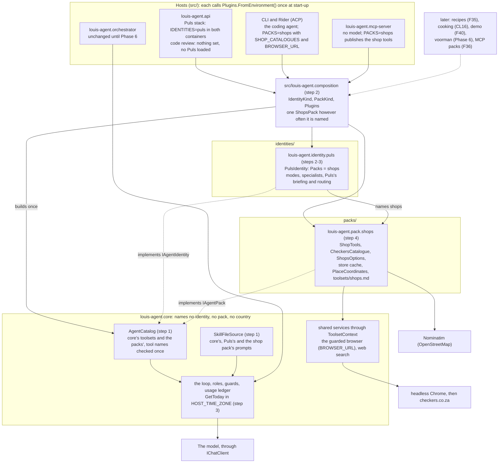

#### Folder structure: the projects before and after

Two new top-level folders, `identities/` and `packs/`, beside `louis-agent.core/`; each new project gets its test
project in `tests/`, named after it, and a line in `louis-agent-solution.sln`. The Dockerfiles copy the whole repo
(`COPY . .`, for example `docker/Dockerfile.api:3` and `docker/Dockerfile.puls:4`), so they need no change; only
`docker-compose.puls.yml` gains `IDENTITIES=puls` and `HOST_TIME_ZONE=Africa/Johannesburg` in both agent containers,
and `config/.env.example` documents `IDENTITIES`, `PACKS` and `HOST_TIME_ZONE`. Only the folders that change are
shown.

**Today (`main`)**

```text
louis-agent/
├── louis-agent-solution.sln
├── louis-agent.core/                      the engine, holding Puls
│   ├── Agent/                             ToolsetCatalog names "shops" and "minions"; ToolsetContext.StoreSessions
│   ├── Config/                            AgentOptions: SHOP_CATALOGUES, SHOP_STORE_CACHE, MINION_LLMS
│   ├── Hosting/AgentHost.cs               ROLES_ENABLED names never checked; config/.env loaded inside Build
│   ├── Messages/                          ToolMessage, LogMessage: 25 Shop… members, 4 naming Puls, 7 Minion…
│   ├── Prompts/
│   │   ├── agent/louis-agent/             the coding agent's modes (stays until CL17); voice.md:62 routes to shops
│   │   ├── agent/puls/                    Puls's modes
│   │   ├── specialists/puls-*.md          5 Puls specialists, the cook among them
│   │   ├── minions/puls-minion*.md        F30, never given to a session
│   │   ├── shared/principles.md
│   │   └── toolsets/                      specialists.md and minions.md hold Puls's protocol; shops.md
│   ├── Sessions/                          UserPlace, SubSessionRegistry, …
│   ├── Skills/SkillFileSource.cs          reads core's assembly only
│   └── Tools/
│       ├── Agents/MinionTools.cs          F30
│       ├── Clock/ClockTools.cs            GetToday: South African time by default
│       └── Shops/                         13 files + Providers/ (CheckersCatalogue, CheckersStore); PlaceCoordinates
├── docker/docker-compose.puls.yml         ROLES_ENABLED's default names the minion; MINION_LLMS
├── src/
│   ├── louis-agent.api/                   one host; -p:WebApp=puls picks Puls's web app; Program.cs:216 Africa/Johannesburg
│   ├── louis-agent.puls/                  Puls's web app (stays: it is what the user sees)
│   └── louis-agent.web/                   the code-review web app
└── tests/
    ├── louis-agent.api.tests/             19 files mention Puls; 14 name Puls's roles
    └── louis-agent.core.tests/
        ├── Agent/ModelRequestSnapshot.json  pins the coding agent with every toolset (never a Puls session)
        ├── Messages/ToolMessageSnapshot.json  every ToolMessage: 17 Shop… entries, 4 Puls texts
        ├── Skills/, Hosting/, Tools/Agents/, …  10 files name Puls's roles (126 lines)
        └── Tools/Shops/                   shop tests, PlaceCoordinatesTests, Fixtures/nominatim-malmesbury.json,
                                           Providers/Fixtures/ (Checkers' recorded answers)
```

**After CL15 (step by step)**

```text
louis-agent/
├── louis-agent-solution.sln               + 6 projects (steps 2, 4)
├── louis-agent.core/                      the engine: names no identity, pack or country
│   ├── Agent/
│   │   ├── IAgentIdentity.cs, IAgentPack.cs   step 1, new
│   │   ├── AgentCatalog.cs                step 1, new: core's + the packs' toolsets and tool names, checked once
│   │   ├── AgentCatalogException.cs       step 1, new
│   │   ├── AgentEngine.cs                 step 1: ReservedToolNames
│   │   ├── ToolsetCatalog.cs              step 1: core's own list, lazy; step 4 drops "shops"
│   │   └── ToolsetContext.cs              step 4: no StoreSessions
│   ├── Config/AgentOptions.cs             step 3: HOST_TIME_ZONE; step 4: no shop settings; MINION_LLMS stays
│   ├── Hosting/AgentHost.cs               step 1: Build and BuildToolHost take the catalogue and call Use; ROLES_ENABLED checked
│   ├── Messages/                          steps 3-4: no Shop… members, none naming Puls; the Minion… members stay
│   ├── Prompts/
│   │   ├── agent/louis-agent/             unchanged (CL17), but voice.md's shops row leaves (step 4)
│   │   ├── shared/principles.md           unchanged: every agent, every identity
│   │   └── toolsets/                      core's guides only: specialists.md and minions.md without Puls (step 3)
│   ├── Skills/SkillFileSource.cs          step 1: lazy, Use(identities' + packs' prompts) before the first read
│   └── Tools/
│       ├── Agents/MinionTools.cs          step 3: names no role of Puls's (:78); step 5: its comment (:133)
│       ├── Clock/ClockTools.cs            step 3: the host's time zone (HOST_TIME_ZONE)
│       └── (Shops/ gone, step 4)
├── identities/                            new: who the agent is
│   └── louis-agent.identity.puls/         step 2 (F40 adds louis-agent.identity.demo beside it)
│       ├── louis-agent.identity.puls.csproj  references core; embeds Prompts/ with a manifest
│       ├── PulsIdentity.cs                step 2; names shops in step 4
│       └── Prompts/                       step 3: moved byte for byte, plus Puls's protocol from the shared guide
│           ├── agent/puls/                voice.md (its routing, now with Puls's briefing), voice-af.md, voice-en.md
│           ├── specialists/               puls-analyst, puls-cook, puls-historian, puls-reader, puls-researcher
│           └── minions/                   puls-minion, puls-minion-web-price-lookup (F30, kept: question 3)
├── packs/                                 new: what an agent can do
│   └── louis-agent.pack.shops/            step 4
│       ├── louis-agent.pack.shops.csproj  references core; embeds Prompts/ with a manifest
│       ├── ShopsPack.cs, ShopsOptions.cs
│       ├── IShopCatalogue.cs, ShopTools.cs, … (from core's Tools/Shops/)
│       ├── PlaceCoordinates.cs, PlaceUnavailableException.cs   the town geocoder, until the places feature takes it
│       ├── Providers/                     CheckersCatalogue.cs, CheckersStore.cs
│       ├── Messages/                      ShopToolMessage.cs, ShopLogMessage.cs
│       └── Prompts/toolsets/shops.md      with the routing line from voice.md:62
├── src/
│   ├── louis-agent.composition/           step 2, new: the one list of identities and packs
│   │   ├── louis-agent.composition.csproj references core, every identity, every pack
│   │   ├── IdentityKind.cs, PackKind.cs   enums (ADR 0024)
│   │   └── Plugins.cs                     FromEnvironment(): LoadEnvironment, then FromSettings(IDENTITIES, PACKS)
│   ├── louis-agent.api/                   Program.cs: Plugins, then AgentHost.Build (step 2); HOST_TIME_ZONE (step 3)
│   ├── louis-agent.cli/                   the same (step 2): PACKS=shops works in the terminal
│   ├── louis-agent.acp-server/            the same (step 2)
│   └── louis-agent.mcp-server/            Plugins, then BuildToolHost (step 2): PACKS=shops publishes the shop tools
└── tests/
    ├── louis-agent.api.tests/             step 3: references identity.puls; a [SetUpFixture] adds Puls's prompts
    ├── louis-agent.composition.tests/     step 2: IDENTITIES and PACKS parsed, a pack named twice created once;
    │                                      step 4: the convertibility test over every PackKind
    ├── louis-agent.core.tests/            Agent/FakePack.cs, AgentCatalogTests.cs (step 1, no global state);
    │                                      Prompts/: test roles, read through a [SetUpFixture] (step 3); Tools/Shops/ leaves (step 4)
    ├── louis-agent.identity.puls.tests/   step 0's Puls golden lives here from step 2; PulsIdentityTests
    └── louis-agent.pack.shops.tests/      step 4: the shop tests, PlaceCoordinatesTests and their fixtures, moved;
                                           ShopToolMessage pinned
```

**At the end of the road** (each line is its own feature; shown so the folders above don't need moving again)

```text
louis-agent/
├── louis-agent.core/                      the loop, contracts, guards, files, web, documents, the browser, specialists,
│                                          minions, skills
├── louis-agent.session-stream/            Phase 3: the one reader of the session stream, no dependencies
├── identities/
│   ├── louis-agent.identity.puls/         CL15
│   ├── louis-agent.identity.demo/         F40: the sales playground
│   ├── louis-agent.identity.coding/       CL17: louis-agent/voice and the code-review web app
│   └── louis-agent.identity.voorman/          F39 part B: the orchestrator
├── packs/
│   ├── louis-agent.pack.shops/            CL15
│   ├── louis-agent.pack.recipes/          F35
│   ├── louis-agent.pack.cooking/          CL16: the cook role
│   ├── louis-agent.pack.places/           Puls's track, after the area guide; takes the geocoder from shops
│   ├── louis-agent.pack.git/  …dotnet/  …shell/  …paymo/  …devops/   CL17
│   ├── louis-agent.pack.triage/  …fixing/         F39 part B
│   └── (orange packs are configuration: MCP servers named in settings, F36)
├── simulations/                           F18: real tasks run end to end and scored
│   ├── louis-agent.simulation/            the harness (Phase 3)
│   ├── louis-agent.simulation.runner/     simulate {name} --repeat N (Phase 3)
│   └── louis-agent.simulations.puls/  …demo/  …voorman/   one per identity (Phases 3, 4 and 6)
└── src/                                   hosts, web apps and the composition project
```

#### Interfaces

```csharp
// louis-agent.core/Agent/IAgentIdentity.cs (step 1)
/// <summary>
/// Who an agent is: its name, its modes, its own roles, and the packs it uses, by name. It has no tools of its own:
/// everything it can do comes from packs. It may hold workflow code that uses its own packs' public types (the voorman
/// identity's TriageWorkflow, Phase 6); a pack never references another pack or an identity (ADR 0027).
/// </summary>
public interface IAgentIdentity
{
    string Name { get; }                    // "puls" (F40: "demo"); its modes are agent/{name}/…
    IFileProvider Prompts { get; }          // its modes, its own specialists and its own minion roles: content,
                                            // never converted to MCP
    IReadOnlyList<string> Packs { get; }    // by name: whatever the catalogue holds as "shops" serves, our compiled pack
                                            // today or an MCP server we named "shops" (F36); the identity can't tell
}

// louis-agent.core/Agent/IAgentPack.cs (step 1)
/// <summary>
/// What an agent can do: one capability's toolsets, their guides, its own settings and state (ADR 0027).
/// A pack stays convertible to an MCP server, both ways (ADR 0028), so nothing here assumes it runs in this process:
/// - It is ready when built. Anything slow or async (a connection, a tool listing) happens before the catalogue is
///   built, once when the host starts, and its toolsets and tools never change afterwards (ADR 0006, 0008).
/// - Its tools take plain data (strings, numbers, booleans, enums, lists and records of those; a CancellationToken when
///   they wait) and return text. A failure is text with its reason, never a thrown exception: in our own loop the model
///   sees a thrown message (IncludeDetailedErrors, AgentEngine.cs:125), but served over MCP the SDK replaces it unless it
///   is an McpException (its message is kept; an McpProtocolException becomes a protocol error).
/// - Whatever a tool reads from the session (the user's place) also arrives as a parameter; no description names an
///   identity.
/// - It frames the outside data it returns and bounds its own output: calls served over MCP skip ToolCallGuards.
/// - Its guides are prose with no "## Skill:" procedures, so one can travel as an MCP server's instructions.
/// - It reads its own settings and core's shared services, names the packs it needs, and never references their code.
/// </summary>
public interface IAgentPack
{
    string Name { get; }                                // "shops": lowercase letters, digits, dashes
    IReadOnlyList<ToolsetDefinition> Toolsets { get; }  // the seam: an MCP server arrives as one more ToolsetDefinition
    IFileProvider Prompts { get; }                      // its guides (toolsets/{name}.md) and, from CL16, its roles
                                                        // (the cook, voorman-fixer); over MCP only its tools convert, and
                                                        // a role runs with the identity that loads it (ADR 0028, rule 8)
    IReadOnlyList<string> Requires { get; }             // other packs, by name: cooking requires "recipes"
}

// louis-agent.core/Agent/ToolsetDefinition.cs: shape UNCHANGED in CL15, two comments sharpened
public sealed record ToolsetDefinition(
    string Name,                                                  // what sessions, role headers ("shops?") and GET /toolsets name
    string Description,
    string? GuideFile,                                            // a path in core's or the pack's Prompts
    Func<ToolsetContext, IReadOnlyList<string>> MissingSettings,  // why it can't load here (F36 adds "unreachable at start-up")
    Func<ToolsetContext, IReadOnlyList<object>>? CreateTools,     // cheap and synchronous: anything async happened before the
                                                                  // catalogue was built
    Type? ToolType = null,                                        // how its tool names are known without building it
    bool ParallelSafe = false);                                   // always our call, never a server's readOnlyHint

// louis-agent.core/Agent/AgentCatalog.cs (step 1): built once by the host, passed down; no global state
public sealed class AgentCatalog
{
    /// Start-up checks, each an AgentCatalogException with its own ErrorMessage member:
    /// - a pack, toolset, role or prompt path in two places;
    /// - a name in Packs or Requires that no pack has (the message lists the registered ones);
    /// - a Requires cycle;
    /// - a tool name in two toolsets (the message names both), or one that takes an engine tool's name (ExecuteSkill,
    ///   GetToday, CreateSkillFile, ReloadSkills, CreateTool, ListAgentTools: the message names it as the engine's),
    ///   case ignored as AgentBuiltTools compares.
    public AgentCatalog(IReadOnlyList<IAgentIdentity> identities, IReadOnlyList<IAgentPack> packs);
    public static AgentCatalog CoreOnly { get; }                      // no identity, no pack: everything as today
    public IReadOnlyList<ToolsetDefinition> Toolsets { get; }         // core's + the packs'
    public IReadOnlyList<IAgentIdentity> Identities { get; }
    public IReadOnlyList<IAgentPack> Packs { get; }
    public IReadOnlyList<ToolsetDefinition> Resolve(IEnumerable<string> names, ToolsetContext context); // what ToolsetCatalog.Resolve does today

    // Moved from ToolsetCatalog's statics, so a pack's tools count:
    public IReadOnlySet<string> ToolNames { get; }                    // an agent-built tool may not take one (AgentBuiltTools.cs:71)
    // F30's minions use these two, so they move too:
    public IReadOnlySet<string> ToolNamesOf(IEnumerable<ToolsetDefinition> resolved);  // a minion's one tool (AgentEngineFactory.cs:113)
    public string? ToolsetOf(string tool);                                             // the toolset that builds it (AgentSessions.cs:163)

    // The one rule for which methods are tools and how each becomes a function, public so the convertibility test
    // checks the very function the engine registers and the MCP server publishes (ToolRegistry is internal):
    public static IEnumerable<MethodInfo> ToolMethodsOf(ToolsetDefinition toolset);  // ToolType's public instance methods
    public static AIFunction FunctionOf(MethodInfo method, Func<AIFunctionArguments, object> createInstance);
                                                                      // its Description normalised, as AddPublicMethods does
    private static IEnumerable<string> NamesOf(ToolsetDefinition toolset);  // the ONE place tool names come from:
                                                                            // ToolMethodsOf today; F36 adds "or the listed names"
}

// louis-agent.core/Agent/AgentEngine.cs (step 1): one optional input; the constructor and the loop unchanged
public class AgentEngine
{
    public IReadOnlySet<string> ReservedToolNames { get; init; }      // default AgentCatalog.CoreOnly.ToolNames;
                                                                      // AgentEngineFactory sets the catalogue's
}

// louis-agent.core/Skills: the one static reader of built-in prompts, now lazy
public static class SkillFileSource
{
    // Called only by AgentHost.Build(catalog) and BuildToolHost(catalog), and by each test assembly's [SetUpFixture].
    // Prompts already added are skipped; new ones after the first read: AgentCatalogException.
    public static void Use(IEnumerable<IFileProvider> prompts);
    // ReadEmbedded, Files, EmbeddedFiles as today, over core's + the identities' + the packs' prompts
}

// louis-agent.core/Hosting: the existing entry points take the catalogue
public static class AgentHost
{
    public static AgentHostContext Build(AgentCatalog catalog, ILlmClientFactory? clientFactory = null);   // the API, CLI, ACP
    public static AgentEngine BuildToolHost(AgentCatalog catalog);                                          // the MCP server
}

// packs/louis-agent.pack.shops: a capability, no identity named
public sealed class ShopsOptions                    // the pack's own settings. BROWSER_URL and the guarded browser stay
{                                                   // core's shared services, reached through ToolsetContext
    public string? ShopCatalogues; public string? ShopStoreCache;
    public static ShopsOptions FromEnvironment();
}
public sealed class ShopsPack(ShopsOptions options) : IAgentPack
{
    public string Name => "shops";
    public IReadOnlyList<ToolsetDefinition> Toolsets { get; }    // shops: FindProducts, SearchSpecials, SearchPromotions
    public IFileProvider Prompts { get; }                        // embedded: toolsets/shops.md (2,635 characters, prose)
    public IReadOnlyList<string> Requires => [];
}

// identities/louis-agent.identity.puls: who Puls is
public sealed class PulsIdentity : IAgentIdentity
{
    public string Name => "puls";
    public IFileProvider Prompts { get; }                          // embedded: agent/puls/, specialists/puls-*, minions/puls-*
    public IReadOnlyList<string> Packs => ["shops"];               // F35: "recipes"; CL16: "cooking"; later "places"
}

// src/louis-agent.composition: the one place that knows every identity and pack; every host calls it
public enum IdentityKind { Puls }                                 // F40: Demo
public enum PackKind { Shops }                                    // compiled packs only (ADR 0024): F35: Recipes; CL16:
                                                                  // Cooking; F40: Customers. An MCP server is data, never
                                                                  // a member: F36 adds MCP_PACKS as a second source here
public static class Plugins
{
    // AgentHost.LoadEnvironment() first, so config/.env counts; then FromSettings(IDENTITIES, PACKS).
    public static AgentCatalog FromEnvironment();
    // IDENTITIES=puls and PACKS=shops: each identity with the packs it names, plus the lone packs; one instance per pack.
    // Synchronous in CL15: nothing to await yet.
    public static AgentCatalog FromSettings(string? identities, string? packs);
}

// F36, not built: someone else's MCP server as a pack with the same contract and no new member on it
// public sealed class McpPack : IAgentPack, IAsyncDisposable { one ToolsetDefinition per server: connected and listed
//   once when the host starts, by the composition root, before the catalogue, under one start-up timeout that covers
//   the connect and tools/list; unreachable = unavailable with its reason; tools/list_changed ignored until a restart }
```

`ToolsetDefinition` keeps its shape; ADR 0028 says why it already fits an MCP pack.

```mermaid
classDiagram
    direction LR
    class IAgentIdentity { <<interface, step 1>> +Name +Prompts +Packs }
    class IAgentPack { <<interface, step 1>> +Name +Toolsets +Prompts +Requires }
    class AgentCatalog { <<step 1>> +Toolsets +Identities +Packs +Resolve() +ToolNames +ToolNamesOf() +ToolsetOf() +ToolMethodsOf()$ +FunctionOf()$ }
    class AgentEngine { <<changed, step 1>> +ReservedToolNames }
    class ToolsetCatalog { <<changed, step 1>> core's own list, lazy }
    class SkillFileSource { <<changed, step 1>> lazy, +Use(prompts)$ }
    class ToolsetDefinition { <<record, unchanged>> }
    class AgentHost { <<changed, step 1>> +Build(catalog)$ +BuildToolHost(catalog)$ }
    class FakeIdentity { <<test, step 1>> }
    class FakePack { <<test, step 1>> }
    class PulsIdentity { <<identity, step 2>> Packs: shops }
    class ShopsPack { <<pack, step 4>> +Prompts }
    class ShopsOptions { <<pack settings, step 4>> }
    class McpPack { <<F36, not built>> one toolset, listed at start-up }
    class ShopTools { <<moved, step 4>> }
    class IShopCatalogue { <<interface, moved, step 4>> }
    class CheckersCatalogue { <<moved, step 4>> }
    class PlaceCoordinates { <<moved with the pack, step 4>> }
    class Plugins { <<composition, step 2>> +FromEnvironment()$ +FromSettings(IDENTITIES, PACKS)$ }
    IAgentIdentity <|.. FakeIdentity
    IAgentIdentity <|.. PulsIdentity
    IAgentPack <|.. FakePack
    IAgentPack <|.. ShopsPack
    IAgentPack <|.. McpPack
    PulsIdentity ..> ShopsPack : names shops
    ShopsPack --> ShopsOptions
    ShopsPack ..> ShopTools : shops toolset
    ShopTools --> IShopCatalogue
    IShopCatalogue <|.. CheckersCatalogue
    CheckersCatalogue ..> PlaceCoordinates : town to store
    Plugins ..> AgentCatalog : builds once
    AgentHost --> AgentCatalog : passed down
    AgentHost ..> AgentEngine : ReservedToolNames
    AgentCatalog --> ToolsetCatalog : core's toolsets
    AgentCatalog --> IAgentPack
    AgentCatalog --> IAgentIdentity
    AgentHost ..> SkillFileSource : Use(prompts) once
    IAgentPack --> ToolsetDefinition
```

#### Objects: what exists in memory with `IDENTITIES=puls` and `PACKS=shops`

Puls names `shops`, and `PACKS` names it again: one `ShopsPack` object, shared.

```mermaid
flowchart LR
    cat["catalog : AgentCatalog<br/>Identities = [puls]<br/>Packs = [shops]<br/>Toolsets = core's + shops<br/>ToolNames = core's + FindProducts, SearchSpecials, SearchPromotions"]
    puls["puls : PulsIdentity<br/>Packs = [shops]<br/>Prompts = agent/puls/, specialists/puls-*, minions/puls-*"]
    lone["PACKS=shops<br/>the pack on its own"]
    shops["shops : ShopsPack<br/>Toolsets = [shops]<br/>Prompts = toolsets/shops.md"]
    opts["shopsOptions : ShopsOptions<br/>ShopCatalogues = checkers<br/>ShopStoreCache = /data/shop-stores.json"]
    cache["stores : StoreSessionCache<br/>one per pack"]
    chk["checkers : CheckersCatalogue<br/>with its CheckersStore"]
    geo["PlaceCoordinates (static)<br/>Nominatim, in the pack"]
    ctx["context : ToolsetContext (core)<br/>Browser from BROWSER_URL = puls-browser"]
    src["SkillFileSource<br/>core's + puls's + shops' prompts"]
    cat --> puls
    cat --> shops
    puls -- names --> shops
    lone -- names --> shops
    shops --> opts
    shops --> cache
    shops --> chk
    chk --> geo
    chk -->|"the guarded browser"| ctx
    cat -.-> src
```

#### Communication: the Puls API starts and the cook searches Checkers

```mermaid
sequenceDiagram
    autonumber
    participant H as louis-agent.api Program
    participant P as Plugins (composition)
    participant A as AgentHost
    participant C as AgentCatalog
    participant F as SkillFileSource
    participant S as AgentSessions
    participant K as ShopsPack
    H->>P: FromEnvironment(): AgentHost.LoadEnvironment() first, so config/.env counts
    P->>A: LoadEnvironment(): config/.env.secrets, config/.env
    Note over P: IDENTITIES="puls" (the Puls compose), PACKS unset
    P->>K: new ShopsPack(ShopsOptions.FromEnvironment())
    P->>C: new AgentCatalog([PulsIdentity], [ShopsPack])
    C-->>P: checked: names unique, "shops" resolves, no cycle, no tool name twice or an engine tool's
    P-->>H: catalog
    H->>A: Build(catalog)
    A->>F: Use(core's + puls's + shops' prompts), before any read
    A-->>H: ROLES_ENABLED checked: every name and the no-role default mode found
    Note over S: later: POST /sessions, role puls-cook
    S->>F: read specialists/puls-cook.md
    F-->>S: from PulsIdentity's prompts (core has no such file)
    S->>C: Resolve(["web", "shops?"])
    C-->>S: web (core), shops (ShopsPack): SHOP_CATALOGUES and BROWSER_URL set
    Note over S: the cook calls FindProducts: the shops pack's code, core's loop and guarded browser
```

#### Namespaces (new, moved, changed)

| Type | Folder | Namespace | Step |
|---|---|---|---|
| `IAgentIdentity`, `IAgentPack`, `AgentCatalog` (with `ToolNames`, `ToolNamesOf`, `ToolsetOf`, `ToolMethodsOf`, `FunctionOf`), `AgentCatalogException` | `louis-agent.core/Agent/` | `LouisAgent.Core.Agent` | 1, new |
| `AgentEngine.ReservedToolNames` | `louis-agent.core/Agent/` | `LouisAgent.Core.Agent` | 1, changed |
| `ToolsetCatalog` (core's own list, lazy) | `louis-agent.core/Agent/` | `LouisAgent.Core.Agent` | 1, changed |
| `SkillFileSource` (lazy, `Use`), `SkillFiles.Guide` (public) | `louis-agent.core/Skills/` | `LouisAgent.Core.Skills` | 1, changed |
| `AgentHost.Build(catalog)`, `BuildToolHost(catalog)`, the `ROLES_ENABLED` check (with the no-role default mode) | `louis-agent.core/Hosting/` | `LouisAgent.Core.Hosting` | 1, changed |
| `AgentEngineFactory`, `AgentBuiltTools`, the API's `Program.cs` and `AgentSessions` (read the catalogue and its tool names) | `louis-agent.core/Hosting/`, `Agent/Tools/`, `src/louis-agent.api/` | as now | 1, changed |
| `FakeIdentity`, `FakePack`, `AgentCatalogTests` | `tests/louis-agent.core.tests/Agent/` | `LouisAgent.Core.Tests.Agent` | 1, new |
| `PulsSessionSnapshotTests` + its golden (puls/voice-af with specialists and web; puls-cook with web and shops) | `tests/louis-agent.core.tests/Agent/` (step 0), `tests/louis-agent.identity.puls.tests/` (from step 2) | `LouisAgent.Core.Tests.Agent`, then `LouisAgent.Identities.Puls.Tests` | 0, new; 2, moved |
| `PulsIdentity` | `identities/louis-agent.identity.puls/` | `LouisAgent.Identities.Puls` | 2, new |
| `IdentityKind`, `PackKind` (enums), `Plugins` | `src/louis-agent.composition/` | `LouisAgent.Composition` | 2, new; `PackKind.Shops` in 4 |
| Hosts call `Plugins.FromEnvironment`, then `AgentHost.Build` / `BuildToolHost` | `src/louis-agent.{api,cli,acp-server,mcp-server}/Program.cs` | as now | 2, changed |
| The ratchet over core's model-visible text; no pack references another pack or an identity | `tests/louis-agent.core.tests/ArchitectureTests.cs` | `LouisAgent.Core.Tests` | 2, changed |
| Puls's prompts (its minion roles among them), and Puls's protocol split out of `toolsets/specialists.md` and `toolsets/minions.md` | `identities/louis-agent.identity.puls/Prompts/` | (content) | 3, moved and split |
| `ToolMessage` texts and `MinionTools` without Puls names; `AgentOptions.HostTimeZone`, `ClockTools` in the host's zone | `louis-agent.core/Messages/`, `Tools/Agents/`, `Config/`, `Tools/Clock/` | as now | 3, changed |
| The API's place line in the host's zone | `src/louis-agent.api/Program.cs` | as now | 3, changed |
| Test roles and their `[SetUpFixture]` | `tests/louis-agent.core.tests/Prompts/` (content), `tests/louis-agent.core.tests/` | `LouisAgent.Core.Tests` | 3, new |
| The API tests' `[SetUpFixture]` with Puls's prompts | `tests/louis-agent.api.tests/` | as its tests | 3, new |
| `ShopsPack`, `ShopsOptions` | `packs/louis-agent.pack.shops/` | `LouisAgent.Packs.Shops` | 4, new |
| `IShopCatalogue`, `ShopTools`, `ShopKind`, `PlaceCoordinates`, `PlaceUnavailableException`, … | `packs/louis-agent.pack.shops/` | `LouisAgent.Packs.Shops` | 4, moved from `LouisAgent.Core.Tools.Shops` |
| `CheckersCatalogue`, `CheckersStore` | `packs/louis-agent.pack.shops/Providers/` | `LouisAgent.Packs.Shops.Providers` | 4, moved |
| `ShopToolMessage`, `ShopLogMessage` (with `ShopAreaUnavailable`) | `packs/louis-agent.pack.shops/Messages/` | `LouisAgent.Packs.Shops.Messages` | 4, moved from core's enums |
| `ShopToolMessageSnapshotTests` + `ShopToolMessageSnapshot.json` | `tests/louis-agent.pack.shops.tests/Messages/` | `LouisAgent.Packs.Shops.Tests.Messages` | 4, new |
| `HostMessageEnumTests` (also scans `packs/` and `identities/` at any depth; lists `ShopToolMessage`, `ShopLogMessage`) | `tests/louis-agent.core.tests/Messages/` | `LouisAgent.Core.Tests.Messages` | 4, changed |
| `PackConvertibilityTests` (every `PackKind`'s tools through `McpServerTool.Create`, and the rule's shapes) | `tests/louis-agent.composition.tests/` | `LouisAgent.Composition.Tests` | 4, new |
| Tests per new project, each mirroring it | `tests/louis-agent.{composition,identity.puls,pack.shops}.tests/` | `LouisAgent.….Tests` | 2-4 |

#### Steps (one commit each, test first, stop after each)

| # | Step | Test first | Concept (GOAL skill) |
|---|---|---|---|
| 0 | **A golden for a Puls session** (`puls/voice-af` with `specialists` and `web`; `puls-cook` with `web` and `shops`, with `SHOP_CATALOGUES` and `BROWSER_URL` set as the coding agent's golden sets them, `ModelRequestSnapshotTests.cs:45-46`), so the moves have a real proof; the plan, the TODO and the ADRs are Phase 0's (its step 2 writes ADRs 0027 to 0031, ADR 0028 among them) | the new golden written from `main` and committed | A golden as a refactor's proof (skill 12) |
| 1 | `IAgentIdentity`, `IAgentPack` (its doc comment carries ADR 0028's rule), `AgentCatalog` passed through `AgentHost.Build` / `BuildToolHost` and `AgentEngineFactory`, read by `AgentBuiltTools` and the API's `Program.cs` and `AgentSessions`; `ToolsetCatalog.ToolNames` moves to `AgentCatalog` through one `NamesOf`, and with it F30's `ToolNamesOf` and `ToolsetOf` (a minion's one tool, `AgentEngineFactory.cs:113`; the toolset that builds it, `AgentSessions.cs:163`), whose test lines `MinionToolsTests.cs:254-256` move to `AgentCatalog.CoreOnly.ToolsetOf`; `ToolMethodsOf` and `FunctionOf` are the one public rule for which methods are tools; `AgentEngine.ReservedToolNames`; a tool name in two toolsets, or an engine tool's name, is a start-up error; `ToolsetCatalog` and `SkillFileSource` lazy, `SkillFileSource.Use` called by `AgentHost`; `SkillFiles.Guide` public; the `ROLES_ENABLED` start-up check, which also resolves the no-role default mode (`louis-agent/voice`); `Microsoft.Extensions.FileProviders.Composite` added; nothing moves yet | a `FakeIdentity` naming a `FakePack`: its toolset resolves through the catalogue; two identities naming one pack get one instance; a name, role or path twice fails; a name that resolves to nothing fails, listing the registered ones; a `Requires` cycle fails; `Use` of new prompts after a read fails, and the same prompts again do nothing; an unknown `ROLES_ENABLED` name stops start-up; so does a no-role default mode that resolves to no file, naming it (given to the check as its input, since core embeds `louis-agent/voice` until CL17; red: today `AgentHost.cs:434-441` hands it out before any check); `CreateTool` refuses a `FakePack` tool's name (red: `ToolsetCatalog.ToolNames` doesn't see it); `ToolsetOf` finds the `FakePack`'s toolset, and a minion may be handed its tool; a `FakePack` tool named like a core tool fails at start-up naming both toolsets, and one named `GetToday` fails naming it as the engine's; `AgentCatalog.CoreOnly`: everything as today, the three goldens unchanged | An extension point: open for packs, closed for change; tool names as data, checked once (skill 4) |
| 2 | `identities/louis-agent.identity.puls` and its tests, `PulsIdentity` (no packs yet); `src/louis-agent.composition` and its tests, called by the API, CLI, ACP and MCP hosts through `Plugins.FromEnvironment()`, which runs `AgentHost.LoadEnvironment()` before it reads a setting; the Puls compose sets `IDENTITIES=puls` in both agent containers, and `config/.env.example` documents `IDENTITIES` and `PACKS`, unset; `ArchitectureTests`: core references no identity or pack, no pack references another pack or any identity, and a ratchet over core's model-visible text (embedded prompts, `[Description]` attributes, `ToolMessage` members): no `puls`, no Afrikaans briefing label, no "South Africa" | `IDENTITIES=puls` loads Puls, unknown refused, unset none; `PACKS`: unknown refused, unset none (a pack loads from step 4); `IDENTITIES=puls` set only in a temporary `config/.env` is honoured; a pack project referencing another pack fails (a fixture the test reads as text, an inline string or a `.csproj.fixture` file, never a loose `.csproj` and never built); the ratchet lists exactly today's pieces | The composition root chooses (skill 18) |
| 3 | Puls's prompts move to Puls's project, its minion roles among them (`minions/puls-minion.md`, `puls-minion-web-price-lookup.md`); Puls's protocol is split out of `toolsets/specialists.md` into Puls's `agent/puls/voice.md`, and Puls's minion table and example out of `toolsets/minions.md` (`:25,29-31`) into Puls's project; the Puls names leave `ToolMessage` and `MinionTools.cs:78`; **South Africa leaves core's defaults** (`HOST_TIME_ZONE` for `GetToday` and the API's place line; `GetToday`'s description names no country; Puls's compose sets `Africa/Johannesburg`); core's tests load test roles embedded in `tests/louis-agent.core.tests/Prompts/` (a specialist with a `toolsets:` header, a language mode with its shared voice, a minion base and a minion role, so they cover every level) through one `SkillFileSource.Use` in a `[SetUpFixture]`, in place of Puls's (126 lines in 10 files); `tests/louis-agent.api.tests` references `louis-agent.identity.puls` and calls `Use` with Puls's prompts in its own `[SetUpFixture]`, and its 19 files that mention Puls run with `IDENTITIES=puls` | `RoleCatalog` lists the Puls roles only with Puls loaded; moved files byte-identical; one of Puls's moved prompts is read through `SkillFileSource` (the project's manifest lines work); `SkillsLayoutTests`' language-mode test runs on the test roles, not vacuously; `GetToday` with no shared place gives the host's zone, and SAST with `HOST_TIME_ZONE=Africa/Johannesburg`; the Puls golden changes only where the split moved text and in `GetToday`'s description, reviewed in its diff; the coding agent's golden loses the Puls lines and shows `GetToday`'s new description, reviewed; `ToolMessageSnapshot.json` changes only in the four Puls texts (`ToolMessage.cs:213,225,228,796`), reviewed; **one paid cook run, on Louis's go** | Prompts belong to their identity; mechanism vs protocol (skill 3) |
| 4 | The shops pack: `Tools/Shops` (with `PlaceCoordinates` and `PlaceUnavailableException`), its tests and fixtures (with `PlaceCoordinatesTests` and `nominatim-malmesbury.json`), `shops.md`, the settings, the store cache and every `Shop…` message (`ShopAreaUnavailable` among them) move to `packs/louis-agent.pack.shops`; the `shops` routing row leaves `agent/louis-agent/voice.md:62` for the pack's guide; `PulsIdentity` names `shops`; `PackKind.Shops`; the `area` text names no identity; a test-only `ModelContextProtocol.Core` 2.2.0 in `composition.tests` (question 9); `HostMessageEnumTests` (`tests/louis-agent.core.tests/Messages/HostMessageEnumTests.cs:10-18`, which reads only `src/*/Messages` and `tools/*/Messages` today) also scans `packs/` and `identities/`, finding a `Messages/` folder at any depth, and `TheHostsHaveMessageEnums` lists `ShopToolMessage` and `ShopLogMessage` | the moved shop tests green in the pack's project; `toolsets/shops.md` read through `SkillFileSource` from the pack; `HostMessageEnumTests` finds `ShopToolMessage` and `ShopLogMessage` and checks their templates (red first: today's scan never reaches `packs/`); core has no `shops` toolset, no Nominatim and no `Shop…` member; the coding agent's golden loses the shop tools and the routing row (reviewed); the Puls golden is unchanged but for the `area` text and the routing line `shops.md` gains; `ToolMessageSnapshot.json` loses the 17 `Shop…` entries, and the pack's `ShopToolMessageSnapshot.json` is byte-equal to them; `PACKS=shops` with `SHOP_CATALOGUES` and `BROWSER_URL` gives the coding agent `shops`, and without `BROWSER_URL` it is listed as missing that setting; **the convertibility test** (`PackConvertibilityTests`, over every `PackKind`): each tool's `AIFunction` built as the engine builds it (`AgentCatalog.ToolMethodsOf` and `FunctionOf`, from its `ToolType` with `AIFunctionFactory.Create(method, createInstance, …)`, so no settings, browser or network), then through the SDK's `McpServerTool.Create`, keeps its name and input schema, and its description equals the function's or starts with it (the SDK appends a *Returns:* line for a `[return: Description]` and rewrites the schema for `[McpHeader]`; the repo has neither today); it returns `string`, `Task<string>` or `ValueTask<string>`; takes only plain data and a `CancellationToken`, which an async tool must take; is named `^[A-Za-z0-9_-]{1,64}\z`; no tool or parameter description names an `IdentityKind` (a whole word, case ignored, so "demonstrate" is not "Demo"); each guide is in the pack's `Prompts` with no `## Skill:` line. Red first on the `area` text, which names Puls; a `FakeUnconvertiblePack` lists exactly its problems | A capability is its own pack, pluggable alone and convertible to MCP (skills 4, 11) |
| 5 | The cut held: the ratchet's list is empty; core's comments and examples name no product (`RoleCatalog.cs`, `AgentHost.cs`, `AgentOptions.cs`, `ClockTools.cs:10`, `ChromeWebBrowser.cs`, `RenderPolicy.cs:10`, `SearxngSearchProvider.cs:12`, `SpecialistTools.cs:66`, `MinionTools.cs:133`, `SkillFileSource.cs:7`, `RoleLevel.cs:10`, `louis-agent.core/CLAUDE.md`); `louis-agent.core/CLAUDE.md`: *Building an identity or a pack* (Puls and the shops pack as the worked example; F40's demo takes over), with ADR 0028's review checklist, and *Adding a toolset* item 3: core's guides may hold `## Skill:` procedures, a pack's may not (a procedure a pack needs becomes a tool); the building-block view; CHANGELOG; **the learning write-up for skills 4 and 18**, written by Claude and read by Louis (new files `docs/learning/04-tool-design.md` and `docs/learning/18-testing-and-shipping.md`, each with its row in `docs/learning/README.md`): an extension point and a composition root, what the three goldens showed, what the catalogue's checks caught. The phase is done only when he has read it | the ratchet's list empty; a search of core's comments finds no product name; links checked | A guard that keeps the boundary; an extension point and a composition root, explained (skills 4, 18) |

#### Verification

- Each step: `dotnet build louis-agent-solution.sln`, `dotnet test` on core and every project the step touches; the
  whole solution before the PR.
- **The proof is three goldens:** the coding agent's request (`ModelRequestSnapshot.json`, as today), every
  `ToolMessage` (`ToolMessageSnapshot.json`, `tests/louis-agent.core.tests/Messages/ToolMessageSnapshotTests.cs:19`) and
  the new Puls one from step 0. Steps 1, 2 and 5 leave all three byte-equal; steps 3 and 4 change them where text
  moves, Puls names leave or `GetToday`'s description changes; each diff is reviewed line by line. From step 4 the
  pack's `ShopToolMessageSnapshot.json` pins the shop texts the model reads.
- **Paid, on Louis's go:** one cook run, in step 3 (the shared guide split and `GetToday`'s description); none other in
  this phase.
- Free hand checks: the Puls stack up with `IDENTITIES=puls`: `GET /roles` and `GET /toolsets` list the same as on
  `main`, `puls-minion-web-price-lookup` and `minions` among them; `FindProducts("checkers", "chicken pieces")` from
  `puls-agent`; `GetToday` in a Puls chat gives South African time; the code-review API without `IDENTITIES` lists no Puls role and no `shops`;
  the CLI with `PACKS=shops`, `SHOP_CATALOGUES` and `BROWSER_URL` (a running headless Chrome) answers a price question
  with `FindProducts`; the MCP server with the same three settings lists the shop tools, beside every other toolset it
  can load, `ExecuteSkill`, `GetToday`, the `skills` toolset's four tools and the server's own three skill views
  (publishing one pack alone, its guide as the server's instructions, is Phase 8's). No step adds an MCP package
  outside a test project, and no test makes a network call.

#### Risks

- **The shared guide split changes what the model reads** (step 3): that is why it has its own golden diff and a paid
  cook run, and why the cook itself waits for CL16.
- **Step 4 changes two small things the cook reads after that run:** the `area` text and the routing line `shops.md`
  gains. Both are reviewed in the Puls golden's diff. Phase 2 keeps one paid run; if Louis wants the cook measured on
  the finished cut, step 3's run moves to the end of step 4, still one run.
- **Embedded paths:** each project's csproj needs the same `GenerateEmbeddedFilesManifest` and `EmbeddedResource`
  lines as core's (`louis-agent.core.csproj:9,38`), or its prompts silently vanish; step 3's test reads one of Puls's
  moved prompts through `SkillFileSource`, and step 4's reads `toolsets/shops.md`.
- **`SkillFileSource` is still static:** only `AgentHost.Build` / `BuildToolHost` and each test assembly's set-up
  fixture call `Use`, before the first read; prompts already added are skipped, and a new identity or pack after the
  first read fails loudly.
- **Images rebuilt:** every image that uses core changes; the Puls compose gains `IDENTITIES=puls` and
  `HOST_TIME_ZONE`, and with the new start-up check a missing Puls now stops the API at start, loudly.
- **Settings in `config/.env` reach every stack:** every compose file passes it to its containers, so `IDENTITIES` set
  there would load Puls into the code-review stack; the example says to leave it unset and lets the Puls compose set
  it.
- **The contracts are public from step 1:** declaring them with PublicApiAnalyzers and validating each package against
  the last release (`EnablePackageValidation`) come with F44 in Phase 9; until then a change to `IAgentIdentity`,
  `IAgentPack` or `ToolsetDefinition` is a review point, and ADRs 0027 and 0028 say what may change.
- **The convertibility test sees shapes, not behaviour:** throwing instead of returning text, input read only from the
  session, and missing framing or bounds are held by ADR 0028's review checklist, not by the test.
- **Tool names checked at start-up:** a pack whose tool takes a core or engine tool's name now stops start-up, as a
  duplicate role does, instead of failing at its first engine build.
- **The name rule's 64 is unverified:** `^[A-Za-z0-9_-]{1,64}\z` is stricter than MCP's own (dots and 128 characters,
  `AIFunctionMcpServerTool.cs:429` in ModelContextProtocol 2.2.0's source, read, not run); the 64 is the provider-safe
  bound the designs recalled, not re-checked, so it stays one constant to adjust. All 123 of today's names pass (the
  longest is 28 characters).
- **A guide's length is not a test:** Claude Code cuts server instructions, and the description of a tool that loads
  upfront, at 4,096 characters by default; `CLAUDE_CODE_MAX_MCP_DESCRIPTION_LENGTH` changes that, and before v2.1.296
  the cut was 2,048 (code.claude.com/docs/en/mcp.md, as the MCP check read it; not re-read for this plan). `git.md` (4,041 characters)
  and `dotnet.md` (4,054) sit just under the default, so it stays a review note until CL17 makes them packs.
- **The test-only package** `ModelContextProtocol.Core` 2.2.0 in `composition.tests` is one more reference to keep in
  step with the MCP server's `ModelContextProtocol` 2.2.0 (`src/louis-agent.mcp-server/louis-agent.mcp-server.csproj:17`),
  which pins exactly that `Core`; if Louis says no (question 9), the test checks the same shapes by reflection, without
  the SDK's own `McpServerTool.Create`.

### Phase 3 · F18 Simulations in C#

> **Plan:** [F18-evals.md](F18-evals.md), copied on its branch `feature/F18-evals` (2026-10-24), from the plan's working
> source with the 2026-10-20 and 2026-10-24 decisions; the word is now *eval* everywhere (Louis, 2026-10-24).

Branch `feature/F18-simulations`. Before step 0 this section is copied, as Louis approved it, into
`docs/plans/F18-simulations.md` on that branch, with its four diagrams, namespace map and folder trees; *Approved during
the build* goes in that file, never in `platform.md` (Phase 0 step 1). It starts after Phase 2, because Puls's
simulations open sessions on the Puls identity (`IDENTITIES=puls`), and it is done only when Louis has read its
write-up, written by Claude (step 8). GOAL skills: 12, 17, 13 and 3. Paid runs: one cook and one routing run, in step 5, each on
Louis's go, compared with the Python's last runs.

F18 was *Evaluation: a small shared eval harness* (`docs/features/F18-evaluation.md`); F31 then built that harness in
Python for the admin portal. This phase rewrites it in C#, as simulations, and gives every identity its own. Louis: "we
call it simulations, of a real world [task]. So the python [scripts] must be [reworked]. They must follow C# patterns
and standards, and AI engineering standards and patterns this is important". ADR 0029 (written in Phase 0) records it and
amends ADR 0022: the harness becomes C# in `simulations/`, the recorded stream moves to
`tests/louis-agent.session-stream.tests/Fixtures/`, and the protocol and the store stand.

It also builds what the thread asked of the engine for evals: web pages recorded and replayed, so a run sees the same
input every time (Louis: "[can we] store those as pics [when it] happens, [reasons] i need to do [benchmarks]"); a
replay cache, so a re-run of a recorded simulation costs a known $0; the prompt's hash on every ledger row; traces per
turn and tool call; and the place and the user's text out of the logs (step 4f; Part 3, row 14), beside the traces'
"sensitive data off". F35 (recipe sources, on Puls's track) comes after this phase; the record and replay its draft
planned as its own step 4 (`WEB_CASSETTE`, `RecordingWebBrowser`, `ReplayWebBrowser`, `plans/F35-recipe-sources.md`) is
built here instead, in the engine, under the names below, and F35's recipe simulation runs on pages recorded this way.
Phase 6
depends on this phase's step 1 in the words used everywhere: "Part A needs Phase 2's steps 1-2 and Phase 3's step 1
(the reader); Part B needs Phase 2's steps 1-2 and Part A." Here *step 1* is the four commits 1a to 1d below.

The checks of this plan's first draft found it wrong in places, fixed here: the routing and follow-up scores are
computed in the checks' own `score()` functions, not in `scoring.py`; a byte-for-byte protocol test can't pass
(Python's separators and escapes, and a wall-clock `t`), so the test compares what the API parses; the manuals and the
fixture's second file also live in `benchmarks/`; the images publish only the API, so the runner had nowhere to run; the
reader sat in `src/` while core would reference it; `SimulationRunner` was placed in two projects; a `Grade` could not
hold F31's scores document, which the trends read key by key; a timeout was not a transcript event, so one dead
container would have counted as the agent failing; no step built pass@k, versions or re-scoring; the web input was not
frozen, so a run measured the websites as much as the agent; and a gate on recorded transcripts can't see the agent.

#### Context

| Today (checked) | Where | Lines |
|---|---|---|
| The line protocol the portal records (version 1: `@` then one JSON event, ASCII only, with a wall-clock `t`; plain lines for people) | `benchmarks/puls_check/protocol.py` (`:12-16`) | 35 |
| A client of the API and a reader of the session stream | `puls_check/client.py`, `stream.py` | 135 |
| The shared scoring rules: prices with sources, rand amounts, "unknown" marks, deals, the store lines | `puls_check/scoring.py` | 185 |
| Three checks: stub (free), cook, routing; the cook's and the routing's own `score()` functions (routed right, the follow-up, the no-shop rows, the expected role: `cook/run_check.py:75-120`, `routing/run_check.py:59-73`); routing's baseline mode read from the instance at run time (`routing/run_check.py:109`); the stub writes its own lines, not ASCII-only (`stub/run_check.py:30-32`) | `benchmarks/{stub,cook,routing}/run_check.py` | 425 |
| Their tests (74 methods: 27 for scoring, 18 cook, 10 routing, 10 stream, 6 protocol, 3 client), and one for the manuals (4 methods) | `test_*.py` | 658 |
| The manuals, one per check, which name every score it reports; the portal reads them only inside `benchmarks/` | `benchmarks/{stub,cook,routing}/HANDLEIDING.md`; `test_manuals.py`; `src/louis-agent.api/Services/Benchmarks/BenchmarkManuals.cs:17-20`, `Services/BenchmarkCheck.cs:13` | |
| The readers' contract: one recorded Puls turn (401 KB, 1,503 events, `docs/features/F31-benchmarks-portal.md:179`) and its expected counts, read by `test_stream.py` and by `SessionStreamFixtureTests` | `benchmarks/fixtures/session-stream.sse`, `session-stream.expected.json`; `tests/louis-agent.api.tests/SessionStreamFixtureTests.cs:15-16,21,28` | |
| Started by the API as `python3 {script}` in the workspace, read and stored by C# | `src/louis-agent.api/Services/BenchmarkRunner.cs:13,52-54`, `Services/Benchmarks/BenchmarkProtocol.cs`, `MongoBenchmarkStore.cs` | |
| What a run keeps of its settings: provider, model, roles, script and arguments; not the commit, and no simulation version | `Services/Benchmarks/BenchmarkSettings.cs:12-21` | |
| The trend's score is the share routed right per run, not pass@k or pass^k; it reads `routed_right`, `priced`, `ingredients` and `priced_ratio` out of each conversation's scores | `Services/Benchmarks/BenchmarkTrends.cs:17-19,80-93` | |
| Shown in the admin portal inside Puls's web app | `src/louis-agent.puls/Pages/Admin/Benchmarks.razor`, `BenchmarkRun.razor` | |
| The images publish only the API into `/app`; the scripts come from the repo mounted at `/workspace` | `docker/Dockerfile.puls:5`, `docker/Dockerfile.api:4`; `docker/docker-compose.puls.yml:51` | |
| Run in CI as Python unit tests | `.github/workflows/ci.yml:56-58` | |
| The ledger carries no prompt version; nothing caches a model's answer; there is no OpenTelemetry in core or `src/` (a search finds no `ActivitySource`) | `louis-agent.core/Usage/UsageRecord.cs:28-44`; `louis-agent.core/Agent/AgentEngine.cs:117-133` | |
| The web input is live on every run: nothing an agent reads is saved, and it comes through three seams, the guarded browser (shops, rendered pages), the search provider and `FetchUrl`'s own `HttpClient` | `louis-agent.core/Tools/Web/Browsing/IWebBrowser.cs:9-17`; `Tools/Web/WebTools.cs:29,35,49` | |
| The logs keep the place and the user's words: every tool call's arguments in full and the first 300 characters of its result; the oversized-result record keeps the arguments and 500 characters of the user's request, the truncated-call record the arguments; the shop lines name the town (`{Place}`) and, in the two store-lookup lines, its centre's coordinates to four decimals (`{Latitude}, {Longitude}`); Rider's host logs the request's raw parameters and the first 300 characters of the prompt | `louis-agent.core/Agent/ToolCallGuards.cs:40-41,63`; `Logging/ToolCallRecords.cs:15-23,27-32`; `Messages/LogMessage.cs:18-40`; `Tools/Shops/Providers/CheckersStore.cs:83-89`; `src/louis-agent.acp-server/AcpServer.cs:216-217` | |

The stream is read four times: by the web apps (`TurnStream.cs`), the orchestrator (`LouisAgentClient`), core
(`SpecialistTools`) and the Python (`TODO.md:299-305`). A new event has to be learnt four times (CL11's finding). Two
of the C# readers frame the stream by hand (`LouisAgentClient.cs:99-100`, `SpecialistTools.cs:442-443`); the web app
already uses the BCL's `SseParser` (`src/louis-agent.web.shared/Services/AgentApi.cs:97,122`). `python3` stays in the
images: skills (`Execution: python`) and `PythonRun` use it (`louis-agent.core/Tools/Shell/PythonTools.cs:52`). Only
the checks leave Python.

#### Design

**What a simulation is, in the field's words** (Anthropic, *Demystifying evals for AI agents*,
https://www.anthropic.com/engineering/demystifying-evals-for-ai-agents, 9 Jan 2026; the page and its date checked
2026-10-18). A *simulation* is a **task**: a
scenario, its made-up data and its **success criteria**. It runs as **trials**; each trial leaves a **transcript**
(the session's events, tool calls included, with each turn's time and any infrastructure failure) and ends in an
**outcome** that **graders** score. A run reports **pass@k** (passed at least once in k trials) and **pass^k** (passed
every time in k). Our own addition: a task runs in one or more *modes* (Puls alone against Puls with its cook).

1. **Grade the outcome, then the path only where the path matters.** The cook's list is priced with sources (outcome);
   it went to the cook and not elsewhere (path, because routing is what is tested).
2. **Code graders first.** Deterministic, free and repeatable: today's scoring rules, ported, the checks' own
   `score()` functions included. A **model grader** only where code can't judge, such as "is this recipe a meal for
   four": our own `IEvaluator` from Microsoft.Extensions.AI.Evaluation, run on our model, and only once it agrees with
   Louis's own labels on at least 9 of 10 stored answers. Its stock Quality evaluators are tuned for one model only
   (each one's remarks in the 10.10.0 package's XML docs name GPT-4o, and say results "can be especially poor when a
   smaller / local model is used"), so none is used uncalibrated. A grade may be **Unknown**, which is shown and never
   counted as a pass.
3. **Repeat for the spread.** Trials per mode, as today; the run reports pass@k and pass^k per scenario and mode,
   because a sold agent needs the second. A trial that failed for the infrastructure (a timeout, a dead container, a
   replay miss) is reported apart and left out of both, so a flake never counts as the agent failing.
4. **Cost from the ledger**, never computed by the harness (ADR 0007), the model grader's requests included; each
   turn's wall-clock seconds measured by the harness, as F31 does today (`benchmarks/cook/run_check.py:140`,
   `benchmarks/routing/run_check.py:91`).
5. **Versioned.** A simulation's version (bumped by any change to a scenario, a mode or a grader), each grader's
   version and the commit are recorded with every run, and every ledger row carries the hash of the system prompt and
   the tool list it was sent with, as prices carry `as_of`, so a trend compares like with like.
6. **Free first.** Graders run on stored transcripts without a model, so a grader change re-scores old runs for $0; a
   recorded run replays for $0 through the replay cache; paid runs wait for Louis's go.
7. **Frozen input.** A recorded run saves the web pages, search results and fetches its agents read; a replay reads
   only those, so a difference between two runs comes only from our change, not from the site.
8. **Made-up data only**, never a real customer's (POPIA), and every simulation names what it proves.

**What CI can and can't catch.** CI gates the harness and the graders (on recorded transcripts) and what the model
reads (the golden files). An agent regression is caught only by a run: the paid simulations before a release, on
Louis's go, or a free local-model run (F15). A free replay (step 4e) sits between the two: it catches a change in what
the model is sent, because a miss names it, but it can't say whether the new behaviour is good; that still needs a
paid run. Replays run where the recordings are, never in CI, because recorded pages stay private and out of the repo.
Step 8's write-up names this limit.

**Frozen input: web pages recorded and replayed** (steps 4a and 4b). Recipe pages and shop prices change and
disappear, so a run that reads the live web measures the website as much as the agent. The pattern is record and
replay:

- **One mode, three values.** `WebReplayMode { Off, Record, Replay }`, set by `WEB_REPLAY` (ADR 0024, parsed with
  `SettingChoice`), is an instance's default for simulation sessions; a run may ask for another
  (`simulate {name} --web record`, `--web replay --of {runId}`), which the runner sends with every session it opens.
  `Off` (the default) reads the live web and saves nothing.
- **Record** reads the live web through the same guards and saves what was asked (a visit's URL, its script and ready
  selector; a search's query and options; a fetch's URL), what came back (the page's HTML, the captured answers and the
  script's result; a search's results; a fetch's body; screenshots once the vision feature adds them), when, and the
  content's SHA-256. The content sits once per hash under `REPLAY_DIRECTORY` (git-ignored: `/data/` at
  `.gitignore:40`; `/data/replay` in the Puls compose, which mounts `data/puls` in both agent containers,
  `docker/docker-compose.puls.yml:54,97`), and each trial's index sits under its run's id, so the run in the store
  points to its recordings by the run's id and to each page by its hash.
- **Replay** answers from those files only and never opens Chrome or the network; an ask that was not recorded fails
  with a text naming it (a `ToolMessage` member, ADR 0009), and `GetToday` answers the recorded times.
- **Three seams, one store.** The guarded browser (`IWebBrowser`: the shops and `ReadRenderedPage`) is wrapped by
  `RecordedWebBrowser` (step 4a). The search provider and `FetchUrl`'s `HttpClient` get the same store in step 4b,
  because the cook searches for its recipe and fetches OpenStreetMap without the browser (`louis-agent.core/Prompts/specialists/puls-cook.md:65`), and a
  run frozen only at the browser would still read a live search.
- **Live chats are never recorded or replayed.** The API takes `replay` only on a session that carries a run tag, and
  refuses it on any other (a 400); a sub-session gets it the way it gets the run tag today
  (`louis-agent.core/Tools/Agents/SpecialistTools.cs:87`), so the cook's pages in `puls-agent` are recorded too.
- **Saved pages are never served:** no endpoint reads the folder, nothing in it is committed, and the portal shows only
  hashes, URLs and times. In the thread's words, keep them "private, for testing only, never shown to users or put in
  the repo"; the same reply estimated 0.5 to 2 MB a full-page screenshot (an estimate, not measured), which is why a
  benchmark set stays at 10 to 50 pages.

**A replay cache, the prompt's hash, traces and clean logs** (steps 4c to 4f). Four small engine changes: the first
three each close a GOAL *Missing* item or half of one; the fourth closes none, but Part 3 (row 14) counts it a release
blocker for a public Puls:

- **The prompt's hash on every ledger row** (step 4c): `prompt_hash`, a SHA-256 over the system prompt and the tool
  list as sent, so a run's prompt version is known (skill 3's "prompt versioning"). Two runs whose rows differ only in
  their hash are an A/B comparison of a prompt change on the same simulation.
- **Traces per turn and tool call** (step 4d): Microsoft.Extensions.AI's own `.UseOpenTelemetry()` inside
  `UseFunctionInvocation`, sensitive data off; `FunctionInvokingChatClient` then traces each tool call itself (it uses
  the `ActivitySource` of an OpenTelemetry client inside it, its `_activitySource` field in the 10.10.0 XML docs), so no
  decorator of ours is needed (skill 17's "tracing per turn and tool call"). Exporters, dashboards and `traceparent`
  across processes stay F44's.
- **A replay cache, for recorded simulations only** (step 4e). Live chats stay uncached: Part 5's reason for cutting a
  live cache holds. MEAI's `DistributedCachingChatClient` gives no hit signal, and a hit returns the stored response
  with its original usage, so the ledger would price it again. A small subclass overrides `ReadCacheAsync` and
  `ReadCacheStreamingAsync` (both protected virtual members of the 10.10.0 class, overriding `CachingChatClient`'s
  protected abstract ones, so only a subclass can reach them; read from the 10.10.0 assembly's metadata, checked
  2026-10-18) and tags a hit in `AdditionalProperties`; it sits inside `UsageRecordingChatClient`, which writes a tagged
  response as a known 0 with `cache_hit=true` (ADR 0007: a known 0, never unknown). A recorded run writes it and never
  reads it, because pass^k needs independent trials; a free replay (`simulate {name} --replay {runId}`) reads it with
  the frozen web input, so every request is the same as the recorded run's and costs $0. A **miss** in a replay never
  reaches the provider: it names the first part of the request that changed (the system prompt, a tool, message *n*),
  which is exactly where what the model is sent changed. It closes skill 13's only *Missing* item ("a response cache for
  exactly repeated requests"), measured by the replayed cook run's hit rate and cost against its live run.
- **Personal data out of the logs** (step 4f; Part 3, row 14; POPIA s13, s14 and s19; OWASP LLM02:2025). Today the logs
  keep what the traces of 4d leave out: every tool call's arguments in full and 300 characters of its result
  (`ToolCallGuards.cs:40-41,63`), 500 characters of the user's request in each oversized-result record
  (`Logging/ToolCallRecords.cs:15-23`), the town and its centre's coordinates in the shop lines, and the prompt in
  Rider's host (`src/louis-agent.acp-server/AcpServer.cs:216-217`). A new setting, `LOG_CONTENT` (`hashed`, the default, or `full`),
  makes every such value a length and a keyed hash: the first 12 hex digits of an HMAC-SHA256 under a random key made
  when the process starts and never written down. Equal values in one process's logs still match, so a log still shows
  "the same town twice", but nobody can reverse it by hashing a list of towns, as they could a plain SHA-256 of a town's
  name. Every argument value is hashed, not only the place, because the model copies the user's words into any argument
  (a search query, a sub-session's task), so no list of "personal" fields would be complete. `full` keeps today's lines
  for a developer on their own machine; Puls's compose never sets it.

**How it is built, in C#'s terms.** A contract per simulation, per grader and per session client; records for
scenarios, trials, transcripts and grades; enums for choices (ADR 0024); message enums for every text (ADR 0009),
checked by `HostMessageEnumTests` once it scans `simulations/`; `ILogger` to stderr because stdout is the protocol;
`IHttpClientFactory`, `TimeProvider` and `CancellationToken` throughout; NUnit tests mirroring each project, one test
project per new project. The harness names no identity: Puls's scoring rules live in `louis-agent.simulations.puls`,
as Phase 2's cut keeps Puls out of core. **F31's line protocol stays the seam:** the C# runner writes the same
version-1 lines, and what it adds is additive (fields `BenchmarkProtocol` reads when present and a Python run simply
lacks, since it reads every field by name, `BenchmarkProtocol.cs:61-76`), so every stored run still reads. The API
starts `dotnet /app/simulations/louis-agent.simulation.runner.dll` instead of `python3`.

*Alternatives considered.* Keep Python: rejected by Louis, and it keeps a fourth stream reader. Run simulations inside
the API process: rejected, a run spends minutes and money and must not take the API down with it. A third hand-written
SSE framer: rejected, the BCL's `System.Net.ServerSentEvents.SseParser` already frames this stream in the web app, so
the reader only maps its items. Microsoft.Extensions.AI.Evaluation's own reporting store: its evaluators and metric
types are reused, but runs stay in F31's store, which the portal and the trends already read; `EvaluatorGrader` calls
`IEvaluator.EvaluateAsync` directly, so no store is needed, and `IEvaluationResultStore` (a public interface in
Microsoft.Extensions.AI.Evaluation.Reporting 10.10.0, checked) could wrap F31's store later. MEAI's
`DistributedCachingChatClient` as it is: rejected, no hit signal, and the ledger would price a hit again. A record and
replay library for HTTP: it would cover search and `FetchUrl` but not the browser's visits, which go to Chrome over its
DevTools protocol (`ChromeWebBrowser.cs:16`), so one small store of ours serves all three seams (no library was
surveyed by name; inferred).

#### Architecture: what runs when the portal starts a simulation

Each box is marked with the step that adds or changes it. The runner is its own process beside the API in the `puls`
container; the cook runs in `puls-agent`, with the same engine and the same mounted folders.

```mermaid
flowchart LR
    portal["Admin portal, Puls's web app /admin<br/>pass@k and pass^k (5a), notes (7a), the word simulation (7)"]
    subgraph pulsc["container puls: louis-agent.api"]
        admin["AdminEndpoints and BenchmarkRunner<br/>starts dotnet SIMULATION_RUNNER (4)"]
        rec["BenchmarkRecorder and BenchmarkProtocol<br/>version 1, plus the new fields (2a)"]
        chat["Puls's sessions: the engine<br/>prompt_hash (4c), traces (4d), replay cache (4e)<br/>place and words hashed in the logs (4f)"]
        subgraph runp["process: louis-agent.simulation.runner (4)"]
            runner["SimulationRunner and SimulationCatalog<br/>CookSimulation, RoutingSimulation (5)"]
        end
    end
    peer["container puls-agent<br/>the cook's sessions, the same engine"]
    web["puls-browser (Chrome) and puls-searxng<br/>OpenStreetMap, shops' sites"]
    replay[("data/puls/replay<br/>pages, searches, fetches, model answers<br/>git-ignored, never served (4a, 4b, 4e)")]
    ledger[("logs/puls/usage-YYYY-MM.jsonl<br/>prompt_hash (4c), cache_hit (4e)")]
    mongo[("puls-mongo: puls_benchmarks<br/>runs, conversations, turns, events")]
    model["The model (Anthropic)"]
    ci["CI on GitHub Actions (7)<br/>harness, graders on recorded transcripts, goldens"]
    portal -->|"POST /admin/benchmarks/cook/runs"| admin
    admin -->|"simulate puls-cook --repeat 1 --web record"| runner
    runner -->|"stdout: version-1 lines"| rec
    rec --> mongo
    runner -->|"POST /sessions with a run tag and replay"| chat
    chat -->|"StartSubSession, run tag and replay passed on"| peer
    chat --> model
    peer --> model
    peer -->|"record or live"| web
    chat -->|"record or live"| web
    peer <-->|"record or replay"| replay
    chat <-->|"record or replay"| replay
    chat --> ledger
    peer --> ledger
    rec -->|"the run's rows, by its tag"| ledger
    ci -.->|"no model, no recordings"| runner
```

#### Folder structure: the projects before and after

Four new projects, each with its test project in `tests/` named after it and a line in `louis-agent-solution.sln`; the
reader sits at the root beside `louis-agent.core/`, because core references it and `src/` holds only hosts, web apps
and the composition project. Only the folders that change are shown.

**Today (`main`)**

```text
louis-agent/
├── benchmarks/                                F31's checks in Python: 1,442 lines in 18 .py files
│   ├── puls_check/                            protocol.py (35), client.py (42), stream.py (93), scoring.py (185), their tests
│   ├── stub/  cook/  routing/                 run_check.py each (102, 184, 139 lines), HANDLEIDING.md each,
│   │                                          test_cook.py, test_routing.py
│   ├── fixtures/                              session-stream.sse, session-stream.expected.json: the readers' contract
│   └── test_manuals.py                        every score a check reports is named in its manual
├── louis-agent.core/
│   ├── Agent/AgentEngine.cs                   the pipeline: no traces, no cache (:117-133)
│   ├── Agent/ToolCallGuards.cs                every call's arguments in full (:40-41), 300 characters of its result (:63)
│   ├── Llm/UsageRecordingChatClient.cs        one ledger row per model request
│   ├── Logging/ToolCallRecords.cs             the arguments and 500 characters of the user's request (:15-23, 27-32)
│   ├── Messages/LogMessage.cs                 the shop lines name the town (:18-40; to the shops pack in Phase 2)
│   ├── Usage/UsageRecord.cs                   no prompt version (:28-44)
│   └── Tools/
│       ├── Agents/SpecialistTools.cs          reads a peer's stream with its own event:/data: loop (:442-443)
│       └── Web/                               Browsing/IWebBrowser.cs, Search/, WebTools.cs: nothing recorded
├── src/
│   ├── louis-agent.acp-server/AcpServer.cs    the raw parameters and 300 characters of the prompt (:216-217)
│   ├── louis-agent.api/
│   │   ├── Endpoints/AdminEndpoints.cs        /admin/benchmarks/…, the manual at :56
│   │   └── Services/                          BenchmarkRunner (starts python3), BenchmarkCatalog, BenchmarkCheck,
│   │       └── Benchmarks/                    BenchmarkProtocol, BenchmarkRecorder, the two stores, BenchmarkTrends,
│   │                                          BenchmarkManuals (reads benchmarks/ only), BenchmarkSettings
│   ├── louis-agent.orchestrator/LouisAgentClient.cs   its own event:/data: loop (:99-100)
│   ├── louis-agent.puls/Pages/Admin/          Benchmarks.razor, BenchmarkRun.razor
│   └── louis-agent.web.shared/                TurnStream.cs; Services/AgentApi.cs frames with SseParser
├── tests/louis-agent.api.tests/               10 Benchmark*.cs test files (9 *Tests.cs and BenchmarkStoreContract.cs);
│                                              SessionStreamFixtureTests.cs reads benchmarks/fixtures/
├── docker/Dockerfile.puls, Dockerfile.api     publish only the API into /app
└── .github/workflows/ci.yml                   dotnet test, then the Python unit tests (:56-58)
```

**After F18 (step by step)**

```text
louis-agent/
├── louis-agent-solution.sln                   + 8 projects: 4 and their tests (steps 1a, 2, 3, 4)
├── louis-agent.session-stream/                1a, new: SSE in (SseParser), typed events out, each with its raw type
│                                              and data; no dependencies; referenced by core, web.shared, the
│                                              orchestrator and the harness
├── louis-agent.core/
│   ├── Agent/AgentEngine.cs                   4d: UseOpenTelemetry inside UseFunctionInvocation; 4e: the replay cache
│   ├── Agent/ToolCallGuards.cs                4f: the tool's and arguments' names, keyed hashes and lengths
│   ├── Config/AgentOptions.cs                 4a: WEB_REPLAY, REPLAY_DIRECTORY; 4f: LOG_CONTENT
│   ├── Config/LogContentMode.cs               4f, new: Hashed (the default) or Full
│   ├── Llm/ReplayCachingChatClient.cs         4e, new
│   ├── Llm/UsageRecordingChatClient.cs        4c: prompt_hash; 4e: a hit written as a known 0
│   ├── Logging/                               4f: LogContent (new, the keyed hash); ToolCallRecords; AgentLogging.Configure
│   ├── Sessions/                              4a, new: WebReplayMode, SessionReplay
│   ├── Usage/                                 4c, 4e: UsageRecord.PromptHash, .CacheHit; 6: UsagePurpose.Grading
│   └── Tools/
│       ├── Agents/SpecialistTools.cs          1c: reads through the reader; 4a: passes replay to a sub-session
│       ├── Clock/ClockTools.cs                4b: the recorded clock in a replay
│       └── Web/Replay/                        4a-4b, new: WebReplayStore, RecordedWebBrowser,
│                                              RecordedSearchProvider, RecordedFetchHandler, ReplayClock
├── packs/louis-agent.pack.shops/              4f: the shop lines name the town's hash, not the town
├── simulations/                               new, beside tests/
│   ├── louis-agent.simulation/                2: the harness, sold with the engine; names no identity
│   │   ├── ISimulation.cs, SimulationMode.cs, SimulationScenario.cs, SimulationScores.cs, SimulationRun.cs,
│   │   │   Trial.cs, Transcript.cs, TurnTranscript.cs, TrialFailure.cs, SimulationRunner.cs
│   │   ├── Grading/                           IGrader, GraderKind, Grade, GradeOutcome, TrialOutcome, PassRates (5a),
│   │   │                                      EvaluatorGrader (6: a Microsoft.Extensions.AI.Evaluation bridge)
│   │   ├── Protocol/                          ProtocolWriter: F31's version-1 lines, plus 2a's fields
│   │   ├── Api/                               ISessionClient, HttpSessionClient over the reader, CannedSessionClient
│   │   └── Messages/                          SimulationMessage, SimulationLogMessage
│   ├── louis-agent.simulation.runner/         4: Program (simulate, --list; 4a: --web, --of; 4e: --replay;
│   │                                          5b: --rescore), SimulationCatalog, StubSimulation, Manuals/stub.md (7)
│   └── louis-agent.simulations.puls/          3: Grading/ (Puls's graders, CookScores, RoutingScores);
│                                              5: CookSimulation, RoutingSimulation; 6: the judge's prompt;
│                                              7: Manuals/cook.md, routing.md
├── src/
│   ├── louis-agent.acp-server/AcpServer.cs    4f: the prompt's lines hashed
│   ├── louis-agent.api/                       2a, 5a, 7a: the store reads the new fields; 4: BenchmarkRunner starts the
│   │                                          C# runner (SIMULATION_RUNNER), the catalogue from --list;
│   │                                          7: BenchmarkManuals reads simulations/
│   ├── louis-agent.orchestrator/              1d: LouisAgentClient reads through the reader
│   ├── louis-agent.puls/Pages/Admin/          5a: pass@k and pass^k; 7: the word simulation; 7a: notes
│   └── louis-agent.web.shared/                1b: TurnStream and AgentApi read through the reader
├── tests/
│   ├── louis-agent.session-stream.tests/      1a; from 7: Fixtures/session-stream.sse and .expected.json
│   ├── louis-agent.simulation.tests/          2, 2a, 5a, 5b, 6: the protocol's lines, the pass rule, the runner, the judge's bridge
│   ├── louis-agent.simulation.runner.tests/   4: the catalogue, the arguments, the stub run recorded as the Python stub's was
│   ├── louis-agent.simulations.puls.tests/    3, 5, 7: today's Python test cases, ported, the same scores; the manuals
│   ├── louis-agent.core.tests/                4a-4f: the replay decorators, the hash, the spans, the cache, the logs;
│   │                                          Messages/HostMessageEnumTests.cs scans simulations/ (2)
│   ├── louis-agent.pack.shops.tests/          4f: a shop line names the town's hash
│   └── louis-agent.api.tests/                 SessionStreamFixtureTests.cs reads the moved fixture (7)
├── docker/Dockerfile.puls, Dockerfile.api     4: the build stage also publishes the runner; the final stage copies it to /app/simulations
├── .github/workflows/ci.yml                   7: no Python step
└── (benchmarks/ deleted in step 7)
```

#### Interfaces

```csharp
// louis-agent.session-stream (namespace LouisAgent.SessionStream): no dependencies
public static class SessionStreamReader
{
    // Frames with SseParser.Create(stream) (System.Net.ServerSentEvents, in the BCL) and only maps each SseItem.
    public static IAsyncEnumerable<SessionEvent> ReadAsync(Stream stream, CancellationToken cancellationToken);
}
// Every event keeps its raw form, so a writer passes Type and Data on unchanged: TurnStream reads message.toolsets,
// message.session_role, tool_use_id and is_error, which a typed record alone would drop.
public abstract record SessionEvent(string Type, JsonElement Data);
public sealed record MessageStarted(JsonElement Data, IReadOnlyList<string> Toolsets, string? Role) : SessionEvent("message_start", Data);
public sealed record SubSessionStreamed(JsonElement Data, string ToolUseId, SessionEvent Inner) : SessionEvent("sub_session", Data);
// ContentBlockStarted, ContentBlockDelta, ContentBlockStopped, MessageDelta, MessageStopped, UsageReported, Error;
// UnknownEvent for a type the reader doesn't know yet: kept, never dropped.
// Two names are chosen so they never clash. SubSessionStreamed is not core's Sessions.SubSessionEvent (the Werk panel's
// feed item, louis-agent.core/Sessions/SubSessionEvent.cs:8), which SpecialistTools uses today (SpecialistTools.cs:355)
// and keeps once it reads through the reader (step 1c): with both imported, one simple name would be ambiguous
// (CS0104). UsageReported is not Usage, because a test file in LouisAgent.Core.Tests.* whose usings sit above its
// namespace (ToolCallLogTests.cs does) finds core's namespace LouisAgent.Core.Usage before an imported type of that name.

// simulations/louis-agent.simulation (namespace LouisAgent.Simulation): the harness, sold with the engine
public interface ISimulation
{
    string Name { get; }                                    // "puls-cook"
    string? Identity { get; }                               // "puls": the identity it proves; null for the stub
    int Version { get; }                                    // bumped by any change to a scenario, a mode or a grader
    string Proves { get; }                                  // one sentence, shown in the portal
    ValueTask<IReadOnlyList<SimulationMode>> ModesAsync(ISessionClient sessions, CancellationToken cancellationToken);
                                                            // routing's baseline: every toolset the instance has, minus the delegating ones
    IReadOnlyList<SimulationScenario> Scenarios { get; }
    IReadOnlyList<IGrader> Graders { get; }
    SimulationScores ScoresOf(Trial trial, IReadOnlyList<Grade> grades);   // F31's scores document, its keys unchanged
}
public sealed record SimulationMode(string Name, string Role, IReadOnlyList<string> Toolsets, int Depth = 0, string? Llm = null);
public sealed record SimulationScenario(string Id, string? Place, IReadOnlyList<string> Messages, string TimeZone,
    JsonElement Expected);                                  // the success criteria the graders read: no shop in town, the expected role, the right customer
public sealed record Trial(string RunId, SimulationMode Mode, int Repeat, SimulationScenario Scenario, Transcript Transcript);
public sealed record Transcript(IReadOnlyList<TurnTranscript> Turns);
public sealed record TurnTranscript(int Turn, string Session, string Question, IReadOnlyList<SessionEvent> Events,
    TimeSpan Duration, TrialFailure? Failure);              // Duration from the harness's clock, as F31's `seconds`
public enum TrialFailure { Timeout, Transport, ApiError, ReplayMiss }   // not the agent's: reported apart, left out of pass@k and pass^k
public abstract record SimulationScores;                    // CookScores, RoutingScores: written snake_case into the `conversation` line's `scores`
public sealed record SimulationRun(string RunId, int Repeats, SessionReplay Replay);   // SessionReplay: core's, step 4a

public sealed class SimulationRunner(ISessionClient sessions, ProtocolWriter protocol, TimeProvider clock, ILogger<SimulationRunner> logger)
{
    public Task RunAsync(ISimulation simulation, SimulationRun run, CancellationToken cancellationToken);
    public Task RescoreAsync(ISimulation simulation, StoredRun stored, string runId, CancellationToken cancellationToken);  // 5b: no session, no model
}

// Api/ (namespace LouisAgent.Simulation.Api)
public interface ISessionClient
{
    Task<IReadOnlyList<string>> ToolsetsAsync(CancellationToken cancellationToken);               // GET /toolsets
    Task<string> OpenAsync(SessionRequest request, CancellationToken cancellationToken);           // POST /sessions
    IAsyncEnumerable<SessionEvent> SendAsync(string session, string message, CancellationToken cancellationToken);
    Task CloseAsync(string session, CancellationToken cancellationToken);
}
public sealed record SessionRequest(SimulationMode Mode, string? Place, string TimeZone, string Task, string RunTag, SessionReplay Replay);
// HttpSessionClient (IHttpClientFactory, the reader); CannedSessionClient (the stub and the tests: canned events, no API)

// Grading/ (namespace LouisAgent.Simulation.Grading)
public interface IGrader
{
    string Name { get; }                                    // "priced-with-source"
    int Version { get; }                                    // recorded with each grade
    GraderKind Kind { get; }                                // Code or Model
    bool Required { get; }                                  // a trial passes when every required grader passes
    ValueTask<Grade> GradeAsync(Trial trial, CancellationToken cancellationToken);
}
public enum GraderKind { Code, Model }
public enum GradeOutcome { Passed, Failed, Unknown }        // Unknown: shown, never counted as a pass
public sealed record Grade(string Grader, int Version, double Score, GradeOutcome Outcome, string Reason);
public enum TrialOutcome { Passed, Failed, Unknown, Infrastructure }
public static class PassRates                               // 5a
{
    public static TrialOutcome Of(Trial trial, IReadOnlyList<Grade> grades, IReadOnlyList<IGrader> graders);
    public static (double? PassAtK, double? PassHatK) Over(IReadOnlyList<TrialOutcome> trialsOfOneScenario);  // Infrastructure left out
}

// Protocol/ (namespace LouisAgent.Simulation.Protocol)
public sealed class ProtocolWriter(TextWriter stdout, TimeProvider clock);   // ASCII only; `t` from the clock

// louis-agent.core: the engine's part (steps 4a-4f)
public enum WebReplayMode { Off, Record, Replay }           // Sessions/: WEB_REPLAY, parsed with SettingChoice
public sealed record SessionReplay(WebReplayMode Web, string? Of, bool Model)   // Sessions/: Of names the recorded run; Model reads the replay cache
{
    public static SessionReplay? Current { get; }           // set per turn by the host, as UserPlace is; passed to a sub-session
}
public sealed class WebReplayStore(string directory);       // Tools/Web/Replay/: content by its hash, an index per trial
public sealed class RecordedWebBrowser(IWebBrowser inner, WebReplayStore store) : IWebBrowser;                  // 4a
public sealed class RecordedSearchProvider(IWebSearchProvider inner, WebReplayStore store) : IWebSearchProvider; // 4b
public sealed class RecordedFetchHandler(WebReplayStore store) : DelegatingHandler;   // 4b: FetchUrl, VerifyQuote; outside the SSRF guard
public sealed class ReplayClock(WebReplayStore store) : TimeProvider;                 // 4b: GetToday's recorded times
public sealed class ReplayCachingChatClient(IChatClient inner, IDistributedCache cache)
    : DistributedCachingChatClient(inner, cache)            // Llm/, 4e
{
    protected override Task<ChatResponse?> ReadCacheAsync(string key, CancellationToken cancellationToken);   // tags a hit
    protected override Task<IReadOnlyList<ChatResponseUpdate>?> ReadCacheStreamingAsync(string key, CancellationToken cancellationToken);
}
// UsageRecord gains PromptHash (prompt_hash, 4c) and CacheHit (cache_hit, 4e), both left out of a row when null
public enum LogContentMode { Hashed, Full }                 // Config/, 4f: LOG_CONTENT, parsed with SettingChoice; Hashed by default
public static class LogContent                              // Logging/, 4f: set once by AgentLogging.Configure
{
    // Hashed: "#3f9c0a1b2d4e (10)", the first 12 hex digits of an HMAC-SHA256 under a key made when the process starts
    // (never written) and the value's length; Full: the value itself, as today
    public static string Of(string? value);
    public static string OfArguments(IDictionary<string, object?> arguments);   // "query=#… (12), area=#… (10)"
}
```

The harness:

```mermaid
classDiagram
    direction LR
    class ISimulation { <<interface>> +Name +Identity +Version +Proves +ModesAsync(sessions) +Scenarios +Graders +ScoresOf(trial, grades) }
    class IGrader { <<interface>> +Name +Version +Kind +Required +GradeAsync(trial) }
    class ISessionClient { <<interface>> +ToolsetsAsync() +OpenAsync(request) +SendAsync(session, message) +CloseAsync(session) }
    class SimulationRunner { +RunAsync(simulation, run) +RescoreAsync(simulation, stored, runId) }
    class HttpSessionClient { the API over HTTP }
    class CannedSessionClient { canned events, no API }
    class SessionStreamReader { <<static>> +ReadAsync(stream) }
    class ProtocolWriter { F31 version 1, ASCII }
    class Trial { +Mode +Repeat +Scenario +Transcript }
    class TurnTranscript { +Events +Duration +Failure }
    class Grade { +Grader +Version +Score +Outcome +Reason }
    class PassRates { <<static>> +Of(trial, grades, graders) +Over(outcomes) }
    class EvaluatorGrader { Model: wraps our IEvaluator }
    class SimulationCatalog { <<runner>> every ISimulation by name }
    class StubSimulation { <<runner>> free, no model }
    class CookSimulation { <<Puls>> }
    class RoutingSimulation { <<Puls>> }
    class CookScores { <<Puls>> F31 keys }
    class RoutingScores { <<Puls>> F31 keys }
    class PricedWithSource { <<code grader>> }
    class RoutedRight { <<code grader>> }
    class SameCookOnFollowUp { <<code grader>> }
    ISimulation <|.. CookSimulation
    ISimulation <|.. RoutingSimulation
    ISimulation <|.. StubSimulation
    IGrader <|.. PricedWithSource
    IGrader <|.. RoutedRight
    IGrader <|.. SameCookOnFollowUp
    IGrader <|.. EvaluatorGrader
    ISessionClient <|.. HttpSessionClient
    ISessionClient <|.. CannedSessionClient
    CookSimulation --> PricedWithSource
    CookSimulation --> SameCookOnFollowUp
    CookSimulation --> RoutedRight
    CookSimulation --> CookScores
    RoutingSimulation --> RoutedRight
    RoutingSimulation --> RoutingScores
    SimulationCatalog --> ISimulation
    SimulationRunner --> ISimulation
    SimulationRunner --> ISessionClient
    SimulationRunner --> ProtocolWriter
    SimulationRunner --> PassRates
    SimulationRunner --> Trial
    Trial --> TurnTranscript
    IGrader --> Grade
    HttpSessionClient --> SessionStreamReader
```

The engine's part:

```mermaid
classDiagram
    direction LR
    class IWebBrowser { <<interface>> +VisitAsync(url) }
    class IWebSearchProvider { <<interface>> +SearchAsync(query) }
    class DelegatingHandler { <<BCL>> }
    class TimeProvider { <<BCL>> }
    class RecordedWebBrowser { 4a: shops, ReadRenderedPage }
    class RecordedSearchProvider { 4b: WebSearch }
    class RecordedFetchHandler { 4b: FetchUrl, VerifyQuote }
    class ReplayClock { 4b: GetToday }
    class WebReplayStore { content by hash, an index per trial }
    class SessionReplay { +Web +Of +Model +Current }
    class WebReplayMode { <<enumeration>> Off, Record, Replay }
    class DistributedCachingChatClient { <<MEAI>> #ReadCacheAsync(key) #ReadCacheStreamingAsync(key) }
    class ReplayCachingChatClient { 4e: tags a hit }
    class UsageRecordingChatClient { 4c: prompt_hash, 4e: cache_hit }
    class UsageRecord { +PromptHash +CacheHit }
    class ToolCallGuards { 4f: names, hashes, lengths }
    class ToolCallRecords { 4f: hashes, never the request }
    class LogContent { <<static>> 4f: +Of(value) +OfArguments(arguments) }
    class LogContentMode { <<enumeration>> Hashed, Full }
    IWebBrowser <|.. RecordedWebBrowser
    IWebSearchProvider <|.. RecordedSearchProvider
    DelegatingHandler <|-- RecordedFetchHandler
    TimeProvider <|-- ReplayClock
    DistributedCachingChatClient <|-- ReplayCachingChatClient
    RecordedWebBrowser --> WebReplayStore
    RecordedSearchProvider --> WebReplayStore
    RecordedFetchHandler --> WebReplayStore
    ReplayClock --> WebReplayStore
    RecordedWebBrowser --> SessionReplay
    ReplayCachingChatClient --> SessionReplay
    SessionReplay --> WebReplayMode
    UsageRecordingChatClient --> ReplayCachingChatClient
    UsageRecordingChatClient --> UsageRecord
    ToolCallGuards --> LogContent
    ToolCallRecords --> LogContent
    LogContent --> LogContentMode
```

Both wrapped interfaces stay as they are: `IWebBrowser.VisitAsync` (`louis-agent.core/Tools/Web/Browsing/IWebBrowser.cs:9-17`)
and `IWebSearchProvider.SearchAsync(WebSearchQuery, CancellationToken)` (`Tools/Web/Search/IWebSearchProvider.cs:19`).

#### Objects: one cook run in memory

A recorded cook run with one repeat, as the portal starts it in step 5; the values are examples. Two of the six cook
scenarios are drawn.

```mermaid
flowchart LR
    subgraph runner["process: louis-agent.simulation.runner"]
        run["run : SimulationRun<br/>RunId = 3f9c0a1b2d4e<br/>Repeats = 1<br/>Replay = Record, Of = null, Model = false"]
        sr["simulationRunner : SimulationRunner<br/>clock = TimeProvider.System"]
        sim["cook : CookSimulation<br/>Name = puls-cook, Identity = puls<br/>Version = 1"]
        tools["pulsTools : SimulationMode<br/>puls-tools, puls/voice-af<br/>web, shops"]
        withCook["pulsCook : SimulationMode<br/>puls-cook, puls/voice-af<br/>specialists, web"]
        af["cookAf : SimulationScenario<br/>cook-af, Stellenbosch, 2 messages<br/>Expected: a meal for four, priced"]
        noShop["cookNoShop : SimulationScenario<br/>cook-no-shop, Prince Albert<br/>Expected: no shop, a dash is right"]
        trial["trial : Trial<br/>pulsCook, repeat 1, cookAf"]
        tx["transcript : Transcript<br/>2 TurnTranscripts: events, Duration,<br/>Failure = null"]
        graders["graders : IGrader[]<br/>PricedWithSource and RoutedRight (required),<br/>SameCookOnFollowUp"]
        grades["grades : Grade[]<br/>one per grader: Passed, Failed or Unknown"]
        outcome["outcome : TrialOutcome<br/>Passed"]
        scores["scores : CookScores<br/>routed_right, priced, ingredients,<br/>priced_ratio, follow_up, hosts, …"]
        sessions["sessions : HttpSessionClient<br/>PULS_API, run tag 3f9c0a1b2d4e:puls-cook:1"]
        writer["protocol : ProtocolWriter<br/>stdout, ASCII"]
    end
    subgraph api["process: louis-agent.api (container puls)"]
        replay["SessionReplay.Current<br/>Web = Record, for this session only"]
        store["store : WebReplayStore<br/>/data/replay"]
        browser["browser : RecordedWebBrowser<br/>wraps the guarded Chrome"]
        cache["cache : ReplayCachingChatClient<br/>writes, never reads (Record)"]
        usage["recorder : UsageRecordingChatClient<br/>prompt_hash on each row"]
    end
    run --> sr
    sr --> sim
    sim --> tools
    sim --> withCook
    sim --> af
    sim --> noShop
    sim --> graders
    sr --> sessions
    sr --> writer
    sr --> trial
    trial --> withCook
    trial --> af
    trial --> tx
    graders --> grades
    grades --> outcome
    grades --> scores
    sessions -->|"POST /sessions, replay: record"| replay
    replay --> browser
    replay --> cache
    browser --> store
    usage --> cache
```

#### Communication: the portal runs the cook simulation, recorded

```mermaid
sequenceDiagram
    autonumber
    participant P as Admin portal
    participant A as louis-agent.api
    participant R as simulation runner (own process)
    participant S as Puls's sessions (the same API)
    participant C as the cook (puls-agent)
    participant W as web input (Chrome, SearXNG)
    participant M as the model
    participant L as Usage ledger
    P->>A: POST /admin/benchmarks/cook/runs (repeats 1, recorded)
    A->>R: dotnet /app/simulations/louis-agent.simulation.runner.dll simulate puls-cook --repeat 1 --web record
    R-->>A: @protocol version 1, simulation puls-cook, simulation_version, commit, graders
    loop each mode, conversation and repeat
        R->>S: POST /sessions (role, toolsets, place, run tag run:mode:repeat, replay: record)
        R-->>A: @mode, @question
        S->>M: the turn's requests (each answer also written to the replay cache, never read)
        S->>C: StartSubSession (the run tag and replay passed on)
        C->>W: FindProducts, WebSearch, FetchUrl
        W-->>C: live answers, each saved with its URL, time and hash
        C->>M: the cook's requests (written to the replay cache too)
        C-->>S: the cook's answer, its events fed live
        S-->>R: the session stream
        R->>R: SessionStreamReader: typed events into the transcript, each turn timed
        R-->>A: @sse and @turn lines, as the Python writes them
        R->>R: the graders score the trial, and PassRates gives its outcome
        R-->>A: @conversation with its scores, grades and outcome
    end
    R-->>A: @mode_done
    A->>L: the run's rows, by its tag: cost, prompt_hash
    A-->>P: the run, its scores, pass@k and pass^k and its cost, recorded in the store
    Note over P,L: later, free: simulate puls-cook --replay 3f9c0a1b2d4e reads the same pages and the model's recorded answers, every row a known 0 with cache_hit
```

#### Namespaces (new, moved, changed)

| Type | Folder | Namespace | Step |
|---|---|---|---|
| `SessionStreamReader`, `SessionEvent` and its records (`SubSessionStreamed` and `UsageReported` among them, named apart from core's `Sessions.SubSessionEvent` and its `Usage` namespace) | `louis-agent.session-stream/` | `LouisAgent.SessionStream` | 1a, new |
| `TurnStream`, `AgentApi` (read through the reader; `AgentStreamEvent` replaced by `SessionEvent`) | `src/louis-agent.web.shared/` | as now | 1b, changed |
| `SpecialistTools` (reads a peer's stream through the reader) | `louis-agent.core/Tools/Agents/` | as now | 1c, changed |
| `LouisAgentClient` (reads through the reader) | `src/louis-agent.orchestrator/` | as now | 1d, changed |
| `ISimulation`, `SimulationMode`, `SimulationScenario`, `SimulationScores`, `SimulationRun`, `Trial`, `Transcript`, `TurnTranscript`, `TrialFailure`, `SimulationRunner` | `simulations/louis-agent.simulation/` | `LouisAgent.Simulation` | 2, new |
| `IGrader`, `GraderKind`, `Grade`, `GradeOutcome`, `TrialOutcome` | `…/louis-agent.simulation/Grading/` | `LouisAgent.Simulation.Grading` | 2, new |
| `PassRates` | `…/louis-agent.simulation/Grading/` | `LouisAgent.Simulation.Grading` | 5a, new |
| `EvaluatorGrader` | `…/louis-agent.simulation/Grading/` | `LouisAgent.Simulation.Grading` | 6, new |
| `ProtocolWriter` | `…/louis-agent.simulation/Protocol/` | `LouisAgent.Simulation.Protocol` | 2, new; 2a, changed |
| `ISessionClient`, `SessionRequest`, `HttpSessionClient`, `CannedSessionClient` | `…/louis-agent.simulation/Api/` | `LouisAgent.Simulation.Api` | 2, new |
| `SimulationMessage`, `SimulationLogMessage` | `…/louis-agent.simulation/Messages/` | `LouisAgent.Simulation.Messages` | 2, new |
| `HostMessageEnumTests` (also scans `simulations/`; `TheHostsHaveMessageEnums` lists `SimulationMessage` and `SimulationLogMessage`) | `tests/louis-agent.core.tests/Messages/` | as now | 2, changed |
| `BenchmarkProtocol`, `BenchmarkDocuments`, `BenchmarkRecorder`, both stores (the new fields) | `src/louis-agent.api/Services/Benchmarks/` | as now | 2a, changed |
| `CookScores`, `RoutingScores`, Puls's code graders (`PricedWithSource`, `RoutedRight`, `SameCookOnFollowUp`, and the rest of `scoring.py`'s rules) | `simulations/louis-agent.simulations.puls/Grading/` | `LouisAgent.Simulations.Puls.Grading` | 3, new (from Python) |
| `Program`, `SimulationCatalog`, `StubSimulation` | `simulations/louis-agent.simulation.runner/` | `LouisAgent.Simulation.Runner` | 4, new |
| `BenchmarkRunner` (starts the C# runner, `SIMULATION_RUNNER`), `BenchmarkCheck` (names a simulation), `BenchmarkCatalog` (built from `simulate --list`) | `src/louis-agent.api/Services/` | as now | 4, changed |
| `WebReplayMode`, `SessionReplay` | `louis-agent.core/Sessions/` | `LouisAgent.Core.Sessions` | 4a, new |
| `WebReplayStore`, `RecordedWebBrowser` | `louis-agent.core/Tools/Web/Replay/` | `LouisAgent.Core.Tools.Web.Replay` | 4a, new |
| `AgentOptions.WebReplay`, `.ReplayDirectory`; the API's `replay` on `POST /sessions` | `louis-agent.core/Config/`, `src/louis-agent.api/` | as now | 4a, changed |
| `RecordedSearchProvider`, `RecordedFetchHandler`, `ReplayClock` | `louis-agent.core/Tools/Web/Replay/` | `LouisAgent.Core.Tools.Web.Replay` | 4b, new |
| `UsageRecord.PromptHash`, `UsageRecordingChatClient` | `louis-agent.core/Usage/`, `Llm/` | as now | 4c, changed |
| `AgentEngine`'s pipeline (`UseOpenTelemetry`) | `louis-agent.core/Agent/` | as now | 4d, changed |
| `ReplayCachingChatClient` | `louis-agent.core/Llm/` | `LouisAgent.Core.Llm` | 4e, new |
| `UsageRecord.CacheHit` | `louis-agent.core/Usage/` | as now | 4e, changed |
| `LogContentMode` | `louis-agent.core/Config/` | `LouisAgent.Core.Config` | 4f, new |
| `LogContent` (the keyed hash) | `louis-agent.core/Logging/` | `LouisAgent.Core.Logging` | 4f, new |
| `AgentOptions.LogContent` (`LOG_CONTENT`), `AgentLogging.Configure`, `ToolCallRecords`, `ToolCallGuards` | `louis-agent.core/Config/`, `Logging/`, `Agent/` | as now | 4f, changed |
| The shops pack's lines that name the town; `AcpServer`'s prompt lines | `packs/louis-agent.pack.shops/`, `src/louis-agent.acp-server/` | as now | 4f, changed |
| `CookSimulation`, `RoutingSimulation` | `simulations/louis-agent.simulations.puls/` | `LouisAgent.Simulations.Puls` | 5, new (from Python) |
| `BenchmarkTrends` (pass@k, pass^k) and the portal's run and trend views | `src/louis-agent.api/Services/Benchmarks/`, `src/louis-agent.puls/Pages/Admin/` | as now | 5a, changed |
| `UsagePurpose.Grading` | `louis-agent.core/Usage/` | as now | 6, changed |
| `BenchmarkManuals` (reads `simulations/`) | `src/louis-agent.api/Services/Benchmarks/` | as now | 7, changed |
| The manuals' test (every score key named in its manual) | `tests/louis-agent.simulations.puls.tests/` | `LouisAgent.Simulations.Puls.Tests` | 7, new (from `test_manuals.py`) |
| `SessionStreamFixtureTests` (reads the moved fixture) | `tests/louis-agent.api.tests/` | as now | 7, changed |
| Notes on a run and on a conversation; `BenchmarkSettings` (the search provider and the page renderer) | `src/louis-agent.api/Services/Benchmarks/` | as now | 7a, changed |
| Tests per new project, each mirroring it | `tests/louis-agent.{session-stream,simulation,simulation.runner,simulations.puls}.tests/` | `LouisAgent.….Tests` | 1a-5 |

#### Steps (one commit each, test first, stop after each)

| # | Step | Test first | Concept (GOAL skill) |
|---|---|---|---|
| 0 | F18's feature doc (`docs/features/F18-evaluation.md`) rewritten as *Simulations*, in the field's words (task, success criteria, trials, transcript, outcome, graders, pass@k and pass^k; modes our own addition); Microsoft.Extensions.AI.Evaluation 10.10.0 (MIT) pinned to the same version as Microsoft.Extensions.AI and moved with it (its 10.10.0 depends on Microsoft.Extensions.AI.Abstractions 10.10.0, and Reporting 10.10.0 on Microsoft.Extensions.AI 10.10.0: their nuspecs on nuget.org, checked 2026-10-18); `EvaluatorGrader` will call `IEvaluator.EvaluateAsync` directly, so no result store is needed; the public word *simulation* planned expand-then-contract, as CL14 did for *role* (its old names kept as aliases until a TODO line removes them, `TODO.md:262`) | docs only; links checked | Reuse before building (18) |
| 1a | **The one session-stream reader** (CL11, done here): `louis-agent.session-stream/` at the root, beside core, with no dependencies, and its test project; it frames with `SseParser` and maps each item to a `SessionEvent` that keeps its raw `Type` and `Data` | the recorded stream (`benchmarks/fixtures/session-stream.sse`, read where it is until step 7) read through the reader gives what `session-stream.expected.json` expects (Puls's tools, the role, the cook's 32 tool calls seen through `sub_session` events (`SubSessionStreamed`), the hosts, the answer's start and length, no error); an unknown event type comes through as `UnknownEvent`, never dropped; each event's `Data` keeps its raw JSON text | One parser per protocol (17, 18) |
| 1b | `TurnStream` and `AgentApi` read through it; `AgentStreamEvent` becomes the reader's `SessionEvent` | `SessionStreamFixtureTests` and the web apps' tests green unchanged; the golden files unchanged | One parser per protocol (17, 18) |
| 1c | `SpecialistTools` reads a peer's stream through it (its own `event:`/`data:` loop, `SpecialistTools.cs:442-443`, goes); core references the reader | the specialist tests green unchanged (the live feed, the roll-up, the kept sub-session); `ArchitectureTests` green; the golden files unchanged | One parser per protocol (17, 18) |
| 1d | `LouisAgentClient` reads through it (`LouisAgentClient.cs:99-100` goes) | the orchestrator's tests green unchanged | One parser per protocol (17, 18) |
| 2 | **The harness's contracts and the protocol in C#**: `ISimulation`, `ISessionClient`, `IGrader`, the records, `SimulationRunner`, and `ProtocolWriter` (ASCII only, `t` from a `TimeProvider`); `HostMessageEnumTests` also scans `simulations/`, and `SimulationMessage` and `SimulationLogMessage` join `TheHostsHaveMessageEnums`' list (`tests/louis-agent.core.tests/Messages/HostMessageEnumTests.cs:21-27`) | with a fixed clock, every line `ProtocolWriter` writes parses through the API's `BenchmarkProtocol.Parse` to the same record as the Python's line for the same event, and every line is ASCII (the protocol's own rule, `protocol.py:13-14`); `HostMessageEnumTests` finds the two new enums and checks their templates | A contract as the seam (12) |
| 2a | **What a run ran, recorded:** the `protocol` line gains `simulation`, `simulation_version` (not `version`, which is the protocol's own), `commit` (stamped into the runner at build, checked in this step; `unknown` when absent) and `graders` (each one's name and version); the `conversation` line gains `grades` and `outcome`; `BenchmarkProtocol` reads them when present and the store keeps them; the protocol stays version 1, because a field it doesn't know is never read | a line with the new fields parses to records that carry them, and a Python line without them parses as before (`BenchmarkProtocolTests` green); both stores keep and return them (the store contract test, in memory and on MongoDB) | Versioned evals: compare like with like (12) |
| 3 | **Code graders and the scores document**, in `simulations/louis-agent.simulations.puls/` (new; Puls's rules don't belong in the harness, which names no identity): `scoring.py`'s rules and the two checks' `score()` functions (`cook/run_check.py:75-120`, `routing/run_check.py:59-73`) as `IGrader`s, with `CookScores` and `RoutingScores` writing F31's keys | every case of `test_scoring.py`, `test_cook.py` and `test_routing.py` (55 test methods) ported to NUnit in `louis-agent.simulations.puls.tests`: for the same input, the C# scores JSON equals the Python dict, key for key; `BenchmarkTrends` reads `routed_right`, `priced`, `ingredients` and `priced_ratio` from it as from a Python run | Graders: outcome first, code first (12) |
| 4 | **The runner and the stub simulation**: `simulations/louis-agent.simulation.runner/` with `Program` (`simulate {name} --repeat N`, `--list`), `SimulationCatalog` (every `ISimulation` by name, one line per simulations project) and `StubSimulation` (the Python stub's canned events through a `CannedSessionClient`: no session, no model); `BenchmarkCheck` names a simulation, and `BenchmarkRunner` starts `dotnet {SIMULATION_RUNNER} simulate {name}` for one (cook and routing stay Python until step 5); the API builds `BenchmarkCatalog` from `simulate --list`, so it references no simulations project; `Dockerfile.puls` and `Dockerfile.api` also publish `simulations/louis-agent.simulation.runner` in their build stage (beside the API's, `Dockerfile.puls:5`, `Dockerfile.api:4`) and copy it to `/app/simulations` in the final one; `SIMULATION_RUNNER` defaults to `/app/simulations/louis-agent.simulation.runner.dll` | in `louis-agent.simulation.runner.tests`: the catalogue lists every simulation once and refuses a name twice; the arguments (`--repeat` clamped as `BenchmarkRunner.MaxRepeat` is, 5; an unknown name refused); a stub run is recorded in the store exactly as the Python stub's was (the same documents, key for key, but the times); then by hand, free: the portal's stub run in the Puls container | Process isolation for long, paid runs (14) |
| 4a | **Web input recorded and replayed: the browser.** `WebReplayMode` and `SessionReplay` (`Sessions/`), `WEB_REPLAY` and `REPLAY_DIRECTORY` (`AgentOptions`, `config/.env.example`; `/data/replay` in the Puls compose), `WebReplayStore` and `RecordedWebBrowser` around the guarded browser; `POST /sessions` takes `replay` (the web mode, the recorded run, whether the model's answers replay too) only on a session with a run tag; a sub-session gets it as it gets the run tag (`SpecialistTools.cs:87`); the runner's `--web record\|replay` and `--of {runId}` | with a fake browser: a recorded visit (its HTML, captured answers and script result, its URL, its time, its content's hash) replays byte-equal from a browser that throws if called; a visit not recorded fails with a text naming its URL and opens nothing; `Off` passes through; a session without a run tag is never recorded, even with `WEB_REPLAY=record`, and `replay` without one is a 400; no endpoint serves the folder; `ToolMessageSnapshot.json` gains the one replay-miss text, reviewed; `ModelRequestSnapshot.json` unchanged | Frozen inputs make evals repeatable (12) |
| 4b | **The same for search, fetch and the clock:** `RecordedSearchProvider` around `IWebSearchProvider`, `RecordedFetchHandler` outside the SSRF guard under `FetchUrl` and `VerifyQuote`'s `HttpClient` (`WebTools.cs:42-49`), and `ReplayClock` for `GetToday` (`ClockTools` already takes a `TimeProvider`, `ClockTools.cs:13`) | a recorded search and a recorded fetch replay byte-equal with the network stubbed to fail; a fetch to a private address is still refused while recording; `GetToday` in a replayed session answers the recorded time; the golden files unchanged | Frozen inputs make evals repeatable (12) |
| 4c | **The prompt's hash on every ledger row:** `UsageRecord.PromptHash` (`prompt_hash`), a SHA-256 over the system prompt and the tool list as sent, written by `UsageRecordingChatClient`; the run's settings keep the hashes its rows carry; speed on every row (`ttft_ms`, F12-S1) stays F44's first step | two requests with the same system prompt and tools carry the same hash, and a changed tool description or prompt line changes it; the conversation's later messages don't; a ledger written before reads with a null hash, and `UsageReport.Total` gives the same totals; a row's other fields are byte-equal to today's; the golden files unchanged | Prompt versioning (3) |
| 4d | **Traces per turn and tool call:** `.UseOpenTelemetry()` inside `UseFunctionInvocation` (`AgentEngine.cs:117-133`), with `EnableSensitiveData = false` set explicitly, since its default turns on when `OTEL_INSTRUMENTATION_GENAI_CAPTURE_MESSAGE_CONTENT` is `true` (the 10.10.0 XML docs); no exporter yet (F44) | an `ActivityListener` sees one chat span per model request (each round of the loop) and one tool span per call, with our `FunctionInvoker` in place (`AgentEngine.cs:123`), named by the OpenTelemetry GenAI conventions; no span carries message text or tool arguments, even with that variable set; the golden files unchanged | Tracing per turn and tool call (17) |
| 4e | **A replay cache for recorded simulations:** `ReplayCachingChatClient` (as in the design) inside `UsageRecordingChatClient`, which writes a hit as a known 0 (tokens and cost) with `cache_hit=true`; the prompt hash and the model in its key (`CacheKeyAdditionalValues`, a public property of the 10.10.0 class); written in a recorded run and never read there; read only when `replay` asks for the model's answers, and then a miss never reaches the provider and names the first part of the request that changed; each recorded trial kept apart, so repeats never share an answer; core takes an `IDistributedCache` (MEAI 10.10.0 depends on Microsoft.Extensions.Caching.Abstractions, its nuspec checked), and the API brings the store: Microsoft.Extensions.AI.Evaluation.Reporting's `DiskBasedResponseCacheProvider` (public in 10.10.0, a cache on disk per scenario and iteration) is tried first, our own small file store only if it doesn't fit; the runner's `--replay {runId}` is `--web replay --of {runId}` with the model's answers replayed from this cache (`SessionReplay.Model`) | with a fake client: a hit costs a known 0, streamed or not, and the recorder never prices it again; thinking signatures survive the cache's JSON round trip byte-equal; a recorded run writes and never reads; a live session neither reads nor writes; two repeats of one recorded run never share an answer; a replay miss never calls the inner client and names what changed; in `louis-agent.simulation.runner.tests`, `--replay {runId}` parses to that request (web `Replay`, `Of` the run, `Model` true); the golden files unchanged | A response cache for exactly repeated requests (13) |
| 4f | **Personal data out of the logs** (Part 3, row 14; POPIA s13, s14 and s19; OWASP LLM02:2025), as in the design: `LOG_CONTENT` (`LogContentMode { Hashed, Full }`, ADR 0024, parsed with `SettingChoice`; `Hashed` the default) read by `AgentLogging.Configure` beside `LOG_DIRECTORY` (its callers: `AgentHost.cs:124,152` and the orchestrator's `Program.cs:36`), and `LogContent` in `Logging/`. With `Hashed`, a tool call's line keeps its tool and its argument names, each value written as a keyed hash and its length (`ToolCallGuards.cs:40-41`; `[TOOL] -> FindProducts(query=#… (12), area=#… (10))`), and a result's line its length in place of its first 300 characters (`:63`); a failure keeps its error type, and its reason is written the same way, since an exception's message can quote an argument (`:58`); the oversized-result and truncated-call records do the same for the arguments and the user's request (`Logging/ToolCallRecords.cs:15-23,27-32`); the shops pack's lines that name the town (moved in Phase 2 step 4 from `Messages/LogMessage.cs:18-40`) write the town the same way, and the town centre's `{Latitude}, {Longitude}` that `ShopStoreForPlace` and `ShopNoStoreForPlace` log beside it (today `Messages/LogMessage.cs:21,24`, written to four decimals at `Tools/Shops/Providers/CheckersStore.cs:83-89`) too, since the coordinates name the town as surely as its name does; Rider's prompt lines (`src/louis-agent.acp-server/AcpServer.cs:216-217`) write the prompt the same way. The arrows, their order, the tool names and the outcomes stay, so the `[TOOL]` lines still show what ran. `Full` keeps today's text, for a developer's own machine; Puls's compose never sets it; docs/CLAUDE.md's *Running and debugging* line (`docs/CLAUDE.md:251`) and `config/.env.example` say so | extending `tests/louis-agent.core.tests/Agent/ToolCallLogTests.cs` (red first: today the line carries the town): with the default, a call whose `area` is a town, in a turn whose place is that town and whose request carries the user's words, leaves neither the town nor the words on stderr or in the run file, only their hashes and lengths; one value hashes the same twice in a process, and two keys hash it differently; an oversized result's record and a truncated call's record carry no argument value and no part of the request in clear; with `LOG_CONTENT=full` today's test's assertions hold unchanged (`[TOOL] -> Ping({"to":"Louis"})`); in `louis-agent.pack.shops.tests` a store-lookup line names the town's hash and its centre's hashes, never the town or its coordinates; the ACP server has no test project, so `LogContent`'s own tests cover what it calls; the ledger and the golden files unchanged | Personal data kept out of logs, as 4d keeps it out of traces (17; skill 15's practice, written up in Phase 7's skill-15 write-up, so Phase 3's skills stay 12, 17, 13 and 3) |
| 5 | **Puls's cook and routing simulations** (`CookSimulation`, `RoutingSimulation`, their scenarios and modes; routing's baseline read from `GET /toolsets` as the Python does), in `louis-agent.simulations.puls`; the portal's cook and routing start the C# runner | on recorded transcripts (a few of the Python's last runs, exported from the store as fixtures, as F31's `session-stream.sse` was), the C# simulations score as the Python did, key for key; then **one paid run of each, on Louis's go**, recorded (`--web record`), beside the last Python runs; then a free replay of each (`--replay {runId}`): every request a hit, each row a known 0, the scores equal to the recorded run's | Same task, new harness: prove nothing moved (12); a replay measured (13) |
| 5a | **pass@k and pass^k:** a trial passes when every required grader passes, and an `Unknown` never counts as a pass; a trial with a `TrialFailure` is reported apart and left out; the runner retries a transport failure once and logs it; `BenchmarkTrends` and the portal show pass@k (passed at least once in k) and pass^k (passed every time in k) per mode | `PassRates` on made-up outcomes; `BenchmarkTrends` over stored conversations with outcomes gives the expected pass@k and pass^k, an infrastructure failure counted in neither; a run from before step 2a shows none (null, never 0); the retry, with a transport that fails once | A sold agent needs pass^k, not only pass@k (12) |
| 5b | **Re-scoring for $0:** `simulate {name} --rescore {runId}` re-grades a stored run's turns (the API hands the runner the run's turns and their events, so the runner needs no admin key) and records the scores as a new run that names the one it re-scored (`rescore_of`) | re-scoring a stored run with the same graders gives the same scores; with a grader's version bumped, the new scores sit beside the old and the old run is unchanged; no session opens and no ledger row is written | A grader change costs $0 (12) |
| 6 | **A model grader where code can't judge:** "a meal for the people asked for", our own `IEvaluator` (Microsoft.Extensions.AI.Evaluation) called through `EvaluatorGrader` (`IEvaluator.EvaluateAsync`, whose 10.10.0 signature takes the messages, the response, a `ChatConfiguration` and evaluation context); no stock Quality evaluator uncalibrated; its prompt a markdown file in `louis-agent.simulations.puls` (ADR 0011); its `IChatClient` wrapped in `UsageRecordingChatClient` with a new `grading` purpose and the run's tag, so its cost is in the run's (ADR 0007); its model, prompt and version stored with each grade; `Unknown` when it can't tell | Louis labels ten stored answers first; the judge matches at least 9 of the 10, the disagreements listed; the calibration runs free on a local model (Ollama, F15); if the local model can't reach 9 of 10, the step stops and Louis decides, because a paid judge is not among this phase's paid runs; it never runs in CI | LLM as a judge, calibrated (12) |
| 7 | **Python leaves:** `benchmarks/` and CI's Python step (`ci.yml:56-58`) deleted; the three manuals move beside their simulations (`simulations/louis-agent.simulations.puls/Manuals/cook.md` and `routing.md`, the stub's to `simulations/louis-agent.simulation.runner/Manuals/stub.md`), and `BenchmarkManuals` reads from `simulations/` (its root at `BenchmarkManuals.cs:17`, the path `BenchmarkCheck.ManualPath` gives, now from `--list`); `test_manuals.py` becomes an NUnit test in `louis-agent.simulations.puls.tests`; `session-stream.sse` and `session-stream.expected.json` both move to `tests/louis-agent.session-stream.tests/Fixtures/`, and `SessionStreamFixtureTests` reads them there; CI's gate is the C# tests: they cover the harness, the graders on recorded transcripts and what the model reads (the golden files), and an agent regression is caught only by a run; the portal's word becomes *simulation* (the old `/admin/benchmarks` routes still answer until a TODO line removes them) | `GET /admin/benchmarks/{check}/manual` answers for stub, cook and routing from their new places (red first: it reads `benchmarks/`); the manual test fails when a score key is missing from its manual; CI runs no Python and the C# tests pass; the old routes still answer | A regression gate, and what it can't see (12, 18) |
| 7a | **Why a run behaved as it did** (F31 step 11c's rest, `TODO.md:204-208`): a person's note on a run and on a conversation, kept in the store with when it was written, shown on the run's row and as a marker on its trend point, beside a marker where the prompt hash changed; the search provider and the page renderer (`WEB_SEARCH_PROVIDER`, `PAGE_RENDERER`, `AgentOptions.cs:212,215`) in the run's settings | the store contract test (both stores): a note on a run and on a conversation reads back with its time; a trend point carries its notes and its prompt-hash marker; `BenchmarkSettingsTests`: the provider and the renderer recorded | A run you can explain (12) |
| 8 | Docs: the feature doc's results; a design doc in `docs/projects/` for each of the four new projects, and the tests design doc; CHANGELOG; GOAL.md's rows 3, 12, 13 and 17 (what is built now, and what stays missing: 12, a gate that sees the agent; 17, dashboards, with F44; 3, the comparison of two prompt versions as a habit); **the learning write-ups**, written by Claude and read by Louis: skill 12's, new (`docs/learning/12-evaluation.md`, with its row in `docs/learning/README.md`: the field's words, code graders first, a calibrated judge, pass@k against pass^k, frozen input, and the limit: a gate on recorded transcripts can't see the agent, only a run can), and skill 13's (`docs/learning/13-cost-and-token-economics.md` gains the replay cache: the hit rate and cost of the replayed cook run against its live run), with a paragraph each on traces and the logs' keyed hashes (17) and the prompt hash (3). The phase is done only when he has read them | links checked | Writing it up (12, 13, 17, 3) |

#### Verification

- Each step: `dotnet build louis-agent-solution.sln`, `dotnet test` on the projects the step touches, and the golden
  files; the whole solution before the PR.
- Steps 1a to 1d leave the golden files byte-equal. Step 4a adds one `ToolMessage` text (the replay miss), reviewed in
  `ToolMessageSnapshot.json`'s diff; no step changes `ModelRequestSnapshot.json`, because no tool, description or
  prompt changes.
- Step 4f changes no golden file and no ledger row; by hand, free: a Puls chat from Malmesbury leaves neither the town
  nor the question in `logs/puls/` (`docker/docker-compose.puls.yml:53,96` mount it), where a search finds only their
  hashes, and the coding agent with `LOG_CONTENT=full` logs as today.
- Steps 2 to 5 keep every key a Python run wrote: a run from the C# runner reads in the store and the portal exactly as
  a Python one did, plus step 2a's fields, which a Python run lacks and every view shows as unknown, never 0.
- **Paid, on Louis's go:** one cook and one routing run, in step 5, compared with the Python's last runs; both are
  recorded, so their replays (free) measure the replay cache. Step 6's calibration runs free on a local model; a paid
  judge is not among this phase's paid runs.
- Free hand checks: the portal's stub run in the Puls container (from step 4); a live Puls chat leaves no file in
  `data/puls/replay` and no cache entry (steps 4a and 4e); a free replay of each step-5 run, every row with
  `cache_hit` and a known 0; `GET /admin/benchmarks/{check}/manual` for the three checks (step 7).
- **What CI can and can't catch:** CI gates the harness and the graders (on recorded transcripts) and what the model
  reads (the golden files). An agent regression is caught only by a run: the paid simulations before a release, on
  Louis's go, or a free local-model run (F15).

#### Risks

- **A subtle scoring difference between Python and C#:** held by porting every one of the 55 Python test cases first,
  comparing the scores JSON key for key, and by step 5's free comparison on the Python's own recorded transcripts
  before any paid run.
- **The portal's word change breaking stored runs:** expand-then-contract, as CL14 did; stored data is read either way
  for good.
- **A local judge failing calibration** (step 6): the step stops and Louis decides; the code graders don't need the
  judge, and nothing else in the phase waits for it.
- **A replay hits only while every request is the same:** the same web input, the recorded clock, the same handles
  (`sub-1`, counted per chat, `louis-agent.core/Sessions/SubSessionRegistry.cs:49`), the same prompt, tools and model. A change to any of them misses, by design; the
  miss is reported, never sent, and a fresh recording is a paid run on Louis's go. Part of a Puls answer that varies by
  more than this (an id the API makes up per session, say) would show as a miss in step 5's first replay; finding none
  is that step's evidence.
- **Recorded pages are other people's content:** private, never committed, never served, kept for testing only, and
  never from a live chat. Whether keeping them for tests is allowed is a question for before Puls's paying customers
  depend on it, as the thread said ("I'm not a lawyer").
- **A run tag is not a login:** any caller with the API's key could open a session with a run tag and ask to be
  recorded; that only writes pages to the private folder or reads them back, and reaches no other user. Restricting it
  to the admin comes with F43's accounts.
- **Two processes write one ledger** once the judge runs in the runner (step 6): the sink opens the month's file shared
  and writes each row in one call (`louis-agent.core/Usage/JsonlUsageSink.cs:40-41`), as the orchestrator already does
  beside the API.
- **Logs that no longer show what a tool was given** (step 4f): with `hashed`, a `[TOOL]` line shows a call's tool,
  its argument names and their lengths, not the values. The chat's own view still shows each call in full (the web
  apps read each call's input from the stream, `src/louis-agent.web.shared/TurnStream.cs:41`; Rider gets each call's
  arguments, `src/louis-agent.acp-server/AcpServer.cs:330`), and a developer sets `LOG_CONTENT=full` on their own
  machine; Puls's compose never does. The key is new each time a process starts, so equal values match only within
  one process's logs, by design.
- **Images rebuilt:** every image that uses core changes, and the Puls and API images gain `/app/simulations`; they are
  SDK images already (`docker/Dockerfile.puls:8`), so `dotnet` runs the runner with no new base image.
- **A new package for the API:** `Microsoft.Extensions.AI.Evaluation.Reporting` (MIT) if its disk cache fits step 4e;
  its time to live for entries is a constructor argument, which we set ourselves (its default is unverified).

### Phase 4 · F40 The sales playground

Branch `feature/F40-sales-playground`. Before step 0 this section is copied, as Louis approved it, into
`docs/plans/F40-sales-playground.md` on that branch, with its four diagrams, namespace map and folder trees; *Approved
during the build* goes in that file, never in `platform.md` (Phase 0 step 1). It starts after Phase 3, whose harness,
runner, simulation catalogue, web record and replay and replay cache it runs on, and it is done only when Louis has
read its learning write-up, written by Claude (step 8). GOAL skills: 18, 7 and 12. Paid runs: one per simulation, the invoice
batch in step 3 and the area guide in step 4, each on Louis's go.

Louis: "demos is for selling, the playground". The two pitches are his own: "Agent should easily be configured for say
reading invoices and matching them to customers or become a code review agent", and "a demo package which contains
examples. where puls will take your location and become a tour guide, a know it all for an area". The demo identity is
what we show a client: each pitch is a mode, a role and a small pack over made-up data, and each is born as a
simulation. It never touches the engine or Puls's identity; only the control room moves out of Puls's web app (step 5).
A pitch that sells moves to a real identity or pack in its own feature, and one that doesn't is dropped; no production
compose names the demo. **Shown, not sold:** no pilot or sale starts before Phase 9, so until then the playground is how
a configured agent is shown, with its numbers, and Phase 0's ten conversations are how it is priced.

**The order of the pitches.** Steps 3 and 4 run in the order Phase 0 step 4's answers choose, invoices first by
default. The order is settled before this section is copied into F40's plan; a swap decided later goes under *Approved
during the build*. If the answers point to a pitch not planned here (documents with sources, for example), it gets its
own plan before Phase 4 starts.

**Why the demo identity and the invoice pitch are built now.** The challenge recommended deferring the composition
project, `PACKS`, the demo identity and the invoice pitch until a second real consumer exists. They stay, because Louis
asked for a sales playground and for packs pluggable on their own ("say the agent needs it it should be [pluggable]";
"demos is for selling, the playground"). Phase 2 carries the same line for the composition project and `PACKS`.

**The area guide, here or first (question 13).** The challenge recommended running the area guide first, as a hand-run
eval before Phase 2 (one paid run, a role file on the `web` toolset, no new code), as the cheapest test of the vision.
The plan keeps it here, because a simulation needs Phase 3's C# harness and Louis asked that every demo be a C#
simulation ("we call it simulations"). If he answers *first*, that eval's role file and its scored answers become step
4's starting point and the baseline its simulation is compared with; nothing else in this phase changes.

#### Context

| Today (checked at `main` 7894953) | Where |
|---|---|
| No demo identity, no customers pack and no F40 doc: the feature docs stop at F34, and no TODO line names F40 | `docs/features/`, `TODO.md` |
| The admin portal (F27, F31), which the control room grows from, lives in Puls's web app: the page of checks and the live run (routes `/admin` and `/admin/benchmarks`, 671 lines) and one stored run (138 lines). It already follows a running check live: a row per turn, the open turn streaming in the chat's own `TurnView`, and a reloaded page picks the run up again | `src/louis-agent.puls/Pages/Admin/Benchmarks.razor:1-2,16-19`, `BenchmarkRun.razor` |
| What ties the portal to Puls: `@layout AdminLayout` (with `PulsLogo` and "Back to Puls"); `RunExplorer` (986 lines), `TrendChart` (135) and `ChartInfo` (76), which are Puls's own components; the focus helper `pulsUi.focus`; the "· Puls Admin" titles; its styles in Puls's `css/app.css`, and Bootstrap's offcanvas, which only Puls's app loads. 47 lines across these six files name Puls, 27 of them in `RunExplorer`'s charts and legends ("Puls itself" beside the specialist) | `src/louis-agent.puls/Layout/AdminLayout.razor:11,17`; `src/louis-agent.puls/Components/`; `Benchmarks.razor:21,658`; `src/louis-agent.puls/wwwroot/js/chat.js:162`, `wwwroot/css/app.css:1249-1252`, `wwwroot/index.html:17,52` (counted with `grep -c Puls`) |
| The shared web project holds no pages: "Each app keeps its own pages, look (CSS) and JavaScript; the shared components only emit class names". Both apps' routers know only their own assembly | `src/louis-agent.web.shared/louis-agent.web.shared.csproj:3-5`; `src/louis-agent.puls/App.razor:1`, `src/louis-agent.web/App.razor:1` |
| Neither web app opens another identity's mode: Puls's app always opens `puls/voice-{language}`, and the code-review app passes no role, so it gets the API's default mode; the shared API client already takes a role | `src/louis-agent.puls/Pages/ChatPage.razor:326,769`; `src/louis-agent.web/Pages/ChatPage.razor:415`; `src/louis-agent.web.shared/Services/AgentApi.cs:26` |
| The checks the portal offers are stub, cook and routing. A run needs the run store ("without a store no run starts"), and only Puls's stack runs one: the code-review stack has no MongoDB | `src/louis-agent.api/Services/BenchmarkCatalog.cs:12-21`; `src/louis-agent.api/Program.cs:108-109,114`; `docker/docker-compose.yml` |
| No stack runs a demo: CL10 deleted the old order-service `docker/docker-compose.demo.yml` (commit `592e4e4`), though `docs/CLAUDE.md:175` still lists a demo compose. Puls's stack turns on only Puls's roles, and its two agent containers' workspace is the whole repository | `docker/`; `docker/docker-compose.puls.yml:40,82` (`ROLES_ENABLED`), `:51,94` (`${PULS_WORKSPACE:-../}:/workspace`) |
| Reading a document: `ReadDocument` and `ReadTable` are tools of the `files` toolset, beside its write, copy, rename and delete tools; no toolset reads documents only. `FetchUrl` already reaches OpenStreetMap's Nominatim: the cook uses it to find a shop's branch | `louis-agent.core/Tools/Workspace/WorkspaceTools.cs:89,126,233-391`; `louis-agent.core/Agent/ToolsetCatalog.cs:28-32`; `louis-agent.core/Prompts/specialists/puls-cook.md:24-25,65` |
| No web tests: `tests/` holds the core, API and orchestrator tests only, the tests guide says the web app has none yet, and the TODO asks for them (bUnit or Playwright) | `tests/CLAUDE.md:63-64`; `TODO.md:155` |
| The guard on message enums outside core reads only `src/*/Messages` and `tools/*/Messages`, so an identity's or a pack's enum is never checked today. Phase 2 step 4 extends it to `packs/` and `identities/` at any depth, and Phase 3 step 2 to `simulations/`, so by this phase it needs only `CustomerToolMessage` on its list | `tests/louis-agent.core.tests/Messages/HostMessageEnumTests.cs:10-18` |
| The trends hold a cost per answer for a meal only (a meal counts as answered when 80% of its ingredients are priced with a source) | `src/louis-agent.api/Services/Benchmarks/BenchmarkTrends.cs:19,25-26,73` |

#### Design

- **The identity** `identities/louis-agent.identity.demo`: `DemoIdentity` (packs: `shops` from step 1, `customers`
  from step 2), the mode `demo/voice`, its two roles and its made-up invoices. `IDENTITIES=demo,puls` creates one shops
  pack for both, which proves the reuse. Its tests' `[SetUpFixture]` calls `SkillFileSource.Use` with the demo's and
  Puls's prompts, as every test assembly that adds prompts does (Phase 2).
- **Where the playground runs** (step 1): `docker/docker-compose.demo.yml`, applied on top of Puls's stack
  (`docker compose -f docker/docker-compose.puls.yml -f docker/docker-compose.demo.yml --env-file config/.env up -d
  --build`), so it reuses Puls's run store, SearXNG and browser; SearXNG is for development, tests and benchmarks only
  (ADR 0023), which is what the playground is. It sets `IDENTITIES=demo,puls` on Puls's two agent containers, adds
  `demo/voice`, `demo-invoice-clerk` and `demo-area-guide` to their `ROLES_ENABLED`, and adds one container,
  `demo-agent` (the same image), the peer the demo's specialists run on: `IDENTITIES=demo`, the settings `puls-agent`
  has (`HOST_TIME_ZONE`, `SEARXNG_URL`, `BROWSER_URL`, and Phase 3's `REPLAY_DIRECTORY`), the same ledger folder, the
  same data folder (`../data/puls:/data`, as both Puls agents mount it, `docker/docker-compose.puls.yml:54,97`; Phase 3
  keeps its recordings in `/data/replay`, so the area guide's pages are recorded and replayed on `demo-agent` as the
  cook's are on `puls-agent`), and **a workspace that holds only the made-up invoices**, mounted read-only, with
  `config/` mounted apart for the price and rate tables. `puls`'s `AGENT_PEERS` gains `demo=http://demo-agent:8080`
  (`name=url` pairs, `AgentOptions.cs:117`). Puls's compose alone runs Puls as today.
- **The first pitch: invoices matched to customers.** A specialist `demo-invoice-clerk` (header `toolsets: files,
  customers`) reads an invoice with core's `ReadDocument` and matches it with `FindCustomer`.
  - **The clerk sees only the invoices.** It runs on `demo-agent`, whose whole workspace is the made-up invoices (PDFs
    with a text layer, since `ReadDocument` does no OCR, `louis-agent.core/Prompts/toolsets/files.md:10`), mounted read-only, so a write fails. The
    customers are embedded in the pack and the expected matches in the simulations project, so no file the clerk can
    reach holds the answer: an agent that can read its answer key measures nothing, and a sales demo with more reach
    than its task needs is the excessive agency OWASP LLM06:2025 warns of. A read-only document toolset would also take
    the write tools out of its list, but a tool name may sit in one toolset only (Phase 2 step 1), so that split would
    change core and every role that reads documents with `files` (*Risks*).
  - **The `customers` pack** lives in the demo's project, in its own folder with its guide and its samples, until a
    second identity wants it: `CustomersPack`, `CustomerTools.FindCustomer(query)` over `ICustomerDirectory`, its one
    provider `SampleCustomerDirectory` reading the embedded, made-up `customers.json`. A real client swaps the provider
    for their own system, an API or an MCP server behind our tool (our tool, framing and guards stay); when their own
    tools are what the model should see, it is an orange MCP pack instead (Phase 8, ADR 0028).
  - **The simulation `demo-invoice-batch`:** ten made-up invoices whose right customer is known, some by name, some
    only by VAT number, one with no customer; one conversation per invoice, in `demo/voice` with `specialists`, which
    hands the invoice to the clerk on `demo-agent`; graded in code: matched right, the unmatched one said so, the VAT
    number checked.
  - **Cost per invoice is a measure, not a grader.** Graders run in the runner during the run, before the API joins
    the run's ledger rows (ADR 0022), and Phase 3 takes cost from the ledger, never from the harness (ADR 0007). So the
    API computes it after the run: `BenchmarkTrends` gains a cost per conversation beside its meal-only
    `CostPerAnswer`, and the simulation's manual states its cost bar (as each of F31's checks has a manual,
    `src/louis-agent.api/Services/BenchmarkCheck.cs:12-13`).
  - In Phase 7 each match becomes a draft a clerk approves.
- **The second pitch: the area guide.** A specialist `demo-area-guide` (header `toolsets: web`) that, given a town,
  answers *what is here*: the municipality, what to see nearby and how far, its history, what's on, each fact with its
  source and the date it was read, using core's web tools, OpenStreetMap's Nominatim and Wikipedia's nearby search
  through `FetchUrl` (no new code: the cook already calls Nominatim that way, `puls-cook.md:24-25`). The simulation
  `demo-area-guide` has two kinds of case: *what is here* for Malmesbury, Prince Albert and Stellenbosch, and Phase 0
  step 4's 30 real Malmesbury questions, kept without names or contact details, whose blind answers there (by Puls,
  Gemini, ChatGPT and Google Maps) are the baseline its answers are set beside. It runs on recorded web input (Phase 3
  steps 4a-4b: the browser, search, `FetchUrl` and the clock, set by `WEB_REPLAY` or the runner's `--web`): its paid run
  records, and later runs replay. Graded in code: the municipality right (a table of town to municipality, whose first
  row is Louis's own example, "Malmesbury is swartland municipality"; the table holds the first rows of the 257
  municipalities the places feature keeps as data, Puls's track); every fact with a source and a date, each source a
  page the trial actually read (its URL among the transcript's tool calls and results, so a made-up source fails);
  nearby places within the distance it states. If it proves out, the places pack follows in its own feature (Puls's
  track), and the guide moves into Puls.
- **The control room, the screen we sell from** (steps 5 and 6). The admin pages leave Puls's web app for
  `louis-agent.web.shared`, so every web app has them and none carries Puls's brand: the portal's two pages,
  `AdminLayout` (without Puls's logo), `RunExplorer`, `TrendChart` and `ChartInfo` move, their words made
  identity-neutral ("the identity itself" where they say "Puls itself"); the focus helper and the admin's styles become
  the shared project's own static assets (served at `_content/louis-agent.web.shared/`), the one exception to "each app
  keeps its own look"; the sidebar's offcanvas either loads Bootstrap in both apps or stops needing it (the step
  decides; the code-review app loads no Bootstrap today); both `App.razor` routers gain `AdditionalAssemblies` for the
  shared project; and the csproj's note says what the shared project now holds. A running simulation shows live, as
  F31's portal already does for a check (its transcript as it streams, then each grade and the cost); step 6 shows any
  simulation's own graders, not only the cook's measures. A pitch can be shown again from its recorded run at a known
  $0 (Phase 3's replay cache), so showing it to a client spends nothing; a fresh run is a paid run, on Louis's go. The
  code-review app serves `/admin` too, but its stack has no run store, so there the room says runs need one
  (`BENCHMARKS_MONGO_URL`, `src/louis-agent.api/Config/AdminOptions.cs:11,26`). Later phases add budgets (5),
  approvals and the audit log (7) to the same room.
- **Shown live: *Try it*** (step 7). The control room opens a chat in one of a simulation's modes (its role and
  toolsets, as the simulation catalogue lists them), so a client asks their own question of the pitch whose numbers
  they have just seen; the chat is the shared `TurnView`, and `AgentApi.CreateSessionAsync` already takes the role.

```csharp
// identities/louis-agent.identity.demo (namespace LouisAgent.Identities.Demo)
public sealed class DemoIdentity : IAgentIdentity
{
    public string Name => "demo";                                  // its mode: agent/demo/voice.md
    public IFileProvider Prompts { get; }                          // embedded: agent/demo/, specialists/demo-*
    public IReadOnlyList<string> Packs => ["shops", "customers"];  // step 1 names shops only: a name that resolves to
                                                                   // nothing stops start-up, and customers is step 2's
}

// identities/louis-agent.identity.demo/Packs/Customers (namespace LouisAgent.Identities.Demo.Packs.Customers):
// self-contained, so the folder moves out whole into packs/louis-agent.pack.customers when a second identity wants it
public sealed class CustomersPack : IAgentPack
{
    public string Name => "customers";
    public IReadOnlyList<ToolsetDefinition> Toolsets { get; }      // customers: FindCustomer
    public IFileProvider Prompts { get; }                          // embedded: toolsets/customers.md
    public IReadOnlyList<string> Requires => [];
}
public interface ICustomerDirectory
{
    Task<IReadOnlyList<Customer>> FindAsync(string query, int maxResults, CancellationToken ct = default);
}
public sealed record Customer(string Id, string Name, string? VatNumber, string? Email, string? Address);
public sealed class CustomerTools(ICustomerDirectory directory)
{
    // By name, VAT number or e-mail; says when none matches; its result framed as data (calls served over MCP skip
    // ToolCallGuards, so the pack frames and bounds its own output, ADR 0028).
    [Description("…")] public Task<string> FindCustomer(string query, int maxResults = 5, CancellationToken ct = default);
}
// …/Packs/Customers/Providers
public sealed class SampleCustomerDirectory : ICustomerDirectory;  // the embedded, made-up customers.json: no path,
                                                                   // on no workspace
// …/Packs/Customers/Messages
public enum CustomerToolMessage { … }                              // every text FindCustomer returns (ADR 0009)

// simulations/louis-agent.simulations.demo (namespace LouisAgent.Simulations.Demo)
public sealed class InvoiceBatchSimulation : ISimulation { public string Name => "demo-invoice-batch"; public string Identity => "demo"; }
public sealed class AreaGuideSimulation : ISimulation { public string Name => "demo-area-guide"; public string Identity => "demo"; }
// Code graders (IGrader): MatchedRight, NoCustomerSaid, VatChecked (step 3); MunicipalityRight, EveryFactSourced,
// NearbyWithinDistance (step 4). The answer keys are embedded in this project, which only the runner loads.

// simulations/louis-agent.simulation.runner: SimulationCatalog gains one line for the demo's project (step 3)
// src/louis-agent.composition: IdentityKind gains Demo (step 1), PackKind gains Customers (step 2)
// src/louis-agent.api/Services/Benchmarks: BenchmarkTrends gains a cost per conversation (step 3)
```

#### Architecture: the playground, by step

```mermaid
flowchart TB
    subgraph screen["The screen we sell from, in either web app"]
        room["Control room (steps 5-6)<br/>louis-agent.web.shared: runs live, grades, cost"]
        tryit["Try it (step 7)<br/>a chat in a simulation's mode"]
    end
    subgraph stack["The playground: Puls's compose plus docker-compose.demo.yml (step 1)"]
        api["puls: louis-agent.api<br/>IDENTITIES=demo,puls; the portal's endpoints"]
        runner["simulation runner, its own process (Phase 3)<br/>demo-invoice-batch (step 3), demo-area-guide (step 4)"]
        pagent["puls-agent<br/>Puls's specialists"]
        dagent["demo-agent (step 1)<br/>IDENTITIES=demo: the clerk (3), the area guide (4)<br/>workspace: the made-up invoices only, read-only"]
        store["puls-mongo<br/>the run store (F31)"]
        ledger["usage ledger<br/>one folder for the three agents"]
        web["puls-searxng, puls-browser<br/>search and pages"]
    end
    subgraph code["What the agents load"]
        comp["louis-agent.composition<br/>IdentityKind.Demo (1), PackKind.Customers (2)"]
        demo["identity.demo (step 1)<br/>demo/voice and its two roles"]
        cust["customers pack (step 2)<br/>FindCustomer; made-up customers embedded"]
        shops["shops pack (Phase 2)<br/>one instance for the demo and Puls"]
        puls["identity.puls (Phase 2)"]
    end
    sims["simulations.demo (steps 3-4)<br/>graders and answer keys, loaded by the runner only"]
    room --> api
    tryit --> api
    api -->|"starts"| runner
    runner -->|"POST /sessions, protocol lines"| api
    runner --> sims
    api -->|"StartSubSession"| dagent
    api --> pagent
    api --> store
    api --> ledger
    dagent --> ledger
    dagent --> web
    api --> comp
    dagent --> comp
    comp --> demo
    comp --> puls
    demo --> cust
    demo --> shops
    puls --> shops
```

#### Interfaces

```mermaid
classDiagram
    direction LR
    class IAgentIdentity { <<interface, Phase 2>> +Name +Prompts +Packs }
    class IAgentPack { <<interface, Phase 2>> +Name +Toolsets +Prompts +Requires }
    class DemoIdentity { <<identity, step 1>> Packs: shops, customers }
    class PulsIdentity { <<identity, Phase 2>> Packs: shops }
    class ShopsPack { <<pack, Phase 2>> one instance for both }
    class CustomersPack { <<pack, step 2>> in the demo project }
    class CustomerTools { <<step 2>> +FindCustomer(query, maxResults) }
    class ICustomerDirectory { <<interface, step 2>> +FindAsync(query, maxResults) }
    class SampleCustomerDirectory { <<provider, step 2>> embedded customers.json }
    class ClientDirectory { <<a client system, its own feature>> their API or MCP server }
    class Customer { <<record, step 2>> Id Name VatNumber Email Address }
    class CustomerToolMessage { <<enum, step 2>> }
    class ISimulation { <<interface, Phase 3>> +Name +Identity +Version +Proves +ModesAsync(sessions) +Scenarios +Graders +ScoresOf(trial, grades) }
    class IGrader { <<interface, Phase 3>> +GradeAsync(trial) }
    class InvoiceBatchSimulation { <<step 3>> demo-invoice-batch }
    class AreaGuideSimulation { <<step 4>> demo-area-guide }
    class MatchedRight { <<code grader, step 3>> }
    class NoCustomerSaid { <<code grader, step 3>> }
    class VatChecked { <<code grader, step 3>> }
    class MunicipalityRight { <<code grader, step 4>> }
    class EveryFactSourced { <<code grader, step 4>> }
    class NearbyWithinDistance { <<code grader, step 4>> }
    class SimulationCatalog { <<Phase 3, a line in step 3>> }
    class Plugins { <<composition>> IdentityKind Demo, PackKind Customers }
    IAgentIdentity <|.. DemoIdentity
    IAgentIdentity <|.. PulsIdentity
    IAgentPack <|.. ShopsPack
    IAgentPack <|.. CustomersPack
    DemoIdentity ..> ShopsPack : names shops
    PulsIdentity ..> ShopsPack : names shops
    DemoIdentity ..> CustomersPack : names customers
    CustomersPack ..> CustomerTools : customers toolset
    CustomerTools --> ICustomerDirectory
    CustomerTools ..> CustomerToolMessage
    ICustomerDirectory <|.. SampleCustomerDirectory
    ICustomerDirectory <|.. ClientDirectory
    ICustomerDirectory ..> Customer
    ISimulation <|.. InvoiceBatchSimulation
    ISimulation <|.. AreaGuideSimulation
    IGrader <|.. MatchedRight
    IGrader <|.. NoCustomerSaid
    IGrader <|.. VatChecked
    IGrader <|.. MunicipalityRight
    IGrader <|.. EveryFactSourced
    IGrader <|.. NearbyWithinDistance
    InvoiceBatchSimulation --> MatchedRight
    InvoiceBatchSimulation --> NoCustomerSaid
    InvoiceBatchSimulation --> VatChecked
    AreaGuideSimulation --> MunicipalityRight
    AreaGuideSimulation --> EveryFactSourced
    AreaGuideSimulation --> NearbyWithinDistance
    InvoiceBatchSimulation ..> DemoIdentity : proves
    AreaGuideSimulation ..> DemoIdentity : proves
    SimulationCatalog --> InvoiceBatchSimulation
    SimulationCatalog --> AreaGuideSimulation
    Plugins ..> DemoIdentity : creates
    Plugins ..> CustomersPack : creates
```

#### Objects: what exists in memory with `IDENTITIES=demo,puls`

On `puls`, after step 4. Both identities name `shops`: one `ShopsPack` object, shared. The customers are data inside the
pack's assembly, never a file on a workspace.

```mermaid
flowchart LR
    cat["catalog : AgentCatalog<br/>Identities = [demo, puls]<br/>Packs = [shops, customers]<br/>Toolsets = core's + shops + customers"]
    demo["demo : DemoIdentity<br/>Packs = [shops, customers]<br/>Prompts = agent/demo/, specialists/demo-*"]
    puls["puls : PulsIdentity<br/>Packs = [shops]<br/>Prompts = agent/puls/, specialists/puls-*, minions/puls-*"]
    shops["shops : ShopsPack<br/>one object, named by both"]
    cust["customers : CustomersPack<br/>Toolsets = [customers]<br/>Prompts = toolsets/customers.md"]
    tools["tools : CustomerTools<br/>built per engine"]
    dir["directory : SampleCustomerDirectory<br/>the embedded, made-up customers.json"]
    src["SkillFileSource<br/>core's + puls's + demo's + shops' + customers' prompts"]
    roles["RoleCatalog<br/>puls/voice-af, puls/voice-en, puls-cook,<br/>demo/voice, demo-invoice-clerk, demo-area-guide"]
    cat --> demo
    cat --> puls
    cat --> shops
    cat --> cust
    demo -- names --> shops
    puls -- names --> shops
    demo -- names --> cust
    cust --> tools
    tools --> dir
    cat -.-> src
    src -.-> roles
```

#### Communication: one `demo-invoice-batch` run, one invoice shown

```mermaid
sequenceDiagram
    autonumber
    participant R as Control room (web.shared)
    participant A as puls: louis-agent.api
    participant N as simulation runner (own process)
    participant V as demo/voice session (on puls)
    participant D as demo-invoice-clerk (on demo-agent)
    participant C as CustomerTools (customers pack)
    participant L as Usage ledger
    R->>A: start demo-invoice-batch, 1 repeat (on Louis's go)
    A->>N: dotnet louis-agent.simulation.runner.dll simulate demo-invoice-batch --repeat 1
    N-->>A: @protocol version 1
    loop each of the ten invoices
        N->>A: POST /sessions (role demo/voice, toolsets specialists, tag run:mode:repeat)
        N->>V: Match inv-07.pdf to a customer
        V->>D: StartSubSession(demo-invoice-clerk, files and customers, brief: inv-07.pdf)
        D->>D: ReadDocument(inv-07.pdf): its workspace holds the invoices only
        D->>C: FindCustomer(the VAT number on the invoice)
        C-->>D: one customer, framed as data
        D-->>V: the match, with the VAT number it checked
        V-->>N: the session stream, the sub-session's events included
        N->>N: SessionStreamReader, then MatchedRight, NoCustomerSaid, VatChecked against the answer key
        N-->>A: @sse, @turn, then @conversation with its grades
        A-->>R: live: the turn as it streams, then each grade
    end
    N-->>A: @mode_done
    A->>L: the run's rows, by its tag
    A-->>R: the run recorded: its grades and its cost per invoice (BenchmarkTrends)
```

#### Namespaces (new, moved, changed)

| Type | Folder | Namespace | Step |
|---|---|---|---|
| `DemoIdentity` | `identities/louis-agent.identity.demo/` | `LouisAgent.Identities.Demo` | 1, new |
| `IdentityKind.Demo` | `src/louis-agent.composition/` | `LouisAgent.Composition` | 1, changed |
| `DemoIdentityTests` and the assembly's `[SetUpFixture]` (`SkillFileSource.Use` with the demo's and Puls's prompts) | `tests/louis-agent.identity.demo.tests/` | `LouisAgent.Identities.Demo.Tests` | 1, new |
| `CustomersPack`, `ICustomerDirectory`, `Customer`, `CustomerTools` | `identities/louis-agent.identity.demo/Packs/Customers/` | `LouisAgent.Identities.Demo.Packs.Customers` | 2, new |
| `SampleCustomerDirectory` | `…/Packs/Customers/Providers/` | `LouisAgent.Identities.Demo.Packs.Customers.Providers` | 2, new |
| `CustomerToolMessage` | `…/Packs/Customers/Messages/` | `LouisAgent.Identities.Demo.Packs.Customers.Messages` | 2, new |
| `PackKind.Customers` | `src/louis-agent.composition/` | `LouisAgent.Composition` | 2, changed |
| `CustomerToolsTests`, `SampleCustomerDirectoryTests`, `CustomersPackIsolationTests`, `CustomerToolMessageSnapshotTests` + `CustomerToolMessageSnapshot.json` | `tests/louis-agent.identity.demo.tests/Packs/Customers/` | `LouisAgent.Identities.Demo.Tests.Packs.Customers` | 2, new |
| `HostMessageEnumTests` (lists `CustomerToolMessage`, found in `identities/louis-agent.identity.demo/Packs/Customers/Messages/`; the scan of `identities/` at any depth is Phase 2 step 4's) | `tests/louis-agent.core.tests/Messages/` | `LouisAgent.Core.Tests.Messages` | 2, changed |
| `DemoSessionSnapshotTests` + its golden (`demo-invoice-clerk` with `files` and `customers`) | `tests/louis-agent.identity.demo.tests/` | `LouisAgent.Identities.Demo.Tests` | 3, new |
| `InvoiceBatchSimulation`, `MatchedRight`, `NoCustomerSaid`, `VatChecked` | `simulations/louis-agent.simulations.demo/` | `LouisAgent.Simulations.Demo` | 3, new |
| `AreaGuideSimulation`, `MunicipalityRight`, `EveryFactSourced`, `NearbyWithinDistance` | `simulations/louis-agent.simulations.demo/` | `LouisAgent.Simulations.Demo` | 4, new |
| `SimulationCatalog` (a line for the demo's project) | `simulations/louis-agent.simulation.runner/` | `LouisAgent.Simulation.Runner` | 3, changed |
| The graders' tests on recorded transcripts | `tests/louis-agent.simulations.demo.tests/` | `LouisAgent.Simulations.Demo.Tests` | 3-4, new |
| `BenchmarkTrends` (a cost per conversation) | `src/louis-agent.api/Services/Benchmarks/` | `LouisAgent.Api.Services.Benchmarks` | 3, changed |
| The portal's two pages (`Benchmarks`, `BenchmarkRun` on `main`) | `src/louis-agent.web.shared/Pages/Admin/` | `LouisAgent.Web.Shared.Pages.Admin` | 5, moved from `LouisAgent.Puls.Pages.Admin` |
| `AdminLayout` | `src/louis-agent.web.shared/Layout/` | `LouisAgent.Web.Shared.Layout` | 5, moved from `LouisAgent.Puls.Layout` |
| `RunExplorer`, `TrendChart`, `ChartInfo` | `src/louis-agent.web.shared/Components/` | `LouisAgent.Web.Shared.Components` | 5, moved from `LouisAgent.Puls.Components`; 6, changed |
| The two routers (`AdditionalAssemblies`) | `src/louis-agent.puls/App.razor`, `src/louis-agent.web/App.razor` | as now | 5, changed |
| The room's page tests (bUnit) | `tests/louis-agent.web.shared.tests/` | `LouisAgent.Web.Shared.Tests` | 5-7, new |
| `TryIt` (`/admin/try`) | `src/louis-agent.web.shared/Pages/Admin/` | `LouisAgent.Web.Shared.Pages.Admin` | 7, new |

#### Folder structure: before and after

**Today** (`main`, the parts this phase touches; Phases 2 and 3 add `identities/`, `packs/`, `simulations/` and
`src/louis-agent.composition/` before it starts):

```text
louis-agent/
├── docker/
│   ├── docker-compose.puls.yml            Puls's stack: puls, puls-agent, puls-mongo, puls-searxng, puls-browser;
│   │                                      ROLES_ENABLED names Puls's roles only (:40, :82)
│   └── docker-compose.yml                 the code-review stack: no run store (no demo compose since CL10)
├── src/
│   ├── louis-agent.api/Services/          BenchmarkCatalog (stub, cook, routing), BenchmarkRunner,
│   │                                      Benchmarks/BenchmarkTrends (a meal's CostPerAnswer)
│   ├── louis-agent.puls/
│   │   ├── App.razor                      a router over its own assembly only
│   │   ├── Pages/Admin/                   Benchmarks.razor (671 lines), BenchmarkRun.razor (138): the portal (F27, F31)
│   │   ├── Layout/AdminLayout.razor       its sidebar, with PulsLogo and "Back to Puls"
│   │   ├── Components/                    RunExplorer (986), TrendChart (135), ChartInfo (76), PulsLogo, …
│   │   └── wwwroot/                       the admin's styles in css/app.css; pulsUi.focus in js/chat.js;
│   │                                      Bootstrap from index.html
│   ├── louis-agent.web/App.razor          the code-review app: a router over its own assembly only; no /admin
│   └── louis-agent.web.shared/            components and services only: "each app keeps its own pages, look (CSS)
│                                          and JavaScript"
└── tests/                                 core, API and orchestrator tests; no web tests
```

**After F40** (step by step):

```text
louis-agent/
├── docker/docker-compose.demo.yml         step 1, new: the playground, on top of Puls's stack; demo-agent
├── identities/louis-agent.identity.demo/  step 1, new
│   ├── louis-agent.identity.demo.csproj   references core; embeds Prompts/, Packs/Customers/Prompts/ and
│   │                                      Packs/Customers/Samples/ with a manifest
│   ├── DemoIdentity.cs                    step 1; names customers from step 2
│   ├── README.md                          one line per pitch: what it shows, its simulation
│   ├── Packs/Customers/                   step 2: the customers pack, self-contained
│   │   ├── CustomersPack.cs, ICustomerDirectory.cs, Customer.cs, CustomerTools.cs
│   │   ├── Providers/SampleCustomerDirectory.cs
│   │   ├── Messages/CustomerToolMessage.cs
│   │   ├── Prompts/toolsets/customers.md
│   │   └── Samples/customers.json         made up, embedded: on no workspace
│   ├── Prompts/
│   │   ├── agent/demo/voice.md            step 1
│   │   ├── specialists/demo-invoice-clerk.md   step 3: toolsets: files, customers
│   │   └── specialists/demo-area-guide.md      step 4: toolsets: web
│   └── Samples/invoices/*.pdf             step 3: made up, with a text layer; demo-agent's whole workspace, read-only
├── simulations/
│   ├── louis-agent.simulation.runner/     step 3: SimulationCatalog gains the demo's project
│   └── louis-agent.simulations.demo/      steps 3-4, new: InvoiceBatchSimulation, AreaGuideSimulation, their graders,
│                                          Data/ (the answer keys: expected matches, town to municipality), embedded
├── src/
│   ├── louis-agent.composition/           IdentityKind.Demo (step 1), PackKind.Customers (step 2)
│   ├── louis-agent.api/Services/Benchmarks/BenchmarkTrends.cs   step 3: a cost per conversation
│   ├── louis-agent.puls/                  step 5: Pages/Admin/, AdminLayout, RunExplorer, TrendChart, ChartInfo gone;
│   │                                      App.razor gains AdditionalAssemblies; its own logo and chat stay
│   ├── louis-agent.web/App.razor          step 5: AdditionalAssemblies, so the code-review app serves /admin
│   └── louis-agent.web.shared/            step 5: Pages/Admin/, Layout/AdminLayout.razor, Components/RunExplorer,
│                                          TrendChart, ChartInfo, wwwroot/ (the admin's styles and focus helper);
│                                          step 7: Pages/Admin/TryIt.razor
└── tests/
    ├── louis-agent.identity.demo.tests/   steps 1-3: the identity, the customers pack, the clerk's golden
    ├── louis-agent.simulations.demo.tests/ steps 3-4: the graders on recorded transcripts
    └── louis-agent.web.shared.tests/      steps 5-7, new: bUnit (MIT), the repo's first web tests
```

#### Steps (one commit each, test first, stop after each)

| # | Step | Test first | Concept (GOAL skill) |
|---|---|---|---|
| 0 | **F40's feature doc** (`docs/features/F40-sales-playground.md`): its user stories and acceptance criteria, each pitch's pass bar and cost bar, the definition of done, and the summary and decision of Phase 0 step 4's conversations (no names or contact details); its TODO line; this section copied into `docs/plans/F40-sales-playground.md` | docs only; links checked | A pass bar written before the build (12) |
| 1 | **The demo identity and the playground:** `identities/louis-agent.identity.demo` and its tests, `DemoIdentity` naming `shops`, `IdentityKind.Demo`, `demo/voice`, the README of pitches; `docker/docker-compose.demo.yml` with `demo-agent`; `docs/CLAUDE.md`'s quick start names the playground, and its project structure's compose list (`docs/CLAUDE.md:175`) is right again | `IDENTITIES=demo,puls` loads both and one shops pack; each lists its own roles; a demo role named like a Puls one stops start-up; with `IdentityKind.Demo`, the convertibility test refuses a `FakePack` description that names "demo" as a whole word, and "demonstrate" passes | Reuse proven: two identities, one pack (18) |
| 2 | **The customers pack:** `CustomersPack` in its own folder of the demo's project, `ICustomerDirectory`, `SampleCustomerDirectory` over the embedded made-up customers, `CustomerTools`, `CustomerToolMessage`, `toolsets/customers.md`; `PackKind.Customers`; `DemoIdentity` names `customers` | `FindCustomer` finds by name, VAT number or e-mail, says when none matches, frames its result as data, and reads no file; nothing in `Packs/Customers/` uses the rest of the demo project (a reflection check), so the folder can move out whole; the convertibility test covers it once `PackKind.Customers` exists, with no new test; `HostMessageEnumTests`, which scans `identities/` at any depth since Phase 2 step 4, lists `CustomerToolMessage` and finds it in `identities/louis-agent.identity.demo/Packs/Customers/Messages/`; `CustomerToolMessageSnapshot.json` pins its texts | A provider swapped per client, the tool unchanged (4, 11) |
| 3 | **The invoice clerk and `demo-invoice-batch`:** `specialists/demo-invoice-clerk.md`, the made-up invoices, `louis-agent.simulations.demo` with `InvoiceBatchSimulation` and its three graders, its line in `SimulationCatalog`, `BenchmarkTrends`' cost per conversation, the simulation's manual with its cost bar; a golden of the clerk's request | the graders on recorded transcripts: a right match, a wrong one, a missed "no customer", a VAT-only invoice matched without checking its number; `SimulationCatalog` lists `demo-invoice-batch` and the portal offers it; the cost per conversation from a recorded run's ledger rows, an unpriced row leaving it unknown, never 0 (ADR 0007); then **one paid run, on Louis's go** | A real task, graded on its outcome, its answer key out of the agent's reach (12) |
| 4 | **The area guide and `demo-area-guide`:** `specialists/demo-area-guide.md`, `AreaGuideSimulation` and its three graders, the town-to-municipality table, its cases (the three towns and Phase 0 step 4's 30 Malmesbury questions, without names or contact details) | the graders on recorded transcripts fail a wrong municipality, a fact with no source or no date, a fact whose source the trial never read, and a nearby place beyond the distance it states; `SimulationCatalog` lists `demo-area-guide`; then **one paid run, on Louis's go**, recording its pages, so later runs replay them | Grounding on location, one place many sources (7, 3) |
| 5 | **The control room moves to `louis-agent.web.shared`:** the portal's two pages, `AdminLayout`, `RunExplorer`, `TrendChart` and `ChartInfo`, their words identity-neutral; the focus helper and the admin's styles as the shared project's own assets; both routers' `AdditionalAssemblies`; the csproj's note; `tests/louis-agent.web.shared.tests` (bUnit 2.11.3, MIT, built for .NET 10; nuget.org, published 2026-09-13), the repo's first web tests | bUnit renders the moved run page from a recorded cook run with the rows, grades and cost that a hand check on `main` shows for the same run, and no Puls name or logo; hand check: Puls's web app and the code-review app both route `/admin`, and in the code-review stack, with no store, it says runs need one | A screen that sells with numbers (17) |
| 6 | **Any simulation's grades in the room:** each grader's score per mode and the cost per conversation, so the demo's runs read as clearly as the cook's; the cook keeps its own measures | bUnit renders a recorded `demo-invoice-batch` run: a row per grader per mode, the cost per invoice, and an unknown cost shown as unknown | Graders, not only one check's measures, on the screen (12, 17) |
| 7 | ***Try it*:** a chat in one of a simulation's modes, opened from the control room | bUnit with the API stubbed: the page lists the simulations' modes and opens a session whose `POST /sessions` carries the mode's role and toolsets (`demo/voice` with `specialists`) | The pitch and its numbers on one screen (17) |
| 8 | **Docs and the learning write-up:** the feature doc's results (each pitch against its pass and cost bars), how to give a pitch, the project docs, the TODO's web-tests line (the bUnit project exists now), CHANGELOG; **the learning write-up for skills 18, 7 and 12**, written by Claude and read by Louis: `docs/learning/18-testing-and-shipping.md` (Phase 2's) gains the playground (two identities, one pack; a stack apart for showing), `docs/learning/07-context-engineering.md` (the F32 to F34 write-up, written before Phase 2) gains the area guide's grounding (one place, many sources, each fact with its source and date), and skill 12's (`docs/learning/12-evaluation.md`, Phase 3's) gains the answer key kept out of reach and cost as a measure, not a grader; each one's row in `docs/learning/README.md` is updated to say what it now covers. The phase is done only when he has read it | links checked | Writing it up (18, 7, 12) |

#### Verification

- Each step: `dotnet build louis-agent-solution.sln`, `dotnet test` on the projects it touches; the whole solution
  before the PR. Phase 2's three goldens (`ModelRequestSnapshot.json`, `ToolMessageSnapshot.json` and the Puls one)
  stay byte-equal through the phase: the demo brings its own prompts and pack and changes no text that core or Puls
  sends. The demo's own goldens, `CustomerToolMessageSnapshot.json` (step 2) and the clerk's request (step 3), are new,
  and each later diff to them is reviewed.
- **Paid, on Louis's go:** one run of `demo-invoice-batch` (step 3) and one of `demo-area-guide` (step 4, recording its
  pages); each is recorded, costed and comparable, and a re-run shown to a client replays it at a known $0 through
  Phase 3's replay cache.
- **The answer key out of reach:** no file the agent can reach holds the expected matches or the customers. The clerk's
  workspace is the invoices alone, the customers are embedded in the demo's assembly, and the answer keys in the
  simulations project, which only the runner loads.
- Free hand checks: the playground up (`docker compose -f docker/docker-compose.puls.yml -f
  docker/docker-compose.demo.yml --env-file config/.env up -d --build`); `GET /roles` lists `demo/voice`,
  `demo-invoice-clerk` and `demo-area-guide` beside Puls's roles; the free stub simulation runs from `/admin`; in
  `demo-agent`, the workspace lists only the invoices and a write fails; Puls's compose alone lists no demo role;
  `/admin` in both web apps (in the code-review stack it says runs need a store); *Try it* hands an invoice from a
  `demo/voice` chat to the clerk.

#### Risks

- **The demo turning into a product by accident:** a pitch that sells moves to its own identity or pack, in its own
  feature; no production compose names the demo, and the playground is never a sold endpoint.
- **An agent that can read its answer key measures nothing:** hence the demo peer's own workspace and the embedded
  data. A later pitch that needs files gets the same: its own peer and its own workspace.
- **The clerk still sees `files`' write tools** (least agency, OWASP LLM06:2025): the read-only mount makes a write
  fail, and its role says it only reads. A read-only document toolset would take them out of its list, but
  `ReadDocument` and `ReadTable` are `files`' tools (`WorkspaceTools.cs:89,126`) and a tool name may sit in one toolset
  only (Phase 2 step 1), so that split would change core and every role that reads documents with `files`, Puls's
  reader and analyst among them. Phase 7's approval per effect (F41, on `ToolEffect`) refuses the demo's writes in code.
- **Moving the control room touches Puls's web app** (step 5): about 2,000 lines move (the six files above hold 2,044)
  and 47 of them name Puls. bUnit on recorded runs and a hand check of Puls's portal against `main` hold the move, and
  it is the one change this phase makes to Puls.
- **The area guide reads the live web:** sites change and answers drift, so it is graded on recorded pages (Phase 3's
  record and replay, steps 4a-4b), and its paid run records what it read.
- **Checkers in the playground:** the demo names `shops` to prove the reuse; Checkers stays off on a sold endpoint until
  its terms are checked (ADR 0023), and the playground is never sold.
- **Real questions in a simulation:** the 30 Malmesbury questions join the area guide only without names or contact
  details, as Phase 0 step 4 keeps its notes (POPIA).
- **Order:** Phase 4 needs Phase 2 (the contracts, the composition project, the convertibility test) and Phase 3 (the
  harness, the runner and its catalogue, record and replay, the replay cache).

### Phase 5 · F7 Cost you can see and stop

Branch `feature/F7-budgets`. Planned to the feature here: before step 1 its own plan, `docs/plans/F07-budgets.md`, is
written and approved by Louis, with its four diagrams (architecture, interfaces, objects, communication), its namespace
map and its folder trees; *Approved during the build* goes in that file. It takes in F6 (estimates) and F11 (the usage
view and the check against the bill), whose docs say so from Phase 0 (step 3). OWASP LLM10:2025 (unbounded consumption)
is the standard; ADR 0007 the rule. GOAL skills: 13 and 16; a budget is also a stop condition beyond a round count, so it
partly meets one of skill 6's *Missing* items (`docs/GOAL.md:27`). Paid runs: one simulation run, in step 2, on Louis's go.

**What exists to start from.** F7's doc already holds four of the user stories (budgets set in a file, warnings before
the limit, a clean stop, an ask to continue; `docs/features/F07-budgets.md:15-36`) and a design: a `BudgetChatClient`
before every model request, and the history kept when it stops, so the turn can continue (`:56-62`). It was written for
the M3 cost roadmap (`:3`), before customers, identities and simulations; the plan file keeps its stories and rewrites
its design around them. Its fifth story, the orchestrator deferring what it can't afford (`:37-41`), is Phase 6's B4
(below). Today the only budget in code is a sub-session's prompt budget (FX14,
`louis-agent.core/Agent/ToolCallGuards.cs:90-104`); everything else stops only at the provider account's own limit.

**Built from Microsoft.Extensions.AI's own pieces** (the engine research's change 14; Part 3's row 15). Budgets are
`IChatClient` middleware in core's `Llm/`, reading the ledger's totals, per session, per customer and per day. "Ask"
goes through `ApprovalRequiredAIFunction` and `ToolApprovalRequestContent`, both in Microsoft.Extensions.AI.Abstractions
10.10.0, which core's Microsoft.Extensions.AI 10.10.0 depends on (`louis-agent.core/louis-agent.core.csproj:23`; checked
in the packages' metadata and API docs), so an ask reaches every host as the same content F41's approvals use in Phase
7. How the two meet is the plan file's to prove with a test (*inferred*: an ask budget, once reached, marks the
session's tools as needing approval, so the loop's next tool call waits for the person and nothing more is spent). A
budget per turn tree (a parent and its children together) comes with Phase 6's `DelegationLimiter` (A3), which then
carries money beside the prompt budget. This budget is the engine's half of rate limiting (tokens and money per
customer and per day); the host's request limits per key are F42's (Phase 7, OWASP LLM10:2025). An account-limit
refusal from the provider is not a budget: stopping on it is F8's (Phase 9), and budgets act before it
(`docs/features/F07-budgets.md:67`).

| # | Step | Done when | Concept (GOAL skill) |
|---|---|---|---|
| 1 | **A customer on every row:** a `customer` on every session and ledger row (a row names host, session, turn, task, run and service today, but no customer, `louis-agent.core/Usage/UsageRecord.cs:28-44`), from the API key until Phase 9's accounts; which key names which customer is a setting the plan file names | the ledger totals per customer; a row with no customer is counted apart, never as someone's | Cost attributed to who spent it, so a price per customer is measured, not guessed (13) |
| 2 | **Estimates:** a run's or a turn's likely cost from the ledger's history per role and mode, as a range with its basis (F6's stories: the 25th to 75th percentile of at least five similar runs, else an estimate from the model's prices, `docs/features/F06-estimates.md:20-30`) | estimate against actual shown per simulation run; **one paid simulation run, on Louis's go**, to compare the estimate with the actual | An estimate as a range with its basis, checked against the actual (13) |
| 3 | **Budgets** per session, per customer and per day: warn, ask (a typed question to the user, through `ApprovalRequiredAIFunction` and `ToolApprovalRequestContent`) or stop, cleanly and append-only (ADR 0008): what the turn produced stays in the history, and the stop carries its reason | a fake client's turn stops at its budget with a reason; the ledger shows it; an ask reaches the host as a `ToolApprovalRequestContent`, and nothing more is spent until it is answered | A stop condition beyond a round count, and a budget that asks a person (13, 16; in part 6) |
| 4 | **The control room's cost view:** per customer, per identity, per simulation, in Phase 4's room; the ledger checked against the provider's own usage report (F11's fourth story). That report needs the provider's organisation admin key, which F11's doc calls `ADMIN_API_KEY` (`docs/features/F11-usage-tab-and-reconciliation.md:31,44`), the name the admin portal's own key has had since F27 (`src/louis-agent.api/Config/AdminOptions.cs:24`), so the plan file gives the provider's key a setting of its own; without one, the view says why the check is unavailable (`:34`) | the two agree, or the difference is shown with its reason | Reconciliation: our own ledger checked against the provider's bill (13) |
| 5 | **Docs and the learning write-up for skill 13** (it counts as learned here), written by Claude and read by Louis: `docs/learning/13-cost-and-token-economics.md` gains estimates, budgets and the check against the bill, as its index row says it will (`docs/learning/README.md:10`). Skill 13's only *Missing* item closed in Phase 3 (the replay cache), and three of its four *Planned* items, estimates, budgets and reconciliation, are built and measured here (`docs/GOAL.md:34`; the fourth, each model's cache minimum and price step, is F15's, in Phase 9). Skill 16 gains its *Planned* "budgets that ask" (`docs/GOAL.md:37`) and counts only after Phase 7's approval policies. F6, F7 and F11 closed as *Finishing a feature* says (`docs/features/README.md:124`) | Write-up written and read by Louis; links checked | Writing it up (13, 16) |

**Moved to Phase 6:** the orchestrator deferring what it can't afford is not a step here. It needs `TriageWorkflow`,
which only Phase 6 builds, so it is B4's: `TriageWorkflow` defers an error whose estimate exceeds its F7 budget
(outcome `Deferred`; test: a fake triage defers when its budget is spent), and F7's fifth story goes with it.

**Verification.** Every step free but step 2: fake clients and recorded ledgers, the touched projects' tests and the
golden files (a budget's texts are message members, so a new one shows in `ToolMessageSnapshot.json` or the API's own
enum, reviewed). Paid: the one simulation run of step 2, on Louis's go.

### Phase 6 · F39 Orchestration: one delegation function, and the orchestrator as an identity

Branches `feature/F39-orchestration` (Part A) and `feature/F39-voorman-identity` (Part B). Before step A0 this section is
copied, as Louis approved it, into `docs/plans/F39-orchestration.md` on `feature/F39-orchestration`, with its four
diagrams, namespace map and folder trees; *Approved during the build* goes in that file, never in `platform.md` (Phase 0
step 1). Part A needs Phase 2's steps 1-2 and Phase 3's step 1 (the reader); Part B needs Phase 2's steps 1-2 and Part
A. F17 (*Orchestrator agent*) is merged into F39 as Part B (Phase 0 step 3), so Part B's branch carries F39's id, as
`docs/CLAUDE.md` asks of every branch. GOAL skills: 10, 5 and 6. Paid runs, all in B6 and each on Louis's go: one live
triage run against the seeded service (question 7), and one rerun each of Puls's routing and cook simulations, because
Part A touches the path Puls delegates through. The phase is done only when Louis has read its learning write-ups,
written by Claude (B7).

Louis asked for it in the thread: "that is correct we need our own plan for a proper orchestrator function". The
orchestrator is both: the engine's delegation function (Part A), which every identity and every host uses, and the
`voorman` identity on a thin host (Part B). Question 12 asks Louis's yes to that answer, question 6 to the name `voorman`, and
question 8 to keeping it on `louis-agent.core` (ADR 0031, written in Phase 0, which closes ADR 0012's open Tool Runner
question).

The checks of this plan's first draft found it wrong in places, fixed here: the voorman identity took its packs as objects,
where Phase 2's contract names them; the sketch used three static classes (`MessageText`, `UsageReport`,
`SubSessionFeed`) as types; `TurnContext` carried five of the six values the API sets per turn; B1's proof compared
against a triage golden that doesn't exist; `DecisionKind` lacked the outcomes the diagram recorded; A0 redid Phase 0's
docs and pointed a build-mode decision here after Phase 0 cut build mode; Part B's branch was named after F17, which is
merged; no step built the seeded service that question 7's recommended answer needs; forcing one tool was marked
unverified, while the answer depends on the model and is stated below; B1 moved a `RecordDecision` tool that doesn't
exist yet; and `TurnContext` in `Sessions/` holding a type from the new `Delegation/` folder, which reads `TurnContext`,
would have made a folder cycle.

#### Context

##### Three orchestrators today, two ways of calling a child

| | What it does | How it calls a child | How the answer comes back | Limits live in |
|---|---|---|---|---|
| **The POC host** `src/louis-agent.orchestrator` | Polls one service's `errors.jsonl` (`OrchestratorOptions.cs:18-19`), triages each error with runbooks, has louis-agent fix it, checks the fix itself | Its own `LouisAgentClient`: `POST /sessions`, reads the SSE stream, `DELETE`; up to 3 "continue" messages, sent by `ServiceTools` (`ServiceTools.cs:26,77-80`) | `FIX-RESULT:` and `DECISION:` text lines found by a regex (`LouisAgentClient.cs:213`, `Program.cs:192`) | `ServiceTools` (one fix per error, 3 follow-ups), a 30-minute `HttpClient` timeout (`Program.cs:30`) |
| **Puls to specialists** (level 0 to 1) | Hands cooking to the cook on a peer | `SpecialistTools.StartSubSession` / `ContinueSubSession` (F5, F26) | Prose shaped by the role's prompt | `SpecialistTools` (3 a turn, 5 minutes, `SpecialistTools.cs:34,40`), `SubSessionRegistry` (3 kept, `SubSessionRegistry.cs:17`), the API host's `AgentSessions.Create` (`AgentSessions.cs:153-188`), six per-turn values the API sets (`src/louis-agent.api/Program.cs:287-292`) |
| **Specialist to minions** (level 1 to 2, F30) | Built, not in use yet (ADR 0021; `docs/features/F30-local-web-peer.md:3`). F30 stays (question 3: keep), and its minions are tested after this plan (*Later*) | `MinionTools`, the same child path as specialists at depth 2 | Prose | `MinionTools` (16 a turn, 2 minutes, `MinionTools.cs:31,34`), the API's `CheckMinion` (`AgentSessions.cs:196`) |

All three run on `AgentEngine` and treat a child's answer as a claim. But the child call, the retry rule, the cost
roll-up, the live feed, the result format and the limits each exist twice, and the limits sit in seven places
(`SpecialistTools`, `MinionTools`, `SubSessionRegistry`, `AgentSessions`, `ToolCallGuards`, `ServiceTools` and the
POC's `HttpClient`), one of them in the API host and two in the POC's, so only the API can delegate fully.

##### What's wrong with it (found by reading the code; not run)

- **Answers are text, read by a regex.** A decision the regex can't read becomes `unknown` (`Program.cs:168-173`) and
  is still written to `decisions.jsonl` and marked processed (`Program.cs:123-131`), so that error is never retried.
- **"Fixed only after all three checks pass" is only in the prompt** (`voice-orchestrator.md:28-37`); no code holds it.
- **Turn counters can hand a turn its slots again:** both clear every count once they hold 1,000 entries
  (`SpecialistTools.cs:411`, `MinionTools.cs:139`), whatever turn is still running. The 16-minion cap
  also counts per engine, not per user turn (`MinionTools.cs:58,136-142`): a cook and a researcher under one Puls turn
  would get 16 each.
- **Only the API delegates fully.** Outside it a delegation is one-shot: nothing is kept for a follow-up, and no
  attachments, minions or place travel (`SpecialistTools.cs:179-189`; `SubSessionRegistry.cs:7`: "With none current
  (an MCP call, the CLI) nothing is kept"), because five of the six per-turn values are set by the API alone; every host
  opens the usage scope (CLI `ConsoleChat.cs:63,90`, ACP `AcpServer.cs:237`, the POC `Program.cs:99`).
- **The POC's fix sessions open at depth 0 with no role and no parent tag** (its body carries task, run, service and
  toolsets only, `LouisAgentClient.cs:45-47`), so they get Louis's coding voice, skip FX14's prompt budget, which
  applies only to a sub-session (`ToolCallGuards.cs:90-104`), and skip the cost roll-up.
- **One key both ways.** `AGENT_API_KEY` is this deployment's own key and the key it sends to every peer
  (`AgentOptions.cs:168-169,243`); the POC sends `LOUIS_AGENT_API_KEY`, falling back to the same `AGENT_API_KEY`
  (`OrchestratorOptions.cs:24-25,60`). Nothing says who may delegate to whom (OWASP Agentic Top 10, ASI03 and ASI07).
- **A child's answer goes back whole and unfenced** into the parent's history (`ToolMessage.cs:768-769`).
- **A core prompt names the host's six tools** (`Prompts/agent/louis-agent/voice-orchestrator.md:7-16`), and the host
  is hard-wired to `order-service` and .NET (`OrchestratorOptions.cs:49,58`). Since CL10 the sample service is gone
  (commit `592e4e4`), and no compose file runs the orchestrator, so **the POC has nothing to watch**.

##### What was measured (Claude Haiku 5.5)

| Run | Result |
|---|---|
| POC baseline (M1, before CL10) | 10/10 fixes confirmed, $0.6586 a run, $0.0625 a fix (`docs/learning/13-cost-and-token-economics.md:26`) |
| POC with caching (F4) | $0.1334 a run (−80%); triage stayed uncached, about a quarter of the cached run's cost (`docs/learning/13-cost-and-token-economics.md:105,154`) |
| POC triage on local qwen3:4b | Free, 2.4× slower (`docs/GOAL.md:22`); in the local runs it made contradicting decisions in one reply, acknowledge and fix (`TODO.md:70-71`) |
| Puls delegating (F25/F29 checks) | 24 of 24 delegations routed by the table in the repeat run; delegating cost **+31%** on average against one agent (`docs/GOAL.md:31`); one wrong route cost $0.278 (`docs/learning/10-multi-agent-orchestration.md:78`, a draft by Claude, `:1-4`) |

##### What the outside sources agree on

- **Start simple:** a fixed workflow where the steps are known, an agent only where the next step depends on what was
  found (Anthropic, *Building effective agents*, Dec 2024; OpenAI's orchestration guide: "Start with one agent").
- **Multi-agent costs a lot:** about 15× the tokens of chat; it pays on parallel research and loses 39 to 70% on
  sequential work (Anthropic's research system, Jun 2025; Google Research, Jan 2026).
- **Children return short, structured results:** "often 1,000-2,000 tokens" or a reference, never a transcript
  (Anthropic, context engineering, Sep 2025).
- **Each agent its own credentials:** per-agent, scoped credentials, mutual authentication and typed message schemas
  between agents (OWASP Top 10 for Agentic Applications: ASI03 identity and privilege abuse, ASI07 insecure inter-agent
  communication).
- **MCP is for tools, A2A is between agents** (A2A's own docs; MCP's 2026-07-28 spec deprecates sampling).

The Anthropic and OWASP sources were re-read by the engine research (`engine-research-final.md`, change 9); the
OpenAI, Google Research and A2A ones, and the MCP specification's sampling note, were read for this plan's first draft
and not again (*unverified* since).

#### What "proper" means: one engine function, six verbs

| Verb | What it means | Where it lives |
|---|---|---|
| **Route** | Known cases are handled in code. Anything else gets one cheap request whose only tool is a typed decision, on its own model (Haiku at low effort, or the local qwen3:4b), forced where the model allows it. | Engine: `RouteClassifier` (`Agent/`), `IToolChoiceStrategy` (`Llm/`) |
| **Brief** | The role holds the job and the report's shape; the brief holds the goal, the context and the limits. The child sees nothing else. | Identities and packs: role files |
| **Delegate** | Agents as tools: the parent keeps ownership and writes the final answer. One writer per workspace; children run at once only when they only read (ADR 0026). Each peer has its own key, and the receiving side lists who may delegate to it. | Engine: `ChildAgentClient` behind `IChildTransport` |
| **Check** | A child's answer is a claim. Code checks it against the real thing (git, a replay, the tests). If it fails, one follow-up to the same child, then the agent for the exceptions or a person. | Packs: `IResultCheck<T>` implementations |
| **Decide** | The result is typed: the child ends with its role's result tool (`ReportFixResult`), its schema made from a C# record and its arguments checked in code; the workflow records its outcome through the triage pack's recorder. The text lines stay as a fallback. A role that reports to a person (the cook) keeps prose. | Engine: `ResultToolset`; packs: the records and the recorder |
| **Record** | One policy in code for depth, calls per turn tree, time, the prompt budget and money (F7, from Phase 5); one cost roll-up (ADR 0007); one live feed, whatever the host. | Engine: `DelegationPolicy`, `DelegationLimiter`, `TurnContext` |

**Honest about cost:** this won't make delegation cheaper. The +31% (`docs/GOAL.md:31`) comes from children starting
with an uncached prompt and the answer being written twice; F39 changes neither. What it gives is delegation that is
correct, typed, bounded, measured and the same in every host and identity. An orchestrated path stays only where the
simulations show quality held and cost per task is no worse than one agent.

**Not in F39:** a general multi-agent framework, hand-off meshes, planners (Magentic), parallel writers, MCP sampling,
and an agent's self-check of its own answer (GOAL skill 6's planning and self-check, `docs/GOAL.md:27`; Part 5 says
where they go). Pull requests are CL17's. An error tracker behind `IErrorFeed` and a webhook beside polling
(`TODO.md:175-176`) are *Later*, after F39: Part B keeps the JSON-lines feed and polling.

#### Options considered (reuse before building)

| Option | Verdict |
|---|---|
| **A. F17 as written, inside the POC host** | Smallest, but keeps both child clients and both cost schemes, and nothing is reusable by Puls or the demo. |
| **B. One function in the engine, then voorman as an identity** | **Chosen.** Removes every duplication above, gives typed results (skill 5) and limits in one place; fits Phase 2's split. Largest, and it touches Puls's working delegation, so Puls's routing and cook simulations are rerun (B6). |
| **C. Microsoft Agent Framework Workflows** (`Microsoft.Agents.AI.Workflows` 1.25.0, MIT, on Microsoft.Extensions.AI 10.10.0 like ours) | Spike only, before `TriageWorkflow` (B4), and it also looks at the framework's checkpoints. Its workflows run in-process; remote agents come in only through A2A (`A2AAgent`, in `Microsoft.Agents.AI.A2A` 1.25.0-preview.261014.1) or an `AIAgent` we would write over `HttpPeerTransport`, and an agent as a tool takes one query string (`AsAIFunction`). Keep plain C# unless the spike shows a remote child with typed results through one of those. The spike's result is ADR 0030's *when to look again*. (Versions and licences as the standards check read them on nuget.org; not re-read here.) |
| **D. Anthropic's Tool Runner for the voorman orchestrator** | Rejected (ADR 0031, question 8): Anthropic only (against ADR 0002/0003), loses the free local triage and the shared ledger. |
| **E. Engine function only; delete the POC host** | Rejected: loses the only loop where a child's claim is checked in code. |

`IChildTransport` (open, send, close) has the shape of Phase 3's `ISessionClient`; A2 checks whether one serves both,
and the plan file says why not if it doesn't (*inferred* that they differ: a child carries a depth, a parent and a
role, a simulation's session a mode and a run tag).

#### Where each part lives (Phase 2's split)

- **The engine** (`louis-agent.core`) holds the mechanism, because every identity delegates: the child client and its
  transport, the policy and the limiter, the turn context, the result toolsets and checks, the classifier, and two
  provider strategies (forcing one tool; a note mid-chat, such as a change of town).
- **Packs** hold tools, checks and the fixer's role: `triage` (the error feed, the recorder, the decision tools) and
  `fixing` (the `voorman-fixer` role, its `fix-result` toolset, `ConfirmFix`).
- **The identity** `voorman` holds the voice and routing, and `TriageWorkflow` in plain C# over its two packs' public types
  (`IErrorFeed`, `ITriageRecorder`, `IResultCheck<FixResult>`), which ADR 0027 allows an identity and never a pack. It
  names its packs by name, so `louis-agent.composition` builds each once (`PackKind.Triage`, `PackKind.Fixing`), and the
  host hands the workflow the catalogue's instances.
- **The host** `louis-agent.orchestrator` only triggers: it polls now; a webhook is *Later*.
- **The peer** that runs the fixer loads the fixing pack (`PACKS=fixing`), or `voorman-fixer` is an unknown role there; the
  orchestrator checks that at start-up and stops if it doesn't.

#### Architecture

```mermaid
flowchart TB
    subgraph hosts["Hosts: they only trigger the work"]
        api["louis-agent.api<br/>Puls, the demo, the coding agent"]
        orch["louis-agent.orchestrator<br/>thin: polls the error feed (B1-B4)"]
        cli["CLI and Rider<br/>keep a child, pass a place (A4)"]
    end
    comp["louis-agent.composition<br/>IdentityKind.Voorman, PackKind.Triage, PackKind.Fixing (B1)"]
    subgraph identities["Identities: who"]
        puls["Puls"]
        voorman["voorman (B1)<br/>voice + Workflows/TriageWorkflow (B4)"]
        coding["coding agent<br/>louis-agent/voice"]
    end
    subgraph packs["Packs: what they can do"]
        cooking["cooking<br/>the cook role (CL16)"]
        triage["triage (B1)<br/>IErrorFeed, ITriageRecorder,<br/>Acknowledge, Escalate, RecordDecision (B5)"]
        fixing["fixing (B1-B3)<br/>voorman-fixer role, ReportFixResult,<br/>ConfirmFix, IReplay"]
    end
    subgraph core["louis-agent.core: the engine"]
        deleg["Delegation/ (A2, A3, A5)<br/>ChildAgentClient, IChildTransport,<br/>DelegationPolicy, DelegationLimiter, IResultCheck"]
        turn["Sessions/TurnContext (A4)<br/>usage, tools, attachments, place,<br/>kept children, feed, replay, limiter"]
        agent["Agent/<br/>the loop, the guards, ResultToolset (A5),<br/>RouteClassifier (A6)"]
        llm["Llm/ provider strategies<br/>tool choice (A6), a note mid-chat (A4a)"]
    end
    reader["louis-agent.session-stream<br/>the one reader (Phase 3)"]
    peer["a peer louis-agent.api<br/>runs the child: the cook, or the fixer with PACKS=fixing"]
    svc["the seeded service (B6a)<br/>writes logs/errors.jsonl"]
    model["the model, through IChatClient"]

    api --> comp
    orch --> comp
    comp --> puls
    comp --> voorman
    api --> coding
    cli --> coding
    puls --> cooking
    voorman --> triage
    voorman --> fixing
    puls --> deleg
    voorman --> deleg
    coding --> deleg
    deleg --> turn
    deleg --> reader
    deleg -->|"HttpPeerTransport: POST /sessions, SSE, a key per peer (A2a)"| peer
    triage -->|"JsonLinesErrorFeed reads"| svc
    agent --> llm
    llm --> model
```

#### Interfaces

```csharp
// louis-agent.core/Delegation (A2): the one way to call a child agent. A new concern folder, layer 2 in
// ArchitectureTests, so SpecialistTools (Tools, layer 2) may call it; it uses Sessions, Usage, Config and Messages.
public sealed record AgentPeer(string Name, Uri Uri);                 // new: AGENT_PEERS is name=url pairs today, held as
                                                                      // a dictionary (AgentOptions.cs:117-120)
public interface IChildTransport
{
    Task<ChildSession> OpenAsync(ChildRequest request, CancellationToken ct);                             // POST /sessions
    IAsyncEnumerable<SessionEvent> SendAsync(ChildSession session, string message, CancellationToken ct); // POST /sessions/{id}/messages, SSE
    Task CloseAsync(ChildSession session, CancellationToken ct);                                          // DELETE /sessions/{id}
}
// SessionEvent: the reader's (LouisAgent.SessionStream, Phase 3 step 1a)
public sealed record ChildRequest(string Role, IReadOnlyList<string> Toolsets, int Depth, string Parent, string Label,
    string LedgerModel, IReadOnlyDictionary<string, string> Tags);    // Label and LedgerModel: what today's internal record
                                                                      // SpecialistTools.ChildKind (:143) holds; that record goes
public sealed record ChildSession(string Peer, string SessionId);
public sealed class HttpPeerTransport(HttpClient http, AgentPeer peer, string? key) : IChildTransport;
    // moved out of SpecialistTools.cs (its HTTP code, :152-483). key: this peer's own (A2a), never this deployment's
    // AGENT_API_KEY sent both ways. F44 passes W3C traceparent here (Phase 9).
public sealed class ChildAgentClient(IChildTransport transport)
{
    // From A4 it reads TurnContext.Current: the limiter (A3), the usage scope, the feed, the place and the replay
    // setting. In A2 and A3 it reads today's per-turn values, as SpecialistTools does now (UsageScope.Current,
    // UserPlace.Current and SubSessionFeed, SpecialistTools.cs:80,91,355; SessionReplay.Current from Phase 3's step 4a),
    // and in A2 the per-turn count stays SpecialistTools' own (TakeSlot, :289). Either way what the child gets comes
    // from the turn, never from the model's arguments (F22).
    public Task<ChildHandle> OpenAsync(ChildRequest request, CancellationToken ct);                 // a slot from the limiter (A3)
    public Task<ChildReply<T>> AskAsync<T>(ChildHandle child, string brief, CancellationToken ct);  // follow-up rule applied
    public Task<ChildReply<T>> ContinueAsync<T>(ChildHandle child, string message, CancellationToken ct);
    public Task CloseAsync(ChildHandle child, CancellationToken ct);
}
public sealed record ChildReply<T>(T? Result, string Text, ChildOutcome Outcome, UsageTotal? Usage);
    // Result: the role's result tool call (A5), read strictly; null when the role has none or the child never called it.
    // Usage: null when the peer reported none (UsageTotal, Usage/UsageTotal.cs:6; UsageReport is a static class)
public enum ChildOutcome { Answered, AnsweredAfterFollowUp, OutOfRounds, TimedOut, Failed }

// louis-agent.core/Delegation (A3): every limit in one place
public sealed record DelegationPolicy(int MaxDepth, int CallsPerTurn, int KeptPerChat, TimeSpan ChildTimeout,
    int PromptBudgetTokens, decimal? MoneyPerTree, FollowUpRule FollowUp, int MinionsPerTree, TimeSpan MinionTimeout)
{
    // Today's numbers: depth 2 (AgentSessions.cs:124: a specialist at 1, a minion at 2), 3 a turn
    // (SpecialistTools.cs:34), 3 kept (SubSessionRegistry.cs:17), 5 minutes (SpecialistTools.cs:40), 80,000 tokens
    // (AgentOptions.cs:160), 16 minions a turn tree and 2 minutes each (MinionTools.cs:31,34); MoneyPerTree from F7's
    // budgets (Phase 5), null when none is set.
    public static DelegationPolicy FromOptions(AgentOptions options);
}
public enum FollowUpRule { AskOnce, ContinueUpTo3 }   // FX11's ask-once (SpecialistTools.cs:317); the POC's three "continue"s
public sealed class DelegationLimiter(DelegationPolicy policy) : IChildLimiter;   // one per turn tree, held by TurnContext;
                                                                                 // no count is cleared while its tree runs

// louis-agent.core/Sessions (A3): what the turn holds, so Sessions never uses Delegation (ArchitectureTests says so)
public enum ChildKind { Specialist, Minion }
public interface IChildLimiter
{
    bool TryTake(ChildKind kind, out string? refusal);                // refusal: a ToolMessage text, already formatted
}

// louis-agent.core/Sessions (A4): one per turn, for every host; one AsyncLocal in place of six today, seven after
// Phase 3's step 4a adds SessionReplay.Current
public sealed class TurnContext
{
    public static TurnContext? Current { get; }
    public static IDisposable Begin(TurnContext turn);
    public UsageScope Usage { get; }                                  // usage.Activate() (src/louis-agent.api/Program.cs:287)
    public IReadOnlySet<string> Tools { get; }                        // today's AgentTools (:289); its one reader is the
                                                                      // minion rule (MinionTools.cs:90), which reads it here
    public IReadOnlyDictionary<string, string> Attachments { get; }   // today's SessionAttachments (:288), a static class
    public UserPlace? Place { get; }                                  // F22 (:290); A4a: it may change between turns
    public SubSessionRegistry? Kept { get; }                          // F26 (:291); null: nothing is kept
    public Action<SubSessionEvent>? Feed { get; }                     // the Werk panel's events (:292); core's Sessions.
                                                                      // SubSessionEvent; SubSessionFeed is a static class
    public SessionReplay? Replay { get; }                             // Phase 3, step 4a: SessionReplay.Current, set per
                                                                      // turn as UserPlace is, the seventh value
    public IChildLimiter Limiter { get; }                             // A3: shared by the turn tree
}

// louis-agent.core/Llm (A4a): a provider strategy (ADR 0003), chosen once in LlmClientFactory
public interface ISystemNoteStrategy { ChatMessage Note(string text); }   // a host's note mid-chat: a change of town
// AnthropicSystemNote (Llm/AnthropicProvider/): ChatRole.System after the history, on models that accept one
// PlainSystemNote (the default): a plain line in the user's turn. Never the system prompt or the tools (ADR 0008).

// louis-agent.core/Agent (A5): a result is a toolset with one tool, so a role asks for it in its toolsets header
// (ADR 0025): no new header key and no new member on IAgentPack. In Agent/, beside ToolsetDefinition.
public static class ResultToolset
{
    // Report{T} (ReportFixResult): its input schema from the record with JsonSchemaExporter (System.Text.Json); its
    // arguments deserialised strictly (unknown members, a missing required member, null in a non-nullable one), every
    // problem returned at once in one tool result. strict: true where the model supports it (A6's provider strategy).
    // Its ToolsetDefinition lists the ready tool (an optional member, Phase 8's line brought forward), so
    // AgentCatalog.NamesOf counts its name; CreateTools returns that AIFunction, which the engine adds as it is
    // (beside AgentEngine.cs:146, where it adds each toolset's public methods today).
    public static ToolsetDefinition Of<T>(string toolset);
}
// louis-agent.core/Delegation (A5)
public interface IResultCheck<in T>                                   // implemented in packs
{
    Task<CheckReport> CheckAsync(T claim, CancellationToken ct);
}
public sealed record CheckReport(bool Confirmed, IReadOnlyList<CheckLine> Lines);
public sealed record CheckLine(string Check, bool Passed, string Detail);

// louis-agent.core/Agent (A6): one request, one decision tool, its own model (LLM_SESSION_PROFILES, AgentOptions.cs:130-134)
public sealed class RouteClassifier(IChatClient client, IToolChoiceStrategy choice)
{
    public Task<Classified<T>> ClassifyAsync<T>(string system, string input, CancellationToken ct);
        // the decision tool built from T as A5's are; no decision read: Unknown, never "done"
}
public sealed record Classified<T>(T? Decision, ClassifiedBy By, UsageTotal? Usage);
public enum ClassifiedBy { Tool, TextLine, None }                     // the tool call; the DECISION: line; nothing read
// louis-agent.core/Llm (A6): forcing one tool is a per-model capability (F15's capability record takes it later)
public interface IToolChoiceStrategy { ChatOptions Force(ChatOptions options, AITool decision); }
// Anthropic, models that accept forced tool use (Haiku 5.5): ChatToolMode.RequireSpecific(name)
// Anthropic, Opus 5.5, Sonnet 5.5, Fable 5.1, Mythos 5.1 and the budget-thinking models (LlmClientFactory.cs:82-89):
//   auto, the tool strict, the DECISION: line as the fallback
// Ollama (Llm/OllamaProvider/): no tool_choice; the decision's JSON schema as the response format

// packs/louis-agent.pack.triage (B1; RecordDecision in B5)
public sealed class TriagePack(TriageOptions options) : IAgentPack    // TriageOptions: the error log and the state folder,
{                                                                     // today's ORCHESTRATOR_* settings
    public string Name => "triage";
    public IErrorFeed Feed { get; }                                   // public, for the voorman identity's workflow (ADR 0027)
    public ITriageRecorder Recorder { get; }
}
public interface IErrorFeed
{
    Task<IReadOnlyList<ErrorEvent>> ReadNewAsync(CancellationToken ct);   // returns a FeedBatch from B5a (the recovery contract)
    Task MarkProcessedAsync(string errorId, CancellationToken ct);    // only for Fixed, Acknowledged and Escalated
}
public sealed class JsonLinesErrorFeed(string path, string stateDirectory) : IErrorFeed;   // today's ErrorFeed
public sealed record ErrorEvent(/* today's fields, ErrorFeed.cs:7 */);
public sealed record Decision(DecisionKind Kind, string Rule, string Reason);              // the classification
public enum DecisionKind { Expected, Fixable, Escalate, Unknown }
public enum TriageOutcome { Fixed, Acknowledged, Escalated, Deferred, Unknown }            // what happened to the error
public interface ITriageRecorder
{
    Task RecordAsync(ErrorEvent error, Decision? decision, TriageOutcome outcome, string reason, UsageTotal? usage,
        CancellationToken ct);
}
public sealed class JsonLinesTriageRecorder(string stateDirectory) : ITriageRecorder;     // today's decisions.jsonl
                                                                                          // (Program.cs:129-130)
public sealed class TriageTools(IErrorFeed feed, ITriageRecorder recorder)    // the toolset "triage", for the agent for
{                                                                             // the exceptions
    public string AcknowledgeError(string errorId, string reason);            // moved from ServiceTools (B1)
    public string EscalateToHuman(string errorId, string team, string reason);    // moved (B1); idempotent per error (B5)
    public string RecordDecision(string errorId, DecisionKind kind, string rule, string reason);   // B5; the DECISION:
}                                                                                                 // line stays a fallback

// packs/louis-agent.pack.fixing (B1, B3): the fixer's role, its result and the check
public sealed class FixingPack(FixingOptions options) : IAgentPack    // FixingOptions: the service root and project, the
{                                                                     // main branch, the runbooks folder (OPS_RUNBOOKS)
    public string Name => "fixing";
    public IReadOnlyList<ToolsetDefinition> Toolsets { get; }         // fix-result: ResultToolset.Of<FixResult>
    public IFileProvider Prompts { get; }                             // specialists/voorman-fixer.md, its header:
                                                                      // toolsets: fix-result, dotnet, files, git, skills
    public IResultCheck<FixResult> Confirm { get; }                   // B3
}
public sealed record FixResult(FixStatus Status, string? Commit, string? Branch, string? Tests, string? Summary,
    string? Reason);                                                  // today's FixResult (LouisAgentClient.cs:32), its
                                                                      // Status a string today
public enum FixStatus { Fixed, Failed }                               // the FIX-RESULT line's two (ServiceTools.cs:268-269)
public sealed class ConfirmFix(IReplay replay, ITestRunner tests, FixingOptions options) : IResultCheck<FixResult>;
    // git + replay + tests: today's VerifyFixCommit, ReplayRequest and RunServiceTests
public interface IReplay { Task<ReplayResult> ReplayAsync(ErrorEvent error, CancellationToken ct); }
public sealed class CliReplay(string serviceProject) : IReplay;      // today's ReplayRequest (ServiceTools.cs:190)
public interface ITestRunner { Task<TestRunResult> RunAsync(string root, CancellationToken ct); }
public sealed class DotNetTestRunner : ITestRunner;                   // today's RunServiceTests (ServiceTools.cs:203)

// identities/louis-agent.identity.voorman (B1, B4): who the voorman orchestrator is (question 6 names it)
public sealed class OpsIdentity : IAgentIdentity
{
    public string Name => "voorman";                                      // agent/voorman/voice.md, moved out of core
    public IFileProvider Prompts { get; }                             // embedded: agent/voorman/voice.md
    public IReadOnlyList<string> Packs => ["triage", "fixing"];       // by name, as Phase 2's contract says
}
// Workflows/ (B4): code over its own packs' public types, which ADR 0027 allows an identity, never a pack
public sealed class TriageWorkflow(RouteClassifier classify, ChildAgentClient children, IResultCheck<FixResult> confirm,
    IErrorFeed feed, ITriageRecorder recorder)                        // + Phase 5's estimate and F7 budget, for Deferred
{
    public Task<TriageOutcome> HandleAsync(ErrorEvent error, string runId, CancellationToken ct);
        // Fixed only with CONFIRMED; Unknown and Deferred are recorded and never marked processed
}

// src/louis-agent.orchestrator/Program.cs (B1-B4): the host builds the workflow from the catalogue's instances
var catalog = Plugins.FromEnvironment();                              // IDENTITIES=voorman: the triage and fixing packs, once each
var host = AgentHost.Build(catalog);                                  // SkillFileSource.Use, once, with voorman's and its
                                                                      // packs' prompts (Phase 2); the engine stays the host's
                                                                      // own: runbooks, ReservedToolNames = catalog.ToolNames
var triage = catalog.Packs.OfType<TriagePack>().Single();
var fixing = catalog.Packs.OfType<FixingPack>().Single();
var workflow = new TriageWorkflow(classifier, children, fixing.Confirm, triage.Feed, triage.Recorder);
```

```mermaid
classDiagram
    direction LR
    class AgentPeer { <<record, A2, new>> +Name +Uri }
    class IChildTransport { <<interface, A2>> +OpenAsync() +SendAsync() +CloseAsync() }
    class HttpPeerTransport { <<moved from SpecialistTools, A2>> a key per peer }
    class FakeChildTransport { <<test, A2>> }
    class ChildAgentClient { <<A2>> +OpenAsync() +AskAsync~T~() +ContinueAsync~T~() +CloseAsync() }
    class SessionStreamReader { <<Phase 3>> typed events }
    class DelegationPolicy { <<record, A3>> }
    class IChildLimiter { <<interface, Sessions, A3>> +TryTake() }
    class DelegationLimiter { <<A3>> one per turn tree }
    class TurnContext { <<Sessions, A4>> +Current }
    class ISystemNoteStrategy { <<interface, Llm, A4a>> +Note() }
    class ResultToolset { <<Agent, A5>> +Of~T~() }
    class IResultCheck~T~ { <<interface, A5>> +CheckAsync() }
    class RouteClassifier { <<Agent, A6>> +ClassifyAsync~T~() }
    class IToolChoiceStrategy { <<interface, Llm, A6>> +Force() }
    class SpecialistTools { <<changed, A2>> thin caller }
    class IAgentIdentity { <<interface, Phase 2>> }
    class IAgentPack { <<interface, Phase 2>> }
    class OpsIdentity { <<B1>> packs by name }
    class TriageWorkflow { <<B4>> +HandleAsync() }
    class TriagePack { <<B1>> +Feed +Recorder }
    class TriageTools { <<B1, B5>> Acknowledge, Escalate, RecordDecision }
    class IErrorFeed { <<interface, B1>> +ReadNewAsync() +MarkProcessedAsync() }
    class JsonLinesErrorFeed { <<moved from ErrorFeed, B1>> }
    class ITriageRecorder { <<interface, B1>> +RecordAsync() }
    class JsonLinesTriageRecorder { <<moved from Program, B1>> decisions.jsonl }
    class FixingPack { <<B1>> voorman-fixer role, fix-result }
    class FixResult { <<record, B1>> }
    class ConfirmFix { <<B3>> }
    class IReplay { <<interface, B3>> }
    class CliReplay { <<moved from ReplayRequest, B3>> }
    IChildTransport <|.. HttpPeerTransport
    IChildTransport <|.. FakeChildTransport
    HttpPeerTransport --> AgentPeer
    ChildAgentClient --> IChildTransport
    ChildAgentClient --> SessionStreamReader
    ChildAgentClient --> TurnContext
    TurnContext --> IChildLimiter
    IChildLimiter <|.. DelegationLimiter
    DelegationLimiter --> DelegationPolicy
    SpecialistTools --> ChildAgentClient
    RouteClassifier --> IToolChoiceStrategy
    RouteClassifier ..> ResultToolset
    IAgentIdentity <|.. OpsIdentity
    IAgentPack <|.. TriagePack
    IAgentPack <|.. FixingPack
    OpsIdentity ..> TriagePack : names triage
    OpsIdentity ..> FixingPack : names fixing
    OpsIdentity ..> TriageWorkflow
    TriageWorkflow --> RouteClassifier
    TriageWorkflow --> ChildAgentClient
    TriageWorkflow --> IResultCheck~T~
    TriageWorkflow --> IErrorFeed
    TriageWorkflow --> ITriageRecorder
    IResultCheck~T~ <|.. ConfirmFix
    ConfirmFix --> IReplay
    ConfirmFix ..> FixResult
    IReplay <|.. CliReplay
    IErrorFeed <|.. JsonLinesErrorFeed
    ITriageRecorder <|.. JsonLinesTriageRecorder
    TriagePack ..> TriageTools : triage toolset
    TriageTools --> IErrorFeed
    TriageTools --> ITriageRecorder
    FixingPack ..> ConfirmFix
    FixingPack ..> ResultToolset : fix-result toolset
```

#### Objects: what exists in memory while one error is triaged

One error, `e42`, in run `run-20261020-0900`, from the seeded service (B6a), where the classifier says *fixable* and
the fix is confirmed. The rule and branch names are made up.

```mermaid
flowchart LR
    host["host loop<br/>: Program (louis-agent.orchestrator)"]
    cat["catalogue<br/>: AgentCatalog<br/>IDENTITIES=voorman"]
    feed["feed<br/>: JsonLinesErrorFeed<br/>the seeded service's logs/errors.jsonl"]
    rec["recorder<br/>: JsonLinesTriageRecorder<br/>decisions.jsonl"]
    wf["workflow<br/>: TriageWorkflow"]
    turn["turn<br/>: TurnContext<br/>session triage_e42, run tag"]
    lim["limiter<br/>: DelegationLimiter<br/>1 of 3 calls used"]
    cls["classifier<br/>: RouteClassifier<br/>profile haiku-low, the tool forced"]
    dec["decision<br/>: Decision<br/>Fixable, rule order-total"]
    kids["children<br/>: ChildAgentClient"]
    tr["transport<br/>: HttpPeerTransport<br/>the coding peer, its own key"]
    child["child<br/>: ChildHandle<br/>role voorman-fixer, depth 1,<br/>parent triage_e42#1"]
    res["result<br/>: FixResult<br/>Fixed, commit, branch fix/order-total-e42"]
    conf["confirm<br/>: ConfirmFix<br/>CliReplay + DotNetTestRunner"]
    out["outcome<br/>: TriageOutcome.Fixed"]

    host --> cat
    cat --> feed
    cat --> rec
    host --> wf
    wf --> turn
    turn --> lim
    wf --> cls
    cls --> dec
    wf --> kids
    kids --> tr
    kids --> child
    child --> res
    wf --> conf
    conf --> res
    wf --> out
    out --> rec
```

#### Communication: one error is fixed and confirmed

```mermaid
sequenceDiagram
    participant H as louis-agent.orchestrator (host)
    participant F as IErrorFeed (triage pack)
    participant R as ITriageRecorder (triage pack)
    participant W as TriageWorkflow (voorman)
    participant C as RouteClassifier (engine)
    participant K as ChildAgentClient (engine)
    participant P as peer louis-agent.api (PACKS=fixing)
    participant X as ConfirmFix (fixing pack)
    H->>P: GET /roles, once at start-up
    P-->>H: specialists include voorman-fixer (if not, the host stops and names PACKS=fixing)
    H->>F: ReadNewAsync()
    F-->>H: [e42] (processed ids skipped)
    H->>W: HandleAsync(e42, run)
    W->>C: ClassifyAsync<Decision>(principles + voorman voice + runbooks, error fenced as data)
    C-->>W: Decision(Fixable, rule order-total)
    W->>K: OpenAsync(role voorman-fixer, depth 1, parent triage_e42#1)
    K->>P: POST /sessions (this peer's own key)
    W->>K: AskAsync<FixResult>(brief: error, expected behaviour, branch fix/order-total-e42)
    K->>P: POST /sessions/{id}/messages
    P-->>K: SSE: tool calls, then ReportFixResult(Fixed, commit, branch, tests)
    K-->>W: ChildReply<FixResult> (usage rolled up into the turn)
    W->>X: CheckAsync(FixResult, expected branch)
    alt CONFIRMED
        X-->>W: commit on the branch, replay 200, tests pass
        W->>R: RecordAsync(e42, Fixable, Fixed)
        W->>F: MarkProcessedAsync(e42)
    else NOT CONFIRMED
        W->>K: ContinueAsync(child, what failed), once
        W->>X: CheckAsync again
        Note over W: still failing: the agent for the exceptions gets the findings (B5)
        W->>R: RecordAsync(e42, Fixable, Escalated)
        W->>F: MarkProcessedAsync(e42)
    end
    W->>K: CloseAsync(child)
    K->>P: DELETE /sessions/{id}
    W-->>H: TriageOutcome
    Note over W,F: Unknown, or Deferred over the F7 budget: recorded, never marked processed, read again next poll
```

The same function in Puls: a Puls turn calls `StartSubSession`, which opens the cook through
`ChildAgentClient.OpenAsync(role puls-cook)` on the same transport, limiter and roll-up, and the cook's prose report
comes back whole (the cook reports to a person, so its role names no result toolset).

#### The recovery contract: what a workflow does when data goes bad mid-run

Added on 2026-10-19, after an outside review, with Louis's yes. The plan already handles bad data in pieces: FX16's
`VerifyQuote` checks a price against its page (`louis-agent.core/Tools/Web/WebTools.cs`), the cook leaves an item
unpriced rather than guess (F34, `docs/features/F34-shop-deals.md:149-151`), this phase types and checks every child's
result and records `Escalated` and `Deferred`, and Phase 9's F8 retries a failed model request. What it lacked is one
rule for a workflow whose data goes bad in the middle of a run. Today the POC's feed drops a line it can't read without
a word (`catch (JsonException) { continue; }`, `src/louis-agent.orchestrator/ErrorFeed.cs:36`), so nobody learns that an
error was lost. The contract is that rule, in code, for every workflow; `TriageWorkflow` is its first user, and Puls's
*Sources as data* its second.

**The loop.** Execute a step; validate what came back (its schema, its freshness from `as_of`, its provenance, its
consistency with the other sources, and the workflow's business rules); classify a failure as one `DataFailure`;
recover within the policy's bounds; and verify before the work resumes. Seven kinds, each with its rule:

| `DataFailure` | What it means | The rule |
|---|---|---|
| `Malformed` | It fails its schema | Rejected against the schema, never coerced into a plausible value; the record is quarantined with its reason |
| `Stale` | Its `as_of` is older than the policy's `MaxAge` | Unusable as it is: refetched once, or the work waits for a person |
| `Conflicting` | Two sources disagree | The policy's fixed precedence decides; two sources of the same rank that disagree go to a person |
| `Partial` | Some records of a batch failed | The valid ones are kept where the policy says that is safe, the bad ones quarantined, and the coverage reported honestly (11 of 13 read, 2 set aside) |
| `Repeated` | The same step failed the same way again | Bounded by `MaxAttempts`; the same futile call is never made again |
| `AfterSideEffect` | A step failed after it changed something outside | The real external state is read back (reconciled) before any retry, so nothing is done twice |
| `Uncertain` | The state can't be known, or no allowed action fits | Stop the affected work, keep the evidence, ask a person |

**The model proposes, code decides.** The agent for the exceptions (B5) may propose a `RecoveryAction` in its typed
result (A5); `RecoveryPolicy.Allows` decides in code whether that action is allowed for that failure at that attempt,
and anything it refuses becomes `Escalate`. Data a source returns stays data inside F42's untrusted-content frame (Phase
7), so a row that carries instructions is at most `Malformed`, never an order.

```csharp
// louis-agent.core/Delegation (B5a): the recovery contract, beside IResultCheck. Delegation/ is a proposed home; the
// plan file may give it its own concern folder, with its row in ArchitectureTests.
public enum DataFailure { Malformed, Stale, Conflicting, Partial, Repeated, AfterSideEffect, Uncertain }
public enum RecoveryAction { Refetch, AlternativeSource, Quarantine, Compensate, Escalate, Stop }
public enum RecoveryResult { Recovered, Quarantined, Escalated, Stopped }
public enum ExternalState { NotDone, Done, Unknown }                   // what reconciling found outside the app

// One per workflow, versioned, so every record names the rules it ran under
public sealed record RecoveryPolicy(string Workflow, string Version, int MaxAttempts, TimeSpan MaxAge,
    IReadOnlyList<string> SourcePrecedence,                           // first wins; two of one rank that disagree: Escalate
    IReadOnlyDictionary<DataFailure, IReadOnlyList<RecoveryAction>> Allowed)
{
    public bool Allows(DataFailure failure, RecoveryAction action, int attempt);   // false past MaxAttempts, and for
                                                                                   // any action not listed
}
// Every attempt, recovered or not; Phase 7 moves these lines into F42's audit log
public sealed record RecoveryRecord(string RunId, string Workflow, string PolicyVersion, DataFailure Failure,
    IReadOnlyList<string> Records, string Source, string? SourceVersion, DateTimeOffset? AsOf, RecoveryAction Action,
    int Attempt, RecoveryResult Result, string Reason, string? ApprovedBy);   // ApprovedBy: null until a person approves
public interface IRecoveryRecorder { Task RecordAsync(RecoveryRecord record, CancellationToken ct); }
public sealed class JsonLinesRecoveryRecorder(string stateDirectory) : IRecoveryRecorder;   // recovery.jsonl, append-only
public interface IReconcile<in T> { Task<ExternalState> ReadAsync(T attempt, CancellationToken ct); }

// packs/louis-agent.pack.triage (B5a): the feed reports what it set aside instead of dropping it
public sealed record FeedBatch(IReadOnlyList<ErrorEvent> Events, IReadOnlyList<QuarantinedLine> Quarantined);
public sealed record QuarantinedLine(int LineNumber, string Reason);  // the line itself goes to quarantine.jsonl
// IErrorFeed.ReadNewAsync returns a FeedBatch from B5a; a quarantined line is never read again

// packs/louis-agent.pack.fixing (B5a): did the fixer's commit land, whatever the child said?
public sealed class FixReconcile(FixingOptions options) : IReconcile<FixAttempt>;   // reads the branch and its commits
public sealed record FixAttempt(string ErrorId, string Branch, string? ReportedCommit);
```

**How it uses what Phase 6 already has.** The typed results (A5) and `IResultCheck<T>` (B3) are the validate step for a
child's answer; the contract adds the same for data read from a source. `DelegationPolicy`'s limits (A3) bound the
children, and `RecoveryPolicy.MaxAttempts` bounds the recovery inside them, never above them: a recovery that needs
another child takes a slot from the same `DelegationLimiter`. B5's one follow-up is the `Repeated` rule's first attempt.
`TriageOutcome` keeps its members: a recovered error ends `Fixed` or `Acknowledged`, a quarantined row never becomes an
error at all (it is a `FeedBatch` line), and a stopped or refused recovery ends `Escalated`, its error not marked
processed until a person decides. Freshness reads a record's `as_of`: the error's `timestamp` (`ErrorFeed.cs:9`) against
the service build's, and on Puls's track the `as_of` of a shop or recipe row and of `SourcedFact` (*Sources as data*,
Part 3, row 32). `EscalateToHuman`, idempotent per error from B5, is the one way to ask a person, so a recovery that
escalates twice still sends one.

**For voorman-triage** (its policy, version 1, *proposed* values for the plan file): `MaxAttempts` 2 (the ask and B5's one
follow-up), `MaxAge` the time since the service's last build, the precedence replay, then tests, then runbook, then
the classifier, and `AfterSideEffect` allowing only a reconcile followed by `ConfirmFix` on what is found: a fixer that
timed out after its commit gets its commit checked, never a second fixer on a second branch.

```mermaid
flowchart TB
    exec["Execute a step"]
    val{"Validate: schema, freshness (as_of), provenance, consistency, business rules"}
    ok["Resume the workflow"]
    cls["Classify: one DataFailure"]
    side{"Did a side effect happen?"}
    rec["Reconcile: read the real external state"]
    pol{"RecoveryPolicy.Allows(failure, action, attempt)?"}
    act["Recover within bounds: refetch, alternative source, quarantine, compensate"]
    verify{"Verify before resuming"}
    esc["Escalate or stop: keep the evidence, ask a person"]
    log[("RecoveryRecord: kind, records, source and version, action, attempt, result, approval")]

    exec --> val
    val -->|"valid"| ok
    val -->|"invalid"| cls
    cls --> side
    side -->|"yes"| rec
    side -->|"no"| pol
    rec -->|"done or not done"| pol
    rec -->|"unknown"| esc
    pol -->|"allowed"| act
    pol -->|"refused, or past MaxAttempts"| esc
    act --> verify
    verify -->|"passes"| ok
    verify -->|"fails"| cls
    act --> log
    esc --> log
```

#### Namespaces (new, moved, changed)

| Type | Folder | Namespace | Step |
|---|---|---|---|
| `SessionStreamReader`, `SessionEvent` | `louis-agent.session-stream/` (at the root, beside `louis-agent.core/`) | `LouisAgent.SessionStream` | Phase 3, steps 1a-1d |
| `AgentPeer` (new), `IChildTransport`, `ChildRequest`, `ChildSession`, `HttpPeerTransport`, `ChildAgentClient`, `ChildHandle`, `ChildReply<T>`, `ChildOutcome` | `louis-agent.core/Delegation/` | `LouisAgent.Core.Delegation` (new concern folder, layer 2 in `ArchitectureTests`, a row in `louis-agent.core/CLAUDE.md`'s folder table) | A2 |
| `FakeChildTransport`, `ChildAgentClientTests`, `HttpPeerTransportTests` | `tests/louis-agent.core.tests/Delegation/` | `LouisAgent.Core.Tests.Delegation` | A2, A2a |
| `SpecialistTools` (a thin caller; its internal `ChildKind` record goes) | `louis-agent.core/Tools/Agents/` | `LouisAgent.Core.Tools.Agents` (unchanged) | A2 |
| `AgentOptions` (a key per peer, the callers' list: setting names the plan file's) | `louis-agent.core/Config/` | `LouisAgent.Core.Config` (changed) | A2a |
| The callers' check in `AgentSessions.Create`, a 403 text in `ApiUserText` | `src/louis-agent.api/` | `LouisAgent.Api` (changed) | A2a |
| `DelegationPolicy`, `FollowUpRule`, `DelegationLimiter` | `louis-agent.core/Delegation/` | `LouisAgent.Core.Delegation` | A3 |
| `ChildKind` (enum), `IChildLimiter` | `louis-agent.core/Sessions/` | `LouisAgent.Core.Sessions` | A3, new |
| `TurnContext` | `louis-agent.core/Sessions/` | `LouisAgent.Core.Sessions` | A4 |
| `ISystemNoteStrategy`, `PlainSystemNote`; `AnthropicSystemNote` | `louis-agent.core/Llm/`; `louis-agent.core/Llm/AnthropicProvider/` | `LouisAgent.Core.Llm`; `LouisAgent.Core.Llm.AnthropicProvider` | A4a |
| `ResultToolset` | `louis-agent.core/Agent/` | `LouisAgent.Core.Agent` | A5 |
| `ToolsetDefinition` (an optional list of ready tools), `AgentCatalog.NamesOf` (reads it), `AgentEngine` (adds a ready `AITool`) | `louis-agent.core/Agent/` | `LouisAgent.Core.Agent` (changed) | A5 |
| `IResultCheck<T>`, `CheckReport`, `CheckLine` | `louis-agent.core/Delegation/` | `LouisAgent.Core.Delegation` | A5 |
| `RouteClassifier`, `Classified<T>`, `ClassifiedBy` | `louis-agent.core/Agent/` | `LouisAgent.Core.Agent` | A6 |
| `IToolChoiceStrategy` and its implementations | `louis-agent.core/Llm/`, `Llm/AnthropicProvider/`, `Llm/OllamaProvider/` (new provider folder) | `LouisAgent.Core.Llm` … | A6 |
| `IdentityKind.Voorman`, `PackKind.Triage`, `PackKind.Fixing` | `src/louis-agent.composition/` | `LouisAgent.Composition` (changed) | B1 |
| `OpsIdentity`, `Prompts/agent/voorman/voice.md` | `identities/louis-agent.identity.voorman/` | `LouisAgent.Identities.Voorman` | B1 |
| `TriagePack`, `TriageOptions`, `TriageTools`, `IErrorFeed`, `JsonLinesErrorFeed`, `ErrorEvent`, `ITriageRecorder`, `JsonLinesTriageRecorder`, `Decision`, `DecisionKind`, `TriageOutcome` | `packs/louis-agent.pack.triage/` | `LouisAgent.Packs.Triage` | B1 (`RecordDecision` in B5) |
| `FixingPack`, `FixingOptions`, `FixResult`, `FixStatus`, `Prompts/specialists/voorman-fixer.md` | `packs/louis-agent.pack.fixing/` | `LouisAgent.Packs.Fixing` | B1 |
| `ConfirmFix`, `IReplay`, `CliReplay`, `ITestRunner`, `DotNetTestRunner` | `packs/louis-agent.pack.fixing/` | `LouisAgent.Packs.Fixing` | B3 |
| `TriageWorkflow` | `identities/louis-agent.identity.voorman/Workflows/` | `LouisAgent.Identities.Voorman.Workflows` | B4 |
| `DataFailure`, `RecoveryAction`, `RecoveryResult`, `ExternalState`, `RecoveryPolicy`, `RecoveryRecord`, `IRecoveryRecorder`, `JsonLinesRecoveryRecorder`, `IReconcile<T>` | `louis-agent.core/Delegation/` (*proposed*; the plan file may give them their own folder) | `LouisAgent.Core.Delegation` | B5a |
| `FeedBatch`, `QuarantinedLine`; `FixReconcile`, `FixAttempt` | `packs/louis-agent.pack.triage/`; `packs/louis-agent.pack.fixing/` | `LouisAgent.Packs.Triage`; `LouisAgent.Packs.Fixing` | B5a |
| `Program`, `CommsLog`, `OrchestratorOptions` (thin host) | `src/louis-agent.orchestrator/` | `LouisAgent.Orchestrator` (changed); `LouisAgentClient` deleted in B2, `ServiceTools` in B4 | B1-B4 |
| `TriageRequestSnapshotTests` and `TriageRequestSnapshot.json` | `tests/louis-agent.orchestrator.tests/` | `LouisAgent.Orchestrator.Tests` | B0, new |
| tests for the packs, the identity and the simulation | `tests/louis-agent.pack.triage.tests/`, `tests/louis-agent.pack.fixing.tests/`, `tests/louis-agent.identity.voorman.tests/`, `tests/louis-agent.simulations.voorman.tests/` | `LouisAgent.Packs.Triage.Tests` and so on | B1-B6 |
| The seeded service, its runbooks and its expected decisions | `simulations/louis-agent.simulations.voorman/Service/` | its own (a made-up service) | B6a |
| `TriageSimulation` | `simulations/louis-agent.simulations.voorman/` | `LouisAgent.Simulations.Voorman` | B6 |

#### Folder structure: before and after

**Today** (`main` 7894953, the parts Phase 6 touches; Phases 2 and 3 change some of them first, as noted):

```text
louis-agent.core/
├── Prompts/agent/louis-agent/voice-orchestrator.md   # the POC's mode, names the host's 6 tools
├── Agent/               AgentEngine, ToolCallGuards (FX14's prompt budget), ToolsetCatalog
├── Llm/                 LlmClientFactory, two strategies (IPromptCachingStrategy, IUsageMapper), AnthropicProvider/
├── Sessions/            OpenSubSession, SessionAttachments, SubSessionEvent, SubSessionFeed, SubSessionRegistry, UserPlace
│                        (Phase 3's step 4a adds WebReplayMode and SessionReplay)
└── Tools/Agents/        AgentTools, SpecialistTools (the child client inside), MinionTools (on the same child path)
src/
├── louis-agent.api/     AgentSessions.cs (the depth and minion rules), Program.cs (6 per-turn values, :287-292)
└── louis-agent.orchestrator/
    ├── Program.cs  CommsLog.cs  ErrorFeed.cs  LouisAgentClient.cs  OrchestratorOptions.cs
    ├── Messages/            OrchestratorErrorMessage, OrchestratorLogMessage, OrchestratorToolMessage
    ├── Tools/ServiceTools.cs   # the 6 tools and the fix prompt
    └── Skills/order-service/   service.md + 11 runbooks (copied into the build)
docker/Dockerfile.orchestrator   # no compose file runs it since CL10
tests/louis-agent.orchestrator.tests/   LouisAgentClientTests, OrchestratorTests, SessionTagsTests (no golden)
```

**After Part A** (core, and the API's wiring):

```text
louis-agent.core/
├── Delegation/          AgentPeer, IChildTransport, HttpPeerTransport, ChildAgentClient, ChildReply, DelegationPolicy,
│                        DelegationLimiter, IResultCheck, CheckReport     # new concern folder, layer 2
├── Agent/               … + ResultToolset (A5), RouteClassifier (A6); ToolsetDefinition lists ready tools, the
│                        catalogue names them and AgentEngine adds them (A5)
├── Llm/                 … + ISystemNoteStrategy (A4a), IToolChoiceStrategy (A6); AnthropicProvider/ and OllamaProvider/
│                        hold their implementations
├── Sessions/            … + ChildKind, IChildLimiter (A3), TurnContext (A4)
└── Tools/Agents/        SpecialistTools and MinionTools, now thin callers
src/louis-agent.api/     AgentSessions asks DelegationPolicy and checks the callers' list; Program.cs opens one
                         TurnContext instead of 6 values
src/louis-agent.cli/, src/louis-agent.acp-server/   open a TurnContext with a registry per chat (A4)
tests/louis-agent.core.tests/Delegation/   FakeChildTransport, ChildAgentClientTests, DelegationLimiterTests, …
```

**After Part B** (Phase 2's layout, voorman added):

```text
identities/
├── louis-agent.identity.puls/                   # Phase 2
└── louis-agent.identity.voorman/                    # new: OpsIdentity, Prompts/agent/voorman/voice.md, Workflows/TriageWorkflow
packs/
├── louis-agent.pack.shops/                      # Phase 2
├── louis-agent.pack.triage/                     # new: TriagePack, TriageTools, IErrorFeed, JsonLinesErrorFeed,
│                                                #      ITriageRecorder, JsonLinesTriageRecorder, Decision, TriageOutcome
└── louis-agent.pack.fixing/                     # new: FixingPack, Prompts/specialists/voorman-fixer.md, FixResult,
                                                 #      ConfirmFix, IReplay, ITestRunner
src/louis-agent.composition/                     # IdentityKind.Voorman, PackKind.Triage, PackKind.Fixing
src/louis-agent.orchestrator/                    # thin: Program.cs (poll loop), CommsLog.cs, OrchestratorOptions.cs
simulations/louis-agent.simulations.voorman/         # new: TriageSimulation, its graders
└── Service/                                     # new (B6a): the seeded service, its runbooks, its expected decisions
tests/
├── louis-agent.identity.voorman.tests/  louis-agent.pack.triage.tests/  louis-agent.pack.fixing.tests/
├── louis-agent.simulations.voorman.tests/
└── louis-agent.orchestrator.tests/              # the host's loop and the triage golden (B0)
louis-agent.core/Prompts/agent/louis-agent/voice-orchestrator.md   # gone: moved to the voorman identity
runbooks: read at run time from a folder setting (OPS_RUNBOOKS, a proposed name), not compiled in
```

#### Steps (one commit each, test first, stop after each)

**Part A: F39 Orchestration in the engine** (core only; the refactor steps change nothing the model sees)

- **A0. Docs.** The stale lines fixed: F26's `SubSessionRegistry` path (`docs/features/F26-specialist-follow-up.md:46`
  says `Tools/Agents/`; it is in `Sessions/`), F5's `agents` / `AgentPeerTools` names
  (`docs/features/F05-toolset-profiles.md:76,96`; the toolset is `specialists`, `ToolsetCatalog.cs:99`, and the class
  `SpecialistTools`) and the same old name in `AgentOptions.cs:118`'s comment, and F30's 6 against
  16 minions (`docs/plans/F30-local-web-peer.md:246` says 6, `:289` says 16). The TODO's F39 line checked against Phase
  0's (F17, the structured results and the orchestrator's end-to-end test are already there). ADR 0031 was written in
  Phase 0. Skills 10, 18.
- **A1. One session-stream reader:** built in Phase 3, steps 1a-1d (`SpecialistTools` and `LouisAgentClient` already
  read through it), so nothing is left to do here; A2 builds on it.
- **A2. `ChildAgentClient` behind `IChildTransport`.** `HttpPeerTransport` moves out of `SpecialistTools.cs`;
  `AgentPeer` is new; today's internal `SpecialistTools.ChildKind` record goes, its `Label` and `LedgerModel` moving
  into `ChildRequest`; `SpecialistTools` and `MinionTools` become thin callers; `Delegation/` gets its row in
  `ArchitectureTests` (layer 2) and in `louis-agent.core/CLAUDE.md`. Test first: a `FakeChildTransport` scripts open, answer, an empty answer, a
  404, a timeout and an error event. `SpecialistToolsTests` and `MinionToolsTests` stay green unchanged; the golden
  files unchanged. Skill 10.
- **A2a. Credentials per peer and a list of who may delegate.** Each peer gets its own key, sent only to it, never this
  deployment's own `AGENT_API_KEY` both ways; the receiving API keeps a list of which caller may open which roles at
  depth 1, and refuses anything else before an engine is built (OWASP Agentic ASI03, ASI07). Setting names are the
  plan file's (*proposed*: `AGENT_PEER_KEYS` and `AGENT_CALLERS`, in `config/.env.secrets.example`); the Puls compose's
  two containers each get the other's key (`docker/docker-compose.puls.yml:35,80`). Test first: a call to peer A sends
  A's key and never B's; a caller not on the list gets a 403 before any engine is built; a listed caller may open only
  its roles; with neither setting set, everything works as today on one key, and the start-up log says so. The golden
  files unchanged. Skill 15.
- **A3. `DelegationPolicy` and one `DelegationLimiter` per turn tree.** `IChildLimiter` and `ChildKind` live in
  `Sessions/`, the limiter in `Delegation/`, so `Sessions/` never uses `Delegation/` (a rule `ArchitectureTests` gains).
  Test first, red today: a turn's count survives 1,000 other turns being counted (`SpecialistTools.cs:411` clears them);
  the per-turn cap, the time limit, the kept-children cap, the prompt budget and the depth rule (a child may not take
  the `specialists` toolset, `AgentSessions.cs:170`) are read from one `DelegationPolicy`; a tree's children are refused
  once its F7 money budget is spent, read from the ledger records under the tree's parent tag (Phase 5). Minions count
  per turn tree too: two specialists on different engines under one Puls turn share 16 minions (red today: each engine
  counts its own, `MinionTools.cs:58,136-142`), and "a child never does more than its parent" is checked in one place
  that the API's `CheckMinion` calls. The golden files unchanged. Skills 15, 14.
- **A4. `TurnContext`**, opened for every host, replaces the API's six per-turn values (`Program.cs:287-292`) and the
  seventh Phase 3 adds (`SessionReplay.Current`, step 4a, set per turn as `UserPlace` is) with one, and carries A3's
  limiter. Test first: an engine turn with no API host (a fake peer) keeps a sub-session for a follow-up, forwards the
  session's attachments, passes the place and the replay setting, feeds its events and rolls up its usage exactly as the
  API path does, so the CLI and Rider can delegate with follow-ups (each keeps a registry per chat); and a minion's tool
  is checked against the turn's tools with no API host. Showing a child's events live in the CLI and Rider is not in
  this step. The golden files unchanged. Skills 9, 10.
- **A4a. A change of town is a turn input.** `POST /sessions/{id}/messages` may carry a place; when it differs from the
  one the model was last told, the engine appends one note through `ISystemNoteStrategy` before the user's text, never
  by editing the system prompt or the tools (ADR 0008; Part 2's place rule). On Anthropic models that accept a
  mid-conversation system message it is a `ChatRole.System` message; elsewhere a plain line. The first turn keeps
  today's line (`src/louis-agent.api/Program.cs:214-216`). Test first, with a recording HTTP handler under the real
  Anthropic and Ollama clients: after a change of town the request as sent keeps `system` and `tools` byte-equal to the
  turn before, and the note sits after the history; a turn with the same town adds nothing. The golden files unchanged
  (they hold one turn). `UserPlace`'s doc comment marks it as personal information (POPIA s1; today it says nothing of
  it, `louis-agent.core/Sessions/UserPlace.cs:3-10`), and the note's town is never logged in full: it is redacted or
  hashed as the place is (Part 3, row 14, from Phase 3). Skills 7, 1.
- **A5. Typed results** (F8's story F8-S4, its implementation step 6, merged here). `ResultToolset.Of<T>` makes a result
  toolset with one tool, `Report{T}`; its schema comes from the record through `JsonSchemaExporter`; its arguments are
  deserialised strictly, and every problem goes back at once; strict decoding (`strict: true`) is a provider strategy
  where the model supports it (ADR 0003); JsonSchema.Net only if a full validator proves necessary. A role asks for its
  result in its `toolsets:` header (ADR 0025), so `RoleHeader` and `IAgentPack` keep their shape. `Report{T}` is built
  from a record, not a public method on a `ToolType`, and the engine registers a toolset's objects only through
  `AddPublicMethods` today (`louis-agent.core/Agent/AgentEngine.cs:146`), so A5 brings forward the two additive lines
  Phase 8 names: `ResultToolset.Of<T>` gives its `ToolsetDefinition` an optional list of its ready tools, whose names
  `AgentCatalog.NamesOf` reads beside `ToolMethodsOf` (the one source of tool names, Phase 2 step 1), and the engine
  adds the ready `AIFunction` that `CreateTools` returns as it is, beside `AgentEngine.cs:146`. Phase 8's MCP pack then
  reuses both; the new optional member on `ToolsetDefinition` is a review point under ADRs 0027 and 0028 (Phase 2's
  risks). The parent's `AskAsync<T>` reads the call from the child's stream with the same strict rules; a reply without
  it gets one follow-up asking for it, then falls back to the text line. A prose answer (the cook's) stays bounded by
  the guards' existing cap (results over 50,000 characters are summarised, ADR 0005) and is framed as outside data by
  F42's untrusted-content frame when Phase 7 builds it (`ToolMessage.cs:768-769` sends it whole and unfenced today).
  Test first: a fake stream with the call gives a typed record; bad arguments list every problem in one tool result; a
  text-only reply asks once, then falls back; an engine given a toolset whose `CreateTools` returns a ready `AIFunction`
  registers that function under its own name and none of its members (red on `main`: `AgentEngine.cs:146` hands every
  toolset object to `AddPublicMethods`, `ToolRegistry.cs:44-58`); a result tool named like a core tool stops start-up,
  naming both;
  `CreateTool` refuses a result tool's name (a test record's `Report{T}` here, B1's `ReportFixResult` the same way);
  `PackConvertibilityTests` passes a fake pack's result tool through `McpServerTool.Create` (B1's `fix-result` is
  covered the same way once `PackKind.Fixing` exists). A test role's request is pinned in its own test; the core golden
  files unchanged. Skill 5.
- **A6. `RouteClassifier`:** one request, one decision tool built as A5's are, its own model through
  `LLM_SESSION_PROFILES` (`AgentOptions.cs:130-134`, F30's other half). How the decision is forced is
  a provider strategy (ADR 0003) and a per-model capability, which F15's capability record takes over later. Anthropic
  models with adaptive thinking that accept forced tool use (Haiku 5.5): `ChatToolMode.RequireSpecific` names the
  decision tool. Opus 5.5, Sonnet 5.5, Fable 5.1 and Mythos 5.1, which reject forced tool use with a 400, and the
  budget-thinking models in `LlmClientFactory.cs:82-89`, where forcing with thinking on is an error: `auto` with the
  tool strict, plus the `DECISION:` line as the fallback. Ollama, whose `/api/chat` has no `tool_choice`: the
  decision's JSON schema as the response format. Test first, with a fake `IChatClient` and a recording handler: each
  strategy's request is built as stated; the decision and its rule are read; a reply without the tool call falls back to
  the `DECISION:` line; a reply with no decision is `Unknown`, never done. Skills 6, 1.

**Part B: F17 rewritten, the voorman orchestrator as an identity.** Part A needs Phase 2's steps 1-2 and Phase 3's step 1
(the reader); Part B needs Phase 2's steps 1-2 and Part A.

- **B0. A golden for the triage request**, written from `main` (principles, `louis-agent/voice-orchestrator`,
  `service.md` and the runbooks, the six tools, and the triage prompt for one fixed error), in
  `tests/louis-agent.orchestrator.tests/` as `TriageRequestSnapshotTests`, as Phase 2's step 0 does for Puls, so B1's
  move has a proof. Done when the golden is written and committed. Skill 12.
- **B1. The voorman identity and its two packs.** `agent/louis-agent/voice-orchestrator.md` moves out of core to the voorman
  identity's `agent/voorman/voice.md`, and `docs/CLAUDE.md`'s mode rule names it there; `AcknowledgeError`,
  `EscalateToHuman`, the error feed (`ErrorFeed` becomes `JsonLinesErrorFeed` behind `IErrorFeed`) and the decisions
  record (`decisions.jsonl` behind `ITriageRecorder`) move into the triage pack; today's fix prompt
  (`ServiceTools.cs:244-270`) splits into the role `specialists/voorman-fixer.md` in the fixing pack (the job, the steps and
  the report's shape, with `toolsets: fix-result, dotnet, files, git, skills`, today's `ServiceTools.cs:33`) and the
  brief the caller writes (the error, the expected behaviour, the branch); `IdentityKind.Voorman`, `PackKind.Triage` and
  `PackKind.Fixing` join `louis-agent.composition`; the host builds its catalogue there (`Plugins.FromEnvironment`) and
  passes it to `AgentHost.Build(catalog)`, which calls `SkillFileSource.Use` once with the voorman identity's and its packs'
  prompts (Phase 2: only `AgentHost.Build` and `BuildToolHost` call it) and gives the host its prices, rates and display
  currency (`AgentHostContext`, `louis-agent.core/Hosting/AgentHostContext.cs:15-17`), which the host loads itself today
  (`src/louis-agent.orchestrator/Program.cs:43-45`). The orchestrator keeps its own `new AgentEngine(...)`
  (`Program.cs:51`, its usage sink from `AgentHost.CreateUsageSink` as today, `:52`), now with `ReservedToolNames` set
  from the catalogue (`catalog.ToolNames`, Phase 2 step 1's init input). It keeps its own engine because its system
  prompt is the principles, the voorman voice, `service.md` and one runbook per method (`OrchestratorSkills.Load`,
  `Program.cs:200-228`), which `AgentEngineFactory` can't build (it builds a prompt from a role and its toolsets'
  guides, `louis-agent.core/Hosting/AgentEngineFactory.cs:140-147`), and because until B4 its tools are still
  `ServiceTools`, which is no catalogue toolset. The host engine that `Build` also makes (`AgentHost.cs:175`) is never
  sent a request. The orchestrator runs with `RIDER_MCP_AUTO_DISCOVER=false` (B6a's compose sets it, and the
  orchestrator's project doc names it), because `Build` starts Rider's discovery, which is on by default
  (`AgentHost.cs:180-197`, `AgentOptions.cs:222`), until Phase 8 takes discovery out of every host.
  `tests/louis-agent.orchestrator.tests` calls `SkillFileSource.Use` with the voorman identity's prompts in its own
  `[SetUpFixture]`, as the API's tests do with Puls's (Phase 2 step 3), because `OrchestratorTests` reads the mode
  through `OrchestratorSkills.Load` (`tests/louis-agent.orchestrator.tests/OrchestratorTests.cs:95,109`). Test first:
  core names no orchestrator tool (a ratchet test); the voorman voice is read through `SkillFileSource` from the voorman
  identity (core has no such file); `voorman-fixer` is listed by `GET /roles` only where the fixing pack is loaded; B0's
  golden is byte-equal, or differs only in the tools' order, which the diff review confirms; `PackConvertibilityTests`
  covers `PackKind.Triage` and `PackKind.Fixing` as soon as they exist, with no new test (as Phase 4 step 2 says for
  `Customers`): the triage pack's tools take plain data and return text (`AcknowledgeError` and `EscalateToHuman` take
  strings and return a string today, `ServiceTools.cs:213-216,232-234`), no tool description names `voorman` as a whole
  word now that `IdentityKind.Voorman` exists (today's descriptions in `ServiceTools.cs` don't, checked), and the
  `fix-result` tool passes through `McpServerTool.Create` (A5). Skills 3, 18.
- **B2. The fix call on `ChildAgentClient`** (depth 1, role `voorman-fixer`, a parent tag); `CallLouisAgentFix` keeps its
  description and calls it; `LouisAgentClient` is deleted. At start-up the host reads its peer's `GET /roles`
  (`Endpoints/RolesView.cs:13`) and stops, naming `PACKS=fixing`, when `voorman-fixer` isn't listed. Test first, against a
  scripted peer: the session opens at depth 1 with the role and the parent tag, FX14's budget and the roll-up apply, and
  the result is a typed `FixResult`; a peer without the role stops the host with that message; the fixer's session
  request (the principles, `voorman-fixer`, its toolsets) is pinned in a golden in `tests/louis-agent.pack.fixing.tests/`,
  reviewed, since its model now reads the role and a brief in place of today's one long prompt. This is the TODO's
  end-to-end test of the orchestrator against a scripted louis-agent.api (`TODO.md:157`). Skill 10.
- **B3. `ConfirmFix`** as an `IResultCheck<FixResult>` in the fixing pack, replacing the three check tools with one
  (F17-S3). Test first: each check passes and fails against a throwaway git repository; a branch the model names that
  differs from the one the workflow computed is refused; the replay goes through `IReplay`. B0's golden changes in the
  tools and the voice's check lines, reviewed. Skills 14, 6.
- **B4. `TriageWorkflow` in code** (F17-S1). First a short spike of Microsoft Agent Framework Workflows on a branch,
  its checkpoints included, its result written into the feature doc and into ADR 0030's *when to look again*. The
  classifier gets its own profile and its prefix cached (F17-S4: the lifetime from `usage-probe -- --cache-gaps`, so
  triage is no longer the uncached quarter of the run). `TriageWorkflow` defers an error whose estimate exceeds its F7
  budget (outcome `Deferred`; F7's story F7-S5, moved here from Phase 5). `ServiceTools` goes. Test first, with a fake
  classifier, child, check, feed and recorder: each path calls the right steps in order; `Fixed` is impossible without
  CONFIRMED; `Unknown` and `Deferred` are recorded and never marked processed; a fake triage defers when its budget is
  spent; the comms log names the path. B0's golden becomes the classifier's request, reviewed. Skill 6.
- **B5. The agent for the exceptions** (F17-S2 with F26): NOT CONFIRMED sends one follow-up with what failed to the
  kept child, then hands the agent the findings; related errors are offered together; the agent records its decision
  with the triage pack's `RecordDecision`, the `DECISION:` line as a fallback. Test first, with fakes;
  `EscalateToHuman` is idempotent per error, and contradicting decisions in one reply are refused (`TODO.md:70-71`);
  the agent's request is pinned in B0's test, reviewed. Skills 6, 14.
- **B5a. The recovery contract** (*The recovery contract* above). `DataFailure`, `RecoveryAction`, `RecoveryPolicy`,
  `RecoveryRecord` and `IRecoveryRecorder` in core; the triage feed returns a `FeedBatch` that names what it set aside;
  the fixing pack's `FixReconcile`; `TriageWorkflow` runs every failure through voorman-triage's policy and records every
  attempt in `recovery.jsonl`. Test first, with fakes, red on `main` where it can be (today a malformed line is dropped
  without a word, `ErrorFeed.cs:36`): a malformed line is quarantined with its reason and counted, never coerced, and
  the batch's valid errors still run; a stale error is refetched (replayed against today's build) and acknowledged if it
  no longer fails, never fixed as it was; two runbooks of one rank that disagree escalate, and a replay outranks a
  runbook; a third identical attempt is refused by the policy; a fixer that times out after its commit is reconciled,
  so `ConfirmFix` checks that commit and no second fixer opens; an unknown external state stops that error, keeps it
  unprocessed and escalates once; a recovery the model proposes that the policy refuses becomes `Escalate`; every case
  writes one `RecoveryRecord` with its kind, records, source, attempt and result. B0's golden unchanged unless the
  agent's result gains its proposal, reviewed. Skills 5, 14, 16.
- **B6a. The seeded service.** A small made-up .NET service in `simulations/louis-agent.simulations.voorman/Service/`,
  answering `{method} {id}` from the command line as the old sample did, so `CliReplay` works on it, and writing its
  errors to `logs/errors.jsonl`; its runbooks; and its bugs listed with their expected decisions, about as many as the
  M1 demo had (13 errors: 10 to fix, 2 expected, 1 for a person; `docs/learning/13-cost-and-token-economics.md:26`).
  Beside the bugs, seeded bad data for B5a's contract, each with its expected outcome: a malformed line in
  `errors.jsonl` (quarantined and counted, no error opened), a stale error that today's build no longer throws
  (refetched, then `Acknowledged`), two runbooks that claim one error with different decisions (`Escalated`, kind
  `Conflicting`), and a fixer that commits and then times out (reconciled, its commit confirmed, one branch only; the
  timeout scripted in the canned transcripts and, in the live run, *inferred* to need a short child timeout set for
  that error). Each trial copies it into a throwaway git repository, so a fix never touches this repo. A compose file
  runs the orchestrator (with `RIDER_MCP_AUTO_DISCOVER=false`, as B1 says), a coding peer with `PACKS=fixing` and the
  service (*proposed*: `docker/docker-compose.voorman.yml`). Test first: the service's own tests show each seeded bug, and
  the expected decisions parse and name a real method, and each seeded bad-data case parses to its expected kind and
  outcome. Skill 12.
- **B6. Measure.** The `voorman-triage` simulation (Phase 3's harness, `simulations/louis-agent.simulations.voorman`): its
  graders check each error's outcome against B6a's list and that `Fixed` comes only with CONFIRMED, and grade the
  recovery contract on B6a's seeded bad data: each case's `RecoveryRecord` has the expected kind and result, the
  coverage reported matches the lines read, and no side effect happens twice; the cost per error
  is a measure the API computes from the run's ledger rows after the run (`BenchmarkTrends`' cost per conversation,
  Phase 4 step 3), never a grader, because graders run in the runner before the API joins the run's ledger rows and no
  check computes a cost (ADR 0007; ADR 0022, `docs/adr/0022-benchmarks-recorded-from-the-protocol.md:25-27`). Free
  first: the graders on canned transcripts, and the classifier alone on the local qwen3:4b, free as the POC's triage was
  (`docs/GOAL.md:22`). Then, **all paid, all on Louis's go**: one live triage run against the seeded service (question
  7), read beside the M1 figures as a guide only, since the service differs; and one rerun each of Puls's routing and
  cook simulations. A re-run of the live run's recording costs a known $0 through Phase 3's replay cache. Skills 12, 13.
- **B7. Docs and the learning write-ups.** Written by Claude and read by Louis: skill 10's
  (`docs/learning/10-multi-agent-orchestration.md`, today a first draft by Claude, `:1-4`, rewritten with a workflow
  against an agent, measured) and new ones for skills 5 and 6 (`docs/learning/05-structured-outputs.md`,
  `06-agent-loop-and-planning.md`, each with its row in `docs/learning/README.md`): typed results, routing and the
  evaluator-optimizer loop. Then GOAL rows 5, 6 and 10 (build mode leaves row 10's *Planned*), the project doc
  (`docs/projects/louis-agent.orchestrator.md`), the runbooks doc (`docs/projects/orchestrator-runbooks.md`),
  `docs/specs/ORCHESTRATOR_DESIGN.md`, F39's feature doc with its results, and the CHANGELOG. The phase is done only
  when Louis has read the write-ups. Skill 10.

#### Verification

- **Free, every step:** `dotnet build`, the changed projects' tests, and the golden files. Part A's steps A1-A4 must
  leave `ModelRequestSnapshot.json`, `ToolMessageSnapshot.json` and the Puls golden (`PulsSessionSnapshotTests`, Phase
  2's step 0) byte-equal: that is the proof the model sees no change. A4a changes a request only after a change of
  town, and A5 a test role's only. From B0 on, the triage golden shows every change to what the orchestrator's model
  reads, each diff reviewed.
- **Free, B6:** the triage simulation's graders on canned transcripts, and the classifier on the local qwen3:4b.
- **Paid, only on Louis's go (B6):** one live triage run against the seeded service (question 7), and one rerun each
  of Puls's routing and cook simulations, because Part A touches the path Puls delegates through.

#### Risks

- **It touches Puls's working delegation.** Steps A2-A4 are refactors held by the three golden files and the existing
  tests; A2a changes the Puls compose's keys; A5 changes what a test role sees only.
- **Nothing to watch until B6a.** Since CL10 there is no sample service; B6a builds a small one, and the free suite runs
  on canned transcripts until then.
- **Forcing a tool depends on the model** (the claude-api notes, `shared/tool-use-concepts.md`, read for this plan;
  the thinking docs as the standards check read them): Haiku 5.5 accepts it; Opus 5.5, Sonnet 5.5, Fable 5.1 and
  Mythos 5.1 return a 400; with budget thinking (core's pre-4.6 models) it is an error; Ollama has no `tool_choice`.
  Where it can't be forced, A6 uses `auto` with a strict tool and the text line. *Unverified:* that the Anthropic SDK's
  `IChatClient` turns `RequireSpecific` and a strict tool into the request A6 expects, and that OllamaSharp turns a
  JSON-schema response format into Ollama's `format`; A6's recording-handler test checks both before anything relies on
  them.
- **A system message mid-chat depends on the model too.** The claude-api notes (`shared/prompt-caching.md`, its
  *Mid-conversation system messages*) list Opus 5.5, Sonnet 5.5, Fable 5.1 and Mythos 5.1, and not Haiku 5.5, our
  default; the Managed Agents notes list Haiku 5.5 for their own system events (*unverified* for the Messages API).
  Where it isn't accepted, A4a's plain line is used. *Unverified* too: whether the Anthropic SDK's `IChatClient` sends a
  `ChatRole.System` message after the history in place or moves it into the top-level `system`, which would edit the
  prefix; A4a's recording-handler test checks it first.
- **A role in a pack is CL16's mechanism.** If CL16 hasn't landed when B1 starts, B1 adds only what the fixer needs:
  the fixing pack's `Prompts` holds `specialists/voorman-fixer.md`, read through Phase 2's composite provider like a guide
  (*inferred* that it is found there unchanged); the plan file says which.
- **`ReportFixResult` costs tokens** per child, and the result tool's description and schema join the fixer's prompt;
  not measured yet (B6 measures it).
- **Roles and the MCP rule.** A pack with a role (`fixing`) converts to MCP for its tools; the role is a prompt and
  stays with the peer that runs it. ADR 0028's rule 8 (roles are prompts, not tools) says so.
- **Order.** Part A needs Phase 2's steps 1-2 and Phase 3's step 1 (the reader); Part B needs Phase 2's steps 1-2 and
  Part A.

### Phase 7 · Checked and guarded: FX4 Append-only history, F41 Drafts and approvals, F42 Safety and audit

Planned to the feature here, as Phases 5, 8 and 9 are: each of its three items gets its own plan file, written and
approved by Louis before its first step, with its four diagrams (architecture, interfaces, objects, communication), its
namespace map and its folder trees (today and after); *Approved during the build* goes in that file, never in
`platform.md`. FX4 comes first, on `fix/FX4-append-only-history` with `docs/plans/FX04-append-only-history.md` (a fix
of more than one step gets a plan, `docs/CLAUDE.md` rule 3). Then F41 on `feature/F41-drafts-and-approvals`
(`docs/plans/F41-drafts-and-approvals.md`) and F42 on `feature/F42-safety-and-audit`
(`docs/plans/F42-safety-and-audit.md`). Neither feature has a doc yet (`docs/features/` ends at F34, checked), so each
plan's first step writes one. The parts below are input to those plans, not approved steps.

It starts after Phase 6, whose typed results (a C# record's schema, validated strictly) the drafts reuse, and it builds
on Phase 4's invoice simulation and Phase 5's "ask", which reaches the hosts as the same `ToolApprovalRequestContent`
(*inferred* from both phases; F41's plan proves it with a test). GOAL skills: 5, 16 and 15. Paid runs: the injection
simulations, with FX4's hand confirm on Haiku 5.5 in the same sitting (`docs/fixes/FX04-append-only-history.md:78-81`),
on Louis's go. It removes known limitations 9 (FX4) and 5 (F42) (`TODO.md:400-405`, `:388`). It is done only when Louis
has read its learning write-up, written by Claude (part 9).

**FX4 Append-only history, first** (skills 2, 3 and 9, where FX4 is *Planned*, `docs/GOAL.md:23,24,30`, and skill 4's
frozen tool list, `:25`; ADR 0008). Each conversation keeps the system prompt and the tool list it opened with, the
loop's final request included. A skill reload, an approved or rejected tool and a tool the model creates reach new
chats only. FX4 leaves *Later* and opens this phase because two later items rest on it: Phase 8's MCP packs (every chat
keeps the tool list it opened with, ADR 0006 and 0008) and F43's durable sessions (a chat resumed after a restart must
send what it opened with). Anthropic's extended-thinking docs state the rule for preserved thinking: "freeze system at
session start" and "leave the tools array as you first sent it" (as the engine research quotes them; not re-read
here). FX4's own doc cites the preserved-thinking page, which counts "Add, remove, rename, or edit a tool in `tools`"
as an edit that invalidates later thinking (`docs/fixes/FX04-append-only-history.md:18-19`).

- **Today in the code.** `BeginTurn` rewrites `history[0]` when the skill documentation changes
  (`louis-agent.core/Agent/AgentEngine.cs:257-259`) and hands every request the engine's live list (`:268`,
  `chatOptions.Tools = _registry.Live`; `louis-agent.core/Agent/ToolRegistry.cs:22-26`). FX1's final request sends the
  live list too (`louis-agent.core/Agent/ToolCallGuards.cs:85`). Since F5 an engine is built per toolset list, and up
  to 16 are cached and shared by every chat with that list (`louis-agent.core/Hosting/AgentEngineFactory.cs:34`), so
  one chat's new tool changes every open chat with the same toolsets (`TODO.md:403-404`). FX4's doc predates that: its
  cause table still says the API has "one engine for all sessions" (`docs/fixes/FX04-append-only-history.md:28`), so
  its plan starts by bringing the cause table up to date. From Phase 1's FX20, approving a skill file reloads the
  skills too, one more way to change `history[0]` mid-chat; until FX4, known limitation 9 holds, and a new chat is
  started after `/approve`.
- **The fix, as its doc has it** (`:32-57`). A conversation keeps a copy of its tool list from its first request, and
  `CreateTool`'s reply says the tool is "available in your next chat" (`:38`) instead of today's "You can call it now"
  (`louis-agent.core/Messages/ToolMessage.cs:711`). FX1's final-request middleware restores the conversation's list from
  a key in `ChatOptions.AdditionalProperties`, removed from a copy of the options before the provider sees it.
  `history[0]` is kept, and after a skill reload a short system message is appended (`:52`). F9 is designed append-only
  too (`:56`).
- **Proved free, by tests.** The doc's six tests (`:66-76`): `CreateTool` mid-message, `/approve` or `/reject`, another
  session's new tool, the round-limit final request (`AgentEngineRoundLimitTests`, extended), the key never reaching the
  provider, and a skill reload. One more, the engine research's measure: after each of those changes, the next request's
  system prompt and tools serialise byte-equal to the chat's first. The golden files stay byte-equal but for
  `CreateTool`'s reply, reviewed.
- **Confirmed once, paid.** The doc's hand check on Haiku 5.5 (`:78-81`) is a message in which the model creates a tool
  and keeps working, then `/approve`, `ReloadSkills` and a second open chat, each followed by a message, with no 400.
  It costs a few requests on the paid model, so it runs in the same sitting as this phase's injection simulations, on
  Louis's go. Its 400 has never been seen in a run: the doc's symptom is "expected from the code and Anthropic's docs;
  not yet seen in a run" (`:8`), and Haiku 5.5 enforces the check for accounts created on or after 2026-08-31, and for
  older accounts only when a request asks for it (`:12-13`). So the same sequence runs first on `main`: if it gives the
  400, the fix's "no 400" is the proof; if it doesn't, FX4's doc records that under *Confirm*, and the byte-equal test
  above is the proof.
- **Later options, as provider strategies (ADR 0003).** Anthropic's `tool_addition` and `tool_removal` blocks (beta
  `inline-tools-2026-09-15`), which FX4's doc calls "worth adding later for Anthropic, behind `LlmClientFactory`"
  (`:62`): that is *Later, after FX4* (a tool added mid-chat). And `prefix_mismatch_behavior: "drop_block"` (beta
  `thinking-binding-controls-2026-08-01`), which the doc keeps only as "a safety net, not a design", because Anthropic
  measured 4.6% to 67% more output tokens with it (`:63`). Both betas are named as the docs name them; neither was
  tried.

**Each tool declares its effect** (`ToolEffect`; skill 4's annotations, `docs/GOAL.md:25`, and skill 16). Read-only,
destructive, idempotent and open-world, declared on each tool, in place of the per-toolset `ParallelSafe`
(`louis-agent.core/Agent/ToolsetDefinition.cs:16-19,32`). It has four readers: parallel rounds (ADR 0026), F41's
approval per risk, F42's audit line, and the annotations our MCP server publishes (Phase 8). It lives in
`louis-agent.core/Tools/`, because `ArchitectureTests` put `Tools` at layer 2, below `Agent` at 3, and fail any `Tools`
file that uses `Agent/` (`tests/louis-agent.core.tests/ArchitectureTests.cs:12-20`); only the policy that reads it sits
in `Agent/`. Its ADR amends ADR 0026 (*Parallel tool calls for read-only toolsets*), whose status line then names it, as
ADR 0022's names 0029. A tool that declares nothing counts as destructive and open-world, the MCP specification's
defaults for a bare tool (Part 3, row 19). An MCP `ReadOnly` hint comes from `ToolEffect`, never from `ParallelSafe`. It
is the first part of F41's plan, because F41's policy is its first reader.

**A timeout per tool, beside its effect** (from Existo's per-tool timeouts, ADR 0030). Each tool declares how long it
may run next to the effect it declares, so a slow tool fails with its reason (ADR 0005) instead of holding the turn.
Today `ToolCallGuards` sets no timeout of its own: it catches a failed call and summarises an oversized result
(`louis-agent.core/Agent/ToolCallGuards.cs:38-69`). The timeouts that exist are written into each kind of call: a
skill's shell command stops after 30 seconds (`ShellTimeoutMs`, `louis-agent.core/Agent/Tools/SkillTools.cs:22,242,282`);
an agent-built script tool after its own `TimeoutSeconds`, 60 by default
(`louis-agent.core/Tools/Scripts/ScriptToolDefinition.cs:18-30`, `louis-agent.core/Agent/Tools/AgentBuiltTools.cs:200,210`);
the bash and PowerShell tools after a `timeoutSeconds` argument the model passes, 60 by default and at most 600
(`louis-agent.core/Tools/Shell/BashTools.cs:39,54`, `PowerShellTools.cs:53,69`); git calls report their own timeout
(`louis-agent.core/Tools/Git/GitTools.cs:333,367`); and some HTTP clients set theirs (Paymo 10 seconds, DevOps 30, Rider's
MCP client 30: `PaymoTools.cs:24`, `DevOpsTools.cs:32`, `RiderMcpClient.cs:23,29`). Other tools have none. Whether the
guard enforces the declared timeout for every tool, and what a tool that declares none gets, is F41's plan's to decide
(*inferred*).

**F41 Drafts and approvals** (skills 5 and 16; OWASP LLM06:2025, excessive agency). For an action that changes
something outside the workspace, the agent proposes a typed draft. Code validates it and returns every problem at once,
with the valid options (skill 4's "errors that list every problem at once with the valid options", `docs/GOAL.md:25`,
and skill 5's drafts, `:26`); the model retrying on them is an evaluator-optimizer loop with code as the evaluator.
Nothing is applied until a person approves it in the control room.

- **Approval policies per action and risk level** (skill 16's *Missing* item, `docs/GOAL.md:37`): Auto, Ask or Refuse
  per effect and per identity (the engine research's #13). Reading needs none, writing in the workspace follows the
  session's setting, and anything outside it asks. An ask goes through Microsoft.Extensions.AI's
  `ApprovalRequiredAIFunction` and `ToolApprovalRequestContent`, streamed to every host, the same content Phase 5's
  budgets that ask use, so nothing is hand-built for it. The shell toolsets, which run any code
  (`louis-agent.core/Agent/ToolsetCatalog.cs:46-63`), get their effect and so their policy here too.
- **Orange packs ask by default.** Every tool of someone else's MCP server counts as an action outside the workspace, so
  it asks. Phase 8 feeds this policy: a server's annotations can only tighten it, except `readOnlyHint` from a server
  named as trusted in settings, which may relax it (Phase 8's *Trust*; the MCP specification: annotations are untrusted
  unless the server is trusted).
- **One place to approve.** What waits for approval today moves to the control room: agent-built tools (`/approve`,
  `/reject`, `louis-agent.core/Agent/Tools/AgentBuiltTools.cs:12-13`) and, from Phase 1's FX20, the skill files the
  agent writes. The control room also gains a skills page listing the agent's own skills (`Skills/agent/functions/`)
  and the built-in ones (core's and each pack's `Prompts/`), the other half of `TODO.md:245`.
- **The invoice simulation's match becomes a draft**, and the simulation grades how often the first draft is valid.
  The same policy refuses the demo's writes in code (Phase 4's *Risks*).

**F42 Safety and audit** (skill 15; OWASP LLM01, LLM02, LLM05, LLM06, LLM10).

- **One untrusted-content frame** (Part 3, row 21): a random boundary per call, the source, `as_of` and a length cap, in
  one `ToolMessage` member, around web pages, shops, sub-session answers and MCP results. Today the web fence is written
  inline in C# (`louis-agent.core/Tools/Web/WebTools.cs:140,142`) and pinned by no golden, the shops' fence is already a
  message member (`ToolMessage.cs:285-286,289`), and a sub-session's answer goes back unfenced (`:768-769`). The inline
  fence becomes message members (ADR 0009), so the golden pins it. A fixed fence can be closed by a page that contains
  its end line, and a random boundary per call can't (*inferred*; OWASP LLM01:2025 asks for external content to be
  segregated). `SourcedFact` (source, URL, `as_of`, terms) waits for *Sources as data* on Puls's track, when a second
  source needs it.
- **An audit log** of every action with an effect (who, which customer, which tool, its arguments, the result, the
  approval), append-only, beside the ledger. It reads `ToolEffect`, so a read-only call writes no audit line (the plan
  decides; *inferred* from row 19).
- **Rate limits** per key and per customer, with ASP.NET Core's rate limiter (`Microsoft.AspNetCore.RateLimiting`,
  partitioned per key, in memory per instance): the host's half of OWASP LLM10:2025 (unbounded consumption), whose
  prevention list includes rate limits and user quotas. Phase 5's budgets are the engine's half.
- **Abuse handling and moderation** (`TODO.md:150`): a moderation check on what users send and on what the agent
  answers, and a block per key or per customer. With it, the **output guardrails** (`TODO.md:356`): nothing private in an
  answer or in an image address, beside the rule both web apps already have (an image a model writes loads only over
  https from a shop's image host, F33, `docs/GOAL.md:36`).
- **The egress proxy for the browser**: a name resolved once and internal addresses refused, so DNS rebinding and a
  Worker's WebSocket can't reach our own services (all three are skill 15's *Missing* items, `docs/GOAL.md:36`). Today
  the only rule is the one written by hand (`louis-agent.core/Guardrails/SsrfGuard.cs:29-34,67-70`), which Chrome
  resolves again after it; whether the fetch tools also move behind the proxy is F42's plan's to decide (the MCP
  security best practices prefer a proxy to address checks written by hand, Part 3, row 22). Phase 8's HTTP MCP servers
  go through the proxy too.
- **A suite of prompt-injection simulations**: an injected web page, document and tool result (and, from Phase 8, an
  MCP result), graded in code: no forbidden tool call, nothing private in the answer or in an image address. It doubles
  as the red-team suite (`TODO.md:356`), and Phase 9's pipeline runs it before a release. Paid, on Louis's go.
- **Repository mounts and branch protection** where the agent can push, and merges recorded under the person who
  clicked.
- **A sandboxed runtime for agent-written skills, weighed** (from Existo, which runs skills created at run time in
  TypeScript with Deno and in Python with uv, ADR 0030). From Phase 1's FX20 a skill file the agent writes waits for
  approval, but once approved it runs its bash, PowerShell or Python with the agent's own rights. F42's plan weighs
  running those skills, and the agent-built tools, in a runtime that grants only what a skill asks for: Deno's
  permission model (no file, network or environment access unless granted) for TypeScript, uv for Python (an isolated
  environment per script, which pins its packages but is no sandbox by itself), or a container per call. *Inferred*,
  and to be decided in F42's plan, with what each costs in start-up time.
- **`IncludeDetailedErrors = true` reviewed before a public Puls** (`AgentEngine.cs:125`). In process the model sees a
  thrown exception's message; over MCP the SDK replaces it unless it is an `McpException` (the MCP check's reading of
  `McpServerImpl.cs:1699-1729`). An exception's message can carry a path or a setting into the model's context and so
  into an answer (*inferred*), so the review decides which failures reach the model as their reason (ADR 0005) and which
  only the log.
- **Already elsewhere:** the place and the user's text are taken out of the logs in Phase 3, step 4f (Part 3, row 14);
  a retention setting and a delete path come with F43's accounts.

**Recovery, audited and approved** (Phase 6's recovery contract, B5a). F42's audit log takes in Phase 6's recovery
records: each `RecoveryRecord` becomes an audit line with who ran the workflow, the tenant once F43 exists, the
`RecoveryPolicy` version and any person's approval, and `recovery.jsonl` goes. A recovery that would change something
outside the app (a `Compensate`, or a retry after a side effect) is never run by the workflow on its own: it is a draft
a person approves under F41, by the effect its tool declares (`ToolEffect`), and the approver's name fills the record's
`ApprovedBy`. A recovery that only reads (a refetch, a quarantine inside the app) needs no approval, as reading needs
none.

One invoice match, drafted, checked, approved and audited (the draft tool's name is F41's plan's to choose):

```mermaid
sequenceDiagram
    autonumber
    participant C as demo-invoice-clerk, on demo-agent
    participant D as The draft tool
    participant V as Validation in code
    participant P as Approval policy, on ToolEffect
    participant R as The control room
    participant L as Audit log, beside the ledger
    C->>D: draft for invoice 7, customer and VAT number
    D->>V: check against the customer directory
    V-->>C: every problem at once, with the valid options
    C->>D: second draft, corrected
    D->>V: check again
    V-->>D: valid
    D->>P: its effect is a write outside the workspace
    P->>R: Ask, as ToolApprovalRequestContent streamed to the host
    R-->>P: a clerk approves
    P->>L: who, which customer, which tool, arguments, approval
    P-->>C: applied, with its result
```

**Its plans start from these parts**, in order (one commit each, test first, stop after each):

| # | Part | Done when |
|---|---|---|
| 1 | **FX4**, in its own plan: the tool list frozen per conversation and `CreateTool`'s new reply; the final request carrying the frozen list; `history[0]` kept and a reload appended; the fix doc's cause table brought up to date | the doc's six tests and the byte-equal test above; the golden files byte-equal but for `CreateTool`'s reply (reviewed); FX4 closed as *Finishing a fix* says (`docs/fixes/README.md:42`), its hand confirm left for part 8 |
| 2 | **`ToolEffect` on every tool**, its ADR amending ADR 0026; parallel rounds read it, and `ParallelSafe` goes | a convention test: every tool in core and in every pack declares an effect; ADR 0026's parallel-round tests green without `ParallelSafe`; the golden files byte-equal |
| 3 | **F41: the approval policy** (Auto, Ask or Refuse per effect and per identity) through `ApprovalRequiredAIFunction` and `ToolApprovalRequestContent`, shown by every host (the API streams it; how the CLI and Rider ask is the plan's to name) | a fake client's call to an Ask tool waits for the person and runs once after approval; a Refuse tool returns its reason as a message member; a write by the demo's clerk is refused in code; an orange-pack tool with no settings asks |
| 4 | **F41: typed drafts and one place to approve**: the invoice match as a draft, validated in code; the control room's approvals page (drafts, agent-built tools, FX20's skill files) and its skills page | a draft with three problems returns all three, with the valid options; approving from the page does what `/approve` does today; the invoice simulation, on recorded transcripts, reports the share of first drafts that are valid |
| 5 | **F42: the untrusted-content frame** for web pages, shops, sub-session answers and (from Phase 8) MCP results | a page that contains a fence's text can't close the frame; a sub-session's answer arrives framed; `ToolMessageSnapshot.json` shows the new members and loses the inline fence (reviewed) |
| 6 | **F42: the audit log and rate limits**; Phase 6's recovery records move into the audit log, and a recovery with an effect outside the app becomes a draft approved under F41 | every call with an effect writes one append-only line, a read-only call none; the limit per key returns 429 with its reason, and one key's burst leaves another key's requests served; a recovery record becomes an audit line with who, the policy version and the approval, and a `Compensate` waits for a person and runs once after approval |
| 7 | **F42: moderation and output guardrails, the egress proxy, repository mounts and branch protection; `IncludeDetailedErrors` reviewed** | a flagged message is refused with its reason; Chrome reaches a public address and is refused a private one, a name re-resolved to an internal address included; the review's outcome in F42's doc |
| 8 | **F42: the injection simulations**, and FX4's hand confirm in the same sitting | graded in code on recorded transcripts first (free); then **the paid run, on Louis's go**: no forbidden tool call, nothing private in an answer or an image address; FX4's confirm: the 400 seen on `main` first, then none on the fix (or, if `main` gives none, that recorded in FX4's doc) |
| 9 | **Docs and the learning write-ups**, written by Claude and read by Louis: skill 16's new `docs/learning/16-human-in-the-loop.md` (approval per effect, drafts, the control room); skill 15's `docs/learning/15-safety-and-security.md` (written in Phase 1) gains the frame, the audit log, the rate limits, the egress proxy, the injection results and Phase 3's hashed logs (step 4f); skill 5's write-up from Phase 6 (`docs/learning/05-structured-outputs.md`, named by the index's rule, `docs/learning/README.md:3-5`) gains drafts. FX4's lesson stays in its fix doc's *Lesson* (`docs/fixes/FX04-append-only-history.md:83-86`) and opens Phase 9's skill-9 write-up. F41 and F42 closed as *Finishing a feature* says (`docs/features/README.md:124`); limitations 5 and 9 deleted from the TODO | Write-ups written and read by Louis; links checked. The phase is done only then |

**Verification.** Every part but part 8 is free: fakes, recorded transcripts, the touched projects' tests and the golden
files (the frame's and the approvals' texts are message members, so they show in `ToolMessageSnapshot.json` and are
reviewed). Paid: the injection simulations and FX4's hand confirm, in one sitting, on Louis's go.

### Phase 8 · F36 Their systems, no code: MCP servers as packs

Planned to the feature here: before its first step, its own plan, `docs/plans/F36-mcp-packs.md` on
`feature/F36-mcp-packs`, is written and approved by Louis, with its four diagrams, namespace map and folder trees; its
first step writes F36's feature doc (none exists yet, checked). GOAL skill 11 (*a full MCP client*, *Missing* today,
`docs/GOAL.md:32`). Paid runs: none. The MCP simulation runs free on a local model (Ollama); one paid run only if the
local model can't drive the tools, on Louis's go. It starts after Phase 7, and needs three things from it: FX4, so a
chat keeps the tool list it opened with; `ToolEffect` and F41's policy, so an orange tool's effect decides whether it
asks; and F42's frame and egress proxy, for an HTTP server's results and traffic. It removes known limitation 1
(`TODO.md:382`), and it is done only when Louis has read its learning write-up, written by Claude (part 11).

**Why it waits for Phase 8.** The challenge recommended F36 right after the cut. It waits for Phase 8 because Louis said
MCP only when needed ("if needed, we are [alone] in this"; "we [don't] have to do mcp's now, I just want it to [be]
pluggable into the mcp with almost no [code]"). Until then, Phase 2 keeps every pack convertible to MCP (ADR 0028, the
convertibility test), so this phase plugs servers in without changing a pack.

**What it builds.** An `McpPack` on the official ModelContextProtocol SDK's client (2.2.0, Apache-2.0; the same SDK our
MCP server already uses) turns someone else's MCP server into a one-toolset pack with the same name, so an identity that
names it can't tell the difference (ADR 0028: MCP plugs in at the toolset). It is an orange pack: their code, with their
own security and data layer, in another process. A server is named by an identity or by `MCP_PACKS`
(`MCP_PACKS=pricerules` reads `config/mcp/pricerules.json`: the transport, the command or URL, headers by the names of
the settings that hold them, the tools allowlist, the prefix, whether it is trusted, each tool's effect, and the pin;
and its guide, `config/mcp/pricerules.md`). These names are proposals for F36's plan to settle; Part 3's *Row 23 in
detail* holds the corrections they need. The two additive lines in core that an MCP pack needs are already there,
because Phase 6's A5 brought them forward for its result tools: the engine adds a ready `AITool` as it is (beside
`louis-agent.core/Agent/AgentEngine.cs:146`, where it adds each toolset's public methods today), and
`ToolsetDefinition` has an optional list of a toolset's ready tools, which `AgentCatalog.NamesOf` reads for its tool
names. F36 fills that list with the tools a server listed and changes no core contract. Each tool is wrapped in our
guard, `McpToolGuard` (over Microsoft.Extensions.AI's `DelegatingAIFunction`): results framed as untrusted (Phase 7's
frame) unless the pack is marked trusted, oversized results summarised, failures with their reasons, and a timeout per
call, because the SDK has no timeout per request.

**What the composition and the guide need.** `Plugins.FromSettings` stays synchronous until here (Phase 2: nothing to
await yet). F36 adds a second, async source of packs, `Plugins.LoadAsync(IDENTITIES, PACKS, MCP_PACKS)`, which connects
every named server before the catalogue is built and owns the connections. Each host holds what it returns with
`await using`, so a stdio child ends when the host stops. The CLI, ACP and MCP hosts already await
(`src/louis-agent.cli/Program.cs:9,13`, `src/louis-agent.acp-server/Program.cs:11`,
`src/louis-agent.mcp-server/Program.cs:28,32`), and the API calls `app.Run()` (`src/louis-agent.api/Program.cs:221`),
so the API either awaits `app.RunAsync()` or disposes the packs when it stops (*inferred*; the plan picks). A name that
is both a `PackKind` and an `MCP_PACKS` entry stops start-up. The pack's guide is ours (`config/mcp/{name}.md`),
reviewed like any prompt; only a trusted server's own instructions may stand in for it. The guide reaches
`SkillFileSource` through a small in-memory `IFileProvider` (F36's own, or a maintained one if one fits), added before
the first read, because a new pack's prompts after the first read throw `AgentCatalogException` (Phase 2). A server
that can't be reached gets its own *unavailable* message, distinct from `ToolsetSettingsMissing` ("Toolset '{Name}'
needs {Settings} to be set on this instance.", `louis-agent.core/Messages/ErrorMessage.cs:111-112`).

**When its tools are listed.** Once, when the host starts, before the catalogue is built; never when a session opens.
A chat keeps the tool list it opened with (ADR 0006 and 0008; FX4), and engines are built per toolset list and cached
(`louis-agent.core/Hosting/AgentEngineFactory.cs:34`), so a list that could change after start would change open chats.
`tools/list_changed` is ignored until a restart. That costs nothing: under the 2026-07-28 protocol revision it arrives
only after the client opens `subscriptions/listen`, and the 2.2.0 client never does (the MCP check's reading of the
SDK's source). The price is a snapshot: a server that is down when the host starts stays unavailable until a restart
or a refresh. **Refreshed for new chats** (step 9a; Louis, 2026-10-19, question 12: "yes and tool search can stay in later"): an admin action re-lists the servers into a new
catalogue generation that only chats opened after it use, so a business's MCP server is added without a restart and no
open chat changes. A tool list that changes *inside* a chat stays out: tool search (F38) is the way to more tools
mid-chat, and it stays in *Later*.

**What the SDK's source says, and what F36 does about it** (the MCP-packs check read the ModelContextProtocol 2.2.0
source at the commit its package names; nothing was run; the details are Part 3's *Row 23 in detail*):

- **The protocol revision.** 2.2.0 uses the 2026-07-28 revision by default: it probes with `server/discover` and falls
  back to `initialize`, and the probe's own timeout defaults to 5 s (`McpClientOptions.cs:50-74,128-139`). So a server
  that only speaks `initialize` spends up to 5 s of the start-up budget on the probe, and `serverInfo` is optional.
- **One start-up timeout.** A linked `CancelAfter` token covers `CreateAsync`, `ListToolsAsync` and the pin together.
  Not `ConnectionTimeout`, which applies to the SSE transport only (`HttpClientTransportOptions.cs:56-70`), and not
  `InitializationTimeout` alone, which covers only `CreateAsync`, so a server that connects and never answers
  `tools/list` would stall the host.
- **The pin.** By the server's version when it reports one, and always by a hash of the listed tools. `ServerInfo`
  throws when the server reported none (`McpClientImpl.cs:174-175`), so it is read inside a guard.
- **Drift.** `ListToolsAsync` returns `ValueTask<IList<McpClientTool>>` and silently drops a tool whose header
  annotations fail validation (`McpClient.Methods.cs:207-209`), so an allowlisted tool missing from the list counts as
  drift: the pack is unavailable, with its reason. The listing's `ttlMs` and `cacheScope` hints are ignored on purpose,
  as `list_changed` is, and F36's doc says so.
- **Failure at start-up.** The boundary catches every exception that is not the caller's own cancellation: a stdio
  start that fails comes back as a plain `IOException` (`StdioClientTransport.cs:220,229-247`), a bad discovery answer as
  a `JsonException`, a missing `ServerInfo` as an `InvalidOperationException`. The pack is then unavailable, with its
  reason, and the client is disposed when listing or the pin fails, because disposing the client is what ends a stdio
  child's process tree (`McpClientImpl.cs:801-813`); otherwise the child lingers. When several servers load together
  (`Task.WhenAll`), a failure in one still disposes the clients the others opened.
- **Names.** Each tool's name gets the prefix we give the server (never its `serverInfo.name`), then is checked against
  our rule, `^[A-Za-z0-9_-]{1,64}\z` (with `\z`, because in .NET `$` also matches before a final newline; the SDK's own
  check ends in `\z`, `AIFunctionMcpServerTool.cs:429`), or refused. The SDK doesn't check a foreign server's names,
  and MCP allows dots and up to 128 characters. A prefixed name that clashes with a tool already known (core's, a
  compiled pack's, or an engine tool such as `GetToday`), which the composition hands to each server's connection,
  refuses that one tool with a log line before the catalogue is built. So the catalogue's start-up error for a tool
  name in two toolsets (Phase 2 step 1; Part 2, rule 7) still holds for compiled packs, and never fires because of
  someone else's naming.
- **Transports.** A stdio server runs as a child process on the same machine (Axiz's price rules speak stdio only), its
  exact command shown to a person and approved before it first starts, with only its own settings passed
  (`InheritEnvironmentVariables = false`; the SDK's default is `true`). An HTTP server is reached over the network
  through `SsrfGuard` and Phase 7's egress proxy. HTTP's OAuth comes only when a real HTTP server needs it, through the
  SDK's `ClientOAuthProvider`: PKCE, the server's protected-resource metadata (RFC 9728), resource indicators (RFC
  8707), the `iss` check and Client ID Metadata Documents, with dynamic client registration only as the deprecated
  fallback; a server is sent only tokens its own authorisation server issued, never one passed through (the MCP
  authorization specification of 2026-07-28,
  https://modelcontextprotocol.io/specification/2026-07-28/basic/authorization, as the engine research read it; not
  re-read here). Sampling, roots and the server's logging are not used.
- **Trust.** A server's annotations may only tighten Phase 7's approval policy: a tool marked destructive, or with no
  annotations, asks every time; `readOnlyHint` relaxes approval only for a server named as trusted in settings; by
  default every tool of an orange pack counts as an action outside the workspace, so it asks. The MCP specification says
  clients must treat annotations as untrusted unless they come from trusted servers, and the SDK's `ToolAnnotations`
  docs say the same (OWASP LLM06:2025).
- **Named, never discovered.** `RiderMcpClient`'s discovery runs in every host that calls `AgentHost.Build` today, the
  CLI, ACP and the API (`louis-agent.core/Hosting/AgentHost.cs:179-197`, on by default,
  `louis-agent.core/Config/AgentOptions.cs:222`; the MCP server's `BuildToolHost` and the orchestrator's own engine have
  none), and only logs what it finds (`louis-agent.core/Agent/ToolRegistry.cs:71-83`). With F36 a server is named by an
  identity or `MCP_PACKS`, never discovered, and the hand-written 199-line `RiderMcpClient`
  (`louis-agent.core/Protocols/Mcp/RiderMcpClient.cs`) is replaced; a Rider server named in settings keeps today's
  `rider_` names (`louis-agent.core/Hosting/RiderMcpToolDiscovery.cs:48`).

**Our guards on every path, and one pack published alone** (Part 3, row 24). Today the guards run only as the loop's
invoker (`AgentEngine.cs:123`, `ToolCallGuards.cs:38-70`), so a call served over our MCP server skips them, and Phase 2
had each pack frame and bound its own results. Here the guards become a decorator around each `AIFunction` (over
`DelegatingAIFunction`), so the loop, our MCP export and imported MCP tools all get the log line, a timeout and the
oversized-result guard. The cut-off check stays in the loop's invoker, because only it has `FunctionInvocationContext`.
A failure goes out as `ErrorContent`, so MCP marks it `isError`; today an "Error: …" string reaches an MCP client as a
success (`ErrorWithReason`, `ToolMessage.cs:156-157`). Over MCP an `McpException`'s message is kept and an
`McpProtocolException` becomes a protocol error, not an `isError` result (the MCP check's reading of
`McpServerImpl.cs:1699-1729`). `BuildToolHost` takes a toolset list (`MCP_TOOLSETS=shops`), so one pack is published
alone, with its guide as the server's instructions.

**Our own MCP server gains** the same annotations, from each tool's `ToolEffect` (never from `ParallelSafe`), and an
output schema on every tool (skill 4's "tool annotations ... and an output schema on every tool", `docs/GOAL.md:25`).

**Proved by** a simulation against a test MCP server in the repo, run free on a local model (Ollama); one paid run only
if the local model can't drive the tools, on Louis's go. F15, which tells Ollama the window, comes in Phase 9, so until
then a local model gets a truncated prompt on the CPU `ollama` service; the run uses the `ollama-nvidia` or `ollama-amd`
container, whose 32k default covers it (`TODO.md:394-399`), or a session that holds only the pack's toolset
(*inferred*; the plan picks). Phase 7's injection suite gains an injected MCP result. A client's own server (Axiz's
price rules) is plugged in only with their OK. The challenge suggested plugging in one real server early, Google's Maps
Grounding Lite, under its no-cache and attribution rules. It is not planned here: Louis said MCP only when needed ("if
needed, we are [alone] in this"), and its price and terms were not checked (*unverified*). It is a candidate for the
area guide once Phase 4's simulation shows where open data fails.

What happens to one MCP pack when the host starts:

```mermaid
flowchart TD
    named["Host starts, MCP_PACKS=pricerules"] --> settings["config/mcp/pricerules.json read: command or URL, allowlist, prefix, trusted, effects, pin"]
    settings --> approved{"stdio: was this exact command approved?"}
    approved -->|no| unavailable["pack unavailable, with its reason"]
    approved -->|"yes, or an HTTP server through SsrfGuard and the egress proxy"| connect["CreateAsync, ListToolsAsync and the pin, under one start-up timeout"]
    connect -->|"fails or times out"| dispose["client disposed, so a stdio child ends"]
    dispose --> unavailable
    connect --> drift{"every allowlisted tool listed?"}
    drift -->|"no: drift"| dispose
    drift -->|yes| names["prefix each name, check it against our name rule, refuse a clash"]
    names --> pin{"pin matches: version when reported, hash always"}
    pin -->|no| dispose
    pin -->|yes| guard["each tool wrapped in McpToolGuard: frame, size, timeout per call; its effect from settings"]
    guard --> catalogue["AgentCatalog built, the pack's listed tools among its names"]
    catalogue --> sessions["sessions open with it; each chat keeps the list it opened with (FX4)"]
    changed["tools/list_changed from the server"] -.->|"ignored"| catalogue
    refresh["admin refresh (step 9a)"] -.->|"new generation, new chats only"| catalogue
```

**Its plan starts from these parts**, in order (the research's steps for rows 23 and 24, corrected by this plan's
decisions; one commit each, test first, stop after each):

| # | Part | Done when |
|---|---|---|
| 1 | A guarded function over `DelegatingAIFunction`: the log line, a timeout, an oversized result cut (with no model, it cuts instead of summarising) | a fake function that returns 60,000 characters comes back cut and marked; a slow one times out with its reason |
| 2 | The loop wraps each function, and its invoker keeps only the cut-off check | one log line per call, not two; the golden files byte-equal |
| 3 | The MCP export publishes guarded functions, failures as `ErrorContent`, annotations from `ToolEffect` and an output schema per tool | through a test MCP client on in-memory streams (`ModelContextProtocol.Protocol.StreamClientTransport` and `ModelContextProtocol.Server.StreamServerTransport`), an oversized result arrives cut, a failure arrives with `isError` true, and a read-only tool is marked read-only; through the same test client, our server answers `server/discover`, and two `tools/list` calls return the tools in the same order (the 2026-07-28 server duties, *unverified* in Part 3's standards check until this test) |
| 4 | `BuildToolHost(catalog, toolsets)`; the guide as the server's instructions; a convention test that anything taken from the session also has a parameter (the MCP rule, Part 2's rule 3) | `PACKS=shops`, `SHOP_CATALOGUES=checkers` and a test `BROWSER_URL` (as `tests/louis-agent.core.tests/Agent/ModelRequestSnapshotTests.cs:45-46` sets them at `main`; building the tools connects to nothing) with `MCP_TOOLSETS=shops` publish the shop tools and nothing else, and without `BROWSER_URL` the toolset is listed as missing it (`louis-agent.core/Agent/ToolsetCatalog.cs:75-77`) and nothing is published; the instructions equal `shops.md`; the convention test fails on a fake tool that reads the user's place (`UserPlace.Current`, or from Phase 6 `TurnContext`) with no parameter for it, and every tool in core and every pack passes it or is named in the test with its reason (today `GetToday` reads the shared time zone with no parameter, `louis-agent.core/Tools/Clock/ClockTools.cs:24-26`; the plan decides whether it gains one) |
| 5 | `McpPack` over stdio against our own MCP server, listed when the host starts, its tools added through the ready-tool lines Phase 6's A5 brought; `Plugins.LoadAsync`, and `await using` in each host | its tools are listed with our prefix and reach the engine as ready functions, not as methods; a call goes through the guard; the host's exit ends the stdio child |
| 6 | Names: our rule after the prefix, a clash refusing one tool | a test server whose tool, once prefixed, takes a compiled tool's name (the prefix `Find` and a tool `Products` give `FindProducts`) loads all its tools but that one, with a log line, and the catalogue still builds; a name with a dot is refused |
| 7 | The start-up boundary: one timeout, every failure caught, the client disposed, drift and the pin | a server that never answers, one whose listing fails and one whose pin differs each leave the pack unavailable with its reason, and no child process behind |
| 8 | Approval and trust: a stdio command approved before it starts; annotations only tighten | an unapproved command never starts; a test server that marks a writing tool read-only still gets an approval prompt; a trusted server's read-only tool doesn't |
| 9 | `RiderMcpClient` replaced; discovery removed from every host | a fake Rider server, named in settings, gives today's `rider_` names; a host with no server named starts no discovery |
| 9a | **New chats pick up new MCP packs without a restart** (question 12): an admin action re-lists the configured servers (the same boundary, pin and drift checks as at start-up) into a new catalogue generation; sessions opened after it get engines from the new generation, keyed by it in `AgentEngineFactory`'s cache; every open chat keeps the engine and tool list it opened with (FX4, Phase 7); `tools/list_changed` stays ignored, so nothing changes by itself | test first: a chat opened before the refresh keeps its request byte-equal (its golden unchanged) and a chat opened after it lists the new server's tool; a refresh whose server fails leaves the current generation in place with the reason; the old generation's engines are dropped when their last chat closes |
| 10 | The simulation against a test server, run free on a local model, and an injected MCP result in Phase 7's suite | the simulation's graders pass on a free local run (or on the one paid run, on Louis's go, if the local model can't drive the tools) |
| 11 | **Docs and the learning write-up for skill 11**, written by Claude and read by Louis: the new `docs/learning/11-protocols.md` (MCP both ways, why the list is a start-up snapshot, why annotations can't be trusted); F36's doc records the SDK facts above; known limitation 1 deleted; F36 closed as *Finishing a feature* says | Write-up written and read by Louis; links checked |

HTTP servers and OAuth come later, as their own steps, when a real HTTP server is needed.

**Risks.** The start-up snapshot: a server that is down at boot stays unavailable until step 9a's refresh or a restart,
which the control room shows with its reason. Step 9a re-lists for new chats only, without changing Phase 2's contract,
since after FX4 each open chat keeps its own list; a refresh on a timer can follow if a manual one ever pinches. Rule creep: every new server tempts a special
case, so each server is settings and a guide, never code. The name rule's 64-character bound is the provider's limit as
the plan states it, not an SDK fact, and was not re-checked (*unverified*). The 2026-07-28 revision is new, so an older
server's behaviour is the first thing the test server checks.

**Verification.** Every part is free: fakes, a test MCP server in the repo, the touched projects' tests and the golden
files. Paid: none, unless the local model can't drive the tools; then one run, on Louis's go.

### Phase 9 · What a sale needs

Planned to the feature here: four plans, each written and approved by Louis before its first step, with its four
diagrams, namespace map and folder trees: `docs/plans/F43-accounts-and-sessions.md`, `docs/plans/F08-reliability.md`,
`docs/plans/F15-model-limits.md` and `docs/plans/F44-engine-as-a-product.md`, each on its own `feature/` branch. F8 and
F15 already have feature docs (`docs/features/F08-reliability.md`, `docs/features/F15-model-limits.md`); F43 and F44 get
theirs in their first step. GOAL skills: 1, 9, 14, 15, 17, 18. Paid runs: none (F15's capability simulation runs free on
local models). No pilot or sale starts before this phase: until it, a configured agent is only shown (the playground's
simulations, Phase 4) and priced in the ten conversations (Phase 0). It removes known limitations 2, 3 and 8
(`TODO.md:384,386,394-399`), and it is done only when Louis has read its learning write-ups, written by Claude.

- **F43 Accounts, tenants and durable sessions** (skills 9 and 15). Sign-in; a tenant on every session, ledger and audit
  row; a sandbox per tenant for the tools that run code. **Durable sessions:** the session store is built with its
  MongoDB store (the API already runs one, `src/louis-agent.api/Services/Benchmarks/MongoBenchmarkStore.cs`, with
  `MongoDB.Driver` 3.12.0): a core `SessionRecord` holds the identity, the toolsets, the role, the frozen prompt and
  tools (FX4, Phase 7) and the transcript with its thinking blocks, and `ISessionStore` and a lifecycle enum live in
  core. A restart ends nothing (removes known limitation 2; today sessions live in a dictionary and are dropped after 4
  hours idle, `src/louis-agent.api/AgentSessions.cs:136,224`); the CLI and Rider resume a session after a restart
  (`TODO.md:252`), and a user's chats follow them across devices instead of living only in the browser's `localStorage`
  (`TODO.md:244`). Phase 6 B4's spike looks at Microsoft Agent Framework's checkpoints first. **POPIA:** a lawful ground
  for each purpose (s11, consent one of six), purpose (s13), retention (s14), security safeguards (s19), our duties as
  operator when we host a business's agent (ss20-21), breach notification (s22), correction and deletion on request
  (s24), and transfers outside South Africa, such as to the model provider (s72). With the accounts come a retention
  setting and a delete path for the logs (Phase 3, step 4f, already takes the place and the user's text out of them).
  Consent to send a chat abroad is Puls's notice, the host's job, not an engine switch. (The Act's sections are as the
  standards check read them at popia.co.za; not re-read here.)
- **F8 Reliability** (skill 14; and skill 1's fallback model). Each provider's own retry and timeout settings, as a
  provider strategy (ADR 0003): for example Anthropic's `ClientOptions.MaxRetries` and `Timeout`, which
  `louis-agent.core/Llm/LlmClientFactory.cs:67-72` sets to neither today, so the SDK retries twice by default (the
  package's docs, as the standards check read them). A fallback model per provider and the stop at the first
  account-limit refusal as `IChatClient` middleware on Microsoft.Extensions.Resilience (Polly v8); because the SDK
  retries a 429 by default, that stop needs its retry setting changed. Microsoft.Extensions.Http.Resilience only on our
  own `HttpClient`s (peers, web tools), never stacked on an SDK that retries, with its 10 s and 30 s timeouts raised for
  streams (Ollama's client already waits 10 minutes, `LlmClientFactory.cs:120-129`). Timeouts and resumable runs (skill
  14's *Missing* items, `docs/GOAL.md:35`) rest on F43's store. With it, the exception strategy (`TODO.md:306-309`):
  four kinds of failure, each with its rule, one base exception. F8's doc already has a design and its steps
  (`docs/features/F08-reliability.md:43-73`); its plan keeps the account-limit classifier and the fallback client and
  rewrites the retry step this way. Its story F8-S4 (`:34`; implementation step 6, the `ReportFixResult` and
  `RecordDecision` tools, `:70`) goes to F39 in Phase 6. F8's retries work at the provider level, one model request at a
  time, and are separate from the workflow's recovery contract (Phase 6, B5a), which decides what a workflow does with
  bad data; the idempotency keys F8 adds for long tasks (*proposed*; F8's doc names none today) serve that contract's
  "failure after a side effect", so a retried action is recognised and never done twice.
- **F15 Model limits and local models** (skill 1). Each model's window, output and cache minimum beside its prices,
  in a table dated by `as_of` (ADR 0007), which also gives skill 13 its last *Planned* item, the cache minimum and the
  price step. `num_ctx` and `think: false` sent to Ollama, so a local model gets its whole prompt (removes known
  limitation 8). Each model's capabilities (real tool calls, thinking, whether forcing one tool works, Phase 6 A6)
  measured by a simulation, run free on the local models, and kept as a capability record per model in place of
  name-prefix lists (`ThinkingBudgetModelPrefixes`, `LlmClientFactory.cs:82,88-89`; `KnownNoToolsPrefixes`,
  `louis-agent.core/Config/LlmOptions.cs:16`), which removes known limitation 3. Takes in F13.
- **F44 The engine as a product** (skills 18 and 17). Its first step is F12-S1: `ttft_ms` and tokens per second on every
  ledger record (`docs/features/F12-response-speed.md:15-18`), so speed sits with the cost views that read the same
  records (ADR 0007); the ledger has `DurationMs` today but no time to the first token
  (`louis-agent.core/Usage/UsageRecord.cs:40`). Then: traces leave the process, through an OTLP exporter and latency and
  error dashboards (Phase 3 put Microsoft.Extensions.AI's `UseOpenTelemetry()` in the pipeline, sensitive data off),
  with W3C `traceparent` passed through `HttpPeerTransport` and MCP's `_meta`; this takes in F12 and the TODO's
  observability line (`TODO.md:373`). Beside the traces come OpenTelemetry metrics, as Existo's OpenTelemetry package
  has them (ADR 0030; from its NuGet page): token usage and cost read from the ledger's records (ADR 0007, so the
  metrics and the cost views agree), tool call counts, turn duration histograms and error counts, exported through the
  same OTLP exporter. Then the two contracts and the simulation harness are versioned: semantic
  versions, with PublicApiAnalyzers to declare the public surface, plus the SDK's package validation against the last
  released version (`EnablePackageValidation`, `PackageValidationBaselineVersion`), whose CP0005 and CP0006 stop a
  member added to a contract interface outside a major version, because buyers implement `IAgentIdentity` and
  `IAgentPack`. The engine ships as packages and a container. The packages are split as Existo splits its own (ADR
  0030): a core package plus one package per optional part (each provider strategy's extras, the MongoDB stores, MCP,
  OpenTelemetry, and each pack), so a buyer takes only what they use, and each package gets the package validation
  above. A .NET team plugs the engine into its own host the usual way, through one DI entry point,
  `services.AddLouisAgent(...)`, which returns a builder for identities, packs and settings, beside
  `Plugins.FromSettings` for our own hosts (Existo's is `services.AddExisto(...)`, returning an `ExistoBuilder`).
  *Building an identity or a pack* (written in Phase 2, step 5) is published for buyers, with the demo as its sample,
  together with licence terms for customers. It ships notices for the MIT, BSD and Apache-2.0 assemblies we ship
  (Apache's NOTICE files included; Apache-2.0 §4): Serilog's packages, PdfPig, MongoDB.Driver and the MCP SDK are
  Apache-2.0, and the repo has no `THIRD-PARTY-NOTICES` or NOTICE file (Part 3, row 29, checked). The container:
  every runtime image today is `mcr.microsoft.com/dotnet/sdk:10.0` with git installed by apt
  (`docker/Dockerfile.{acp-server,agent,api,mcp-server,orchestrator,puls}`), and git is GPL-2.0, so a container handed
  to a self-hosting buyer needs those licences and their source made available, or a slimmer runtime image. A deploy
  pipeline: CI gates the harness, the graders on recorded transcripts and the golden files; an agent's
  regression is caught only by a run, so a release also waits for the simulations (Phase 7's injection suite among
  them), paid on Louis's go or free on a local model once F15 is in.
- **Hosting for public traffic** (with F44; its own item, so `TODO.md:151` has one home): where Puls and the configured
  agents run, uptime and alerting on the OpenTelemetry traces, and the running cost per month recorded beside the
  ledger.

**Their plans start from these parts** (the research's steps for row 25 for F43; the rest from the features' own docs
and this plan's decisions):

- *F43:* a `SessionRecord` in `Sessions/` that round-trips through JSON with a thinking signature byte-equal;
  `ISessionStore` and the lifecycle enum, with an in-memory store for tests (the allowed transitions; an unknown id is a
  clean miss); the MongoDB store, with the contract test run against both stores, as F31 does; resume (a chat resumed
  after a restart sends the request it would have sent without the restart); the 4-hour idle drop becomes a lifecycle
  state; then sign-in, tenants, the sandbox, retention and the delete path.
- *F8:* the provider strategy for retries and timeouts (test first: a stub returning 429 then 200 is retried by the
  provider's own setting, once, not by two layers); the account-limit classifier and the stop; the fallback middleware;
  the exception strategy's base exception and kinds.
- *F15:* the limits table beside the prices; `num_ctx` and `think: false` per request; the capability simulation and
  the record that replaces the prefix lists.
- *F44:* F12-S1; the exporter and `traceparent`; the OpenTelemetry metrics; PublicApiAnalyzers and package validation;
  the notices and the container's licences; the split packages and `AddLouisAgent`; the container; the pipeline;
  hosting.
- **The learning write-ups**, written by Claude and read by Louis: new
  `docs/learning/01-models-and-providers.md` (F8's fallback, F15's limits and capabilities), `docs/learning/09-sessions-and-state.md` (opening with FX4's lesson,
  then durable sessions and resume), `docs/learning/14-reliability.md` and `docs/learning/17-observability.md`;
  `docs/learning/18-testing-and-shipping.md` (Phase 2) gains versioned contracts and the pipeline, and
  `docs/learning/15-safety-and-security.md` gains tenants, the sandbox and POPIA. Each feature closed as *Finishing a
  feature* says; limitations 2, 3 and 8 deleted from the TODO.

**Verification.** Every part is free: fakes, an in-memory and a MongoDB store under the same contract test, recorded
transcripts and the golden files; F15's capability simulation runs on local models. A release's own simulation run is
paid only on Louis's go.

### Puls's track, between the phases

Puls sells itself (Louis: "puls can sell itself, but the agent should also"). It is a local guide on cloud models, in
Louis's words "puls the product is a local AI when it knows your [location] it [becomes] a know it all in that place":
"local" means local knowledge, never a model on the phone (Part 1). Every source that knows the place answers through a
few tools (places, shops, recipes, later bookings), and the sites are rows of data, never one tool per site, so a
session's tool list stays small and fixed (ADR 0006, FX4; Part 2, question 11). Its items take their turns between the
phases, one feature at a time as GOAL.md asks (`docs/GOAL.md:61`), never alongside one, and the TODO (Part 5) says which
comes next. They come in this order, each item its own feature or fix with its own plan when it starts (`docs/CLAUDE.md`
rule 3). GOAL skills: 3, 4, 7, 8, 13, 19. Paid runs: per feature (CL16's cook run, F35's recipe simulation, and each
later simulation), each on Louis's go. Selling: listings and credits are sold only with Phase 9's accounts.

```mermaid
flowchart LR
    spec["Puls local spec"] --> f35["F35 Recipe sources"]
    p3["Phase 3: record and replay"] --> f35
    f35 --> cl16["CL16 Reusable roles"]
    f35 --> sources["Sources as data, ADR 0032"]
    f35 --> vision["Vision, question 15"]
    sources --> places["Places"]
    p4["Phase 4: the area-guide simulation proves it"] --> places
    places --> business["Local businesses"]
    p9["Phase 9: accounts"] --> business
    p9 --> f23["F23 Credits"]
    places -.-> lookups["Local lookups, each a pack when a simulation shows demand"]
```

An arrow means "before"; a dashed arrow means "comes when measured". Puls's open items, F28 and more shops have no
prerequisite beyond what they name.

**1. Puls local spec** (`docs/specs/puls-local.md`, new; `docs/specs/` holds four specs today, checked): the place
registry, the business registry with its two tiers, the municipality theme, and POPIA for location. Docs only, and
first, because places, businesses and the theme all build on it (the thread put it before F35). The spec also says how
the landing page's pitch is rewritten around place: today it sells reading files, the repository's history, search, cost
and counting, and never mentions place (`src/louis-agent.puls/Pages/LandingPage.razor:275-292`; *Where this plan
challenges you*, row 10). The page itself changes in its own small step after the spec.

**2. F35 Recipe sources**, in full (`packs/louis-agent.pack.recipes`, namespace `LouisAgent.Packs.Recipes`, green: small
sites read in our process). After Phase 3, whose record and replay its simulation runs on.

- **Why.** Today the cook never opens a recipe page: its role allows `WebSearch` for a recipe and `FetchUrl` only for
  OpenStreetMap (`louis-agent.core/Prompts/specialists/puls-cook.md:65`), so its recipe is search snippets plus the
  model's memory, unsourced and unchecked.
- **Free only.** Louis: "it has to be free". No paid recipe API: pages are found with SearXNG (F32) and read through our
  own Chrome, with no key and no quota.
- **Research** (`research/sa-recipes-api.md`, checked 2026-10-18): no hosted recipe API covers South African dishes.
  TheMealDB returns 0 South African meals and its free key is for development only; Spoonacular and Edamam are paid,
  forbid keeping results (Spoonacular for longer than an hour) and are mostly US-written. The SA recipes are on the SA
  sites (Food24, Woolworths TASTE, Drizzle and Dip, and recipesfromsouthafrica.com with its Afrikaans *resepte*), and
  none has a public API, so F35 reads each page's own schema.org `Recipe` block, with `WebSearch` kept as the fallback.
- **Shaped like shops.** Louis: "yes I want recipe providers like shops providers, so it has all the details". Two
  tools: `FindRecipes(source, query)` searches only the sites turned on, and `ReadRecipe(url)` reads any public page's
  `Recipe` block through the guarded browser and returns it as a short table. Behind them, an `IRecipeSource` per site,
  chosen by `RecipeSourceKind` (an enum) and turned on by `RECIPE_SOURCES` (like `SHOP_CATALOGUES`; a site is turned on
  only after its terms are read, ADR 0023). A `Recipe` record carries every detail: name, serves, prep, cook and total
  times, every ingredient line, steps by section, photo, author and link.
- **The draft.** `plans/F35-recipe-sources.md` (the Claude project's draft, not approved) was written for the old CL15
  shape, in `louis-agent.puls.core`. Before its approval it is rebased onto the recipes pack: its record and replay
  (step 4: `WEB_CASSETTE`, `RecordingWebBrowser`, `ReplayWebBrowser`) was built in Phase 3 instead (steps 4a and 4b:
  `WEB_REPLAY`, `RecordedWebBrowser`, `WebReplayStore`), and its screenshot and three-way benchmark (steps 6 and 7) go
  to *Vision*. Its first sources (question 14, answered 2026-10-19): Drizzle and Dip, Food24, The Lazy Makoti and recipesfromsouthafrica.com; Drizzle and Dip
  first, because its pages carry the block (WP Recipe Maker; the draft's reading, not re-checked). F35's first step
  confirms each site's `Recipe` block and reads its terms; one without the block is read through `WebSearch` or dropped,
  and more are added later if needed.
- **Proved by** a recipes simulation: the same 10 SA dishes three ways (today's search snippets, `FetchUrl` of the page,
  `ReadRecipe` of its block), the cost per answer from the ledger and the share of answers that match their source, on
  pages recorded with Phase 3's record and replay, so a difference between runs comes only from our change. The thread
  guessed 5,000 to 15,000 tokens for a whole page against about 500 for the block (Claude's estimate there, not
  measured); the simulation is what proves it.

| # | Part | Done when |
|---|---|---|
| 0 | F35's feature doc, the rebased plan, the TODO line and indexes; the free check: 10 SA recipe pages from question 14's sites, through the guarded browser, for a `Recipe` block | docs only; the check's table in the feature doc |
| 1 | **The JSON-LD reader, in core** (Part 3, row 30): `application/ld+json` read from the raw HTML before `HtmlToText` strips every script (`louis-agent.core/Tools/Web/WebTools.cs:413-417`, the script pattern at `:463-464`), measured on the 10 pages and on about 50 Swartland business sites from OpenStreetMap's `website` tags | recorded pages, trimmed: one block, a block in `@graph`, two blocks, broken JSON, none; the measured share in the feature doc |
| 2 | `Recipe`, `RecipeStep` and the schema.org reading, in the pack (Schema.NET, MIT, tried first; Python's recipe-scrapers considered, but it is Python) | `@graph`, `HowToSection`, `PT1H15M` and the `recipeYield` forms read right; a page without a block gives none |
| 3 | `IRecipeSource`, `RecipeSourceKind`, the factory and the first provider | the site's search page, recorded, gives hits; `RECIPE_SOURCES` parsed with `SettingChoice`; a site that doesn't answer gives its reason |
| 4 | `RecipeTools` (`FindRecipes`, `ReadRecipe`), the `recipes` pack (`PackKind.Recipes`; `PulsIdentity` names `recipes`), its guide and its message texts | the table framed as untrusted, as the shop tools are (`ToolMessage.cs:285-286`) until Phase 7's frame takes both; a page with no block says so; an unknown source lists the ones turned on; the toolset unavailable without `BROWSER_URL`; the convertibility test green; the pack's golden reviewed |
| 5 | The cook reads its recipe: its header gains `recipes?` (`toolsets: shops?, recipes?`, in Puls's identity project after Phase 2), and its role finds and reads a recipe, links it and scales it to *Serves* | the role's tests on the prompt; Puls's golden reviewed |
| 6 | **The recipes simulation**, on recorded pages | the three ways' cost per answer and match share in the feature doc; **paid, on Louis's go** |
| 7 | Docs and the write-up, by Claude, read by Louis: `docs/learning/07-context-engineering.md` gains "data read in code, not pages" for recipes, after F32 to F34's prices | Write-up written and read by Louis; F35 closed as *Finishing a feature* says |

**3. CL16 Reusable roles**, after F35. A pack carries roles: the cook moves into `packs/louis-agent.pack.cooking`, which
requires `recipes` (from F35) and uses `shops` where the instance has it. The identity's frame is loaded before a pack's
role, a mechanism of CL16's own: the cook's file mixes the craft with Puls's protocol today (*How every Puls specialist
works* at `puls-cook.md:69`, *Your report to Puls* at `:85`, Afrikaans lines at `:38-40`), so the protocol stays with
Puls's identity and the craft goes to the pack (Part 3, row 34). Proved by the cook simulation under Puls (paid, on
Louis's go), and its reuse by a free golden: a test identity in the cooking pack's tests names `cooking`, loads the cook
under its own frame, and its request is pinned, so the craft is shown without Puls's protocol (the engine research
measured CL16 under Puls and under a second identity; Louis: "we should be able to reuse those items").

**4. Sources as data** (ADR 0032 *Sites are data*, an explicit exception to ADR 0024: a site directory's keys are rows,
not enum members). `ShopKind` becomes the platform: `Checkers`, `Shopify` (`/products.json`), `WooCommerce` (its Store
API, `/wp-json/wc/store/v1/products`), `SchemaOrg` and `PriceList`; today its one member is `Checkers`
(`louis-agent.core/Tools/Shops/ShopKind.cs:7-10`). Shops and recipe sites become rows: name, town, URL, platform, a
terms flag that defaults to off, and `as_of`. Checkers becomes the first descriptor-driven provider: a descriptor is a
data file holding a search URL template, which response to capture, a field map and a ready selector. A visit already
takes a URL, a rule for which responses to capture and a ready selector (`IWebBrowser.VisitAsync`,
`louis-agent.core/Tools/Web/Browsing/IWebBrowser.cs:13-16`), so the next shop with a JSON catalogue is a reviewed data
file, not a feature (the challenge's design). A site registry and its indexing are shared by shops and recipes: the
collecting job reads `robots.txt` first (obeys it and its `Crawl-delay`, names itself with a user agent), then the
sitemap (filtered by path, `lastmod` saying what changed), then the pages through the JSON-LD reader (Part 2,
*Collecting is a job*; Part 3, row 31). Once the registry exists, it also picks the pages later simulations record;
F35's own simulation records the pages its trials read. The registry is seeded from open place data we may store, the
second of Puls's sources (Part 2, *Inside a pack*): OpenStreetMap's shops and businesses in a town with their `website`
tags (the same list Part 3, row 30 measures the JSON-LD reader on), or Overture's places. Each row keeps its source and
`as_of`, and OpenStreetMap's licence (ODbL: attribution, and share-alike for a database made from it; not re-checked
here) goes with the rows. Overture's South African coverage is unmeasured (the challenge's). `SourcedFact` (source, URL,
`as_of`, terms) comes here, when a second source needs it (Part 3, row 32). Why, in numbers: Checkers took 45 commits,
16 of them fixes, and covers 1 of the 4 supermarket chains in Malmesbury (Part 2), so a provider per platform replaces a
provider per site, and the Shoprite, Pick n Pay and Woolworths providers (`TODO.md:259-261`) wait for this. Shop and
recipe rows follow Phase 6's recovery contract (B5a): a row older than its policy's `MaxAge` by `as_of` is stale,
conflicting prices for one product are settled by a fixed precedence rule, a malformed row is quarantined and never
coerced into a price, and the cook reports its coverage, as F34 already leaves an item unpriced rather than guess.

**5. Places** (`packs/louis-agent.pack.places`), after the area-guide simulation proves it (Phase 4). Louis: "what would
be [places] here?", and of his town: "we can even load the municipality css when [a] person changed or drives. Like for
instance Malmesbury is swartland municipality give it that municipality colours".

- **The area guide moves into Puls.** Louis: "where puls will take your location and become a tour guide, a know it all
  for an area". When the places pack lands, the guide that Phase 4's `demo-area-guide` proved moves into Puls's identity
  with it, and its simulation's scenarios are rerun on Puls (one paid run, on Louis's go). The demo's pitch has then
  done its job.
- **The place specialist.** A local question goes to a specialist opened for the town, with only the place and shop
  tools its sources need and the town's source rows in its brief (Part 2, *Inside a pack*; question 11).
- **Sources and tools.** OpenStreetMap's Nominatim reverse lookup, Wikipedia's nearby search in English and Afrikaans,
  and the municipality's own site; tools such as `FindPlaces` and `Municipality`; every fact with its source.
- **Municipalities as data.** The 257 municipalities are rows (code, name, colours; the thread's count, not re-checked
  here), and Phase 4's town-to-municipality table (the one its `MunicipalityRight` grader reads) holds their first rows.
  A step first confirms that Nominatim's reverse lookup returns the municipality for SA towns; Puls's web app already
  asks Nominatim at `zoom=10`, with the position rounded to 2 decimals, about 1 km, and falls back to
  `address.municipality` for the town (`src/louis-agent.puls/wwwroot/js/chat.js:213-218`).
- **The theme.** Puls's web app applies the municipality's colours as its theme: Puls has one theme today, its colours
  as CSS variables (`src/louis-agent.puls/wwwroot/css/app.css:1-4,8`). Colours only: a crest or a logo is official
  insignia and needs the municipality's permission. While the user drives, the theme changes when they stop or open the
  app, never mid-chat.
- **Location under POPIA.** Location is personal information: the user is asked once (as today: the browser asks
  once, and the town is kept in that browser only, `src/louis-agent.puls/wwwroot/js/chat.js:195-198,205`), only the
  town is used, as today (F22), never a track of movements, and no movements are stored. Coarse coordinates (about 1
  km) only when a measured question needs "how far", recorded in an ADR when it comes.
- **Places never changes the identity.** Louis asked "to find pulse identity?": no. Puls is the same identity in every
  town. The town is an input to the places tools; it changes the facts and the web app's look, never who Puls is or a
  session's tools (a chat's tool list is fixed when it opens, ADR 0006 and 0008).
- **The geocoder.** Places takes the town geocoder from the shops pack (where Phase 2 moved it) behind an `IGeocoder`
  seam in core, a shared service through `ToolsetContext`, so shops keeps naming places by name only (Part 3, row 33).

The picture Louis confirmed ("this is correct"):

```mermaid
flowchart LR
    town["Your town: Malmesbury, from the place you shared"] --> pack["places pack"]
    sources["OpenStreetMap's Nominatim, Wikipedia nearby in English and Afrikaans, the municipality's site"] -.-> pack
    pack --> answer["Puls answers: Swartland municipality, what's near and how far, each with its source"]
    pack --> theme["Swartland's colours: the Puls web app's theme"]
    puls["Puls, the same identity in every town"] --> answer
```

**6. Local businesses.** Louis: "A shop can then [advertise] or become a provider like Shops/hairdressers". Two tiers in
the business registry. **Listed:** name, category (shop, hairdresser and so on), municipality, hours and a link, shown
beside an answer and always marked as an ad, never inside it; a Puls revenue line, sold from Phase 9's accounts.
**Provider:** their prices or open times reach a pack through their platform, a price list or their MCP server (an
orange pack, Phase 8), with a future bookings pack for hairdressers; categories map to packs. One rule, from the
principles (`louis-agent.core/Prompts/shared/principles.md`: never cheat): paying never changes what Puls calls cheapest
or nearest. Businesses joining is the best of Puls's sources (Part 2's ranking).

**7. Vision** (GOAL skill 19, `docs/GOAL.md:40`; its own feature after F35, question 15, answered 2026-10-19). Louis: "okay so when
I as a person look at the computer, I can see and take a pic with my eyes, how can we do it". `ScreenshotPage(url)`
asks our Chrome for the page's screenshot (the DevTools protocol's `Page.captureScreenshot`), cut into pieces about one
screen high, and returns them as image `DataContent`. It is the fallback when a page has no recipe block; later it reads
a shop's specials leaflet that exists only as an image, or a photo the user sends. Its parts, from the F35 draft's steps
6 and 7: first a check that our Anthropic client carries an image in a tool result; then the tool, its screenshots
recorded by Phase 3's record and replay (which records "screenshots once the vision feature adds them"); then a
three-way simulation on recorded pages (page text, recipe block, picture: tokens, cost and correct ingredient lines per
way), paid, on Louis's go; then the write-up, `docs/learning/19-multimodal-and-computer-use.md`. The thread estimated
about 1,500 tokens a screen ("width × height ÷ 750", Anthropic's rule of thumb as Claude quoted it) and 0.5 to 2 MB a
screenshot; neither is measured.

**8. Local lookups.** What training can't know (`TODO.md:8-9,138-139`): sports results, SARS dates and load-shedding
schedules, each a pack when a simulation shows people want it; and the South African context Puls assumes ("the game"
means the Springboks or Bafana, `TODO.md:136-137`), measured on Puls's simulations. Municipal services go to *Places*,
and rand prices are the shops pack's.

**9. F23 Credits** (`TODO.md:237-239`): credits bought in rand, spent per question at cost plus a margin, from the
ledger and prices; Louis: "'n layer wat geld na ons interne krediete verander. Wil so bietjie geld maak as ek kan." It
takes in rand pricing and billing (`TODO.md:147`), and comes with Phase 9's accounts.

**10. Puls's open items:** the cook's *geskat* or *unknown* (decide, then measure; `TODO.md:231`); a shorter cook report
(half the model time; `TODO.md:218`); binary attachments sent as files, not text (F22's open item, a fix;
`TODO.md:196-198`); a continued specialist's ledger rows named by the turn that continued it (F26's open item, a fix;
`TODO.md:236`); Louis's corrections to the Afrikaans (F21's, `TODO.md:199`). F21, F22, F25, F26 and F29 themselves are
closed in Phase 0 step 3.

**11. F28 Team talk** (step 1 built: commit `89c46ba`, Puls briefs its specialist in a fixed note, mood included; the
mood rule and the `[stemming: af]` marker in `louis-agent.core/Prompts/toolsets/specialists.md:57-70`). The mood read
is live with no off switch; question 4 was answered *switch* (2026-10-19): add it, off by default. The rest of its plan
stays here (`docs/plans/F28-team-talk.md:57-59`): `read_mood` on the API and the chat's *Lees my stemming* toggle (off
by default, with an instance setting), the delegation card as a thread and the Werk panel's chip, and the briefing and the mood graded by
Puls's simulations (Phase 3 step 5), which score `briefed` and `mood`.

**12. More shops** only with a retailer's permission or feed (F33's follow-up; ADR 0023), after *Sources as data*.

**13. Later for Puls:**

- **A Puls-owned set of a few hundred SA recipes** (skills 8 and 12): searched before the web, so the cook's answers are
  repeatable and an eval can say whether they were right; F45's first retrieval case. The content is our own writing,
  open sources (Wikibooks' SA dishes are CC BY-SA: credited and shared alike) or a content deal with an SA publisher
  (Food24, a cookbook author); copying blog text is not an option. Mealie (AGPL-3.0), run beside us as a separate
  service as ADR 0023 allows, is the candidate store; its licence is decided in an ADR before it is used.
- **WhatsApp as a host** (`TODO.md:143`), **the eleven official languages measured** (`TODO.md:140`), and **voice**
  (`TODO.md:142`).

### Later

- **F45 Knowledge and retrieval** (skill 8, nothing built yet, `docs/GOAL.md:29`): curated, source-cited knowledge
  looked up through tools when needed; grounding on versioned reference data with its provenance; then embeddings and
  retrieval over documents and past sessions, measured. The frame (F42) and provenance (`SourcedFact`, *Sources as
  data*) come first, and embeddings and a vector store only when the area-guide simulation shows retrieval failing
  (Part 3, row 40). Its first case is Puls's own recipe set. Likely the first after Phase 9, if the conversations
  confirm it ("ask our own documents, with sources" is one of the pitches Phase 0 step 4's conversations test).
- **F9 Long chats** (skill 7): stale tool results cleared and old turns compacted by one measured summariser, by
  "summarise, then open a new window", never by rewriting history (ADR 0008; FX4's doc asks it,
  `docs/fixes/FX04-append-only-history.md:56`), so not Microsoft.Extensions.AI's `SummarizingChatReducer`. Anthropic's
  server-side compaction (beta `compact-2026-09-04`) and context editing as provider strategies (read, not tried). Takes
  in F16. F9 is the session architecture's first slice (`TODO.md:189`).
- **F10 Settings per role and per session** (skills 2 and 6): rounds, thinking and model in a role's header (ADR 0025),
  the thinking level per role chosen from a simulation run per level, with interleaved thinking measured the same way
  (`TODO.md:315`), stop conditions beyond a round count beside F7's budgets (`TODO.md:331`), and `max_tool_rounds`
  passed when a session opens (`POST /sessions`, `StartSubSession`), as Louis asked on 2026-10-15 ("can we make it
  something we can pass per session?", `TODO.md:63-66`), enforced beside FX14's `KeepWithinPromptBudget` with
  `MaximumIterationsPerRequest` as the ceiling (`AgentEngine.cs:120`). The role header replaces the TODO's `roles.json`,
  which no longer exists (`RoleCatalogTests.cs:538` asserts it). Removes known limitation 6 (`TODO.md:389`).
- **CL17 The coding agent's identity:** `louis-agent/voice` and the code-review app as
  `identities/louis-agent.identity.coding`, with the API's web app chosen by `IDENTITIES` (coding or puls) instead of
  the `-p:WebApp` build switch; git, dotnet and shell as packs; Paymo and DevOps as packs (takes in CL12); a pull-request
  tool; and the default mode for a session that names no role, named by the identity and narrowed by `ROLES_ENABLED`
  (today it is core's `louis-agent/voice`, `RoleCatalog.cs:28`, handed out before any `ROLES_ENABLED` check,
  `AgentHost.cs:434-441`; Phase 2's *Considered and left for CL17*).
- **A tool added mid-chat, after FX4** (skill 4's *Missing* item, `docs/GOAL.md:25`; `TODO.md:320-322`): Anthropic's
  `tool_addition` and `tool_removal` blocks (beta `inline-tools-2026-09-15`) as a provider strategy behind
  `LlmClientFactory`, which FX4's doc leaves for later (`docs/fixes/FX04-append-only-history.md:62`). After FX4 a new
  tool reaches new chats only; this would let it reach the chat that made it.
- **F38 Tool search**, only when a measured need comes (skill 4): sites are arguments, so a session's tool list stays
  small (Part 3, row 39).
- **Planning and a self-check before answering** (skill 6's *Missing* items, `docs/GOAL.md:27`; `TODO.md:331`), tried
  on a simulation first; F39 leaves them out (Phase 6's *Not in F39*).
- **An error tracker behind `IErrorFeed`** (`TODO.md:175`), after F39's Part B, which keeps the JSON-lines feed.
- **A webhook trigger beside polling** in the orchestrator's host (`TODO.md:176`), after F39's Part B, which keeps
  polling.
- **Computer use** (skill 19's *Missing* item, `docs/GOAL.md:40`; `TODO.md:358`), when a simulation needs it.
- **F30's minions tested** (question 3, answered *keep*): the cook measured with and without minions, after this plan,
  as Louis said on 2026-10-19 ("we still need to run test on it and can be focused on after this plan is
  implemented"). Until then no session is given `minions` (`docs/features/F30-local-web-peer.md:3`).
- **Build mode, an idea to look into** (question 5, answered *yes, cut*): runbooks that build a service, never started.
  Its 11 lines leave the TODO, and it stays only as a side note: Louis, 2026-10-19, "yes cut it, but keep it as a side
  note and idea to look into". Looked at again after this plan; if it comes back, it is a feature with its own plan and
  a sample written new.

Moved out of *Later*: FX4 opens Phase 7, and images as input and OCR are *Vision* on Puls's track. F37 (packs loaded as
DLLs from a folder) is cut (Part 5): our own code goes in packs we compile, and anyone else's runs as an MCP server
(F36).

## Part 5 · The TODO, relooked

Louis: "I want you to relook our todo take [a]way what we do not need and features we do not need or merge them".
Today's TODO has 110 open lines (`grep -c '^\s*- \[ \]' TODO.md` at `main` 7894953), from an M1-M5 cost roadmap
written before Puls, a build-mode demo that was never started, and a backlog that names the same work three or four
times (structured results under *Models*, *Agent architecture gaps* and F8, `TODO.md:47,325,366`; MCP under *Tooling*
and *Protocols*, `:286,341`; sessions and memory under *Sessions and memory*, *Redis* and *MongoDB*, `:191-194,343,350`).
The new TODO follows the phases: **from 110 open lines to 62**, one item per line, counted the way today's are, so
lines and items are the same number.

### The new TODO's shape: from 110 open lines to 62

Every line below is one item, written as the TODO writes an open line, so `grep -c '^\s*- \[ \]'` counts it. Phase 0
step 3 writes it, with each line's links; Phase 0's own docs (steps 1 to 3) are the commit that writes it, so they have
no line, and its step 4 is *Validate demand*.

```text
# TODO
(The header stays: the goal and how this list works. "The end product" names the three offers on one engine, Puls,
a configured agent and the engine itself, and links docs/plans/platform.md. "How this list works" gains: one item per
line; every planned feature or fix has exactly one line, in its phase's section.)

## Now: three doors, the cut, simulations and the sales playground (Phases 0 to 4)
- [ ] Validate demand: ten conversations and 30 real Malmesbury questions, answered blind by Puls, Gemini, ChatGPT and Google Maps (Louis's own, Phase 0 step 4)
- [ ] FX18 Auth fails closed: the API and the MCP server's HTTP transport refuse to start without a key (Phase 1; docs/fixes/FX18-auth-fails-closed.md, opened in Phase 0 step 3)
- [ ] FX19 Git arguments as data: every git call takes a list (Phase 1; docs/fixes/FX19-git-arguments-as-data.md, opened in Phase 0 step 3)
- [ ] FX20 Skill files wait for approval: CreateSkillFile writes to pending/ until /approve (Phase 1; docs/fixes/FX20-skill-files-wait-for-approval.md, opened in Phase 0 step 3)
- [ ] The F32 to F34 learning write-up (Claude writes, Louis reads), skills 7 and 12, before Phase 2
- [ ] CL15 Engine, identities and packs (Phase 2; takes in "SA context in the prompt"'s SAST default, HOST_TIME_ZONE; F30's minions kept, Puls's minion roles moved with Puls)
- [ ] F18 Simulations in C# (Phase 3; takes in CL11, the Python checks, "evaluation in CI", "prompts compared on the evals", notes on a run (F31 step 11c), the response cache as a replay cache, traces per turn and tool call)
- [ ] Personal data out of the logs: the place and the user's text hashed in the logs (Phase 3 step 4f, with F18; Part 3 row 14)
- [ ] F40 The sales playground (Phase 4: the demo identity, the customers pack, the invoice and area-guide simulations, the control room, Try it, on its own compose, docker/docker-compose.demo.yml)

## Next: the control layer, then what a sale needs (Phases 5 to 9)
- [ ] F7 Cost you can see and stop (Phase 5; takes in F6, F11)
- [ ] F39 Orchestration (Phase 6; takes in F17, F8-S4's structured results between agents, the orchestrator's end-to-end test, F7's deferral, workflows, multi-agent, the recovery contract for bad data)
- [ ] FX4 Append-only history (first in Phase 7; the prerequisite of F36 and of F43's durable sessions; removes known limitation 9)
- [ ] F41 Drafts and approvals (Phase 7; takes in drafts, human in the loop, structured outputs, every problem listed at once, ToolEffect, the approvals screen with FX20's skill files and a page of the skills)
- [ ] F42 Safety and audit (Phase 7; takes in the safety gaps, abuse handling and moderation, output guardrails, the untrusted-content frame, IncludeDetailedErrors reviewed, the egress proxy, repository mounts, branch protection, merges by person; removes known limitation 5)
- [ ] F36 MCP servers as packs (Phase 8; takes in "MCP servers as a session toolset", a full MCP client, annotations and output schemas on our MCP server, our guards on every path; removes known limitation 1)
- [ ] F43 Accounts, tenants and durable sessions (Phase 9; takes in accounts, a sandbox per tenant, POPIA, durable sessions, the MongoDB layer, storage by access pattern and lifecycle states, sync across devices, CLI resume; removes known limitation 2)
- [ ] F8 Reliability (Phase 9; takes in timeouts and idempotency, the exception strategy)
- [ ] F15 Model limits and local models (Phase 9; takes in F13, the capability check per model; removes known limitations 3 and 8)
- [ ] F44 The engine as a product (Phase 9; takes in F12, its S1 first, observability's exporters and dashboards, shipping, notices and the container's licences, split packages, AddLouisAgent, OpenTelemetry metrics)
- [ ] Hosting for public traffic (Phase 9, with F44: where Puls and the configured agents run, uptime and alerting on the traces, the running cost per month beside the ledger)

## Puls (between the phases, one at a time, in this order)
- [ ] Puls local spec (docs/specs/puls-local.md: the place registry, the business registry and its tiers, the municipality theme, POPIA for location)
- [ ] F35 Recipe sources (packs/louis-agent.pack.recipes; free sources only; the JSON-LD reader first; research/sa-recipes-api.md; question 14)
- [ ] CL16 Reusable roles (the cook into packs/louis-agent.pack.cooking, under the identity's frame)
- [ ] Sources as data (ADR 0032; ShopKind becomes the platform; shops and recipe sites as rows; robots.txt and sitemap indexing)
- [ ] Places (packs/louis-agent.pack.places; takes in municipal services; the geocoder behind IGeocoder; the area guide moves into Puls)
- [ ] Local businesses (listed, always marked as an ad; providers through their platform, a price list or their MCP server)
- [ ] Vision: ScreenshotPage(url) and images as input (question 15)
- [ ] Local lookups: scores, SARS dates, load-shedding, "the game" means the Springboks or Bafana, each a pack when a simulation shows demand
- [ ] F23 Credits (takes in rand pricing and billing)
- [ ] The cook's unconfirmed prices: geskat or unknown, decided, then measured
- [ ] A shorter cook report
- [ ] FX: binary attachments sent as files, not text (F22's open item)
- [ ] FX: a continued specialist's ledger rows name the turn that continued it (F26's open item)
- [ ] F21: Louis's corrections to the Afrikaans
- [ ] F28 Team talk, the rest: the mood switch, off by default (question 4: switch), the card as a thread and the Werk chip, the briefing and the mood graded by Puls's simulations
- [ ] More shops: Shoprite, Pick n Pay and Woolworths, and a delivery area per shop, after Sources as data, each only with the retailer's permission or feed

### Later for Puls
- [ ] A Puls-owned set of a few hundred South African recipes (its licence decided in an ADR first)
- [ ] WhatsApp as a host
- [ ] The eleven official languages, measured
- [ ] Voice

## Later (and every GOAL Missing item no phase plans yet)
- [ ] F45 Knowledge and retrieval (likely the first after Phase 9, if the conversations confirm it; takes in knowledge on demand, grounding's retrieval, long-term memory and retrieval)
- [ ] F9 Long chats (takes in F16 and the context-building step)
- [ ] F10 Settings per role and per session (takes in max_tool_rounds per session, thinking measured per level and interleaved thinking, stop conditions beyond a round count, the model per role; removes known limitation 6)
- [ ] CL17 The coding identity (takes in CL12, a pull-request tool, the web app chosen by IDENTITIES, the default mode named by an identity)
- [ ] A tool added mid-chat, after FX4 (tool_addition behind LlmClientFactory)
- [ ] F38 Tool search, when a measured need comes
- [ ] Planning and a self-check before answering, tried on a simulation first
- [ ] An error tracker behind IErrorFeed, after F39
- [ ] A webhook trigger beside polling, after F39
- [ ] Computer use, when a simulation needs it
- [ ] F30's minions tested: the cook measured with and without minions, after this plan (Louis, 2026-10-19)
- [ ] Build mode, a side note: an idea to look into after this plan, not planned (question 5, Louis, 2026-10-19)

## Small cleanups (each when its code is next touched)
- [ ] F16-S1: the oversized-results report, and the worst offenders paged
- [ ] VerifyQuote's prices in the host's currency (HOST_CULTURE)
- [ ] Remove CL14's aliases, after a deploy
- [ ] Choices still made by string, the LLM provider first
- [ ] SearXNG on only on purpose
- [ ] SearXNG's results filtered to the site asked for
- [ ] F31's review follow-ups
- [ ] Web tests: the Branches queue, on Phase 4's bUnit project
- [ ] Tests for the web app's UsageFormat
- [ ] The portal's old benchmark routes and words removed, after Phase 3

## Known limitations (kept; each pointer names the item that now removes it: 1 F36, 2 F43, 3 and 8 F15, 5 F42, 6 F10, 9 FX4; 4 and 7 as they are)
```

If question 13 is *first*, *Now* gains one line before CL15: the area guide as a hand-run eval (one paid run, a role
file on the `web` toolset, no new code).

**What the new TODO has that today's doesn't** (the plan's own work): FX18, FX19 and FX20; Louis's F32 to F34
write-up; CL15; F40; personal data out of the logs; F39, F41, F42, F43 and F44 as features of their own; *Puls local
spec*, F35, CL16, *Sources as data*, *Places*, *Local businesses*, *Vision* and *Local lookups*; a Puls-owned recipe
set; F38 and the tool added mid-chat as named items; `VerifyQuote`'s currency and the portal's old routes as cleanups.
F35 was never in the TODO (it is a draft in the Claude project), and neither was CL15.

**Where the Missing skills live now.** GOAL.md says a skill that is still missing "gets a line in the TODO's backlog
(*Agent architecture gaps*) until it is planned" (`docs/GOAL.md:16-17`). That section goes, so *Later* takes its place:
every GOAL *Missing* item no phase plans yet has a line there (planning and a self-check, tool search, a tool added
mid-chat, computer use), and Phase 0 step 3 points GOAL.md's sentence at *Later*.

### Keep, merge or cut: every line of today's TODO

Each table below is one section of today's `TODO.md`, and every open line in it is named by its line number at `main`
7894953 (`:36` is `TODO.md:36`), so all 110 can be checked. A line that splits goes to more than one place, and its row
says where each part goes.

Where they go, counting each line once, by its main destination (a line that splits counts where most of it goes):

```mermaid
flowchart LR
    today["TODO.md at main 7894953<br/>110 open lines"]
    added["Added by this plan<br/>FX18 to FX20, CL15, F40, F41 to F45,<br/>Puls's new features, the write-up gate"]
    subgraph kept["Kept: the new TODO, one item per line"]
        now["Now: Phases 0 to 4"]
        next["Next: Phases 5 to 9"]
        puls["Puls's track"]
        later["Later"]
        small["Small cleanups"]
    end
    subgraph gone["Leave the list"]
        closed["Closed as built in Phase 0 step 3<br/>F22, F25, F26, F29"]
        answered["Answered or done another way<br/>how often Puls delegates; ADR 0031; F34's parallel rounds"]
        cut["Cut<br/>build mode's 11 lines (a side note in Later),<br/>five more not in any offer"]
    end
    today -->|"8 lines"| now
    today -->|"39 lines"| next
    today -->|"16 lines"| puls
    today -->|"16 lines"| later
    today -->|"7 lines"| small
    today -->|"4 lines"| closed
    today -->|"4 lines"| answered
    today -->|"16 lines"| cut
    added --> kept
```

The 8 to *Now* are `:54`, `:134`, `:136`, `:204`, `:299`, `:314`, `:319` and `:343`; the 7 to the small
cleanups `:155`, `:200`, `:247`, `:256`, `:262`, `:271` and `:282`; the 4 answered `:164`, `:173`, `:221` and `:222`;
the rest are in the tables. 8 + 39 + 16 + 16 + 7 + 4 + 4 + 16 = 110.

**Now: usage, budgets and cheaper responses** (12 open lines)

| Today's line | Becomes | Why |
|---|---|---|
| F15 Model limits (`:36`) | **Phase 9, F15 Model limits and local models**, taking in F13 | A local model must get its whole prompt before "your data, your model" is sold; `num_ctx`, `num_gpu` and `think: false` per request stay its steps (`TODO.md:36-40`) |
| F6 Estimates (`:44`) | **Merged into F7** (Phase 5, step 2) | An estimate is the first half of a budget that asks |
| F7 Budgets (`:45`) | **Phase 5, F7 Cost you can see and stop**; its fifth story, the orchestrator deferring what it can't afford, goes to **Phase 6 B4** (`TriageWorkflow`, outcome `Deferred`) | Pillar: cost you can see and stop; the deferral needs `TriageWorkflow`, which only Phase 6 builds |
| F8 Reliability (`:47`) | **Phase 9, F8**; its story F8-S4 (implementation step 6: results as tool calls, `ReportFixResult` and `RecordDecision`) goes to **F39** (Phase 6 A5 and B5) | Retries and a fallback model are what a buyer expects; typed results are delegation's (`docs/features/F08-reliability.md:34,70`) |
| F18 Evaluation (`:54`) | **Phase 3, F18 Simulations in C#** | Louis: "[every] demo must be in c# we call it simulations, of a real world [task]"; F31 already built the first harness, in Python |
| F16 Summariser (`:57`) | **Merged into F9** (Later); its first story, F16-S1 (the report on `logs/oversized-tool-results.jsonl`, and the worst offenders paged), is **a small cleanup** | Today's guard already summarises every result over 50,000 characters, and "F9 will need the same skill again" (`docs/features/F16-summariser.md:10-13,25-30`), so F9 is its second user, not its only one; S1 needs no F9 and serves ADR 0005 now |
| F9 Bounded history (`:59`) | **Later, F9 Long chats**: "summarise, then open a new window"; Anthropic's server-side compaction and context editing as provider strategies | Long chats matter after the control layer; never `SummarizingChatReducer`, which rewrites history (ADR 0008) |
| F10 Route settings (`:62`) | **Later, F10 Settings per role and per session**: rounds, thinking and model in a role's header (ADR 0025), and `max_tool_rounds` passed when a session opens (`POST /sessions`, `StartSubSession`), enforced beside FX14's `KeepWithinPromptBudget` with `MaximumIterationsPerRequest` as the ceiling | Louis asked for the per-session value on 2026-10-15 (`TODO.md:63-66`), so it stays; `roles.json` is gone (`RoleCatalogTests.cs:538` asserts it), so the role header replaces it; the cook never reached 10 rounds in 42 measured turns (`TODO.md:213-214`), so it waits |
| F17 Orchestrator agent (`:68`) | **Merged into F39, Part B** (Phase 6); its local-triage items, `EscalateToHuman` idempotent per error and contradicting decisions refused, are B5's tests | Rebuilt on the identity split, as the `voorman` identity |
| F11 Usage tab and reconciliation (`:75`) | **Merged into F7** (Phase 5, step 4) | The control room's cost view and the check against the bill |
| F12 Response speed (`:78`) | **Merged into F44** (Phase 9): its F12-S1, `ttft_ms` and tokens per second on every ledger record, is F44's first step; the traces carry speed too | Speed belongs on the ledger, which every view reads (ADR 0007; `docs/features/F12-response-speed.md:15-18`) |
| F13 Local models (`:83`) | **Merged into F15** | Most of it is sending `num_ctx`, which is F15's |

**Next: build-mode POC** (11 open lines)

| Today's line | Becomes | Why |
|---|---|---|
| The whole section, set-up and the build flow (`:96`, `:98`, `:100`, `:106`, `:108`, `:110`, `:112`, `:114`, `:116`, `:117`, `:119`) | **Cut** (question 5) | Never started: its sample, `samples/build-service/`, was to be written new (`TODO.md:91-97`), so CL10's removal of the fix demo's sample is not the reason; no offer in Part 1 builds a service from runbooks; F39 keeps the fix loop, and Phase 6's B6a builds the small service the triage simulation needs |

**Backlog: South African general AI** (12 open lines)

| Today's line | Becomes | Why |
|---|---|---|
| Validate demand (`:134`) | **Phase 0 step 4, Louis's own**: ten conversations, and 30 real Malmesbury questions answered blind by Puls, Gemini, ChatGPT and Google Maps; ticked there | It chooses the order of Phase 4's pitches, and which question types Puls is built for |
| SA context in the prompt (`:136`) | **Done in part, the rest planned.** Puls's own voice already says South Africa and rands (`Prompts/agent/puls/voice-en.md:3,14`, `voice-af.md:3,14`); SAST comes from `GetToday`'s default in core, which **Phase 2 step 3** moves behind `HOST_TIME_ZONE`, set to `Africa/Johannesburg` by Puls's compose, with the API's fallback zone; "the game means the Springboks or Bafana" is done nowhere (no prompt names either team) and goes to Puls's **Local lookups**; `VerifyQuote`'s rand-only prices become **a small cleanup** (`HOST_CULTURE`) | Core names no country after Phase 2; Puls carries its own place |
| Local tools (`:138`) | Municipal services: **Places** (Puls's track); sports results, SARS dates and load-shedding: **Local lookups** (Puls's track), each a pack when a simulation shows demand; rand prices: already the shops pack's (F33, F34), with F35's recipes next | Each becomes a pack only when a simulation shows people want it |
| All 11 official languages, measured (`:140`) | **Puls's track, Later for Puls** | Puls's reach, after its core works |
| Voice (`:142`) | **Puls's track, Later for Puls** | The same |
| WhatsApp as a host (`:143`) | **Puls's track, Later for Puls** | The same; businesses that join through a WhatsApp listing come earlier, with *Local businesses* |
| Accounts and multi-tenancy (`:144`) | **Merged into F43** (Phase 9) | One feature: who the user is, whose data it is |
| A sandbox per user (`:146`) | **Merged into F43**: a sandbox per tenant for the tools that run code | The same |
| Rand pricing and billing (`:147`) | **Merged into F23 Credits** (Puls's track) | The same work |
| POPIA (`:149`) | **Merged into F43**, with Part 3's list: a lawful ground for each purpose (s11, consent one of six), purpose (s13), retention (s14), security safeguards (s19), our duties as operator when we host a business's agent (ss20-21), breach notification (s22), correction and deletion on request (s24), transfers outside South Africa such as to the model provider (s72) | Today's line asks for "data kept in South Africa"; that is s72's question, and every turn already goes to a model provider abroad |
| Abuse handling and moderation (`:150`) | **Merged into F42** (Phase 7): a moderation check on what users send and what the agent answers, a block per key or customer, output guardrails, and the injection simulations as the red-team suite | Safety (OWASP LLM01, LLM02, LLM05, LLM06, LLM10) |
| Hosting (`:151`) | **Phase 9, its own item beside F44** (*Hosting for public traffic*, its own line in the new TODO, next to F44's): where Puls and the configured agents run, uptime and alerting on the traces, and the running cost per month beside the ledger | No sale before it; nothing hosts public traffic yet |

**Quality and CI** (2 open lines)

| Today's line | Becomes | Why |
|---|---|---|
| Automated tests for the API and the web app (`:155`) | The web tests start in **Phase 4 step 5** (`tests/louis-agent.web.shared.tests`, bUnit 2.11.3, MIT); the Branches queue's test (several clicks in a row, a conflict partway) stays **a small cleanup** on that project; the API already has its tests (`tests/louis-agent.api.tests`) | The control room's move needs the first web tests; the Branches queue is the code-review app's |
| End-to-end tests for the orchestrator (`:157`) | **Merged into F39** (Phase 6 B2) | Its fix call is tested against a scripted peer there |

**Orchestrator and agents** (11 open lines)

| Today's line | Becomes | Why |
|---|---|---|
| How often Puls delegates (`:164`) | **Answered** | F29 made Puls answer the web itself and hand only cooking to the cook (`TODO.md:232`; commits `d7afa23`, `28c4901`); Puls's routing simulation (Phase 3) keeps watching it |
| A pull-request tool (`:172`) | **Merged into CL17** (Later) | The coding identity's |
| The orchestrator's tier (`:173`) | **Answered by ADR 0031** (Phase 0 step 2; question 8): it stays on `louis-agent.core` | ADR 0012 left it open (`docs/adr/0012-one-orchestrator-per-microservice.md:24-25`) |
| Error-tracker tools (`:175`) | **Later**, after F39 Part B: an error-tracker provider behind `IErrorFeed` | F39 keeps polling and the JSON-lines feed (Phase 6's *Not in F39*) |
| A webhook trigger (`:176`) | **Later**, after F39 Part B: a webhook beside polling in the host | The same |
| Branch protection on `main` (`:177`) | **Merged into F42** | Safety and audit |
| Repository mounts per service (`:178`) | **Merged into F42** | The same |
| Merges recorded under the person who clicked (`:180`) | **Merged into F42** | The same |
| Regenerate `samples/sample-output/` (`:181`) | **Cut** | `samples/` went in CL10 (checked: no such folder at `main` 7894953) |
| Self-healing beyond the POC (`:182`) | **Cut** | Not in any offer |
| Store operations (`:184`) | **Cut** | Not in any offer; the shops pack covers what Puls needs |

**Sessions and memory** (21 open lines)

| Today's line | Becomes | Why |
|---|---|---|
| Durable sessions (`:191`) | **Merged into F43** | Removes known limitation 2 |
| Session state apart from the model's context (`:192`) | **Later**: the context-building step with **F9**, retrieval with **F45** | The session architecture's context pipeline, whose first slice F9 is (`TODO.md:189`) |
| Long-term memory and retrieval (`:193`) | **Merged into F45** (Later) | Skill 8 |
| Storage by access pattern; lifecycle states (`:194`) | **Merged into F43**: the session store on MongoDB with its lifecycle enum (Part 3 row 25) | Durable state is F43's |
| F22 Role tools, built (`:195`) | **Closed** in Phase 0 step 3 (*done* in its doc, the index and a CHANGELOG line); its open item is the binary-attachments fix | |
| Binary attachments (`:196`) | **Puls's track, a fix**: an attached file sent as base64 with its media type and read with `DocumentText` | A bug, not a feature |
| F21 Personalities, built (`:199`) | **Closed** in Phase 0 step 3; Louis's corrections to the Afrikaans on **Puls's track** | |
| F31's review follow-ups (`:200`) | **A small cleanup** (one line), checked first against Phase 3 step 7 and Phase 4 step 5, which move the manuals and the portal's pages | Small, and some of it moves with those steps |
| Why a benchmark run behaved (`:204`) | **Phase 3 step 7a** (F31 step 11c's rest): a person's note on a run and on a conversation, the search provider and page renderer in the run's settings | F31's last open item (`docs/features/F31-benchmarks-portal.md:3`) |
| F30 Local web peer, built and not in use (`:209`) | **Kept** (question 3, answered *keep* on 2026-10-19): its minions stay in core and move with Phase 2's cut (Puls's minion roles go to Puls's project), and they are tested in **Later**, after this plan: "F30's minions tested: the cook measured with and without minions" | Built in 23 commits and never given to a session (`docs/features/F30-local-web-peer.md:3`); Louis: "we still need to run test on it" |
| A faster, cheaper cook (`:210`) | **Puls's track: a shorter cook report** | The report is half the model time (`TODO.md:216-218`) |
| First: less output (`:218`) | **Puls's track: a shorter cook report**, measured on the cook simulation (seconds and output tokens down, priced ingredients held) | The same |
| Then, for the tool time, one of two (`:221`) | **Done another way** | F34 runs a round's calls at once where every toolset is parallel-safe (ADR 0026), and the cook's two, `web` and `shops`, are (`ToolsetCatalog.cs:69,81`) |
| A fan-out tool (`:222`) | **Done another way**: the cook's shop searches already run at once (ADR 0026) | No new tool needed |
| Workers at depth 2 (`:225`) | **Kept with F30** (question 3: keep): tested in **Later**, after this plan, as part of the F30 line | They are F30's minions |
| F25 Local cook, built (`:229`) | **Closed** in Phase 0 step 3 | |
| The cook's unconfirmed prices (`:231`) | **Puls's track**: *geskat* or *unknown*, decided, then measured | |
| F29 Validated specialists (`:232`) | **Closed** in Phase 0 step 3 | Its four steps are in git (`d79dbb1`, `ae257c5`, `d7afa23`, `28c4901`), though its doc still says *planned* |
| F26 Specialist follow-up, built (`:233`) | **Closed** in Phase 0 step 3 | |
| A continued sub-session's ledger rows (`:236`) | **Puls's track, a fix** | A bug: the specialist's rows land in the turn that opened it |
| F23 Credits (`:237`) | **Puls's track, F23 Credits**, with Phase 9's accounts | Puls's revenue |

**Web app** (4 open lines)

| Today's line | Becomes | Why |
|---|---|---|
| F28 Team talk, step 1 built (`:243`) | **Question 4** for the mood read's switch (its steps 2-3's toggle); the card as a thread and the Werk chip on **Puls's track**; the briefing and the mood graded by Puls's simulations (its step 4) | Only step 1 is built (commit `89c46ba`); steps 2-4 are open (`docs/plans/F28-team-talk.md:57-59`), so the mood read is live with no off switch |
| Sync chat history across devices (`:244`) | **Merged into F43** | Needs accounts |
| A UI for skills and for approving agent-built tools (`:245`) | **Merged into F41**: the control room's approvals (agent-built tools, and skill files from FX20) and a page listing the agent's own and the built-in skills | The approvals screen is F41's, and the skill list sits beside the skill files it approves |
| Tests for `UsageFormat` (`:247`) | **A small cleanup**, on Phase 4's bUnit project | Kept |

**CLI** (1 open line)

| Today's line | Becomes | Why |
|---|---|---|
| Resume a session after a restart (`:252`) | **Merged into F43** (durable sessions) | It needs the session store; Phase 6 A4 already lets the CLI keep a child for a follow-up while it runs |

**Tooling and repositories** (10 open lines)

| Today's line | Becomes | Why |
|---|---|---|
| F32 follow-up: SearXNG's results (`:256`) | **A small cleanup** | Development only (ADR 0023) |
| F33 follow-up: more shop catalogues (`:259`) | **Puls's track**: *Sources as data* first; the Shoprite, Pick n Pay and Woolworths providers, and a delivery area per shop, wait for it, each only with the retailer's permission or feed | Checkers took 45 commits and covers 1 of the 4 chains in Malmesbury (Part 2, *How a local shop becomes a provider*) |
| Remove CL14's aliases (`:262`) | **A small cleanup** | Kept, after a deploy |
| F32 follow-up: one egress proxy for the browser (`:267`) | **Merged into F42** | Safety |
| F32 follow-up: SearXNG on only on purpose (`:271`) | **A small cleanup** | ADR 0023 |
| CL12 Integrations by role (`:275`) | **Merged into CL17** (Later) | Paymo and DevOps become the coding identity's packs |
| Choices still made by string (`:282`) | **A small cleanup**, the LLM provider first (Part 3 row 41) | Kept (ADR 0024) |
| MCP servers as a session toolset (`:286`) | **Merged into F36** (Phase 8), as packs whose tools are listed once when the host starts, never when a session opens | Louis's "An MCP toolset for the model" (`TODO.md:286`); every chat of an engine shares one tool list, so a list per session would break the cache (Part 2) |
| Search across several repositories (`:290`) | **Cut** | Not in any offer |
| Share agent-built tools between projects (`:292`) | **Cut** | Not in any offer |

**Agent architecture gaps** (23 open lines)

| Today's line | Becomes | Why |
|---|---|---|
| One session-stream reader, CL11 (`:299`) | **Phase 3 steps 1a-1d** | The Python reader leaves with step 7 |
| Exception strategy (`:306`) | **Merged into F8** (Phase 9) | Transient faults are reliability's |
| Evaluation in CI (`:314`) | **Phase 3 step 7**: CI's gate is the C# tests, the graders on recorded transcripts and the golden files | CI gates the harness, the graders and what the model reads; an agent regression is caught only by a run, the paid simulations before a release, on Louis's go, or a free local-model run (F15) |
| Thinking measured (`:315`) | **Later, with F10**: thinking per role, chosen from a simulation run per level; interleaved thinking measured the same way | Skill 2's *Missing* item; F10 is where the level is set |
| Models chosen per task, capabilities measured (`:316`) | **F15** (a capability record per model, Part 3 row 27) and **F10** (the model per role) | Skill 1 |
| Prompts versioned and compared (`:319`) | **Phase 3**: the prompt's hash on every ledger row (step 4c) and a marker on the trend where it changed (step 7a); comparing two versions on a simulation becomes a habit, which GOAL.md's row 3 keeps | Skill 3 |
| Tools (`:320`): tool search; a tool added mid-chat; MCP annotations and output schemas; every problem listed at once | Tool search: **F38, waits for a measured need** (Later); a tool added mid-chat: **Later, after FX4** (Anthropic's `tool_addition` behind `LlmClientFactory`, which FX4's doc leaves for later, `docs/fixes/FX04-append-only-history.md:62`); annotations: **`ToolEffect`** (Phase 7), published with output schemas by our MCP server in **F36** (Phase 8); every problem at once: **F41** | Sites are arguments, so tool lists stay small (question 12) |
| Structured outputs (`:325`) | **F39 A5** (typed results between agents) and **F41** (drafts) | |
| Drafts (`:327`) | **Merged into F41** | |
| Agent loop: planning, a self-check, stop conditions (`:331`) | Stop conditions beyond a round count: **F7's budgets** (Phase 5) and **F10** (Later); planning and a self-check before answering: **Later**, tried on a simulation first | F39 leaves them out (Phase 6's *Not in F39*); they are skill 6's *Missing* items, which GOAL.md keeps on the TODO until they are planned (`docs/GOAL.md:16-17,27`), so they are not cut |
| Workflows (`:332`) | **Merged into F39**: routing in code with an agent for the exceptions; evaluator-optimizer with code as the evaluator | Its six verbs |
| Knowledge on demand (`:334`) | **Merged into F45** (Later) | Skill 8 |
| Grounding (`:337`) | **Puls's track, *Sources as data*** (a `SourcedFact`: source, URL, `as_of`, terms), then **F45** | Provenance first, retrieval later |
| Memory and retrieval (`:339`) | **Merged into F45** | Skill 8 |
| Multi-agent (`:340`) | **Merged into F39**: agents as tools; children run at once only when they only read (ADR 0026) | Skill 10 |
| Protocols: a full MCP client (`:341`) | **Merged into F36** | Removes known limitation 1 |
| Reliability: timeouts, idempotency, resumable runs (`:342`) | **F8** (timeouts and idempotency) and **F43** (resumable runs on the session store) | Skill 14 |
| Redis: the fast, short-lived layer (`:343`) | **Cut as a live cache; built in Phase 3 as a replay cache for simulations** (step 4e) | Exactly repeated requests are rare in live chats, and F4 already caches the prefix; a recorded simulation repeats every request exactly, so a re-run costs a known $0 and a miss names what changed. It closes skill 13's only *Missing* item |
| MongoDB: the durable layer (`:350`) | **Merged into F43** | The API already runs a MongoDB store, for the benchmark runs (`src/louis-agent.api/Services/Benchmarks/MongoBenchmarkStore.cs`) |
| Shipping (`:355`) | **Merged into F44**: a deploy pipeline whose release gate is the simulations | |
| Safety (`:356`) | **Merged into F42**, with Phase 7's untrusted-content frame | OWASP LLM01, LLM02, LLM05, LLM06, LLM10 |
| Human in the loop (`:357`) | **Merged into F41** | Skill 16 |
| Multimodal and computer use (`:358`) | Images as input: **Puls's track, *Vision*** (`ScreenshotPage(url)`, question 15); attached documents: the binary-attachments fix; the browser exists (F32, F33); computer use: **Later** | Skill 19 |

**Models** (2 open lines)

| Today's line | Becomes | Why |
|---|---|---|
| FX4 Append-only history (`:362`) | **Phase 7, first**; it leaves *Later* | The prerequisite of Phase 8 (F36) and of F43's durable sessions; Anthropic's extended-thinking docs: "freeze system at session start", "leave the tools array as you first sent it" |
| Structured results between agents (`:366`) | **Merged into F39** (A5) | Typed results are delegation's |

**Observability** (1 open line)

| Today's line | Becomes | Why |
|---|---|---|
| Metrics and tracing (`:373`) | Traces per turn and tool call: **Phase 3 step 4d**; exporters, latency and error dashboards: **F44** (Phase 9) | Skill 17 |

**Also decided: items from the earlier drafts' road, not in today's TODO**

| Item | Becomes | Why |
|---|---|---|
| F37 Packs loaded as DLLs from a folder at start-up, allow-listed and signed | **Cut** | Our own code goes in packs we compile; anyone else's runs as an MCP server (an orange pack, F36). The challenge recommended it, and it answers the "live" option of Louis's plug-in question: at start-up, by settings (question 12; Part 2, *The end state*) |
| F38 Tool search | **Waits for a measured need** (Later) | Sites are arguments, so tool lists stay small, and a session loads only its own toolsets (ADR 0006); the triggers to watch are Anthropic's (10 or more tools, over 10k tokens of definitions, several MCP servers), measured on one session's own toolsets rather than on every toolset at once (Part 3 row 39). GOAL skill 4's "tool search" stays *Missing* until then |
| F35 Recipe sources (a draft in the Claude project) | **Puls's track**, after Phase 3, rebased onto `packs/louis-agent.pack.recipes` | Louis: "it has to be free"; its record and replay is built in Phase 3 |
| CL15 (not in today's *Now*) | **Phase 2** | The cut |

## Verification, money and risks

- **Every step:** `dotnet build louis-agent-solution.sln`, `dotnet test` on the projects the step touches, and the
  golden files: from Phase 2 on, its three (`ModelRequestSnapshot.json`, `ToolMessageSnapshot.json` and the Puls one
  from step 0, which moves to Puls's own tests in step 2), plus each pack's and identity's own: the shops pack's
  `ShopToolMessageSnapshot.json` (Phase 2 step 4), the demo's `CustomerToolMessageSnapshot.json` and the clerk's
  request (Phase 4 steps 2 and 3), the triage request's `TriageRequestSnapshot.json` (Phase 6 B0), the fixer's session
  request (Phase 6 B2, in `tests/louis-agent.pack.fixing.tests/`), and each later pack's own (the recipes pack's, F35
  step 4). They change only where a step says so, and that diff is reviewed. The whole solution before each PR.
- **What CI can and can't catch.** CI gates the harness and the graders (on recorded transcripts) and what the model
  reads (the golden files). An agent regression is caught only by a run: the paid simulations before a release, on
  Louis's go, or a free local-model run (F15). From Phase 3 a free replay of a recorded run sits between the two: a
  miss names what the model is sent that changed, but whether the new behaviour is good still needs a paid run.
- **Every paid run waits for Louis's go.** The one list, as the one-page table has it:
  - Phase 0 and Phase 1: none (Phase 1's hand checks, FX18's start-up checks, are free);
  - Phase 2: one cook run (step 3, which changes text the model reads);
  - Phase 3: one cook and one routing run (step 5), compared with the Python's last runs; their replays are free.
    Step 6's judge is calibrated free on a local model, and a paid judge is not on this list;
  - Phase 4: one run per simulation, `demo-invoice-batch` (step 3) and `demo-area-guide` (step 4);
  - Phase 5: one simulation run (step 2), to compare the estimate with the actual;
  - Phase 6: one live triage run against the seeded service (question 7; the service is built in B6a), and one rerun
    each of Puls's routing and cook simulations, because Part A touches the path Puls delegates through (B6);
  - Phase 7: the injection simulations, with FX4's hand confirm on Haiku 5.5
    (`docs/fixes/FX04-append-only-history.md:78-81`) in the same sitting;
  - Phase 8: none: the MCP simulation runs free on a local model (Ollama), and one paid run only if the local model
    can't drive the tools, on Louis's go;
  - Phase 9: none;
  - Puls's track: per feature (CL16's cook run, F35's recipe simulation);
  - and, only if question 13 is *first*, one more before Phase 2: the area guide as a hand-run eval.

  Each is a simulation run, so each is recorded, costed and comparable, and from Phase 3 on a re-run of a recorded one
  replays at a known $0 through the replay cache. The two exceptions, FX4's hand confirm and question 13's hand-run
  eval, are chats, still costed in the usage ledger like every model request.
- **The pace is the biggest risk.** A plan this long tempts the pace of 2026-10-17 (the numbers are in *How we work
  through it*). Each step stays one commit that takes about ten minutes to review (`docs/CLAUDE.md:10-11`), and a day
  holds only what Louis can review line by line. Every phase ends with a learning write-up step, Phases 1 and 2
  included, and a phase is done when Claude has written its write-up and Louis has read it (changed 2026-10-19
  at Louis's word). Before Phase 2, Claude writes the F32 to F34 write-up.
- **Selling before it is safe:** no pilot or sale before Phase 9. Before it, a configured agent is only shown (the
  playground's simulations, Phase 4) and priced in the ten conversations (Phase 0).
- **The demo turning into a product by accident:** a pitch that sells moves to its own identity or pack, in its own
  feature. The playground runs on its own compose over Puls's stack (`docker/docker-compose.demo.yml`, Phase 4 step 1),
  never on a sold endpoint, and no production compose names the demo.
- **Shops, recipe sites and the law:** Checkers stays off on the sold endpoint until its terms are checked (ADR 0023);
  more chains only with permission; each recipe site is turned on only after its terms are read, and its recipes are
  read as its own published data, with the source. Pages recorded for simulations are private, for testing only, never
  served and never committed (Phase 3).
- **An approval still breaks an open chat until FX4:** FX20 (Phase 1) adds skill files to what `/approve` changes, and
  until FX4 opens Phase 7, known limitation 9 holds: after `/approve`, start a new chat.
- **A plan this long drifting from the code:** the roadmap (`docs/plans/platform.md`) is never edited after its
  approval; before a phase's first step its section is copied into its own plan and checked against the code then. The
  repository facts here are at `main` 7894953.
- Each phase's own risks are in its section.

## Questions for Louis

One word each (question 14 asks for names); the recommendation is in bold.

1. ~~Approve this plan and its order? (**yes** / no)~~ **Answered 2026-10-19: yes.** Louis: "approve the plan commit it".
2. ~~Sell configured agents first, the engine licence after Phase 9? (**yes** / no)~~ **Answered 2026-10-19: yes.**
   Louis: "this is secondary, yes we can sell agents first. The real thing is learning selling is secondary."
3. ~~Remove F30's minions, built in 23 commits and never used? (**remove** / keep)~~ **Answered 2026-10-19: keep.**
   Louis: "no we are not removing it, we still need to run test on it and can be focused on after this plan is
   implemented".
4. ~~F28's mood read, live with no off switch: add the switch, off by default, or remove it? (**switch** / remove)~~
   **Answered 2026-10-19: switch.** Louis: "add the switch".
5. ~~Cut build mode (runbooks that build a service), never started? (**yes** / no)~~ **Answered 2026-10-19: yes, cut,
   kept as a side note.** Louis: "yes cut it, but keep it as a side note and idea to look into".
6. ~~The orchestrator identity's name: `ops`? (**yes** / another)~~ **Answered 2026-10-19: `voorman`** (Afrikaans for
   foreman: it hands out the work and checks it). Louis: "use voorman".
7. ~~The triage simulation's target: a small service with seeded bugs (built in Phase 6, B6a) or recorded replies only? (**service** / recorded)~~ **Answered 2026-10-19: service.** Louis: "service".
8. ~~Keep the orchestrator on `louis-agent.core` and close ADR 0012's Tool Runner question (ADR 0031)? (**yes** / no)~~
   **Answered 2026-10-19: yes.** Louis: "yes". ADR 0031 also records what would reopen it: Phase 6 showing core's loop
   failing at something the Tool Runner does well that can't be fixed in core.
9. ~~A test-only `ModelContextProtocol.Core` 2.2.0 in `composition.tests`, so the convertibility test runs the SDK's own
   `McpServerTool.Create`? (**yes** / reflection only)~~
   **Answered 2026-10-19: yes.** Louis: "yes".
10. ~~Add extensibility (contracts, packs, plug-ins, MCP both ways) to GOAL.md as skill 20? Phase 2 closes no *Missing*
    item today because no row names it. (**yes** / no)~~
    **Answered 2026-10-19: yes.** Louis: "yes".
11. ~~May "every website in the area becomes a tool" read "every source that knows this place answers through a few
    tools"? (**yes** / no)~~
    **Answered 2026-10-19: yes, reworded.** Louis proposed the hand-off ("we could hand of to a specialist? with only
    it's tools") and took the combined reading: "every source that knows this place answers through a specialist opened for that place, with a few tools whose sites are data" ("yes I understand do it").
12. ~~The plan's three answers to your plug-in questions: sites go through one tool per job with a `source` argument,
    never a tool per site; the orchestrator is both an engine function and the `voorman` identity; identities and packs
    plug in at start-up by settings, not live. (**yes** / no)~~
    **Answered 2026-10-19: yes**, with one addition: new chats pick up new MCP packs without a restart (F36 step 9a),
    while an open chat's tools never change; tool search (F38) stays in *Later*. Louis: "yes and tool search ca[n] stay
    in later".
13. ~~The area guide: keep it in Phase 4 as a C# simulation, or run it first as a hand-run eval before Phase 2 (one paid
    run, a role file on the `web` toolset, no new code)? (**Phase 4** / first). The challenge recommended *first*, as
    the cheapest test of the vision; the plan keeps Phase 4 because the simulations need Phase 3's C# harness, and you
    asked that every demo be a C# simulation ("[every] demo must be in c# we call it simulations, of a real world [task]").~~
    **Answered 2026-10-19: Phase 4.** Louis: "phase 4".
14. ~~F35's first recipe sources: Drizzle and Dip (WP Recipe Maker, carries the schema.org block), and which others?
    (names)~~
    **Answered 2026-10-19: Drizzle and Dip, Food24, The Lazy Makoti and recipesfromsouthafrica.com** (a known blog, a big publisher, traditional dishes, Afrikaans
    *resepte*); more added later if needed. Louis: "go with your suggestions we can add to it later if needed, let's see
    how those pan out". Which of them carry the `Recipe` block is unverified (this plan's network could not reach them).
15. ~~The screenshot fallback and its simulation: their own vision feature after F35? (**own feature** / in F35)~~
    **Answered 2026-10-19: own feature.** Louis: "yes own feature".

**What each answer changes.**

| # | On the recommended answer | On the other answer |
|---|---|---|
| 1 | Phase 0 lands this plan as `docs/plans/platform.md` | Nothing is built; the plan goes back for changes |
| 2 | **Answered yes:** Part 1's order of sale stands, and Part 1 records that learning comes first and selling second | |
| 3 | **Answered: keep** (2026-10-19). Phase 2 removes nothing: F30's minions stay in core and move with the cut (step 1 moves `ToolNamesOf` and `ToolsetOf` to `AgentCatalog`; step 3 moves Puls's minion roles to Puls's project and takes the Puls names out of `MinionTools` and `toolsets/minions.md`); Phase 6's A0, A2 and A3 cover `MinionTools`; the minions are tested in *Later*, after this plan | |
| 4 | **Answered: switch** (2026-10-19). F28's steps 2-3 on Puls's track: the chat's *Lees my stemming* toggle and an instance setting, both off by default, so the mood is read only when switched on; step 4 grades it on Puls's simulations | The mood read leaves Puls's briefing, a change to what the model reads, so it shows in the Puls golden and is measured on the cook simulation (*inferred*: F28's plan has no removal step) |
| 5 | **Answered: yes, cut** (2026-10-19). Build mode's 11 lines leave the TODO; one line in *Later* keeps it as a side note, an idea to look into after this plan | Build mode stays a feature with its own plan, after Phase 6, its sample written new |
| 6 | **Answered: `voorman`** (2026-10-19), not the proposed `ops`: `identities/louis-agent.identity.voorman`, `voorman-fixer`, `IdentityKind.Voorman`, used throughout this plan | |
| 7 | **Answered: service** (2026-10-19). Phase 6 B6a builds the seeded service; B6's live run uses it | B6a isn't built; the triage simulation runs on recorded replies only, and no live triage run is paid for |
| 8 | **Answered: yes** (2026-10-19). ADR 0031 (Phase 0) closes ADR 0012's question, and names what would reopen it | ADR 0031 records the other tier, and Phase 6's option D (Anthropic's Tool Runner) is taken up again |
| 9 | **Answered: yes** (2026-10-19). Phase 2 step 4 adds the test-only package | The convertibility test checks the same shapes by reflection, without the SDK's own `McpServerTool.Create` |
| 10 | **Answered: yes** (2026-10-19). Phase 0 step 3 adds GOAL.md's row 20, *Extensibility* | GOAL.md keeps 19 rows; Phase 2's write-up counts toward skills 4 and 18 |
| 11 | **Answered: yes, reworded** (2026-10-19). Part 2's *Inside a pack* gains the place specialist; *Sources as data* stands, its rows read by that specialist's few tools | We talk it through before Phase 2. Your words were "meaning [every website] in that [area] become a tool"; a tool per site breaks a chat's frozen tool list and its cache (ADR 0006, 0008), so the plan has no other design to offer |
| 12 | **Answered: yes** (2026-10-19). Part 2's *The end state* stands, plus F36 step 9a (new chats pick up new MCP packs without a restart); F38 tool search stays in *Later* | Your answer replaces the plan's in *The end state*, and the phases it touches are planned again |
| 13 | **Answered: Phase 4** (2026-10-19). The area guide is Phase 4 step 4's simulation; no paid run before Phase 2 | One paid run before Phase 2, on a role file and the `web` toolset; its scored answers become Phase 4 step 4's starting point and the baseline its simulation is compared with |
| 14 | **Answered** (2026-10-19): Drizzle and Dip, Food24, The Lazy Makoti and recipesfromsouthafrica.com, each turned on only after its terms are read (ADR 0023) and its `Recipe` block confirmed, Drizzle and Dip first | |
| 15 | **Answered: own feature** (2026-10-19). *Vision* is its own feature on Puls's track, after F35 | F35's plan keeps its screenshot steps and their simulation, and *Vision* leaves Puls's track |

## Concepts, mapped to the goal

Each phase's GOAL skills here are the one-page table's.

| Concept | Where | GOAL skill |
|---|---|---|
| A roadmap against a plan; decisions kept as ADRs, amended and never edited; scope as a product decision, each line cut, merged or kept with its reason | Phase 0 | 18 |
| Deny by default; arguments as data; nothing an agent writes runs before a person approves it | Phase 1 | 15 |
| Composition root; open-closed through two contracts; dependencies one way between projects | Phase 2 | 4, 18 |
| Convertible, not converted: a rule and one cheap test keep packs MCP-shaped, and the MCP code waits for a need; the seam is the toolset, listed once at start-up | Phases 2, 8 | 4 in Phase 2; 11 in Phase 8, where the MCP client closes it |
| Bind by name, resolve at the root: identities, packs and roles name what they use; only the composition root turns names into objects | Phase 2 | 18 |
| A golden file as a refactor's proof; a ratchet test that only lets a list shrink | Phase 2 (and Phase 6's B0) | 18 |
| Prompts belong to their identity; mechanism apart from protocol; core's text names no product and no country | Phase 2 | 3 |
| Simulations in the field's words: a task with success criteria, trials, transcripts, outcomes and graders; code graders first, a calibrated model judge; pass@k against pass^k; frozen input; what CI can and can't catch; an answer key out of the agent's reach | Phases 3, 4 | 12 |
| One parser per protocol; traces per turn and tool call | Phase 3 | 17 |
| A replay cache for exactly repeated requests, a hit priced as a known $0 | Phase 3 | 13 |
| Prompt versioning: the prompt's hash on every ledger row | Phase 3 | 3 |
| Reuse proven: two identities, one pack; a stack apart for showing | Phase 4 | 18 |
| Grounding on location: one place, many sources, each fact with its source and date | Phase 4 | 7 |
| Estimates; budgets that warn, ask or stop; cost per customer; the ledger checked against the bill | Phase 5 | 13 |
| A budget that asks: a person decides before more is spent | Phase 5 | 16 |
| Agents as tools; one policy per turn tree; credentials per peer | Phase 6 | 10 |
| Typed results: a schema from a C# record, validated strictly | Phase 6 | 5 |
| A workflow where the steps are known and an agent for the exceptions; routing; evaluator-optimizer with code as the evaluator | Phase 6 | 6 |
| Recovery as a contract: validate, classify, bounded recovery, escalate, record | Phase 6 (and 7, where it is audited and approved) | 5 in Phase 6; 16 in Phase 7; it feeds 14, which Phase 9's F8 completes |
| Drafts validated in code and approved by a person; approval per risk, from each tool's declared effect | Phase 7 | 5, 16 |
| An audit log; one frame for untrusted content; injection simulations as the red-team suite; rate limits | Phase 7 | 15 |
| An MCP client with our guards around someone else's tools; annotations that only tighten approval | Phase 8 | 11 |
| Tenants, durable state and POPIA | Phase 9 | 9, 15 |
| Resilience as provider strategies and middleware: retries, a fallback model, timeouts | Phase 9 | 14 |
| Each model's limits and capabilities measured, not guessed from its name | Phase 9 | 1 |
| Traces that leave the process; a versioned public API with package validation; a deploy pipeline gated by simulations | Phase 9 | 17, 18 |
| Roles from packs, under the identity's frame | Puls's track (CL16) | 3, 4 |
| Data read in code beats pages read by the model: a JSON-LD reader, sources as data with their provenance, places | Puls's track (F35, *Sources as data*, *Places*) | 7, 8 |
| Cost per answer from the ledger; credits at cost plus a margin | Puls's track (F35's simulation, F23) | 13 |
| Images as input | Puls's track (*Vision*) | 19 |
| Knowledge and retrieval, measured | Later (F45) | 8 |
| Long chats: summarise, then open a new window, never edit the history | Later (F9) | 7 |
| Thinking chosen per role from a measured run per level | Later (F10) | 2 |
| The coding agent as an identity, its tools as packs | Later (CL17) | 18 |

FX4, which opens Phase 7, also completes the *Planned* FX4 items of skills 2, 3, 4 and 9 (`docs/GOAL.md:23-25,30`);
they count with those skills' own write-ups. Question 10 was answered *yes*, so Phase 2's rows also count toward the new skill 20,
*Extensibility*.
