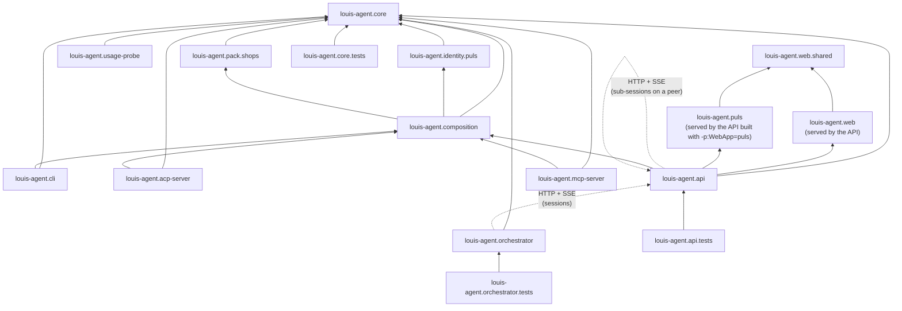

# Project design docs

One design doc per project in the solution: what it's for, how it works, its parts, its settings, how to extend it,
how it's tested, and its limits. For the whole system at once, read [Architecture](../architecture/README.md) first; come here
when you're about to change a particular project. Each project's `.csproj` links its design doc and its how-to from
[Guides](../guides/README.md), so both show under `docs/` in the IDE's solution explorer.

## The projects

| Project | Kind | In one line | Doc |
|---|---|---|---|
| `louis-agent.core` | Class library | The engine: tools, skills, the tool loop, providers, bootstrap; names no product (CL15) | [core](louis-agent.core.md) |
| `identities/louis-agent.identity.puls` | Class library | Who Puls is: its voice and modes, its roles, the packs it names (`shops`); its prompts embedded with their paths | [identity.puls](louis-agent.identity.puls.md) |
| `packs/louis-agent.pack.shops` | Class library | What the shops are: the `shops` toolset (a shop's products, specials and promotions from its own catalogue), its guide, its settings (`SHOP_CATALOGUES`, `SHOP_STORE_CACHE`) and its texts | [pack.shops](louis-agent.pack.shops.md) |
| `src/louis-agent.composition` | Class library | The composition root: the one project that references every identity and pack; `Plugins.FromEnvironment()` builds the `AgentCatalog` a host runs with, from `IDENTITIES` and `PACKS` | [composition](louis-agent.composition.md) |
| `src/louis-agent.cli` | Console app | Chat with the agent in a terminal | [cli](louis-agent.cli.md) |
| `src/louis-agent.acp-server` | Console app (stdio) | The agent inside JetBrains Rider's AI chat (Agent Client Protocol) | [acp-server](louis-agent.acp-server.md) |
| `src/louis-agent.api` | ASP.NET Core app | HTTP API with streamed answers, workspace and git endpoints; serves the web app | [api](louis-agent.api.md) |
| `src/louis-agent.web` | Blazor WebAssembly | The browser app: chats, files, changes, branches | [web](louis-agent.web.md) |
| `src/louis-agent.puls` | Blazor WebAssembly | Puls: the general assistant in Afrikaans; a landing page and a three-panel chat that delegates every task | [puls](louis-agent.puls.md) |
| `src/louis-agent.mcp-server` | Console / ASP.NET Core | Hands the agent's tools to any MCP client (no model of its own) | [mcp-server](louis-agent.mcp-server.md) |
| `src/louis-agent.orchestrator` | Console app | A second agent that watches a service's errors and has louis-agent fix them (POC) | [orchestrator](louis-agent.orchestrator.md) |
| `tools/louis-agent.usage-probe` | Console app (developer tool) | Prints what a provider reports as token usage and what the ledger makes of it | [usage-probe](louis-agent.usage-probe.md) |
| `evals/louis-agent.evals` | Class library | The eval harness: `IEval` and `IEvalSet`, datasets, trials, the common graders, the judge and its calibration, the runner loop, conformance (F18) | [evals](louis-agent.evals.md) |
| `evals/louis-agent.evals.checks` | Class library | The check contract: what a check reads and returns, out of the harness so a pack can reference it (Separated Interface; empty until F49.1 steps 2 and 3, ADR 0056) | [evals.checks](louis-agent.evals.checks.md) |
| `evals/louis-agent.evals.protocol` | Class library | The eval protocol v2: the events the runner writes and the API and portal read, records and enums only (ADR 0047) | [evals.protocol](louis-agent.evals.protocol.md) |
| `evals/louis-agent.evals.runner` | Console app | The command that lists and runs evals, re-scores a stored run and checks a judge; the API starts it as a child process | [evals.runner](louis-agent.evals.runner.md) |
| `evals/louis-agent.evals.puls` | Class library | Puls's evals: `puls-cook` and `puls-routing`, their datasets, graders and reference transcripts | [evals.puls](louis-agent.evals.puls.md) |
| `louis-agent.choices` | Class library | `SettingChoice` and `[WireName]`: the one parser for a name that is an enum member; references nothing ([ADR 0043](../adr/0043-repeated-names-are-enums.md)) | — (to write) |
| `louis-agent.session-stream` | Class library | Reads a session's server-sent events into records, for core's sub-sessions, the web apps and the eval runner | — (to write) |
| `src/louis-agent.api.contracts` | Class library | The API's replies and bodies as records, and each wire's options object, shared by the API and its clients ([ADR 0045](../adr/0045-typed-answers-and-a-shared-contract.md)) | — (to write) |
| `evals/louis-agent.evals.template` | Class library | A one-eval set to copy when an identity gets its evals ([Add an eval set](../guides/add-an-eval-set.md)) | — (to write) |
| `src/louis-agent.web.shared` | Razor class library | What both web apps share: chat models, the API client, the turn and delegation views, markdown, usage and currency | [web.shared](louis-agent.web.shared.md) |
| `tests/louis-agent.*.tests` | NUnit | The tests of core, the API's sessions, the orchestrator, the ACP server, Puls's prompts and golden, the shops pack, the composition root and the three web projects (bUnit); `tests/louis-agent.testing` and `tests/louis-agent.web.testing` hold the fakes they share | [tests](tests.md) |

## How they depend on each other

Solid arrows are project references; dotted ones are runtime calls. Only `louis-agent.core` and the test projects are
referenced by other projects, and `louis-agent.core` references none of them. Behaviour lives in core; every host is a
thin adapter between its protocol and `AgentEngine`.

## Where each one runs

| Project | Run it with | Docker service |
|---|---|---|
| core | (library) | — |
| cli | `dotnet run --project src/louis-agent.cli` | `local-agent` |
| acp-server | Rider starts it per chat | `acp-server` (`docker compose run --rm -T acp-server`) |
| api + web | `docker compose … up -d api` → http://127.0.0.1:5080 | `api` |
| mcp-server | an MCP client starts it (stdio), or HTTP with `MCP_TRANSPORT=http` | `mcp-server` |
| orchestrator | `dotnet run --project src/louis-agent.orchestrator` (its demo returns with the benchmarks) | — |

## Each doc covers

**Purpose** · **How it works** · **Structure** (files and what's in them) · **Key types** · **Configuration** ·
**Extending it** · **Tests** · **Limits and plans** (with links to [features](../features/README.md) and the
[TODO](../../TODO.md)) · **Related docs**.

---
[Docs index](../README.md) · Next: [louis-agent.core](louis-agent.core.md)
