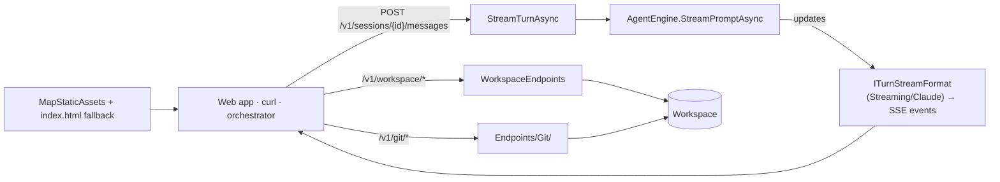

# louis-agent.api — design

> **Kind:** ASP.NET Core minimal API · **Path:** `src/louis-agent.api/` · **References:** louis-agent.core, and the web
> app it serves as static files: louis-agent.web by default, louis-agent.puls when built with `-p:WebApp=puls` ·
> **Docker services:** `api` (http://127.0.0.1:5080); `demo-api` in the demo; `puls` (5070)

## Purpose

The agent over HTTP: sessions whose answers stream as Server-Sent Events shaped like Claude's, plus read-only workspace
browsing and a git interface. It also serves the web app. Other programs and agents (the orchestrator) use it to hand
louis-agent a whole task.

## How it works

- **Start-up** (`Program.cs`): `AgentHost.Build()`, the services with `ApiMap.AddApi` (the engine, `AgentSessions` and
  a `WorkspaceBoundary` for path checks); decide the auth with core's `HostAuth` (FX18: no `AGENT_API_KEY` stops
  start-up unless `AGENT_AUTH=off`; a key adds `AgentKeyGate`, whose check is `HostAuth.HasKey`); map static assets,
  then the API with `ApiMap.MapApi`, and the admin portal on the `/v1` group it returns. Nothing else: the routes and
  the turn's stream live in `Endpoints/` and `Sessions/`.
- **Routes** (CL20, [ADR 0039](../adr/0039-api-routes-under-v1.md)): every route is under `/v1` but `/health`, mapped
  in one place (`Endpoints/Routing/ApiMap`). Resources are nouns; a create answers `201` with `Location`, a delete is
  `DELETE`, an action is `POST /v1/{resource}/{verb}`. A route needs the key unless the code marks it
  (`RouteAccess.Open` for the prices and the rates, `AdminKey` for `/v1/admin`); a `/v1` path no route matches is a
  JSON `404`. `ApiRoutesSnapshot.json` pins the table, and `ApiRouteRuleTests` checks the rule on it.
- **Prices** (`GET /v1/prices`, public): the price table `AgentHost.Build` loaded for this API's usage ledger, so other
  hosts can set `PRICES_URL` to it and price with the same table (the demo's orchestrator does); `404` without one.
- **Rates** (`GET /v1/rates`, public, F14): the exchange rates `AgentHost.Build` loaded, in our `rates.json` format, for
  other hosts' `RATES_URL` (`RATES_FORMAT=rates-json`); `GET /v1/rates/display` gives the web app the server's display
  currency and a symbol per currency. Usage objects add `display_cost`, `display_currency`, `display_symbol`,
  `rate_as_of` beside the charged `cost`.
- **Sessions** (`AgentSessions`): in memory, one turn at a time per session (a second message gets `409`), cancelled by
  `POST /v1/sessions/{id}/cancel` or by the client disconnecting; idle sessions are dropped after 4 hours.
- **Toolsets per session** (F5): `POST /v1/sessions` takes `toolsets` (none: `skills` only) and gets that profile's engine
  from core's `AgentEngineFactory`, kept for the session's life; unknown or unavailable names, a `depth` other than 0
  or 1, or `specialists` at depth 1 are a `400`. `parent` tags a sub-session's usage records with the turn that opened it.
  `GET /v1/toolsets` lists names, descriptions and availability, never tool definitions. The code-review web app opens
  chats with every available toolset; Puls opens them with `specialists` and `web` and hands cooking to its peer.
  Engines are shared by every session with the same toolsets, role and level, and the least recently used of
  16 is dropped (a session keeps its own).
- **Roles** (F21, CL14): `POST /v1/sessions` takes `role`, a built-in one at the session's level (a mode such as
  `puls/voice-af` at depth 0, a specialist's role such as `puls-cook` at depth 1); none gives the default mode,
  `louis-agent/voice`; an invalid or unknown name is a `400` before an engine is built. `GET /v1/roles` lists them by
  level, with the default. A sub-session (depth 1) gets no routing, and the role its parent names; with none it gets
  the default mode's voice (CL10: a role is never derived from the toolsets).
- **The user's place** (F22): `location` (only when the user shared it) and `time_zone` (IANA; an unknown one is a
  `400`) are kept with the session, so `GetToday` and "near me" are the user's. A location is said once, in front of
  the session's first message (`ApiModelText.UserPlace`: `[The user is in {Location}; their time zone is {TimeZone}.]`),
  not in the system prompt, which engines share; without a `time_zone` the note and `GetToday` use
  `Africa/Johannesburg`. Files attached to a message are
  remembered by name, so `StartSubSession` can forward them to a specialist without the model copying them.
- **Web input recorded and replayed** (F18 step 4a): `POST /v1/sessions` takes `replay` (`{ web, of, model }`) only on a session with
  a run tag, and **sending it, even an empty `{}`, is what marks a session as an eval**: a run tag alone marks nothing (the orchestrator
  sends one on every fix session), so with no `replay` the session is left alone whatever `WEB_REPLAY` says. `ReplayResolution` decides,
  before any engine is built (each refusal a 400): a `replay` with no run tag; an unknown `web` (the supported names are listed);
  `model: true` with any web but `replay` (step 4e: the model's answers come from a recording, with its web); `record` or `replay` on an instance with no replay folder; `replay` without `of`. The
  instance's `WEB_REPLAY` (parsed once at start-up, so a bad value stops the API) only fills in a `web` the eval didn't send. A
  recording without `of` writes `{run tag}/{task}`; a sub-session is sent its parent's `of` and keeps it, so it never works out a key of
  its own, and a child of a parent that said `off` is sent nothing and stays live. The session keeps the result, and `TurnStream` sets it for each turn as it sets
  the user's place.
- **Streaming** (`Sessions/Streaming/`, F18 step 1f): the writer is `ITurnStreamFormat`, and the turn and the session
  view call only it. Its one format is `Claude/ClaudeStreamFormat`; `"stream"` on `POST /v1/sessions` picks the format
  (`StreamFormat`, Claude by default) and the session keeps it. Engine updates become `message_start`,
  `content_block_start/delta/stop` (thinking, text, tool_use, tool_result), `message_delta` (stop reason and the
  turn's `usage`, F3) and `message_stop`;
  failures become an `error` event in Claude's shape, with the turn's `usage` when a request had returned (FX6).
  The error's `type` is the failure's kind (`StreamErrorKind` in `louis-agent.session-stream`, FX26): `api_error`
  for any failure, `replay_miss_error` when the engine's replay had no recorded answer (`ModelReplayMissException`,
  mapped by `Sessions/Streaming/StreamErrorKinds`), so a client can tell a replay miss from the agent's own failure.
  `/tools`, `/approve`, `/reject` and `/usage` are answered without the model.
- **Usage** (F3): each session keeps its finished turns' records (`UsageSession`) for `/usage` and the `usage` of
  `GET /v1/sessions/{id}`; the turn is added in the stream's `finally`, so a disconnected or failed turn still counts.
- **Workspace and git:** every path goes through core's `WorkspaceBoundary` and `SensitiveFiles` (`Guardrails/`), so the API applies
  the same boundary and secret-file rules as the agent; git runs without a shell with a 30-second timeout.
- **History and merging** (`GitCommitsEndpoints`, `GitBranchesEndpoints`): branches with ahead/behind counts, the log
  across branches, commit and branch diffs (secret files' content removed), `--no-ff` merges that abort cleanly on
  conflict, deletion of merged branches. Branch names are only accepted if they exist, and keep their slashes in the
  route (`/v1/git/branches/feature/x`).

The full endpoint and event reference: [How the agents and endpoints talk](../AGENT_COMMUNICATION.md#the-http-api-louis-agentapi).

## Structure

| File | What's in it |
|---|---|
| `Program.cs` | Start-up only (CL15, the core layout review): `AgentHost.Build`, the services, the API-key middleware (FX18), the web app's files, then each endpoint group mapped |
| `Endpoints/InfoEndpoints.cs` | `/health`, `/v1/prices`, `/v1/rates`, `/v1/rates/display`, `/v1/toolsets`, `/v1/model`, `/v1/roles`, `/v1/llm-profiles`: what this instance is and has |
| `Endpoints/SessionEndpoints.cs` | `POST /v1/sessions` (`201` with `Location`; with `"stream"`, the format, refused as a 400 when unknown), `GET` and `DELETE /v1/sessions/{id}`, `POST /v1/sessions/{id}/cancel` and `/messages` (the turn as SSE, through `TurnStream`) |
| `Endpoints/ApiErrors.cs` | The one error body every endpoint returns |
| `Endpoints/WorkspaceEndpoints.cs` | `GET /v1/workspace/entries`, `GET /v1/workspace/file` (text ≤ 1 MB; secret files listed but not readable) |
| `Endpoints/Git/GitChangesEndpoints.cs` | `GET /v1/git/status`, `GET /v1/git/diff`, `POST /v1/git/stage` · `unstage` · `discard`: the working tree and the index |
| `Endpoints/Git/GitCommitsEndpoints.cs` | `POST /v1/git/commits` (`201` with `Location`), `GET /v1/git/commits?count=` (the log across branches), `GET /v1/git/commits/{sha}` |
| `Endpoints/Git/GitBranchesEndpoints.cs` | `GET /v1/git/branches`, `GET` and `DELETE /v1/git/branches/{name}`, `POST /v1/git/merge` |
| `Endpoints/Git/GitProcess.cs`, `Output/`, `Requests/` | The git runner (no shell, 30 seconds at most); git's output parsed (`GitOutputParser` and its records); the request bodies |
| `Endpoints/Routing/` | `ApiMap` (the services and every route, the `/v1` group, the JSON 404), `RouteAccess` and `WithAccess` (who may call a route), `AgentKeyGate` (the key check) |
| `Sessions/AgentSession.cs`, `AgentSessions.cs` | One conversation (id, engine, toolsets, depth, role, place, attachments, history, turn lock, cancellation) and the in-memory session store, which picks each session's engine |
| `Sessions/Streaming/` | The stream formats (F18 step 1f): `ITurnStreamFormat`, the writer's seam; `StreamFormat`, the enum `"stream"` names; `StreamFormats`, which makes a turn's format; `TurnUsage`, a turn's usage computed once from the ledger; `Claude/ClaudeStreamFormat.cs`, the Claude-style events |
| `Sessions/TurnStream.cs` | A turn as the API streams it: the prompt from the message and its attachments, the engine's updates as Claude-style events, a sub-session's events live among them, the usage at the end |
| `Sessions/SessionView.cs`, `Sessions/Requests/` | A session as the API shows it; the request bodies (`CreateSessionRequest`, `SendMessageRequest`, `AttachmentRequest`, `ReplayRequest`) and what `replay` resolves to (`ReplayResolution`, F18 step 4a) |
| `Admin/AdminGate.cs`, `AdminAccess.cs` | The gate on `/v1/admin` (F27): the admin key, else the agent's, else closed; what it decided |
| `Admin/AdminRows.cs` | The JSON rows the admin endpoints send (a run, a conversation, a turn, a request, a live run), with the standard records: the run's eval, version, commit and graders, a conversation's grades and outcome; null from before F18 step 2a (step 4.5b) |
| `Endpoints/AdminEndpoints.cs` | The admin portal's API under `/v1/admin` (F27, F31), behind `AdminGate`: the checks and runs, a run started (503 without a store), its live events over SSE, a check's manual and trend, a stored run with its levels, a turn's events, a run deleted. Every eval route answers under `/v1/admin/evals/…`
(the trend at `/evals/{check}/trend`) and, until a TODO line removes the alias, under its old
`/v1/admin/benchmarks/…` (F18 step 7b (iii); the routes below keep their old spelling); `RescoreEndpoints.cs` (F18 step 5b.2): `POST /v1/admin/benchmarks/runs/{id}/rescore` starts the eval runner on the stored run's export, `201` with the new run's `Location`, `404` for an unknown run, `400` for a run of a Python check, `409` while a run runs, `503` without a store |
| `Config/AdminOptions.cs` | The portal's settings in one place: the admin key, the API address the checks call, the store's URL and database, and the eval runner's path (`EVAL_RUNNER`, made absolute where it enters) |
| `Evals/List/`, `Evals/Runs/` (`Start/`, `Protocol/`, `Kinds/`) | The checks the portal offers (`EvalList` and `EvalEntry`: every check is a C# eval, which comes from `EvalListing`, the runner's `--list`, read on first use; a listing that fails leaves no checks and warns; F18 step 7.4 removed the script path, so a check has an id, a title and a manual and nothing to interpret) and one run at a time as a child process (`EvalProcess`, `RunningEval`, `RunnerStartInfo` building its start and `RunnerEnvironment` the allowlist of what the process may see of the API's environment, FX25: what it reads, what the runtime needs, an Anthropic judge's key as `EVAL_JUDGE_API_KEY`; its status: `dotnet {EVAL_RUNNER} run {name} --repeat N`; `BENCHMARK_RUN` set, its lines kept and streamed); `EvalRunOptions` (the portal's start request for an eval: `web` `record`|`off` or `replay` {runId}, parsed once, and the runner gets `--web record` or `--replay {runId}`, F18 step 5.5), `EvalProtocol` (the `@` lines the runner prints; a grade's outcome may be `Pending` (F18 step 6a: a human review nobody has answered yet, `EvalOutcome.Pending`, read, kept by both stores, exported as written, shown by the portal as "waiting for review"; a trial's outcome never is); a conversation's grade line may carry `judge_model` and `judge_prompt_hash` (F18 step 6.1, a model grader's grade only: the model that judged and the hash of its prompt); the reader keeps them with the grade (F18 step 6.1b: the store, the export and the admin rows carry them; a code grader's grade has none); a model grader's requests are ledger rows with the purpose `grading`, tagged as the turns are (`{run}:{mode}:{repeat}`, the scenario as the task) and carrying the conversation's session and last turn, so `EvalLedger` places them on their conversation, the run's total counts them like any request and a slice's cost includes the judging; a re-score is priced from its own ledger rows when it has any (a judge asked), and is a known $0 only when it has none (`LedgerJoin`); the eval runner's `summary` line, F18 step 5c, is one slice of a mode's roll-up, `overall` or a category, written after the mode's last `mode_done` with its counts, tasks, rates (absent when too few), grader and kind counts and score means, and no cost: an API from before 5c reads it as a log line, which is harmless, and 5c.2 reads it (`SummaryLineReader` into a `EvalSlice`, kept on the stored run as `Slices`, null for a run from before it, never zeros), writes it back in the export as the runner wrote it with no cost (`SummaryExport`), and prices each slice when the run is read: `SlicePricer` sums the ledger's rows of the slice's conversations, so `GET /v1/admin/benchmarks/runs/{id}` returns `summaries` with `cost_per_trial` (null when any row's price is unknown) and `cost_per_pass` (left out when nothing passed); a re-score's are 0) and `StartRescore` (F18 step 5b.2: `dotnet {EVAL_RUNNER} run {eval} --rescore {id}` as an argument list, the stored run's export written to the runner's stdin; the runner grades, the API only starts it, stores it and shows it) and `EvalSettings` (what a run ran with, and the `prompt_hashes` its rows carried: the prompts it used, not all it has, F18 step 4c) |
| `Evals/Store/` (`Runs/`, `Conversations/`, `Turns/`, `Requests/`, `Recording/`, `Mongo/`, `Notes/`) | Where runs are kept (F31): one store per record (F18 step 7b), `IRunStore`, `IConversationStore`, `ITurnStore` and `IRequestStore`, each with an in-memory and a MongoDB class (one typed collection, its index, and its document record beside it, ADR 0048: `RunDocument`, `ConversationDocument`, `TurnDocument`, `RequestDocument`) and its own contract test; `Mongo/` keeps the database, the enum serializer and the facade; `IEvalStore` is the four together (a Facade, which adds the notes and deleting a run with everything under it), with `InMemoryEvalStore` and `MongoEvalStore`; `MongoEvalDatabase` opens the database with five-second timeouts, `EvalDocuments` (the records), `EvalRecorder` (a run's lines into the store as it happens; a re-score keeps `rescore_of` on its `Run` (both stores; an older run reads null) and its total is a known `0` requests and `$0`, never null and never the stored run's rows, F18 step 5b.2; a `mode_done` line's rates, F18 step 5a, are kept on that repeat's `Mode` as `ModeRates`: pass@k, pass^k, k, the trials left out and the retried, over the repeats so far, so a mode's are its last repeat's; a mode from before them has none, and the API computes none), `OnceItWorks` (the store's indexes, set up until it works once) |
| `Evals/Reviews/` | People's grades of a stored run (F18 step 6a.2), beside the benchmark store and not in it: `HumanGrade` (the run, the conversation, the model grader it answers, `HumanVerdict` pass, fail or unsure, a note, the reviewer's name and the time; the portal's gate is one shared key, so the name is what the person said, not proof), `IHumanReviewStore` in `Reviews/Store/` (`AddAsync` never overwrites: the earlier grades are the history; `OfRunAsync` oldest first; `DeleteRunAsync`) with `InMemoryHumanReviewStore` and `MongoHumanReviewStore` (collection `human_grades`; its own class, since `MongoEvalStore` is over its size), `HumanReviewStoreContract` holding both. `HumanGrades` says which grade counts: a reviewer's latest (`Latest`; a name is the same name whatever its case, and the store keeps it as typed), and the one that stands for a conversation (`Decided`: a later unsure takes back the same reviewer's pass or fail, then across reviewers the latest decided wins). `ReviewAgreement` counts, per judge, the person's pass or fail against the judge's pass, fail or unknown (counts only: the API reads, it doesn't rate). `ReviewLabels` writes a decided grade as the label file the harness's loader reads (`{grader}.{scenario}.{mode}.{run}.{repeat}.json`, snake_case; its own record on the harness's wire, held to one checked-in fixture by `ExportedLabelFixtureTests` and the harness's `ExportedLabelLoadingTests` until CL22) and zips them. The routes (`Endpoints/ReviewEndpoints.cs`, under `/v1/admin`, behind the admin key): `PUT /benchmarks/runs/{id}/reviews/{mode}/{repeat}/{task}/{grader}` (the grader is the run's human review, `meal-for-people.human`; body `{verdict, note, reviewer}`; 200 with the grade; 400 for an unknown verdict, a blank reviewer, a note over 2,000 characters, a name over 100 or a grader that is not a human review of that run; 404 for an unknown run or conversation), `GET /benchmarks/runs/{id}/reviews` (every grade, history included, the latest of each reviewer marked), `GET /benchmarks/runs/{id}/labels?grader=meal-for-people` (a zip of one label file per conversation with a decided pass or fail, an unsure never; 404 when there is none). `GET /benchmarks/runs/{id}` puts each conversation's `human_grades` beside its `grades`, and an `agreement` per judge with a human review (`person_pass` and `person_fail`, each `judge_pass`, `judge_fail` and `judge_unknown`); deleting a run deletes its grades too. |
| `Evals/Calibrations/` | The judge checks of a stored run (F18 step 6a.5b): `CalibrationRecord` (the run whose grades were the labels, the judge, the judge model or null, when, the agreement, the bar and whether it clears it, each class's counts, each disagreement with the judge's reason), `CalibrationLineReader` (the runner's `@{"event":"calibration",…}` line, read by hand as the protocol's lines are; any other line is null), `CalibrationRecorder` (listens to the run's lines as `EvalRecorder` does and keeps the report when the run ended well, else says why; `RecordingOf` for whoever waits), `ICalibrationStore` in `Calibrations/Store/` (`AddAsync` never overwrites, `OfRunAsync` newest first, `DeleteRunAsync`) with `InMemoryCalibrationStore` and `MongoCalibrationStore` (collection `calibrations`), `CalibrationStoreContract` holding both. A check is the runner's one run at a time (`EvalProcess.StartCalibration`, `EvalCalibration` on the `RunningEval`: `dotnet {EVAL_RUNNER} --calibrate {eval} {grader} --labels -`, the label lines on stdin, `RunnerStartInfo` building it) but no benchmark run: nothing records it in the benchmark store. The routes (`Endpoints/CalibrationEndpoints.cs`, under `/v1/admin`): `POST /benchmarks/runs/{id}/calibrations/{grader}` (the decided grades as `ReviewLabels.Line`s; 202 with the live run's row, which says `calibration_of`, `grader` and `last_line`; 400 for a grader without a human review on the run or a run of a script; 404 for an unknown run or one nobody graded for that judge; 409 while a run runs; 503 without a store) and `GET /benchmarks/runs/{id}/calibrations` (the reports, newest first); deleting a run deletes its reports too. |
| `Evals/Reports/` (the trends in `Trends/`) | What is read back for the portal: `CategoryTrends` (F18 step 5c.4: the trend per category per model from each run's slices, a point per run with a rate, a gap where a slice had too few trials; sent as `categories` on the trend endpoint), `SlicePricer` (a slice's cost from the ledger), `EvalTrends` (a check over its dev runs: a held-out run, one of all of them, and a replay of another run are no point), `EvalTools` (a turn's tool failures from its events), `EvalLedger` (a run's cost and, with `PromptHashesOf`, its prompt hashes from the usage ledger), `EvalManuals` (an eval's manual, F18 step 7.1: the path the runner's listing gave, read only from under `evals/`; the catalogue entry carries it as `ManualPath`, and `EvalLine.Manual` is the listing's field) |

## Configuration

Core settings (`WEB_REPLAY` and `REPLAY_DIRECTORY` among them: F18 step 4a, read through `ReplayResolution` and `AgentOptions.KeepsRecordings`), plus: `AGENT_API_KEY` (required on every `/v1` route but the prices and the rates; without it the API
refuses to start unless `AGENT_AUTH=off`, FX18), `API_PORT` (host port in
Docker, bound to `127.0.0.1`), `GIT_AUTHOR_*` / `GIT_COMMITTER_*` (identity for commits and merges from the web app),
`ASPNETCORE_URLS` / `ASPNETCORE_ENVIRONMENT` outside Docker (an unpublished `dotnet run` only serves the web app in
`Development`). The admin portal: `ADMIN_API_KEY` (falls back to `AGENT_API_KEY`), `BENCHMARKS_MONGO_URL` and
`BENCHMARKS_MONGO_DATABASE` (the store; without it no run starts), and `EVAL_RUNNER` (the eval runner's dll: the API lists and starts the C# evals with it; default `/app/evals/louis-agent.evals.runner.dll`), [SETUP](../SETUP.md).

The images carry the eval runner: both Dockerfiles (`docker/images/Dockerfile.api`, `Dockerfile.puls`) publish it in the
build stage and copy it to `/app/evals`, its own folder beside the API's (F18 step 4.3b). Compose sets no `EVAL_RUNNER`.

## Extending it

- New endpoints in their concern's `*Endpoints.cs` with a `Map…` extension, mapped from `ApiMap.MapApi`; reuse
  `GitProcess.RunAsync` for git and `ApiErrors.Result` for errors (Claude's error shape).
- New stream content goes through `ITurnStreamFormat` (its Claude format, `Sessions/Streaming/Claude`), so every client sees the same event shapes.
- Anything that changes agent behaviour belongs in core, not here.

The steps are in [Change the API](../guides/change-the-api.md). In short: an endpoint in its concern's `*Endpoints.cs`,
mapped from `ApiMap.MapApi` under `/v1`, needing the key unless it is marked open on purpose, and the route golden
regenerated; a session option in `CreateSessionRequest`; new stream events added, never changed.

## Tests

`tests/louis-agent.api.tests`: the sessions' toolsets, the default, unknown names, depth and the `specialists` rule, shared
engines and separate histories, roles, a role opening only at its own level, and a sub-session with no role getting none (a model client that is
never called). The benchmarks (F31): the protocol, the recorder, the ledger join, the runner, the catalogue, the
manuals, the trends, the tool failures, and one store contract run against the in-memory store and, when
`BENCHMARKS_MONGO_URL` is set, MongoDB (CI sets it). The routes (CL20): `ApiRoutesSnapshot.json` pins every route, its
method and who may call it, `ApiRouteRuleTests` checks ADR 0039's rule on that table, and the in-memory host
(`ApiTestHost`) runs the key gate (`AgentKeyGateTests`), a session's `201` (`SessionCreatedTests`) and the git
resources in a temporary repository (`GitResourceTests`). A streamed turn is still checked by hand, in the browser.

## Limits and plans

- Sessions are in memory → [session architecture](../specs/SESSION_ARCHITECTURE.md).
- A usage API over the ledger (`/v1/usage` endpoints, `/v1/budgets`, `/v1/estimates`) and budget errors →
  [F7](../features/F07-budgets.md) (taking in [F11](../features/F11-usage-tab-and-reconciliation.md)); account-limit
  errors → [F8](../features/F08-reliability.md); settings per role and per session →
  [F10](../features/F10-route-settings.md).
- The eval routes still answer under their old `/v1/admin/benchmarks/…` names too, until a deploy has passed (TODO,
  *Small cleanups*).

## Related docs

[How the agents and endpoints talk](../AGENT_COMMUNICATION.md) · [louis-agent.web](louis-agent.web.md) ·
[Architecture § HTTP API](../architecture/05-building-block-view.md#http-api-and-web-app)

---
[Projects](README.md) · Previous: [louis-agent.acp-server](louis-agent.acp-server.md) · Next: [louis-agent.web](louis-agent.web.md)
