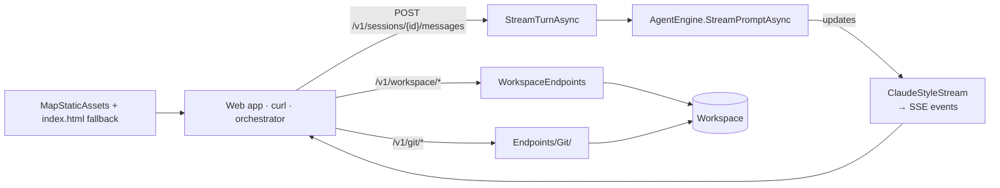

# louis-agent.api — design

> **Kind:** ASP.NET Core minimal API · **Path:** `src/louis-agent.api/` · **References:** louis-agent.core, and the web
> app it serves as static files: louis-agent.web by default, louis-agent.puls when built with `-p:WebApp=puls` ·
> **Docker services:** `api` (http://127.0.0.1:5080); `demo-api` in the demo; `puls` (5070)

## Purpose

The agent over HTTP: sessions whose answers stream as Server-Sent Events shaped like Claude's, plus read-only workspace
browsing and a git interface. It also serves the web app. Other programs and agents (the orchestrator) use it to hand
louis-agent a whole task.

## How it works

- **Start-up** (`Program.cs`): `AgentHost.Build()`, the services with `ApiMap.AddApi` (the engine, `AgentSessions` and
  a `WorkspaceBoundary` for path checks); decide the auth with core's `HostAuth` (FX18: no `AGENT_API_KEY` stops
  start-up unless `AGENT_AUTH=off`; a key adds `AgentKeyGate`, whose check is `HostAuth.HasKey`); map static assets,
  then the API with `ApiMap.MapApi`, and the admin portal on the `/v1` group it returns. Nothing else: the routes and
  the turn's stream live in `Endpoints/` and `Sessions/`.
- **Routes** (CL20, [ADR 0039](../adr/0039-api-routes-under-v1.md)): every route is under `/v1` but `/health`, mapped
  in one place (`Endpoints/Routing/ApiMap`). Resources are nouns; a create answers `201` with `Location`, a delete is
  `DELETE`, an action is `POST /v1/{resource}/{verb}`. A route needs the key unless the code marks it
  (`RouteAccess.Open` for the prices and the rates, `AdminKey` for `/v1/admin`); a `/v1` path no route matches is a
  JSON `404`. `ApiRoutesSnapshot.json` pins the table, and `ApiRouteRuleTests` checks the rule on it.
- **Prices** (`GET /v1/prices`, public): the price table `AgentHost.Build` loaded for this API's usage ledger, so other
  hosts can set `PRICES_URL` to it and price with the same table (the demo's orchestrator does); `404` without one.
- **Rates** (`GET /v1/rates`, public, F14): the exchange rates `AgentHost.Build` loaded, in our `rates.json` format, for
  other hosts' `RATES_URL` (`RATES_FORMAT=rates-json`); `GET /v1/rates/display` gives the web app the server's display
  currency and a symbol per currency. Usage objects add `display_cost`, `display_currency`, `display_symbol`,
  `rate_as_of` beside the charged `cost`.
- **Sessions** (`AgentSessions`): in memory, one turn at a time per session (a second message gets `409`), cancelled by
  `POST /v1/sessions/{id}/cancel` or by the client disconnecting; idle sessions are dropped after 4 hours.
- **Toolsets per session** (F5): `POST /v1/sessions` takes `toolsets` (none: `skills` only) and gets that profile's engine
  from core's `AgentEngineFactory`, kept for the session's life; unknown or unavailable names, a `depth` other than 0
  or 1, or `specialists` at depth 1 are a `400`. `parent` tags a sub-session's usage records with the turn that opened it.
  `GET /v1/toolsets` lists names, descriptions and availability, never tool definitions. The code-review web app opens
  chats with every available toolset; Puls opens them with `specialists` and `web` and hands cooking to its peer.
  Engines are shared by every session with the same toolsets, role and level, and the least recently used of
  16 is dropped (a session keeps its own).
- **Roles** (F21, CL14): `POST /v1/sessions` takes `role`, a built-in one at the session's level (a mode such as
  `puls/voice-af` at depth 0, a specialist's role such as `puls-cook` at depth 1); none gives the default mode,
  `louis-agent/voice`; an invalid or unknown name is a `400` before an engine is built. `GET /v1/roles` lists them by
  level, with the default. A sub-session (depth 1) gets no routing, and the role its parent names; with none it gets
  the default mode's voice (CL10: a role is never derived from the toolsets).
- **The user's place** (F22): `location` (only when the user shared it) and `time_zone` (IANA; an unknown one is a
  `400`) are kept with the session, so `GetToday` and "near me" are the user's. A location is said once, in front of
  the session's first message (`ApiModelText.UserPlace`: `[The user is in {Location}; their time zone is {TimeZone}.]`),
  not in the system prompt, which engines share; without a `time_zone` the note and `GetToday` use
  `Africa/Johannesburg`. Files attached to a message are
  remembered by name, so `StartSubSession` can forward them to a specialist without the model copying them.
- **Streaming** (`ClaudeStyleStream`): engine updates become `message_start`, `content_block_start/delta/stop`
  (thinking, text, tool_use, tool_result), `message_delta` (stop reason and the turn's `usage`, F3) and `message_stop`;
  failures become an `error` event in Claude's shape, with the turn's `usage` when a request had returned (FX6).
  `/tools`, `/approve`, `/reject` and `/usage` are answered without the model.
- **Usage** (F3): each session keeps its finished turns' records (`UsageSession`) for `/usage` and the `usage` of
  `GET /v1/sessions/{id}`; the turn is added in the stream's `finally`, so a disconnected or failed turn still counts.
- **Workspace and git:** every path goes through core's `WorkspaceBoundary` and `SensitiveFiles` (`Guardrails/`), so the API applies
  the same boundary and secret-file rules as the agent; git runs without a shell with a 30-second timeout.
- **History and merging** (`GitCommitsEndpoints`, `GitBranchesEndpoints`): branches with ahead/behind counts, the log
  across branches, commit and branch diffs (secret files' content removed), `--no-ff` merges that abort cleanly on
  conflict, deletion of merged branches. Branch names are only accepted if they exist, and keep their slashes in the
  route (`/v1/git/branches/feature/x`).

The full endpoint and event reference: [How the agents and endpoints talk](../AGENT_COMMUNICATION.md#the-http-api-louis-agentapi).

## Structure

| File | What's in it |
|---|---|
| `Program.cs` | Start-up only (CL15, the core layout review): `AgentHost.Build`, the services, the API-key middleware (FX18), the web app's files, then each endpoint group mapped |
| `Endpoints/InfoEndpoints.cs` | `/health`, `/v1/prices`, `/v1/rates`, `/v1/rates/display`, `/v1/toolsets`, `/v1/model`, `/v1/roles`, `/v1/llm-profiles`: what this instance is and has |
| `Endpoints/SessionEndpoints.cs` | `POST /v1/sessions` (`201` with `Location`), `GET` and `DELETE /v1/sessions/{id}`, `POST /v1/sessions/{id}/cancel` and `/messages` (the turn as SSE, through `TurnStream`) |
| `Endpoints/ApiErrors.cs` | The one error body every endpoint returns |
| `Endpoints/WorkspaceEndpoints.cs` | `GET /v1/workspace/entries`, `GET /v1/workspace/file` (text ≤ 1 MB; secret files listed but not readable) |
| `Endpoints/Git/GitChangesEndpoints.cs` | `GET /v1/git/status`, `GET /v1/git/diff`, `POST /v1/git/stage` · `unstage` · `discard`: the working tree and the index |
| `Endpoints/Git/GitCommitsEndpoints.cs` | `POST /v1/git/commits` (`201` with `Location`), `GET /v1/git/commits?count=` (the log across branches), `GET /v1/git/commits/{sha}` |
| `Endpoints/Git/GitBranchesEndpoints.cs` | `GET /v1/git/branches`, `GET` and `DELETE /v1/git/branches/{name}`, `POST /v1/git/merge` |
| `Endpoints/Git/GitProcess.cs`, `Output/`, `Requests/` | The git runner (no shell, 30 seconds at most); git's output parsed (`GitOutputParser` and its records); the request bodies |
| `Endpoints/Routing/` | `ApiMap` (the services and every route, the `/v1` group, the JSON 404), `RouteAccess` and `WithAccess` (who may call a route), `AgentKeyGate` (the key check) |
| `Sessions/AgentSession.cs`, `AgentSessions.cs` | One conversation (id, engine, toolsets, depth, role, place, attachments, history, turn lock, cancellation) and the in-memory session store, which picks each session's engine |
| `Sessions/TurnStream.cs`, `ClaudeStyleStream.cs` | A turn as the API streams it: the prompt from the message and its attachments, the engine's updates as Claude-style events, a sub-session's events live among them, the usage at the end |
| `Sessions/SessionView.cs`, `Sessions/Requests/` | A session as the API shows it; the request bodies (`CreateSessionRequest`, `SendMessageRequest`, `AttachmentRequest`) |
| `Admin/AdminGate.cs`, `AdminAccess.cs` | The gate on `/v1/admin` (F27): the admin key, else the agent's, else closed; what it decided |
| `Endpoints/AdminEndpoints.cs` | The admin portal's API under `/v1/admin` (F27, F31), behind `AdminGate`: the checks and runs, a run started (503 without a store), its live events over SSE, a check's manual and trend, a stored run with its levels, a turn's events, a run deleted |
| `Config/AdminOptions.cs` | The portal's settings in one place: the admin key, the API address the checks call, the store's URL and database |
| `Benchmarks/Runs/` | The checks the portal offers (`BenchmarkCatalog`, `BenchmarkCheck`) and one run at a time as a child process (`BenchmarkRunner`, `BenchmarkRun`, its status: `python3 run_check.py --repeat N`, `BENCHMARK_RUN` set, its lines kept and streamed); `BenchmarkProtocol` (the `@` lines a script prints) and `BenchmarkSettings` (what a run ran with) |
| `Benchmarks/Store/` | Where runs are kept (F31): `IBenchmarkStore` with `InMemoryBenchmarkStore` and `MongoBenchmarkStore`, `BenchmarkDocuments` (the records), `BenchmarkRecorder` (a run's lines into the store as it happens), `OnceItWorks` (the store's indexes, set up until it works once) |
| `Benchmarks/Reports/` | What is read back for the portal: `BenchmarkTrends` (a check over its runs), `BenchmarkTools` (a turn's tool failures from its events), `BenchmarkLedger` (a run's cost from the usage ledger), `BenchmarkManuals` (a check's manual) |

## Configuration

Core settings, plus: `AGENT_API_KEY` (required on every `/v1` route but the prices and the rates; without it the API
refuses to start unless `AGENT_AUTH=off`, FX18), `API_PORT` (host port in
Docker, bound to `127.0.0.1`), `GIT_AUTHOR_*` / `GIT_COMMITTER_*` (identity for commits and merges from the web app),
`ASPNETCORE_URLS` / `ASPNETCORE_ENVIRONMENT` outside Docker (an unpublished `dotnet run` only serves the web app in
`Development`). The admin portal: `ADMIN_API_KEY` (falls back to `AGENT_API_KEY`), `BENCHMARKS_MONGO_URL` and
`BENCHMARKS_MONGO_DATABASE` (the store; without it no run starts), [SETUP](../SETUP.md).

## Extending it

The steps are in [Change the API](../guides/change-the-api.md). In short: an endpoint in its concern's `*Endpoints.cs`,
mapped from `ApiMap.MapApi` under `/v1`, needing the key unless it is marked open on purpose, and the route golden
regenerated; a session option in `CreateSessionRequest`; new stream events added, never changed.

## Tests

`tests/louis-agent.api.tests`: the sessions' toolsets, the default, unknown names, depth and the `specialists` rule, shared
engines and separate histories, roles, a role opening only at its own level, and a sub-session with no role getting none (a model client that is
never called). The benchmarks (F31): the protocol, the recorder, the ledger join, the runner, the catalogue, the
manuals, the trends, the tool failures, and one store contract run against the in-memory store and, when
`BENCHMARKS_MONGO_URL` is set, MongoDB (CI sets it). The routes (CL20): `ApiRoutesSnapshot.json` pins every route, its
method and who may call it, `ApiRouteRuleTests` checks ADR 0039's rule on that table, and the in-memory host
(`ApiTestHost`) runs the key gate (`AgentKeyGateTests`), a session's `201` (`SessionCreatedTests`) and the git
resources in a temporary repository (`GitResourceTests`). A streamed turn is still checked by hand, in the browser.

## Limits and plans

- Sessions are in memory → [session architecture](../specs/SESSION_ARCHITECTURE.md).
- A usage API over the ledger (`/v1/usage` endpoints, `/v1/budgets`, `/v1/estimates`) →
  [F11](../features/F11-usage-tab-and-reconciliation.md); costs in another currency →
  [F14](../features/F14-display-currency.md); budget and account-limit errors →
  [F7](../features/F07-budgets.md), [F8](../features/F08-reliability.md); session tags and profiles →
  [F1](../features/F01-usage-ledger.md), [F10](../features/F10-route-settings.md).

## Related docs

[How the agents and endpoints talk](../AGENT_COMMUNICATION.md) · [louis-agent.web](louis-agent.web.md) ·
[Architecture § HTTP API](../architecture/05-building-block-view.md#http-api-and-web-app)

---
[Projects](README.md) · Previous: [louis-agent.acp-server](louis-agent.acp-server.md) · Next: [louis-agent.web](louis-agent.web.md)
