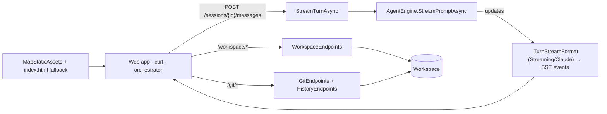

# louis-agent.api — design

> **Kind:** ASP.NET Core minimal API · **Path:** `src/louis-agent.api/` · **References:** louis-agent.core, and the web
> app it serves as static files: louis-agent.web by default, louis-agent.puls when built with `-p:WebApp=puls` ·
> **Docker services:** `api` (http://127.0.0.1:5080); `demo-api` in the demo; `puls` (5070)

## Purpose

The agent over HTTP: sessions whose answers stream as Server-Sent Events shaped like Claude's, plus read-only workspace
browsing and a git interface. It also serves the web app. Other programs and agents (the orchestrator) use it to hand
louis-agent a whole task.

## How it works

- **Start-up** (`Program.cs`): `AgentHost.Build()`, register the engine, `AgentSessions` and a `WorkspaceTools` for path
  checks; decide the auth with core's `HostAuth` (FX18: no `AGENT_API_KEY` stops start-up unless `AGENT_AUTH=off`; a
  key adds the middleware, whose check is `HostAuth.HasKey`); map static assets, then each endpoint group
  (`MapInfo`, workspace, git, history, admin, `MapSessions`). Nothing else: the routes and the turn's stream live in
  `Endpoints/` and `Sessions/`.
- **Prices** (`GET /prices`, public): the price table `AgentHost.Build` loaded for this API's usage ledger, so other
  hosts can set `PRICES_URL` to it and price with the same table (the demo's orchestrator does); `404` without one.
- **Rates** (`GET /rates`, public, F14): the exchange rates `AgentHost.Build` loaded, in our `rates.json` format, for
  other hosts' `RATES_URL` (`RATES_FORMAT=rates-json`); `GET /rates/display` gives the web app the server's display
  currency and a symbol per currency. Usage objects add `display_cost`, `display_currency`, `display_symbol`,
  `rate_as_of` beside the charged `cost`.
- **Sessions** (`AgentSessions`): in memory, one turn at a time per session (a second message gets `409`), cancelled by
  `POST /sessions/{id}/cancel` or by the client disconnecting; idle sessions are dropped after 4 hours.
- **Toolsets per session** (F5): `POST /sessions` takes `toolsets` (none: `skills` only) and gets that profile's engine
  from core's `AgentEngineFactory`, kept for the session's life; unknown or unavailable names, a `depth` other than 0
  or 1, or `specialists` at depth 1 are a `400`. `parent` tags a sub-session's usage records with the turn that opened it.
  `GET /toolsets` lists names, descriptions and availability, never tool definitions. The code-review web app opens
  chats with every available toolset; Puls opens them with `specialists` and `web` and hands cooking to its peer.
  Engines are shared by every session with the same toolsets, role and level, and the least recently used of
  16 is dropped (a session keeps its own).
- **Roles** (F21, CL14): `POST /sessions` takes `role` (`personality` still read), a built-in one at the session's level
  (a mode such as `puls/voice-af` at depth 0, a specialist's role such as `puls-cook` at depth 1); none gives the
  default mode, `louis-agent/voice`; an invalid or unknown name is a `400` before an engine is built. `GET /roles` (or
  `/personalities`) lists them by level, with the default. A sub-session (depth 1) gets no routing, and the role its
  parent names; with none it gets the default mode's voice (CL10: a role is never derived from the toolsets).
- **The user's place** (F22): `location` (only when the user shared it) and `time_zone` (IANA; an unknown one is a
  `400`) are kept with the session, so `GetToday` and "near me" are the user's. A location is said once, in front of
  the session's first message (`ApiModelText.UserPlace`: `[The user is in {Location}; their time zone is {TimeZone}.]`),
  not in the system prompt, which engines share; without a `time_zone` the note and `GetToday` use
  `Africa/Johannesburg`. Files attached to a message are
  remembered by name, so `StartSubSession` can forward them to a specialist without the model copying them.
- **Streaming** (`Sessions/Streaming/`, F18 step 1f): the writer is `ITurnStreamFormat`, and the turn and the session
  view call only it. Its one format is `Claude/ClaudeStreamFormat`; `"stream"` on `POST /sessions` picks the format
  (`StreamFormat`, Claude by default) and the session keeps it. Engine updates become `message_start`,
  `content_block_start/delta/stop` (thinking, text, tool_use, tool_result), `message_delta` (stop reason and the
  turn's `usage`, F3) and `message_stop`;
  failures become an `error` event in Claude's shape, with the turn's `usage` when a request had returned (FX6).
  `/tools`, `/approve`, `/reject` and `/usage` are answered without the model.
- **Usage** (F3): each session keeps its finished turns' records (`UsageSession`) for `/usage` and the `usage` of
  `GET /sessions/{id}`; the turn is added in the stream's `finally`, so a disconnected or failed turn still counts.
- **Workspace and git:** every path goes through core's `WorkspaceBoundary` and `SensitiveFiles` (`Guardrails/`), so the API applies
  the same boundary and secret-file rules as the agent; git runs without a shell with a 30-second timeout.
- **History and merging** (`HistoryEndpoints`): branches with ahead/behind counts, the log across branches, commit and
  branch diffs (secret files' content removed), `--no-ff` merges that abort cleanly on conflict, deletion of merged
  branches. Branch names are only accepted if they exist.

The full endpoint and event reference: [How the agents and endpoints talk](../AGENT_COMMUNICATION.md#the-http-api-louis-agentapi).

## Structure

| File | What's in it |
|---|---|
| `Program.cs` | Start-up only (CL15, the core layout review): `AgentHost.Build`, the services, the API-key middleware (FX18), the web app's files, then each endpoint group mapped |
| `Endpoints/InfoEndpoints.cs` | `/health`, `/prices`, `/rates`, `/rates/display`, `/toolsets`, `/model`, `/roles` (`/personalities`), `/llm-profiles`: what this instance is and has |
| `Endpoints/SessionEndpoints.cs` | `POST /sessions` (with `"stream"`, the format, refused as a 400 when unknown), `GET` and `DELETE /sessions/{id}`, `POST /sessions/{id}/cancel` and `/messages` (the turn as SSE, through `TurnStream`) |
| `Endpoints/ApiErrors.cs` | The one error body every endpoint returns |
| `Endpoints/WorkspaceEndpoints.cs` | `GET /workspace/entries`, `GET /workspace/file` (text ≤ 1 MB; secret files listed but not readable) |
| `Endpoints/GitEndpoints.cs` | `GET /git/status`, `GET /git/diff`, `POST /git/stage` · `unstage` · `discard` · `commit`; the git runner |
| `Endpoints/HistoryEndpoints.cs` | `GET /git/branches`, `/git/log`, `/git/commit`, `/git/branch`; `POST /git/merge`, `/git/branch/delete` |
| `Sessions/AgentSession.cs`, `AgentSessions.cs` | One conversation (id, engine, toolsets, depth, role, place, attachments, history, turn lock, cancellation) and the in-memory session store, which picks each session's engine |
| `Sessions/Streaming/` | The stream formats (F18 step 1f): `ITurnStreamFormat`, the writer's seam; `StreamFormat`, the enum `"stream"` names; `StreamFormats`, which makes a turn's format; `TurnUsage`, a turn's usage computed once from the ledger; `Claude/ClaudeStreamFormat.cs`, the Claude-style events |
| `Sessions/TurnStream.cs` | A turn as the API streams it: the prompt from the message and its attachments, the engine's updates as Claude-style events, a sub-session's events live among them, the usage at the end |
| `Sessions/SessionView.cs`, `Sessions/Requests/` | A session as the API shows it; the request bodies (`CreateSessionRequest`, `SendMessageRequest`, `AttachmentRequest`) |
| `Admin/AdminGate.cs`, `AdminAccess.cs` | The gate on `/admin` (F27): the admin key, else the agent's, else closed; what it decided |
| `Endpoints/AdminEndpoints.cs` | The admin portal's API under `/admin` (F27, F31), behind `AdminGate`: the checks and runs, a run started (503 without a store), its live events over SSE, a check's manual and trend, a stored run with its levels, a turn's events, a run deleted |
| `Config/AdminOptions.cs` | The portal's settings in one place: the admin key, the API address the checks call, the store's URL and database, and the eval runner's path (`EVAL_RUNNER`, made absolute where it enters) |
| `Benchmarks/Runs/` | The checks the portal offers (`BenchmarkCatalog`, `BenchmarkCheck` and its `BenchmarkCheckKind`; the C# evals come from `EvalListing`, the runner's `--list`, read on first use) and one run at a time as a child process (`BenchmarkRunner`, `BenchmarkRun`, its status: `python3 run_check.py --repeat N`, or `dotnet {EVAL_RUNNER} run {name} --repeat N` for an eval; `BENCHMARK_RUN` set, its lines kept and streamed); `BenchmarkProtocol` (the `@` lines a script prints) and `BenchmarkSettings` (what a run ran with) |
| `Benchmarks/Store/` | Where runs are kept (F31): `IBenchmarkStore` with `InMemoryBenchmarkStore` and `MongoBenchmarkStore`, `BenchmarkDocuments` (the records), `BenchmarkRecorder` (a run's lines into the store as it happens), `OnceItWorks` (the store's indexes, set up until it works once) |
| `Benchmarks/Reports/` | What is read back for the portal: `BenchmarkTrends` (a check over its runs), `BenchmarkTools` (a turn's tool failures from its events), `BenchmarkLedger` (a run's cost from the usage ledger), `BenchmarkManuals` (a check's manual) |

## Configuration

Core settings, plus: `AGENT_API_KEY` (required on `/sessions`, `/workspace`, `/git`; without it the API refuses to start
unless `AGENT_AUTH=off`, FX18), `API_PORT` (host port in
Docker, bound to `127.0.0.1`), `GIT_AUTHOR_*` / `GIT_COMMITTER_*` (identity for commits and merges from the web app),
`ASPNETCORE_URLS` / `ASPNETCORE_ENVIRONMENT` outside Docker (an unpublished `dotnet run` only serves the web app in
`Development`). The admin portal: `ADMIN_API_KEY` (falls back to `AGENT_API_KEY`), `BENCHMARKS_MONGO_URL` and
`BENCHMARKS_MONGO_DATABASE` (the store; without it no run starts), and `EVAL_RUNNER` (the eval runner's dll: the API lists and starts the C# evals with it; default `/app/evals/louis-agent.evals.runner.dll`), [SETUP](../SETUP.md).

The images carry the eval runner: both Dockerfiles (`docker/images/Dockerfile.api`, `Dockerfile.puls`) publish it in the
build stage and copy it to `/app/evals`, its own folder beside the API's (F18 step 4.3b). Compose sets no `EVAL_RUNNER`.

## Extending it

- New endpoints in their own `*Endpoints.cs` with a `Map…` extension, following `HistoryEndpoints`; reuse
  `GitEndpoints.RunAsync` for git and `ApiErrors.Result` for errors (Claude's error shape).
- New stream content goes through `ITurnStreamFormat` (its Claude format, `Sessions/Streaming/Claude`), so every client sees the same event shapes.
- Anything that changes agent behaviour belongs in core, not here.

The steps are in [Change the API](../guides/change-the-api.md). In short: an endpoint in its own `*Endpoints.cs`, its
prefix added to the key check; a session option in `CreateSessionRequest`; new stream events added, never changed.

## Tests

`tests/louis-agent.api.tests`: the sessions' toolsets, the default, unknown names, depth and the `specialists` rule, shared
engines and separate histories, roles, a role opening only at its own level, and a sub-session with no role getting none (a model client that is
never called). The benchmarks (F31): the protocol, the recorder, the ledger join, the runner, the catalogue, the
manuals, the trends, the tool failures, and one store contract run against the in-memory store and, when
`BENCHMARKS_MONGO_URL` is set, MongoDB (CI sets it). The endpoints and the web app are checked with
curl and the browser (backlog: *Automated tests for the API and the web app*); nothing exercises sessions, streaming
and the git endpoints end to end since CL10 removed the orchestrator demo.

## Limits and plans

- Sessions are in memory → [session architecture](../specs/SESSION_ARCHITECTURE.md).
- A usage API over the ledger (`/usage` endpoints, `/budgets`, `/estimates`) →
  [F11](../features/F11-usage-tab-and-reconciliation.md); costs in another currency →
  [F14](../features/F14-display-currency.md); budget and account-limit errors →
  [F7](../features/F07-budgets.md), [F8](../features/F08-reliability.md); session tags and profiles →
  [F1](../features/F01-usage-ledger.md), [F10](../features/F10-route-settings.md).

## Related docs

[How the agents and endpoints talk](../AGENT_COMMUNICATION.md) · [louis-agent.web](louis-agent.web.md) ·
[Architecture § HTTP API](../architecture/05-building-block-view.md#http-api-and-web-app)

---
[Projects](README.md) · Previous: [louis-agent.acp-server](louis-agent.acp-server.md) · Next: [louis-agent.web](louis-agent.web.md)
