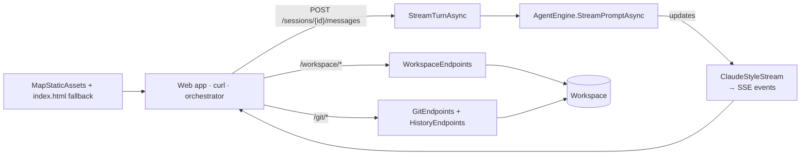

# louis-agent.api — design

> **Kind:** ASP.NET Core minimal API · **Path:** `src/louis-agent.api/` · **References:** louis-agent.core, and the web
> app it serves as static files: louis-agent.web by default, louis-agent.puls when built with `-p:WebApp=puls` ·
> **Docker services:** `api` (http://127.0.0.1:5080); `demo-api` in the demo; `puls` and `puls-agent` (5070, 5071)

## Purpose

The agent over HTTP: sessions whose answers stream as Server-Sent Events shaped like Claude's, plus read-only workspace
browsing and a git interface. It also serves the web app. Other programs and agents (the orchestrator) use it to hand
louis-agent a whole task.

## How it works

- **Start-up** (`Program.cs`): `AgentHost.Build()`, register the engine, `AgentSessions` and a `WorkspaceTools` for path
  checks; add the API-key middleware when `AGENT_API_KEY` is set; map static assets, `/health`, `/prices`, workspace,
  git and history endpoints, and the session endpoints.
- **Prices** (`GET /prices`, public): the price table `AgentHost.Build` loaded for this API's usage ledger, so other
  hosts can set `PRICES_URL` to it and price with the same table (the demo's orchestrator does); `404` without one.
- **Rates** (`GET /rates`, public, F14): the exchange rates `AgentHost.Build` loaded, in our `rates.json` format, for
  other hosts' `RATES_URL` (`RATES_FORMAT=rates-json`); `GET /rates/display` gives the web app the server's display
  currency and a symbol per currency. Usage objects add `display_cost`, `display_currency`, `display_symbol`,
  `rate_as_of` beside the charged `cost`.
- **Sessions** (`AgentSessions`): in memory, one turn at a time per session (a second message gets `409`), cancelled by
  `POST /sessions/{id}/cancel` or by the client disconnecting; idle sessions are dropped after 4 hours.
- **Toolsets per session** (F5): `POST /sessions` takes `toolsets` (none: `skills` only) and gets that profile's engine
  from core's `AgentEngineFactory`, kept for the session's life; unknown or unavailable names, a `depth` other than 0
  or 1, or `agents` at depth 1 are a `400`. `parent` tags a sub-session's usage records with the turn that opened it.
  `GET /toolsets` lists names, descriptions and availability, never tool definitions. The code-review web app opens
  chats with every available toolset; Puls opens them with `agents` only and delegates every task to its peer.
  Engines are shared by every session with the same toolsets, personality and router, and the least recently used of
  16 is dropped (a session keeps its own).
- **Personalities** (F21): `POST /sessions` takes `personality`, a file in `Skills/personalities/` (`puls`, or a
  specialist's role such as `puls-researcher`); none gives `personality.md`; an invalid or unknown name is a `400`
  before an engine is built. `GET /personalities` lists them. A sub-session (depth 1) gets no router (`default.md`),
  and when its parent named no role, one is taken from its toolsets (`roles.json`).
- **The user's place** (F22): `location` (only when the user shared it) and `time_zone` (IANA; an unknown one is a
  `400`) are kept with the session, so `GetToday` and "near me" are the user's. A location is said once, in front of
  the session's first message (`ApiModelText.UserPlace`: `[The user is in {Location}; their time zone is {TimeZone}.]`),
  not in the system prompt, which engines share; without a `time_zone` the note and `GetToday` use
  `Africa/Johannesburg`. Files attached to a message are
  remembered by name, so `StartSubSession` can forward them to a specialist without the model copying them.
- **Streaming** (`ClaudeStyleStream`): engine updates become `message_start`, `content_block_start/delta/stop`
  (thinking, text, tool_use, tool_result), `message_delta` (stop reason and the turn's `usage`, F3) and `message_stop`;
  failures become an `error` event in Claude's shape, with the turn's `usage` when a request had returned (FX6).
  `/tools`, `/approve`, `/reject` and `/usage` are answered without the model.
- **Usage** (F3): each session keeps its finished turns' records (`UsageSession`) for `/usage` and the `usage` of
  `GET /sessions/{id}`; the turn is added in the stream's `finally`, so a disconnected or failed turn still counts.
- **Workspace and git:** every path goes through core's `WorkspaceBoundary` and `SensitiveFiles` (`Guardrails/`), so the API applies
  the same boundary and secret-file rules as the agent; git runs without a shell with a 30-second timeout.
- **History and merging** (`HistoryEndpoints`): branches with ahead/behind counts, the log across branches, commit and
  branch diffs (secret files' content removed), `--no-ff` merges that abort cleanly on conflict, deletion of merged
  branches. Branch names are only accepted if they exist.

The full endpoint and event reference: [How the agents and endpoints talk](../AGENT_COMMUNICATION.md#the-http-api-louis-agentapi).

## Structure

| File | What's in it |
|---|---|
| `Program.cs` | Start-up, API-key middleware, `/health`, `/prices`, `/rates`, `/toolsets`, `/personalities`, `/model`, session endpoints, `StreamTurnAsync`, `ClaudeStyleStream` |
| `AgentSessions.cs` | `AgentSession` (id, engine, toolsets, depth, personality, place, attachments, history, turn lock, cancellation) and the in-memory session store, which picks each session's engine |
| `WorkspaceEndpoints.cs` | `GET /workspace/entries`, `GET /workspace/file` (text ≤ 1 MB; secret files listed but not readable) |
| `GitEndpoints.cs` | `GET /git/status`, `GET /git/diff`, `POST /git/stage` · `unstage` · `discard` · `commit`; the git runner |
| `HistoryEndpoints.cs` | `GET /git/branches`, `/git/log`, `/git/commit`, `/git/branch`; `POST /git/merge`, `/git/branch/delete` |

## Configuration

Core settings, plus: `AGENT_API_KEY` (required on `/sessions`, `/workspace`, `/git` when set), `API_PORT` (host port in
Docker, bound to `127.0.0.1`), `GIT_AUTHOR_*` / `GIT_COMMITTER_*` (identity for commits and merges from the web app),
`ASPNETCORE_URLS` / `ASPNETCORE_ENVIRONMENT` outside Docker (an unpublished `dotnet run` only serves the web app in
`Development`).

## Extending it

- New endpoints in their own `*Endpoints.cs` with a `Map…` extension, following `HistoryEndpoints`; reuse
  `GitEndpoints.RunAsync` for git and `ApiErrors.Result` for errors (Claude's error shape).
- New stream content goes through `ClaudeStyleStream`, so every client sees the same event shapes.
- Anything that changes agent behaviour belongs in core, not here.

## Tests

`tests/louis-agent.api.tests`: the sessions' toolsets, the default, unknown names, depth and the `agents` rule, shared
engines and separate histories, personalities and the role a sub-session gets from its toolsets (a model client that is
never called). The endpoints and the web app are checked with
curl and the browser (backlog: *Automated tests for the API and the web app*); the orchestrator demo exercises
sessions, streaming and the git endpoints end to end.

## Limits and plans

- Sessions are in memory → [session architecture](../specs/SESSION_ARCHITECTURE.md).
- A usage API over the ledger (`/usage` endpoints, `/budgets`, `/estimates`) →
  [F11](../features/F11-usage-tab-and-reconciliation.md); costs in another currency →
  [F14](../features/F14-display-currency.md); budget and account-limit errors →
  [F7](../features/F07-budgets.md), [F8](../features/F08-reliability.md); session tags and profiles →
  [F1](../features/F01-usage-ledger.md), [F10](../features/F10-route-settings.md).

## Related docs

[How the agents and endpoints talk](../AGENT_COMMUNICATION.md) · [louis-agent.web](louis-agent.web.md) ·
[Architecture § HTTP API](../architecture/05-building-block-view.md#http-api-and-web-app)

---
[Projects](README.md) · Previous: [louis-agent.acp-server](louis-agent.acp-server.md) · Next: [louis-agent.web](louis-agent.web.md)
