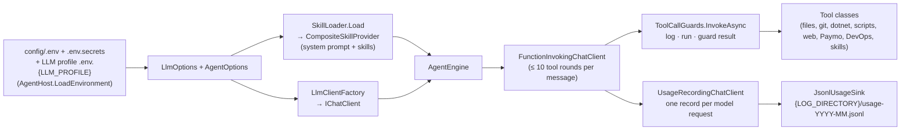

# louis-agent.core — design

> **Kind:** class library (`net10.0`) · **Path:** `louis-agent.core/` · **References:** Microsoft.Extensions.AI,
> Anthropic SDK, OpenAI and Ollama clients, dotenv.net · **Used by:** every host, the orchestrator, the tests

## Purpose

Everything that makes louis-agent an agent, independent of how you talk to it: the tools, the skills, the tool-call
loop, the model providers, configuration, logging and bootstrap. The hosts (CLI, Rider, API, MCP) only translate their
protocol to and from `AgentEngine`; behaviour changes belong here.

## How it works

1. **Bootstrap** (`AgentHost.Build()`): load `config/.env.secrets` then `config/.env` (searching upward from the working
   directory; variables already set win), bind `LlmOptions` and `AgentOptions`, start file logging, load skills, create
   the chat client, create `AgentEngine`, load approved agent-built tools, start Rider MCP discovery if enabled.
   `BuildToolHost()` does the same without a model, for the MCP server.
2. **A turn** (`StreamPromptAsync` / `ProcessPromptAsync`): append the user message to the history, send history + tools
   + reasoning settings to the model, let `FunctionInvokingChatClient` run tool calls (up to 10 rounds), stream thinking,
   text, calls and results to the host, then append the whole turn to the history.
3. **Guards** around every tool call: results over 50,000 characters are summarised by a separate tool-less call; a call
   cut off by the output limit is never run (and when streaming, the model is asked to continue, up to 3 times);
   exceptions go back to the model with their message.
4. **Usage** (F1): `UsageRecordingChatClient` sits inside the tool loop, so every model request (each tool round, each
   summary) writes one line to the usage ledger: token counts mapped by the provider's `IUsageMapper`, model, duration,
   stop reason, and the `UsageScope` the host opened for the turn (host, session, turn, purpose, task/run/service tags).
   Counts and ids only, never prompt text.

The full step-by-step is in [How a turn works](../architecture/06-runtime-view.md).

## Structure

| Path | What's in it |
|---|---|
| `Agent/AgentEngine.cs` | The engine as a facade (S, CL15): wires the skills, the tools, the guards and the pipeline once; a turn, a command and the self-extension tools go to the classes below |
| `Agent/Turns/` | `TurnRunner` (one turn: the history seeded and kept current, the reply whole or streamed, a cut-off reply continued), `ChatPipeline` (the middleware in its order), `ToolCallGuards` (cut-off calls never run, oversized results summarised), `ToolCallText` (a call's arguments on one line for the CLI and Rider) |
| `Agent/EngineTools/OwnTools.cs` | The tools an engine registers itself: `ExecuteSkill` and the clock in every session, the toolsets' objects, and the four self-extension tools as the `skills` toolset |
| `Agent/Commands/UserCommands.cs` | `/tools`, `/approve`, `/reject`, `/usage`: answered without the model, from the agent-built tools, the skill files and the session's usage |
| `Agent/ToolRegistry.cs` | The tools in name order (one name each), public methods as tools, discovered tools |
| `Agent/ToolCallGuards.cs` | Around each call: logging, cut-off calls never run, oversized results summarised (a model call), tools kept on the final request; a sub-session's prompt budget (FX14: past `SUB_SESSION_PROMPT_BUDGET` the next request answers without tools) |
| `Agent/Toolsets/ToolsetCatalog.cs`, `ToolsetDefinition.cs`, `ToolsetContext.cs` | Every toolset a session can load (F5): name, description, the settings it needs, its tool class and guide; resolves a session's list (`ToolsetException` for an unknown or unavailable one) |
| `Agent/Catalog/AgentCatalog.cs`, `IAgentIdentity.cs`, `IAgentPack.cs` | The contracts an identity or a pack implements (CL15, ADR 0027) and the catalogue the composition root builds from them: core's toolsets then each pack's, every tool name, the start-up checks (a name nothing provides, a name twice, a `Requires` cycle) |
| `Agent/EngineTools/SkillTools.cs` | `ExecuteSkill`, `CreateSkillFile` (to `agent/functions/pending/`, FX20), `ReloadSkills`, the user's `/approve` and `/reject` of a skill file, and the skill set the system prompt is built from |
| `Agent/EngineTools/AgentBuiltTools.cs` | `CreateTool`, `ListAgentTools`, `LoadApprovedTools`, `/approve`, `/reject`, running their scripts |
| `Guardrails/` | `WorkspaceBoundary` (relative, inside the root, no symbolic links), `SensitiveFiles`, `SsrfGuard` (public addresses only, every hop and at connect time) |
| `Hosting/AgentHost.cs`, `AgentHostContext.cs` | Bootstrap for every host (S, CL15: the flow only): options, client, prices, rates, ledger, engine; `UsageLedger` (where the records go), `ToolsOnlyChatClient` (the MCP server's stand-in) |
| `Hosting/EnvFiles/HostEnvironment.cs` | The .env files a host loads (secrets, .env, the LLM profile), and the profile-name rule |
| `Hosting/Prompts/SkillLoader.cs` | The system prompt assembled from skill files: the principles, the role, the guides of the session's toolsets, the function skills |
| `Hosting/SessionLlms/SessionLlmLoader.cs` | The models a session may name (F30): their profiles read, the minions' choices checked |
| `Hosting/AgentEngineFactory.cs` | One engine per toolsets + role + level (F5, F21, CL8), shared by the sessions that ask for the same; checks the request and builds the engine, and keeps the cache in `Engines/` |
| `Hosting/Engines/EngineCache.cs`, `ProfileKey.cs` | The factory's cache (a class: built once on first use, outside the lock; the least recently used of 16 is dropped) and the key it holds engines by (a record: toolsets, role, level, LLM profile, tool; its `Text` is what `Profiles` shows) |
| `Hosting/Rider/RiderMcpToolDiscovery.cs` | At start-up, registers Rider's MCP tools with the engine in the background (logged only; not callable yet) |
| `Logging/AgentLogging.cs` | Serilog behind `ILogger`, configured once per process: the console on stderr (`[INFO]`, or a tag such as `[TOOL]`), and with `LOG_DIRECTORY` a run file per process and the JSON-lines records |
| `Logging/MessageLogging.cs`, `ToolCallRecords.cs`, `RecordFormatter.cs` | `logger.Log(level, Member, new { Hole = value })` for a message enum member; the two records (`oversized-tool-results.jsonl`, `truncated-tool-calls.jsonl`), written as `timestamp` and camelCase fields |
| `Config/LlmOptions.cs`, `CacheLifetime.cs` | `LLM_*`: provider (inferred from the model when unset), model, endpoint, key, tool support, thinking, `LLM_CACHE` and `LLM_CACHE_TTL` |
| `Config/AgentOptions.cs` | Workspace, skills directory, keys for Paymo / DevOps / web search, the self-hosted web (`SEARXNG_URL`, `BROWSER_URL`, `PAGE_RENDERER`), Rider MCP, `LOG_DIRECTORY`, prices and rates, `AGENT_PEERS`, `SUB_SESSION_PROMPT_BUDGET` |
| `Config/EnvFile.cs` | Finds the `config/` folder; sets one line in `config/.env` (`usage-probe --host-culture`), keeping the rest of the file |
| `Messages/` | The shared message enums (`ErrorMessage`, which keeps only the message system's own texts and `ApiKeyRequired`, the one text two hosts share; `ToolMessage`; `UserText`; one file each, the texts two areas use) and `MessageText` (`Format`, `Template`, `Holes`). An area's own enums sit in its `Messages/` folder beside its code: `Agent/Messages/` (`AgentErrorMessage`, `AgentToolMessage`), `Tools/Web/Messages/` (`WebErrorMessage`, `WebToolMessage`), and so on, each named `{Area}ToolMessage`, `{Area}LogMessage` or `{Area}ErrorMessage` (the split by area, F18) |
| `Llm/LlmClientFactory.cs`, `ILlmClientFactory.cs` | Options → `IChatClient`: Anthropic (`AsIChatClient`, `MaxOutputTokens` 16,000, a fixed thinking budget for pre-4.6 models), Ollama, OpenAI-compatible; every client wrapped in `PromptCachingChatClient` with the provider's strategy (`CreatePromptCaching`) |
| `Llm/Caching/IPromptCachingStrategy.cs`, `NoPromptCaching.cs`, `PromptCachingChatClient.cs` | F4: how a provider marks a request for its prompt cache, the no-op default, and the client that applies it (skips summary requests) |
| `Llm/UsageMapping/IUsageMapper.cs`, `StandardUsageMapper.cs` | Provider usage → input / cache write / cache read / output / reasoning, by the Microsoft.Extensions.AI contract |
| `Llm/UsageMapping/UsageRecordingChatClient.cs` | Middleware that records one `UsageRecord` per model request, streaming or not; a cancelled request (a stopped stream, or a timed-out non-streaming call, FX9) is recorded as `cancelled`, a provider error isn't |
| `Llm/Providers/AnthropicProvider/` | `AnthropicUsageMapper` (cache writes, and the 1-hour part from the raw response or the stream's `message_start`) and `AnthropicPromptCaching` (marker 1 on a copy of the system prompt with `LLM_CACHE_TTL`, marker 2 the top-level `cache_control`, 5 minutes) |
| `Skills/MarkdownSkillLoader.cs` | Parses `## Skill:` procedures (description, parameters, a bash / PowerShell / Python fence) from Markdown |
| `Skills/Providers/MarkdownSkillProvider.cs`, `CompositeSkillProvider.cs` | Every skill file we control is plain markdown read by `MarkdownSkillProvider`; `CompositeSkillProvider` joins them into the system prompt (CL13: the seam's implementations in `Providers/`) |
| `Skills/Roles/RoleCatalog.cs`, `RoleLevel.cs`, `RoleException.cs` | A session's role (F21; "personality" before CL13 and CL14): its file in its level's folder (`RoleLevel`, CL8), valid names, the ones available, and the toolsets a role declares (`ToolsetsOf`, F33) |
| `Skills/Roles/RoleHeader.cs` | A role's header (F33, ADR 0025): `toolsets: shops?` between `---` lines at the top of its file, read for the session and stripped before the model sees the file |
| `Skills/SkillFileSource.cs`, `SkillFiles.cs` | The built-in prompts in `Prompts/`, embedded with a manifest and read only from the assembly (`ManifestEmbeddedFileProvider`); their paths, the files `AgentHost` loads by name; which names the agent may not take |
| `Tools/Workspace/` | The files toolset as five classes, one concern each (S, CL15): `WorkspaceFileTools` (read ≤ 1 MB, write, append), `WorkspaceOrganiseTools` (create a directory, delete, rename, copy), `WorkspaceBrowseTools` (list, tree, exists, file info), `WorkspaceSearchTools` (text in files, files by name), each on the workspace boundary with the secret-file checks; `Listing/` holds what they share and is tested alone: `WorkspaceFilter` (what is skipped, what is searched), `DirectoryTree` (the tree drawn), `FileSizeText` |
| `Tools/Git/` | The git toolset as five classes (S, CL15), 38 tools: `GitChangeTools` (the working tree and the index, the stash), `GitBranchTools` (branches, tags, merge, rebase, cherry-pick), `GitRemoteTools` (push, pull, fetch, the remotes), `GitHistoryTools` (the log, a commit, the historian's tools of F22, the overview), `GitConfigTools` (`SetConfig` only `user.name` and `user.email`). `Running/` is the plumbing under them: `GitRunner` (the one way git runs: a list of arguments, `ProcessRunner`, 30-second timeout, ADR 0004) and `GitArguments` (FX19: the model's values after `--end-of-options`, paths after `--`, a leading `-` or a refspec refused; tested by rule) |
| `Tools/DotNet/DotNetTools.cs` | Build, test, run, restore, clean, packages, SDK info — parsed into compact results |
| `Tools/Shell/` | `PythonTools`, `PowerShellTools`, `BashTools`: run scripts with arguments as data (Python in its own venv; bash is Git Bash on Windows, never WSL) |
| `Tools/Web/` | The web toolset as three classes (S, CL15): `WebTools` (`WebSearch`, `FetchUrl`, `ReadRenderedPage`), `Quotes/QuoteTools` (`VerifyQuote`, by `QuoteMatch`'s FX16 rules, tested alone) and `Tools/Currency/CurrencyTools` (`ConvertCurrency`). `Fetching/` is what reading a page needs: `PageFetcher` (the guarded client, one per toolset: `SsrfGuard` on every hop; given a store, its handler records and replays fetches, and a replay skips the per-hop DNS check), `HtmlText` (HTML as readable text, for the fetch, the renderer and the search providers) and `PageText` (a page framed as untrusted content). Two seams, each its contract at the top and its implementations in `Providers/` (F32): `Search/` (`IWebSearchProvider`; Tavily, Google, SearXNG, DuckDuckGo, picked by `WEB_SEARCH_PROVIDER`) and `Rendering/` (`IPageRenderer`; the headless Chrome, or Tavily Extract, picked by `PAGE_RENDERER`). `Browsing/` (F33) is the one guarded browser both Chrome users share: `IWebBrowser` and `ChromeWebBrowser` (every request a page makes put to `Policy/RenderPolicy`, no WebSockets, cancellation closes the page, 4 pages at once), which can keep the bodies of the responses a caller asks for; `WebBrowserFactory` builds the process's one browser (the shops and the renderer read through it). `Replay/` (F18 steps 4a and 4b): four seams recorded and replayed by the session's trial (`ReplayTrial`): `RecordedWebBrowser` (visits), `RecordedSearchProvider` (searches), `RecordedFetchHandler` (a `DelegatingHandler` outside the SSRF guard: `FetchUrl` and `VerifyQuote`) and `ReplayClock` (the time, standing still within a trial); in `Record` each saves what it answered under the trial, in `Replay` each answers only from it and uses no browser, engine, network or clock. The store is `Replay/Store/`: `WebReplayStore` (one store for every kind of answer, once per SHA-256 in `answers/`, one index line per ask in `trials/`), `ReplayAsk` (a `ReplayKind` and a JSON key), `ReplayAnswer<T>` (an answer or a failure, never both) and `TrialFileName` (the one map from a key to a file name); `Replay/Answers/` holds what is saved (`ReplayPage`, `ReplayResponse`, an allow list that keeps no cookie or header). Private: nothing serves it, and `ReplayFolderIsPrivateTests` holds it |
| `Tools/Integrations/Paymo/`, `Integrations/DevOps/` | Paymo time tracking and Azure DevOps work items — only registered when their keys are set |
| `Tools/Agents/` | `SpecialistTools.StartSubSession` (F5): a session on a peer with only the toolsets a task needs and a role, its answer and usage back, an empty answer asked for once more (FX11); at most 3 a turn, 5 minutes each; each reply's usage rolled up as one `sub_session` record into the parent turn and the ledger. `MinionTools.StartMinion` (F30): one task and one of the specialist's own tools to a minion at depth 2 on a cheap model, on the same child path; `AgentTools`: the agent's own tool names, set per turn, for what a minion may be handed; `CallSlots`: the calls a turn may make, with the clock injected. The path both share is `SubSessions/` (S, CL15): `PeerSession` (a sub-session's life on a peer: opened, kept or deleted), `SubSessionMessenger` (one message sent and read, asked again once when empty), `SubSessionStream` (the SSE stream read: the seam Phase 3 step 1c replaces), `SubSessionUsage` (what it reported, and the line), `UsageRollUp` (one ledger row in the parent's turn), `SubSessionKind` (a specialist's or a minion's labels), `PeerHttp` (the key on every request) |
| `Sessions/` | What a host sets for a session's turn: `UserPlace` (where the user is, F22), `SessionAttachments` (files forwarded by name), `SubSessionRegistry` and `OpenSubSession` (the children a chat keeps, F26), `SubSessionFeed` and `SubSessionEvent` (a child's stream, passed to the host live); `Replay/` (F18 step 4a): `SessionReplay` (what an eval session does with the web, its trial in `Of`, held per flow like `UserPlace`, and sent on to a sub-session) and `WebReplayMode` (`Off`, `Record`, `Replay`; `WEB_REPLAY` parsed once) |
| `Tools/Clock/` | `ClockTools.GetToday` in every session (F22), in the user's time zone |
| `Tools/Documents/DocumentText.cs` | PDF (PdfPig), Word (OpenXml), spreadsheets and CSV (ExcelDataReader) as text or tables, for `ReadDocument`, `ReadTable` and `FetchUrl` (F22) |
| `Tools/Documents/DocumentTools.cs`, `MarkdownTable.cs` | The files toolset's fifth class: `ReadDocument` (a document's text in parts) and `ReadTable` (a sheet as a page of a markdown table, rendered by `MarkdownTable`, tested alone) |
| `Tools/Scripts/` | Agent-built tools from `*.tool.md` (`ScriptTool`, its definition and parameters): typed parameters, arguments validated and passed as JSON on stdin |
| `Tools/ProcessRunner.cs` | The one way to start processes: argument lists, no shell, timeouts, bounded output |
| `Protocols/Mcp/` | `RiderMcpClient` and `DiscoveredTool`: lists Rider's MCP tools |
| `Usage/Records/UsageScope.cs`, `UsageTags.cs` | The turn's context in an `AsyncLocal`: host, session, turn, purpose, tags (task, run, service); `Activate()` for hosts that stream from an async iterator; `Add` / `Records` / `Total()` collect the turn's stored (priced) records, passing them to the outer scope (F3) |
| `Usage/Records/UsageRecord.cs`, `UsageTokens.cs`, `UsageCost.cs`, `UsagePurpose.cs` | The record, its token counts and cost, and why it was made; a `sub_session` roll-up carries `Requests`, the model requests it stands for (F5) |
| `Usage/Sinks/IUsageSink.cs`, `JsonlUsageSink.cs` | Where records go: the monthly JSONL file (shared append, UTC month) |
| `Usage/Reports/UsageReport.cs`, `UsageTotal.cs` | Reads a ledger back, prices records written before F2, totals by any key (`WorkOf`: a fix, a triage, a session); requests weighted by a roll-up's `Requests`, so a turn that delegated says how many were really made |
| `Usage/Reports/UsageText.cs`, `Usage/Records/UsageSession.cs` | The usage text every host shows (F3): the line after an answer and the `/usage` summary (k/M tokens, two significant digits below $1, "price unknown" never $0); a host session's finished turns |
| `Usage/Reports/CacheGaps.cs`, `CacheGapGroup.cs`, `LifetimeCost.cs` | The prefix's cache lifetime from a ledger: gaps per host and model, both lifetimes replayed and priced (F4) |
| `Pricing/Prices/PriceTable.cs`, `ModelPrice.cs`, `TokenPrices.cs`, `LongPromptPrices.cs`, `CostCalculator.cs` | `config/prices.json` (longest-prefix match, a `long_prompt` tier) and a record's cost; no price → `null`, never 0 |
| `Pricing/Prices/PricingUsageSink.cs`, `PriceTableLoader.cs` | Wraps the ledger in `UsageLedger.Open`: prices each record before it's written; the table from PRICES_URL or the file |
| `Pricing/Rates/ExchangeRates.cs`, `Mappers/IRatesMapper.cs` and its mappers | Exchange rates in our `rates.json` format, the only one read; a mapper per provider turns its reply into it (`FrankfurterRatesMapper`, `RatesJsonMapper`), chosen by `RATES_FORMAT` (F14) |
| `Pricing/Rates/DisplayCurrency.cs` | The currency costs are shown in, with its symbol, rate and date: `DISPLAY_CURRENCY` → `HOST_CULTURE`'s region → the process's culture → as charged (F14) |

Folders split the code by concern and the namespace is the folder path (`LouisAgent.Core.Tools.Web`); dependencies
point one way (Hosting → Agent → Llm, Tools, Skills, Usage, Pricing, Protocols → Guardrails → Config, Messages,
Logging). `ArchitectureTests` holds both rules ([louis-agent.core/CLAUDE.md, Project layout](../../louis-agent.core/CLAUDE.md#project-layout)).

## Key types

| Type | Role |
|---|---|
| `AgentHost` | Static bootstrap, the flow: `Build`, `BuildToolHost`; the pieces are `HostEnvironment.Load`, `SkillLoader.Load`, `RoleFiles.Check`, `PriceTableLoader.Load`, `ExchangeRatesLoader.Load`, `UsageLedger.Open` |
| `UsageScope` | Open one per turn in a host (`Begin(host:, session:, turn:, tags:)`); every request inside it is attributed to it |
| `AgentEngine` | `StreamPromptAsync`, `ProcessPromptAsync`, `NewHistory`, `HandleUserCommand` (`/tools`, `/approve`, `/reject`, `/usage` from the session records the host passes), `RecordsUsage`, `Tools` and `ToolsChanged`. Optional `toolsets:` replaces the coding tools with your own objects (used by the orchestrator) |
| `ISkillProvider` | `Documentation` (system prompt text) + `Skills` (runnable procedures) |
| `ILlmClientFactory` | Builds the `IChatClient`; tests inject a fake |
| `WorkspaceBoundary` / `SensitiveFiles` | Internal (`Guardrails/`), used by the file tools and the API's file and git endpoints, so the same rules apply |

**Every public method on a tool class becomes a tool**, named after the method, described by its `[Description]`
attributes (121 tools with every toolset, Paymo and DevOps included). Helpers must be `internal` or `private`.

## Configuration

`LLM_PROVIDER`, `LLM_MODEL`, `LLM_ENDPOINT`, `LLM_API_KEY` / `ANTHROPIC_API_KEY`, `ANTHROPIC_WORKSPACE_ID`,
`LLM_SUPPORTS_TOOLS`, `LLM_THINKING`, `LLM_PROFILE`, `WORKSPACE_ROOT`, `SKILLS_DIRECTORY`,
`LOG_DIRECTORY`, `USAGE_LEDGER`, `USAGE_IN_CHAT`, `PRICES_FILE`, `PRICES_URL`, `RATES_URL`, `RATES_FORMAT`, `RATES_FILE`,
`HOST_CULTURE`, `DISPLAY_CURRENCY`,
`PAYMO_API_KEY`, `DEVOPS_API_KEY`, `DEVOPS_ORGANIZATION`, `DEVOPS_PROJECT`, `DEVOPS_TEAM`, `WEB_SEARCH_PROVIDER`,
`GOOGLE_SEARCH_API_KEY`, `GOOGLE_SEARCH_ENGINE_ID`, `SEARXNG_URL`, `BROWSER_URL`, `PAGE_RENDERER`, `WEB_REPLAY` (the default for eval
sessions: off, record or replay) and `REPLAY_DIRECTORY` (where the saved pages are kept: private, never served; unset keeps none),
`RIDER_MCP_*`, `BASH_PATH`. All read once at start-up in
`LlmOptions` / `AgentOptions` — tools never read the environment themselves. Details: [Setup](../SETUP.md),
[Models](../MODELS.md).

## Extending it

The steps are in [Change the engine](../guides/change-the-engine.md). In short: a tool is a public method with
`[Description]`s on a toolset's class in `Tools/{Toolset}/`, named in the toolset's guide; a toolset is a
`ToolsetDefinition` in `Agent/Toolsets/ToolsetCatalog.cs` and its guide in `Prompts/toolsets/`; a provider difference
is a strategy chosen in `LlmClientFactory`, with the provider's own classes in `Llm/Providers/{Name}Provider/`
([Architecture: Provider strategies](../architecture/05-building-block-view.md#provider-strategies)); a new capability
for one agent is a pack, not core. Another agent on core is
[Building another agent on core](../../louis-agent.core/CLAUDE.md#building-another-agent-on-core).

## Security

Paths stay inside the workspace (no `..`, no following symbolic links); secret files (`.env*` except templates such as `.env.example`, keys, certificates,
`credentials.json`, …) can't be read, written, searched or diffed; processes get argument lists or environment
variables, never model text spliced into a command line; `FetchUrl` blocks private, loopback and metadata addresses.

## Tests

`tests/louis-agent.core.tests` — see [tests](tests.md). No network, model or Docker needed.

## Limits and plans

- 10 tool rounds per message → [F10](../features/F10-route-settings.md); nothing cached → [F4](../features/F04-prompt-caching.md);
  usage recorded but not priced → [F2](../features/F02-prices-and-cost.md); history grows unbounded → [F9](../features/F09-context-management.md);
  sub-session usage not yet in the parent chat's totals → the F5 follow-up in the TODO.
- Rider MCP discovery only logs; Ollama tool support is a name heuristic; Paymo task lookup takes the first match
  ([known limitations](../../TODO.md#known-limitations)).

## Related docs

[Architecture](../architecture/README.md) · [How a turn works](../architecture/06-runtime-view.md) · [Development guide](../CLAUDE.md) ·
[Setup](../SETUP.md) · [Models](../MODELS.md)

---
[Projects](README.md) · Next: [louis-agent.identity.puls](louis-agent.identity.puls.md)
