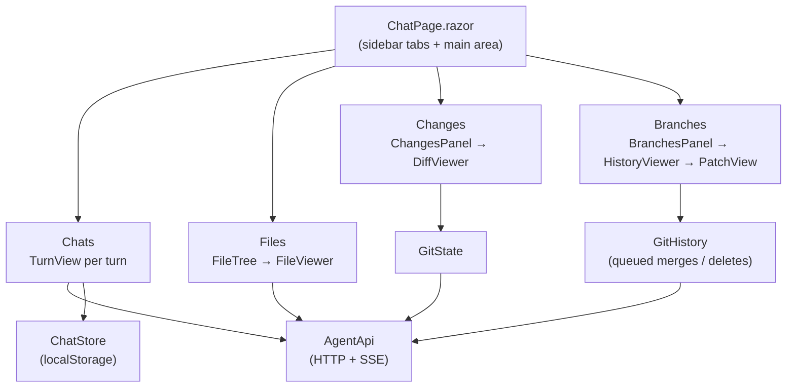

# louis-agent.web — design

> **Kind:** Blazor WebAssembly app · **Path:** `src/louis-agent.web/` · **Served by:** louis-agent.api (same origin) ·
> **References:** louis-agent.web.shared (with Markdig), highlight.js (from a CDN)

## Purpose

The browser front end: chat with the agent, browse the workspace, review and commit changes, and review and merge
branches — on top of louis-agent.api.

## How it works

- **One page, four tabs.** `ChatPage` holds the sidebar (Chats, Files, Changes, Branches, theme, API key) and the main
  area, which shows a chat, a file, a diff, or a branch/commit.
- **Chats** stream from `POST /sessions/{id}/messages`: `ChatPage.Apply` turns each SSE event into `Turn` / `Block`
  objects (thinking, text, tool card); `TurnView` renders them, re-rendering at most every 50 ms while streaming.
  Answers are rendered from Markdown **without raw HTML** (`Markdown.cs`), and code is highlighted.
- **Usage** (F3): `message_delta.usage` (or an `error`'s, FX6) becomes `Turn.Usage`, shown as a quiet line under the
  answer (`1.9k in · 26k cached · 412 out · $0.004`, exact figures on hover), and the chat's total sits above the
  message box. `UsageFormat` follows core's `UsageText` rules (the app doesn't reference core). The total is summed in
  the browser and saved with the chat, since the chat outlives the API's session.
- **Currency** (F14): `CurrencyState` loads `GET /rates` and `/rates/display` and starts with the server's currency
  (the PC's region; the browser's locale is the display language, not the region). The sidebar's Currency select
  changes it for this browser (`localStorage`, like the theme). Chats keep their costs as charged and `UsageFormat`
  converts when drawing, so a change re-labels every saved chat.
- **Chats are kept in the browser** (`ChatStore`, `localStorage`); the server only holds the session, so after an API
  restart a chat can be read but not continued.
- **Shared state services** raise `Changed` events so panels, viewers and tab badges stay in step:
  `GitState` (working-tree status, stage / unstage / discard / commit) and `GitHistory` (branches and log; **merges and
  deletes are queued and run in click order**, each row showing *Merging… / Queued / deleting…*). Each branch shows how
  many commits it is ahead of the checked-out one.
- **Nothing pushes.** Commits and merges stay local; the API's git endpoints never push, so pushing stays with you.
- **Themes** are CSS files in `wwwroot/css/themes/` listed in `themes.json`; each sets the variables listed at the top of
  `css/app.css`. Two today: *Retro terminal* and *Paper (soft light)*.

## Structure

| Path | What's in it |
|---|---|
| `Pages/ChatPage.razor` | The page (W2): the layout only, about fifty lines; the sidebar, the viewers and the shared chat pieces (`MessageList`, `Notice`, `ChatUsageBar`, `Composer`); its state (what a viewer shows) and handlers in `ChatPage.razor.cs`, a turn's life in the shared `ChatRunner` |
| `Components/EmptyChat.razor`, `Components/Workspace/WorkspaceSidebar.razor` | The boot screen until the first message; the sidebar (new chat, the four tabs and their panels, theme, currency, API key), its tab its own, everything else parameters and callbacks of the page |
| `Components/Workspace/FileTree.razor`, `FileViewer.razor` | Workspace browser and file view (with "Ask agent to review") |
| `Components/Git/ChangesPanel.razor`, `ChangeGroup.razor`, `DiffViewer.razor` | Changed files, selection, stage / unstage / discard / commit, *Review all* (asks the agent to review every uncommitted change); one titled group of them with its select-all box; one file's diff |
| `Components/Git/BranchesPanel.razor`, `HistoryViewer.razor`, `PatchView.razor` | Branches to merge, merged branches, all commits; a branch's or commit's diff |
| `Components/ThemeSwitcher.razor` | Theme selection |
| `*.razor.cs` | Every component's C# (W2b): a `.razor` holds markup only |
| `Workspace/` | The workspace records (`WorkspaceEntry`, `WorkspaceFolder`, `WorkspaceFile`, one per file) and `AgentApiWorkspace`, the workspace and git calls on the shared `AgentApi`; `CodeLanguage` (highlight.js language by file name) and `FileSize` (the header's size) |
| `Git/` | The git records (`GitFile`, `GitStatus`, `GitDiff`, `GitBranch`, `GitBranches`, `GitCommit`, `GitLog`, `GitCommitDetail`, `GitBranchDetail`, one per file); `GitState` and `GitHistory`, shared git state with change events and the merge/delete queue; `UnifiedDiff` (a diff as rows with line numbers), `Patch` (a multi-file patch per file), `RelativeTime` (a commit's age) and `ReviewActions` (the prompts and chat titles of the reviews a viewer asks for), each with tests |
| `wwwroot/` | `index.html`, `css/app.css`, themes, `js/chat.js` (scrolling, focus, cross-tab sync of chats) |

**Shared with Puls:** the chat as data, the API client, a turn's life, the turn and delegation views, markdown, usage
and currency are in `src/louis-agent.web.shared/`, a Razor class library both apps reference; its design is in
[louis-agent.web.shared](louis-agent.web.shared.md).

## Configuration

None of its own: it calls the API on the same origin. If the API requires `AGENT_API_KEY`, the user enters it under
*API key* in the sidebar (kept in this browser only).

## Extending it

The steps are in [Change the code-review web app](../guides/change-the-web-app.md). In short: a new tab is a `…Panel`
and a viewer wired in `ChatPage`, with shared data in a `…State` service; calls go through `AgentApi`, never
`HttpClient` in a component; a theme is a CSS file and a line in `themes.json`.

## Tests

`tests/louis-agent.web.tests`, NUnit with bUnit, mirroring the folders: `Git/` (`UnifiedDiffTests`, `PatchTests`,
`RelativeTimeTests`, `ReviewActionsTests`) and `Workspace/` (`CodeLanguageTests`, `FileSizeTests`) test the plain
classes; `Pages/ChatPageTests` renders the page against `FixtureApi` (`tests/louis-agent.web.testing`), streams the
recorded turn, lists the page's JavaScript calls and pins the markup to `ChatPage.empty.html` and `ChatPage.turn.html`.
The panels' own behaviour (the merge queue, staging) is still checked in a browser.

## Limits and plans

- Chats live in one browser only → backlog *Sync chat history across devices*.
- Skills and agent-built tools are managed by typing commands → backlog *A UI for skills*.
- `UsageFormat` repeats core's `UsageText` number rules (k/M tokens, two significant digits below $1, "price
  unknown"): a change to one (e.g. [F14](../features/F14-display-currency.md)'s currencies) must be made in both.
- A Usage tab → [F11](../features/F11-usage-tab-and-reconciliation.md); costs in your own currency →
  [F14](../features/F14-display-currency.md); a budget "continue?" prompt → [F7](../features/F07-budgets.md).

## Related docs

[README § Web app](../../README.md#web-app) · [Quick start](../QUICK_START_AGENT.md) · [louis-agent.api](louis-agent.api.md)

---
[Projects](README.md) · Previous: [louis-agent.api](louis-agent.api.md) · Next: [louis-agent.web.shared](louis-agent.web.shared.md)
