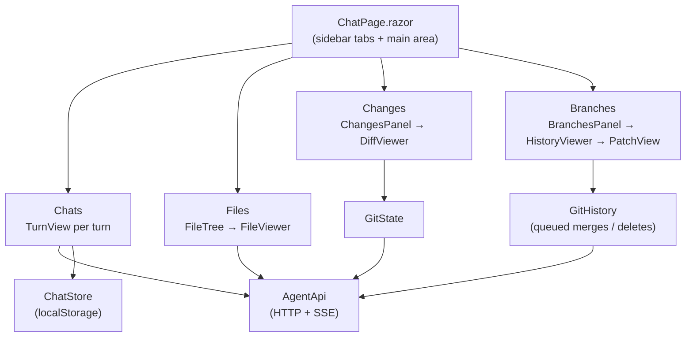

# louis-agent.web — design

> **Kind:** Blazor WebAssembly app · **Path:** `src/louis-agent.web/` · **Served by:** louis-agent.api (same origin) ·
> **References:** louis-agent.web.shared (with Markdig), highlight.js (from a CDN)

## Purpose

The browser front end: chat with the agent, browse the workspace, review and commit changes, and review and merge
branches — on top of louis-agent.api.

## How it works

- **One page, four tabs.** `ChatPage` holds the sidebar (Chats, Files, Changes, Branches, theme, API key) and the main
  area, which shows a chat, a file, a diff, or a branch/commit.
- **Chats** stream from `POST /sessions/{id}/messages`: `ChatPage.Apply` turns each SSE event into `Turn` / `Block`
  objects (thinking, text, tool card); `TurnView` renders them, re-rendering at most every 50 ms while streaming.
  Answers are rendered from Markdown **without raw HTML** (`Markdown.cs`), and code is highlighted.
- **Usage** (F3): `message_delta.usage` (or an `error`'s, FX6) becomes `Turn.Usage`, shown as a quiet line under the
  answer (`1.9k in · 26k cached · 412 out · $0.004`, exact figures on hover), and the chat's total sits above the
  message box. `UsageFormat` follows core's `UsageText` rules (the app doesn't reference core). The total is summed in
  the browser and saved with the chat, since the chat outlives the API's session.
- **Currency** (F14): `CurrencyState` loads `GET /rates` and `/rates/display` and starts with the server's currency
  (the PC's region; the browser's locale is the display language, not the region). The sidebar's Currency select
  changes it for this browser (`localStorage`, like the theme). Chats keep their costs as charged and `UsageFormat`
  converts when drawing, so a change re-labels every saved chat.
- **Chats are kept in the browser** (`ChatStore`, `localStorage`); the server only holds the session, so after an API
  restart a chat can be read but not continued.
- **Shared state services** raise `Changed` events so panels, viewers and tab badges stay in step:
  `GitState` (working-tree status, stage / unstage / discard / commit) and `GitHistory` (branches and log; **merges and
  deletes are queued and run in click order**, each row showing *Merging… / Queued / deleting…*). Each branch shows how
  many commits it is ahead of the checked-out one.
- **Nothing pushes.** Commits and merges stay local; the API's git endpoints never push, so pushing stays with you.
- **Themes** are CSS files in `wwwroot/css/themes/` listed in `themes.json`; each sets the variables listed at the top of
  `css/app.css`. Two today: *Retro terminal* and *Paper (soft light)*.

## Structure

| Path | What's in it |
|---|---|
| `Pages/ChatPage.razor` | The page: tabs, chat flow, stream handling, opening files / diffs / branches, merge and delete actions |
| `Components/Workspace/FileTree.razor`, `FileViewer.razor` | Workspace browser and file view (with "Ask agent to review") |
| `Components/Git/ChangesPanel.razor`, `DiffViewer.razor` | Changed files, selection, stage / unstage / discard / commit, *Review all* (asks the agent to review every uncommitted change); one file's diff |
| `Components/Git/BranchesPanel.razor`, `HistoryViewer.razor`, `PatchView.razor` | Branches to merge, merged branches, all commits; a branch's or commit's diff |
| `Components/ThemeSwitcher.razor` | Theme selection |
| `Workspace/` | The workspace records (`WorkspaceEntry`, `WorkspaceFolder`, `WorkspaceFile`, one per file) and `AgentApiWorkspace`, the workspace and git calls on the shared `AgentApi` |
| `Git/` | The git records (`GitFile`, `GitStatus`, `GitDiff`, `GitBranch`, `GitBranches`, `GitCommit`, `GitLog`, `GitCommitDetail`, `GitBranchDetail`, one per file); `GitState` and `GitHistory`, shared git state with change events and the merge/delete queue |
| `wwwroot/` | `index.html`, `css/app.css`, themes, `js/chat.js` (scrolling, focus, cross-tab sync of chats) |

**Shared with Puls** (`src/louis-agent.web.shared/`, a Razor class library both apps reference; Markdig is its package):

| Path | What's in it |
|---|---|
| `Components/TurnView.razor`, `BlocksView.razor` | One turn: user message, thinking (collapsible), text, tool cards |
| `Components/DelegationCard.razor` | A sub-session (F5) inside the turn: the specialist, its toolsets, its steps live, its cost |
| `Components/CurrencySwitcher.razor` | The display currency per browser (F14) |
| `Api/` | `AgentApi`, the typed client for the session calls with SSE parsing; `AgentApiException` (errors with their status); `AgentStreamEvent` |
| `Chat/` | What a chat is in the browser: `Chat`, `Turn`, `Block`, `BlockKind`, `Attachment`; `TurnStream` and `Delegation` fold the event stream, sub-session events included, into the turn the page shows; `WorkStatus` and `RolePhases` say what a specialist is doing |
| `Usage/` | `TurnUsage` (a turn's tokens and cost), `UsageFormat` (the usage lines), `CurrencyState` and `CurrencyChoice` (the display currency, F14), `RatesTable` and `RatesDisplay` (the API's rates) |
| `Storage/` | `ChatStore` (chats in `localStorage`) and `ChatSettings` (the API key and the admin key, kept in this browser) |
| `Text/` | `ChatText` (the words the components show; the code-review app's by default) and `Markdown` (the Markdig pipeline: raw HTML shown as text, only http(s)/mailto links, images only from the shops' hosts) |

## Configuration

None of its own: it calls the API on the same origin. If the API requires `AGENT_API_KEY`, the user enters it under
*API key* in the sidebar (kept in this browser only).

## Extending it

- A new tab: a `…Panel` component in the sidebar plus a viewer for the main area, wired in `ChatPage` (the Branches tab
  is the most recent example); shared data in a `…State` service with a `Changed` event.
- New API calls in `AgentApi`; never call `HttpClient` from components.
- A theme: copy `paper.css`, set the variables, add a line to `themes.json`.

## Tests

None automated yet (backlog: *Automated tests for the API and the web app*, Branches queue first); checked in a browser.

## Limits and plans

- Chats live in one browser only → backlog *Sync chat history across devices*.
- Skills and agent-built tools are managed by typing commands → backlog *A UI for skills*.
- `UsageFormat` repeats core's `UsageText` number rules (k/M tokens, two significant digits below $1, "price
  unknown"): a change to one (e.g. [F14](../features/F14-display-currency.md)'s currencies) must be made in both.
- A Usage tab → [F11](../features/F11-usage-tab-and-reconciliation.md); costs in your own currency →
  [F14](../features/F14-display-currency.md); a budget "continue?" prompt → [F7](../features/F07-budgets.md).

## Related docs

[README § Web app](../../README.md#web-app) · [Quick start](../QUICK_START_AGENT.md) · [louis-agent.api](louis-agent.api.md)

---
[Projects](README.md) · Previous: [louis-agent.api](louis-agent.api.md) · Next: [louis-agent.mcp-server](louis-agent.mcp-server.md)
