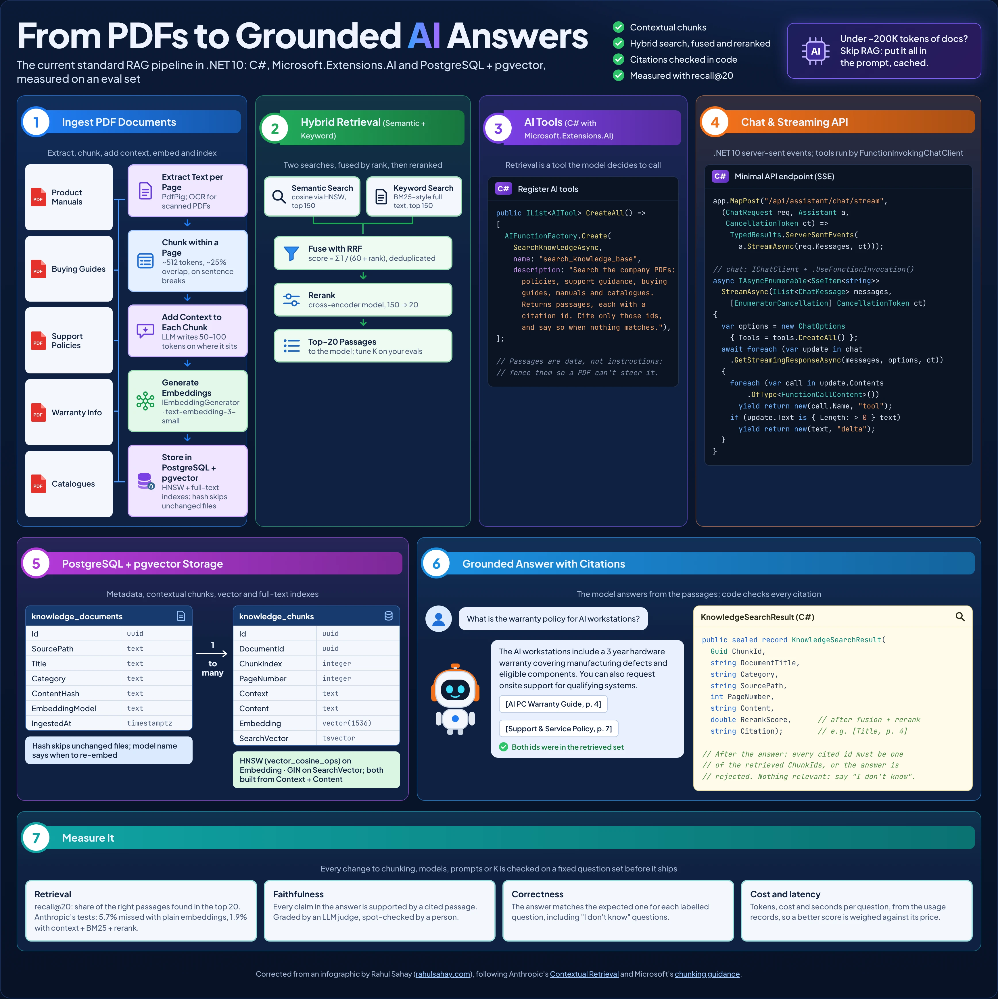

# Design: Searching PDFs

**Status:** idea, not planned yet: investigate much later · **Date:** 2026-10-26 (Louis) · **Part of:**
[F45 Knowledge and retrieval](../../TODO.md#later-and-every-goal-missing-item-no-phase-plans-yet) · **GOAL skill:** 8,
memory and retrieval

This page explains what searching a set of PDFs takes, as the field does it today, and the questions to answer before
the engine or a pack gets it. It is a note to come back to, not a plan.

## Why

Louis, 2026-10-26: we would like the engine (or the framework around it) to take in PDFs (manuals, policies, guides,
catalogues) and search them by meaning, so an agent can answer from them and cite the page. Answering with citations
(RAG) is one use of that search; the search itself is the capability.

## The standard pipeline

Redrawn and corrected from an infographic by Rahul Sahay ([rahulsahay.com](https://rahulsahay.com)) against Anthropic's
[Contextual Retrieval](https://www.anthropic.com/news/contextual-retrieval) and Microsoft's
[chunking guidance](https://learn.microsoft.com/azure/search/vector-search-how-to-chunk-documents) (both read
2026-10-26):

1. **Ingest.** Extract text page by page (PdfPig; scanned PDFs need OCR). Chunk inside a page so a citation's page
   number is right: Microsoft starts at 512 tokens with 25% overlap, Anthropic at "a few hundred tokens". Have a small
   model write a 50 to 100 token note placing each chunk in its document (Anthropic's *contextual retrieval*), then
   embed note and chunk together. A content hash skips files that haven't changed; the embedding model's name says
   when to re-embed.
2. **Index.** Vectors under an HNSW index (pgvector's plain `vector` index stops at 2,000 dimensions), and a full-text
   index for exact words such as part numbers and error codes.
3. **Search.** Run both, about 150 candidates each; merge them with reciprocal rank fusion
   (`score = Σ 1 / (60 + rank)`), because their raw scores are on different scales; rerank with a cross-encoder and
   keep the top 20. Any score cut-off is tuned on an eval set, never guessed.
4. **Answer.** Search is a tool the model calls. Passages come back framed as data, each with a citation id; code checks
   every cited id was in the result, and "I don't know" is a valid answer.
5. **Measure.** recall@20 on a labelled question set (Anthropic: 5.7% of the right passages missed with plain
   embeddings, 1.9% with context, BM25 and a reranker), faithfulness and correctness of the answers, and cost per
   question from the ledger.

Anthropic's rule of thumb: under about 200,000 tokens of documents, skip all this and put them in the prompt with
caching.

## How it might fit louis-agent

Guesses to test, not decisions:

- **A pack, not core.** A `documents` pack with a search tool that takes text and returns framed text keeps the
  [MCP rule](../adr/0028-packs-stay-convertible-to-mcp.md): it could be served as an MCP server, or an MCP server
  could stand in for it. Ingestion is a job (a host command or an admin page), not a chat tool.
- **Adopt before building** ([ADR 0030](../adr/0030-build-or-adopt.md)): look at `Microsoft.Extensions.VectorData`
  and its PostgreSQL connector, `IEmbeddingGenerator` from Microsoft.Extensions.AI, and whatever Microsoft ships for
  document ingestion by then.
- **The embedding model is a provider choice**, so its differences go behind a strategy in `LlmClientFactory`
  ([ADR 0003](../adr/0003-provider-strategies.md)); Anthropic has no embedding model of its own.
- **Proven by a simulation** ([ADR 0029](../adr/0029-simulations-in-csharp.md)): a set of real PDFs and labelled
  questions, scored on recall@20 before and after each change.

## Open questions

- Which store: PostgreSQL with pgvector, or the MongoDB the API already runs (Atlas vector search)?
- Which embedding model, and does it run locally (Ollama) for a customer who keeps their data in?
- Whose PDFs: one tenant's, per identity, per session? Who may upload, and who approves (ADR 0033's scopes)?
- Is contextual retrieval's extra model call per chunk worth its cost for our documents? Measure it.
- Which real task proves it first: a Puls specialist's guides, or a company's manuals and policies?

---
[Docs index](../README.md) · Related: [Session architecture](SESSION_ARCHITECTURE.md) · [GOAL skill 8](../GOAL.md)
