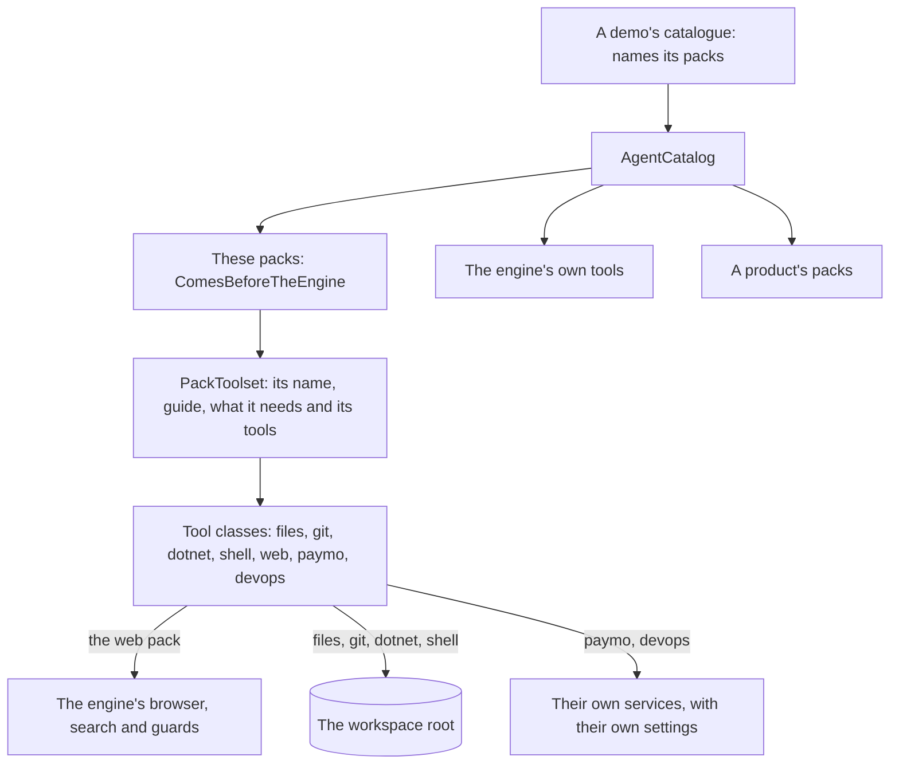
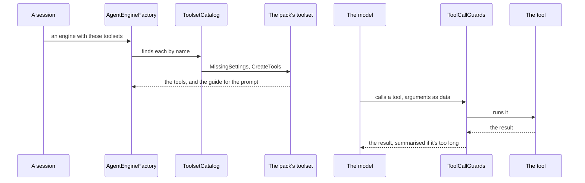

# The general packs

> **Design doc.** The tools any agent may want, one pack each: what each holds and what it gets from the engine.
> **Elsewhere:** why they aren't in core in [ADR 0076](../../../src/docs/adr/0076-core-ships-no-agent.md), how to write one in
> [Build a pack](../../../src/docs/guides/build-a-pack.md).

| Pack | Toolsets | Holds | Needs from the engine |
|---|---|---|---|
| `louis-agent.pack.files` | `files` | Read, write, search, copy, rename and delete in the workspace; PDF, Word and Excel as text | The workspace root |
| `louis-agent.pack.git` | `git` | Status, diffs, branches, commits, merges, history; one runner shared by five classes | The workspace root |
| `louis-agent.pack.dotnet` | `dotnet` | Build, test, run, restore, list packages | The workspace root |
| `louis-agent.pack.shell` | `python`, `powershell`, `bash` | The tools the model calls, on the composition's script runners | The workspace root |
| `louis-agent.pack.web` | `web` | Search, fetch, read a drawn page, check a quote, convert money | Search, a guarded fetcher, the renderer, the rates |
| `louis-agent.pack.paymo` | `paymo` | Time entries, tasks, projects and summaries | Nothing: its own `PAYMO_API_KEY` |
| `louis-agent.pack.devops` | `devops` | Work items, sprints and team queries | Nothing: its own `DEVOPS_*` settings |

Each says `ComesBeforeTheEngine`, so a session's tools keep their order: these, then the engine's, then a product's.

**The web pack holds only tools.** The browser, the search providers and the guards around every fetch stay in the engine,
so a pack can't reach an internal address or skip a site's `robots.txt`. It keeps its own small PDF reader, because a pack
references no other pack.

## Diagrams

**Architecture:** a pack is only its tools, and the engine stays in charge of what's dangerous. The web pack's calls go through the engine's guards, so a pack can't reach an internal address.

**Flow:** a session that names a toolset, and a tool it calls. A toolset that lacks a setting is listed with what it lacks, and a session can't open with it.

**Tests** are in `packs/tests/`, one project per pack, and a `.integration-tests` project where a tool starts a process.
`APackInstallsAsAPackageTests` proves a pack runs from a NuGet package with no engine in its dependencies.

---
[Packs' docs](../README.md) · Related: [Build a pack](../../../src/docs/guides/build-a-pack.md)
