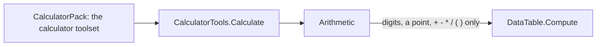
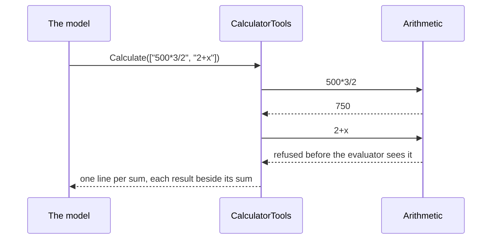

# louis-agent.pack.calculator

> **Explanation.** What the calculator pack does and why it's built this way. **Elsewhere:** the rule behind it in
> [ADR 0080](../../../src/docs/adr/0080-a-tool-when-it-improves-the-prompt.md); building a pack in
> [Build a pack](../../../src/docs/guides/build-a-pack.md).

A model's mental arithmetic slips. Puls's cook wrote 1 teaspoon × ⅔ as 2⅔ teaspoons, and no prompt rule could promise that
wouldn't happen again. This pack gives a model one tool, so it hands the sum to code. It needs no setting and no network,
so it loads wherever it's named.

## The tool

`Calculate(sums)` takes a list of sums and answers one line per sum, each result beside its sum:

```
500*3/2 = 750
1*2/3 = 0.6667
```

- **Many sums, one call:** every call is one more request to the model, so the guide asks for all the sums at once. A call
  holds at most 60.
- **A bad sum doesn't cost the others:** it says why it can't be worked out, and the rest still answer.
- **Four decimals,** finer than anyone cooks or shops by, in plain digits with a point.

## How it works

`Sums/Arithmetic.cs` uses .NET's own expression evaluator (`DataTable.Compute`), so there's no package and no parser of our
own ([ADR 0030](../../../src/docs/adr/0030-build-or-adopt.md)). Two things keep that safe and correct:

- **Only arithmetic gets in.** The evaluator also does strings, comparisons and functions, so a sum may hold only digits, a
  point, `+ - * / ( )` and spaces, at most 200 characters. Anything else is refused before the evaluator sees it. It runs no
  code and no shell ([ADR 0004](../../../src/docs/adr/0004-arguments-as-data.md)).
- **Every number is a decimal.** The evaluator reads a whole number as an int, and `100000*100000` outgrows one, so each whole
  number gets a point first.

## Diagrams

**Architecture:** one tool on .NET's own evaluator, with a check in front so only arithmetic reaches it.



**Flow:** a call with two sums, one of them bad. A bad sum says why, and the others still answer.



## Who uses it

Puls's cook, for scaling a recipe's amounts: its role file asks for the `calculator` toolset, and Puls names the pack. The
shopping list's prices and totals aren't sums for this tool, since the `shop-prices` pack's tool works those out itself.

## Tests

`packs-tests/louis-agent.pack.calculator.tests`: the sums and what's refused, the tool's lines, the pack's shape, and a golden
of its texts (`CalculatorToolMessageSnapshot.json`).

---
[Packs' docs](../README.md) · Related: [Build a pack](../../../src/docs/guides/build-a-pack.md) · [ADR 0080](../../../src/docs/adr/0080-a-tool-when-it-improves-the-prompt.md)
