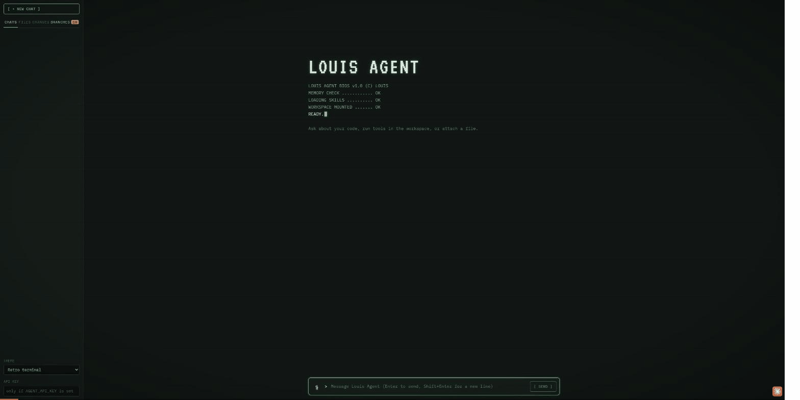

# Orchestrator demo: one agent watching a microservice

A proof of concept for the "one orchestrator per microservice" design in [docs/specs/ORCHESTRATOR_DESIGN.md](../docs/specs/ORCHESTRATOR_DESIGN.md):
an orchestrator agent watches a service's errors, decides what each one needs from a runbook per API method, hands
code fixes to louis-agent, and then checks louis-agent's work itself. Each fix lands as one commit on its own branch;
you review and merge the branches in the web app. Nothing is pushed, and everything runs in Docker.

```
order-service ──errors.jsonl──▶ orchestrator ──POST /sessions (SSE)──▶ louis-agent.api ──▶ fix/<method>-<id> branch
 (samples/)                     (louis-agent.core,                     (WORKSPACE_ROOT =        one commit, from main
                                 runbook per method)                    the service repo)
                                      │                                        │
                                      ├─ verifies: commit in git, replay, tests  └─ web app: Branches tab → Merge
                                      └─ writes every message to agent-comms.md
```

## Run it

```powershell
.\samples\run-demo.ps1             # a clean run: about 15 minutes (the first run also builds the images)
.\samples\run-demo.ps1 -Short      # a clean run with 5 errors (4 fixes, 1 escalation): quicker and cheaper
.\samples\run-demo.ps1 -Resume     # keep .demo; triage only the errors not handled yet (e.g. after running out of credits)
.\samples\run-demo.ps1 -ApiOnly    # keep .demo; just (re)start the web app
.\samples\run-demo.ps1 -StopApi    # stop demo-api at the end instead of leaving it up
.\samples\run-demo.ps1 -Short -OrchestratorProfile ollama   # triage on the local model, fixes on LLM_PROFILE's
.\samples\run-demo.ps1 -Short -OrchestratorProfile ollama-triage   # the same with a local model that can triage
                                   # (qwen3 instruct; llama3.1 can't): see sample-output-short-local-triage
```

Needs Docker Desktop and `ANTHROPIC_API_KEY` in `config/.env.secrets`; nothing else runs on the host. The demo uses the
LLM profile in `config/.env`; if that is `ollama`, run it on Claude with `$env:LLM_PROFILE = 'anthropic'` first (the
shell wins over the file). The script drives
[`docker/docker-compose.demo.yml`](../docker/docker-compose.demo.yml):

1. **demo-setup** (orchestrator image) copies `samples/order-service` to `.demo/order-service` (git-ignored) as a fresh
   git repository on `main`, then replays `data/requests.txt`, which logs 13 exceptions to `logs/errors.jsonl`
   (`-Short`: `data/requests-short.txt`, 5 exceptions);
2. **demo-api** (the louis-agent api image) runs louis-agent.api and the web app on `http://127.0.0.1:5081`, with that
   repository as its workspace;
3. **orchestrator** triages every new error once (`--once`), calling demo-api over the compose network for fixes;
4. the fix branches and the run summary are printed, and demo-api is left running, so you can open
   **http://127.0.0.1:5081** and merge the fixes (below).

All three containers mount the host's `.demo/` at `/demo`, so the repository has the same path everywhere (stack
traces in the error log match louis-agent's workspace), and `agent-comms.md`, the logs and the repository can be read
on the host. A shared `nuget` volume means the service's packages are restored once. Stop the web app with
`docker compose -f docker/docker-compose.demo.yml stop demo-api`.

To see the result without running it, look at [sample-output/](sample-output/README.md): the comms log, logs, branches
and priced usage ledger from one clean full run on Claude Haiku 5.5 (10 fixes for $0.66), and a recording of merging ten
fixes in the web app. [sample-output-short/](sample-output-short/README.md) is a `-Short` run (four fixes, $0.29 shown as R4.77, with the cost per error and per run in its comms log):



## The pieces

| Piece | Where | Role |
|---|---|---|
| order-service | `samples/order-service` (runs in the demo-setup container; replays run in the orchestrator's) | A console stand-in for a microservice: 11 API methods over `data/orders.csv`, one file each in `src/OrderService/Api/`. Unhandled exceptions go to `logs/errors.jsonl`, standing in for Exceptionless. |
| Orchestrator | `src/louis-agent.orchestrator` (`docker/Dockerfile.orchestrator`) | An `AgentEngine` from `louis-agent.core` whose system prompt is the runbooks and whose only tools are `ServiceTools` (no file, git or shell tools). |
| Runbooks | `src/louis-agent.orchestrator/Skills/` | `orchestrator.md` (workflow), `order-service/service.md` (owners, deploy policy) and one file per API method: what it does, which exceptions are expected, auto-fixable or escalated, and the correct behaviour. See [the runbooks guide](../docs/projects/orchestrator-runbooks.md). |
| louis-agent | `src/louis-agent.api` (the demo-api container) | Does each fix with its usual tools: branch from `main`, edit, regression test in a new file, build, test, commit, then a `FIX-RESULT` line. |

## What the demo traffic triggers

Ten bugs, one per API method, each fixed on its own branch:

| Request | Exception | Cause | Fix the runbook asks for |
|---|---|---|---|
| `get-order 1006` | `ArgumentOutOfRangeException` | order without items | summary says 0 items |
| `order-total 1003` | `KeyNotFoundException` | retired discount code `SUMMER25` | unknown codes give no discount |
| `shipping-cost 1006` | `DivideByZeroException` | order without items | nothing to ship costs 0.00 |
| `invoice-number 1007` | `FormatException` | `created` has a time (`…T14:05:00Z`) | accept dates with a time |
| `packing-slip 1001` | `NullReferenceException` | no gift message | print the items only |
| `loyalty-points 1008` | `OverflowException` | a 25,000,000.00 order | correct points for any size |
| `vat 1009` | `KeyNotFoundException` | country `nl` in lower case | match country codes case-insensitively |
| `delivery-estimate 1010` | `IndexOutOfRangeException` | ordered on a Sunday | Sunday dispatches on Monday |
| `discount-label 1011` | `FormatException` | code `FREESHIP` has no percentage | show such codes as-is |
| `customer-initials 1012` | `IndexOutOfRangeException` | single name `Cher` | one initial |

And three that must not be fixed:

| Request | Exception | Runbook says | Orchestrator does |
|---|---|---|---|
| `refund 1002` | `InvalidOperationException` "already been refunded" | expected | `AcknowledgeError` |
| `refund 1005` | `ArgumentOutOfRangeException` (no card reference) | payments: never auto-fix | `EscalateToHuman` (payments) |
| `get-order 9999` | `OrderNotFoundException` | expected (404) | `AcknowledgeError` |

## How a fix is confirmed

louis-agent's `FIX-RESULT` (status, commit, branch, tests) is a claim. The orchestrator only reports `fixed` when all
three of its own checks pass:

1. `VerifyFixCommit` — in the service's git repository, the commit exists, is on the reported fix branch (checked
   out), the branch starts from the tip of `main`, the commit is **not** on `main`, it changed files, and the working
   tree is clean; it shows the author (`louis-agent`).
2. `ReplayRequest` — the failing call now answers `200` (replays write to their own error log, not production's).
3. `RunServiceTests` — the whole suite passes, including louis-agent's regression test.

Anything else is escalated. Between errors the orchestrator checks `main` out again (stashing anything an unfinished
fix left behind), so every fix branch starts from `main` and holds exactly one fix.

## The agent communications log

`.demo/agent-comms.md` (set with `ORCHESTRATOR_COMMS_LOG`) records the whole conversation, one section per error:

- the error event;
- **Orchestrator → louis-agent**: every message, verbatim (the fix request, and any "continue" follow-ups);
- **louis-agent → orchestrator**: every reply: a table of the tools it called (inputs and results, shortened), its
  text verbatim, and the `FIX-RESULT` it ended with;
- **Orchestrator actions and checks**: verify, replay and test results, or the acknowledgement/escalation;
- **Summary**: the decision, louis-agent's claim, branch, commit, what the error cost (triage, louis-agent and the
  total), and the orchestrator's closing answer. louis-agent's usage is also under each of its replies.

It ends with a **run summary** table (one row per error: decision, louis-agent's result, branch, commit, tokens and
cost), the **run total** split by agent, and the list of branches ready to merge, which is the part to check when
testing. The run total should equal the usage ledger's total for the run id:
`dotnet run --project tools/louis-agent.usage-probe -- --ledger .demo/logs/usage-YYYY-MM.jsonl`.

`-OrchestratorProfile ollama` runs the triage on the local model and the fixes on Claude, but llama3.1 can't triage yet:
its 2,048-token window cuts off the runbooks and CPU requests can pass the 100-second timeout, so each error fails
(FX7 keeps that from ending the run). It's there for when local models can triage
([F13](../docs/features/F13-local-models.md)).

## Reviewing and merging the fixes in the web app

Open **http://127.0.0.1:5081** and go to the **Branches** tab (the badge counts branches waiting to be merged):

- **To merge** lists each `fix/...` branch with its commit. Click one to see its commit and the full diff it would
  bring into the checked-out branch (`main`), then **Merge into main**. A merge is a `--no-ff` merge commit; if it
  would conflict, it is aborted and nothing changes.
- **Merged** lists merged branches; **×** deletes one (only merged branches can be deleted).
- **All commits** is the log across every branch; click a commit to see its diff.

Merges stay local: pushing is left to you. The web app refuses to merge while `main` has uncommitted changes.

## Outputs

`.demo/` on the host holds everything: `agent-comms.md`, the repository (`order-service/`), louis-agent.api's logs
and the usage ledger (`logs/`, `usage-YYYY-MM.jsonl`: one line per model request from both agents, each fix's tagged
`fix:<error id>` and every line of the run tagged with its run id), and `orchestrator-state/` with `decisions.jsonl`,
`fixes.jsonl` (louis-agent's replies),
`escalations.jsonl`, `acknowledged.jsonl` and `processed.txt` (so an error is triaged once). Container output:
`docker compose -f docker/docker-compose.demo.yml logs demo-api`.

With prompt caching (F4, on by default since): [sample-output-cached/](sample-output-cached/README.md) ($0.13 against
$0.72, −81%) and [sample-output-short-cached/](sample-output-short-cached/README.md) ($0.049 against $0.29, −83%), the
same fixes for a fifth of the cost; the two samples above are their "before".

With toolset profiles (F5): [sample-output-short-f5/](sample-output-short-f5/README.md) ($0.038 against F4's $0.049,
−23%): each fix session loads only `dotnet`, `files`, `git` and `skills`, so its prefix halves (~48.5k → ~24.4k tokens).

Puls's delegation, measured: [sample-output-puls-check/](sample-output-puls-check/README.md) asks five questions twice,
first one agent with every toolset (the baseline), then Puls delegating to its specialists
(`samples/puls-check/run_check.py`): 60% fewer tokens but 31% more cost ($0.0167 → $0.0218), as each specialist writes
its own prefix to the cache and the answer is written twice; cheaper only for web research and plain chat.
[sample-output-puls-check-roles/](sample-output-puls-check-roles/README.md) runs ten questions after roles were derived
on the peer: every delegation had a role, 40% fewer tokens and 57% more cost ($0.0324 → $0.0509), with most of the extra
cost from a required `agent` parameter and one empty sub-session answer. Its `answers.md` shows each question's two
answers side by side.
[sample-output-puls-check-fixes/](sample-output-puls-check-fixes/README.md) is the run after FX10–FX12: no refused
calls and `.env.example` read, but one counting task sent to a `files`-only specialist read every test file into a
282k-token prompt at the long-prompt price, $0.278 of the run's $0.313 (baseline $0.028).
[sample-output-puls-check-repeat/](sample-output-puls-check-repeat/README.md) runs each mode three times after
FX10–FX14: delegation +31% on average (+6%, +11%, +86%), every delegation routed by the table, the dearest question
$0.0174; cheaper for chat and web research, 1.2–3.5× dearer for short files, git and counting questions.

The cook, measured: [sample-output-puls-cook/](sample-output-puls-cook/README.md) runs two meal conversations with a
follow-up each and a control question, three times, Puls as built and Puls with `web` (`samples/puls-cook-check/run_check.py`):
every meal went to `puls-cook` and was priced at South African shops; the follow-up continued the same cook in half the
delegated runs and never when Puls had `web`; DuckDuckGo refused 41 of 48 searches, so most prices are marked estimates.

With triage on a local model: [sample-output-short-local-triage/](sample-output-short-local-triage/README.md) is a
`-Short` run whose orchestrator ran on `qwen3:4b-instruct-2507` in Ollama on a 4 GB GPU, fixes on Claude: the same
4 fixes and 1 escalation, triage free ($0.042 against $0.049), 2.4 times slower. Its README has the steps to run it
yourself.

Not from the demo: [smoke-f4-caching/](smoke-f4-caching/README.md) is F4's smoke check, one CLI message with prompt
caching on ($0.0070), kept as a reference for what a cached turn looks like in the ledger.

## Running the parts yourself

```powershell
docker compose -f docker/docker-compose.demo.yml --env-file config/.env run --rm demo-setup    # fresh repo + traffic
docker compose -f docker/docker-compose.demo.yml --env-file config/.env up -d --wait demo-api  # louis-agent.api + web app
docker compose -f docker/docker-compose.demo.yml --env-file config/.env run --rm orchestrator  # triage new errors once
```

`DEMO_RESET=0` makes demo-setup keep `.demo` as it is; `DEMO_PORT` changes the web app's port (default 5081). The
compose file sets the orchestrator's settings below; outside Docker they are plain environment variables.

| Setting | Default | Meaning |
|---|---|---|
| `ORCHESTRATOR_SERVICE_ROOT` | (required) | The service's git repository: the same folder as louis-agent.api's `WORKSPACE_ROOT` |
| `ORCHESTRATOR_SERVICE` | `order-service` | Selects `Skills/{service}/` |
| `ORCHESTRATOR_SERVICE_PROJECT` | `src/OrderService` | Project used to replay requests |
| `LOUIS_AGENT_URL` | `http://127.0.0.1:5081` | The louis-agent.api instance for this service |
| `LOUIS_AGENT_API_KEY` | `AGENT_API_KEY` | Sent as `x-api-key` when louis-agent.api requires a key |
| `ORCHESTRATOR_STATE_DIRECTORY` | `logs/orchestrator/{service}` | Decisions, fixes, escalations, processed ids |
| `ORCHESTRATOR_COMMS_LOG` | `{state directory}/agent-comms.md` | The Markdown log of every message between the agents |
| `ORCHESTRATOR_POLL_SECONDS` | `15` | Poll interval when not run with `--once` |

The model is louis-agent's usual `LLM_*` configuration.

## Adding a service or a method

How to write a good runbook, with a template, is in [the runbooks guide](../docs/projects/orchestrator-runbooks.md).


- **A method:** add `Skills/{service}/{method}.md` with a `## Method: {method}` runbook. The file name is the method
  name the error events carry; `ReplayRequest` only accepts methods that have a runbook.
- **A service:** add `Skills/{service}/service.md` plus its method runbooks, run one orchestrator per service with
  `ORCHESTRATOR_SERVICE={service}`, and point it at that service's own louis-agent.api instance.

## Differences from the orchestrator design

- The orchestrator is built on `louis-agent.core` (`AgentEngine` with a custom toolset) rather than Anthropic's Tool
  Runner, so it reuses louis-agent's providers, skills loader and tool loop.
- The error feed is a JSON-lines file instead of the Exceptionless API, and a fix ends as a commit on a fix branch
  (the demo repository has no remote) instead of a pull request; you merge it in the web app.
- In the demo, louis-agent.api runs with a `louis-agent` git identity, so merges made from the web app are also
  recorded under that name.

---
[Docs index](../docs/README.md) · Previous: [Development guide](../docs/CLAUDE.md) · Next: [Runbooks](../docs/projects/orchestrator-runbooks.md)
