# 0133. An agent's subagents live inside it, and a prompt's level is in its header

**Status:** Accepted · **Date:** 2026-11-22 · **Recorded:** 2026-11-22 · Supersedes
[0017](0017-skills-by-level.md)

## Context

ADR 0017 kept a prompt in the folder of the level that reads it: a voice in `agent/`, a specialist's role in
`specialists/`, a minion's function in `minions/`. It stopped a role opening at the wrong level, but a reader couldn't
see whose a role was: the triage team's sorter sat in `specialists/triage-sorter.md`, apart from the triage agent it
belongs to. And a specialist had two names, its address `triage.sorter`, which a caller writes (ADR 0117), and its
role `triage-sorter`, which its file is named for, joined by a step that turned the dot into a dash.

Reading the engine showed a specialist runs on the same loop as the agent you talk to, with less context: its own
instructions, its own tools, a fresh conversation. Louis, 2026-11-19: "So it is actually a SubAgent", and the shape
"agents/{name}/Subagents/{name}". The same word is Claude Code's for an agent with its own instructions file, kept
under `agents/`. In the meantime every prompt's header had come to name its level (ADR 0063), and the catalogue reads
every header when a host starts.

## Decision

An agent's subagents live inside it, and a prompt's level is in its header.

- **Everything one agent has sits in its folder**: its voice at `agents/{identity}/voice.md`, its skills at
  `agents/{identity}/skills/{name}/SKILL.md`, and its subagents at `agents/{identity}/subagents/{name}/voice.md`,
  a folder each, so a subagent can hold its own skills.
- **A subagent's one name is its address**, `{identity}.{name}`: in a call, a session's `role`, `ROLES_ENABLED`,
  an eval's file and the logs. No second, dashed name is made from it.
- **A prompt's level is the `metadata.level` in its header**: `agent` for an agent's voice, `subagent` for a
  subagent's. A specialist is a subagent, in the code, the headers and the texts (`RoleLevel.Subagent`).
- **A layout test refuses a header whose level doesn't match where the file sits**, so a subagent can't open as an
  agent: the protection ADR 0017's folders gave, held by the header instead.

## Consequences

- Who owns a subagent is visible in the tree, and the address a caller writes is the path the engine reads: package
  by feature, where ADR 0017 was package by layer.
- A subagent's name has a dot, so the name a role may have takes one between an identity and its subagent, as it
  takes one slash between a product and its mode.
- Renaming a subagent means moving its folder, and every place that names it uses the same name to change.
- Minions keep their own folder until CL68.3 makes them lookup agents beside the subagents.

## Links

- CL68, CL68.2; [ADR 0117](0117-one-address-for-every-agent-call.md), one address for every agent call;
  [ADR 0063](0063-a-prompt-says-what-it-is.md), a prompt says what it is; [ADR 0017](0017-skills-by-level.md),
  superseded
- Claude Code's subagents: <https://code.claude.com/docs/en/sub-agents>

---
[Docs index](../README.md) · [ADRs](README.md) · Related: [0117](0117-one-address-for-every-agent-call.md) · [0063](0063-a-prompt-says-what-it-is.md) · [0017](0017-skills-by-level.md)
