# 0135. Licence: MIT

**Status:** Accepted · **Date:** 2026-11-25 · **Recorded:** 2026-11-25 · **Supersedes:** [0127](0127-licence-polyform-noncommercial.md)

## Context

Since [ADR 0127](0127-licence-polyform-noncommercial.md) the framework has been free for noncommercial use under the
PolyForm Noncommercial License 1.0.0, and a business that used it commercially needed the copyright holder's licence
first. On 2026-11-25 Louis asked to change every licence of his to MIT. The proposal, that the framework is MIT from
that day, that it supersedes 0127, and that earlier versions keep their licence, was put to him on a card, and he
picked it over also granting MIT to every earlier version and over keeping PolyForm.

## Decision

The framework is licensed under the MIT License (SPDX `MIT`), from 2026-11-25 onward. `LICENSE` holds the MIT text as
the Open Source Initiative publishes it, under the copyright line. Anyone may use, change, share and sell the
framework, commercial use included, as long as the copyright notice and the licence travel with it. It is open source.

This binds the framework, this repository. Puls, in its own repository, made the same change the same day, as its own
decision there.

## Consequences

- No permission is needed for commercial use, so the framework itself is not sold as a licence. What is sold is the
  work around it: a site, a custom agent, the building fee.
- **Not retroactive:** a version released under MIT, the AGPL-3.0, all rights reserved or PolyForm Noncommercial stays
  under that licence for whoever has it. The 0.1.0 packages published under PolyForm stay so; the next release of each
  carries MIT.
- The packages carry the licence by its SPDX name, so NuGet and GitHub show it.
- Every dependency is MIT, Apache, BSD or, for the fonts, SIL OFL, and they allow this. Their own notices still travel
  with what we hand out, listed in [THIRD-PARTY-NOTICES.md](../../../THIRD-PARTY-NOTICES.md).
- An outside contribution is taken under the same licence, MIT; it no longer needs a written agreement so the
  copyright holder can licence the framework commercially.

## Links

- The licence: <https://opensource.org/license/mit>
- [LICENSE](../../../LICENSE) · [README, Licence](../../../README.md#licence)

---
[Docs index](../README.md) · [ADRs](README.md) · Supersedes: [0127](0127-licence-polyform-noncommercial.md)
