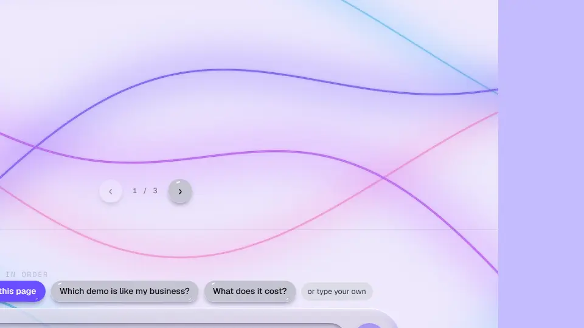

# 6. Runtime view

> **Explanation.** How the parts work together at run time: what the model can use (tools and skills), one chat turn
> step by step with its guards, what each host shows, and the scenarios that span several agents. **Elsewhere:** every
> message on the wire in [AGENT_COMMUNICATION.md](../AGENT_COMMUNICATION.md); adding
> [a C# tool](../../engine/LouisAgent.Core/CLAUDE.md#adding-a-tool), [a toolset](../../engine/LouisAgent.Core/CLAUDE.md#adding-a-tool),
> [a skill](../guides/add-a-skill.md), [a mode or a role](../guides/build-an-identity.md#modes-subagents-and-lookup-agents-the-rules) or
> [another agent on core](../../engine/LouisAgent.Core/CLAUDE.md#building-another-agent-on-core) in the development guides.


## One turn, as a film

<picture>
  <source media="(prefers-reduced-motion: reduce)" srcset="../films/detail.png">
  
</picture>

The six slabs inside core are the real middleware in its real order, and a test holds that. The film is rendered from the
site's CSS, so it can't drift from what the site plays ([ADR 0077](../../../demos/louis-agent/docs/adr/0077-films-on-github-are-rendered-webp.md)).

## Two kinds of capability

| | **Tools** | **Skills** |
|---|---|---|
| What | Public C# methods on a pack's tool classes in `packs/tools/LouisAgent.Packs.{Name}/` | Markdown in the prompt folders of core, an identity or a pack, and the function skills the agent wrote |
| The model sees | A function with typed parameters and a description | Text in the system prompt; named procedures it can run |
| How it's used | The model calls it; the result comes back | The model follows the guidance, or runs a procedure with `ExecuteSkill` |
| Examples | `ReadWorkspaceFile`, `GetStatus`, `DotNetTest`, `WebSearch`, `LogTimeByTaskName` | `agent/louis-agent/voice.md` (the coding agent's mode: voice, routing), `toolsets/dotnet.md` (the dotnet pack's guide), a function skill in the skills folder's `agents/functions/` |

Tools give the agent abilities; skills tell it how and when to use them. The agent can add both: `CreateSkillFile` writes
a new skill file and `CreateTool` a script-backed tool, and each waits in a `pending/` folder for your `/approve <Name>`
before any later session loads it (FX20 for skill files).

### How tools are registered

A session names its toolsets when it opens, and keeps them. Each toolset is an entry that builds its tool objects:
core's two in `Agent/Toolsets/ToolsetCatalog.cs`, and every other in its pack. The host's `AgentCatalog` resolves the
names, and the engine registers only those tools:

```csharp
// AgentEngineFactory: the session's toolset names → their tool objects
var resolved = Catalog.Resolve(toolsets, Context);                         // e.g. "files", "git"
bool selfExtension = resolved.Any(t => t.IsEngineProvided);
var tools = ToolsetCatalog.BuildTools(resolved, Context);
var engine = new AgentEngine(SkillLoader.Load(...), chatClient, options, supportsTools, toolsets: tools, ...);

// OwnTools.Register, which the engine's constructor calls (simplified)
registry.Add(Function(skillTools.ExecuteSkill, nameof(AgentEngine.ExecuteSkill)));  // every session
registry.AddPublicMethods(new ClockTools(clock, options.HostTimeZone));            // every session: today's date (F22)
foreach (object toolset in toolsets) registry.AddPublicMethods(toolset);          // only the session's toolsets
if (selfExtension) AddSelfExtensionTools(...);    // the skills toolset: CreateSkillFile, ReloadSkills, CreateTool, ListAgentTools
```

Every **public** instance method becomes a tool, named after the method, with its `[Description]` attributes as the
documentation. Keep helpers `internal` or `private`. `ToolRegistry` keeps every tool in name order, so the start of
every request is the same bytes and the prompt cache holds (F4). A toolset whose settings are missing (Paymo or DevOps
without its API key, or `agents` without `AGENT_PEERS`) can't be loaded. When an identity has skills to read on
demand, its session also gets `ReadSkill`, which reads only those. An agent built on core, like the orchestrator, passes its own tool objects as
`toolsets:` the same way (the guide's [Building another agent on core](../../engine/LouisAgent.Core/CLAUDE.md#building-another-agent-on-core)).

### How skills are loaded

The system prompt is put together from skill files, in a fixed order, by the engine factory's `SkillLoader`.

It opens with the principles (`shared/principles.md`), which are the same for every agent. Then comes the role. At
level 0 that's the session's mode, its voice and then its routing: the default `louis-agent/voice`, or Puls's language
file (`puls/voice-af`) followed by Puls's shared `puls/voice.md`. At level 1 it's a subagent's voice from inside its
agent, `agents/{identity}/subagents/{name}/voice.md`, with no routing, because its toolsets were chosen for it. At level 2 it's a lookup agent's voice from
its agent's `lookups/`, after the agent's `lookup.md`, the file that says what every lookup agent is.

At level 0 the identity's own skills follow the voice. The ones it always needs are there whole, and the ones it reads
on demand are listed by name, each with the line that says when to read it.

Next comes the guide of each toolset the session loaded (`toolsets/{toolset}.md`), and no other. A lookup agent gets no
guide, because its role says what to do with its one tool. A session with the `agents` toolset then gets the list of
the agents it may ask, its identity's `Calls`, the same list `AskAgent` checks. Last, and only with the `skills`
toolset, comes every function skill the agent wrote.

The combined text is the system prompt. Core's own files are in `src/engine/LouisAgent.Core/`'s `shared/` and `toolsets/`, and each
identity and pack embeds its own. All of them are read only from their assemblies, so changing a word means a rebuild.

*Decided in:* F5, [ADR 0018](../adr/0018-built-in-prompts-embedded.md), [ADR 0019](../adr/0019-modes-one-file-per-product.md),
[ADR 0020](../adr/0020-principles-for-every-agent.md).

## A chat turn

A host hands your message to the engine, and the engine sends it to the model with the system prompt, the tools,
the reasoning setting and a 16,000-token output limit. The model thinks, then calls tools. Each call goes through the
guards, and its result goes back to the model, round after round, until it answers. The answer streams back to the
host as it is written, and the whole turn is kept in the history.


### Guards around tool calls

A few guards stand around every tool call. If a result is over 50,000 characters, a separate model call with no
tools summarises it (its input capped at 200,000 characters), and if that fails it's cut short instead. That way one
tool can't flood the context.

If a reply hits the output limit, any tool call in it has incomplete arguments. It isn't run, and the model is told to
write large content in chunks. When the turn is streaming, the provider drops a cut-off call, so the engine asks the
model to carry on, up to 3 times.

When a tool throws, the exception's message reaches the model (a missing parameter, say), and the call is logged as a
failure.

A sub-session has a prompt budget too. Once its next request is expected to pass `SUB_SESSION_PROMPT_BUDGET`
(80,000 tokens by default, under Haiku 5.5's long-prompt price step), it keeps its tools but with tool mode None. The
subagent then answers from what it has, instead of growing its context further.

*Decided in:* FX14, [ADR 0005](../adr/0005-guard-the-context.md).

## A turn, step by step

**1. You send a message** — from Rider, a site, the API or the CLI. In Rider, attached files are added to the
message as fenced code blocks (`[Attached file: name]`).

**2. The host streams the turn**

```csharp
await foreach (var update in engine.StreamPromptAsync(history, message, cancellationToken))
{
    // update.Contents: TextReasoningContent (thinking), TextContent (answer),
    // FunctionCallContent (a tool call), FunctionResultContent (its result)
}
```

`StreamPromptAsync` adds your message to the history and calls the model with the tools, `ChatOptions.Reasoning` (from
`LLM_THINKING`) and a 16,000-token output limit.

**3. The model thinks and decides.** With thinking on, it first reasons (streamed to you), then either answers or calls
one or more tools.

**4. Tools run.** `FunctionInvokingChatClient` runs each call through `ToolCallGuards.InvokeAsync`, which logs it,
runs it, and guards the result. A result over 50,000 characters is summarised by a separate model call instead of
filling the context. A call cut off by the output limit isn't run, and the model is told to write large content in
chunks. And an exception goes back to the model with its message, so it can correct itself.

The result is added to the conversation and the model continues — up to 10 tool rounds per message.

**5. The answer streams back** as it is written. When the stream ends, the whole turn — thinking (with its signature),
tool calls, results and answer — is in the history, so follow-up messages have full context.

### What each host shows

| | Thinking | Answer | Tool call |
|---|---|---|---|
| Rider (ACP) | `agent_thought_chunk` | `agent_message_chunk` | `tool_call` → `tool_call_update` (completed / failed) |
| HTTP API / web app | `thinking_delta` block | `text_delta` block | `tool_use` block, then `tool_result` block |
| CLI | grey text | text | `  > Name args` then `    done:` / `failed:` |

## Example

```
You: What branch am I on and what's the latest commit?

[thinking] The user wants the branch and latest commit. I'll use GetCurrentBranch and GetLog with count 1.
[tool]     GetCurrentBranch()          → main
[tool]     GetLog(count: 1)            → 306a91c docs: add a README and fix the Rider MCP server config
[answer]   You're on **main**; the latest commit is `306a91c` — "docs: add a README and fix the Rider MCP server config".
```

The model can call several tools in one round (here both lookups at once) and chain rounds when a result decides the
next step (read a file → edit it → build → run the tests).

## Writing large files

A reply has a 16,000-token output limit, and a whole web page or long source file can exceed it in one tool call. The
files guide (`toolsets/files.md`) tells it to write large files in chunks: `WriteWorkspaceFile` for the first ~300
lines, then `AppendToFile` for each next chunk. If a call is still cut off, it is skipped and the model is asked to
continue in smaller pieces (up to 3 times when streaming).

## Debugging

Every call is logged to stderr and, when `LOG_DIRECTORY` is set (it is in Docker), to a file per run,
`agent-{host}-{time}-{process}.log`:

```
[TOOL] -> GetLog({"count":1})
[TOOL] <- GetLog: 306a91c docs: add a README and fix the Rider MCP server config
[TOOL] <- ReadWorkspaceFile failed: ArgumentException: Path must stay inside the workspace. (Parameter 'relativePath')
[WARN] Reply cut off by the output limit (16000 tokens); asking the model to continue
```

In the same folder, `oversized-tool-results.jsonl` and `truncated-tool-calls.jsonl` record the cases where a tool returned too
much or a reply ran out of room.

To see what the model is offered, inspect `engine.Tools` (name, description, JSON schema) in a test or the debugger.

## Scenarios across agents

| Scenario | What happens | In detail |
|---|---|---|
| **Puls delegates** | Puls asks its subagent by its address (`AskAgent("puls.cook", …)`), and the subagent's session loads the toolsets its header names; its steps stream into the chat's work panel; Puls answers in its own voice | [Agent to agent: one address for every call](../AGENT_COMMUNICATION.md#agent-to-agent-one-address-for-every-call) |
| **The orchestrator fixes an error** | It reads the service's error, follows the method's runbook, opens a fix session on LouisAgent.Api, verifies the commit and replays the request | [Agent to agent: the orchestrator and louis-agent](../AGENT_COMMUNICATION.md#agent-to-agent-the-orchestrator-and-louis-agent) · [Runbooks](../../../demos/louis-agent/docs/projects/orchestrator-runbooks.md) |
