# The framework's two sites in Azure: the architecture

> **Explanation.** What runs where for louis-agent.dev and framework.louis-agent.dev, how a release reaches them,
> where a secret travels and where a visitor's chat goes, in pictures. **Elsewhere:** the how-to in
> [Deploy the sites](../guides/deploy-the-sites.md), the whole system's deployment view in
> [07-deployment-view](07-deployment-view.md), the why of a release from GitHub in
> [ADR 0097](../adr/0097-puls-deploys-from-github-without-a-password.md).

This page is for seeing the shape of it before you change it. It goes from what runs, to where that comes from, to
how a merge reaches it, to how a secret gets there, to what a visitor's chat passes through, and ends with what the
network lets in.

## What runs where

Two apps run in one Container Apps environment, `puls-env`, in the resource group `rg-puls-za`. louis-agent.dev is
`louis-agent-app`, and framework.louis-agent.dev is `louis-agent-framework-app`. They are the only things with a
public address, and each sleeps at no replicas until someone visits.

They share what they can. One identity reads the vault for both, and one file share holds each app's logs in a
folder of its own, so the framework's site added nothing to Azure but its app. Each app has its own image, built in
the registry, and calls the model with the key both sites share. Their logs and traces go to the same
Application Insights.

## Made from code

Everything the two apps stand on is described in one Bicep file, `src/site/deploy/azure/main.bicep`: the network and
its subnet, the environment with its telemetry agent, the registry, the vault and the identity that reads it, the
storage account and its share, the logs and Application Insights, and the rights between them. The apps themselves
aren't in it. Each merge releases them, and a Bicep deploy would fight the release over them. The file is deployed by
a person, since it gives rights the release identity doesn't hold, and Azure shows its what-if before anything
changes. The releases read the environment, the identity and the vault from what that deploy recorded, so the file
and the apps can never disagree about where the apps run. Its own names are in a parameters file beside it, which is
what lets the same file build someone else's sites.

## A release

A merge to `main` signs in to Azure with no password and runs one job. It releases louis-agent.dev first, then the
framework's site, so a failure in the second never holds back the site that sells. Each release makes the folders
its app names on the share, which only the framework's does, builds the image and updates the app as its next
revision.

## A secret's path

No value is ever in a file under git or on an app. It goes from a git-ignored file on the PC into the vault, and the
release writes only references to it, which the app resolves with the shared identity.

## A chat, from the domain to the model

Cloudflare points each name at its app, as DNS-only records. The app wakes if nobody was on it, serves the page drawn
as HTML, and lets the visitor talk to its Orbi through the open door, with no key, within the cap of 20 sessions a day
from one address. The answer streams back from the model.

## What the network lets through

| From | To | Port | Allowed by |
|---|---|---|---|
| The internet | `louis-agent-app`, `louis-agent-framework-app` | 443 | The environment's ingress, with each app's managed certificate; each yaml sets `allowInsecure: false` |

Nothing else in the resource group has a public address. What the environment lets out is Azure's default for it;
no rule of ours narrows it.

---
[Docs index](../README.md) · Related: [Deploy the sites](../guides/deploy-the-sites.md) · [Deployment view](07-deployment-view.md)
