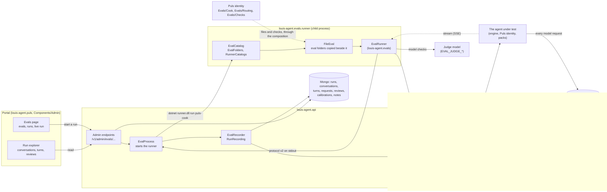
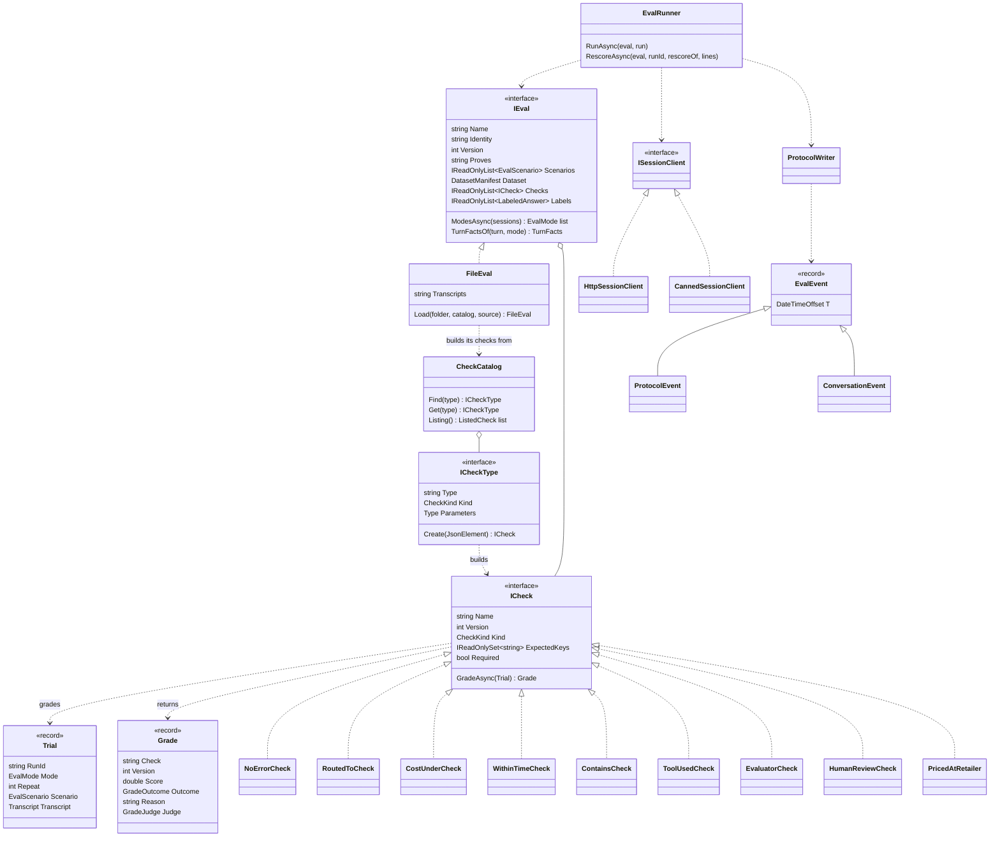
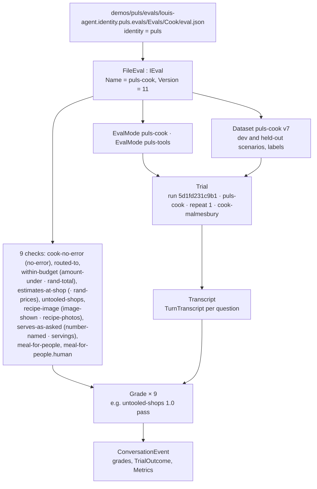
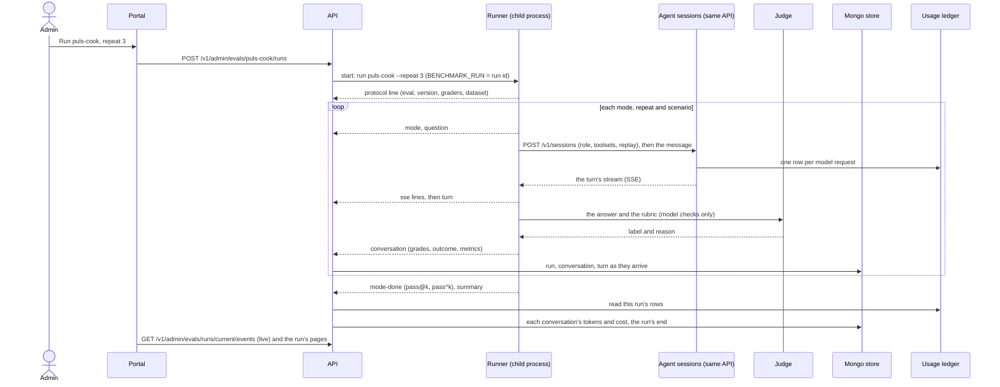
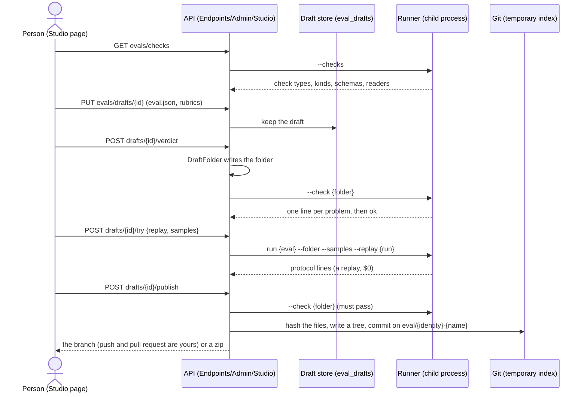

# The evals: architecture and communication

> **Explanation.** How the evals work as built at the end of F49 (2026-11-03): which parts there are, how they
> talk, what one run looks like in memory, the lines the runner writes, how the studio makes an eval, and where F49
> came from. **Elsewhere:** running them in
> [Run the evals](../guides/run-the-evals.md); adding one in [Add an eval](../guides/add-an-eval.md); each
> project's files and settings in [projects/](../projects/README.md); why it's built this way in
> [ADR 0029](../adr/0029-simulations-in-csharp.md), [ADR 0047](../adr/0047-protocol-v2-one-event-contract.md),
> [ADR 0058](../adr/0058-an-eval-is-a-folder-of-files.md) and
> [ADR 0062](../adr/0062-the-studio-writes-what-git-keeps.md).

## In one paragraph

An eval is a folder of files in the evals project of the identity it proves: an `eval.json` that names its modes and its checks, with
its dataset, manual and transcripts beside it. It asks the agent real questions and grades the answers. The
**runner** is a small console
app: it opens real chat sessions on the **API**, exactly as a person's chat would, reads what streams back, grades each
conversation with the eval's **checks**, and writes everything it saw as JSON lines on stdout (the **protocol**). The
API starts the runner as a child process when someone presses *Run* in the **portal**, reads those lines as they come,
keeps them in the **store**, joins the cost from the **usage ledger** when the run ends, and the portal shows the
result. The runner never knows the cost and the API never knows how to grade: each side does one job, and the protocol
is the only thing they share.

## The parts



| Part | Project | Its one job |
|---|---|---|
| The check contract | `src/evals/louis-agent.evals.checks` | What a check reads and returns (`Trial`, `ICheck`, `Grade`), and the catalogue a file names a check from (`ICheckType`, `CheckCatalog`). What a pack can reference to ship a check ([ADR 0056](../adr/0056-a-check-is-a-catalogue-entry.md)). |
| The harness | `src/evals/louis-agent.evals` | How an eval runs: `IEval`, `FileEval` (an eval read from its folder), the datasets, the general checks and their entries, the protocol writer, re-scoring, conformance, labels and calibration. Names no product. |
| An identity's evals | `demos/puls/evals/louis-agent.identity.puls.evals` (`Evals/`) | What proves Puls: `puls-cook`, `puls-routing` and `puls-recipes` as folders of files, with Puls's readers and expectations (`Evals/Readers/`, `Evals/Checks/`). A project under `evals/` that only the runner references ([ADR 0058](../adr/0058-an-eval-is-a-folder-of-files.md), [ADR 0073](../adr/0073-packs-reference-no-evals.md)). |
| A pack's checks | `evals/packs/tools/louis-agent.pack.{name}.checks` | The rules no general check can say, apart from the pack; only the runner references them ([ADR 0073](../adr/0073-packs-reference-no-evals.md)). |
| An identity's judges | `demos/puls/evals/louis-agent.identity.puls.judges` | Puls's model judge, `meal-for-people`, apart from the identity because it needs the harness; only the runner references it. |
| The runner | `src/evals/louis-agent.evals.runner` | The command: finds the eval folders and gathers the check catalogue, lists the evals (`--list`), runs one, re-scores a stored run, writes a label sheet, calibrates a judge; for the studio, lists the catalogue (`--checks`), judges a folder (`--check`), runs a folder's samples (`--folder`, `--samples`) and converts promptfoo files. |
| The protocol | `src/evals/louis-agent.evals.protocol` | The eight line records both sides share, and their reader and writer. Records only. |
| The API | `src/hosts/louis-agent.api` (`Evals/`, `Endpoints/Admin/`) | Starts the runner, records its lines, prices them from the ledger, serves the portal; also runs the sessions the runner opens. |
| The portal | `demos/puls/web/louis-agent.puls` (`Components/Admin/`) | Start a run, watch it live, read runs and trends, grade the answers that wait (one at a time on the Review page, F53.3), calibrate a judge, write notes; make samples and transcripts from runs, and compose, check, try and publish an eval in the Studio. |
| The drafts | `src/hosts/louis-agent.api` (`Evals/Drafts/`, Mongo's `eval_drafts`) | What the studio made and hasn't published yet: samples, transcripts and evals being composed ([ADR 0061](../adr/0061-evals-grow-from-use.md), [ADR 0062](../adr/0062-the-studio-writes-what-git-keeps.md)). |
| The replay store | `louis-agent.core` (`Sessions/Replay/`, `Llm/Replay/`, `Web/Replay/`) | Records a run's web answers, clock and model answers, so the same run can be replayed for free. |

## The types



The three kinds of check (`CheckKind`; on the wire a check is still a `grader`, as stored runs say):

| Kind | What it is | Examples |
|---|---|---|
| `fixed-rule` | Plain C# that reads the transcript. Every eval needs at least one required fixed-rule check. | `NoErrorCheck`, `RoutedToCheck`, `ContainsCheck`, `AmountUnderCheck`, `ImageShownCheck`, `NearCheck` and the rest of the harness's 22; `UntooledShops`, `EstimatesAtShop` (the shops pack's rules, F49.3) |
| `model` | A judge model reads the answer against a rubric. `EvaluatorCheck` wraps Microsoft.Extensions.AI.Evaluation's `IEvaluator`; the grade carries the model and the prompt's hash. | `judge` (the general one over a rubric file); `meal-for-people` (`MealForPeopleCheck`, Puls's own) |
| `human` | A person's verdict in the run explorer, paired with a model check so the two can be compared. | `meal-for-people.human` (`HumanReviewCheck`, the `human` entry) |

An eval's file names its checks by type (`within-time`, `{"seconds": 120}`): each check's entry, an `ICheckType`,
builds it from a typed settings record, and `CheckCatalog` finds the entry. The runner's catalogue is three lists
(`RunnerCatalogs`): the harness's `GeneralChecks.All` (24 types by family, from `no-error` to `judge` and `human`; the
table is in [Add an eval](../guides/add-an-eval.md#4-choose-the-checks)), each pack's checks project (the where-to-buy
rules, `WhereToBuyChecks.All`, F49.3 and F50.2, and the recipes rule `recipe-from-source`, `RecipesChecks.All`, F35.2),
and Puls's judges
(`PulsJudges.All`)
([ADR 0056](../adr/0056-a-check-is-a-catalogue-entry.md), [ADR 0058](../adr/0058-an-eval-is-a-folder-of-files.md)).

**Extract, then compare** (F49.2b): a check that compares a value in the answer with the scenario's (a total with a
budget, a number of people, an image with the pages read) is a general compare plus a *reader* the file names beside
the key (`"reader": "rand-total"`). Readers are a second registry, `ReaderCatalog` (`RunnerCatalogs`): the harness's
`GeneralReaders.All` (`currency-amount`, `digits`, `markdown-images`) and each identity's evals project's
(`PulsReaders.All`: `rand-total`, `rand-prices`, `servings`, `recipe-photos`, `recipe-link`). So an identity ships readers, not
checks, and its eval file keeps its stored names with `name` (`{"type": "amount-under", "name": "within-budget", …}`).

**A pack or an identity references no evals** ([ADR 0073](../adr/0073-packs-reference-no-evals.md), which supersedes
[ADR 0060](../adr/0060-a-pack-ships-its-checks.md)): what proves one is a project under `evals/` that only the runner references
(`louis-agent.pack.where-to-buy.checks`, `louis-agent.identity.puls.evals`), and a new check is a general one in the harness
when it can be. What an identity knows comes in through a reader the file names: the where-to-buy rule `estimates-at-shop` reads
whether a price is given as fact through Puls's `rand-prices`. Plain markdown reading (tables, links, a site's host)
is the contract's (`Markdown/`), so an identity, a pack and the harness read them the same way.

A grade's score is 0 to 1 with an outcome (pass, fail, unknown) and a reason. A conversation's metrics (calls, hosts,
turns, tokens, seconds, cost) are measured beside the grades and never decide a pass.

## One cook run, in memory



## How a run talks



The other three conversations use the same pieces:

- **A re-score** (`--rescore {runId}`): the API exports the stored run as protocol lines on the runner's stdin;
  `Rescorer` reads the transcripts back (`ProtocolTranscripts`) and grades them again, with no session and no model
  cost unless a judge runs. The new run says `rescore_of`.
- **A replay** (`--replay {runId}`): the runner asks for `replay` on each session; `ReplayResolution` in the API turns
  that into recorded web answers, a recorded clock and recorded model answers (`ModelReplayChatClient`), so the agent
  gives the same answers for nothing. An ask the recording doesn't have is a replay miss: the engine throws
  `ModelReplayMissException`, the API streams it as an error of kind `replay_miss_error` (`StreamErrorKind` in
  `louis-agent.session-stream`), and the runner marks the turn `TurnFailure.ReplayMiss`, so it counts as
  infrastructure, never as the agent's failed answer (FX26). A replay only matches when every request reads the same
  as when it was recorded, so nothing that changes between runs may enter a tool result: a specialist's or minion's
  footer names the child, never what it cost (FX27). The cook recording `dc272b95eaeb` replays as `c0362ff73151` with
  no miss at any of its 20 turns. The portal marks a replay on both pages, leaves it out of the estimate and the
  trend, and starts one from a recorded run's row (`StoredRunRow.ReplayOf` and `Recorded`, read from the run's
  settings by `EvalSettings`; CL26, FX28).
- **A calibration**: `--label-sheet` writes the answers a person labels; `--calibrate` asks the judge about each label
  and reports how often it agrees (the bar is 90% of each class, ADR 0029). From the portal, `POST
  .../runs/{id}/calibrations/{grader}` runs the same command and stores the report.

## The lines the runner writes

One JSON object per line, UTF-8, `"event"` first, every time UTC with `Z`. A line that isn't an event is a log line
for people.

| `event` | Record | When | Carries |
|---|---|---|---|
| `protocol` | `ProtocolEvent` | First line | The eval, its version, the commit, the graders, the models, the split, the dataset |
| `mode` | `ModeEvent` | A mode's repeat starts | The mode, the repeat, its toolsets, role and model, how many scenarios |
| `question` | `QuestionEvent` | A question is sent | Its conversation and turn key, the text |
| `sse` | `SseEvent` | A piece of the turn's stream | The stream event as the session sent it |
| `turn` | `TurnEvent` | A turn ends | Agent and specialist calls, hosts, seconds, error, failure kind |
| `conversation` | `ConversationEvent` | A conversation is graded | Its grades (`GradeInfo`), its `TrialOutcome`, its `Metrics` |
| `mode-done` | `ModeDoneEvent` | A mode's repeat ends | Pass rates so far (`RatesInfo`: pass@k, pass^k), infrastructure failures, retries |
| `summary` | `SummaryEvent` | After a mode's last repeat | The roll-up: overall, per category, per grader, per grader kind |

## The studio

The Studio page (`/admin/studio`, F49.5) makes a new eval without Rider. It never reads an eval file itself: the runner
is the one reader and judge, started as a process for each question, and git is where a finished eval ends up
([ADR 0062](../adr/0062-the-studio-writes-what-git-keeps.md)). An eval being composed is a draft in `eval_drafts`;
`DraftFolder` writes it out as one folder, with the samples and transcripts kept for it from runs (F49.4), and the
check, the try, the publish and the promptfoo export all read that folder.



| Method | Route | Does |
|---|---|---|
| `GET` | `/v1/admin/evals/checks` | The runner's catalogue: types, kinds, settings' schemas, readers |
| `POST`, `GET` | `/v1/admin/evals/drafts` | Make an eval draft; list them |
| `GET`, `PUT`, `DELETE` | `/v1/admin/evals/drafts/{id}` | One eval draft |
| `POST` | `/v1/admin/evals/drafts/{id}/verdict` | The runner's check of its folder |
| `POST` | `/v1/admin/evals/drafts/{id}/try` | A replay of a stored run on the samples named |
| `POST` | `/v1/admin/evals/drafts/{id}/publish` | A commit on its branch, or a zip where there is no git workspace |
| `POST` | `/v1/admin/evals/drafts/promptfoo` | A promptfoo file to a new eval draft, with what was left out |
| `GET` | `/v1/admin/evals/drafts/{id}/promptfoo` | The draft as a promptfoo file |

## Where F49 came from

F49 *Evals as content* (2026-10-28 to 2026-11-03) turned the evals from C# into files. Louis's goal: *"it should be
simple to make evals, edit them and from the admin panel, living in identity."* Before it, one eval was about twenty C#
files. Every eval tool we studied keeps three things apart, and F49 did the same:

- **the eval is a data file** (`eval.json`, its dataset, its manual, its transcripts), beside the identity or pack
  it proves: identity is who, pack is what it can do, eval is how we prove it;
- **the checks are a catalogue of compiled C# classes**, picked by a kebab-case type, from core's harness and from
  the packs that ship them;
- **the judge's rubric is the one bit of free text** a person writes, kept as a markdown file.

**No script engine.** .NET has no sandbox for running untrusted code in the hosted service, so the way out of the
catalogue is a new reviewed C# class (ADR 0056), never a script in a file. A promptfoo file's JavaScript asserts are
left out on import, by name.

| Child | What it built | ADR |
|---|---|---|
| F49.1 The checks catalogue | The check contract in `src/evals/louis-agent.evals.checks` (Separated Interface), every check an entry with a typed settings record, found through a registry each owner fills | [0056](../adr/0056-a-check-is-a-catalogue-entry.md) |
| F49.2 The cook's eval as files | `eval.json` read by `FileEval`, the cook and routing evals as folders in the Puls identity, the template folder, the general checks of every family (F49.2b) with readers an identity ships | [0058](../adr/0058-an-eval-is-a-folder-of-files.md), [0059](../adr/0059-an-identity-ships-readers-not-checks.md) |
| F49.3 Checks in packs | The shops pack ships the checks that prove its tools, gathered by the composition | [0060](../adr/0060-a-pack-ships-its-checks.md) |
| F49.4 Studio: samples | Sample and transcript drafts made from stored runs and human review | [0061](../adr/0061-evals-grow-from-use.md) |
| F49.5 Studio: compose, try, publish | The Studio page, the runner's studio commands, publish to a branch, promptfoo in and out | [0062](../adr/0062-the-studio-writes-what-git-keeps.md) |

**What the research of 2026-10-29 added** (the report of 2026-10-28 stood):

- **Microsoft.Extensions.AI.Evaluation** keeps its scenarios in C# only, so there was no file format to reuse; its
  judge evaluators stay reachable through the catalogue.
- **Anthropic's *Develop test cases*:** volume over polish, grow cases from real use (F49.4), grade by code first, a
  model second and a person last; a rubric asks for a constrained output and lets the grader think first.
- **promptfoo's assertion** is `type`, `value`, `threshold`, `weight`, `metric`; our check entry keeps the same
  fields, so import and export are a rename of types by a table, not a translation of shape.
- **Inspect's `Sample`** (`input`, `target`, `id`, `metadata`) is the shape our scenarios keep.
- **`JsonSchemaExporter`** (.NET 9 and up) makes a JSON schema from a settings record, which is how the runner's
  `--checks` hands the studio a form for every check.

## Where the files are

```
evals/
├── louis-agent.evals/              # the harness
│   ├── Api/                        # ISessionClient, HttpSessionClient, CannedSessionClient, the session request
│   ├── Conformance/                # references must pass, known-bads must fail
│   ├── Datasets/                   # dataset.json + scenarios/{dev,held-out}/ (Inspect's Sample shape), the loader
│   ├── Grading/                    # Common/ (the general checks, GeneralChecks; Answers/, Tools/), Models/ (the judge), Human/, Outcomes/
│   ├── Labels/                     # the label sheet and the calibration
│   ├── Protocol/                   # ProtocolWriter, ProtocolTranscripts
│   ├── Reports/                    # RunSummary
│   ├── Running/                    # EvalRunner, ScenarioAttempt, TrialChecking, Rescoring/
│   └── Trials/                     # ConversationMetrics
├── louis-agent.evals.checks/       # the check contract: EvalMode, EvalJson; Catalog/ (ICheckType, CheckType, CheckCatalog); Datasets/Scenarios/; Trials/; Grading/ (ICheck, Grade, Verdict); Messages/
├── louis-agent.evals.protocol/     # Events/, Parts/, Kinds/, EvalProtocolJson
├── louis-agent.evals.runner/       # EvalRunnerHost, Arguments/, Catalog/ (EvalFolders, RunnerCatalogs, ChecksListing), Calibration/, Evals/Stub/,
│                                   # Studio/ (CheckCommand, ManifestSeal, RunTarget, SampleSubset), Promptfoo/ (the table, import, export)
└── template/Example/               # the folder a new eval starts as a copy of (never listed)
demos/puls/evals/louis-agent.identity.puls.evals/Evals/  # Cook/, Recipes/ and Routing/ (eval.json, manual.md, Dataset/, Transcripts/), Checks/, Readers/ (Puls's readers)
demos/puls/evals/louis-agent.identity.puls.judges/       # meal-for-people, PulsJudges
packs/evals/louis-agent.pack.where-to-buy.checks/Checks/ # the shop rules (F49.3; the shops pack's until F50.2)
packs/evals/louis-agent.pack.recipes.checks/Checks/      # recipe-from-source
src/hosts/louis-agent.api/Evals/          # List/ (RunnerProcess), Runs/, Store/, Reviews/, Calibrations/, Reports/, Export/,
│                                   # Drafts/ (Samples/, Transcripts/, Composed/, Store/), Studio/ (DraftFolder, the runner's parts, Publish/)
src/hosts/louis-agent.api/Endpoints/Admin/Studio/   # the studio's routes, Promptfoo/
src/web/louis-agent.web/Pages/Admin/Building/EvalStudio.razor  # the Studio page
src/web/louis-agent.web/Components/Admin/Evals/  # the portal's pages; Studio/ (the drafts, Compose/, Promptfoo/)
src/web/louis-agent.web/Admin/Studio/  # the studio's plain classes: Compose/ (the form), Schema/ (a check's fields from its schema)
```

## What to keep in mind

- **The API decides, the runner asks.** The runner only says it wants a replay; the API's settings decide what a
  session may do (ADR 0029).
- **Cost comes from the ledger, never from a check.** The runner can't see prices; the API joins them after the run
  (ADR 0007).
- **CI grades recorded transcripts only.** Every eval's references and known-bads run in the tests for free; a live
  run waits for Louis's go.
- **An eval is content, a check is code.** A new eval that uses existing checks is a folder of files with no C#; a
  check is a reviewed class with an entry (ADR 0056, ADR 0058).
- **The runner reads eval files; git keeps them.** The API and the portal never read an eval's folder themselves,
  and the studio's publish is a commit the person pushes (ADR 0062). F49 is done (2026-11-03); the next change to
  this picture is the specialists' evals (F50) and the `similar` check on the TODO.

---
[Architecture](README.md) · Related: [Building block view](05-building-block-view.md) ·
[Runtime view](06-runtime-view.md) · [Run the evals](../guides/run-the-evals.md)
