# Draw a diagram

> **How-to.** Put a picture in a doc: write its JSON beside the doc, draw it with the tool, link it, and let the test
> hold it. **Elsewhere:** how the drawing works in [LouisAgent.Diagrams](../projects/LouisAgent.Diagrams.md); why a
> diagram is data in [ADR 0103](../adr/0103-a-diagram-is-data-on-a-row-grid.md) and
> [ADR 0118](../adr/0118-a-diagram-is-data-our-renderer-draws.md).



## What you will do

A picture in the docs is two files that sit in a `diagrams` folder beside the doc. One is a JSON file, which you
write. The other is an SVG, which the tool draws from it. The doc links the SVG.

There are four steps, and this guide takes them in order:

1. **Write the JSON.** You say what the picture holds. You never place anything by hand.
2. **Draw it.** One command draws every picture that changed.
3. **Link it** in the doc.
4. **Check it** with the test, and look at it.



One rule comes before all of them: **never edit an SVG by hand.** The test compares each SVG with what its JSON
draws, byte for byte, so a hand edit fails it.

## Step 1: write the JSON

### Where the file goes, and what every file has

Put the file in `diagrams/` next to the doc, and name it for what it shows. The overview of core's design doc is
`src/docs/projects/diagrams/LouisAgent.Core.json`.

Every file has the same things at the top.

| Field | What it is |
|---|---|
| `kind` | Which kind of picture this is. The next part helps you choose. |
| `type` | What type of diagram it is, by UML's name. Only a `flow` writes it. *Say the type*, below, has the list. |
| `title` | What the picture is. A screen reader is told it, and the docs' frame shows it. |
| `caption` | Optional in the file, but every chart in the docs has one: the one thing to take from the picture. |
| the kind's own part | A field named after the kind (`cards`, `flow`, `sequence`, `classes`, `nested`, `composite`, `ticket`) that holds the picture. |

### Choose the kind

| Kind | It shows | Use it for |
|---|---|---|
| `cards` | Rows of cards, with links between rows | A project's overview: what it is and its parts |
| `flow` | Boxes and arrows | How something works |
| `sequence` | Who calls whom, in order | One case, step by step |
| `classes` | Types, their members and how they relate | An interface design |
| `nested` | One component, the boxes it holds, and what stands around it | What a component is made of: what holds what, what is handed down and what is said back up |
| `composite` | One class, its parts, the ports on its edge and what joins them | What a single class is made of |
| `ticket` | A read-only card, such as a booking request | What an agent draws in the chat |

### Say the type

A kind is how a picture is laid out. A type is what it shows, by UML's name for it. Every picture shows its type
at the right of its title's line: "Sequence diagram", "Class diagram", "Overview".

Most kinds are only ever one type, so their files don't write it.

| Kind | Its type | The picture says |
|---|---|---|
| `sequence` | `sequence` | Sequence diagram |
| `classes` | `class` | Class diagram |
| `composite`, `nested` | `composite-structure` | Composite structure diagram |
| `cards` | `overview`, a name of our own | Overview |
| `ticket` | none, since it is a card in a chat | nothing |

A flow is boxes and arrows, and those draw several types. So a flow writes `"type"`, straight after its `"kind"`.
Ask what its boxes are.

| `type` | Its boxes are | Its arrows are |
|---|---|---|
| `component` | Parts: classes, services, endpoints | Calls, or data handed on |
| `activity` | The steps of a procedure, with a start, an end or a decision | What comes next |
| `object` | Instances in memory, in one case | What holds what |
| `package` | Sets of projects or files | What depends on what |
| `deployment` | Machines, containers and cloud services | What runs where, and what it reaches |
| `state-machine` | The states one thing can be in | What moves it from one to the next |
| `use-case` | People, and what they use the system for | Who uses what |
| `communication` | Instances that send each other messages | The messages, in order |

A picture titled "how it works" is not always an activity diagram. When its boxes are parts and not steps, it is
a component diagram.

The seven parts below take one kind each. Each starts with a whole example, then says what its pieces mean.

### Cards: a project's overview

```json
{
  "kind": "cards",
  "title": "LouisAgent.Core at a glance",
  "cards": {
    "rows": [
      { "cards": [
        { "id": "core", "icon": "chip", "title": "The engine", "code": "LouisAgent.Core", "look": "highlight",
          "text": "Everything that makes an agent an agent." }
      ] },
      { "cards": [
        { "id": "loop", "icon": "message", "title": "The loop", "text": "Runs the model's tool calls." },
        { "id": "guards", "icon": "shield", "title": "Guards", "text": "Keep the context safe." }
      ] }
    ],
    "links": [
      { "from": "core", "to": "loop" },
      { "from": "core", "to": "guards", "kind": "both" }
    ]
  }
}
```

**Reading the example.** The picture has two rows. The first holds one card, the project. The second holds two,
its parts. Two links join the project to each part, and the second has arrowheads both ways. The picture draws the
project as a headline on a light, and hangs its two parts from one lit rail under it.

**A card.** In the example each card has an `id`, an `icon`, a `title` and a `text`. A card may also have a
`code`, which is a project's or a type's name shown in a pill under the title. And it may have a `look`:

| `look` | What it draws |
|---|---|
| `plain` | A glass card: its icon in a badge beside its title, and its text. This is the default. |
| `highlight` | A headline on a light, with no box: the project. Give it a row of its own. |
| `heading` | A quieter headline, with no light. |

A plain card that no link touches is drawn quiet, lower and without a badge, in a picture that has links. So link
the project to its main parts, and leave what else it has unlinked. A picture with no links at all may leave
`links` out: the reader takes that as none.

**A link.** It joins two cards by their ids, a card to one in the row just above or just under it. A link that
skips a row, or joins two cards of one row, is refused with the two cards it names. Its `kind` says which way its
arrowheads point: `down` (the default), `up` or `both`.

**The icons.** `icon` names one of the 37 icons the framework holds. They come in six groups.

| Group | The names |
|---|---|
| What a project's parts usually are | `chip`, `user`, `users`, `box`, `server`, `database`, `world`, `message`, `shield`, `code`, `folder`, `file`, `browser`, `checks`, `chart`, `cloud`, `settings`, `branch`, `mail`, `search`, `book`, `terminal` |
| The docs' frame's own | `stack`, `info` |
| A ticket's facts | `calendar`, `clock`, `phone`, `home`, `tag`, `paw` |
| What a showroom's demos wear | `bed`, `dining`, `scales`, `exchange` |
| A deck's arrows | `chevron-left`, `chevron-right` |
| A run or a release | `play` |

To add an icon, add a member to `DiagramIcon` and its Tabler path data to `IconPaths`. This is the framework's one
set of icons. A page's line icons are drawn from it too, by `LineIconView` in the framework's web.

**The shape of an overview.** Every project doc's overview takes one shape, so they all read alike. The project is
highlighted on top, alone in its row. Its main parts are in the row under it, with a link to each, so they hang
from its rail. A further row, with no links, holds what else the project has, and is drawn quiet.

**How links become rails.** You write links, and the picture draws rails. In the gap between two rows, the cards
above that are linked to exactly the same cards below share one rail, and every other card above has a rail of
its own. So two cards that both feed one card share a rail, and two that feed different cards have one each.

**Which way it runs.** A cards picture runs across by default, its rows side by side. Give `cards` a `direction`
of `down` and it is laid out for a phone's width instead, 338 wide with one card to a line:

```json
{
  "kind": "cards",
  "title": "LouisAgent.Core at a glance",
  "cards": {
    "direction": "down",
    "rows": [
      { "cards": [
        { "id": "core", "icon": "chip", "title": "The engine", "look": "highlight", "text": "An agent's loop." }
      ] },
      { "cards": [
        { "id": "loop", "icon": "message", "title": "The loop", "text": "Runs the model's tool calls." },
        { "id": "guards", "icon": "shield", "title": "Guards", "text": "Keep the context safe." }
      ] },
      { "cards": [ { "id": "usage", "icon": "chart", "title": "Usage", "text": "Counts what each turn cost." } ] }
    ],
    "links": [ { "from": "core", "to": "loop" }, { "from": "core", "to": "guards" } ]
  }
}
```

Running down, the engine is the full width at the top. Under it a trunk, a lit line down the picture's left side,
runs from the engine to the last card it links, and a short branch with an arrowhead joins each of them. Those two
cards and the quiet usage card stand 24 in from the left, so the trunk has room beside them. Only a picture whose
links all leave one card can run down, since one trunk can't show who is joined to whom when two cards feed
others. The engine won't draw any other one running down, and says why. You will rarely write `down` yourself:
a framework page asks the engine for this form on its own, as [LouisAgent.Diagrams](../projects/LouisAgent.Diagrams.md)
tells.

**What the picture says about itself.** A cards picture writes its `title` small in its top left corner. Keep a
card's title and its text short: a row of three gives a card about 40 characters a line, and a row of four about
28.

### Flow: boxes and arrows

A flow is boxes and arrows on the row grid of [ADR 0103](../adr/0103-a-diagram-is-data-on-a-row-grid.md).

```json
{
  "kind": "flow",
  "type": "component",
  "title": "The CLI: from your program to the engine",
  "caption": "One chat, one engine: the console reads a line and the engine answers it.",
  "flow": {
    "nodes": [
      { "id": "you", "label": "Your program", "icon": "terminal", "tone": "blue", "shape": "terminal" },
      { "id": "chat", "label": "ConsoleChat\nreads a line", "icon": "message", "tone": "green", "group": "cli" },
      { "id": "engine", "label": "AgentEngine", "icon": "chip", "tone": "violet" }
    ],
    "edges": [
      { "from": "you", "to": "chat" },
      { "from": "chat", "to": "engine", "word": "StreamPromptAsync", "style": "dashed" }
    ],
    "direction": "down",
    "groups": [ { "id": "cli", "label": "LouisAgent.Cli" } ]
  }
}
```

**Reading the example.** There are three boxes and two arrows. The picture runs down the page. The first box is a
pill, since your program is what sets the story off. The middle box belongs to a group, which is drawn as a
labelled frame round it. The second arrow is dashed and carries a word. Its type is `component`, since its boxes
are parts and its arrows are calls, so the picture says "Component diagram".

**Where a box goes.** You don't place boxes. A box's column comes from its arrows: it stands one column past the
furthest box that points at it. Set `column` on a box only when you want to move it.

**The other fields.**

| Field | Values | What it does |
|---|---|---|
| a `\n` in a `label` | | Breaks the label over two lines. |
| `direction` | `right` (the default), `down` | Which way the chart runs. |
| `group` on a box, with `groups` | a group's id | Puts a labelled frame round the group's boxes. |
| `style` on an arrow | `solid` (the default), `dashed` | How the arrow is drawn. |
| `word` on an arrow | a few words | Shown in a pill on the arrow's own line. |
| `shape` on a box | `decision`, `data`, `terminal` | Draws the box in that shape. Left out, it is a plain box. |

**A box's tone says what it is, and means the same in every chart.**

| Tone | What the box is |
|---|---|
| `blue` | Who starts it: a caller, a program, the browser |
| `green` | This project's own parts |
| `violet` | The framework: the engine, core, the framework's web |
| `teal` | Contracts, state and data shapes |
| `amber` | Files, databases and logs |
| `red` | What runs outside the process: a model, another server |

An arrow takes the tone of the box it leaves.

**A shape, only where it means something.** Most boxes name none: a class or a project is a plain box. Name a
shape when the box is one of these three.

| Shape | Drawn as | Name it on |
|---|---|---|
| `decision` | A box with pointed ends | A box that asks a question, or whose own words say a choice is made there, with each arrow out carrying an outcome. It may stay `plain`. |
| `data` | A slanted box | Data at rest, not code: a file, a folder, a log, a database, a store. A class counts only when its label names the file or the store beside it. |
| `terminal` | A pill | A person, wherever one stands. In a picture that tells steps in order, also the caller, the request or the event that sets it off, and the outcome it ends in. |

A class or a program at the top of a picture of what a project holds is not a start, so it stays a box. A
decision shows its words and no icon, and is as tall as a plain box and a little wider.

**What the picture says about itself.** A flow writes its own title inside the picture: the whole `title` as
one small line in the top left corner. Under the drawing it has a key, *How to read it*:
each tone and each shape the picture uses, and that a line has the colour of the box it leaves. You write none of
that.

**What the docs' frame adds.** The tool draws a frame round every picture in the docs. Every kind writes its own
title inside the picture, so the frame adds only a note bar from `caption`, with the part before the colon in
bold. That is why every chart has a caption: it is the one thing to
take from the picture, so the doc doesn't have to say it again.

### Sequence: who calls whom, in order

A sequence names its participants first, then its steps.

```json
{
  "kind": "sequence",
  "title": "LouisAgent.Cli: one line typed",
  "caption": "One line, two ways: a command is answered with no model, a message streams from the engine.",
  "sequence": {
    "participants": [
      { "id": "you", "label": "You", "actor": true, "tone": "blue" },
      { "id": "chat", "label": "ConsoleChat", "icon": "terminal", "tone": "green" },
      { "id": "engine", "label": "AgentEngine", "icon": "chip", "tone": "violet" }
    ],
    "steps": [
      { "step": "message", "from": "you", "to": "chat", "text": "a line" },
      { "step": "block", "block": "alt", "label": "it's a command",
        "steps": [ { "step": "reply", "from": "engine", "to": "chat", "text": "the answer, no model" } ],
        "else": [ { "label": "it's a message",
          "steps": [ { "step": "message", "from": "chat", "to": "engine", "text": "StreamPromptAsync" } ] } ] },
      { "step": "note", "over": ["chat", "engine"], "text": "the usage goes to stderr" }
    ],
    "numbered": false
  }
}
```

**Reading the example.** There are three participants. The first step is a message from you to the chat. The
second is a block with two cases: the line is a command, or else it is a message. The last is a note over two
lifelines.

**A participant.** It takes an icon and a tone, as a flow's box does, and is drawn as a badge filled with the
tone, its icon in the badge and its `label` under it. An `actor` with no icon wears a person's icon. The badge is
the only place a tone is shown, so give each participant the tone that says what it is: a call does not take its
sender's colour. A `label` breaks at 24 characters, and a written `\n` breaks it where you say.

**A step.** Each step says what it is in its `step` field.

| `step` | What it draws |
|---|---|
| `message` | A call: a lit line from one participant to another, violet where it leaves and blue where it arrives, with an arrowhead and dots that run the way it points. Its `text` stands above it, bold. |
| `reply` | An answer: a thin dashed grey line with an arrowhead, its `text` above it in grey. |
| `note` | A glass panel over one lifeline, or over a span of them. |
| `block` | A glass frame round steps of its own, its kind in a pill and its `label` beside it. Its `block` is `loop`, `opt` or `alt`. An `alt` lists each other case in `else`, drawn under a dashed line. |

A message to oneself, with the same `from` and `to`, turns back on its own lifeline, with its words beside the
turn. Setting `numbered` to true puts 1, 2, 3 in a small ring where each line starts. A step's `text` breaks at 40
characters.

**What the picture says about itself.** A sequence writes its `title` small in its top left corner. Under the
steps it has a key, *How to read it*: each tone its badges wear, a call, an answer, a note when it has one, and
each kind of block it has, with what the kind does (`loop` repeats, `opt` only if, `alt` one case or the other).
You write none of that.

**On a phone.** A sequence a page shows is drawn a second way for a phone, as its steps down the page: each call or
answer names its sender and its receiver with the same beam or dashes between them, and its words under them. You
write nothing for that either, and the picture's file in the docs is always the wide drawing.

### Classes: an interface design

A class chart shows types, their members and how they relate. A type is drawn as a card and a relation as a line
between two cards. The cards stand where a flow's boxes would.

```json
{
  "kind": "classes",
  "title": "F92 voice: the interface design",
  "caption": "Speech is a provider like a model: one interface per provider, and a factory that picks it.",
  "classes": {
    "types": [
      { "id": "provider", "name": "ISpeechProvider", "kind": "interface, step 1",
        "members": [ "SpeechProviderName Name", "ISpeechToTextClient Create(SpeechOptions options)" ] },
      { "id": "whisper", "name": "WhisperSpeechProvider", "kind": "step 2" },
      { "id": "factory", "name": "SpeechClientFactory", "kind": "step 1" }
    ],
    "relations": [
      { "from": "whisper", "to": "provider", "kind": "implements" },
      { "from": "factory", "to": "provider", "kind": "holds", "word": "one per provider" }
    ]
  }
}
```

**Reading the example.** There are three types. One implements the interface, with a dashed violet line that ends
in a hollow triangle at the interface. The factory holds it, with a whole violet line that starts in a diamond at
the factory and carries a word.

**A type.** It is a glass card with a badge. Its `kind` is the small line under its name: say what it is and the
step that builds it. The badge shows a letter for the first of these words the kind has, looked for in this order:

| The kind has | The badge shows |
|---|---|
| `interface` | I |
| `record` | R |
| `enum` | E |
| `abstract` | A |
| `static` | S |
| none of them, or no kind | C, a class |

So write the word: "interface, step 1" shows an I, and "step 1" alone shows a C. An interface, a record and an
enum also wear an accent line along the top of their card. A type that names an `icon` shows the icon in its badge
in place of the letter. Its `members` go under a divider, in the code font, without the plus a member may be
written with. A member over 60 characters wraps, and a `name` over 30 does too.

**A type's tone.** With no `tone`, a type is `teal` when its kind says interface, record or enum, and `green`
otherwise. Name another tone for a type that comes from elsewhere, such as `violet` for the framework's.

**A relation.** Its `kind` says how two types relate, and how the line is drawn. The colour says the kind, and not
the type the line leaves.

| `kind` | Its line | Its ends | Its word |
|---|---|---|---|
| `holds` | Whole, violet, with running dots. | A diamond at the holder, an arrowhead at what it holds. | holds |
| `inherits` | Whole, violet, with running dots. | A hollow triangle at the base type. | is a |
| `implements` | Dashed, violet. | A hollow triangle at the interface. | implements |
| `creates` | Dotted, blue, with running dots. | An arrowhead. | creates |
| `uses` | Dashed, grey and thin. | An open arrowhead. | uses |

Choose `holds` for what a type is built of, and `uses` for what it merely calls: the violet lines are what a
reader sees first, so they should be the chart's structure.

A `word` on a relation replaces the line's own word. It stands in a pill on the line. When several lines into one
type, or out of one, share a word, it is shown once.

**What the picture says about itself.** A class chart writes its `title` small in its top left corner. Under the
types it has a key, *How to read it*: each tone its badges wear, each letter, and each kind of relation it has,
drawn as a short line with its ends. You write none of that.

`direction` and `groups` work as they do in a flow. Over about twenty types the arrows tangle. Split such a chart
into two pictures.

### Nested: what a component is made of

A nested picture shows one component, everything it holds, and what stands around it. Use it for a project's
components: a page, a frame or a part that is put together from others. The kind is named for how it is laid
out, boxes inside a box. It shows what UML calls a composite structure. UML's component diagram is another
thing, parts and the calls between them, and is a `flow` whose type is `component`.

```json
{
  "kind": "nested",
  "title": "The showroom's start: what it is made of",
  "caption": "One thing held: which demo is forward. The deck and the dock are told it, and each says back what a visitor asked for.",
  "nested": {
    "subtitle": "LouisAgent.Web, Components / Site / Showroom / Start",
    "root": {
      "id": "start", "name": "ShowroomStart", "kind": "component", "tone": "green",
      "state": {
        "says": "which demo is forward",
        "down": [ "stage.Accent", "deck.Forward", "dock.Current" ],
        "up": [ "deck.ForwardChanged", "dock.Chosen" ]
      },
      "holds": [
        { "id": "stage", "name": "LitStage", "kind": "general part", "tone": "green", "in": [ "Accent" ],
          "holds": [
            { "id": "deck", "name": "Deck", "kind": "general part", "tone": "green",
              "note": "one forward, the rest behind it in depth",
              "in": [ "Items", "Forward" ], "out": [ "ForwardChanged" ],
              "holds": [
                { "id": "window", "name": "FramedWindow", "kind": "general part", "tone": "green",
                  "in": [ "Address", "Lit" ],
                  "holds": [
                    { "id": "plain", "name": "PlainBody", "tone": "green",
                      "note": "when a demo names no window", "ghost": true }
                  ] }
              ] },
            { "id": "dock", "name": "Dock", "kind": "general part", "tone": "green",
              "in": [ "Items", "Current" ], "out": [ "Chosen" ] }
          ] }
      ]
    },
    "around": [
      { "id": "page", "name": "DemosPage", "side": "before", "kind": "page", "tone": "blue",
        "heading": "The site's page", "gives": [ "Featured", "Group" ] },
      { "id": "demos", "name": "ShowroomDemos", "side": "before", "tone": "teal",
        "heading": "What it reads", "note": "the site's list of demos", "reads": true },
      { "id": "script", "name": "Deck.razor.js", "side": "after", "to": "deck",
        "heading": "Runs in the browser", "code": "watch, bring",
        "note": "says which item a swipe left in the middle", "calls": "calls", "back": "Viewed" }
    ]
  }
}
```

**Reading the example.** The root is the start. It holds a lit stage, which holds a deck and a dock, each drawn
inside the one that holds it. The deck holds a framed window, and the window a ghost. The start holds one thing
of its own, which demo is forward. That goes down to three pins and comes back up from two. A page stands before
the root and hands it two things. A list stands before it too and is only read. A script stands after it, beside
the deck it belongs to.

**How to read the picture.** A box inside a box is held by it, and the boxes one box holds are stacked in the order
you name them. A pin on a box's top edge is what crosses into it. A filled pin with an arrow down is handed down to
the box, a parameter. A hollow pin with an arrow up is said back up, a callback.

A pill under a box's name is the one thing that box holds. A line runs from it down to each pin it feeds, and back up
from each pin that changes it. And a ghost is drawn dashed: it's what stands in that place when the usual box doesn't.

The picture draws its own key, "how to read it", with a row for each of these it really uses.

**A box.**

| Field | What it is |
|---|---|
| `id` | Its id. A state and a neighbour name a box by it. It is used once in the picture. |
| `name` | Its name, as the code has it. |
| `kind` | The few words in its chip, such as "general part". |
| `note` | A line under its name: what it does. A long one wraps. |
| `aside` | A few words at the right of its name, such as the folder it is in. |
| `tone` | Its colour. It means what it means in every picture: `green` is this project's own. |
| `in` | The names of what is handed down to it. |
| `out` | The names of what it says back up. |
| `holds` | The boxes inside it. |
| `state` | The one thing it holds: what it `says`, and the pins that carry it `down` and `up`, each written `box.Pin`. |
| `ghost` | `true` draws it dashed. |

**A neighbour**, in the list `around`.

| Field | What it is |
|---|---|
| `id`, `name`, `kind`, `note`, `tone` | As a box's. Its name is written in the code's face. |
| `side` | `before` the root, at the left, or `after` it, at the right. |
| `to` | The id of the box it stands by. The root, when you leave it out. |
| `heading` | The words over it. Give it to the first of a group of neighbours. |
| `code` | A line of code under its name, such as a script's functions. |
| `gives` | What it hands to its box. Each is a row with a line of its own. |
| `reads` | `true` when its box only reads it. It is drawn as one dashed line. |
| `calls`, `back` | The word on the line from the box out to it, and on the line from it back. |

**The title is in the picture.** A nested picture writes its `title` inside itself as one small line, and
its `subtitle` after it on the same line, after a colon. The docs' frame adds only the note bar from `caption`,
as it does for every kind.

**What the tool places.** Everything. A box is as wide as its words, its pins and the boxes it holds need. A
neighbour stands level with the box it talks to. A line from a pill goes straight where it can, and otherwise
down the left side of the box that holds the pin's box.

### Composite: the inside of one class

A composite structure diagram shows one class from the inside: the parts it is built from, the ports on its edge,
and which parts work together. A class chart shows whole classes and how they relate. Use this one when the
question is what a single class is made of, and how what it is asked reaches the part that does it.

```json
{
  "kind": "composite",
  "title": "AgentEngine: what it is made of",
  "caption": "One engine: it builds its parts once and passes what it is asked on to the part that does it.",
  "composite": {
    "name": "AgentEngine",
    "kind": "class",
    "aside": "LouisAgent.Core, Agent",
    "tone": "green",
    "parts": [
      { "id": "turns", "type": "TurnRunner", "role": "turns", "note": "one turn on the pipeline" },
      { "id": "guards", "type": "ToolCallGuards", "role": "guards", "note": "stops a cut-off call" },
      { "id": "registry", "type": "ToolRegistry", "role": "registry", "note": "the tools the model is offered" }
    ],
    "ports": [
      { "name": "prompts", "side": "in", "part": "turns", "label": "ProcessPromptAsync" },
      { "name": "model", "side": "out", "part": "guards", "label": "IChatClient", "tone": "teal" }
    ],
    "connectors": [
      { "from": "turns", "to": "guards", "word": "the pipeline" },
      { "from": "turns", "to": "registry" },
      { "from": "guards", "to": "registry" }
    ]
  }
}
```

**The class.** `name` is the class the picture is of. `kind` is a few words for what it is, such as `class`, and
`aside` a few words for where it is. Its `tone` means what a tone means in every picture.

**A part.** A piece the class is built from. Read them from the class's own code: the fields its constructor
fills.

| Field | What it is |
|---|---|
| `id` | What a port or a connector names it by. |
| `type` | Its type, as the code has it. |
| `role` | The name the class holds it by: the field's name. |
| `note` | A line of what it does. |

**A port.** A way in or out on the class's edge.

| Field | What it is |
|---|---|
| `name` | Its name. No two ports of a class share one. |
| `side` | `in` for what is asked of the class, `out` for what the class needs from outside. |
| `part` | For `in`, the part that does what is asked. For `out`, the part that needs what comes in. |
| `label` | What is asked or needed, in the code's own words: a method, or an interface. |
| `tone` | Its colour. A port with none wears the class's. Give what the class needs `teal` when it is a contract. |

**A connector.** Two parts that work together. Write it `from` the part that uses the other, `to` the part it
uses, and give it a `word` when the link has a name. The picture is laid out from that: what is asked first,
then the part that does it, then the parts that part uses, and last what the class needs.

**How it is drawn.** The class is a frame with its name, its chip and its `aside`. A part is a panel inside it:
its type large, its role in a chip, its note under them. A port is a pin on the frame's edge, on the left and
pointing down for `in`, on the right and pointing up for `out`, with its `label` written outside the frame. A
line from a pin to a part, or from a part to a pin, is what is passed on: it has an arrowhead and running dots.
A line between two parts is plain, since it says they work together and not that something moves.

**What the picture says about itself.** Its title in the top left corner, and in the top right what type of
diagram it is: *Composite structure diagram*. Under the class a key, *How to read it*, with an item for each
thing the picture has. You write none of that.

**What the tool places.** Everything, by the layout a flow has. So what holds for a flow's lines holds here.

### Ticket: a card an agent draws

A ticket is a read-only card, such as a booking request. An agent draws one in the chat with the site pack's
`ShowCard` tool, which fills these same parts. A doc may show one too.

```json
{
  "kind": "ticket",
  "title": "BOOKING REQUEST: The garden room",
  "ticket": {
    "topic": "BOOKING REQUEST",
    "title": "The garden room",
    "subtitle": "Seemeeu Guesthouse · Yzerfontein",
    "status": { "label": "Not sent yet", "tone": "amber" },
    "rows": [
      { "icon": "calendar", "label": "Dates", "value": "Fri 14 to Sun 16 Nov" },
      { "icon": "users", "label": "Guests", "value": "2 adults" }
    ],
    "note": "The guesthouse confirms by email. Nothing is paid here."
  }
}
```

**Reading the example.** It has a topic and a title in its head, a subtitle, and a status that is drawn as a
pill. Two rows follow, each an icon, a label and a value. The note is at the foot, in a well of its own.

**The rows.** There are one to six. A long value wraps, and the card grows.

**The head.** The `topic`, the small line over the title, wraps beside the status pill. The `title` takes the head's full width. The status's
`tone` is one of the tones, and `plain` when left out.

**Its size and colours.** A ticket is 320 wide, so a phone's chat shrinks it little. It is a glass card in the
look the other pictures wear. Its colours are CSS variables with the look's colours as fallbacks, which a
business's window sets for its brand: `--ticket-paper`, `--ticket-line`, `--ticket-ink`, `--ticket-quiet`,
`--ticket-chip`, `--ticket-accent` and `--ticket-title-font`.

**Where it is drawn.** A page holds a ticket inline, through `DiagramRenderers.RenderForPage`, with its styles
kept to the drawing. The docs' tool draws it like any other picture.

### What is refused

The reader refuses a file with a misspelt field, a link to an id that no card has, or a missing title. The tool
says which.

It also holds a picture's type to its kind. It refuses a flow that says no type, a type its kind can't be (a
`sequence` that says `class`), a name that is no type of diagram, and a ticket that says one. Each refusal lists
what may be written.

In a nested picture it also refuses an id used twice, a state that names a pin its box can't reach (a box
it doesn't hold, or a pin that isn't in that box's `in` for a way down or its `out` for a way up), and a
neighbour that stands by a box the picture doesn't have.

In a composite it also refuses a class with no part, an id two parts share, and a port or a connector that names
a part the class doesn't have.

## Step 2: draw it

```bash
dotnet run --project src/tools/LouisAgent.DocDiagrams
```

The tool draws every `diagrams/*.json` under `src/docs`, `packs/docs` and each demo's folder. It writes only the
SVGs that changed.

To see whether anything is stale without writing, add `-- --check`. It writes nothing and fails, naming any stale
picture.

**If someone brings in a doc with a Mermaid diagram.** No doc keeps a Mermaid block
([ADR 0118](../adr/0118-a-diagram-is-data-our-renderer-draws.md)), so it is read once into JSON. Run the tool with
`-- import <doc>`. For each Mermaid flowchart, sequence or class diagram in the doc, it writes a JSON beside the
doc, never over a picture already there. It draws it, and prints the lines it replaces and the link to put there.
Swap the block by hand. Then give the JSON its title, caption, icons and tones.

## Step 3: link it

In the doc, link the SVG as a markdown image. Its alt text says what the picture shows:

```markdown

```

**Which pictures a project doc shows.** A project's kind decides the least its doc shows, and the doc names what
it shows beyond that. The doc's opening quote says both: its kind as the first words of its `**Kind:**` line, and
what it adds in a line of its own, by the names a picture's `type` has:

```markdown
> **Kind:** host (a library, ASP.NET Core minimal API) · **Path:** `src/hosts/LouisAgent.Api/` · …
> **Also shows:** `component`
```

| Kind | What it is | It shows at least |
|---|---|---|
| `library` | A class library with a main path through it | `class`, `activity`, `sequence`, `overview` |
| `contracts library` | A library of contracts or content, with no path of its own, such as an identity's prompts | `class`, `overview` |
| `host` | A library a program adds to serve the agent: the API, the CLI, ACP, MCP, the accounts | `class`, `deployment`, `sequence`, `overview` |
| `program` | A console app that composes and runs | `class`, `deployment`, `sequence`, `overview` |
| `web app` | A Blazor WebAssembly app | `class`, `composite-structure`, `overview` |
| `Razor library` | A Razor class library | `class`, `composite-structure`, `overview` |
| `console tool` | A developer's tool, run by hand | `class`, `activity`, `overview` |
| `test projects` | The doc of the test projects | `class`, `overview` |
| `content` | Files an agent reads, such as runbooks | `overview` |

A doc shows exactly that and what its own line adds, no less and no more, so its first lines are a true list of
its pictures (`ProjectDocsTests`).

The overview is a `cards` picture named for the doc. It sits just above the doc's *Purpose*, or after its opening
quote when it has none. The class diagram is the project's interface design: the types someone using or extending it
meets, about twelve at most, named `{project}-interface`.

An activity diagram is the project's main path, step by step, with its decisions. It's a `flow` whose type is
`activity`, named `{project}-flow`. A sequence diagram is its main case, who calls whom and in what order, named
`{project}-sequence`. A deployment diagram is where it runs: the machine or container, the program that starts it, and
what it talks to across the network. That's a `flow` whose type is `deployment`, named `{project}-deployment`. And the
composite structure of a web project is its main component, drawn as a `nested` picture (below).

Each picture stands beside the text it explains, inside *How it works* or the part it belongs to.

**A project that has components shows them too** (Louis, 2026-11-14: "all projects which has components should
have an component diagram in their documentation", and of one picture for a whole project: "of it's main
components? plural"). Each of its main components gets a `nested` picture of its own, since one picture is
of one component: a frame, a page that is put together from parts, a part others are built on. Name each
`{project}-components-{what}`, such as `LouisAgent.Web-components-showroom-start`, and put it beside the part
of *How it works* that tells of that component.

## Step 4: check it

```bash
dotnet test src/tests/tools/LouisAgent.DocDiagrams.Tests
```

`DocsDiagramsTests` fails when a picture isn't what its JSON draws, when no doc shows a picture, or when a doc shows
one that isn't there. It fails when a flow's word sits on a box or a line, or a line crosses a box it doesn't join,
and when a sequence's words, notes or frames spill out of its drawing. It also fails when a `diagrams` folder sits
where the tool never looks, and when a doc holds a Mermaid block.

`ProjectDocsTests` fails when a project doc names no kind of the list, lacks its overview, or shows other than
exactly what its kind and its `**Also shows:**` line ask for; when the guide's table of kinds is not the one the
test holds; and when a project that holds Razor components has no `nested` picture whose `subtitle` starts with its
name.

Then look at the picture yourself, in Rider's markdown preview or a browser, in a light look and a dark one,
before you commit. As a file it follows your device's setting; drawn into one of our pages it follows the page's
Dark and Light switch instead, since the tool writes a rule for each. A chart wider than about 1,600 px reads small in a doc's column, so try it the other way round.

Commit the JSON and the SVG together.

---
[Docs index](../README.md) · Related: [Guides](README.md) · [LouisAgent.Diagrams](../projects/LouisAgent.Diagrams.md)
