# 20 · Extensibility: a check as a catalogue entry, an eval as a folder

> **Skill:** #20 in the [goal](../GOAL.md)'s map, with #12 (evaluation) for what a check is · **Stages:** Phase 3b,
> F49.1 *The checks catalogue* and F49.2 *Evals as files*, the first two children of F49 *Evals as content*
> (2026-10-30), F49.2b *The generic checks* and F49.3 *Checks in packs* (2026-10-31) · **Written by** Claude, for
> Louis to read (2026-10-30, extended the same day for F49.2 and on 2026-10-31 for F49.2b and F49.3) · **Next:** the
> studio: samples and known-bads from conversations (F49.4), then a check's settings as a form (F49.5)

What this answers: how a check went from "a constructor call in an eval's C#" to "a name a file can use", why the
contract left the harness, and what was left out on purpose (F49.1); then how an eval went from a C# class in its own
project to a folder of files beside its identity, and what that move taught (F49.2, from
[An eval as a folder of files](#an-eval-as-a-folder-of-files-f492) on).

The sections run in the order the work was done, so a few have been overtaken. The studio this page names as next was
built (F49.4 and F49.5). And the triage demo's swimlanes (`SwimlaneLayout`, in F122's section) went with the coding
agent and triage demos when FX195 took them off the site.

## Before and after

| | Before F49.1 | After F49.1 |
|---|---|---|
| Where the contract lives | Inside the harness (`evals/LouisAgent.Evals`): `IGrader`, `Grade`, `Trial` | Its own project, `evals/LouisAgent.Evals.Checks`, which references only what a pack references |
| Who can write a check | The harness and an eval set | Also a pack (F49.3), without reaching the harness that runs Puls's evals |
| How an eval gets a check | `new WithinTimeGrader(TimeSpan.FromSeconds(120))` in C# | That, or `within-time` with `{"seconds": 120}` from a file, through the catalogue |
| The words | "Grader" everywhere | `ICheck` in C#; the wire still says `grader`, so stored runs read the same (ADR 0049) |
| The general checks | four, all C# only | six, five of them named from a file: `no-error`, `within-time`, `cost-under`, `contains`, `tool-used`; `routed-to` C# only |

The cook's and routing's evals didn't change: they still build their checks in C#, every check kept its name and
version, and their reference and known-bad transcripts grade the same in the test suite before and after.

## Three patterns, each for one job

**Separated Interface** (Fowler, PoEAA) for where the contract lives. A pack may not reference the harness (ADR 0027),
so a pack couldn't ship a check while `ICheck` lived there. The contract moved to a small project its clients can
reference. It isn't a "references nothing" project: a check's reason is a message enum formatted by core's
`MessageText` (ADR 0009), a trial carries the session stream's events, and a grade carries the protocol's kinds. So it
references exactly those three, which a pack references anyway; `ArchitectureTests` holds the list.

**Factory Method** (Gang of Four) for how a file's settings become a check. `CheckType<TParameters>` does the part every
entry shares: read the JSON into a typed record, strictly (an unknown field, a missing one and a null are refused,
naming the type and the field, so a typo never becomes a default). The entry only says how to build its check from the
record. The record is also the schema: .NET's `JsonSchemaExporter` turns it into the JSON schema the studio will make
its form from, so the form and the reader can't disagree.

**Registry** (Fowler) for how a name finds its entry. Each owner lists its entries in one place
(`GeneralChecks.All` for the harness; a pack's list in F49.3) and the composition gathers the lists, as it gathers
`PACKS` and `IDENTITIES`. Weighed against it: an attribute scanned by reflection (magic a reader can't follow) and an
enum with a switch in the harness (the harness would have to reference every pack).

## What was left out, and why

ADR 0055 (*keep it simple*) did most of the work in this feature:

No `regex` check. The plan had one because "the field uses it" (promptfoo has both). No eval of ours needs a pattern,
and a pattern in a file is a language to learn, a slow-match risk (ReDoS) and hard to read back. `contains` takes a
list of texts instead (one is enough, case and accents ignored), which covers "one of these words". The question
became a rule for the code too: [ADR 0057](../adr/0057-regex-is-the-last-option.md).

No `routed-to` entry. Its expected role is a function that reads a scenario key and the mode's toolsets. A file can't
hold a function, so it waits for F49.2's eval file to settle how a route is stated.

The runner doesn't build the catalogue yet. Nothing reads one until F49.2's file reader; `GeneralChecksTests` proves
the catalogue on every test run in the meantime.

No `judge` or `human` entry. They need a rubric as a file, which is F49.2's.

## What was learned

A rename stops at the wire. `IGrader` became `ICheck` in C# (through Rider, one commit with nothing else in it), but
the JSON keys stayed `graders`/`grader`: a stored run is data someone else may read, and ADR 0049 forbids an alias.
The protocol tests and the golden files proved the wire didn't move.

A pure move is provable. Steps 2 and 3 moved thirteen files with `git mv` and a SHA-256 check of each, and kept their
namespaces (a namespace is logical, an assembly physical), so none of the 118 files using them changed.

A folder name is a namespace, and it can hide a name. The plan's `Grading/Common/Text/` made a namespace `Text`, and
the tests' `TrialBuilder.Text(…)` stopped compiling. The folder became `Answers/`, which also says better what the
check reads.

Who did the work matters less than whether it was done. `tool-used` counts a specialist's call too: Puls hands the
meal to its cook, and an eval that asks "was the shop searched?" would otherwise fail because the work was delegated.
The reason says who called it, so nothing is hidden.

One check, one question. `tool-used` ignores a streamed error; `no-error` reports it. An eval that wants both lists
both, and each grade says one thing.

## An eval as a folder of files (F49.2)

| | Before F49.2 | After F49.2 |
|---|---|---|
| What an eval is | A C# class (`CookEval`, `RoutingEval`) in `evals/louis-agent.evals.puls` | A folder with an `eval.json`, its manual, dataset, rubric and transcripts, under the identity's `Evals/` |
| How the runner knows it | An `IEvalSet` per identity, chosen by an enum, `EVALS=puls` | Every `eval.json` copied beside the runner; `EVALS=` chooses by the identity the file names, and a typo is refused |
| Where its checks come from | `new …()` in the eval's C# | By type from the catalogue: the general checks, each identity's own through the composition (`EvalChecks`), and Puls's judge from its own project |
| A new eval that uses existing checks | A C# class, a set entry and a registration | A copy of `evals/template/Example/`, edited; zero C# |
| A turn's facts | Each eval's own (`PulsTurnFacts`) | The harness reads them from the engine's events, for every eval |

The stored runs, the trend and the portal didn't move: every check kept its name and version, and the cook's eval
kept its version (10), since moving it changed no scenario, mode or check.

**Three more patterns.** *Registry* again, this time in the composition: `EvalChecks.All` is where every identity's
check list meets, because the composition is the one project that knows every identity, so the runner never names
one. The *Stable Dependencies Principle* (Robert Martin) for where the cook's judge lives: it is built on the
harness's judge, and the identity, which every host loads, must never carry the harness, so the judge got a small
project of its own beside the identity that only the runner references. *Prototype* (Gang of Four) for the template:
a working eval you copy and change, proven to load and conform with no C#, instead of a scaffold with empty members
that throw.

**What F49.2 taught:**

Prove a move with the thing it must not change. The cook moved from C# to files in step 8b, and a free replay of the
recorded baseline (`--replay`, every model answer from the recording) graded 140 of 140 the same: outcome, score,
version, reason and the judge's prompt hash. A test suite proves the code; a replay proves the stored meaning.

Same name, same meaning, or a new name. The cook's `cook-no-error` looked like the general `no-error`, but the cook's
leaves a broken turn Unknown before counting errors and the general one fails on an error first, with other reasons.
Swapping one for the other would have changed what stored grades mean under the same name, so the cook's stayed its
own entry.

A rubric is content, and its words are its identity. The judge's prompt left its embedded resource for a file in the
eval's folder word for word, and the review found its hash was of the bytes: `161e5cebcc15` on a Windows checkout
(CRLF), another on Linux (CI went red). `RubricHash` now makes the line endings LF before hashing, so one rubric is
one hash (`438a8deb91f4`) everywhere; the 36 labels the judge was calibrated against still describe it, and the runs
recorded before carry the old hash as another measure.

A dependency rule finds the design for you. "The identity never references the harness" is what put the judge in a
project of its own; a check the identity's code could hold (the six fixed rules) went beside it, one that needed the
harness couldn't. Writing the rule as a test (`ArchitectureTests`) keeps it.

Keep a move reviewable. Step 9b moved 60 files with `git mv` and a byte check, and only their namespaces changed, so
git showed 60 renames; their missing summaries and long comments were tidied in a step of their own (9c), checked by
comparing each file's code with comments and whitespace stripped. Mixed in one commit, the moves would have read as
rewrites.

A plan is cut where the work turns out to be. Nine steps became fourteen: the cook needed its checks named from a file
before it could become one (7, 8a), the sets had to go after both evals were files (8c), the judge needed a home
before the rest could move (9a), and the template and the docs were each a review of their own (10a to 10c).

**Left out on purpose:** the cook's shop hosts are no longer a turn's facts (the harness reads the URLs a tool was
given, and a passing cook run calls no shop tool), and a check of an identity's own is still C#: a rule is code, and
F49.3 moves the shops' checks to the shops pack.

## Readers: the smallest thing a domain ships (F49.2b)

F49.2b made the extension point smaller. An identity used to ship whole checks; now a check that compares a value in
the answer with the scenario's is a general compare plus a **reader**, a one-method Strategy the file names beside the
key (`"reader": "rand-total"`). Readers sit in their own registry (`ReaderCatalog`), built like the check catalogue:
the harness lists its plain ones, Puls lists its three (`PulsReaders.All`), the composition gathers them. Puls's
readers are Adapters over the scoring code its old checks used, unchanged, so the knowledge didn't move, only the
seam did. It's the same shape as a pack shipping tools: the engine owns the loop, the domain owns the small piece only
it knows. How we proved no grade moved is in [write-up 12](12-evaluation.md#generic-checks-and-readers-instead-of-pulss-own-f492b).

## A pack ships its checks (F49.3)

The platform's rule is *identity = who, pack = what it can do, eval = how we prove it*. After F49.2b, two checks
still sat in the wrong place: the shop rules (`untooled-shops`, `estimates-at-shop`, and the kept `priced-at-shop`)
were Puls's, though what they prove is the shops pack's tools. F49.3 moved them beside the tools, with a registry of
the pack's own (`ShopsChecks.All`), so a pack is complete on its own and the identity only composes.

**Dependencies one way is the whole job.** A pack may not reference an identity, an identity may not reference a
pack, and neither may reference the harness (every host loads them). So every move asked the same question: *who
else needs this?*

**Shared by everyone, and plain.** Reading a markdown table, a link, a site's host. It moved *down* to the check contract
(`Markdown/`), where all three can reach it (Fowler's Move Method).

**What only the identity knows.** How Puls writes a rand price, or what counts as one given as fact. It came in
*sideways*, as a reader the eval file names (`IPriceReader`, Puls's `rand-prices`): the same seam as F49.2b's.

**What both sides need, and only seven rows long.** The table of shops' names and sites. It lives twice, and a test in the
one project that sees both (`ShopTableTests`) fails if the copies ever differ. That's cheaper than a third project,
and honest about the cost.

**The plan was cut where the work turned out to be.** Its step 2 was "move all the shop helpers", but their only users
stayed in Puls until steps 3 and 4, so each helper moved *with* the check that used it. Step 2 became the one change
of behaviour worth reviewing alone: two regexes rewritten as plain scans, pinned first by 21 characterisation tests
that passed on the regexes before the rewrite.

**The tests split by what they prove.** The pack's tests prove its rules with a fake price reader. Puls's tests
prove `rand-prices` on the same answers. And the cook's `CookGradesTests` proves the two together: its 230 pinned
grades held through every step.

## Sources

Fowler, *Patterns of Enterprise Application Architecture* (Separated Interface, Registry, Plugin) · Gamma et al.,
*Design Patterns* (Factory Method, Prototype) · Robert C. Martin, *Agile Software Development* (the Stable
Dependencies Principle) · Microsoft, *Framework Design Guidelines* (namespaces) and the System.Text.Json schema
exporter · promptfoo, *assertions* (`icontains-any`) · Inspect AI, *scorers* (`includes()`) and *datasets* (`Sample`)
· Anthropic, *Develop tests* (tool-call checks) · [ADR 0056](../adr/0056-a-check-is-a-catalogue-entry.md) ·
[ADR 0058](../adr/0058-an-eval-is-a-folder-of-files.md) · [ADR 0055](../adr/0055-keep-it-simple.md) ·
[ADR 0057](../adr/0057-regex-is-the-last-option.md) · [ADR 0060](../adr/0060-a-pack-ships-its-checks.md) · Fowler,
*Refactoring* (Move Method, Extract Class) · Feathers, *Working Effectively with Legacy Code* (characterisation tests)

## Core ships no agent

The test of an extensible engine is whether its own first product could be anyone's. Ours couldn't: the coding agent lived in
core. Moving it out showed three kinds of code that all looked like "tools":

What the model asks for is a plugin. It needs only a contract, so it can ship alone: a console app ran the git pack
from a NuGet package with no engine in its dependency graph.

What every plugin relies on is a platform service. The guards around a fetch stay in the engine, and a plugin asks for
a guarded fetcher. That is safer than a shared helper, because the plugin has no way to skip the check.

What needs the engine's insides stays. Delegation opens sessions and rolls up their usage; making it a plugin would
have pushed those insides into the contract, which is the coupling the split exists to remove.

The golden files were the safety net. A move this size should change nothing the model reads, and when one did change, the
order of a Puls session's guides, the test caught it. The order looks cosmetic, but it is part of the prefix the prompt cache
keys on, so it became a rule in the code. Concept: *20 Extensibility* and *18 Testing and shipping* in the [goal](../GOAL.md);
pattern: Separated Interface (Fowler, *PoEAA*), Composition Root (Seemann).

## The framework's web (F59.1, 2026-11-06)

The engine has been a framework for a while, but the web wasn't. A new site would have started as a copy of Puls. F59.1 makes the
split official without moving much: the shared library takes the framework's name, the rule is written, and tests hold it. The moves
come in the children after it. Doing the name first means nothing later moves twice.

**A rule you can run beats a rule you can read.** The framework named a site on 24 lines and its project file, all of them comments,
and nobody had noticed, because nothing checked. Now a test reads every file, and it finds the sites on disk, so a new site comes
under the rule with nobody listing it. The second test is a *ratchet*: what's still too long sits on a list, and the list can only
shrink. It's how you adopt a rule the code doesn't meet yet without pretending it does.

**A tool that says it worked may not have.** Rider's namespace tool did the rename, and the build and most tests stayed
green. Meanwhile it had dropped `@using` lines from `_Imports.razor`. Razor treats a component it can't find as a plain
HTML tag, so that's a warning, not an error, and only the page tests noticed. It had rewritten markup such as `Chat`
into `Chats.Chat`, in 16 files. And it had removed `using` lines that were still needed, and left old ones behind.

What caught it was reading the diff with a question in mind: *which lines changed that aren't a namespace or a `using`?* In a rename
that should be almost nothing, so anything there is the bug. No golden file moved at the end, which is the evidence that the pages
still draw what they did.

**MCP Apps, which you asked about.** MCP lets an AI app use tools from a server, and a tool normally sends back text or data. MCP Apps
adds screens: a tool's description names a `ui://` address, the chat app fetches the HTML page held there and runs it in a sandboxed
frame, and the page can only act by asking the chat app to call the server's tools. It's the one formal standard in this area, and it's
built for screens inside a chat, so it doesn't fit our admin. The idea we kept is that a screen can do only what the server named.

Concept: *20 Extensibility* and *18 Testing and shipping* in the [goal](../GOAL.md); pattern: Composition Root (Seemann).

## Described screens (F59.5, 2026-11-07)

A pack can now show whoever runs it a screen without writing any web code. It says what the screen is, as plain data: a title, a sentence,
its columns, whether it searches. One generic page in the framework draws that. So a new screen appears on every site, sidebar link
included, with no change to any of them. This is called *metadata-driven UI*, and the Django admin is the famous example.

**The catch is the vocabulary.** A description can only say what its words allow. Give it enough words and you've slowly written a worse
programming language. So there's a rule for growing it: a new kind of column or field enters only when a *second* screen needs it, and until
then that screen uses a real component.

**The way out is a list with an order.** `PackViews` maps a screen's name to a component, and the plain table is what you get if nobody
registered one. The last to register wins, so the order of the lines in `Program.cs` *is* the order of precedence: the framework's
default, then a pack's view, then a demo's. Fowler calls a shared lookup like this a Registry. A component found by name also means the
generic page names no pack, which is the Plugin pattern, and it's why a pack's view can live in a project the framework has never heard of.

**Two projects that can't see each other still share facts.** The recipes pack runs on the server with its database. Its view runs in the
browser, and must never carry a database driver. So neither references the other, and `PackWebBoundaryTests` holds that. But the view has to
know the screen's name and two column headings. Those are written twice, and the only thing stopping them drifting is one test project
that's allowed to see both. When you split two things apart, ask what facts they still share, and give those facts a test.

**A value from outside is still outside.** The table turns a link column into a link, and those values can come from pages we read. A
`javascript:` address in an `href` runs in the admin's tab, which holds the admin key. So only `http` and `https` become links, and the rest
stays text. It's the same habit as treating a tool's result as data: where a value came from decides how far you trust it.

**A wrong proof looks like a right one.** The boundary test first "passed on a throwaway bad reference". It hadn't: the edit adding that
reference never applied, so the test had only passed on the unchanged project. A test seen passing tells you little until you've seen it
fail, and "seen it fail" needs checking too.

**A button that asks a model is a place to slow down (F59.6).** The git and file controls moved out of one site and into their packs' web
projects, and became admin screens. On the old page their Review button started the turn at once. A screen is on a different page from the
chat, so it had to change anyway, and it now opens the chat with the prompt waiting in the box. Nothing costs money or runs a tool until
the person reads it and presses send. The small `ChatHandoff` object holds the words for the moment between the two pages, in memory, because
a long prompt in a web address would end up in the browser's history.

**One seam still has to fit what doesn't look like a table.** The git panels have no rows, so a described screen seems wrong for them. They
became `OwnViewScreen`s, which are a name and a heading and nothing else. That keeps one list of screens rather than a second list of panels,
but it raised a real question: Puls's host loads the git pack too, for its model, so its sidebar would have offered an empty *Changes*. The
rule that came out is that a screen with no columns can only be drawn by its own view, so a site that doesn't carry the view doesn't list it.

**Sharing a frame means saying what it isn't (F59.7).** The code-review app moved onto the same chat frame as Puls, and lost about 300 lines of
page code and all its copies of the frame's styles. But a coding agent has no use for a place, a language menu or buying credits. Those are
hooks now, all on by default, in one record a site can pass: Template Method's other half. A site names only what doesn't suit it.

**Look at it, even when the tests are green.** Every test passed and the first look still found two bugs. The message box sat below the window,
since the frame's empty chat takes the full height and expects the box inside it. And an admin page crashed the whole app: with no API behind
the dev server, the reply was a web page, reading it as JSON threw, and nothing caught that kind of error. The menu on every admin page made it
worse. The fix went in the one place replies are read, so every page gets it. Tests answer the questions you thought to ask.

**A form in the vocabulary is a line we crossed on purpose (F59.8).** Recipes can now be found, fixed and removed on screen, with no script. A list of columns is cheap to
describe, but a form has to say what each field is, whether it can change, and what a refusal means, and that's how a description turns into a programming language. So it
stops at four kinds: text, number, link and rows. The rules stay in the pack: `RecipeForm` says a name is required and where a recipe came from can't change, and the page only
draws what it's told. A value for a read-only field has nowhere to land, because the save starts from the kept recipe rather than from what was sent.

**Destroying something should cost a second thought, in code.** Removing a recipe does two writes, and their order matters. The page goes on the excluded list first, so if the
second write fails the recipe is still there. The other way round, a failure would leave it gone from the library and free to be kept again on the next read. Being able to say
which half-finished state you'd rather be in is most of what makes a two-step write safe when you have no transaction.

**A template is only proved by using it (F59.11).** A new site is one command, and it holds only its name. A template is an ordinary project plus a small settings file, which
makes it easy to break without noticing: nothing compiles what it makes until someone runs it. So one test really does: it installs the template into a throwaway list, makes a
site called Acme in a throwaway folder, checks the old name is gone everywhere, and builds it. That's slow for a test, so it's an integration test, but it's the only one that can
say the template works. It's also the fairest test of the whole framework: if a site really is this small, the framework must hold the rest.

**Moving 400 files takes three commits, and only the last is the move (F59.10).** The eval pages looked like one big move, but they still knew things about Puls: its name on the screen, and a list of South African shops
inside a chart. Move those along and the framework names a site; clean them up during the move and nobody can review it. So the cleanups went first, in Puls, where the old tests still ran, and the move itself came last, with a checker
saying every changed line is a namespace, a using or a path. Reviewing that takes minutes, where reading 400 diffs would take days. The shop list is the part worth keeping: it wasn't a word to change but something only the site can know, so it became data the site
hands over (a small named rule per kind of website, what Evans and Fowler call a Specification), and the chart only counts.

**A checker has to look for the mistake you'd really make (F59.10).** My script replaced a path twice and wrote `Evals/Evals`. The checker passed it, because it asked "does this line look like a path?", and that line did. The tests caught it, since a golden file can't be found at
a wrong path. A check that only reads the shape of a change says what kind of change it was, not that it's right, so it needs something that runs behind it.

**A guard that fires on a harmless change is still doing its job (F59.12).** The static site's films are exported to files, and a test holds a fingerprint of the stylesheets they're
made from. Moving those stylesheets to Sass changed no colour, so the films surely look the same, and it would be easy to update the fingerprint and move on. But *surely* is the very
thing the guard is there to replace. The film has to be exported again, which needs Docker, so the test stays red until someone does. A red test with a known, written-down reason is honest;
a green one you edited by hand isn't.

Concept: *20 Extensibility* and *15 Safety* in the [goal](../GOAL.md); patterns: Plugin and Registry (Fowler), Decorator (Gang of Four).

## The admin's frame (F59.2, 2026-11-06)

The admin's frame moved to the framework, and Puls's layout shrank to what's its own. Two patterns carry it, and both solve the same
problem from different sides: the framework needs a site's things, but can't name them.

Template Method, for the frame. `AdminShell` keeps the sidebar and the column, and a site fills the parts that differ
as slots. The other option was a settings object listing the logo and links, which gives a site nothing to write, but
checks its types only when the page runs. Slots cost a demo fifteen lines and the compiler checks them.

Bridge, for the layout. A Blazor page's layout is an attribute, fixed when it's compiled, so a page in the framework
can't name a layout in a site. And a page naming none gets the router's default, which on Puls is the chat's. So a
framework page names `AdminFrame`, whose only job is to draw inside the layout the site chose. The first test runs
through the real `RouteView`, because the trap is in the router: a test of `AdminFrame` alone would pass and the page
would still sit inside the chat's layout.

**Pin before you move.** The golden file for Puls's layout was written from the old layout, before anyone touched it, and the new one had
to match. That's a stronger claim than "it looks right", and it's cheap. It proves the markup is the same; it doesn't cover states the
test didn't draw, such as the live strip showing a run, so those lean on their own tests.

Concept: *20 Extensibility* in the [goal](../GOAL.md); patterns: Template Method and Bridge (Gang of Four).

## The chat's frame (F59.3, 2026-11-06)

Puls's chat page was the whole chat, so a new site would have started by copying about 300 lines. Now the frame is `ChatShell` in the
framework, and Puls's page is 28 lines of markup that fill its slots. The same two golden files pinned that page all the way through. They
moved once, when an `` built from values started closing with `>` instead of `/>`, and that was the only difference; the last step,
the frame itself, moved neither.

**Move the parts first, and the frame last.** Each small move was easy to check: the sidebar, the header, the message box, the work panel,
each taking its words and brand from outside. By the last step the frame was only wiring, and the step that sounds biggest was one of the
quieter ones. Doing it the other way round means one huge change that nobody can review.

**Pull the state out before you move the page.** Renaming a chat, this browser's settings, choosing a language and a chat's costs each became
a small plain class. That's a *Presentation Model* (Fowler): the rules live in a class you can test without drawing anything, and the
screen only shows them. Without that step `ChatShell` would have been over the size limit, with its rules only testable through a page.

**A move can change when your code runs.** Puls's page used to read the chat from the address in `OnParametersSet`, which Blazor called
only when the address changed. Inside `ChatShell` the same code runs far more often, because a parent that redraws sets its child's parameters
again whenever one of them is a slot. Puls's page redraws on every address change, so a redraw that still carried the old empty address made
the frame look that address up and drop the open chat. Nothing about the code looks wrong; only its caller changed. So the frame now remembers
which chat it opened. Taking that line out fails `ARedrawFromTheSite_KeepsTheOpenChat` and Puls's page test with the turn, which is how we know
the line does its job: a test written alongside a fix hasn't proved anything until you've seen it fail without the fix.

**What the tests can't see.** bUnit answers every script call with nothing, so a test can't tell whether the sidebar's edge really drags. The
look in a browser covered that: the views, a template's draft, renaming, a favourite, search, the toast, the old address and the phone's
width. Sending a message needs the API key and costs money, so the turn itself leans on the recorded turn in the golden file.

Concept: *20 Extensibility* in the [goal](../GOAL.md); patterns: Template Method (Gang of Four), Presentation Model (Fowler).

## Styles anyone can reuse (F59.4, 2026-11-07)

Moving stylesheets into a framework sounds like moving files. It wasn't, for one reason you spotted when you asked "can't we use color vairables?": 89 rules had Puls's orange written straight in, so any new site would have come out orange. A framework's rules can't hold one site's values, so the first job was getting the values out.

**Use names someone else already defined.** The colour names became Bootstrap's own, so a site's author learns no list of ours, and only what Bootstrap has no word for gets a `--web-` name. It had a cost: Bootstrap's own parts read those names too, so text in its dropdowns took Puls's colour. Look for that kind of side effect whenever two things share a name.

**Sass doesn't replace CSS variables.** A Sass variable is gone once the build has run, and a theme that swaps while the page runs needs a variable the browser can read. So Sass writes the variables. The real win is one mixin writing both forms of a colour from one value, so `--bs-primary` and `--bs-primary-rgb` can't disagree.

**Prove a move by comparing what the browser gets.** Each file was split by whose classes its rules use, and the checks compared the whole compiled CSS, rule by rule: 1,591 before and after. Then the browser compared every element on every page with the old stylesheet swapped in. One run gave nonsense because the old sheet hadn't loaded, which is worth remembering: check that your comparison compared something.

Concept: *20 Extensibility* in the [goal](../GOAL.md); patterns: Template Method (Gang of Four), Mixin.

## A second identity in one catalogue (F109.3)

The guide in the site's corner is a second identity beside the coding agent, in the same catalogue, served by the
same host. Nothing in the engine knew which identity a session was: the first one's voice was every session's. The
change was small because the seams were already there: the catalogue answers an identity by name and says whose a
role is; a session carries `identity` and takes that identity's default voice as its role; the engine factory already
kept an engine per role, so a second identity costs no new cache key. What the day taught:

An identity is a folder of markdown and one class. The expert is a voice file and a class naming one pack; the packs
it names are what it can do, and the docs pack is read-only by construction, so the guide can't act.

A test that routes every toolset has to know whose toolsets they are. The coding agent's router test named every
toolset of the catalogue; with two identities it names the first identity's packs' toolsets, since the expert's docs
are not the coding agent's to route.

Names that repeat are enums, even in tests. The wire-name rule caught `"puls"`, `"files"` and `"rate_limit_error"`
spelled out in new tests; each became its enum's `.Wire()`.

A widget is a facade over parts that already exist. The corner's chat is the chat frame's list, composer and runner
behind one tag with the identity as its setting, on a store of its own so a site's chat page never lists the widget's
conversations.

---
[Docs index](../README.md) · Related: [Learning](README.md) · [LouisAgent.Evals.Checks](../projects/LouisAgent.Evals.Checks.md)

## Adapters over Identity's seams (F61.1, 2026-11-07)

Identity is built to be extended at three seams, and the accounts library uses exactly those and no more: the user
type (`AccountUser : IdentityUser`, a tenant and a name on Identity's columns), the user store
(`AccountUserStore : UserStore<AccountUser>`, three methods overridden so a lookup is within the request's tenant,
Template Method), and the mail sender (`IEmailSender<AccountUser>`, the log today, a service tomorrow, Null Object).
Its managers, its routes and its migrations machinery stay Microsoft's. The one thing Identity has no seam for,
which tenant a request is in, is a seam of ours: `ITenantResolver` (Strategy), by host today, by a path or a header
on a business site later, with `CurrentTenant` as the scoped answer every part reads.

The lesson for the goal's skill 20 is the same as the renderers' and the search providers': find where the library
expects to be extended, extend it there, and put a seam of your own only where it has none. The alternative, our own
user tables over every Identity interface, would have been Identity again for one column.

## The same Bridge twice (F61.2, 2026-11-07)

The admin pages reached a site's layout through `AdminFrame`, a layout in the framework that hands over to the one the
site set (`SiteFrames`, a Bridge). The account pages needed the same, so `SiteFrames` names two layouts and
`AccountFrame` is the second bridge: eleven lines, the same test. A site's `AccountLayout` is a brand in a slot of
`AccountShell`, as its `AdminLayout` is for `AdminShell`. The lesson for skill 20: when a seam already exists, a second
use of it should look like the first, so the third is obvious.

One place deliberately breaks the injection rule: the profile menu looks the account services up
(`IServiceProvider.GetService`) instead of injecting them, because accounts are a site's choice and the menu is drawn
on every site, and in every chat test, with or without them. Rather than make every site and every test register
services they don't use, the one component that cares asks whether they're there.

## A provider is one class, and a test can play one (F61.3, 2026-11-07)

`IExternalProvider` is the seam: which provider, its label, whether this instance has its keys, and how it joins the
authentication pipeline. Google, Microsoft and LinkedIn are one class each, Facebook and X are names in the enum
waiting for theirs. The toolsets' rule holds here as everywhere: `?` only where the instance has it, so a button
appears the moment the keys do and never before. LinkedIn taught the other lesson of the skill: before reaching for a
third-party package, ask what the standard handler already does. LinkedIn is OpenID Connect, so the generic handler
and a discovery document were the whole of it.

The callback route runs the real `SignInManager` on the real external cookie, so the test needed a provider that
isn't there. `ScriptedProvider` is a route the test host alone maps, which writes that cookie exactly as a handler
would; the callback can't tell the difference, which is the point.

## A diagram is data (F111, 2026-11-08)

Louis asked for "a nice graph on each page", animated, not a film. The first idea is seven drawings; the pick was one
component and seven records. `GraphSpec` is the diagram as data: boxes with an id, a label, a note and a column, and
arrows between ids. `GraphLayout.Place` is a pure function from that to coordinates and curves, tested with numbers.
`GraphView` writes the SVG, and its styles beside it make the arrows draw themselves and the boxes rise once the
frame's module marks the figure `.in`, the same mechanism the landing's blocks reveal with, so the motion needs no
script of its own.

What the shape buys is not the drawing but the test. A diagram that is data can be held to the thing it draws the way
the pages' words are (ADR 0100): the Identities diagram's boxes are checked against the parts the page lists, the
Architecture diagram's against the groups the solution file has, the turn's pipeline against the middleware's order,
the demos against the folders on disk. A drawing kept by hand can say anything; a record can be read.

Two small things worth knowing. Razor keeps the `<text>` tag for itself and refuses attributes on it, so an SVG's
text elements go out as `MarkupString` from the code-behind, encoded. And the scope rule for a component's styles
looks for the classes a component draws in its markup and in the quoted strings of its code-behind, so a class
written only as an argument in the markup is invisible to it: the three text classes became three small methods.

## A site of slides, and every place an address (F118, 2026-11-08)

F118 was built with Louis looking at each step on the Docker copy, and most of what it became came from that review,
not the plan: the plan had five steps, the build had over thirty commits. What held it together was one question asked
of every request: would every business's site want this? When the answer was yes, it went into the framework.

**Parts that register themselves.** The section index is never written by hand. A `Band` puts itself on the frame's
`PageAreas` as it draws and takes itself off as it goes (a Registry the parts fill, Observer for the index), so every
page has an index by construction. The order comes from the page, read in the browser after each draw, because a band
inside a component registers after the page's own.

**A layout is an option, not a page's code.** Slides or a flowing page is a Strategy picked by configuration: the site
sets one on the frame, a page may say the other with one line, and the page's choice reaches the frame through a small
holder it listens to. "All content must fit the slide" was the hard ask, and Louis's "you must not fit it by hand"
ruled out the easy answer. The frame measures each band, and one taller than a screen flows into screen-high CSS
columns that page sideways. The content is untouched; the layout does the fitting.

**An address is a rule both ways.** `SiteAddresses` writes a place's address and reads one back, from the routes the
pages already declare, and a catch-all route opens any place. Each wrong turn in review was one place having two names:
`#rand` against `/proof/rand`, `/parts` against `/parts/1`, `/architecture` against `/architecture/top`. The fix every
time was to make the rule say they are the same, never to teach the guide the difference. An agent is only as good as
the names it's given.

**The guide acts through the page's own parts.** It opens a card the way a click would, turns a page the way the pager
would, and is asked a question through a door any button can knock on (`GuideDoor`), so the guide gained abilities
without a new tool. Two of its mistakes were information, not reasoning: it didn't know which section was on screen,
and an address that ended in "contact" read like a page. Both were fixed by what the page sends, with one line in the
guide's text each.

**Side lessons.** A class name shared between the framework and a site needs a prefix: the films' `.strip` caught the
framework's strip. And a full-height section makes a spotlight around the section useless; light the content instead.

## The demos, and a framework that learns from one page (F122, 2026-11-09)

F122 put the two demos in one place: a Demos menu, a demo index, and a doc the guide explains them from. Most of the
work came from looking at one page, the triage demo, on a real 1080p screen, and each fix asked the F118 question
again: is this the page's problem, or the framework's?

A band that must stay whole. The slide frame pages any section taller than a screen, which is right for words and
wrong for a demo that plays: its controls ended up on one page and its list on another. The fix was not a special case
for that page but a parameter every site has, `Band Paged="false"`, honoured by the frame's module.

Layout as plain code. The swimlanes look like a drawing, but where each dot goes is arithmetic: its agent's lane, one
column right of the step before. Putting that in `SwimlaneLayout`, apart from the SVG, gave it four quick tests and
left the component only the drawing (the same split as `GraphLayout` and `GraphView`).

Slots over copies. The triage player gained `Intro` and `Actions`, so the site puts its own words in the left column
and its own button at the end of the controls, and the pack still names no site.

The guide reads what is written. "Make sure the agent can explain them" meant a doc, `docs/demos.md`, and one line in
the voice naming it, held by a test; the guide's answers come from that doc, not from the page alone.

Concept: *20 Extensibility* in the [goal](../GOAL.md).

## The framework's site gets its own place (F124, 2026-11-09)

The framework's website had lived for three features inside the coding agent's demo app. Louis saw it in the solution
tree and said it plainly: the website is the framework's, the code review is a demo. F124 moved it to `src/site/` with
its guide and a host of its own. Most of the work was moving files, and that is where the lessons were.

A composition root decides what the public can reach. The site used to run on the coding agent's program, so
louis-agent.dev carried a coding agent with a shell, files and git, even though no page ever used it. Its own host
names the guide and three packs, nothing more. The safest tool is the one that isn't loaded.

An exception to a rule is a rule of its own. `src/` had held only the framework. The site needs packs and an identity,
so instead of quietly breaking the rule, `SiteBoundaryTests` says both halves: only `src/site/` may use them, and
nothing else in `src/` may use the site. The engine can still leave for its own repository.

Move and rename in separate commits. The guide moved in one step and was renamed `louis-agent-guide` in the next, so
each diff says one thing. Rider moved namespaces, renamed classes and found the uses; `git mv` kept each file's
history.

Tooling has edges, and the tests find them. Rider's namespace fix dropped the `using` lines it could not resolve,
turned a file-scoped namespace into a block, and once wrote a stale buffer after an edit. Building and running the
tests after each tool call found every one; reading the tool's "applied" alone would not have.

Hashes that include paths change when files move. The films' record hashes each file's path with its text, on purpose.
Moving the files changed the record without changing the films, so the record was renewed and the commit says why.

Ship what you checked. The site's image was built and run on this PC before the deploy files changed, because a merge
releases it straight away.

Concept: *20 Extensibility* in the [goal](../GOAL.md): a host is a few lines that name what it serves, and a folder
rule held by a test lets the framework grow a site without growing into it.

## A showroom the framework owns, a site only fills (F127.1, 2026-11-10)

The demos were the site's best selling point and its plainest pages. F127.1 gave them a room of their own: a rail of
every demo, a stage per demo in its colour, and a business's agent playing on a mock of the business's own website.
It was built unattended, with Louis looking in and steering by screenshot, and grew from ten planned steps to about
thirty commits as each look led to the next idea.

Put the area in the framework, and let the site bring only data and words. The frame, the stage, the start and the
mock website live in `LouisAgent.Web`. The site registers its demos as a list (`ShowroomDemos`) and fills slots. The
rail, the phone's chips, the start's covers and the sitemap all read that one list, so a new demo is one line and one
page. That is the same Bridge-and-slots idea as the site frame (F118), and it is why the guesthouse could replace the
doctor's practice in an hour.

A slot beats a parameter for anything a site draws. The mock takes its places, its scene and its notes as render
fragments: the site writes its own markup, the framework draws the frame round it. Where the framework must know
something about what the site drew (which place is lit), a cascading value hands it down, so the site never says "this
one is shown".

Reuse the live path in the replay. The business agents show their website with the guide's own `ShowPage` tool, and
the recorded chat tells its page about each tool call exactly as the live runner does. Nothing in the demo is faked:
the agent really called the tool, with the page the recording sent, the way a customer's site would. Reading the call
moved into one class (`ShowPageCall`), shared by the widget and the showroom.

Hold the page and the agent to each other with a test. A mock website that says R1,450 while the agent says R1,250
would undo the demo. A test reads every price and time on each mock and finds it in that agent's voice, and another
holds the page a recording sends to the places the mock draws.

A refresh is a different road from a click. A place's address worked when clicked, because Blazor never reloads.
Loaded afresh, the router's catch-all drew it in the default layout, outside the showroom. The fix (`PlaceLayout`)
uses the router's own `DefaultLayout`, so nothing of how Blazor draws a page was copied.

Look at it, on the real screen. Several bugs only showed in the browser: a corner inside a stacking context went under
the guide's light, a ring on a full-width place gave the page a sideways scroll, a tall photo left a hero empty, a
positioned photo covered the words on it. Every one was a style the tests passed.

What I'd do differently. Twice I wrote throwaway stubs with `printf` instead of an edit, and twice I wrote code before
its test had failed and had to put a stub back to see it fail. Chrome froze three times, most likely from checking
pages inside a frame of the site itself or from a tab left open while its container restarted; I stopped both.

Concept: *20 Extensibility* in the [goal](../GOAL.md): an area of the framework a site fills with data, words and
slots, and a replay that speaks the live runner's events, so a demo is the real thing played back.

## The demos as working websites, tried live (F127.2, 2026-11-10)

F127.2 turned each demo into a small website of three pages that its agent moves through, and let a visitor try the
agent themselves when the recording ends. It was built unattended over a day, Louis steering by screenshot, and it
changed shape twice on the way: once when a planned second pack turned out to break a rule, and once when the guide's
last step grew into three features of its own.

Let the parts register themselves. A site writes each page as a `MockPage` inside its mock, and each tells the mock
it's there (Microsoft's TabSet pattern). The menu, the page an address is on and what a live agent reads all come from
that one list, so a site writes its pages once and never lists them a second time.

One path, two players. The live chat hands each `ShowPage` call to the demo exactly as the recording does, so the
website moves the same way for both. A recording is the live runner's events played back, and the live chat is the
runner itself: nothing is written twice.

When a plan breaks a rule, the rule wins. The plan named a second leads pack for the demos. The catalogue refused it:
two tools called `SendLead`, and tool names are unique so packs stay convertible to MCP. Of the three ways round,
Louis picked the one that says what's true: the identity says it's a demonstration, the turn carries who it runs as
(an ambient value, like the user's place), and the one pack marks the lead.

Ask the plumbing what it already does. The guide's step began as a tool the browser would carry out. Louis asked how
Puls talks to its cook, and the answer was that it already calls another agent through the API. The design moved onto
that path, then grew: one address for every agent call (`identity`, `identity.specialist`), its own ADR (0117) and
children (F127.3 to F127.5). Asking "what do we already do?" saved building a second way.

A brand is data the framework can serve. A brand's faces are a class of three roles, its header one of three
treatments, its colours five; the faces are the framework's own files, fetched only by a page that wears them. Sass
dropped the quotes from the font lists, which would have broken a family named "Bodoni 72": a test now reads the
build, not the source.

The browser finds what the tests can't. In Chrome, a cue clicked while live crashed the page (the demo still held the
recorded chat the swap had disposed), and a usage line showed a customer tokens. Both became tests, and Louis picked
the fixes. A test that failed only sometimes was the test's own fault: a late redraw swallowed its click.

What I'd do differently. I wrote the faces map before its tests had run, so four of them passed at once. Chrome froze
twice more after a container rebuild with a tab open: close the tab first, and open a fresh one after.

Concept: *20 Extensibility* in the [goal](../GOAL.md): parts that register with their whole, one player for the
recorded and the live, and a brand as data the framework serves. It also touches *4 Tool design* (a tool the browser
carries out, and one that marks its result) and *15 Safety* (an allow-list of identities under one cap).

## F127.6: a site names its areas (2026-11-12)

Every site's `Program.cs` built the framework's parts itself, near line for line the same: frames, pack views, a chat
handoff, the eval studio, the accounts, the chat's five services, and a router listing the libraries' pages. A new site
copied the list. Two sites registered the eval pages and never linked them, and only Puls drew their links, by hand.

A builder, open from outside. `AddSiteAreas(areas => areas.Chat().Admin(layout, views).Evals())`: the framework's web
names the areas it owns, and a library above it adds its own through an extension (`Evals()` lives in the eval
studio's library, which the web can't reference). A new part is a new area, added once, and every site that names it
gets it. The admin's sidebar now draws each area's links, so the eval links reached every admin.

Plumbing isn't an area. The guide in louis-agent.dev's corner needs the chat's services with no chat portal, so those
come with every site; the chat area adds only what the portal needs. Finding that out was why the plan was rewritten
after its first step.

One Composition Root a test can share. Each site keeps one `Name` method that its program and its tests both hand the
builder. The tests used to copy the program's list, so they could pass on a setup the site didn't use.

A rule, and its limit. ADR 0120, at Louis's word: nothing is wired by hand from the framework into an implementation,
louis-agent.dev included, though it lives in `src/`. His question, "is it a good idea though?", found its two limits:
a site's own services stay its own, and "register your words before the builder" is still wiring by order (CL62).

What I'd do differently. The Puls layout tests timed out after the switch: the evals area registered its own review
queue over the test's. Registering the areas first, then the test's own pieces, fixed it, and that order is the same
lesson as CL62.

Concept: *20 Extensibility* in the [goal](../GOAL.md): a Builder a library extends without the framework knowing it,
and a Composition Root per implementation.

## F144: the admin is a frame its areas plug into (2026-11-13)

Louis opened louis-agent.dev's `/admin` and found "not found": the root belonged to the eval studio, on sites that had
one. `.Admin(layout, views, counts)` mixed three things, the frame, the packs' views and the overview's counts. His
words set the shape: "admin must be the main admin layout for admin areas to plugin into".

One slot, three areas. An area already brought its pages and its sidebar links; now it can bring a card for the home
too (`SiteArea.AdminCard`). The overview, the packs and the evals each became an area of that one shape, and the home
at `/admin` draws whatever cards the site named, in its order. The frame knows none of them, so a fourth area is a new
card, not a change to the home.

Refuse a wrong setup at start-up. An area that plugs into the admin with no frame stops the site with the fix in the
message, rather than drawing frameless pages later. It is the web's first message enum, with its holes record.

Read once, share the answer. Three things listed what the packs offer (the menu, the new packs page, the card), and
two showed the review count (the badge, the card). Each pair now reads through one place (`PackOffer`,
`ReviewQueueState.ReadOnceAsync`), so the numbers can't disagree.

Template Method and Observer, for a refused key. Every card loads the key, reads, and goes quiet when refused: that is
`AdminCardBase`, and a card writes only its read. Louis picked "cards report it": a refused card tells `AdminAccess`,
and the home asks for the key once, instead of once per card or with a request of its own.

Moving one part moves the sites with it. The plan kept the sites for step 7, but each step that changed `.Admin(…)`
broke them, so each step carried them along. Step 7 was left with tests that hold the result.

What I'd do differently. I gave Home an icon only the chat's shell draws; Louis's screenshot showed the blank square.
A check of every icon the web uses against the styles that draw them found a second gap (the packs' page icon lived
only in Puls). Run that check before using an icon, not after a screenshot.

Concept: *20 Extensibility* in the [goal](../GOAL.md): a frame that names none of its parts, each part bringing its own
slot-fillers, Template Method for the parts' shared steps and Observer for what they report.

## F151.1: a theme's contract, before any theme (2026-11-15)

F151 lets a visitor pick between two themes, glass and flat, each light and dark. Louis wanted each theme in a
package of its own, "which then gets wired into core.web". This child built only the wiring, the part a theme plugs
into, and no theme at all. That was the point. When it merged, every page looked exactly as it did before, and the
next child could add a theme without touching the framework.

A contract is a few small types and a list of names. A theme is `SiteTheme`, an id and a name, with the id checked
when the theme is made, because the page writes it into an attribute and a stylesheet's selector. A style is an
enum, light or dark, read with `SettingChoice` like every other choice. `SiteLook` holds the handful of words the C#
and the browser must agree on: two attributes, two remembered keys, and that a first visit is light. And
`_surfaces.scss` names the 23 things a colour can't describe, such as a pane's rim or the mark's gloss. Each is set
to today's look, so adding them changed nothing on any page.

A plug-in point is one more optional slot. The admin's home card had already been added to `SiteArea` as an
optional last parameter, so a theme went in the same way: `SiteTheme? Theme = null`. Every area written before still
compiles, and a theme's package joins by adding an area, as the accounts and evals libraries do. The site's areas
list the themes in the order named, and the first is the default. This is the step I'd study: open to a new theme,
with nothing existing changed.

A contract needs a test that pins it. `ThemeSheet` reads a stylesheet as text and says which of the framework's names
a theme's block for one style leaves unset, so a theme can't quietly let the framework's value show through in one
style. `SurfaceNamesTests` holds the surfaces sheet to the list name for name. `FirstPaintLookTests` reads the script
and takes its words from `SiteLook`, so the two programs can't drift apart.

Three findings stopped the build, and each one was a test that didn't fit where the plan put it. Puls's colour test
took the first two `:root` blocks as the framework's and Puls's, and the surfaces made a new second block. Louis
picked having it count the framework's blocks from the stylesheet's list instead, which also stops it breaking the
next time the framework adds a settings sheet. The surfaces' test made its folder one file too full, so the two theme
tests got a `Themes/` folder of their own. And the framework's tests can't call a site's areas, because the sites
reference the framework, not the other way round. So the check that a page writes its default theme moved into each
site's own tests, through one shared helper, `IndexLook`. The rule that every page writes light stayed in the
framework's tests, where it can see every site.

What I'd do differently. Each of those three could have been found while planning, by asking of every test: what
does it read, and can it reach that from where it sits? Twice a rule test caught my own words, too. A summary of
mine named the code-review app inside the framework, and `FrameworkNamesNoSite` refused it. A comment claimed the
space before `data-theme` kept Puls's `data-bs-theme` out, but that name doesn't contain it at all. And one small
JavaScript trap is worth remembering: a regular expression tests `null` as the word "null", so the theme check reads
`theme ?? ""`. Nothing spent money, and there was nothing to measure. The look was checked in the browser, where a
remembered `dark` and `glass` came back on `<html>` after a reload, and `dim` and `../Glass` were refused.

Concept: *20 Extensibility* in the [goal](../GOAL.md): a plug-in point added as one optional slot, a contract
written down as a list of names, and each test placed where it can reach what it checks.

## F151.2: two themes on the contract (2026-11-15)

F151.1 built the place a theme plugs into. This child plugged two in: glass and flat, each in a dark and a light
style, and one site, the starter, wearing both. louis-agent.dev's look did not move, since its parts read the new
names only from F151.4.

One project, a folder per theme. The plan had a project for each theme. When the glass project was built, Louis
looked at it and said "we should only have one project called themes and add them there not seperately". So the
glass project was renamed into `LouisAgent.Web.Themes`, with a `Glass/` folder, and flat joined it in `Flat/`. A
third theme is a new folder, not a new project. The ADR's rule changed with it, on his yes to the wording. The
lesson is about where a plug-in's boundary sits: a theme is still its own unit, its class and its sheets, but the
unit is a folder, and the package is the family.

A sheet of values is tested as compiled. A theme's colours are written through the framework's `colours.both`,
which makes two names from one line, so the names only exist once Sass has run. No test in the repo compiled Sass,
so Louis picked having the themes project compile its own test sheet with the compiler the sites already use: the
framework's names first, then every theme's blocks. Each theme's test asks `ThemeSheet` which names it leaves unset,
in each style, and the answer is none, all 85 of them. The real compiler taught two things a hand-written test sheet
would not: Dart Sass writes `[data-theme=glass]` without its quotes, so `ThemeSheet` learnt both spellings, and a
compiled file is counted by the size rule unless it is named as a site's `app.css` is.

One name doing two jobs. The framework writes the words on a button and on your own message with one name. In its
own grey theme that was fine. Glass and flat press in violet with white words, so your message had to become a
dark grey in the dark and black in the light, or white words would have sat on light grey. I made exactly that
mistake in glass's dark sheet, and the light sheet showed it, because the light swaps which surfaces are dark.

The payoff. The starter wears both themes with one line of C#, one reference, one path and four lines of Sass, and
the check written in F151.1 asked its page for `data-theme="glass"` the moment its default changed. In the browser
the four looks render, and the two dark ones look alike for now, since what sets them apart is in the surface names
no component reads yet.

What I'd do differently. I did not run the site's own tests when the themes project was added, so its rule that
every shipping project is named on louis-agent.dev only showed at step 7. When a step adds a project, run every
test project that reads the solution, not only the ones beside it. And look at the compiled output early: both of
this child's surprises were in what the compiler wrote, not in what I wrote. Nothing spent money.

Concept: *20 Extensibility* in the [goal](../GOAL.md): two plug-ins on one contract, a family of them in one
package, and a contract checked against what the build really makes.

## F151.3: a feature every frame draws (2026-11-15)

After F151.2 a site had two themes and four looks, but only an attribute edited by hand could change them. This
child gave the visitor the two switches the mockups show: the themes, and Dark or Light.

The frame draws it, so no site writes a line. The switch is one component that asks the site's areas for its
themes, and the framework's three frames place it themselves: the site's header, the chat's settings, and the foot
of the admin's sidebar. The admin was not in the plan; looking at the starter showed an owner who went straight to
the admin could not pick a look there, and Louis picked adding it. Each frame asks one question before it makes
room, `SiteAreas.OffersThemes`, and the switch draws nothing where no theme is offered, which let the chat's frame
place it with no code of its own.

Two languages, one contract. A press runs in the browser: a module writes the look on the page and keeps the word
where `first-paint.js` reads it, and follows another tab through the browser's storage event. A module can't read
C#, so it spells the keys itself, and a test reads the module and takes its expected words from `SiteLook`, so the
two can't drift. The behaviour was then tried in a real browser: a press changed the page at once, a reload opened
the same way, and a pick in a second tab moved the first tab's switch.

A design choice that kept a frame small. The chat's frame was five lines from its size limit. Moving "draw nothing
without a theme" into the switch meant the frame only places it. A component that knows when it has nothing to show
keeps every place that holds it simple.

What I'd do differently. Twice a rule test caught my own comment naming a site inside the framework, as it had in
F151.1, so I should write framework comments without naming a site in the first place. And a plan's check by eye
should name the page it will look at: the header's switch has no page that shows it until louis-agent.dev names
its themes in F151.6, and that only showed at the end. Nothing spent money.

Concept: *20 Extensibility* in the [goal](../GOAL.md): a feature the frames draw for every site, a contract shared
by two languages and held by one test, and a component that knows when it has nothing to show.

## F151.4: one tool draws every surface (2026-11-16)

After F151.3 a visitor could pick a look, but most of the framework's web did not follow the pick. A component's
sheet wrote its own background, border and shadow, so a theme could change the names and the component would not
notice. This child made every sheet say what a piece is, a pane, a bar, a press, a field, and left the drawing to
one shared tool that reads the names a theme sets.

The tool is the seam. A sheet includes a kind, and the kind writes the lines from the theme's names. Glass makes a
pane a sheet of glass and flat makes it a plain card, and the component's sheet is the same in both. The tool
started as one file and outgrew the 200-line limit as the chat came in, so it became a folder of kinds by what
they are, the panes, the presses, the marks, the lines and washes, and what only a conversation draws, behind the
one name every sheet already used. No sheet had to change for the split.

A list that may only shrink carried the work. The rule test reads every sheet a line at a time and calls a line
hand-drawn when it sets a background, a border, a shadow, a blur or an outline from a colour, a name or a
gradient. At the start every sheet that did so was on a list in the test, and a sheet could leave the list but
never join it. Each step emptied one family: the site's parts, the stage and its windows, the widget and the
mark, the chat, the admin and the rest. So a change this wide landed in small commits, and at no point was it
half done in secret. When the last ten sheets left, the list was deleted and the test became the plain rule: no
sheet draws by hand.

Those last ten were the showroom's mock website, and they were a real question, because a mock wears a made-up
business's colours and not the site's theme. Louis picked the middle of three ways. What every website has, a
header, a foot, a card and a main button, goes through the same surface tool, with the names it reads set to the
business's colours on the mock's header and page. What only a mock has, a ruled header, a washed photo, the
browser's window, is a small second tool. Setting the names low in the page, and not on the whole mock, is what
lets the agent's chat beside the website keep the site's own look.

The agent's mark got a fifth state, Listening, on Louis's pick, because the mockups show it and the code had only
idle, thinking, showing and speaking.

What was measured. Every step compared the built stylesheet before and after with the comments stripped, and
looked at the starter in all four looks and at louis-agent.dev on this PC, desk and phone. The admin's home, its
overview, its packs, its imports and the page for an address nothing answers were looked at in the four looks. A
pack's screen and a row of it were not, since the starter has no pack that offers a screen. The full unit suite passed before the pull request, 9196 tests in 56 projects.
Nothing spent money.

What didn't work, and what I'd do differently. A small piece's hairline first read the name glass sets to nothing,
so a header button and the search box lost their line in glass; it now reads the bar's edge. Sass copies a tool's
comments into every sheet that includes it, which made the before and after comparison noisy until the comments
were stripped. Three older tests pinned a sheet's hand-written lines, so they broke when the lines moved into the
tool, and each had to be said again in the tool's words: a test that pins text breaks on a move that changes
nothing a visitor sees. And the plan asked for the starter's real flow to be walked with a question to the agent,
which was not done, since a local run here has no real key. That check is still Louis's, as are Firefox and
Safari.

Concept: *20 Extensibility* in the [goal](../GOAL.md): a tool as the seam between a theme and a component. And
*18 Testing and shipping*: a rule test with a list that may only shrink, which ends as the rule itself.

## F151.5: the libraries and the other sites follow (2026-11-16)

F151.4 made the framework's own components follow a theme. Three libraries sit on top of the framework and draw
pages of their own: the account pages, the eval studio and the packs' views. They still wrote their own
backgrounds and borders, so a visitor who picked flat got a flat chat and a sign-in page that had not noticed.
This child took the same tool to them.

Nothing new had to be invented for that, which is the point of the seam. The rule test that reads every sheet for
a surface drawn by hand was given three more folders to read, and it failed for their sheets: the accounts' three,
the studio's forty-one and the packs' three. Each was moved to the tool's kinds, a card to a pane or an inset, a
box you type in to a field, a tip to a float, until the test passed again with no list of exceptions. One kind was
added on the way, a line down the side of a piece, for the packs' views. The account library also needed to be
told where the framework's Sass is, since until then it had used none of it.

One thing went wrong and was caught by looking. In glass the theme draws no edge on a small inset piece, so the
account pages' fields nearly vanished. They now ask for the bar's edge, which every theme sets.

The code-review app was the test of the plug-in point. It had its own picker, its own script, a list of themes in a
JSON file and two theme sheets built apart from the rest. All of that is gone. The app names glass, flat and retro
among its areas and the frame's switch offers them. Retro is the app's own theme, added the way glass is: a small
class with its id and name, and two sheets of values. It got a light style, dark green ink on pale mint paper,
which Louis picked. His second pick settled a clash with ADR 0124, which says a theme is only values: retro's
terminal dressing, the block letters and scanlines, stays, as the app's own rules written under the retro theme's
selector, and not as part of the theme.

Two findings came from holding retro to the same test as glass and flat. The test first failed for seven names,
the sign-in providers' colours. Those are Google's, Microsoft's and LinkedIn's, no theme sets them, and the test
now leaves them out by reading the framework's sheet that holds them. And on a phone retro's page scrolled 351 px
sideways. Its switch-on animation kept hold of the app after it ended, and an element that is being animated
becomes the frame for the fixed panels inside it, so the off-screen work panel widened the page. The animation now
lets go when it ends. That was in the old retro too, and nobody had seen it.

Puls names no theme and was not to change, since it is live. The surfaces' names fall back to the site's own
colours when no theme is named, so Puls's test passed unchanged and its sign-in page still wears its orange.

The last step was not in the plan. A check of the glass drawings found that a drawing laid on as a background is
painted again whenever its piece is repainted, and that two buttons, the guide's and the chat widget's, pulsed for
ever by changing their own shadow. Louis picked the fix that changes no look: the swollen glow is a layer over the
button that only fades. A browser draws in stages, and fading a finished layer is done in the last one,
compositing, without painting anything again. On a page with one guide button, four quiet seconds had 482 paints
with a shadow pulse and none with the fading layer. The guide's button had clipped its inside for its sweeping
light, which would have cut the new layer off, so the light got a small piece of its own to be clipped by.

What was not checked: a turn in retro, the pack screens and account pages in retro, the studio's pages with data
in them, the widget's round button, Firefox and Safari, and the paint count on a real graphics card or in the
glass theme itself, since the framework's site names no theme yet. Whether the drawings' blurs should go is left
until the transitions are measured after F151.

Concept: *20 Extensibility* in the [goal](../GOAL.md): a plug-in point is proved when a third thing joins by the
door the first two used and the old way is deleted. And *17 Observability* in spirit: a cost is counted before and
after, not assumed.

## F164.1: the framework's pages, a package any site turns on (2026-11-18)

louis-agent.dev had ten pages about the framework, hidden from its menu. They followed the repo's folders, seven
held raw HTML, one still said the repository was private, and none named what was built that month. We threw all of
it away, pages, parts, pictures, tests and addresses, and wrote seven pages new, in the order a developer reads:
Overview, Getting started, How it works, Features, Cost and evals, Examples and Comparison. They live on a site of
their own, meant for framework.louis-agent.dev, so louis-agent.dev sells and the new site teaches.

The lesson of this child is where the pages ended up. The first plan put them in the new site's project. Louis turned
that round: "the framework must be a package like accounts". So the pages are `LouisAgent.Web.Framework`, and a
site turns them on with `.Framework()` among its areas, the same door the account pages, the evals and the themes
already use. The framework's site is then almost nothing: one line of areas, a sixteen-line layout, a stylesheet that
lists the framework's Sass, and a host of a few lines. That is the test of a plug-in point we keep coming back to: if
the site that ships the pages is thin, any site could ship them.

Two more packages came out the same way. Where a page's doc links lead is `.Docs(address)`, from
`LouisAgent.Web.Docs`: a page names a doc by its path in the repo, and the site says once that paths lead to GitHub,
so moving the docs later is one setting. And the catch-all route that opens a place's own address moved out of the
framework's web into `LouisAgent.Web.Places`, as `.Places(home, site)`, so a site that wants its places doesn't take
the admin's pages with them. That move closed a gap: the addresses were read from every fixed route, so the catch-all
could have drawn a page behind a sign-in or the admin's key around the router's own check. Now only pages anyone may
open have places, by the same rule the host draws pages for a search
engine by.

The host was the hardest seam. It draws each page as HTML for a search engine, and it had to learn which pages a
package brought without the host naming the package and without the API referencing the web. The answer is a record
both already reference, `SitePageAssemblies` in the API's contracts: the web registers it from the areas, and the
host reads it from the services the program hands over. A Separated Interface again, a contract where both sides can
see it.

What the pages say is held to the repo, which is skill 18 as much as 20. The program shown is the coding agent's real
`Program.cs`. Every identity and pack on the disk is named. Each of the 39 features names code and a doc that exist.
The worked request's rand is read from the price table and the rates. Every comparison claim of ours names the file
that proves it, and theirs link to the pages we read, with the date. Every doc link is a file. A page that would say
something untrue now fails a test before anyone reads it.

What didn't go well. The plan grew from ten steps to thirteen as Louis looked at each page, and most of the growth was
looks: a layout researched and built three ways before his pick, pictures that wear flat or glass by a palette per
theme in the diagram engine, the brand in every picture's footer, the site's fonts in every picture. The docs
layout's grid, first written in Sass, took round after round to get its widths right, and that is why Bootstrap's
grid is now a rule for the whole solution (ADR 0085, amended). And the feature's id clashed twice: main took F160 and
then F161 for other work while this branch was open, so it is F164, and the branch and its first commits keep the old
name. Reserving an id on main when a plan is approved would have avoided both.

Nothing was measured in money: no agent runs on the new site yet. Its agent is F164.2, and the subdomain is F164.3.

Concept: *20 Extensibility* in the [goal](../GOAL.md): a package of pages is proved when the site that ships it holds
nothing but the names of what it uses. And *11 Protocols*: a page names a doc by its path, one source the docs site,
the API and the MCP server can all point at.

## F164.2: one door, four ways to ask (2026-11-19)

The framework's site got an agent of its own, the framework Orbi, and every rich feature a docs site has: a search
in the header, Ask Orbi in the header with Ctrl+I, Ask about this page on the right, and Ask on every code listing.
Orbi is an identity of its own, beside louis-agent.dev's Orbi, on the docs and site packs only. It stands docked in
the page's right column, and closing it gives the column back to "On this page".

The lesson is how little each of the four ways to ask needed. Every one of them is a button that puts a question
through the door, `GuideDoor`, the Observer the chat widget listens on. None of them knows the widget, so a new way
to ask is a new button and nothing else. The code listing's Ask is one method of two statements. That only worked once
the door itself moved. It was registered by the showroom alone, so on the framework's site, which has no showroom,
every Ask would have pressed into nothing. Louis asked "why is there not a door feature in core?", and the door now
comes with the chat's plumbing that `AddSiteAreas` gives every site. A plug-in point that one feature registers is
really that feature's, and the first site without it finds out.

The docked layout is the second thing worth keeping. It is a third `WidgetLayout` beside the corner and the bar, on
the same runner, door and tool calls, and it adds almost no code of its own. What a layout adds to the widget's
classes is asked of one type, `WidgetLook`, and the docked panel is Bootstrap's responsive offcanvas, which stands in
place from an extra-large screen and slides in below it. So no style of ours writes a breakpoint, and how the column
swaps between Orbi and "On this page" is one style rule that reads whether the widget says it is open. No state
passes between the two parts.

The search is retrieval with no model, which is skill 8 as much as 20. The host already read every section and card
of the site's pages into an index for the agent's `FindPlace`. The search is a public route over that same index, so
typing costs nothing, and only the last row, "Ask Orbi about …", spends a model call. Sharing the index found a
fault: a diagram's own `<style>` was being read as words, so a section's text began with CSS. The agent had been
reading that too, unseen; a search box put it in front of a person.

What it cost. The live check asked Orbi twice on :5085: Ask about this page cost R0.037, and Ask on `Program.cs`
R0.06, with 76k tokens read from the cache. Both answered from the docs with a doc's path and ended with three
choices.

What didn't go well. Five choices came up during the build that the plan hadn't settled: where the wide screen's way
in lives, the door's move, who draws Ask about this page, whether a site with no agent hides the code listing's Ask,
and what the search looks like. Each was put to Louis with three options, two of them drawn as screens. The plan
named the layout and the door, but not how a visitor reaches them; drawing the ways in before step 1 would have
settled most of these at once. The look at the end left two things open: a search result shows its place's heading,
so two "Cost" sections read alike, and at 390 px the page's text column is narrow. And Ctrl+I didn't answer once,
right after a page loaded, but did after a click; that wasn't looked into.

Concept: *20 Extensibility* in the [goal](../GOAL.md): one shared door, so a way to ask is a button. And *8 Memory and
retrieval*: an index read from the real pages answers a search for nothing.

## F169.3: one unit that meant something else, and a mark three places wear (2026-11-22)

The design review found the brand's own parts in three states on one page. The violet ball in the name was 0.41
of the letters in the header, half of them in the footer, and about three quarters under every picture. Orbi had
no face, and the footer was a name with no link. Louis picked one size for the ball everywhere, the mark on Orbi and
above the Overview's first words, and a footer of one row with three links. Four of the choices on the way were his
on cards, and he picked the first option on each.

The most useful lesson was one line. A theme said the ball's size in em, and everyone read that as a share of the
name. It wasn't. The orb sets its own 17 pixel font size for the letter it can carry, so inside a name an em was
always 17 pixels, whatever the name's size. Flat's ".5em" was 8.5 pixels in a 20.8 pixel header and in a 16.9 pixel
footer alike, and that is why the footer's ball looked bigger. One `font-size: inherit` on the orb inside a name
made the unit mean what the themes said. Then the values could be fixed: flat to 0.41, and glass, retro and the
framework's default to 0.62, both measured on the running sites. A framework control serves every site, so a fix to
it lands in every theme at once. That is why glass and retro waited on a card: between steps 2 and 8 their ball was
three quarters of the letters on the branch, and nothing merged until it was settled.

The mark in three new places is composition, not new drawing. The header's button, the panel's head and the
phone's button each draw the framework's `Orb` and set its size, with its rings hidden, because a mark on a button
is not an agent at work. Which layout's folded button wears the mark is a question asked of `WidgetLook`, the type
that already knew what each layout adds, so the markup works nothing out. The first letter the bar put on its orb
was written out in the bar, and the panel's head needed the same letter, so it moved to `Orb.InitialOf`, and both
ask it. The mark above the Overview took a named `Mark` slot on `Band`, Louis's pick over a band that draws the orb
itself or a control before the section. The slot is Blazor's templated component, the pattern `CornerLink` and the
site's frame already use, and the band learns nothing of what a mark is. Its size grows with the screen's width
from 48 to 64, a clamp and not a breakpoint, so the rule that our Sass writes no breakpoint held.

The picture's ball was a contract with a font on someone else's machine. The name under every picture is one line
of text, and its ball was the character ●, which Geist doesn't have, so every reader's browser borrowed it from
another font: larger and above the line. Louis picked Geist's own bullet, at 1.41 times the letters with a drop of a
tenth of a letter, over drawing the name as outlines or placing a disc by measured widths. It stays text, takes the
picture's colours and needs the engine to measure nothing. Every picture in the repo was drawn again, 476 of them,
and the one rendered in Geist shows the ball standing on the line at a small letter's height.

What looking found that tests did not. The header button's mark first stood 19 pixels from its words instead of
about 9, because every `.btn` is already a flex row with a 10 pixel gap and the mark added its own room. The tests
were green, and only the picture of the running page showed it. A comment line put into the framework's sheet of
surface names made a rule test miss the next name, since that test reads the sheet's declarations line by line; the
comment came out again.

What it cost: nothing was paid for. Every check was a test, a measure with Playwright on the local sites, or a
picture of them.

Concept: *20 Extensibility* in the [goal](../GOAL.md): a unit inside a shared control decides what every theme's
value means, and a slot lets one page hand a part something the part need not know.

## F169.4: a theme can only reach a piece that asks it (2026-11-22)

Flat's design says one solid colour for each surface and a hairline round it, with no shadow, blur or fade
anywhere. The nine pages of the framework's site already kept that. The two windows that open over them did not:
the search window threw a shadow 80 pixels deep and blurred the page behind it, Orbi's typing row had three shadows
and a 14 pixel blur, and its send glowed violet and breathed. A talk added more: a deep shadow under the visitor's
message and under a code block. And flat already said none for every one of those things. The fault was that these
places never asked. They called mixins of the surface tool that wrote the depth as numbers, and from the sheet
that called them such a mixin looked exactly like one that read a theme's name.

Louis picked "the names there are": each place reads a name the themes already set, and no new name is added for
them. So the change was small and in the right place. `hovering()` reads the floating shadow, `frosted()` takes a
theme's blur, `typed-in()` keeps its pale ring beside the floating shadow, a new `press-shadow()` gives the send the
press's shadow alone, and `spoken()` reads the small shadow. Two mixins that only wrote numbers, `depth()` and
`spoken-deep()`, lost their last caller and went, with the send's breathing. One line in each mixin made three
themes right at once, which is why the plan weighed who else each change reached before a line was written. Glass
moved a little where it draws a talk: a message and a code block now wear glass's own small shadow in place of the
deep ones, which is what the sheets Louis picked from showed. Retro says none for these names as flat does, so code
review's chat lost the same shadows, its send stopped glowing and its top bar on a phone lost its blur. That was
measured on the running app before and after, since it was not on the sheets he saw.

One fade was not a shadow at all. The visitor's bubble runs from the theme's `--bs-success` into its
`--web-success-deep`, and flat set the two a shade apart. A theme is values, so flat now sets the second to the
first and the bubble is one colour. The same thinking settled the line that says Orbi is working: its band of light
is a fade between two colours, so the light became a theme value of its own, `--web-working-light`, which glass and
retro set to today's colour and flat to the words' own grey. Nothing moves visibly in flat, and the ring beside the
words still turns.

A picture is the same idea across a boundary. The diagrams' engine can't read the web's names, since the docs' tool
draws pictures without the web, so a page's copy carries a palette for each theme. Flat's side gained rules that
hide a picture's glows and lights and fill its rails, beams and badges with the violet line. They are written with
`:is()`, because the first draft of the test showed a list of selectors after one theme attribute keeps only the
first one under the theme: `[data-theme="flat"] :scope .a, :scope .b` would have hidden `.b` in glass too. And one
detail the pick's own sheet got wrong would have broken a promise: the sheet filled every card badge violet, but a
badge with a tone keeps its tone, and the plan says the six tones stay. So the badge rule names only a badge with no
tone. A test reads the page's copy of every kind of picture, finds every part its own style fills with a fade or
passes through a filter, and fails if flat says nothing of it. It found the title's rule before the rules were
written, so a fade added next year will have to say what it is on a flat page.

The grain was the last thing on a flat page that was not its theme's colour: a fixed layer at 5 percent over every
page of every site. Louis picked it out everywhere. Two things made the change smaller than the card said. The print
rule hides both of the page's layers, and the second is the theme's lights, so it stayed word for word. And retro's
scanlines were drawn on the same layer and took their opacity and blend from the grain's rule without saying so.
With that rule gone they would have been twenty times stronger, so retro's own rule now says both. The ground of a
flat dark page now measures `#0c0c0e`, exactly flat's colour.

What was measured, all on the local sites with Playwright. On the framework's site in flat, light and dark, at 1920
and at 390 wide, on its nine pages, with the search window open and with every part of a talk put into Orbi's panel
by hand, there is no shadow that is offset or soft, no blur and no fade between two colours; what is left are lines,
rings and a link's underline. Eleven pictures count no fade and no blur, and all six tones still show. A phone's
measure reported a glow on the folded button, but that layer computes `display: none` on the docked button, so it
is drawn nowhere. On louis-agent.dev in glass a message and a code block wear glass's small shadow.

What didn't go well. A comment line added to the framework's sheet of surface names hid the new name from the test
that reads that sheet, exactly as it did in F169.3. The reader splits declarations on semicolons, so a comment
swallows the line after it. The comment came out again; the reader itself is worth teaching to skip comments.

What it cost: nothing was paid for.

Concept: *20 Extensibility* in the [goal](../GOAL.md): a theme can only reach a piece that asks it, so a tool that
writes its own numbers is a hole in the contract even when every theme is right. And *18 Testing and shipping*: a
unit test reads what a sheet says, and only a browser shows what a page draws, so the rule is held by both.

## F169.5: a picture that is data can be drawn again for a phone (2026-11-22)

On a phone the framework's site was a desktop page squeezed into 390 pixels. The nine pages stood in a block 175
pixels tall above every page's first words. The words had 222 of the 390, because three side paddings stacked up.
A long path in a code word pushed Getting started 40 pixels wider than the screen, so it slid sideways. And every
picture was drawn about 900 wide and shrunk to fit, so its words came out at 2 to 4 pixels: there, but unreadable.

The menu was the easy part, and it shows a slot paying off. The docs layout already handed the frame its menu once,
as `Sidebar`, and the frame already had a sheet behind its menu button on a phone. So the frame now draws that same
slot twice, first in the sheet and in the left column, and its own rules show one by width, right beside the rule
that turns the header into a sheet, so the three can never change at different widths. The site wrote nothing new.
The paddings were the same kind of fix: on a phone the docs layout sets the frame's own gutter name to none and the
page's padding to 12, so the words are 342 wide, 24 from each edge. A code word may now break anywhere, but only
when it would not fit, so every code word that fits is drawn exactly as before on every site.

The pictures were the real work, and the lesson is in why they were possible at all. A picture here is data: a JSON
file says the boxes and how they join, and our engine decides where each goes. So a phone's drawing is the same data
told one more thing. A flow already knew how to run down. A cards picture learned it: running down, the headline is
the full width, and the cards it feeds hang from a trunk down the left side, with a short branch to each. The page
asks the engine for a fit, wide or narrow, an enum of two, and the engine answers with the picture's narrow form or
none. The figure on the page then holds both drawings and lets Bootstrap's display classes show one. Twelve pictures
on nine pages got a phone drawing, and not one page and not one picture file was touched for it. The sequence on How
it works is the one with no narrow form yet: five lifelines need width, so it slides at its own size in a frame that
takes the keyboard, and drawing it as steps down the page is F169.7.

Two things the plan did not see came out in the measuring. The plan's test for the downward cards said every card
is the picture's full width with the trunk at their left, but the sketch Louis picked draws the fed cards 24 in from
the trunk. The sketch is what he chose, so the code follows it and the plan's *Approved during the build* says so.
The bigger one: with the boxes laid out at 338, two pictures were still wider than a phone, because the head line,
a picture's title with its type at the right, needs 354 for the cost flow and 370 for the Examples overview. A phone
would have shrunk those to words of 9.7 and 9.2 pixels, under the 10 the done-when asks. That went to Louis as a
finding with three options, and he picked the type under the title: on a phone the type gets a line of its own under
the title, so the width counts each alone. The wide drawing did not change, which is why the docs' pictures stayed
byte for byte the same.

What was measured, on the local framework site with Playwright. At 390 and at 360 wide no page of the nine slides
sideways, in light and dark. The pages are in the header's sheet, and at 768 and 1920 they stand where they did.
The words are 342 wide on every page. The ten cards pictures and the cost flow are drawn for a phone, the cards 342
wide and the flow 268, with no word under 10 pixels. The sequence slides at 1009 wide with its words at 10 to 16. Two drawings in
a page are right from the first paint, and they are paid for in bytes: the Overview went from 151 KB to 283 KB, or
11.3 to 17.1 KB compressed, and each other page with one picture grew by about 20 KB, under 1 KB compressed. How it
works, with only the sequence, did not grow at all.

What didn't go well. Some edits in this child were made with small scripts where the rules say to edit the file,
and the plan's test for the trunk was written against the words of the plan rather than its sketch. Both were caught
in the build, but the second would have been cheaper to catch when the plan was reviewed.

What it cost: nothing was paid for.

Concept: *20 Extensibility* in the [goal](../GOAL.md): when a thing is data, a new way to show it is one more word in
the data and one more argument to the call that draws it, so twelve pictures gained a phone drawing with no page
touched. The frame's slot is the same idea: filled once, drawn in two places. And *18 Testing and shipping*: a unit
test can read a rule, but only a browser at 390 wide shows a page that slides sideways, so the done-when is a measure.

## F169.6: a file where the rule says is the whole configuration (2026-11-22)

When someone shared a link to the framework's site, the chat showed louis-agent.dev's card: the glass ball, "The
website that answers." and the other site's address. All nine pages named that one picture, and no picture on any of
the four sites said what it showed. Louis picked a card for each page, and three smaller things on 2026-11-22: our
tool draws the cards and they are kept as files, the host learns a page's card by where its file is, and a test checks
the card's words.

The middle pick is the lesson. The host could have learned a page's picture from a page's own code, or from the
menu. Instead `/getting-started` wears `social-cards/getting-started.png` because that file is there, and the text
file beside it says what it shows. That is convention over configuration: no line of code names a card, so a site
gets one by adding two files. Its price is a rule a person has to know, so it is written in the host's design doc. Two
small guards make it safe. A picture with no words beside it is no card, so a picture never shows with another
picture's words. And the host looks with the route of the page it matched, never the address that was typed, so a
section's address gets its page's card and nothing a visitor types reaches the file system.

The tool shows how to put a browser to work without letting it into the tests. Everything that can be decided
without one is a small type with a test: the pages from the sitemap, a page's words from its title, the card's page
filled in, and whether a card may be written at all. The part that drives Chrome is thin. It photographs the site's
own name from its header, as the old card photographs the glass ball, because the name changed under the review: in
flat the o became smaller in F169.3, and a card that drew its own name would already have been wrong. It reads each
page's title and first heading with scripts off, as a crawler does, and it refuses to write a card whose type didn't
load or whose words run past the middle that a cut to 3 to 2 keeps.

Three things the plan did not see came out in the run. The type check first asked for Geist at weight 650, which
the site's own card never uses, so the browser never loaded it and the check refused a good card. It now asks for the
face each word on the card uses. The header's name sits in a tight line, so at 132 points the g's tail was cut off;
the name now gets room below while it is photographed. And the site has a page at `/not-found`, which has no place in
a share card, so the test takes its pages from the site's contents, as the sitemap does, rather than from every route.

The test that keeps the cards true is the sitemap's test again, on a picture. A card goes stale when a heading
changes, and two machines never draw the same bytes, so no test compares pictures. Instead the words are written
beside each card, and `SiteCardsTests` draws each page as the host does and holds the two to each other. It asks the
host's own `PageCards`, which is what binds the tool and the host to one rule, since neither references the other.

What was measured. The nine cards, drawn in a cloud container in about 40 seconds, are 58 to 95 KB each, 724 KB in
all, every one 2400 by 1260 and well under WhatsApp's 600 KB. The widest words, on Getting started, end at 903 of
the 1072 allowed, as the proof drawn while planning measured. What can only be asked live, after the deploy, is
whether each address names its own card; how a platform shows it needs Louis's own sign-in to its checker.

What didn't go well. Two edits in this child, a parameter added at several calls and a host named at two calls, were
made with a one-line script where the rules say to edit the file. The result is the same text, but the rule is
there so every change is seen as it is made.

What it cost: nothing was paid for.

Concept: *20 Extensibility* in the [goal](../GOAL.md): convention over configuration, where a file in the right place
is the whole configuration. And *18 Testing and shipping*: a file drawn from a source goes stale, and a test that
reads both is what notices.
