# Learning write-ups

One short write-up per skill in the [goal](../GOAL.md)'s architecture map: what was measured before and after, what
changed, the trade-offs, and what didn't work. Name each file after the skill's number and name, e.g.
`13-cost-and-token-economics.md`.

A write-up is read after the work, not during it. It says what a feature, a cleanup or a fix taught about one skill:
the numbers before and after, the design and why, and what went wrong on the way. So it tells the story of the work,
which the design docs leave out on purpose. Claude writes them, and Louis reads them afterwards.

| Skill | Write-up | Covers |
|---|---|---|
| 4 · Tool design | [04-tool-design.md](04-tool-design.md) | F169.2: a heading's rank said in the markup first and its size second, a part as an h3 a band asks for, a selector kept at its weight, and a look's corners and step number as names a theme sets; F160: the guide's page tool as the remote control of a recording, a turn an address, no new tool; CL15: a capability as a pack with a contract (`IAgentPack`), tool names from one catalogue, every pack kept convertible to MCP by a test over shapes (`PackConvertibilityTests`), what the goldens showed. F50.2: one job per pack (where-to-buy, shop-prices), the numbers in code, unknown as `?`, the licence's credit in the tool's text, a store with a fallback. F128.2: a pack names no owner, so one leads tool serves a guide and a practice; an identity's packs aren't a session's toolsets; a dry run before the run that sends. By Claude, read by Louis |
| 5 · Structured outputs | [05-structured-outputs.md](05-structured-outputs.md) | F35: a page's own recipe data read in code before its text, whole or not at all, what that made measurable, and where structured data was simply wrong. The minion that saved nothing, the check that passed broken images, and the photo check that broke working ones |
| 7 · Context engineering | [07-context-engineering.md](07-context-engineering.md) | F48.3: a rule doesn't beat an example, a language lives in its own file, and an eval has to open the way the product does. CL25: our own `CLAUDE.md` under 200 lines, the rest loaded by path or on demand. CL63: our own instructions in three layers, with nine skills for the procedures, and what the count showed: more is always loaded than before, since the standing instructions moved in from private notes. F32–F34: a shop's prices read from its catalogue in code as a short table, not pages read by the model; sourced prices 0 of 32 → 19 of 23 → 31 of 31 rows right; with skill 12: a scorer that counts each way of being wrong, a control with the same tools. F128.1: a persona (Louis, labelled AI) tuned live with its owner in eight rounds: an example is copied, a tone rule needs its opposite, the time is a tool. CL64: Orbi's voice as an index of on-demand skills, what must happen at once stays always loaded, every skill with its rules first, an example and its references. By Claude, read by Louis |
| 8 · Memory and retrieval | [08-memory-and-retrieval.md](08-memory-and-retrieval.md) | F35.3: a recipe library that keeps each new read and serves it from our own API; it helped where it was used and failed its win test, because the cook rarely read it |
| 10 · Multi-agent orchestration | [10-multi-agent-orchestration.md](10-multi-agent-orchestration.md) | Puls: a router, roles as personalities (F21), tools per role (F22), sub-sessions without the router, the Werk panel (F20); prompt ~28.6k → ~2.2k tokens. Draft for Louis |
| 11 · Protocols | [11-protocols.md](11-protocols.md) | CL20: an API is a contract: a version in the path (and why in the code, not a setting), resources as nouns, `201` and `Location`, closed by default, the route table pinned and a refactor proved by an unchanged golden; F56: MCP's resources beside its tools, one data shape published over HTTP and MCP, a protocol tested in process. By Claude, read by Louis |
| 12 · Evaluation | [12-evaluation.md](12-evaluation.md) | F18 steps 6.3 to 6a.5: a judge checked against your 36 labels in four rounds (35 → 32 → 32 → 35 of 36), what each fix taught (show the judge the whole conversation; a model can't misuse what it isn't told), the wobble of a small judge, and why the check is now a button in the portal (a process, data in, data out); a side lesson on least privilege for the runner (FX25). Extended with the rest of F18: the field's words, code graders first, pass@k against pass^k, a held-out split, frozen input and replays, the first v2 judge check on fresh blind labels (31 of 36, below the bar), the limit (a gate on recorded transcripts can't see the agent), and side lessons on traces and keyed log hashes (17), the stream format seam (4) and the prompt hash (3). By Claude, for Louis to read |
| 13 · Cost and token economics | [13-cost-and-token-economics.md](13-cost-and-token-economics.md) | M1 "See it" (F1–F3): the usage ledger, prices, showing cost, the $0.66 baseline; F4 prompt caching, measured: $0.66 → $0.13 a run with 10/10 fixes; F18's replay cache, measured: the first v2 runs $0.37 live, $0 replayed with every request a hit, and the sub-session miss. To be extended at M3 (estimates, budgets) |
| 15 · Safety and security | [15-safety-and-security.md](15-safety-and-security.md) | Phase 1: hosts fail closed without a key (FX18), git arguments as data (FX19), skill files wait for a person's approval (FX20); why a security test must fail for the hole itself. F61.1: a sign-in cookie a script can't read, 401 never a redirect, a store that refuses without a tenant, the log as the mail with the link hashed. F61.2: a cookie counts only with the app's own header, a return address that's never another site's, answers that say the same either way. F61.3: two cookies, one short-lived; a newcomer confirmed because the provider said so; linking that checks it's still you; the server guarding the return address too. F61.5: a passkey keeps its secret on the device and we keep the public half, two-factor shares one, both proved without a device, the recovery codes shown once. By Claude, read by Louis |
| 16 · Human in the loop | [16-human-in-the-loop.md](16-human-in-the-loop.md) | F53.3: grading as a queue (an annotation queue: one answer at a time, keys 1, 2 and 3, the next opening by itself, a count that falls), the one rule for *what waits* held in the API and shared with the explorer, the blind review kept by reusing the panel unchanged, and what the unattended build decided; measured: seven clicks per answer to one key. By Claude, for Louis to read |
| 17 · Observability | [17-observability.md](17-observability.md) | F35.7: a counter for what the library does in real use, one record a day behind the admin key. F52: every host's logs and traces over OTLP on the standard settings, a turn as an `invoke_agent` span, a sub-session nested across the HTTP hop by one header, a crash as one Critical line, the Aspire dashboard on the PC and Application Insights on Azure; the eleven picks and their patterns; measured on a free replay (22.7 s off, 22.9 s on, within the runs' spread); what the build taught. By Claude, read by Louis |
| 18 · Testing and shipping | [18-testing-and-shipping.md](18-testing-and-shipping.md) | F54: a host that is only content, tested as strings and stylesheets, with headless eyes for a CSS film; CL15: three goldens as a refactor's proof, a composition root tested on its own, the catalogue's start-up checks, a ratchet that empties, a shared test library instead of test projects referencing each other, rules a person can maintain held by ratchets.; CL19: one folder per place, the sidecar pattern, secrets by reference, verifying the environment before the plan. F121: a site a crawler can read, each page prerendered once per deploy by `HtmlRenderer`, opted in by its description, failing to the old shell, tested against the real `index.html`. By Claude, read by Louis; F142: one record that people and agents both read, a page that is its own editor with no edit mode, and a form thrown away for it; F134.8: a layout proved with numbers over 93 real pictures, built behind two rules and switched in one step; F134.9: the cards picture built beside the old layout in parts each proved alone, and swapped in one commit. F134.10: the sequence picture in the same look with no second layout, its numbers handed in as one value, a shared look moved and proved by identical images, and what looking found that numbers did not. F134.11: the class chart on an adapter that kept paying, real charts finding what the golden's chart could not, and an old drawing deleted when its last user left. F134.12: a look that lives in one place changing two kinds at once, a panel that needs no rule for its depth, a variable that must be read to be set, a style change proved by taking the style out, and a routing rule judged by looking at every picture it changed. F134.13: a new kind of picture with no layout of its own, an adapter onto the flow's, a doubt drawn twice before the plan, a label padded to be a measure, and a rule test missed because a shared enum has more readers than its own project. CL65.1: one project cut in two along a line that was already there, the one coupling cut first, two planned commits made one, and a move proved by no picture changing. CL65.2: six methods that put a picture together made one builder, what differs said by name so the builder knows no kind, a key asked for last because its rows wrap at the width, and a rule test written late and still seen failing. CL65.3: a kind is the layout and a type is what a picture shows, a default where a kind is one type and a refusal where a flow could be eight, 95 flows read and typed, and a change to every picture proved by taking its one line out again. CL65.6: a box, a face and a path writer that carry their own sums, two families behind one seam with ours in use, a ratchet that shrank to four plain rules, every move proved by no picture changing, and what single precision does to 269 pictures. CL65.4: rules nothing drew by that 47 tests still ran, a strategy folded when its second rule went, a rule test that found eleven twins where the plan had two, and three rewrites of every picture each proved by taking the change out again. CL65.5: a project's kind sets the least its doc shows, a rule stated once in the guide and held by a test that reads it, a doc's first lines used as data, and a ratchet that emptied as 27 pictures were drawn from the code. F134.1: general parts proved alone before a page is built from them, a presentation rule tested with no browser, and a slot a site fills by naming a type. F134.7: a new kind of picture, one for every project that holds components, read from its parameters, and a rule whose first failure named exactly the five it should. F134.2: a page restyled with its places held by their ids, so the guide's stops stay where they were, and a general part used for what it does, not how it looks. F134.3: one engine with a second layout, an orb whose state is read from the chat and never guessed, a size limit that pushed knowledge to its type, and a live check that cost US$0.0051. F134.4: nothing moves that a tool call didn't move, a behaviour that already worked pinned by a test seen failing on purpose, a race found by a flaky run, and two crowded screens only looking could find. F134.5: an answer's back read from the framework's own records, matched to the ledger's rows exactly, and nothing new measured. F134, before the merge: the built pages held against the mockups side by side, what green tests had not seen, and the whole flow walked three times with the real guide. F134.6 and F134's end: a demo's own website sized by its window, a test that would not let a website gain a section without recording again, and three chosen photos looked at full size before they went in. F164.3: a second Azure app as one row in the deploy script's table, on the first app's identity and share, checked against the first by a diff of their yamls, two faults found before they shipped, and an idempotent step for what couldn't be confirmed. F166.1: the API's tests on a made-up agent, the framework's fakes and data of their own, so Puls can leave without them, with rule tests holding the line as the code moved and one real bug found on the way. F167: every project named for its namespace, names read from the code and not invented, a tool half built then dropped for commands kept as the record, and a test whose own fixture agreed with a bug. F166.2: the framework as 31 packages, each released by its own tag, proved from outside before and after publishing, a scratch repository that settled how versions cross prefixes, and a release GitHub didn't see until one tag was pushed again; F166.3: Puls moved to its own repository by once-off commands, and the 199 failures of its first run outside, which showed what the packages had to carry; F166.4 and F166: Puls gone from louis-agent, and the pack rules that left with its composition root brought back over every pack. F169.1: a look turned into numbers, WCAG's contrast in a small shared type, a theme's inks measured in its sheet and again on nine built pages, a line and a ring held by reading the Sass, and a golden file in another project that held a copy of the palette; F170: the sites' Azure made from code, a desired state proved by what-if, verified modules whose safe defaults would have hurt a running site, two parts as plain Bicep, and a deploy whose outputs match the old build's |
| 20 · Extensibility | [20-extensibility.md](20-extensibility.md) | F164.1: the framework's pages as a package any site turns on with `.Framework()`, the doc link and the places as packages beside it, and a contract the host reads to draw a package's pages; F164.2: the framework Orbi, an identity of its own, reached four ways through one door that had to move to come with every site, a docked layout that is one type and Bootstrap's offcanvas, a search over the agent's own index of places with no model, and two paid calls at R0.037 and R0.06; F49.1: a check as a catalogue entry: the contract out of the harness (Separated Interface), a check built from a strict typed record (Factory Method, the record as the studio's schema), found by name in a registry each owner fills; what was left out on purpose (no regex, ADR 0057; routed-to waits for F49.2), a rename that stops at the wire, and a folder name that hid a method. F61.1: Identity extended at its own three seams (the user, the store, the mail sender) and one seam of ours for the tenant. F61.2: the account frame as a second Bridge beside the admin's, and the one component that looks services up instead of injecting them. F61.3: a provider is one class behind one seam, LinkedIn on the standard OpenID Connect handler, and a scripted provider the callback can't tell from a real one. F49.2: an eval as a folder of files beside its identity (Registry in the composition, Stable Dependencies for the judge's project, Prototype for the template); a move proved by a free replay, a name kept for its meaning, a rubric's bytes as its identity, and a move kept apart from its tidy. F118: parts that register themselves, a layout as an option and a section that pages itself rather than being fitted by hand, an address rule read both ways so no place has two names, and a guide that acts through the page's own parts. F122: a band that must stay whole, layout as plain code apart from its drawing (the swimlanes), slots over copies, and a doc the guide explains the demos from. F127.1: a showroom the framework owns and a site only fills, a cascading value for what's lit, a replay that speaks the live runner's events, a website held to its agent's facts by a test, and a refresh that takes a different road from a click. F127.2: pages that register with their website, one player for the recorded and the live, a plan's second pack refused by the rule it broke, the plumbing we already had for agent-to-agent calls, and a brand as data the framework serves. F151.1: a theme's contract built before any theme, a plug-in point as one optional slot, a contract as a list of names pinned by tests, and three findings that were each a test placed where it couldn't reach what it checked. F151.2: two themes on that contract in one project, a folder each, a sheet of values tested as the compiler writes it, and one name doing two jobs. F151.3: a switch the three frames draw for every site, a contract two languages share held by one test, and a component that knows when it has nothing to show. F151.4: one surface tool as the seam between a theme and every component, a rule test whose list only shrank until it became the rule, and a mock website that wears a business's colours through the same tool. F151.5: the same tool and the same rule test reaching the libraries built on the framework, a third theme added by a site through the door the first two used, and a pulse moved to a layer the browser only composites. F169.3: a unit inside a shared control that meant 17 pixels instead of the name, fixed in one line for every theme; the mark in three new places by composition, a type asked which layout wears it, and a named slot on the section so the band learns nothing of the orb; a picture's ball made Geist's own bullet so a reader's font can't move it. By Claude, for Louis to read |
| — · Every skill | [fixes-lessons.md](fixes-lessons.md) | What each fix taught (FX1 to FX45, but the open FX4 and FX38, and FX150 to FX156; FX46 to FX149 still owed), kept when the fix docs were folded (CL24): one paragraph each, with its skill. By Claude, for Louis to read |

---
[Docs index](../README.md) · [Goal](../GOAL.md)
