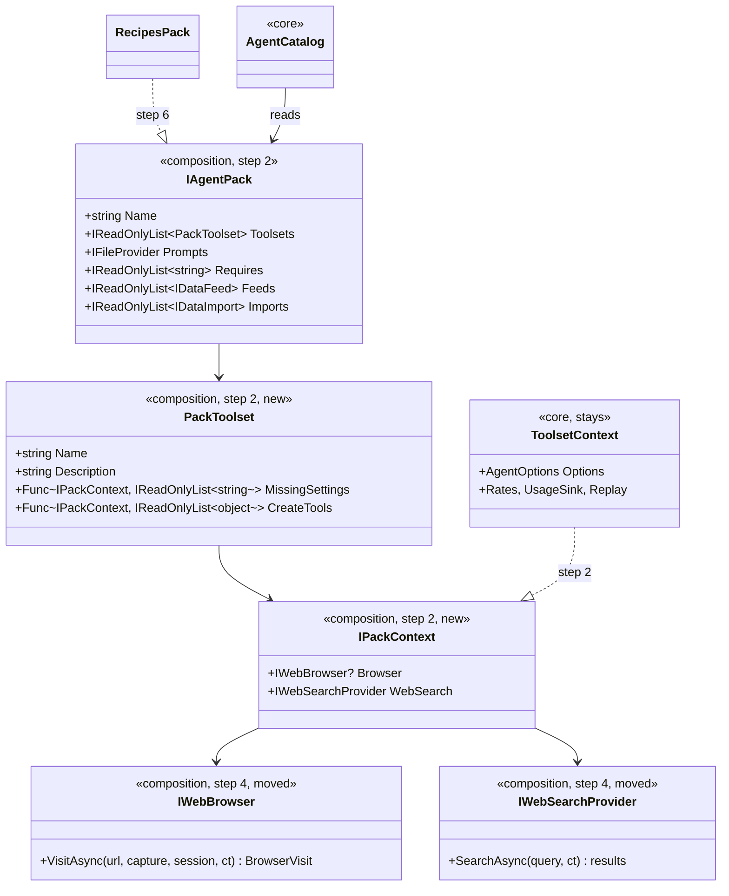
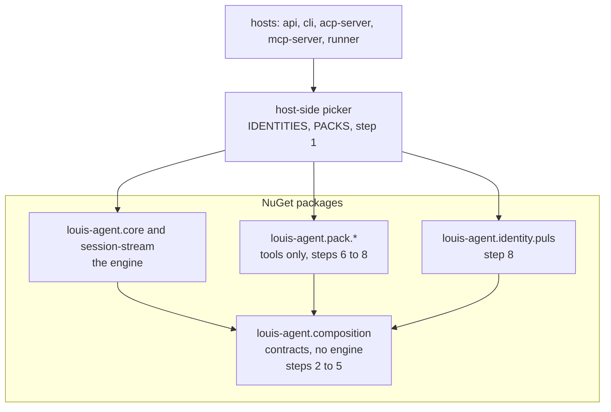
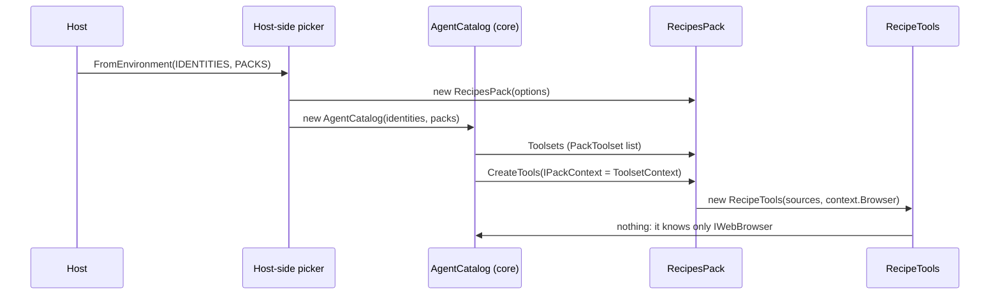
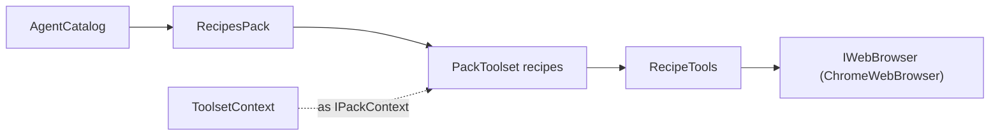

# CL29: packs are just tools

> **Plan, approved 2026-11-04; built by 2026-11-05 ([CL29.3](CL29.3-core-is-just-the-loop.md) holds what changed).** How a pack comes to depend on one small package and not on the engine, so that each can
> ship as a NuGet package. **Elsewhere:** why evals are apart in [ADR 0073](../adr/0073-packs-reference-no-evals.md).

## Context

The product is a framework. Louis, 2026-11-04: "shouldn't packs just be tools?", "composition should put them together",
"these things are going to be packages nuget, so in the end we will not even ref projects, it's a framework", and then
the pick: **the contracts live in the composition; a pack depends on the composition; the composition names no pack; the
host picks the packs.**

And for the engine: "the agent should be limited", "it is just the loop". So core ends up as the loop and its guards, with
no tool of its own, and everything an agent can do is a pack. That is more than one plan holds, so CL29 is a parent:

| Child | What | Done when |
|---|---|---|
| **CL29.1** (this plan's steps) | The contracts in the composition, and the three packs and Puls's identity off core | No pack or identity references core; a console app runs a pack from packages |
| **CL29.2** | The `web` pack: browser, search, fetch and the HTML readers leave core; the guards stay | Core has no `Tools/Web`; recipes gets its browser through the contract |
| **CL29.3** | The rest of core's tools become packs, as CL17 says: files, git, dotnet, shell, scripts, delegation, skills, clock, documents, currency, Paymo and DevOps | Core has no `Tools/` folder; `ToolsetCatalog` is gone |

Each child gets its own plan when it starts, its own branch, pull request and done-when. CL29.3 takes over CL17.1's work.

Today a pack references all of core, and through it `choices` and `session-stream`. Measured across the three packs:

| What a pack takes from core | Used for |
|---|---|
| `IAgentPack`, `IDataFeed`, `IDataImport` and its records | What a pack is |
| `ToolsetDefinition`, `ToolsetContext` | A toolset; of the context, packs read only `Browser` and `WebSearch` |
| `SkillFiles.Guide` | One line: a guide's path |
| `MessageText`, `MessageLogging`, `AgentLogging`, `LogContent` | Texts and logs |
| `IWebBrowser` and `BrowserVisit`, `IWebSearchProvider` and its records | The recipes pack's two services |
| `HtmlText`, `JsonLdBlocks` | The recipes pack reading a page |
| `SettingChoice`, `[WireName]`, `.Wire()` (`choices`) | Enum names, 17 files |
| `session-stream` | **Nothing.** It is only inherited |

Puls's identity takes one `using` from core, the catalog, plus `choices`.

## Design

The composition stops being what knows everything and becomes what everything agrees on: a small package of contracts.
The engine implements them, a pack uses them, and a host joins them. Pattern: Separated Interface (Fowler, *Patterns of
Enterprise Application Architecture*), the shape of `Microsoft.Extensions.AI.Abstractions`. We lose nothing a pack uses,
and a third party can ship a pack with no change to us.

### Interface design



```csharp
public interface IPackContext
{
    IWebBrowser? Browser { get; }
    IWebSearchProvider WebSearch { get; }
}

public sealed record PackToolset(
    string Name, string Description, string? GuideFile,
    Func<IPackContext, IReadOnlyList<string>> MissingSettings,
    Func<IPackContext, IReadOnlyList<object>> CreateTools,
    IReadOnlyList<Type>? ToolTypes = null, bool ParallelSafe = false);
```

### Architecture



### Communication: a host starts, and the cook reads a recipe



### Object diagram: what the main case holds in memory



### Approved during the build

- **Layout, 2026-11-04.** `host-packs` is one configuration, not framework ("this is only the puls config", "this would be
  like someone projects"), and only framework stays in `src/`: see [ADR 0074](../adr/0074-the-folders-say-what-ships.md).
  `host-packs` is at `demos/puls/hosts/`, and the composition at `src/engine/`. The trees below are from before that.
- **Order, 2026-11-04.** `IPackContext` names the browser and search contracts, so those move first: step 4 comes before
  step 2's new types.
- **Docs, 2026-11-04.** Framework docs are in `src/docs/`, a demo's in `demos/{demo}/docs/`, the packs' in `packs/docs/`,
  ADRs included. Paths in this plan are from before that.
- **Order, 2026-11-04.** Hosts come first, as their own child: [CL29.2](CL29.2-hosts-are-libraries.md). The `web` pack and the
  rest of the tools, called CL29.2 and CL29.3 here, become CL29.3 and CL29.4. This plan's steps 2 to 9 wait for it.
- **Hosts, 2026-11-04.** A host ships as a library, and each demo writes the small program that names its packs (Composition
  Root; picked over an installable `dotnet tool` with plugins, and over the CLI leaving the framework). It starts with
  `louis-agent.cli`, and it is how the hosts stop referencing `host-packs`.

### Folder trees

```
Today                                After
src/engine/                          src/engine/
  louis-agent.core/                    louis-agent.composition/   # the contracts (moved from hosts)
  louis-agent.choices/                 louis-agent.core/
  louis-agent.session-stream/          louis-agent.session-stream/
src/hosts/                           src/hosts/
  louis-agent.composition/             louis-agent.host-packs/    # Plugins, IdentityKind, PackKind (see finding 1)
```

### Namespace map

| Type | From | To (folder under `louis-agent.composition/`, namespace `LouisAgent.Composition.…`) | Step |
|---|---|---|---|
| `Plugins`, `IdentityKind`, `PackKind`, `CompositionErrorMessage` | composition | `demos/louis-agent.host-packs/`, `LouisAgent.HostPacks` | 1 |
| `IAgentPack`, `IAgentIdentity`, `IDataFeed` | core `Agent/Catalog` | `Packs/` | 2 |
| `IDataImport`, `ImportFact`, `ImportFile`, `ImportReport`, `ImportSlot` | core `Agent/Catalog/Imports` | `Packs/Imports/` | 2 |
| `PackToolset`, `IPackContext` | new | `Packs/` | 2 |
| `MessageText`, `MessageLogging`, `LogContent`, `LogContentMode` | core `Messages`, `Logging` | `Messages/`, `Logging/` | 3 |
| `SettingChoice`, `WireName`, `WireExtensions`, `ChoiceText` | `louis-agent.choices` | `Choices/`, the project gone | 3 |
| `IWebBrowser`, `BrowserVisit`, `BrowserSession`, `BrowserCookie`, `WebBrowserException` | core `Tools/Web/Browsing` | `Web/Browsing/` | 4 |
| `IWebSearchProvider`, `WebSearchQuery`, `WebSearchResult`, `WebSearchException` | core `Tools/Web/Search` | `Web/Search/` | 4 |

Moves go through Rider's *move to namespace*, so every `using` follows. A pack's own namespaces don't change.

## Steps (CL29.1)

One commit each, test first, with a stop after each.

1. **The composition names no pack.** `Plugins` and the two enums move to a host-side project; the hosts reference that.
   Test: the composition's csproj references no pack or identity.
2. **The pack contract moves in.** `IAgentPack`, the identity's, feeds, imports, and the new `PackToolset` and
   `IPackContext`; `ToolsetContext` implements `IPackContext`, and core reads a `PackToolset` into its own definition.
   Core references the composition.
3. **Texts and names move in.** `MessageText` and logging helpers; `choices` folds in, so the browser side references the
   composition. Test: the composition references no project and only abstraction packages.
4. **The browser and search contracts move in.**
5. **The HTML readers** (finding 2).
6. **`where-to-buy` drops core.** Its csproj references the composition alone. The smallest first, to prove the shape.
7. **`shop-prices` drops core.** Feeds and imports come along.
8. **`recipes` and Puls's identity drop core.** Test: no pack and no identity references core.
9. **Prove the packages.** `dotnet pack` each; a test console app that takes one pack and core as packages, not projects,
   and lists a tool. A new ADR, and the guides.

## Findings for Louis (rule 10)

Each needs a pick before its step.

**1. Who picks the packs?** Four hosts and the runner call `Plugins.FromEnvironment()` today. If the composition names no
pack, that has to move.

| Option | Changes | Costs |
|---|---|---|
| **A host-side project, `louis-agent.host-packs` (recommended)** | One place reads `IDENTITIES` and `PACKS`; hosts call it as they do today | One more project, which a package user wouldn't need |
| Each host names its own packs | Removes the shared code; a host is explicit | Five copies of a list, and the settings stop working the same everywhere |
| Plugin loading: scan for packs at run time | No list at all; a dropped-in package just works | Reflection, harder to test, and a security question about what gets loaded |

**2. The HTML readers.** Recipes needs `HtmlText` and `JsonLdBlocks`. They go to the `web` pack in CL29.2, and a pack can't
reference another pack (ADR 0027), so recipes needs another way to reach them.

| Option | Changes | Costs |
|---|---|---|
| **Recipes keeps its own copy, a test holds them equal (recommended)** | Matches "shared project or duplicated"; the composition stays contracts only | About 300 lines live twice |
| An `IPageReader` contract in the composition, which the `web` pack implements | No copies; recipes asks for a page's text and data | Recipes can't run without `web`, for what is a pure function |
| Let a pack reference another pack, for this | No copies, and the simplest code | Reverses ADR 0027, and a tool package then pulls in another |

**3. The name.** A package called `composition` that composes nothing is odd for someone reading NuGet. Your call whether
it keeps the name; the plan works either way, and a rename is one Rider step.

**4. Logging.** A pack logs through `AgentLogging.For<T>()`, which is Serilog set-up in core. I'd have packs take
`ILogger` from `Microsoft.Extensions.Logging.Abstractions`, a package every host already has, unless you'd rather not add
it to the composition.

## Verification

- `ArchitectureTests`: no pack or identity references core; the composition references no project of ours.
- The golden files must not change: this moves code and doesn't change what the model reads. A changed golden is a bug.
- The cook's pinned grades, the whole unit suite, and a Puls image build.
- Step 9's console app is the real proof, using packages and not project references.
- No paid run is needed for this work. **The F35.2 paid run should wait or go first:** this plan touches 200+ files, and
  mixing them would blur what that run measures.

## Concepts

Dependency inversion and package boundaries: the skill *18 Testing and shipping* in the [goal](../GOAL.md), and *20
Extensibility*, since a framework's real test is someone else's pack.

---
[Plans](README.md) · Related: [ADR 0073](../adr/0073-packs-reference-no-evals.md) · [ADR 0027](../adr/0027-engine-identities-and-packs.md)
