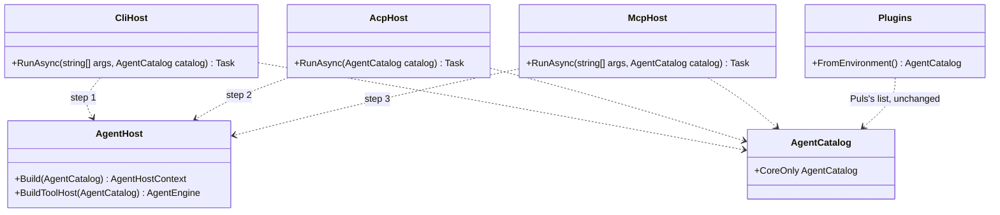
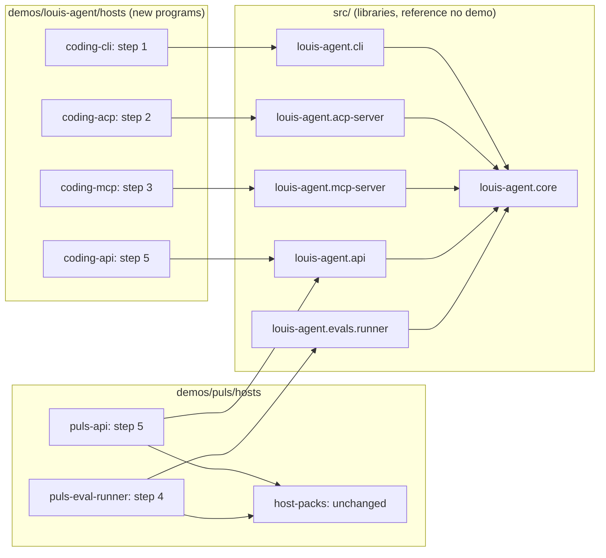
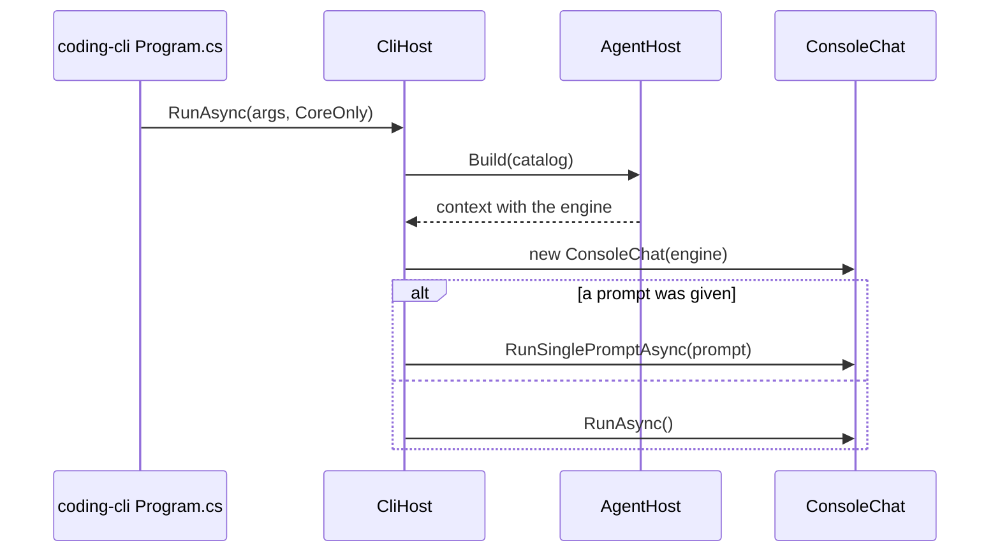
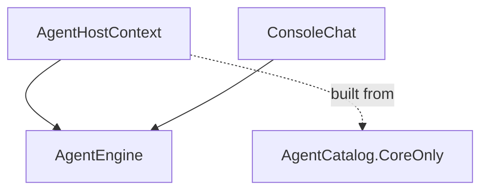

# CL29.2 Hosts are libraries

> **Plan.** How a framework host stops naming a product: it becomes a library, and each demo writes the small program that
> names its packs. **Elsewhere:** the rule in [ADR 0074](../adr/0074-the-folders-say-what-ships.md), the parent in
> [CL29](CL29-packs-are-just-tools.md).

**Status:** approved by Louis, 2026-11-04 · **Branch:** `refactor/CL29.2-hosts-are-libraries`, stacked on CL29.1 until that merges.

## Context

The folders now say what ships, but five framework projects still reference a demo, so none of them can become a NuGet
package: a package can't point at someone's project.

| Framework project | Points at |
|---|---|
| `louis-agent.cli`, `.acp-server`, `.mcp-server` | `host-packs` |
| `louis-agent.api` | `host-packs`, the Puls app, the code-review app (`-p:WebApp`) |
| `louis-agent.evals.runner` | `host-packs`, Puls's evals and judges, both packs' checks |

Louis picked the shape (2026-11-04, option A of three): a host ships as a library, and each demo writes the program. He put
this before the plan's pack-contract steps, because the split comes first, and made it its own child. What was CL29.2 (the
`web` pack) and CL29.3 (the rest of the tools) move along to CL29.3 and CL29.4.

## Design

**Pattern: Composition Root** (Seemann): the one place an app wires itself is its entry point, so a library never picks its
own dependencies. ASP.NET works this way: the framework is a package, and you write `Program.cs`.

What each host does today is one line, so the seam is small:

```csharp
// Today, in the framework:
var host = AgentHost.Build(Plugins.FromEnvironment());      // Plugins lives in demos/puls

// After, in the framework:
public static class CliHost
{
    public static Task RunAsync(string[] args, AgentCatalog catalog);
}

// After, in demos/louis-agent/hosts/louis-agent.coding-cli/Program.cs:
await CliHost.RunAsync(args, AgentCatalog.CoreOnly);
```

The coding agent names no packs today (`IDENTITIES` and `PACKS` are unset in its settings), so `AgentCatalog.CoreOnly` is what
it already gets, and its behaviour doesn't change. `host-packs` stays with Puls, as Puls's own list.

**No Puls terminal, Rider or MCP program is added:** nothing runs one today (ADR 0055, nothing for a future no plan names). A
demo gets a program when it runs that host.

### Interface design



The eval runner (step 4) and the API (step 5) get their signatures when reached: each has a real choice in it (see *Findings*).

### Architecture



### Communication: the terminal starts



### Object diagram: what the terminal holds



### Folder trees

```
Today                                After step 5
src/hosts/louis-agent.cli  (exe)     src/hosts/louis-agent.cli  (library)
src/hosts/louis-agent.acp-server     src/hosts/louis-agent.acp-server  (library)
src/hosts/louis-agent.mcp-server     src/hosts/louis-agent.mcp-server  (library)
src/hosts/louis-agent.api  (exe)     src/hosts/louis-agent.api  (library)
src/evals/louis-agent.evals.runner   src/evals/louis-agent.evals.runner  (library)
demos/louis-agent/hosts/             demos/louis-agent/hosts/
  louis-agent.orchestrator             louis-agent.orchestrator
                                       louis-agent.coding-cli, .coding-acp, .coding-mcp, .coding-api
demos/puls/hosts/                    demos/puls/hosts/
  louis-agent.host-packs               louis-agent.host-packs
                                       louis-agent.puls-api, louis-agent.puls-eval-runner
```

### Namespace map

| Type | Folder | Namespace | Step |
|---|---|---|---|
| `CliHost` (new) | `src/hosts/louis-agent.cli/` | `LouisAgent.Cli` | 1 |
| `Program` (moved, top-level) | `demos/louis-agent/hosts/louis-agent.coding-cli/` | none | 1 |
| `AcpHost` (new) | `src/hosts/louis-agent.acp-server/` | `LouisAgent.AcpServer` | 2 |
| `Program` (moved) | `demos/louis-agent/hosts/louis-agent.coding-acp/` | none | 2 |
| `McpHost` (new) | `src/hosts/louis-agent.mcp-server/` | `LouisAgent.McpServer` | 3 |
| `Program` (moved) | `demos/louis-agent/hosts/louis-agent.coding-mcp/` | none | 3 |
| `ArchitectureTests` (changed) | `src/tests/engine/louis-agent.core.tests/` | `LouisAgent.Core.Tests` | 1 to 5 |
| `SolutionLayoutTests` (changed) | `src/tests/engine/louis-agent.core.tests/` | `LouisAgent.Core.Tests` | 1 to 5 |

Steps 4 and 5 add their rows when their findings are picked.

## Steps

One commit each, test first, with a stop after each. **The ratchet:** step 1 adds `AFrameworkProject_ReferencesNoDemoOrPack`,
reading every project under `src/` outside `src/tests/`, with the projects not yet done on a list that can only shrink, as
`FileSizeTests` does. Each step takes its project off.

1. **The CLI.** `CliHost` takes the catalogue, `louis-agent.cli` stops being an exe and drops `host-packs`, and
   `louis-agent.coding-cli` is the program. `Dockerfile.agent`, its launch profile and the docs follow. Three files, to prove
   the shape.
2. **The ACP server, the same.** Rider's example entry follows.
3. **The MCP server, the same.** Its start-up is longer, so it moves whole into `McpHost`.
4. **The eval runner.** Its checks and readers come from the caller, not from `RunnerChecks` and `RunnerReaders` naming Puls.
5. **The API.** The biggest: a demo's program names its packs and its web app, the Dockerfiles publish that program, and
   `-p:WebApp` goes.
6. **The API's tests that don't need Puls come back** to `src/tests/hosts/`, and the ratchet's list is deleted, leaving a plain
   rule. ADR 0074 loses its debts, and the runner's is recorded while it lasts.

## Findings for Louis (rule 10)

**1. What to call a demo's programs.** Louis picked the first: `louis-agent.coding-cli` and `louis-agent.puls-api`.

| Option | What it changes | Cost |
|---|---|---|
| **`louis-agent.coding-cli`, `louis-agent.puls-api` (recommended)** | Says whose program and which host, and reads the same in both demos | Introduces "coding" as the demo's short name, though its folder is `louis-agent` |
| `louis-agent.agent.cli`, `louis-agent.puls.api` | Follows the dotted names used elsewhere | `louis-agent.puls.api` reads like part of the Puls web app, `louis-agent.puls` |
| `louis-agent.cli.app`, `louis-agent.api.puls` | Keeps the framework's name first, so they sort beside it | The demo's name is last, or missing for the CLI |

**2. The eval runner, before step 4.** How the caller hands over its checks and readers, three options then, patterns looked up.

**3. The API's web app, before step 5.** How a program chooses what the library serves, three options then, patterns looked up.

## Verification

- Each step: the ratchet's entry goes, and the touched project's tests and `SolutionLayoutTests` pass (ADR 0075).
- Step 1: `dotnet run --project demos/louis-agent/hosts/louis-agent.coding-cli -- --help`-free smoke: the project starts, and
  stops on a missing key with the existing message. **No real prompt, so no model call and no money.**
- Steps 4 and 5: rebuild the Puls image, then the runner's `--list` and `--checks` inside it. No eval is run.
- Before the PR: the whole solution, unit and integration.

## Concepts

The dependency rule and Composition Root: where wiring belongs, and why a library must not choose its own plugins. In the
[goal](../GOAL.md)'s skill map: extensibility.

---
[Docs index](../README.md) · Related: [Plans](README.md) · [CL29](CL29-packs-are-just-tools.md)
