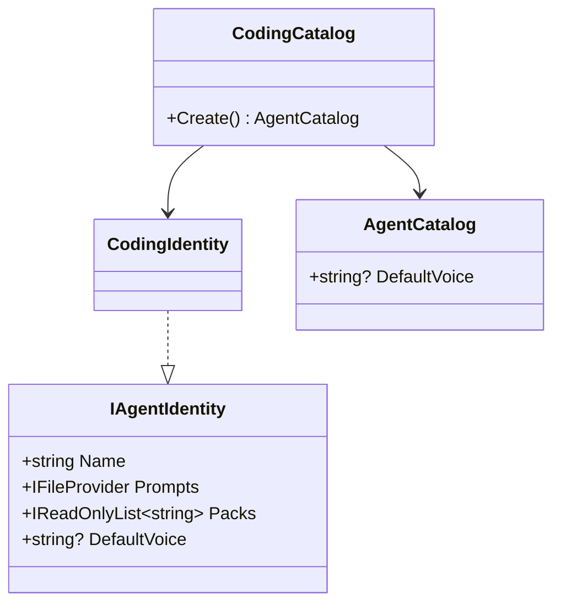
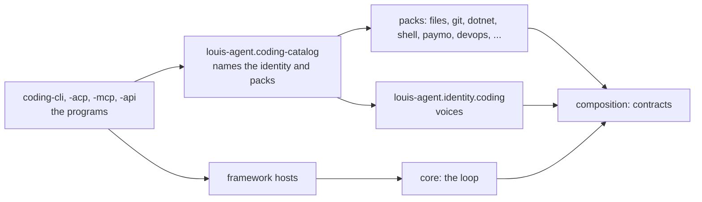
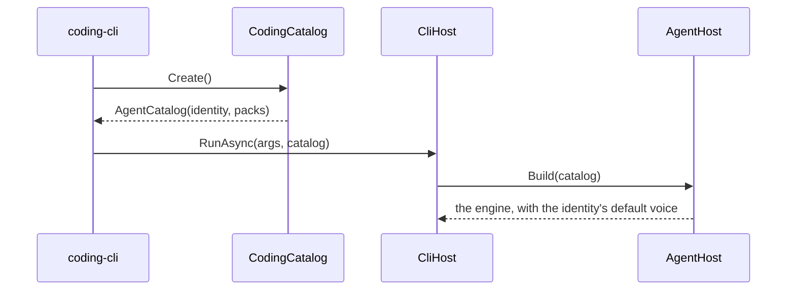
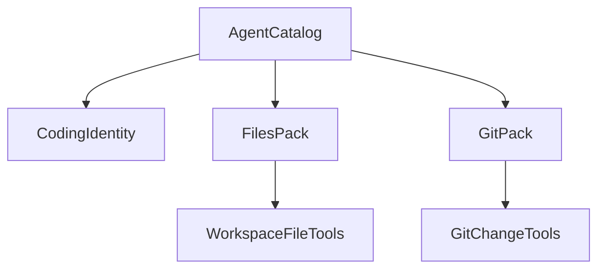

# CL29.3 Core is just the loop

> **Plan, written unattended.** How the coding agent stops living inside core: it becomes an identity in its demo, and every tool
> in core becomes a pack. **Elsewhere:** the parent in [CL29](CL29-packs-are-just-tools.md), the rule in
> [ADR 0074](../adr/0074-the-folders-say-what-ships.md).

**Status:** Louis picked this on 2026-11-05 (option C: "the coding agent is also just a demo, so it should be a pack identity"), then
said "finish it all" and "do all steps whole cl29" before going to bed. He has **not** seen this plan: review it, and *Decided
unattended* below, in the morning. **Built** on 2026-11-05: the plan stays until he has reviewed those choices, then its lasting parts are [ADR 0076](../adr/0076-core-ships-no-agent.md) and it is deleted. It takes over what CL29's table called CL29.2 and CL29.3, and CL17.

## Context

`AgentCatalog.CoreOnly` reads as "no packs", but it hides the coding agent: its voice is in core's `Prompts/agent/louis-agent/`, core's
default mode is that voice, and core owns the file, git, dotnet, shell, script, Paymo and DevOps tools. So the framework still ships
one of its own demos.

## Design

Pattern: Separated Interface (the contracts in the composition) and Composition Root (a demo's program names what it loads), as for
CL29.1 and CL29.2. A tool's wire name and text don't change, so what the model reads doesn't either: the golden files move with the
coding agent and must stay byte-equal.

| Type | Folder | Namespace |
|---|---|---|
| `CodingIdentity` | `demos/louis-agent/identity/louis-agent.identity.coding/` | `LouisAgent.Identities.Coding` |
| `CodingCatalog` | `demos/louis-agent/hosts/louis-agent.coding-catalog/` | `LouisAgent.CodingCatalog` |
| A pack's class and tools | `packs/louis-agent.pack.{name}/` | `LouisAgent.Packs.{Name}` |
| `WorkspaceBoundary`, `ProcessRunner`, shared `ToolMessage` | `src/engine/louis-agent.composition/` | `LouisAgent.Composition.*` |

## Steps

One commit each, leaving the two known failures and nothing new. Riskiest last, so what's done is always whole.

1. The coding identity and its catalogue; the programs name them; the default voice comes from the identity.
2. The golden files move with the coding agent.
3. Paymo and DevOps become packs.
4. `dotnet` becomes a pack.
5. `git` becomes a pack.
6. `files`, with documents, becomes a pack.
7. `shell` and the scripts become a pack.
8. `web`, with currency: browser, search, fetch and readers leave core; the guards stay.
9. Delegation, skills and the clock: the last of `Tools/`.
10. `dotnet pack` proves it: a console app takes a pack as a package.

## Decided unattended

Each took the recommended option. Louis reviews these.

| Choice | Taken | Not taken |
|---|---|---|
| The composition's name | Keeps it, as a rename is one step later | A new name now |
| `choices` | Stays a small package the composition references | Folding it in, renaming a namespace across hundreds of files for nothing a pack needs |
| Logging for a pack | `ILogger` through `PackLog`, with the engine choosing where lines go; telemetry follows, as he asked | A logger passed in by the context; or Serilog in the contract |
| HTML readers for recipes | Recipes' own copy, a test holds it equal | An `IPageReader` contract; or a pack referencing a pack |
| Helpers several packs need | In the composition | A copy per pack, about ten copies of the boundary check that keeps a tool inside the workspace, and a safety check must not drift |
| A shared list for the coding agent | `louis-agent.coding-catalog`, so four programs don't repeat it | A copy in each program |
| API tests back in `src/tests` | **Not done**: about 30 files open Puls's sessions by name, so it's a rewrite of its own | Doing it first |
| Order of the steps | Tools first, the identity last, since its tests need the packs to exist; each stayed one commit | The plan's order |
| Web access | Stays in the engine (`Web/`), reached through `IPackContext`: the guards can't be left out. Only the tools left | Its own package now, one mechanical move later; or the whole of it in the pack, which then couldn't give other packs the browser |
| Delegation, skills, the clock | Stay in the engine: they use its sessions, ledger and registry (ADR 0031). `Tools/` is gone anyway | Packs, as step 9 said, which would have put engine insides in the contract |
| Running a script | `PythonRunner` and its siblings in the composition, since the engine runs skills without the toolset | The engine referencing a pack; or a copy each side |
| The order of a session's tools | `IAgentPack.ComesBeforeTheEngine`: general tools, the engine's, a product's. Found when Puls's golden file failed | Regenerating the golden file; or a number per pack |
| What Puls loads | Its identity names `web`, which it uses; `dotnet`, `git`, `files`, `shell` come through `PACKS` in its compose file, for its routing eval's baseline only. Azure doesn't set it | The identity naming all of them, which gives a public agent git and shell tools |
| Puls's routing eval | Drops Paymo and DevOps, version 4, so its trend restarts | Puls keeping both, which it has no use for |
| A session with no role on Puls | Now Puls's own voice (`puls/voice-af`); it used to get the coding agent's, which was wrong | Keeping that |
| `WebSearch` and `FetchUrl` | Gain a cancellation token, as `PackConvertibilityTests` asks of a pack; a token isn't in a tool's schema, so the golden files don't move | Excusing them from the rule |
| The golden files | `Encoding` and `Decoding` are excused in `ApiNamesNoProductTests`, since the identity folder's name is `coding` | Another folder name |

## Verification

The golden files stay byte-equal, the whole unit and integration suites pass but for the two known failures, both images build and
start, and no paid run. Then push the branch and wait for Louis's pull request.

## Concepts

Dependency inversion and package boundaries: *18 Testing and shipping* and *20 Extensibility* in the [goal](../GOAL.md).

---
[Docs index](../README.md) · Related: [Plans](README.md) · [CL29](CL29-packs-are-just-tools.md)
