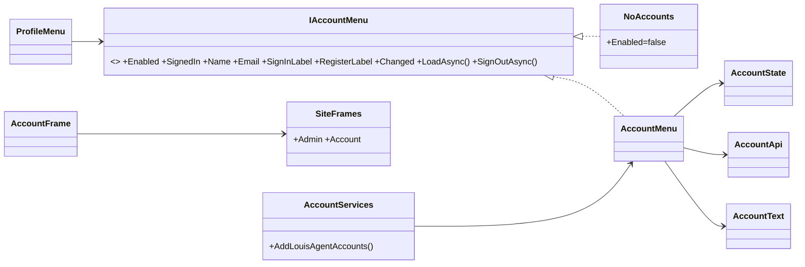
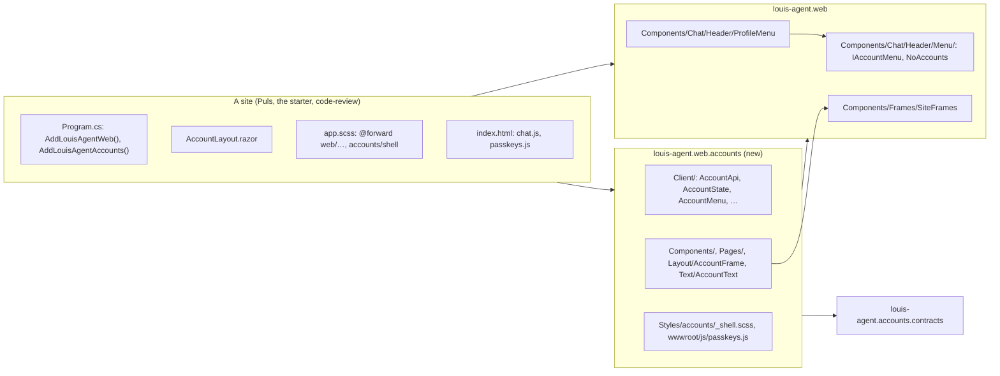
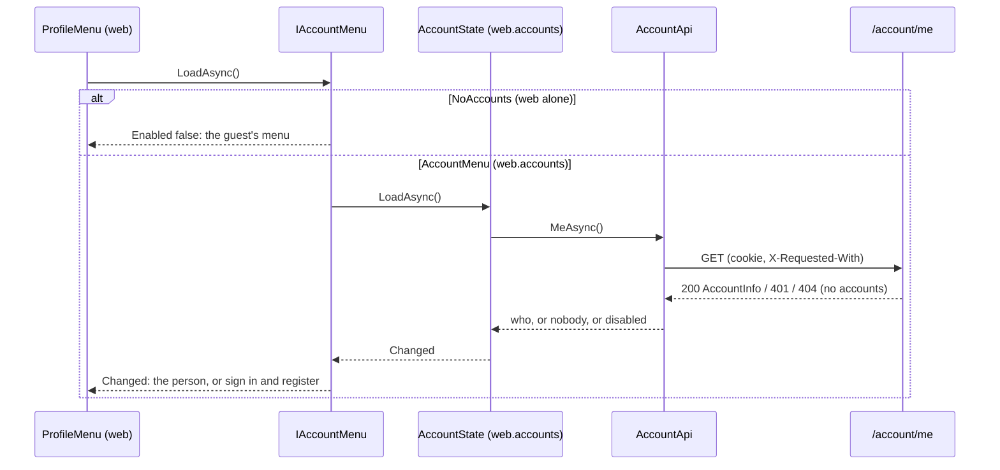

# CL30 The account client as its own library

> **Plan.** How the account pages, their client, words, styles and script move out of `louis-agent.web` into
> `louis-agent.web.accounts`, a Razor class library a site opts into, with the one thing the chat still needs from
> accounts (who's here, and the way out) behind a named seam. Drafted 2026-11-07 after F61.5, on
> `refactor/CL30-web-accounts`; deleted when the work is done.

## Context

**What Louis asked (2026-11-07):** "should we not rather have louis-agent.web.accounts" — and, of the three options
put to him, **A: the library on top of `louis-agent.web`, a site opts in**, "finish step 5 first then do the move".

**What exists.** F61.2, F61.3 and F61.5 put 56 account files in the framework's web: the client (`Accounts/`:
`AccountApi`, `AccountState`, `CookieAuthenticationStateProvider`, `AccountProblem`, `AccountServices`, `Errors/`,
`Navigation/`, `TwoFactor/`), the forms and sections (`Components/Account/` with `Profile/`, `Passkeys/`,
`TwoFactor/`), six pages (`Pages/Account/`), `Layout/AccountFrame`, `Text/AccountText`,
`Styles/web/account/_shell.scss` and `wwwroot/js/passkeys.js`; `louis-agent.web` references
`louis-agent.accounts.contracts` and `Microsoft.AspNetCore.Components.Authorization` for them. Outside those
folders two things touch accounts: the chat header's `ProfileMenu` looks `AccountState`, `AccountApi` and
`AccountText` up by hand (`IServiceProvider.GetService`, so a site or a test without them still draws the guest's
menu), and `AgentApi` sends `X-Requested-With` (a header named in `louis-agent.api.contracts`, nothing of accounts).
On the server the split is already made: `louis-agent.api` doesn't reference `louis-agent.accounts`; a host's
`Program.cs` composes the two.

**Not in this plan:** anything the pages do; the server; F61.4.

## Design

### The shape, in plain words

- **One more library, the same direction as the server.** `louis-agent.web.accounts` references `louis-agent.web`
  and the contracts; `louis-agent.web` references neither. A site that wants accounts references the library and
  calls `AddLouisAgentAccounts()`, as its API references `louis-agent.accounts`; a site that doesn't ships no
  Identity client, no Authorization package, no passkey script (ADR 0074: the folders say what ships).
- **The header asks a seam, not a service.** `louis-agent.web` declares `IAccountMenu`: what the chat's profile
  menu needs to know (are there accounts, is someone signed in, their name and email, the words for sign in and
  register) and do (load, follow changes, sign out). It registers `NoAccounts` for it, a Null Object that says
  "no accounts" and draws the guest's menu as before. `louis-agent.web.accounts` implements it as `AccountMenu` over
  `AccountState`, `AccountApi` and `AccountText`, and `AddLouisAgentAccounts()` replaces the Null Object. The
  `ProfileMenu` injects `IAccountMenu` and never looks anything up by hand again.
- **Folders say the namespace.** The library's root namespace is `LouisAgent.Web.Accounts`, so the client's types
  sit in `Client/` (`LouisAgent.Web.Accounts.Client`), the forms in `Components/` and its subfolders, the pages in
  `Pages/`, the frame in `Layout/`, the words in `Text/`: no `Accounts/Accounts`. Rider's *adjust namespaces* does
  the renames (ADR 0052).
- **What a site changes:** a project reference; `@using` lines in `_Imports.razor`; `@forward "accounts/shell"`
  in `app.scss` with the library's `Styles` on the Sass include path; `_content/louis-agent.web.accounts/js/passkeys.js`
  in `index.html`; nothing in `Program.cs` but a `using`. The starter (and so `dotnet new louis-site`) keeps accounts.
- **The rules follow.** `FrameworkNamesNoSiteTests`, `RazorHasNoCodeTests`, `FrameworkScriptsTests` and
  `SiteLayoutsStaySmallTests` read both libraries; `SolutionLayoutTests` lists the two new projects; the goldens
  stay where their component's tests go.

### Interface design



The signatures:

```csharp
// src/web/louis-agent.web/Components/Chat/Header/Menu/ (the seam stays in the framework's web, beside the menu that asks it)
public interface IAccountMenu
{
    bool Enabled { get; }          // the site registered accounts and the API has them
    bool SignedIn { get; }
    string? Name { get; }          // the display name, else the email
    string? Email { get; }
    string SignInLabel { get; }    // the site's words for the two links
    string RegisterLabel { get; }
    event Action? Changed;
    Task LoadAsync();              // once, when the menu first draws
    Task SignOutAsync();           // signs out and goes home
}
public sealed class NoAccounts : IAccountMenu { … }                       // Null Object: Enabled false, labels empty, the tasks complete
// src/web/louis-agent.web.accounts/Client/
public sealed class AccountMenu(AccountState state, AccountApi api, AccountText text, NavigationManager navigation) : IAccountMenu, IDisposable { … }
public static class AccountServices
{
    public static IServiceCollection AddLouisAgentAccounts(this IServiceCollection services);   // + services.AddScoped<IAccountMenu, AccountMenu>() replacing NoAccounts
}
```

### Architecture



### Communication: the menu draws



### Namespace map

| Type | Folder | Namespace | Step |
|---|---|---|---|
| `louis-agent.web.accounts.csproj` (RCL, refs web + contracts + Authorization) | `src/web/louis-agent.web.accounts/` | `LouisAgent.Web.Accounts` | 1 new |
| `louis-agent.web.accounts.tests.csproj` | `src/tests/web/louis-agent.web.accounts.tests/` | `LouisAgent.Web.Accounts.Tests` | 1 new |
| `IAccountMenu`, `NoAccounts` | `src/web/louis-agent.web/Components/Chat/Header/Menu/` (not `Accounts/`: that namespace is the library's root) | `LouisAgent.Web.Components.Chat.Header.Menu` | 2 new |
| `ProfileMenu` | unchanged | unchanged | 2 changed |
| `AccountApi`, `AccountApiException`, `AccountProblem`, `AccountState`, `CookieAuthenticationStateProvider`, `AccountServices` | `src/web/louis-agent.web.accounts/Client/` | `LouisAgent.Web.Accounts.Client` | 3 moved |
| `AccountErrors`, `SafeReturn`, `OtpAuth`, `SecondStep` | `…/Client/Errors/`, `…/Client/Navigation/`, `…/Client/TwoFactor/` | `LouisAgent.Web.Accounts.Client.{Errors,Navigation,TwoFactor}` | 3 moved |
| `AccountShell`, `AccountNotice`, `PasswordField`, `ProviderButtons`, `LoginForm`, `RegisterForm` | `…/Components/` | `LouisAgent.Web.Accounts.Components` | 4 moved |
| `Profile/*`, `Passkeys/*`, `TwoFactor/*` | `…/Components/{Profile,Passkeys,TwoFactor}/` | `LouisAgent.Web.Accounts.Components.{…}` | 4 moved |
| the six pages | `…/Pages/` | `LouisAgent.Web.Accounts.Pages` | 4 moved |
| `AccountFrame` | `…/Layout/` | `LouisAgent.Web.Accounts.Layout` | 4 moved |
| `AccountText` | `…/Text/` | `LouisAgent.Web.Accounts.Text` | 4 moved |
| `_shell.scss`, `passkeys.js` | `…/Styles/accounts/`, `…/wwwroot/js/` | — | 5 moved |
| `AccountMenu` | `…/Client/` | `LouisAgent.Web.Accounts.Client` | 6 new |
| the tests (24 files) | `src/tests/web/louis-agent.web.accounts.tests/` mirroring the library | `LouisAgent.Web.Accounts.Tests.*` | 3, 4, 6 moved |

### Folder trees (after)

```
src/web/
├── louis-agent.web/                     # names no site, knows no Identity: the seam only
│   └── Components/Chat/Header/Menu/     # IAccountMenu, NoAccounts
└── louis-agent.web.accounts/            # a site opts in
    ├── Client/                          # AccountApi, AccountState, AccountMenu, …; Errors/, Navigation/, TwoFactor/
    ├── Components/                      # the forms; Profile/, Passkeys/, TwoFactor/
    ├── Layout/AccountFrame.razor        # on SiteFrames.Account
    ├── Pages/                           # login, register, confirm-email, forgot-password, reset-password, profile
    ├── Styles/accounts/_shell.scss
    ├── Text/AccountText.cs
    ├── _Imports.razor
    └── wwwroot/js/passkeys.js           # served at _content/louis-agent.web.accounts/js/passkeys.js
src/tests/web/
├── louis-agent.web.tests/               # ProfileMenuTests on the seam; the rules read both libraries
└── louis-agent.web.accounts.tests/      # the 24 account test files, AccountTestContext
```

## Steps

One commit each; a move is `git mv` and Rider's adjust-namespaces, proved by the build and the moved tests
(ADR 0052, 0054); test first where a step changes behaviour (steps 2 and 6).

1. **The projects.** `louis-agent.web.accounts` (Razor class library: `Microsoft.NET.Sdk.Razor`, refs `louis-agent.web`,
   `louis-agent.accounts.contracts`, `Microsoft.AspNetCore.Components.Authorization`; the package leaves `web`'s
   csproj) and `louis-agent.web.accounts.tests` (bunit, the testing libraries); the four `.sln` entries by hand;
   `SolutionLayoutTests` rows; the design doc stub `src/docs/projects/louis-agent.web.accounts.md`. Empty, builds.
2. **The seam.** `IAccountMenu` and `NoAccounts` in `louis-agent.web`, registered by `AddLouisAgentWeb()` with
   `TryAddScoped`; `ProfileMenu` injects it. Test first: `ProfileMenuTests` on a fake `IAccountMenu` (signed in,
   guest with accounts, no accounts); the lookup by hand goes.
3. **The client moves.** `Accounts/*` → `Client/*` with the namespaces adjusted; `AccountServices` registers the
   same as today. The seven client test files move with it. Both solutions build; the moved tests pass.
4. **The pages move.** `Components/Account/*` → `Components/*`, `Pages/Account/*` → `Pages/*`, `AccountFrame`,
   `AccountText`; the library's `_Imports.razor`; `louis-agent.web`'s `_Imports.razor` loses the account lines.
   The fifteen component, page and layout test files move. `FrameworkNamesNoSiteTests`, `RazorHasNoCodeTests`,
   `SiteLayoutsStaySmallTests` read both libraries (`FrameworkWebSites` gains the second root).
5. **The assets and the sites.** `_shell.scss` → `Styles/accounts/_shell.scss`, `passkeys.js` → the library's
   `wwwroot/js/`; `FrameworkScriptsTests` reads it there. Puls, the starter and code-review: the project reference,
   `_Imports.razor`, `sasscompiler.json`'s include path, `@forward "accounts/shell"`, `index.html`'s script line,
   `Program.cs`'s `using`. The starter's template builds a site with accounts, as today.
6. **The menu live.** `AccountMenu : IAccountMenu` over the state, the client and the words;
   `AddLouisAgentAccounts()` registers it over `NoAccounts`. Test first: `AccountMenuTests` (loads once, follows
   `Changed`, signs out and goes home) in the library's tests; `ProfileMenuTests` unchanged.
7. **Docs.** `louis-agent.web.accounts.md` (how it works, the diagrams, structure, tests), `louis-agent.web.md`
   (the account lines move out, the seam line in), `change-the-web.md` and `spawn-a-site.md` (a site opts in),
   `src/docs/CLAUDE.md`'s structure line, ADR 0089 *The account client is a library a site opts into* (why on top
   of `web`, why a seam and not a lookup), CHANGELOG, TODO's CL30 line closed; this plan deleted. Full unit suite.

## Verification

Per step: the moved project's tests, `louis-agent.web.tests` for the rules, `core.tests` for the layout and size
rules. By hand, free: `dotnet run` Puls's API and open the sign-in page, the profile and the chat's menu, signed out
and in; `dotnet new louis-site` from the starter builds. No paid run.

## Concepts, and where they sit in GOAL.md

- **Separated Interface** (Fowler, PoEAA; skill 20, extensibility): the interface in the package that needs it, the
  implementation in the package that has it, so the dependency points the way the packages ship.
- **Null Object** (skill 20): the no-accounts case as an object, so the menu has no `if` for it.
- **What a package ships** (ADR 0074; skill 18): a site carries only what it opted into.

---
[Docs index](../README.md) · Related: [F61](F61-accounts-and-azure.md) · [Plans](README.md)
