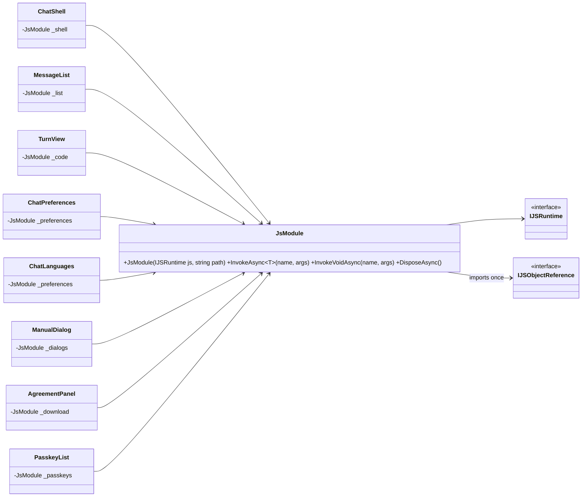
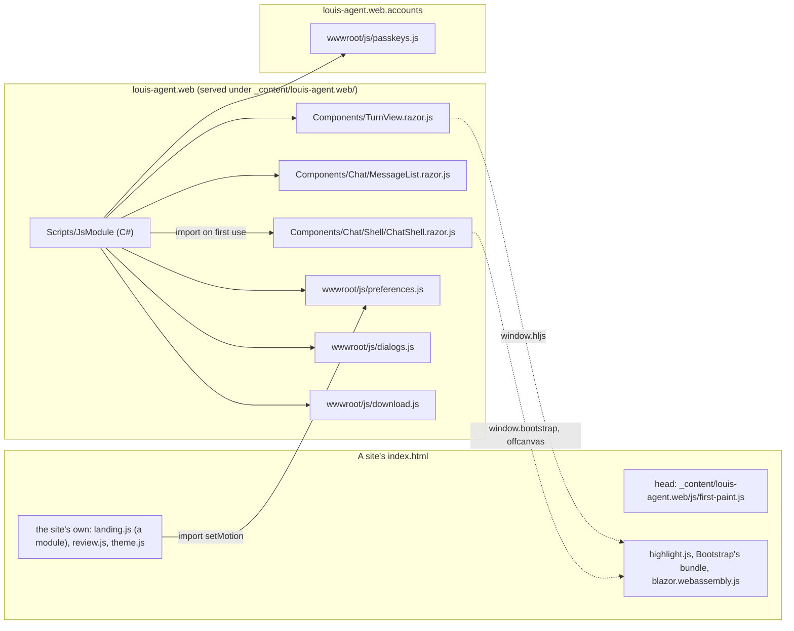
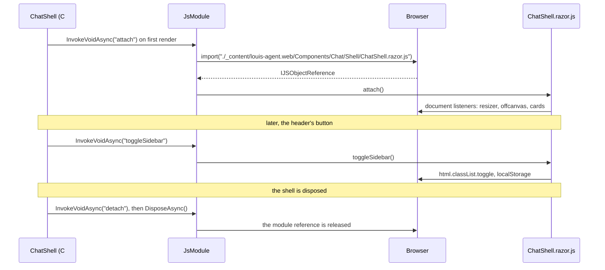

# CL31 Scripts as modules beside their components

> **Plan.** How the framework's JavaScript stops being two files every site has to list (`chat.js`, `passkeys.js`)
> and becomes small ES modules, each beside the component that needs it and loaded by that component when it first
> draws, so a site's `index.html` lists nothing of ours but the one script that must run before the first paint.
> Drafted 2026-11-07 after CL30, on `refactor/CL31-scripts-as-modules`; deleted when the work is done.

## Context

**What Louis asked (2026-11-07):** "instead of JS is there like something else we can use to make it easier, what
javascript like jQuery is mainstream today?" Of the three options put to him he picked **A: keep plain JavaScript,
as ES modules beside each component**, over C# wrappers from NuGet (packages to vet, a second look fighting
Bootstrap's) and over leaving the scripts listed by every site.

**What exists.** Blazor is the UI; JavaScript is only glue to what the browser alone can do. `chat.js` (266 lines)
holds two globals, `window.louisChat` (scroll to the end, code colouring on the site's highlight.js) and
`window.chatUi` (the sidebar's width and toggles, the work panel, the resizer drag, the offcanvas close on a phone,
the spotlight and tilt on cards, the cost count-up, focus, open settings, the motion and location and language
preferences in `localStorage`, the time zone, geolocation, copy, show work), plus document-wide listeners that run
as soon as the file loads. `passkeys.js` (24 lines, `window.passkeys`) wraps `navigator.credentials`.
`first-paint.js` (10 lines) reads what the browser remembers and sets it before the first paint; it must stay a
script a site lists in its head. Nineteen distinct calls reach them from eleven C# files (`IJSRuntime.InvokeAsync
("chatUi.x")`), six buttons call `chatUi.toggle…()` inline from markup, and Puls's own `landing.js` reaches
`window.chatUi.setMotion`. **A bug found on the way:** three framework components (`AgreementPanel`, `PromptfooPanel`,
`EvalStudio`) call `louisDownload`, which only Puls's `review.js` defines, so the starter's and the code-review app's
admin downloads do nothing; the rule that should catch it (`FrameworkScriptsTests`) only looks for `chatUi` and
`louisChat`. Third-party scripts (highlight.js, Bootstrap's bundle, Blazor's loader) stay the site's to list, as now.

**Not in this plan:** a site's own scripts (Puls's `landing.js` and `review.js`, code-review's `theme.js`) beyond
what they take from the framework; replacing Bootstrap's JavaScript; any new library.

## Design

### The shape, in plain words

- **A module beside its component.** A component that needs the browser gets a `X.razor.js` next to it, an ES
  module with `export function`s and no global; a Razor class library serves it at
  `_content/louis-agent.web/Components/…/X.razor.js`. What several components share (focus for dialogs, the
  download, the preferences) is a module under the library's `wwwroot/js/`. The component imports it the first time
  it draws (`OnAfterRenderAsync(firstRender)`) and lets it go when disposed. This is Microsoft's *JavaScript
  isolation* for Blazor (collocated JS, `IJSObjectReference`), nothing of our own invention.
- **One small helper carries the import.** `JsModule` (in `louis-agent.web`, `Scripts/`) holds a module's path,
  imports it on first use, forwards `InvokeAsync`/`InvokeVoidAsync`, and disposes it. Every caller holds one and
  never writes the `import` dance itself. Pattern: a Virtual Proxy (Gang of Four): the component talks to the proxy
  as if the module were there, and the proxy loads it the first time it's needed.
- **The page-wide behaviour belongs to the shell.** The listeners `chat.js` hangs on `document` as it loads (the
  resizer drag, the offcanvas close, the cards' spotlight and tilt) become `attach()`/`detach()` in
  `ChatShell.razor.js`, called when the shell first draws and when it's disposed; the admin pages, which have no
  shell, get none of it, which is what they have today in effect.
- **Buttons call Blazor, not a global.** The six `onclick="chatUi.toggleSidebar()"` become `@onclick` handlers on
  their components, each calling the shell's module through its own `JsModule`; the browser caches a module, so six
  imports of one file cost one fetch.
- **A site lists one line of ours.** `first-paint.js` stays, since it must run before anything draws; `chat.js` and
  `passkeys.js` go. Puls's `landing.js` becomes a module (`type="module"`) and imports `setMotion` from the
  framework's `preferences.js`; its `review.js` loses `louisDownload`, which the framework now owns.
- **The rule follows.** `FrameworkScriptsTests` becomes a rule on modules: every path a framework class imports is a
  file on disk, every function it invokes on it is exported there, no framework script but `first-paint.js` writes
  to `window`, and a site's `index.html` lists nothing of ours but `first-paint.js`.

### Interface design



The signatures:

```csharp
// src/web/louis-agent.web/Scripts/JsModule.cs
public sealed class JsModule(IJSRuntime js, string path) : IAsyncDisposable
{
    public ValueTask<T> InvokeAsync<T>(string function, params object?[] args);   // imports the module on the first call
    public ValueTask InvokeVoidAsync(string function, params object?[] args);
    public ValueTask DisposeAsync();                                               // lets the module go, if it was ever loaded
}
public static class FrameworkScripts   // the paths, named once: "./_content/louis-agent.web/Components/Chat/Shell/ChatShell.razor.js", …
```

The modules and what they export:

| Module | Beside | Exports | Called from |
|---|---|---|---|
| `Components/Chat/Shell/ChatShell.razor.js` | `ChatShell` | `attach`, `detach`, `setWidth`, `toggleSidebar`, `toggleWork`, `showWork`, `openSettings`, `countCosts`, `focusEnd`, `copy`, `timeZone` | `ChatShell`, `ChatHeader`, `ChatSidebar`, `WorkPanel`, `AnswerActions`, `ProfileMenu`, `RunExplorer` (countCosts) |
| `Components/Chat/MessageList.razor.js` | `MessageList` | `scrollToBottom` | `MessageList` |
| `Components/TurnView.razor.js` | `TurnView` | `highlightBlocks`, `renderCode` (on the site's `hljs`) | `TurnView` |
| `wwwroot/js/preferences.js` | shared | `loadLocation`, `saveLocation`, `loadLanguage`, `saveLanguage`, `motion`, `setMotion`, `reducedMotion`, `locate` | `ChatPreferences`, `ChatLanguages`, Puls's `landing.js` |
| `wwwroot/js/dialogs.js` | shared | `focus` | `ManualDialog`, `ChatsDialog`, `ChatShell` (rename) |
| `wwwroot/js/download.js` | shared | `download` | `AgreementPanel`, `PromptfooPanel`, `EvalStudio` |
| `wwwroot/js/first-paint.js` | — | none: a script, listed by the site's head | the browser, before the first paint |
| accounts `wwwroot/js/passkeys.js` | shared in the library | `supported`, `create`, `get` | `PasskeyList`, `PasskeySignIn` |

### Architecture (after)



### Communication: the shell draws, a button is pressed



### Namespace map

| Type or file | Folder | Namespace | Step |
|---|---|---|---|
| `JsModule`, `FrameworkScripts` (the paths) | `src/web/louis-agent.web/Scripts/` | `LouisAgent.Web.Scripts` | 1 new |
| `JsModuleTests` | `src/tests/web/louis-agent.web.tests/Scripts/` | `LouisAgent.Web.Tests.Scripts` | 1 new |
| `wwwroot/js/download.js` | `src/web/louis-agent.web/` | — | 2 new (from Puls's `review.js`) |
| `wwwroot/js/dialogs.js` | `src/web/louis-agent.web/` | — | 3 new (from `chat.js`) |
| `MessageList.razor.js`, `TurnView.razor.js` | beside their components | — | 4 new (from `chat.js`) |
| `wwwroot/js/preferences.js` | `src/web/louis-agent.web/` | — | 5 new (from `chat.js`) |
| `ChatShell.razor.js` | `Components/Chat/Shell/` | — | 6 new (from `chat.js`) |
| `wwwroot/js/chat.js` | `src/web/louis-agent.web/` | — | 7 deleted |
| `FrameworkScriptsTests` → `FrameworkModulesTests` | `src/tests/web/louis-agent.web.tests/Rules/` | `LouisAgent.Web.Tests.Rules` | 7 changed |
| accounts `wwwroot/js/passkeys.js` (a module now) | `src/web/louis-agent.web.accounts/` | — | 8 changed |
| `AccountScripts` (the path) | `src/web/louis-agent.web.accounts/Client/` | `LouisAgent.Web.Accounts.Client` | 8 new |
| Puls `landing.js` (a module), `review.js` (no download) | `demos/puls/web/louis-agent.puls/wwwroot/js/` | — | 2, 5 changed |

### Folder trees (after)

```
src/web/louis-agent.web/
├── Scripts/JsModule.cs, FrameworkScripts.cs
├── Components/Chat/Shell/ChatShell.razor(.cs|.js)
├── Components/Chat/MessageList.razor(.cs|.js)
├── Components/TurnView.razor(.cs|.js)
└── wwwroot/js/first-paint.js, preferences.js, dialogs.js, download.js      # chat.js is gone
src/web/louis-agent.web.accounts/wwwroot/js/passkeys.js                      # exports, no window
demos/*/web/*/wwwroot/index.html                                             # of ours: first-paint.js only
```

## Steps

One commit each, test first where a step changes behaviour; a module's text is moved from `chat.js` whole, as a
function at a time (ADR 0054), with `export` added and the `chatUi.` prefix dropped.

1. **The helper.** `JsModule` (Virtual Proxy over `import`), `FrameworkScripts` with the paths; `JsModuleTests` on
   bUnit's `JSInterop.SetupModule`: imports once, forwards a call, disposes what it loaded and nothing when it
   never did.
2. **The download, owned by the framework.** `wwwroot/js/download.js` from Puls's `review.js`; `AgreementPanel`,
   `PromptfooPanel` and `EvalStudio` on it through `JsModule`; `review.js` loses the global. Test first: the three
   components' tests set the module up and see the call; the starter's admin download now works.
3. **Dialogs' focus.** `wwwroot/js/dialogs.js` (`focus`); `ManualDialog`, `ChatsDialog` and the shell's rename box
   on it. Their tests on the module.
4. **The list and the turn.** `MessageList.razor.js` (`scrollToBottom`), `TurnView.razor.js` (`highlightBlocks`,
   `renderCode`, on `window.hljs`, which stays the site's script). Goldens unchanged; the tests set the modules up.
5. **The preferences.** `wwwroot/js/preferences.js`; `ChatPreferences`, `ChatLanguages` and the shell's time zone on
   it; Puls's `landing.js` a module importing `setMotion`. Tests on the module; Puls's landing golden unchanged.
6. **The shell.** `ChatShell.razor.js` with `attach`/`detach` and the rest; the six inline `onclick`s become
   `@onclick` through the module (`ChatHeader`, `ChatSidebar`, `WorkPanel`, `AnswerActions`, `ProfileMenu`);
   `RunExplorer`'s count-up. Tests on the module; the chat page goldens of the three sites regenerated if the
   buttons' markup changed (`@onclick` leaves no attribute in the golden), reviewed.
7. **`chat.js` goes.** The sites' `index.html` lose its line; `FrameworkScriptsTests` becomes `FrameworkModulesTests`
   (every imported path exists, every invoked function is exported, no `window.` but in `first-paint.js`, a site
   lists only `first-paint.js` of ours).
8. **Passkeys as a module.** `passkeys.js` exports its three functions; `PasskeyList` and `PasskeySignIn` on
   `JsModule` with the accounts library's path; the sites lose its line; the component tests on `SetupModule`.
9. **Docs.** `louis-agent.web.md` and `louis-agent.web.accounts.md` (the scripts), `change-the-web.md` (a component
   that needs the browser: a module beside it, `JsModule`, the rule), `spawn-a-site.md` (`index.html` lists
   `first-paint.js` and the third-party scripts), ADR 0093 *A script is a module beside its component*, the work log,
   TODO (CL31 closed); this plan deleted. Full unit suite.

## Verification

Per step: the component's tests on the module, the rules in `louis-agent.web.tests`, the site tests that render the
chat page. **By hand, free, after step 7 and again after step 8**, on the PC's Puls stack at desktop and phone
width: drag the sidebar's edge and double-click it, hide and show the sidebar and the work panel, pick a chat on a
phone (the offcanvas closes), move over a suggestion card (the spotlight and the tilt), a cost counts up, copy an
answer, the rename box and the dialogs take focus, download a label set from the admin, the landing page's motion
pill, add a passkey. No paid run.

## Concepts, and where they sit in GOAL.md

- **JavaScript isolation** (skill 20, extensibility): a module per component, loaded on demand, so a library ships
  its scripts with its components and a site lists nothing of them.
- **Virtual Proxy** (skill 20): the component talks to `JsModule` as if the module were there, and the proxy loads
  it the first time it's needed.
- **A rule as a test** (skill 14, evaluation): the rule that caught nothing (`louisDownload`) is rewritten to read
  what the code really imports and calls.

---
[Docs index](../README.md) · Related: [CL30 (ADR 0089)](../adr/0089-the-account-client-is-a-library-a-site-opts-into.md) · [Plans](README.md)

## Approved during the build

Picks made unattended (Louis, 2026-11-07: "continue with CL31", mode **Unattended**), each with its why:

- **JavaScript stays** (Louis, 2026-11-07, after step 5: "can we use typescript instead of javascript?", pick A of
  three, then "revert to javascript"). Noted for the record: `Microsoft.TypeScript.MSBuild` 7.0.x bundles the
  native compiler for Windows, Linux and macOS, so TypeScript would need no Node.js; it is one package and a
  `tsconfig.json` per project away if the scripts ever grow.
- **The plan predates CL57**, which moved the studio's pages into `louis-agent.web.evals`: `AgreementPanel`,
  `PromptfooPanel`, `EvalStudio`, `ManualDialog`, `ChatsDialog` and `RunExplorer` live there now, under
  `Components/` and `Pages/`, and their tests in `louis-agent.web.evals.tests`; `FrameworkScriptsTests` already reads
  that library. The modules they import stay the framework's (`download.js`, `dialogs.js`, the shell's), served from
  `louis-agent.web`'s content path. ADR 0091 is taken, so the ADR is 0093.
