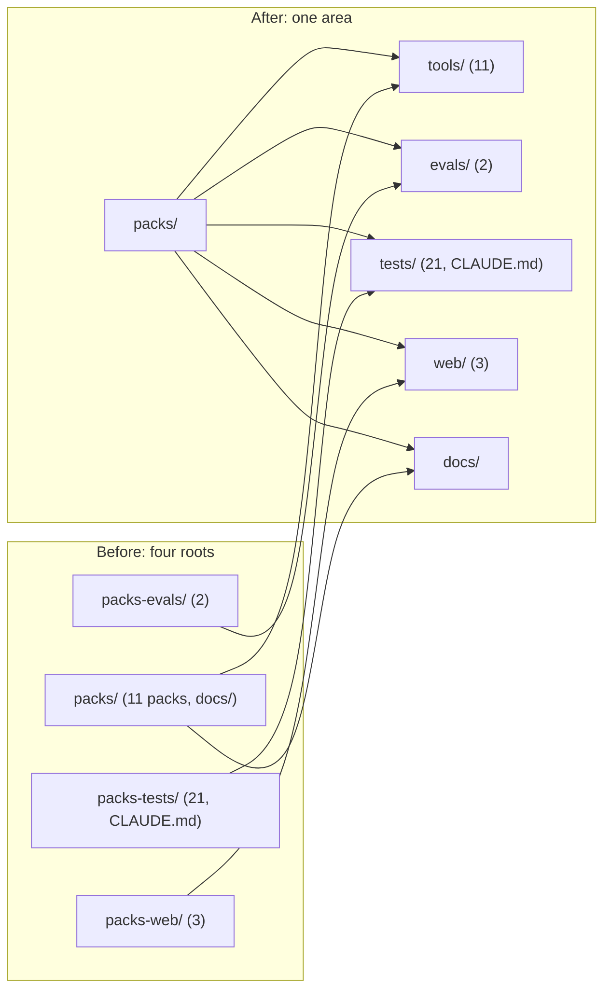
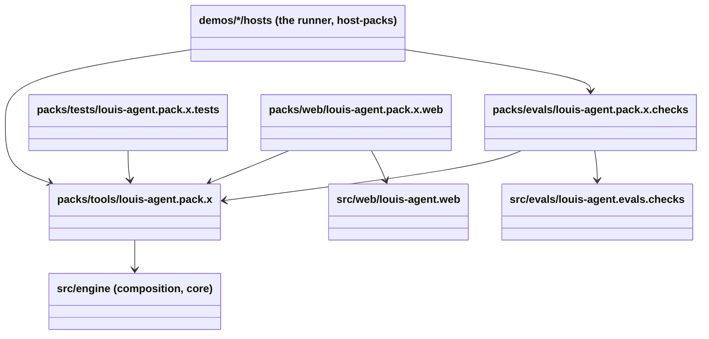

# CL32 The packs as one area

> **Plan.** How the four root folders of the packs (`packs/`, `packs-evals/`, `packs-tests/`, `packs-web/`) become
> one area, `packs/`, shaped like `src/` and a demo: `tools/`, `evals/`, `tests/`, `web/`, `docs/`. A pure move;
> nothing a pack does changes. Drafted 2026-11-07, on `refactor/CL32-packs-as-an-area`; deleted when done.

## Context

**What Louis asked (2026-11-07):** looking at the solution tree, "can't we just move this under packs in its own
folder like packs/evals?" Of the three options he picked **A: `packs/` as the area, with the same inner names as
`src/` and a demo**, over putting only the three siblings under `packs/` beside the pack projects (a folder of two
kinds) and over leaving it; and the order: CL32 before CL31, since CL31 would touch the same paths twice.

**What exists.** ADR 0086 kept a pack's tests, evals and web views apart from its tools, so someone can take a
pack's tools without them; the first cut put each kind at the root. `src/` and each demo already do it the other
way: one root, the same inner names (`engine/`, `hosts/`, `web/`, `evals/`, `tests/`, `docs/`). The move touches:
the `.sln` (44 lines: the project paths and the folder nesting), every `ProjectReference` into or out of the four
roots (the packs' own, their tests', evals' and web views', the demos' hosts and tests, the code-review app), the
Sass include paths of the code-review app, the path lists in `SolutionLayoutTests`, `FileSizeTests`,
`ArchitectureTests`, `PackWebBoundaryTests`, `RepeatedNameTests` and `PageReaderCopyTests`, `packs-tests/CLAUDE.md`,
and about sixty docs. No Dockerfile or workflow names the roots. The packs reference the engine by a relative path
(`..\..\src\…`), which gains one level.

**Not in this plan:** anything inside a pack; the packs as NuGet packages (the direction, ADR 0074); CL31.

## Design

### The shape, in plain words

- **One area, the same inner names everywhere.** `packs/tools/` holds the eleven packs (what ships: a pack is a
  folder someone can take), `packs/evals/` what proves a pack, `packs/tests/` a pack's own tests, `packs/web/` a
  pack's own screens, `packs/docs/` their docs (already there). The rules of ADR 0073 and 0086 stay as they are:
  a pack references no eval, no web and no test; a pack's web references the framework's web and its pack; only the
  runner references the evals. They hold on the new prefixes.
- **A pure move.** `git mv` of whole folders; a project reference changes only in its path; the test lists and the
  docs say the new names. Nothing is renamed but the folders, so history follows every file.
- **The solution tree is the disk.** The `.sln`'s `packs` folder gains `tools`, `evals`, `tests` and `web` folders
  (the three root folders move under it and take the new names), and `SolutionLayoutTests` lists the four.

### Folder map (before and after)

### The references, one way (unchanged, on the new paths)

A sequence adds nothing here: no call changes, only where a file sits.

### Path map

| Was | Becomes | Who points at it |
|---|---|---|
| `packs/louis-agent.pack.{x}/` | `packs/tools/louis-agent.pack.{x}/` | its tests, evals and web; `host-packs`, `coding-catalog`, the demos' tests; the engine's rules |
| `packs-evals/louis-agent.pack.{x}.checks/` | `packs/evals/louis-agent.pack.{x}.checks/` | the runners, their tests, `ArchitectureTests` |
| `packs-tests/louis-agent.pack.{x}.tests/`, `packs-tests/CLAUDE.md` | `packs/tests/…`, `packs/tests/CLAUDE.md` | the `.sln`, `SolutionLayoutTests`, `FileSizeTests` |
| `packs-web/louis-agent.pack.{x}.web/` | `packs/web/louis-agent.pack.{x}.web/` | the code-review app (project and Sass include paths), `PackWebBoundaryTests` |
| `..\..\src\…` from a pack, a test, an eval or a web view | `..\..\..\src\…` | the moved projects themselves (one level deeper) |
| `..\..\packs\louis-agent.pack.{x}` from a test, an eval or a web view | `..\..\tools\louis-agent.pack.{x}` | the moved projects |
| `..\..\packs-web\…`, `..\..\packs-evals\…` from a test | `..\..\web\…`, `..\..\evals\…` | the moved tests |

## Steps

1. **The move.** `git mv` of the four roots into `packs/tools/`, `packs/evals/`, `packs/tests/`, `packs/web/`;
   every `ProjectReference` path and the `.sln` (paths, the three folders renamed and nested under `packs`, a
   `tools` folder for the eleven); the code-review app's Sass include paths; the old roots' build output removed.
   Proved by `dotnet build louis-agent-solution.sln`.
2. **The rules.** `SolutionLayoutTests` (four cases), `FileSizeTests` (`packs` covers the area now: the web views
   come under the size rule, which they weren't), `ArchitectureTests` (the scopes under `packs/tools` and
   `packs/evals`), `PackWebBoundaryTests` (the prefixes), `RepeatedNameTests` and `PageReaderCopyTests` (the
   paths). `core.tests` green.
3. **The docs.** `src/docs/CLAUDE.md`'s tree and table, `packs/tests/CLAUDE.md`, the guides (`build-a-pack`,
   `write-tests`, `spawn-a-site`, `add-an-eval`), the design docs (`tests.md`, the packs', `host-packs`,
   `code-review`), the architecture views, `platform.md`, ADR 0090 *The packs are one area* (and a line on ADRs
   0074 and 0086 pointing at it for the layout), CHANGELOG, TODO; this plan deleted. Full unit suite.

## Verification

`dotnet build louis-agent-solution.sln`, `core.tests`, then the full unit suite; `git log --follow` on a moved file
shows its history. By hand: the solution tree in Rider shows `packs` with five folders and nothing of the packs at
the root.

## Concepts, and where they sit in GOAL.md

- **The folders say what ships** (ADR 0074; skill 18, shipping): one area per thing someone could take, the same
  inner names so a reader finds tests, evals and docs in the same place in every area.

---
[Docs index](../README.md) · Related: [ADR 0086](../adr/0086-a-packs-screens-are-described.md) · [Plans](README.md)
