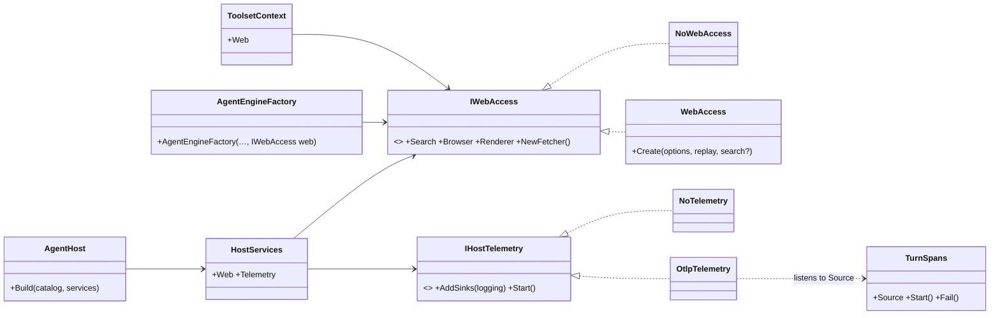
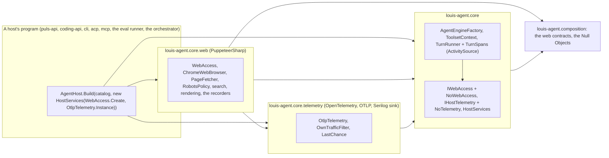
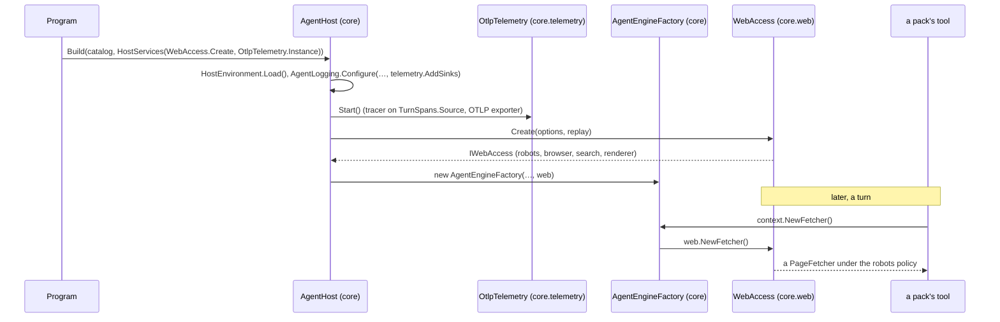

# CL33 Web access and telemetry as libraries on core

> **Plan.** How core's `Web/` (the browser, the fetcher, the robots policy, search, rendering, the replay recorder)
> and `Telemetry/` (the OpenTelemetry tracer and exporter, the crash handler) become two libraries on top of core,
> `louis-agent.core.web` and `louis-agent.core.telemetry`, with core keeping one seam for each, so core ships
> neither PuppeteerSharp nor OpenTelemetry and a host opts into both. Drafted 2026-11-07 on
> `refactor/CL33-core-web-and-telemetry`; deleted when done.

## Context

**What Louis asked (2026-11-07):** pointing at `Telemetry` and `Web` in `louis-agent.core`: "those two should
also move"; the names "louis-agent.core.web louis-agent.core.telemetry"; of three cuts, **A: both on top of core,
core keeps the seams**; "go with the CL33 plan unattended". The three engine projects below core keep their plain
names: they are shared by more than core (Louis: "those are like at a lower level than .core, it can be shared by
many").

**What exists.** `Web/` is 46 files of *implementations* of contracts that already live in `louis-agent.composition`
(`IWebBrowser`, `IPageFetcher`, `IPageRenderer`, `IWebSearchProvider`, the records): `ChromeWebBrowser` on
PuppeteerSharp, `PageFetcher`, `RobotsPolicy`, the search providers and their setups, the page renderers, the replay
recorder (`RecordedFetchHandler`, `RecordedSearchProvider`, `RecordedWebBrowser`, `ReplayClock`). Two files in core
build them: `AgentEngineFactory` (one robots policy, one browser, one search provider per process) and
`ToolsetContext` (a fetcher per call, the renderer lazily); `ToolsetContext : IPackContext` is what a pack gets.
`Telemetry/` is six files: `AgentTelemetry` (the `ActivitySource` and `Start()`, the tracer provider and OTLP
exporter), `TurnSpans` (a span per turn, used by `TurnRunner`), `SpanTag`, `OwnTrafficFilter`, `LastChance` (the
unhandled-exception handler `ChromeWebBrowser` tells what to expect), `TelemetryLogMessage`; `Logging/AgentLogging`
adds Serilog's OpenTelemetry sink when `OTEL_EXPORTER_OTLP_ENDPOINT` is set. `AgentHost.Build` starts telemetry after
the `.env` files load. Outside core: the API reads `WebSearchProviderKind` and `PageRendererKind` for an eval's
settings; the eval runner and the orchestrator call `AgentTelemetry.Start()`; the shared test library builds a
`ToolsetContext` with `WebSearchProviderFactory`; two pack test projects and nine folders of `core.tests` use
`Core.Web`. ADR 0076 already names this split as the one left.

**Not in this plan:** a new provider or renderer; the eval runner's own settings; CL31.

## Design

### The shape, in plain words

- **Two libraries on core, the same direction as `web.accounts` on `web`.** `louis-agent.core.web` holds `Web/*`
  and references core, composition and `core.telemetry` (for `LastChance`); `louis-agent.core.telemetry` holds the
  tracer, the exporter, the log sink, `OwnTrafficFilter`, `LastChance` and their messages, and references core.
  PuppeteerSharp, OpenTelemetry, its OTLP exporter and Serilog's OpenTelemetry sink leave core's project file.
- **Core keeps two seams and two Null Objects.** `IWebAccess` is what the engine needs from the web (the search
  provider, the browser if any, the renderer, a new fetcher); `NoWebAccess` answers with the Null Objects beside
  `UnavailablePageRenderer` in composition (an `UnavailableSearchProvider` and an `UnavailablePageFetcher`, each
  saying web access isn't set up), so an engine with no web library still runs and its web tools say why.
  `IHostTelemetry` is what the host does at start-up (add the log sink, start the tracer); `NoTelemetry` does
  nothing. `TurnSpans` and `SpanTag` stay in core on a plain `ActivitySource` (`System.Diagnostics`, no package);
  the tracer in `core.telemetry` listens to that source by name. Separated Interface (Fowler) with Null Objects,
  as ADR 0089.
- **A host composes.** `HostServices(Web, Telemetry)` is one record a host hands `AgentHost.Build` (and
  `BuildToolHost`): `Web` builds the `IWebAccess` from the options and the replay store, `Telemetry` is the
  `IHostTelemetry`; both default to the Null Objects. `core.web` gives `WebAccess.Create`, `core.telemetry` gives
  `OtlpTelemetry.Instance`; the demos' programs and the hosts that build an agent pass them, the way they pass the
  catalogue of identities and packs. `AgentEngineFactory` takes an `IWebAccess` and builds nothing of the web
  itself; `ToolsetContext` carries it and `IPackContext`'s members read through it.
- **The replay clock is replay, not web.** `ReplayClock` moves to core's `Sessions/Replay/`, beside the store it
  reads; the recorders that wrap the web stay with the web.
- **The rules follow.** A new `ArchitectureTests` case: core references neither PuppeteerSharp nor OpenTelemetry;
  `SolutionLayoutTests` lists the four projects; `HostMessageEnumTests` reads the two libraries' `Messages/`.

### Interface design



The signatures:

```csharp
// src/engine/louis-agent.core/Web/ (the seam stays in core)
public interface IWebAccess
{
    IWebSearchProvider Search { get; }
    IWebBrowser? Browser { get; }
    IPageRenderer Renderer { get; }
    IPageFetcher NewFetcher();
}
public sealed class NoWebAccess : IWebAccess { public static readonly NoWebAccess Instance; … }   // Null Object
// src/engine/louis-agent.composition/Web/ (beside UnavailablePageRenderer)
public sealed class UnavailableSearchProvider(string reason) : IWebSearchProvider { … }
public sealed class UnavailablePageFetcher(string reason) : IPageFetcher { … }
// src/engine/louis-agent.core/Telemetry/
public interface IHostTelemetry { void AddSinks(LoggerConfiguration logging); IDisposable Start(); }
public sealed class NoTelemetry : IHostTelemetry { … }
public static class TurnSpans { public static readonly ActivitySource Source = new("louis-agent"); … }   // moved from AgentTelemetry
// src/engine/louis-agent.core/Hosting/
public sealed record HostServices(Func<AgentOptions, ReplayStore?, IWebAccess>? Web = null, IHostTelemetry? Telemetry = null);
public static AgentHostContext Build(AgentCatalog catalog, HostServices? services = null, ILlmClientFactory? clientFactory = null);
public AgentEngineFactory(IChatClient chatClient, AgentOptions agent, …, IWebAccess? web = null, …);
public sealed record ToolsetContext(AgentOptions Options, IWebAccess Web, ExchangeRates? Rates = null, IUsageSink? UsageSink = null, ReplayStore? Replay = null) : IPackContext;
// src/engine/louis-agent.core.web/
public static class WebAccess { public static IWebAccess Create(AgentOptions options, ReplayStore? replay = null, IWebSearchProvider? search = null); }
// src/engine/louis-agent.core.telemetry/
public sealed class OtlpTelemetry : IHostTelemetry { public static readonly OtlpTelemetry Instance; }
```

### Architecture (after)



### Communication: a host starts, a tool fetches a page



### Namespace map

| Type | Folder | Namespace | Step |
|---|---|---|---|
| `louis-agent.core.web.csproj`, `louis-agent.core.telemetry.csproj` | `src/engine/…` | `LouisAgent.Core.Web`, `LouisAgent.Core.Telemetry` (the moved files keep their namespaces) | 1 new |
| `louis-agent.core.web.tests`, `louis-agent.core.telemetry.tests` | `src/tests/engine/…` | `LouisAgent.Core.Web.Tests`, `LouisAgent.Core.Telemetry.Tests` | 1 new |
| `IHostTelemetry`, `NoTelemetry`; `TurnSpans.Source` | `src/engine/louis-agent.core/Telemetry/` | `LouisAgent.Core.Telemetry` | 2 new, changed |
| `HostServices` | `src/engine/louis-agent.core/Hosting/` | `LouisAgent.Core.Hosting` | 2 new |
| `AgentTelemetry` → `OtlpTelemetry`, `OwnTrafficFilter`, `LastChance`, `Messages/TelemetryLogMessage` | `src/engine/louis-agent.core.telemetry/` | `LouisAgent.Core.Telemetry` (`.Messages`) | 3 moved |
| `UnavailableSearchProvider`, `UnavailablePageFetcher` | `src/engine/louis-agent.composition/Web/Search/`, `Web/Fetching/` | `LouisAgent.Composition.Web.*` | 4 new |
| `IWebAccess`, `NoWebAccess` | `src/engine/louis-agent.core/Web/` | `LouisAgent.Core.Web` | 4 new |
| `ReplayClock` | `src/engine/louis-agent.core/Sessions/Replay/` | `LouisAgent.Core.Sessions.Replay` | 4 moved |
| `Web/*` (45 files) and `WebAccess` | `src/engine/louis-agent.core.web/{Browsing,Fetching,Messages,Rendering,Replay,Robots,Search}/` | `LouisAgent.Core.Web.*` | 5 moved, new |
| `core.tests/Web/*`, `core.tests/Telemetry/*` | the two test projects | `LouisAgent.Core.{Web,Telemetry}.Tests.*` | 3, 5 moved |

### Folder trees (after)

```
src/engine/
├── louis-agent.core/
│   ├── Telemetry/        # TurnSpans (ActivitySource), SpanTag, IHostTelemetry, NoTelemetry
│   ├── Web/              # IWebAccess, NoWebAccess
│   ├── Hosting/          # AgentHost (Build takes HostServices), HostServices, AgentEngineFactory (takes IWebAccess)
│   └── Sessions/Replay/  # ReplayClock beside the store
├── louis-agent.core.telemetry/   # OtlpTelemetry, OwnTrafficFilter, LastChance, Messages/
└── louis-agent.core.web/         # WebAccess; Browsing/, Fetching/, Messages/, Rendering/, Replay/, Robots/, Search/
src/tests/engine/
├── louis-agent.core.web.tests/        # core.tests' Web/ folders
└── louis-agent.core.telemetry.tests/  # core.tests' Telemetry/
```

## Steps

One commit each; test first where behaviour changes (steps 2, 4, 6); a move is `git mv`, namespaces kept.

1. **The projects.** The two libraries (Razor-less class libraries; `core.web` references core, composition,
   `core.telemetry` and PuppeteerSharp; `core.telemetry` references core, OpenTelemetry, its OTLP exporter and
   Serilog's sink) and their test projects; the `.sln` entries by hand; `SolutionLayoutTests`; the design doc stubs.
2. **The telemetry seam.** `IHostTelemetry`, `NoTelemetry`, `TurnSpans.Source`; `AgentLogging.Configure` takes the
   sink hook; `HostServices`; `AgentHost.Build`/`BuildToolHost` take it and call `Telemetry.Start()` where
   `AgentTelemetry.Start()` was. Test first: a host built with `NoTelemetry` starts no tracer; a fake sees `AddSinks`
   then `Start`.
3. **Telemetry moves.** `AgentTelemetry` becomes `OtlpTelemetry : IHostTelemetry` in `core.telemetry` with
   `OwnTrafficFilter`, `LastChance` and the messages; `core.tests/Telemetry` moves; the API, the eval runner and the
   orchestrator pass `OtlpTelemetry.Instance`; the three packages leave core.
4. **The web seam.** `IWebAccess`, `NoWebAccess`, the two Null Objects in composition, `ReplayClock` into
   `Sessions/Replay/`; `ToolsetContext(Options, Web, …)` and `AgentEngineFactory(…, web)`; the factory stops
   building the web; `HostServices.Web`. Test first: an engine on `NoWebAccess` lists the web tools and each
   answers "web access isn't set up"; `AgentEngineFactoryTests` on a fake `IWebAccess`.
5. **Web moves.** `Web/*` to `core.web` with `WebAccess.Create` (the robots policy, the fetcher, the browser, the
   search provider wrapped by the recorder, the renderer, from the options and the store as the factory did);
   `core.tests/Web` and the web halves of `Agent/Toolsets`, `Hosting` and `Sessions/Replay/Store` tests move or
   switch to `WebAccess`; the two pack test projects and the shared test library reference `core.web`; the API's
   `ApiStartup` and `EvalSettings` reference it for the kinds; PuppeteerSharp leaves core.
6. **The hosts compose.** `puls-api`, `coding-api`, `CliHost`, `AcpHost`, `McpHost`, the eval runner and the
   orchestrator pass `HostServices(WebAccess.Create, OtlpTelemetry.Instance)`; the API's test host too. Test first:
   `AgentHost.Build` with no services runs on the Null Objects (core alone), proved in `core.tests`.
7. **The rules.** `ArchitectureTests`: core's project file names neither PuppeteerSharp nor OpenTelemetry;
   `HostMessageEnumTests` reads the two libraries; `FolderSizeTests`/`FileSizeTests` over the new projects; the
   full unit suite.
8. **Docs.** The two design docs, `louis-agent.core.md` and core's `CLAUDE.md` project layout, `src/docs/CLAUDE.md`'s
   tree, ADR 0091 *Web access and telemetry are libraries on core* (ADR 0076 gets its dated line), the work log's
   row and the TODO's row (CL33 out), this plan deleted.

## Verification

Per step: the project's tests and `core.tests`; the whole solution builds after steps 3 and 5. By hand, free, after
step 6: `dotnet run` the Puls API and ask the chat for a page (the browser and robots policy through `core.web`),
with `OTEL_EXPORTER_OTLP_ENDPOINT` unset (no tracer) and set to a dead address (the exporter fails quietly, as
today). No paid run: the chat check uses a page fetch, not a model, where the test host allows; otherwise skipped
and said so.

## Concepts, and where they sit in GOAL.md

- **Separated Interface and Null Object** (skill 20): the engine names what it needs, the libraries supply it, and
  the absence is an object, not a null.
- **What a package ships** (ADR 0074; skill 18): core without a browser binary or a tracer is what a team that
  builds its own host takes first.

---
[Docs index](../README.md) · Related: [ADR 0076](../adr/0076-core-ships-no-agent.md) · [ADR 0089](../adr/0089-the-account-client-is-a-library-a-site-opts-into.md) · [Plans](README.md)
