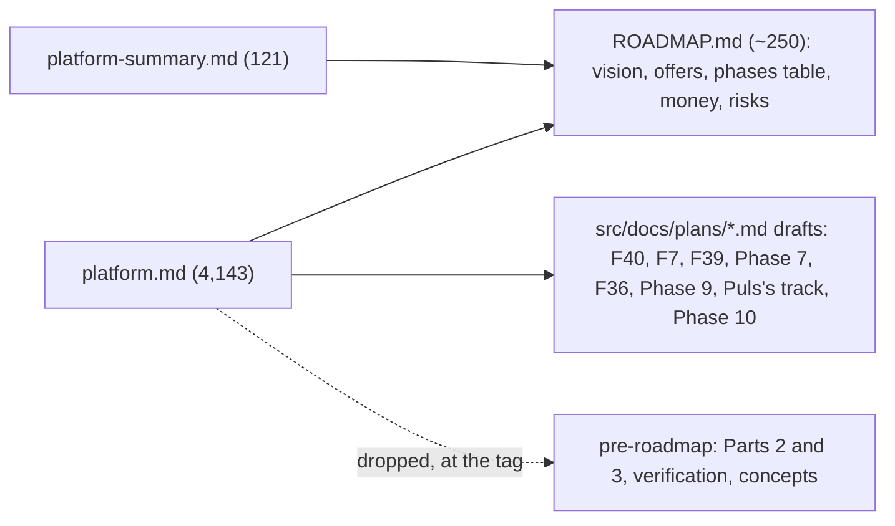

# CL56 One roadmap

> **Plan.** How `src/docs/plans/platform.md` (4,143 lines) and `platform-summary.md` (121 lines) become one
> `ROADMAP.md` at the root, in the work log's and the TODO's terse style; the feature plans the long file carried
> move out whole as drafts, the rest is at the tag `pre-roadmap`. Drafted 2026-11-07 on `docs/CL56-roadmap`;
> deleted when done.

## Context

Louis, 2026-11-07, on the two files in the solution tree: "we also need to standardise this, come up with a plan to
do this and merge these two into a ROADMAP.MD"; then "go, do it now then continue with CL33". The two hold the vision,
what we sell, the architecture (now in `src/docs/architecture/` and the ADRs), the engine changes (now the TODO and
the work log), the phases with five whole feature plans inside them, the business plan, and the investor one-pager.

## Design

One `ROADMAP.md` at the root beside `TODO.md`: in one minute, what we sell, what exists, the phases as one table (phase,
what, the selling point, status, the ids, done when) with a short paragraph each, Puls's track and Later as rows, the
money, the numbers we watch, the risks, what we are looking for, how we work. The feature plans of Phases 4 to 10 and
Puls's track move out whole as plan drafts (`F40-sales-playground.md`, `F07-budgets.md`, `F39-orchestration.md`,
`phase-7-checked-and-guarded.md`, `F36-mcp-packs.md`, `phase-9-what-a-sale-needs.md`, `puls-track.md`,
`phase-10-engine-package.md`), each with one header line saying so, the body byte-identical (ADR 0054). Parts 2 and
3, the verification and the concepts are dropped: the architecture docs, the ADRs, the TODO, the work log and
GOAL.md hold them now. `RoadmapTests` holds that every id the roadmap names is in the TODO or the work log.

## Steps

1. The tag; `ROADMAP.md`; the drafts moved out; the two files deleted; every link re-pointed; the plans README's
   rows; `RoadmapTests`.
2. The work log's row; this plan deleted.

---
[Docs index](../README.md) · Related: [Plans](README.md)
