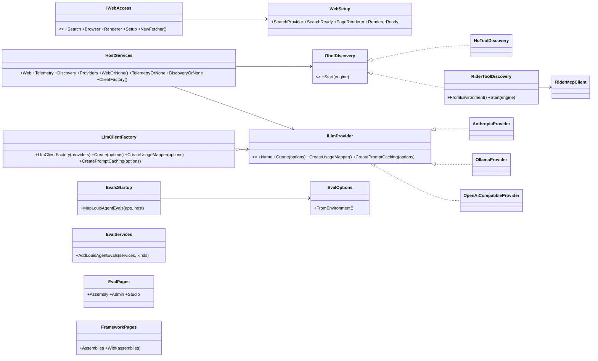
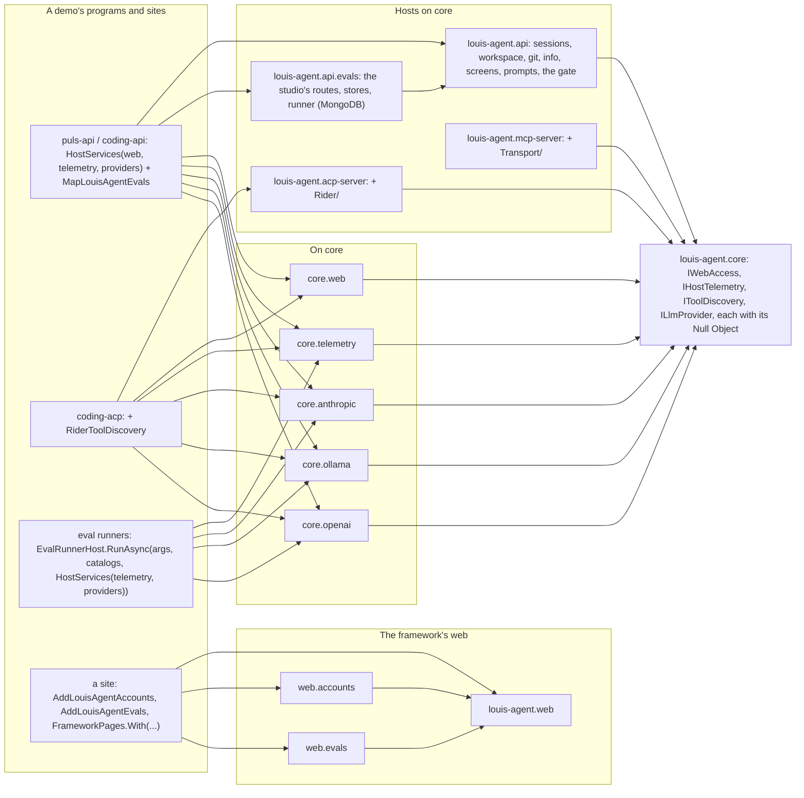

# CL57 What a project holds: six moves under ADR 0092

> **Plan.** How the six places that make a user take what it doesn't use are put right, in one branch and one pull
> request, under [ADR 0092](../adr/0092-a-project-holds-what-is-reused-together.md): the API lets go of `core.web`,
> the eval runner's programs hand in their telemetry, Rider's discovery leaves core for the ACP server, the three
> model SDKs become libraries on core, and the eval studio becomes `louis-agent.api.evals` and `louis-agent.web.evals`,
> which a site opts into. Drafted 2026-11-07 after CL33 merged, on `refactor/CL57-what-a-project-holds`; built
> unattended; deleted when the work is done.

## Context

**What Louis asked (2026-11-07):** after picking A for `choices` and `session-stream` (keep them below core), "do an
investigation on what does not follow that pattern fully and suggest movements"; of the six findings and the
five-children shape put to him: "we will fix all of it in one big CL now", "this must be an adr", "one pr", "you
will do this unattended". CL51 in the TODO ("Rider out of core") is one of the six and closes with this.

**What exists** (the map of 2026-11-07, every project's references):

| Place | What it makes a user take |
|---|---|
| `louis-agent.api/Evals` (7,000 of 13,700 lines), `Endpoints/Admin/*` but the screens and the prompts, `Admin/Replies`, `Config/AdminOptions` | MongoDB, the checks, the protocol, in every site's API |
| `louis-agent.web/Admin` (3,900 lines), `Components/Admin/Evals` (5,500), `Pages/Admin/{Building,Reviewing,Running}`, `Styles/web/admin/_eval-pages.scss`, 60 `@using` lines | the whole studio in every site's download; the starter has no admin link to it |
| `louis-agent.core/Llm/LlmClientFactory` (three SDKs: Anthropic, OpenAI, OllamaSharp), `Llm/Providers/AnthropicProvider` | three SDKs for one provider used |
| `louis-agent.core/Hosting/Rider`, `Protocols/Mcp` (316 lines), `AgentOptions.RiderMcp*`, seven `HostingLogMessage` members; `AgentHost.Build` starts the discovery in every host | Rider in core; the CLI and the API try to reach Rider at start-up |
| `louis-agent.api` → `core.web` | two lines in `ApiStartup` (which search provider and renderer the eval runner will have) tie the API to the browser binary |
| `louis-agent.evals.runner` → `core.telemetry`, `EvalRunnerHost` starts it | a library decides the telemetry; CL33 took that out of core |

**Found on the way:** the account pages (`@page "/login"` and five more) are in no site's router: `FrameworkPages.Assemblies`
lists the framework's web only, and no site lists `louis-agent.web.accounts`, so `/login` answers "not found" on
every site (Louis's leftover "pages not yet seen in a browser"). The same would hit `web.evals`, so the fix is part
of the shape: a site's router lists the libraries it opted into.

**Not in this plan:** splitting `api.contracts` into the studio's records and the rest (the ADR says when);
`accounts` on `composition` (the ADR says why it stays); `LlmOptions` keeping the provider names and their
defaults (`claude*` is Anthropic; a setting's value, not an SDK); CL31 (scripts as modules), next after this.

## Design

### The shape, in plain words

- **One seam per thing core needs, one Null Object, one slot in `HostServices`.** CL33's shape, twice more:
  `IToolDiscovery` (Rider's discovery made a thing a host hands in; `NoToolDiscovery` starts nothing) and
  `ILlmProvider` (a model SDK as a Strategy: its name, its client, its usage mapper, its prompt caching;
  `LlmClientFactory` becomes the registry of the providers a host gave, and with none says so). `HostServices`
  grows `Discovery` and `Providers`; a program composes
  `new HostServices(WebAccess.Create, OtlpTelemetry.Instance, Providers: [AnthropicProvider.Instance, …])`.
- **The web seam says what it is.** `IWebAccess.Setup` is a record (`WebSetup`: the search provider's and the
  renderer's wire names, and whether each is ready); the API reads it from the engine's context and the eval
  runner's settings carry it as before. `core.web` leaves the API's references.
- **The eval studio is two libraries a site opts into.** `louis-agent.api.evals` on the API: the stores, the
  runner process, the recorders, the studio, the admin routes for runs, drafts, reviews, calibrations, notes,
  imports and the studio, `EvalOptions` (the Mongo address, the runner, the benchmark address), and
  `EvalsStartup.MapLouisAgentEvals(app, host)`; a program that wants the studio calls it after `MapLouisAgentApi`.
  The API keeps the sessions, the workspace, git, info, the packs' screens, the prompts, the admin gate and key.
  `louis-agent.web.evals` on the framework's web: the pages, components, readers and words of the studio, its
  styles under `Styles/evals/`, `AddLouisAgentEvals()` for the services, and its assembly for the router. A site
  opts in with one reference, one service line, one router entry and one `@forward`.
- **A site's router lists what it opted into.** `FrameworkPages.With(params Assembly[])` adds a library's pages to
  the framework's; each library names its own (`AccountPages.Assembly`, `EvalPages.Assembly`). A rules test reads
  every site's `App.razor` and `Program.cs`: a library a site adds services for is in its router too.
- **The runner's programs hand in the telemetry.** `EvalRunnerHost.RunAsync(args, catalogs, services)`; the
  providers reach the judge through the same handle, so the evals library builds no SDK client itself.
- **Rider's host owns Rider.** `RiderToolDiscovery : IToolDiscovery` and `RiderMcpClient` move to
  `louis-agent.acp-server/Rider/`, with `RiderOptions.FromEnvironment()` (`RIDER_MCP_*`) and their log messages in
  the ACP server's own enum; the coding-acp program hands it in. `McpTransport` and its setting move to
  `louis-agent.mcp-server`, the only reader of `MCP_TRANSPORT`. Core's `Protocols/` folder goes; the engine keeps
  `RegisterDiscoveredTool`, the one thing discovery needs from it.

### Interface design



The signatures (read from the code where the type exists today):

```csharp
// src/engine/louis-agent.core (changed)
public sealed record HostServices(Func<AgentOptions, ReplayStore?, IWebAccess>? Web = null, IHostTelemetry? Telemetry = null,
    IToolDiscovery? Discovery = null, IReadOnlyList<ILlmProvider>? Providers = null)
{ public IToolDiscovery DiscoveryOrNone => Discovery ?? NoToolDiscovery.Instance;
  public ILlmClientFactory ClientFactory() => new LlmClientFactory(Providers ?? []); }
public sealed record WebSetup(string? SearchProvider, bool SearchReady, string? PageRenderer, bool RendererReady) { public static readonly WebSetup None = new(null, false, null, false); }
public interface IWebAccess { …; WebSetup Setup { get; } }
public interface IToolDiscovery { void Start(AgentEngine engine); }                 // Strategy + Null Object
public interface ILlmProvider { string Name { get; } IChatClient Create(LlmOptions options);
    IUsageMapper CreateUsageMapper() => new StandardUsageMapper();
    IPromptCachingStrategy CreatePromptCaching(LlmOptions options) => NoPromptCaching.Instance; }
public sealed class LlmClientFactory(IEnumerable<ILlmProvider> providers) : ILlmClientFactory { … }   // Registry of strategies
public static class LlmLimits { public const int MaxOutputTokens = 16_000; }        // was LlmClientFactory's, the providers need it too
// src/engine/louis-agent.core.anthropic (new): AnthropicProvider.Instance, AnthropicUsageMapper, AnthropicPromptCaching (moved)
// src/engine/louis-agent.core.ollama (new): OllamaProvider.Instance (the ten-minute HttpClient)
// src/engine/louis-agent.core.openai (new): OpenAiCompatibleProvider.Instance
// src/hosts/louis-agent.acp-server/Rider (new): RiderOptions, RiderToolDiscovery, RiderMcpClient, DiscoveredTool, RiderLogMessage
// src/hosts/louis-agent.mcp-server/Transport (new): McpTransport, McpTransportSetting (moved)
// src/evals/louis-agent.evals.runner (changed)
public static Task<int> RunAsync(string[] args, RunnerCatalogs catalogs, HostServices? services = null);
// src/hosts/louis-agent.api.evals (new)
public static WebApplication MapLouisAgentEvals(this WebApplication app, AgentHostContext host);   // after MapLouisAgentApi
public sealed record EvalOptions(string BenchmarkApiUrl, string? EvalsMongoUrl, string EvalsDatabase, string EvalRunner);
// src/web/louis-agent.web (changed), src/web/louis-agent.web.evals (new), src/web/louis-agent.web.accounts (changed)
public static Assembly[] With(params Assembly[] libraries);                          // FrameworkPages
public static IServiceCollection AddLouisAgentEvals(this IServiceCollection services, SiteKinds? kinds = null);
public static readonly Assembly Assembly = typeof(Evals).Assembly;                   // EvalPages, AccountPages
```

### Architecture (after)



### Communication: a host starts, a judge grades

```mermaid
sequenceDiagram
    participant P as Program
    participant H as AgentHost (core)
    participant F as LlmClientFactory (core)
    participant A as AnthropicProvider (core.anthropic)
    participant D as IToolDiscovery
    P->>H: Build(catalog, HostServices(Web, Telemetry, Discovery, Providers))
    H->>F: services.ClientFactory() → new LlmClientFactory(providers)
    H->>F: Create(llm)
    F->>A: Create(llm) (by LLM_PROVIDER's name)
    A-->>F: the SDK's IChatClient, wrapped for prompt caching
    H->>D: services.DiscoveryOrNone.Start(engine)
    Note over D: Rider's: reads Rider's MCP tools in the background, engine.RegisterDiscoveredTool; none: nothing
    Note over P,A: the eval runner the same way: EvalRunnerHost.RunAsync(args, catalogs, services) hands the factory to the judge
```

### Namespace map

| Type | Folder | Namespace | Step |
|---|---|---|---|
| `WebSetup` | `src/engine/louis-agent.core/Web/` | `LouisAgent.Core.Web` | 2 new; `IWebAccess`, `NoWebAccess`, `WebParts` changed; `WebAccess` (core.web) changed |
| `EvalSettings` | `src/hosts/louis-agent.api/Evals/Runs/Start/` → `louis-agent.api.evals/Runs/Start/` | `LouisAgent.Api.Evals.Runs.Start` | 2 changed (takes `WebSetup`), 6 moved |
| `EvalRunnerHost.RunAsync(args, catalogs, services)` | `src/evals/louis-agent.evals.runner/` | `LouisAgent.Evals.Runner` | 2 changed |
| `IToolDiscovery`, `NoToolDiscovery` | `src/engine/louis-agent.core/Hosting/Discovery/` | `LouisAgent.Core.Hosting.Discovery` | 3 new |
| `RiderOptions`, `RiderToolDiscovery`, `RiderMcpClient`, `DiscoveredTool`, `RiderLogMessage` | `src/hosts/louis-agent.acp-server/Rider/` (+ `Messages/`) | `LouisAgent.Acp.Rider` | 3 moved from core's `Hosting/Rider`, `Protocols/Mcp` |
| `McpTransport`, `McpTransportSetting` | `src/hosts/louis-agent.mcp-server/Transport/` | `LouisAgent.Mcp.Transport` | 3 moved |
| `ILlmProvider`, `LlmLimits` | `src/engine/louis-agent.core/Llm/Providers/` | `LouisAgent.Core.Llm.Providers` | 4 new |
| `LlmClientFactory` | `src/engine/louis-agent.core/Llm/` | `LouisAgent.Core.Llm` | 4 changed (a registry) |
| `AnthropicProvider`, `AnthropicUsageMapper`, `AnthropicPromptCaching` | `src/engine/louis-agent.core.anthropic/` | `LouisAgent.Core.Anthropic` | 5 new / moved |
| `OllamaProvider` | `src/engine/louis-agent.core.ollama/` | `LouisAgent.Core.Ollama` | 5 new |
| `OpenAiCompatibleProvider` | `src/engine/louis-agent.core.openai/` | `LouisAgent.Core.OpenAi` | 5 new |
| `HostServices` (+ `Discovery`, `Providers`, `ClientFactory()`) | `src/engine/louis-agent.core/Hosting/` | `LouisAgent.Core.Hosting` | 3, 4 changed |
| `EvalsStartup`, `EvalOptions`, `Evals/*`, `Endpoints/{Runs,Drafts,Evals,Imports,Reviews,Studio}`, `Replies/*` | `src/hosts/louis-agent.api.evals/` | `LouisAgent.Api.Evals.*` (the folder path) | 6 moved |
| `louis-agent.api.evals.tests`, `ApiTestHost` (api.testing, changed) | `demos/puls/tests/` (they read Puls's evals, as the API's tests do) | `LouisAgent.Api.Evals.Tests` | 7 |
| `EvalServices`, `EvalPages` (+ `Assembly`), `Admin/*`, `Components/Evals/*`, `Pages/{Building,Reviewing,Running}`, `Styles/evals/` | `src/web/louis-agent.web.evals/` | `LouisAgent.Web.Evals.*` | 8 moved |
| `FrameworkPages.With`, `AccountPages.Assembly` | `src/web/louis-agent.web/Pages/`, `louis-agent.web.accounts/Pages/` | unchanged | 8 changed |
| `louis-agent.web.evals.tests` | `src/tests/web/` | `LouisAgent.Web.Evals.Tests` | 9 |

### Folder trees (after)

```
src/engine/
├── louis-agent.core/            # + Hosting/Discovery/, Llm/Providers/ILlmProvider.cs; − Hosting/Rider/, Protocols/, the SDKs
├── louis-agent.core.anthropic/  # AnthropicProvider, AnthropicUsageMapper, AnthropicPromptCaching
├── louis-agent.core.ollama/     # OllamaProvider
├── louis-agent.core.openai/     # OpenAiCompatibleProvider
├── louis-agent.core.web/        # WebAccess.Setup
└── louis-agent.core.telemetry/
src/hosts/
├── louis-agent.api/             # − Evals/, Endpoints/Admin/{Runs,Drafts,Evals,Imports,Reviews,Studio}, Admin/Replies, MongoDB, evals.*; − core.web
├── louis-agent.api.evals/       # EvalsStartup, Config/EvalOptions, Evals/…, Endpoints/…, Replies/
├── louis-agent.acp-server/      # + Rider/
└── louis-agent.mcp-server/      # + Transport/
src/web/
├── louis-agent.web/             # − Admin/, Components/Admin/Evals, Pages/Admin/{Building,Reviewing,Running}, Styles/web/admin/_eval-pages.scss
├── louis-agent.web.accounts/    # + AccountPages.Assembly
└── louis-agent.web.evals/       # EvalServices, EvalPages, Admin/, Components/, Pages/, Styles/evals/, _Imports.razor
src/tests/engine/louis-agent.core.{anthropic,ollama,openai}.tests/   src/tests/web/louis-agent.web.evals.tests/
demos/puls/tests/louis-agent.api.evals.tests/
```

## Steps

1. **The plan and the ADR.** This file, ADR 0092 and its index row, the TODO row (CL57; CL51 folds in).
2. **The web seam says what it is; the runner's programs hand in their services.** `WebSetup` on the seam and its
   three implementations; `EvalSettings` takes it; the API drops `core.web`. `EvalRunnerHost` takes `HostServices`;
   the runner drops `core.telemetry`; the two programs reference it. Core's and `core.web`'s project files tidied.
   Tests: `WebAccessTests` (the setup names what the settings name), `HostServicesTests`, the runner's host test.
3. **Rider out of core.** `IToolDiscovery`/`NoToolDiscovery`, the slot, `AgentHost` starts what it was given;
   `Rider/` in the ACP server with its options and messages; `Transport/` in the MCP server; the coding-acp program
   hands it in. Tests move with the code (`RiderToolDiscoveryTests`, `RiderMcpClientTests`, `McpTransportSettingTests`).
4. **The provider seam.** `ILlmProvider`, `LlmLimits`, `LlmClientFactory` as a registry; `HostServices.Providers`
   and `ClientFactory()`; `AgentHost`, `SessionLlmLoader`, `JudgeClients`, the usage probe take the factory they're
   given. The three providers still live in core this step, as classes. Tests: the factory with none, with one, by
   name; `PromptCachingFactoryTests` through the provider.
5. **The three libraries.** `core.anthropic`, `core.ollama`, `core.openai` and their tests; the SDKs leave core's
   project file (`CorePackagesTests`); every program composes its providers; `JudgeClients.FromEnvironment()`
   takes the runner's.
6. **`louis-agent.api.evals`.** The code moves whole, namespaces by folder; `EvalsStartup.MapLouisAgentEvals`;
   `EvalOptions` out of `AdminOptions` (which keeps the admin key); the API drops MongoDB, the checks and the
   protocol; the two API programs call it.
7. **Its tests.** `louis-agent.api.evals.tests` beside the API's; `ApiTestHost` maps the studio when a test asks;
   the route snapshot tests split (the API's and the studio's).
8. **`louis-agent.web.evals`.** The code, styles and `@using` lines move; `AddLouisAgentEvals()`;
   `FrameworkPages.With`, `AccountPages.Assembly`, `EvalPages.Assembly`; the three sites opt in (reference,
   service line, router, `@forward`); the Sass include paths; the admin layouts link to the studio where they did.
9. **Its tests.** `louis-agent.web.evals.tests`; the rules tests cover the new library (names no site, scripts,
   styles); the router rule (a library a site adds services for is in its router).
10. **Docs, and the full suite.** Design docs for the six new projects, the API's, the web's, core's and the ACP
    server's updated, `eval-pages.md` and its how-to re-pointed, the projects index, the src/engine tree line, the
    work log (CL57, CL51), the TODO; this plan deleted; the full suite once.

## Verification

- Per step: the tests of what the step touches; `core.tests`' rules when a project or folder is added.
- Step 10: the full unit suite; the two failures that predate the branch (`TheExports_MatchTheFilms`,
  `AChildThatReadsItsInput_GetsIt`) are the only ones allowed.
- By hand, for Louis, free: the starter site's `/login` and `/admin` open (the router now lists them); the Puls API
  with `EVALS_MONGO_URL` unset starts with the studio's routes saying no store, as before. A paid run is not needed.

## Concepts, and where they sit in GOAL.md

- **Package design** (skill 20, extensibility): the Common Reuse Principle and the Stable Dependencies Principle
  (Robert Martin); a seam with a Null Object per thing the engine needs (Fowler's *Separated Interface*, the Gang
  of Four's *Strategy*); a registry of strategies for the providers.
- **Composition at the edge** (skill 18, shipping): a program composes what its host gets; a site composes what
  it ships; the library decides nothing about the world (Seemann's *Composition Root*).

## Approved during the build

Picks made unattended, each with its why, for Louis's review:

- (none yet)

---
[Docs index](../README.md) · Related: [Plans](README.md) · [ADR 0092](../adr/0092-a-project-holds-what-is-reused-together.md)
