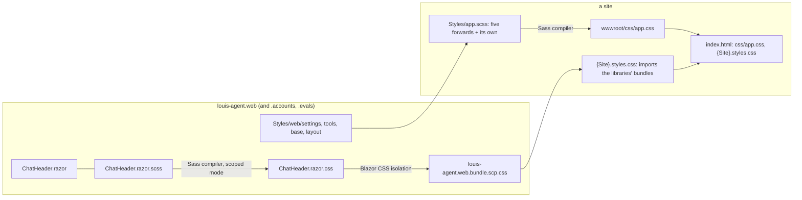

# CL58 A component's styles sit beside it

> **Plan.** How the framework's component rules stop being a list every site has to forward (fifteen to
> twenty-five `@forward` lines in each site's `app.scss`) and become `X.razor.scss` beside each component, compiled
> scoped by the Sass compiler we already use and bundled by Blazor's CSS isolation into one file per site, so a
> site lists one link and forwards only what is global by nature: the colours, the plain elements, the page grid and
> its own. The twin of CL31 for styles. Drafted 2026-11-07 after CL31, for `refactor/CL58-styles-beside-their-components`
> off `main` once CL31 is merged; deleted when the work is done.

## Context

**What Louis asked (2026-11-07):** after CL31, "can we do something similar to the styles? what does blazor do it?";
of three options (keep the partials; isolation for component rules with the global partials kept; isolate everything)
he picked **B**, and "finish this and then we do that right after".

**What exists.** Styles are Sass partials per library (ADR 0085, ADR 0053): the framework's 13 under
`src/web/louis-agent.web/Styles/web/` (about 950 lines: `settings/`, `tools/`, `base/`, `layout/`, `chat/`,
`admin/`), the account library's one under `accounts/` (46 lines), the studio's seven under `evals/` (660 lines).
Each site's `app.scss` forwards them by name in its cascade order (Puls 25 lines, the code-review app 17, the
starter 15) with the three libraries' `Styles` folders on `sasscompiler.json`'s include paths; the build makes
`wwwroot/css/app.css`. The partials are cut by concern, not by component: `chat/_bars.scss` holds the header's and
the composer's rules, `layout/_panels.scss` the sidebar's and the work panel's. Themes work through the global
cascade: Puls and the code-review app set Bootstrap's colour names after `web/settings/colours`. The Sass
compiler's scoped mode (`GenerateScopedCss`) is off in every site.

**What Blazor does.** *CSS isolation*: a `X.razor.css` beside a component is rewritten so every selector carries a
scope attribute (`[b-…]`) the component's elements get, bundled into `{Site}.styles.css`, which a page links once; a
Razor class library's scoped styles are bundled as `_content/{library}/{library}.bundle.scp.css` and imported by the
site's bundle, so a library ships its styles with its components. A rule for an element a child component draws
takes `::deep`. The Sass compiler we use compiles `X.razor.scss` to `X.razor.css` when scoped mode is on.

**Not in this plan:** the themes (a theme stays a file the page loads, ADR 0085); the packs' views' Sass
(`pack-` partials, their own shape); Puls's landing styles (the site's own); the third-party stylesheets.

## Design

### The shape, in plain words

- **A component's rules sit beside it.** `ChatHeader.razor.scss` holds what `chat/_bars.scss` held for the
  header, and so on: the rules of a component, cut from the concern partials by what they style, moved as line
  ranges (ADR 0054). The compiler makes `ChatHeader.razor.css`, scoped; the build bundles it. The partial that
  held them shrinks and goes when empty.
- **What is global by nature stays a partial.** The colours (`settings/`), the colour tools (`tools/`), the plain
  elements (`base/`), the page grid and its breakpoints (`layout/_shell.scss`, `_responsive.scss`), since they style
  `<html>`, `<body>` and the frame as one thing, and a theme must come after them. A site forwards those, about five
  lines, then its own.
- **A site lists one link.** `<link href="{Site}.styles.css">` in `index.html`, beside `css/app.css`; the three
  libraries' bundles ride in it. `sasscompiler.json` turns scoped mode on; the include paths stay for the global
  partials.
- **A rule that reaches into a child takes `::deep`,** and only then: the header styling the menu a child draws,
  the message list styling a turn. Each is a decision written in the step.
- **The cascade is checked, not assumed.** A scoped selector gains an attribute, so it beats an unscoped one of
  the same shape; a rule that moves is checked in the browser on the three sites, at desktop and phone width, and
  the goldens pin the markup with the scope attributes normalised.
- **The rule follows.** `FrameworkStylesTests` reads the `.razor.scss` files too (no fixed colour, the names);
  a new rule says a site's `app.scss` forwards only the framework's `settings/`, `tools/`, `base/` and `layout/`
  and its own partials, and that a component with a `.razor.scss` has no rules left for it in a partial.

### Interface design

There is no new C#; the shape is files and the build. What a site names:

```mermaid
classDiagram
    direction LR
    class Site_app_scss { @forward web/settings/colours; @forward web/base/elements; @forward web/layout/shell; @forward web/layout/responsive; @forward its own }
    class Site_index_html { link css/app.css; link {Site}.styles.css }
    class sasscompiler_json { GenerateScopedCss true; IncludePaths the three libraries }
    class Component { X.razor; X.razor.cs; X.razor.scss }
    class LibraryBundle { _content/{library}/{library}.bundle.scp.css }
    class SiteBundle { {Site}.styles.css imports the libraries' bundles }
    Component --> LibraryBundle : the compiler scopes, the build bundles
    LibraryBundle --> SiteBundle
    Site_index_html --> SiteBundle
    Site_index_html --> Site_app_scss : css/app.css
```

The settings a site holds (read from the code where they exist today):

```json
// demos/{site}/web/{site}/sasscompiler.json
{ "Source": "Styles", "Target": "wwwroot/css", "GenerateScopedCss": true,
  "IncludePaths": [ "../../../../src/web/louis-agent.web/Styles", "…web.accounts/Styles", "…web.evals/Styles" ] }
```

```scss
// demos/{site}/web/{site}/Styles/app.scss, after
@forward "web/settings/colours";
@forward "web/base/elements";
@forward "web/layout/shell";
@forward "web/layout/responsive";
@forward "landing/start";            // the site's own, as before
```

The partials and where their rules go:

| Partial today | Lines | Goes to | Stays global |
|---|---|---|---|
| `web/settings/_colours.scss`, `web/tools/_colours.scss` | 80 | — | yes: the colours and the tools a theme overrides |
| `web/base/_elements.scss` | 10 | — | yes: `html`, `body`, the plain elements |
| `web/layout/_shell.scss`, `_responsive.scss` | 118 | — | yes: the page grid on `<html>` classes and the breakpoints |
| `web/layout/_panels.scss` | 166 | `ChatSidebar.razor.scss`, `WorkPanel.razor.scss` | — |
| `web/chat/_bars.scss` | 133 | `ChatHeader.razor.scss`, `Composer.razor.scss`, `ComposerButtons.razor.scss` | — |
| `web/chat/_conversation.scss`, `_interaction.scss`, `_finish.scss`, `_pages.scss` | 291 | `MessageList.razor.scss`, `TurnView.razor.scss`, `AnswerActions.razor.scss`, `UserActions.razor.scss`, `DelegationCard.razor.scss`, `ChatSearch.razor.scss`, the pages' | — |
| `web/admin/_shell.scss`, `_screens.scss` | 146 | `AdminShell.razor.scss`, `Screen.razor.scss`, `ScreenTable.razor.scss`, `ScreenForm.razor.scss` | — |
| `accounts/_shell.scss` | 46 | `AccountShell.razor.scss`, the forms' | — |
| `evals/_benchmarks.scss`, `_evals.scss`, `_run-page.scss`, `_explorer.scss`, `_reviews.scss`, `_studio.scss`, `_pages.scss` | 660 | the studio's pages and components, one `.razor.scss` each where a partial styles one | — |

### Architecture (after)



### Communication: the build, then the page

```mermaid
sequenceDiagram
    participant D as dotnet build
    participant S as Sass compiler
    participant B as Blazor's CSS isolation
    participant P as the page
    D->>S: compile Styles/app.scss (the globals and the site's own)
    S-->>D: wwwroot/css/app.css
    D->>S: compile every X.razor.scss, scoped mode
    S-->>D: X.razor.css beside each component
    D->>B: scope each X.razor.css with the component's attribute
    B-->>D: {library}.bundle.scp.css per library, {Site}.styles.css importing them
    P->>P: link css/app.css, then {Site}.styles.css
    Note over P: a component's elements carry the scope attribute; its rules match them and nothing else
```

### Namespace map

No namespace changes; the files:

| File | Folder | Step |
|---|---|---|
| `sasscompiler.json` (`GenerateScopedCss: true`), `index.html` (the bundle's link) | each site | 1 changed |
| `Snapshots` (the scope attribute normalised) | `src/tests/web/louis-agent.web.testing/` | 1 changed |
| `AccountShell.razor.scss` and the account forms' | `src/web/louis-agent.web.accounts/Components/`, `Layout/` | 2 new, from `accounts/_shell.scss` |
| `AdminShell.razor.scss`, `Screen.razor.scss`, `ScreenTable.razor.scss`, `ScreenForm.razor.scss` | `src/web/louis-agent.web/Components/Admin/`, `Pages/Admin/`, `Components/Screens/` | 3 new, from `web/admin/` |
| the studio's `.razor.scss` files | `src/web/louis-agent.web.evals/Pages/`, `Components/` | 4 new, from `evals/` |
| `ChatSidebar.razor.scss`, `WorkPanel.razor.scss`, `ChatHeader.razor.scss`, `Composer.razor.scss`, `ComposerButtons.razor.scss` | `src/web/louis-agent.web/Components/Chat/` | 5 new, from `layout/_panels`, `chat/_bars` |
| `MessageList.razor.scss`, `TurnView.razor.scss`, `AnswerActions.razor.scss`, `UserActions.razor.scss`, `DelegationCard.razor.scss`, `ChatSearch.razor.scss` | `src/web/louis-agent.web/Components/`, `Components/Chat/` | 6 new, from `chat/_conversation`, `_interaction`, `_finish`, `_pages` |
| `app.scss` of each site (five forwards and its own) | each site | 7 changed |
| `FrameworkStylesTests`, `SiteStylesheetTests` (new), `SassStylesheet` | `src/tests/web/louis-agent.web.tests/Rules/`, `louis-agent.web.testing/Styles/` | 8 |
| ADR 0094, `css.md`, the design docs, the guides | `src/docs/`, `.claude/rules/` | 9 |

### Folder trees (after)

```
src/web/louis-agent.web/
├── Styles/web/settings/, tools/, base/, layout/_shell.scss, layout/_responsive.scss     # the globals a site forwards
├── Components/Chat/Header/ChatHeader.razor(.cs|.scss)                                     # a component and its rules
├── Components/Chat/Sidebar/ChatSidebar.razor(.cs|.scss), Panels/WorkPanel.razor(.cs|.scss), …
└── Components/Admin/AdminShell.razor(.cs|.scss)
src/web/louis-agent.web.accounts/Layout/AccountShell.razor(.cs|.scss)
src/web/louis-agent.web.evals/Pages/Running/Evals.razor(.cs|.scss), Components/…
demos/{site}/web/{site}/Styles/app.scss      # five forwards of the framework's, then the site's own
demos/{site}/web/{site}/wwwroot/index.html   # css/app.css and {Site}.styles.css
```

## Steps

One commit each; a rule moves as a line range (ADR 0054), its selector unchanged unless the step says `::deep`
and why. Each step ends with the three sites built and their goldens green.

1. **The build.** Scoped mode on in the three `sasscompiler.json`; the bundle's link in each `index.html`; the
   snapshot helper normalises the scope attribute; one small `.razor.scss` on `AccountShell` proves the chain
   (compiled, bundled, served) on the starter in the browser. The plan and the TODO row (CL58).
2. **The accounts.** `accounts/_shell.scss` cut into `AccountShell.razor.scss` and the forms'; the `accounts/shell`
   forward goes from the three sites; the accounts' goldens.
3. **The admin.** `web/admin/_shell.scss` and `_screens.scss` into the admin frame's and the screens' files; the
   two forwards go.
4. **The studio.** The seven `evals/` partials into the studio's pages and components; the `evals/pages` forward
   goes; the studio's goldens.
5. **The chat's bars and panels.** `chat/_bars.scss` and `layout/_panels.scss` into the header's, the composer's,
   the sidebar's and the work panel's files; `::deep` where the sidebar styles a chat item a child draws.
6. **The conversation.** `chat/_conversation.scss`, `_interaction.scss`, `_finish.scss`, `_pages.scss` into the
   list's, the turn's, the actions', the delegation card's and the search's files.
7. **What stays.** Each site's `app.scss` down to the five forwards and its own; the empty partials deleted; the
   cascade checked in the browser on the three sites at desktop and phone width.
8. **The rules.** `FrameworkStylesTests` reads the `.razor.scss` files; `SiteStylesheetTests`: a site forwards only
   the globals and its own, and no partial holds a rule for a component that has its own file; `SassStylesheet`
   knows the bundle.
9. **Docs.** ADR 0094 *A component's styles sit beside it*, `css.md`, `louis-agent.web.md`, the accounts' and the
   studio's docs, *Change the framework's web*, *Spawn a site*, the work log, the TODO; this plan deleted; the
   full suite.

## Verification

- Per step: the touched library's tests and goldens, `FrameworkStylesTests`, the three sites' tests.
- **By hand, free, after steps 1, 4 and 7**, on the three sites at desktop and phone width: the chat (the header,
  the sidebar open and hidden, the work panel, a turn with a delegation card, the composer), the admin frame and a
  pack's screen, the account pages, the studio's pages; the code-review app's themes still apply; Puls's landing
  page unchanged. No paid run.

## Concepts, and where they sit in GOAL.md

- **CSS isolation** (skill 20, extensibility): a component's rules scoped to its elements and shipped with it, so a
  library carries its look and a site composes.
- **The cascade as a contract** (skill 14, evaluation): what stays global is what a theme must override; a rule
  that moves is checked, since specificity changed under it.

## Approved during the build

- **Step 2, the accounts' shared rules (2026-11-07, unattended; the pick Claude recommended, for Louis to confirm).**
  Finding: the form rules (`.account-form`, `.account-field`, `.account-button`, `.account-actions`, `.account-links`,
  `.account-section`, `.account-providers`, `.account-logins`, the card's `h1` and `p`) are drawn by eleven to sixteen
  pages and components, not one, and a scoped rule reaches only the file's own elements. Three options: **A** keep them
  a global partial the sites forward (the step's goal, no accounts forward, missed); **B** hold them once in
  `AccountShell.razor.scss` under `::deep`, the shell being the one ancestor every account page has (Blazor's own
  way for a parent to style what its children draw; the selector gains the shell's attribute, so a site's override
  needs the same specificity, and no site overrides one today); **C** a copy in each component's file (eleven
  copies). **B taken.** A rule a single component draws (the notice, the password field, the divider, the facts, the
  key and codes) is in that component's file; the step is an edit, not a pure move, since every shared line gained
  `::deep`. The account library has no `Styles/` partial left, so `FrameworkStylesTests` reads only its `.razor.scss`.
- **Step 3, the admin (2026-11-07, unattended; Claude's picks, for Louis to confirm).** The two admin partials held
  four kinds of rule, not one. (a) The frame's own (`.admin-shell`, its sidebar, the column) are `AdminShell`'s file.
  (b) What a pack's own view draws in the column (`.pack-split` and its buttons) sits under `::deep` in the same
  file, as the accounts' shared rules do in theirs. (c) A part many components draw *and override* stays global,
  in a partial that stays, since a parent's `::deep` rule carries the parent's scope attribute and would outweigh
  every single-class override of it (found in the browser: the gate's paragraph lost its margin to the card's
  rule): `.cards`, `.card-p`, `.card-head` and `.admin-table` to `web/layout/_shell.scss`, the page grid; so too
  `.page-head` and `.page-actions` (Puls's chat panels draw a page header), `.muted` (the chat, the packs, the
  accounts) to `web/base/_elements.scss`, and the three keyframes the packs' partials and the sites name
  (`fade-in`, `slide-in`, `blink-soft`) to `web/layout/_shell.scss` beside `rise`, since a keyframe inside a scoped
  file is renamed with the scope. (d) The studio's rules that lived in `web/admin/_shell.scss` (`.run-*`,
  `.summary-*`, `.prompts*`, `.live-run-strip*`, `.admin-details`, `.admin-markdown`, `.admin-pre`) stay there,
  under a header that says so, until step 4 moves them beside the studio's components; the `web/admin/shell`
  forward goes then, `web/admin/screens` now. A rule two components share with no ancestor of their own (the
  screen answer's colours, drawn by the table and the form) is a mixin in `web/tools/` each file includes, as
  `css.md` says of what repeats; the form styles the rows editor's inputs through `::deep`, since it holds it.
- **Step 1, the libraries (2026-11-07).** The Sass package goes in the three libraries too (it compiles a library's
  `X.razor.scss` to the `X.razor.css` Blazor bundles), with `SassCompilerEnableWatcher` off, since a library has no
  page to watch and the package would otherwise compile its watcher attribute in; the generated `X.razor.css` is
  git-ignored. The accounts library has no goldens: its tests find elements by class, so no golden changed.

---
[Docs index](../README.md) · Related: [Plans](README.md) · [ADR 0085](../adr/0085-styles-are-written-in-sass.md) · [ADR 0093](../adr/0093-a-script-is-a-module-beside-its-component.md)
