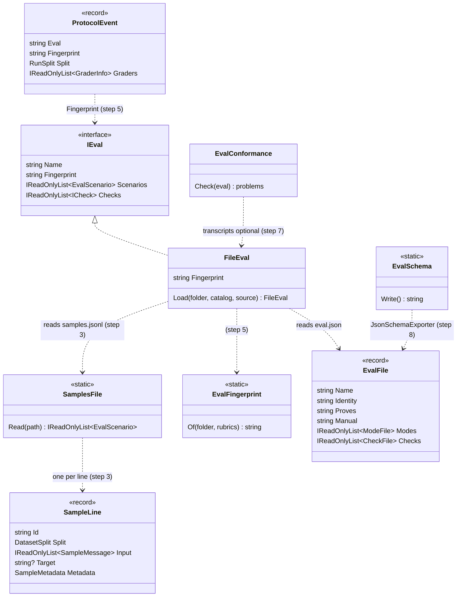
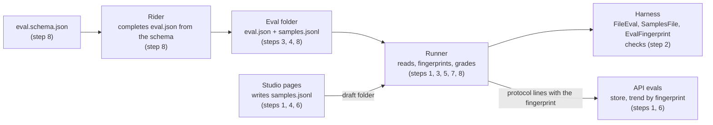
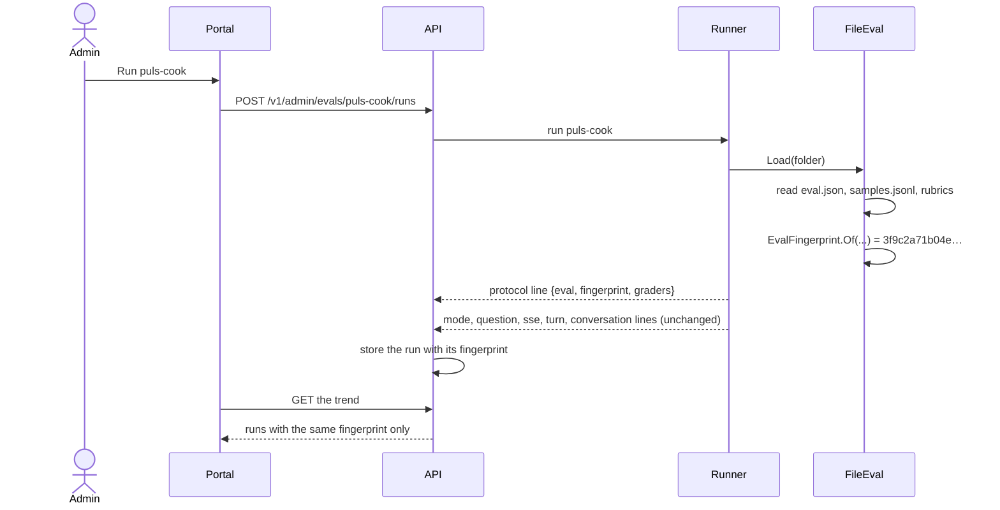
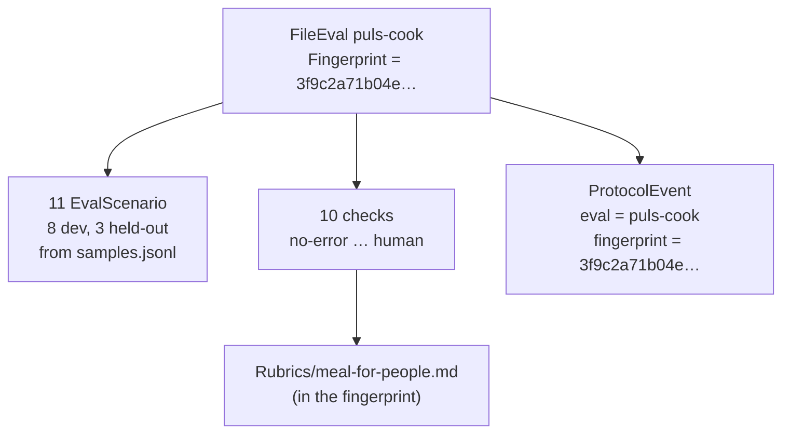

# CL60 Simpler evals: two files, no hand versions

> **Plan.** How we make an eval simpler to write: `eval.json` with a `samples.jsonl` beside it, a fingerprint the
> runner works out instead of hand-kept versions, transcripts that are optional, the unused checks gone, a JSON schema
> for hand editing, and no promptfoo bridge. Approved by Louis on 2026-11-09 (the five findings, one card each); built
> step by step, one commit each. **Elsewhere:** the research and the five picks in
> [Simpler evals: research and findings](https://claude.ai/artifact/NRverscDsWonM7EkdWk2X6); how the evals work today
> in [the evals' architecture](../architecture/evals.md); why an eval is files in
> [ADR 0058](../adr/0058-an-eval-is-a-folder-of-files.md).

## Context

Louis asked on 2026-11-09: "Can we research how we can simplify our evals?" The research measured `main` at `9fe81f40`:

- **A new eval is six files in four folders**: `eval.json`, `manual.md`, `Dataset/dataset.json`, one file per
  scenario under `Dataset/scenarios/dev/` or `held-out/`, a reference transcript and a known-bad transcript per
  scenario. The cook's eval is about 90 files, its transcripts 2.4 MB of raw stream lines.
- **Two versions and a hash are kept by hand**: `version` in `eval.json` (the cook is at 20), the dataset's own
  `version` (7), its dated `changes` list and a `content_hash` you paste from a failing test.
- **14 of the 25 general checks are named by no eval** (F49.2b built the whole set as a standard library on
  2026-10-30).
- **Three ways to write an eval**: by hand, in the Studio, and imported from promptfoo; no eval on `main` came
  through promptfoo.

Every source we read says the same: keep the tasks in one place, grade with code first, read the transcripts after a
run, and keep the harness thin ([Anthropic, Demystifying evals for AI agents](https://www.anthropic.com/engineering/demystifying-evals-for-ai-agents);
[Hamel Husain and Shreya Shankar, AI Evals FAQ](https://hamel.dev/blog/posts/evals-faq/);
[promptfoo's configuration](https://www.promptfoo.dev/docs/configuration/guide/); [Inspect](https://inspect.aisi.org.uk/)).

**Louis's picks** (2026-11-09, one card per finding):

| # | Finding | Pick |
|---|---|---|
| 1 | Where an eval's questions live | **C**: `eval.json` plus one `samples.jsonl` beside it, one sample per line |
| 2 | How an eval's version is kept | **C**: the runner fingerprints the eval; no hand version |
| 3 | Reference and known-bad transcripts | **C**: optional |
| 4 | The 14 unused general checks | **B**: removed, brought back on first use (replaces F49.2b's standard-library call) |
| 5 | Ways to write an eval | **B**: a JSON schema for `eval.json`, the Studio stays, promptfoo in and out go |

The design underneath stays: an eval is content and a check is code (ADR 0056, 0058), the catalogue and readers,
the judge and its calibration, pass@k and pass^k, replays, cost from the ledger, the run pages and the Studio.

## Design

### What an eval folder holds, before and after

```
Evals/Cook/                          Evals/Cook/
├── eval.json                        ├── eval.json          ($schema, no version, no schema_version)
├── manual.md                        ├── samples.jsonl      (one sample per line, "split" on each)
├── Dataset/                         ├── manual.md
│   ├── dataset.json                 ├── Rubrics/meal-for-people.md
│   ├── labels/*.json                ├── labels/*.json      (moved up, unchanged)
│   └── scenarios/                   └── Transcripts/       (optional; what is there is still checked)
│       ├── dev/*.json
│       └── held-out/*.json
├── Rubrics/meal-for-people.md
└── Transcripts/*.txt
```

A line of `samples.jsonl` is today's scenario file on one line, Inspect's `Sample` shape, with the split as a field:

```json
{"id":"cook-malmesbury","split":"dev","input":[{"role":"user","content":"Ek het R150 vir aandete vir vier mense. …"}],"metadata":{"place":"Malmesbury, Wes-Kaap, Suid-Afrika","time_zone":"Africa/Johannesburg","follow_ups":[],"expected":{"routes_to":"puls-cook","serves":4,"budget":150},"categories":["language:af","budget"]}}
```

`dataset.json` goes: its `name` is the eval's, its `covers` line moves into `manual.md`, its `version`, `changes` and
`content_hash` give way to the fingerprint, and git log is the history.

### The fingerprint

The runner hashes the bytes that decide what a run asks and how it grades: `eval.json`, `samples.jsonl` and every
rubric the checks name, with line endings made the same first so Windows and Linux agree. It is SHA-256, written as
hex, and the first 12 characters are what the portal shows. It goes on the `protocol` line in place of `eval_version`
and the dataset's version and hash, the store keeps it on the run, and the trend joins only runs with the same
fingerprint. A typo fixed in a question starts a new trend line, which is honest: the eval changed. `manual.md` and
the transcripts are left out, so editing them never moves the fingerprint.

The pattern is a **content address** (the way git names a commit and Docker names an image by a hash of what is in
it): the name can't drift from the content because it is computed from it.

### The four diagrams

**Interface design** (what the steps add, change or remove; the step in brackets):



Removed: `DatasetLoader`, `DatasetManifest`, `DatasetHash`, `SampleFile` (becomes `SampleLine`) and `ManifestSeal`
(step 3); `PromptfooImport`, `PromptfooExport`, `PromptfooAssertion`, `PromptfooRunner` and the studio's promptfoo
box (step 1); the 14 checks below (step 2).

**Architecture** (which step changes which part):



**Communication** (one run, after step 6):



**Object diagram** (the cook's run in memory, after step 5):



### The 14 checks that go (step 2)

`contains`, `not-contains`, `starts-with`, `length-under`, `mentions-expected`, `is-json`, `cost-under`,
`tokens-under`, `turns-under`, `tool-calls-under`, `tool-not-used`, `links-to-host`, `near`, `answers-in-language`
(and `AnswerLanguage`, `LanguageWords`, which only the last uses). About 1,280 lines and 1,170 lines of tests. The 11
that stay: `no-error`, `within-time`, `routed-to`, `tool-used`, `tool-used-with`, `tool-rows-marked`, `amount-under`,
`number-named`, `image-shown`, `judge`, `human`. Git keeps the rest; one comes back, with its tests, in the step that
first needs it.

### Namespace map

| Type | Folder | Namespace | Step |
|---|---|---|---|
| `PromptfooImport`, `PromptfooExport`, `PromptfooAssertion` (removed) | `src/evals/louis-agent.evals.runner/Promptfoo/` | `LouisAgent.Evals.Runner.Promptfoo` | 1 |
| `PromptfooRunner`, the promptfoo endpoints and box (removed) | `louis-agent.api.evals/Studio/`, `Endpoints/Studio/Promptfoo/`; `louis-agent.web.evals/Components/Studio/Promptfoo/` | as today | 1 |
| The 14 checks, `AnswerLanguage`, `LanguageWords` (removed) | `src/evals/louis-agent.evals/Grading/Common/{Answers,Facts,Tools,Compare,Similarity,Language}/` | `LouisAgent.Evals.Grading.Common.*` | 2 |
| `SampleLine` (was `SampleFile`, gains `Split`) | `src/evals/louis-agent.evals/Datasets/Samples/` | `LouisAgent.Evals.Datasets.Samples` | 3 |
| `SamplesFile` (new) | `src/evals/louis-agent.evals/Datasets/Samples/` | `LouisAgent.Evals.Datasets.Samples` | 3 |
| `DatasetLoader`, `DatasetManifest`, `DatasetHash` (removed) | `src/evals/louis-agent.evals/Datasets/` | `LouisAgent.Evals.Datasets(.Manifest)` | 3 |
| `ManifestSeal` (removed) | `src/evals/louis-agent.evals.runner/Studio/` | `LouisAgent.Evals.Runner.Studio` | 3 |
| `DraftFolder` (writes `samples.jsonl`) | `src/hosts/louis-agent.api.evals/Studio/` | as today | 4 |
| `EvalFingerprint` (new) | `src/evals/louis-agent.evals/Files/` | `LouisAgent.Evals.Files` | 5 |
| `ProtocolEvent` (`Fingerprint` for `EvalVersion`, `Dataset` gone; contract version 3) | `src/evals/louis-agent.evals.protocol/Events/Run/` | `LouisAgent.Evals.Protocol.Events.Run` | 5 |
| `RunDocument`, `RunRecording`, the trend (by fingerprint) | `src/hosts/louis-agent.api.evals/Store/` | as today | 6 |
| `EvalConformance` (transcripts optional) | `src/evals/louis-agent.evals/Conformance/` | `LouisAgent.Evals.Conformance` | 7 |
| `EvalSchema` (new) | `src/evals/louis-agent.evals.runner/Catalog/` | `LouisAgent.Evals.Runner.Catalog` | 8 |
| Tests for each | `src/tests/evals/…`, mirroring the project | the project's, `.Tests` | each |

## Steps

Each step is one commit with its test, written and seen failing first (docs-only steps excepted), then Louis's
review stop. The order changed from the research's (4, 1, 2, 3, 5): promptfoo goes first, because its table maps
`contains`, `not-contains`, `starts-with`, `is-json`, `near` and `cost-under`, which step 2 removes.

1. **promptfoo out.** Remove the runner's `--import-promptfoo` and `--export-promptfoo` and `Promptfoo/`, the API's
   promptfoo endpoints and `PromptfooRunner`, the Studio's promptfoo box, their tests, and YamlDotNet from the runner
   if nothing else there uses it. *Test first:* the runner refuses `--import-promptfoo` as an unknown flag.
2. **The unused checks out.** Remove the 14 checks and their tests, shorten `GeneralChecks.All`, and move any test
   fixture that named one to a check that stays. *Test first:* `GeneralChecks.All` lists exactly the 11 types above;
   every type it lists is named by at least one eval file on disk (a test that keeps the catalogue honest from now on).
3. **`samples.jsonl` replaces `Dataset/`.** `SamplesFile` reads one `SampleLine` per line, strictly (the same rules
   as today: unknown field, missing field, a duplicate id, an `expected` key no check reads); `FileEval` reads it
   beside `eval.json`; every eval folder (Puls's four, the triage team's three, the template) moves its scenarios
   into `samples.jsonl`, its `labels/` up a level and its `covers` line into `manual.md`; `DatasetLoader`, the
   manifest, the hash and `ManifestSeal` go (ADR 0049: no second reader). *Test first:* a folder with
   `samples.jsonl` loads its scenarios with their splits; a line with an unknown field is refused, naming the line.
4. **The Studio writes `samples.jsonl`.** `DraftFolder` and the sample drafts (F49.4) write lines, not scenario
   files. *Test first:* a draft with two samples writes a two-line `samples.jsonl` that `SamplesFile` reads back.
5. **The fingerprint replaces the versions.** `EvalFingerprint.Of` hashes `eval.json`, `samples.jsonl` and the
   rubrics with line endings made the same; `eval.json` loses `version` and `schema_version`; the protocol line
   carries `fingerprint` in place of `eval_version` and the dataset's version and hash (contract version 3).
   *Test first:* the same folder gives the same fingerprint with LF and CRLF endings; changing one sample changes
   it; changing `manual.md` doesn't.
6. **The store and the portal use the fingerprint.** The run document keeps it, the trend joins by it, the run and
   Evals pages show its first 12 characters where they showed `v20`. Old stored runs: see *Open before step 6*.
   *Test first:* two runs of one eval with different fingerprints land on two trend lines.
7. **Transcripts optional.** The conformance check runs the references and known-bads a folder has: a reference
   that is there must pass every required check, a known-bad that is there must fail at least one; a scenario with
   no reference, and a required check no known-bad fails, are no longer refused. The existing transcripts stay.
   *Test first:* a folder with no `Transcripts/` passes conformance.
8. **A schema for `eval.json`.** `EvalSchema` makes `src/evals/eval.schema.json` from `EvalFile` with
   `JsonSchemaExporter` (the way `--checks` already does for a check's settings), the runner's `--schema` writes it,
   every `eval.json` names it with `$schema`, and the strict reader accepts that one key. *Test first:* the committed
   schema equals the one the code makes (a golden file, regenerated with `LOUIS_UPDATE_GOLDEN=1`).
9. **Docs.** An ADR (next free number) *An eval is a file and its samples*, amending ADR 0058 (an eval is a folder of
   files); [Add an eval](../guides/add-an-eval.md) rewritten for two files,
   [Run the evals](../guides/run-the-evals.md) and [the evals' architecture](../architecture/evals.md) brought in
   step; the write-up's section in [12 Evaluation](../learning/12-evaluation.md); the work-log row; this plan
   deleted.

## Open before step 6

**Old stored runs carry a version number, not a fingerprint.** ADR 0049 says no lenient reader for what we store.
This is a finding for Louis, asked with three options when step 6 starts: drop the old runs from the trend and keep
them readable on their own pages, give each old run a fingerprint worked out from its commit's files, or delete the
old runs. Nothing before step 6 depends on it.

## Verification

- Each step: build and test what it touches (the evals' tests, `core.tests` when it moves files or names);
  `EvalConformanceTests` and every eval's own test green after steps 3, 5 and 7.
- After step 5: `--list` shows every eval with its fingerprint, free.
- After step 6: a **replay** of a stored cook run (free, no model cost) records with a fingerprint and shows on the
  Evals page. No live run is needed; one waits for Louis's go.
- After step 8: Rider completes and flags a wrong field in an `eval.json` (Louis's check in Rider).
- The full suite once, when step 9 is done.

## Concepts

| Step | Concept | GOAL.md skill |
|---|---|---|
| 1, 2 | Keep the harness thin: build for the eval that asks (YAGNI, ADR 0055) | 12 Evaluation |
| 3, 4 | The task list is the eval: one sample per line, the field's JSONL dataset shape (Inspect, OpenAI evals) | 12 Evaluation |
| 5, 6 | Versioning an eval by its content, so a trend never mixes two evals (the same idea as prompt versioning) | 12 Evaluation, 3 Prompt design |
| 7 | Test the graders in unit tests; read real transcripts after a run instead of keeping fixtures | 12 Evaluation, 18 Testing and shipping |
| 8 | Schema-validated configuration: the editor checks the file before the runner does | 5 Structured outputs |

---
[Plans](README.md) · Related: [the evals' architecture](../architecture/evals.md) · [Add an eval](../guides/add-an-eval.md) · [TODO](../../../TODO.md)
