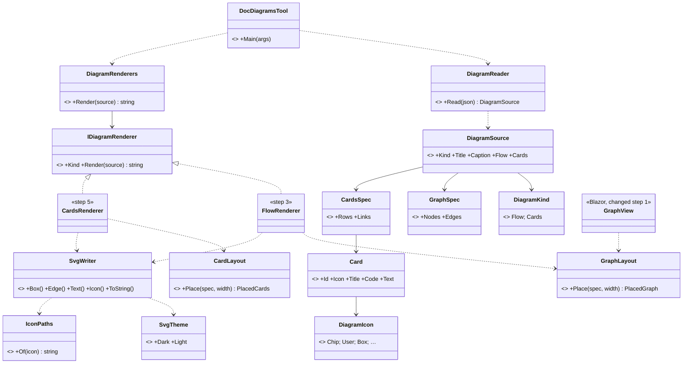
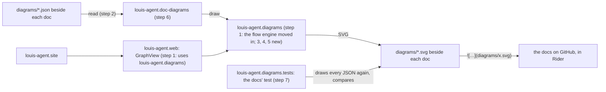
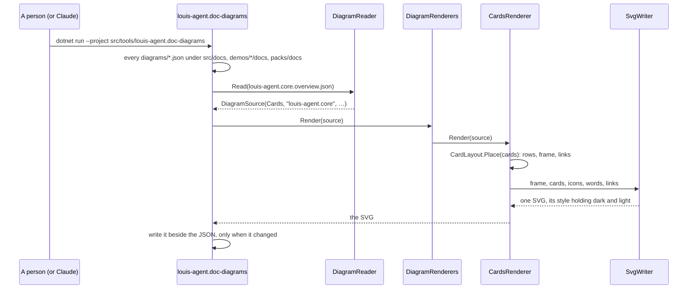
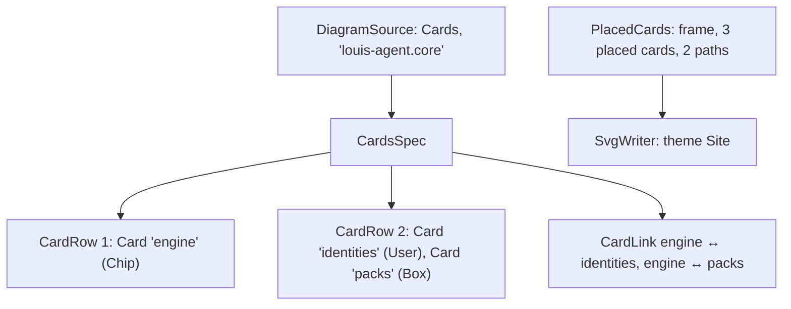

# CL60.1 The renderer and the overviews

> **Plan**, approved by Louis on 2026-11-11 (picks P1 to P4, all A), CL60's first child ([the parent](CL60-docs-diagrams-as-svg.md)). Branch
> `refactor/CL60-svg-diagrams`. It changes only under *Approved during the build*. Its own four diagrams are the
> last drafted in Mermaid; CL60.2 to CL60.4 redraw them with what this child builds.

## Context

The docs draw 126 diagrams with Mermaid, and Louis wants them gone: "it must look modern", one look, SVG. The site
already draws diagrams from data with the framework web's engine (`GraphSpec`, `GraphLayout`, `GraphView`, ADR 0103),
but only inside a Blazor page and only as columns of boxes. This child builds the renderer every later child uses,
and with it the first new pictures: an overview of each project, in the card style of Louis's figure.

## Design

### What changes, in plain words

- **A diagram is a JSON file beside its doc** (`src/docs/projects/diagrams/louis-agent.core.overview.json`), and the
  SVG the renderer draws from it sits next to it (`….overview.svg`). The doc shows it with a plain markdown image.
- **One SVG holds both looks.** Its own `<style>` picks the dark or the light palette from the reader's screen
  (`prefers-color-scheme`), so GitHub, Rider and the site show the right one with nothing else to do. It loads
  nothing from outside: the fonts are the system's, the icons are paths inside it.
- **Two kinds to start:** a *flow* (the site's boxes and arrows, by ADR 0103's rules) and *cards* (the overview:
  rows of cards in one rounded frame, an arrow between rows, each card an icon, a title with a code chip and a line
  of text, a caption under the frame). CL60.2 to CL60.4 add the rest.
- **A tool writes them, a test holds them.** `louis-agent.doc-diagrams` finds every `diagrams/*.json` in the docs and
  writes its SVG; the docs' test draws every JSON again and fails on any SVG that differs, any JSON without its SVG,
  or a doc linking an SVG that isn't there.
- **The drawing code becomes its own small project** (pick P1 A): `louis-agent.diagrams`, plain C# with no Blazor,
  which the site's `GraphView` and the tool both use. The flow engine moves into it unchanged.

### Interface design



```csharp
// louis-agent.diagrams/Sources (step 2)
public sealed record DiagramSource(DiagramKind Kind, string Title, string? Caption, GraphSpec? Flow, CardsSpec? Cards);
public enum DiagramKind { [WireName("flow")] Flow, [WireName("cards")] Cards }   // sequence, class: CL60.3, CL60.4
public static class DiagramReader { public static DiagramSource Read(string json); }   // refuses, naming what's wrong

// louis-agent.diagrams/Cards (step 5)
public sealed record CardsSpec(IReadOnlyList<CardRow> Rows, IReadOnlyList<CardLink> Links);
public sealed record CardRow(IReadOnlyList<Card> Cards);
public sealed record Card(string Id, DiagramIcon Icon, string Title, string? Code, string Text);
public sealed record CardLink(string From, string To, CardLinkKind Kind);   // Down, Up, Both
public static class CardLayout { public static PlacedCards Place(CardsSpec spec, int width = 880); }

// louis-agent.diagrams/Svg (steps 3, 5)
public interface IDiagramRenderer { DiagramKind Kind { get; } string Render(DiagramSource source); }   // Strategy
public static class DiagramRenderers { public static string Render(DiagramSource source); }            // picks by kind
internal sealed class SvgWriter { … }   // Builder: shapes in, one SVG string out, the theme's <style> first
public sealed record SvgTheme(SvgPalette Dark, SvgPalette Light) { public static SvgTheme Site { get; } }
```

**Patterns** (rule 11): the sources are a declared model the renderer interprets (Fowler, *Domain-Specific
Languages*: a semantic model read from data); each kind's drawing is a Strategy behind `IDiagramRenderer`
(Refactoring.Guru), so a new kind is one class, not a switch; the SVG is built by a Builder, so no renderer writes
markup by hand.

### Architecture



### Communication: writing the docs' SVGs



### Object diagram (one overview being drawn)



### Namespace map

| Type | Folder | Namespace | Step |
|---|---|---|---|
| `GraphSpec`, `GraphNode`, `GraphEdge`, `GraphLayout`, `EdgeRouter`, `PlacedGraph`, `PlacedNode`, `PlacedEdge` (moved) | `src/web/louis-agent.diagrams/Flow/` | `LouisAgent.Diagrams.Flow` | 1 |
| `GraphLayoutTests` (moved) | `src/tests/web/louis-agent.diagrams.tests/Flow/` | `LouisAgent.Diagrams.Tests.Flow` | 1 |
| `DiagramSource`, `DiagramKind`, `DiagramReader` | `src/web/louis-agent.diagrams/Sources/` | `LouisAgent.Diagrams.Sources` | 2 |
| `SvgTheme`, `SvgPalette`, `SvgWriter`, `IDiagramRenderer`, `DiagramRenderers`, `FlowRenderer` | `src/web/louis-agent.diagrams/Svg/` | `LouisAgent.Diagrams.Svg` | 3 |
| `DiagramIcon`, `IconPaths`, Tabler's licence | `src/web/louis-agent.diagrams/Icons/` | `LouisAgent.Diagrams.Icons` | 4 |
| `CardsSpec`, `CardRow`, `Card`, `CardLink`, `CardLinkKind`, `CardLayout`, `PlacedCards`, `CardsRenderer` | `src/web/louis-agent.diagrams/Cards/` | `LouisAgent.Diagrams.Cards` | 5 |
| `Program`, `DiagramFiles` | `src/tools/louis-agent.doc-diagrams/` | `LouisAgent.DocDiagrams` | 6 |
| `DocsDiagramsTests` | `src/tests/web/louis-agent.diagrams.tests/Docs/` | `LouisAgent.Diagrams.Tests.Docs` | 7 |

### Folder tree (after)

```text
src/web/louis-agent.diagrams/        Flow/ (moved from louis-agent.web/Graphs), Sources/, Svg/, Icons/, Cards/
src/web/louis-agent.web/             Components/Graphs/GraphView (uses louis-agent.diagrams); Graphs/ gone
src/tools/louis-agent.doc-diagrams/  the tool
src/tests/web/louis-agent.diagrams.tests/   Flow/, Sources/, Svg/, Icons/, Cards/, Docs/
src/docs/projects/diagrams/          {project}.overview.json and .svg, one pair per project doc
demos/*/docs/projects/diagrams/, packs/docs/projects/diagrams/   the same for theirs
```

## Steps

One commit each, test first (seen failing), a stop after each, a tidy commit after each for old debt in its files.

1. **`louis-agent.diagrams`, the flow engine moved in.** A new library under `src/web/`, plain C#; the eight flow
   types move with Rider's move refactoring, `GraphView` and the site's graphs use them from there. Tests:
   `GraphLayoutTests` move and pass unchanged; `SolutionLayoutTests` and `ArchitectureTests` know the project.
2. **The sources.** `DiagramSource`, `DiagramKind` (parsed with `SettingChoice`), `DiagramReader` through records.
   Tests: a flow and a cards file read; an unknown kind refused naming the kinds; an arrow or a link to an id no box
   has refused naming it.
3. **The theme and the flow's SVG.** `SvgTheme.Site` (pick P2), `SvgWriter`, `IDiagramRenderer`, `FlowRenderer`:
   one SVG, its style holding both palettes, ADR 0103's layout, the system fonts. Tests: a sample's golden; both
   palettes in the style; no `href` or `url(` that leaves the file.
4. **The icons.** `DiagramIcon` and Tabler's path data for the set the overviews need (pick P3), its MIT licence
   beside it. Tests: every member has a path; the licence is there.
5. **The cards.** `CardsSpec`, `CardLayout`, `CardsRenderer`: rows of cards in one frame, cards in a row the same
   width and height, text wrapped inside, a link between rows, the caption. Tests, with numbers: no overlap, every
   card inside the frame, every word inside its card; the golden of Louis's figure (engine, identities, packs).
6. **The tool.** `louis-agent.doc-diagrams` writes every `diagrams/*.json`'s SVG beside it, only when it changed;
   `--check` exits 1 naming a stale one. Tests: on a temp folder it writes; a second run writes nothing; `--check`
   fails on a stale file.
7. **The docs' test, and the first picture.** `DocsDiagramsTests`: every JSON's SVG matches it byte for byte, every
   SVG is linked from a doc in its folder, every `diagrams/*.svg` a doc links exists. The first picture: Louis's
   figure for ADR 0027 and the architecture's building blocks.
8. **The framework's overviews.** One cards JSON and SVG per project doc in `src/docs/projects/` (pick P4), linked
   under each doc's title. The docs' test holds them.
9. **The demos' and packs' overviews.** The same for `demos/*/docs/projects/` and `packs/docs/projects/`.
10. **The docs.** A how-to (*Draw a diagram*), `louis-agent.diagrams`' project doc, the projects README row, the work
    log.

## Verification

- **Each step:** the tests it touches; `core.tests` when a project or a folder is added (steps 1, 6).
- **By eye, free:** the overviews on GitHub's page of the branch, in Rider's markdown preview, light and dark; the
  site's pages with a flow diagram, unchanged (the golden files hold them).
- No paid run.

## Concepts, and where they sit in GOAL.md

- **Testing and shipping** (skill 18): a picture held to its source by a byte-for-byte test, like the goldens.
- **Extensibility** (skill 20): a kind of diagram is one Strategy; the site and the docs share one renderer.

## Louis's picks (2026-11-11)

All four A, as the design above assumes. The options as they were put:

| # | Question | A (picked) | B | C |
|---|---|---|---|---|
| P1 | Where the drawing code lives | **A new plain-C# library `louis-agent.diagrams`** that `louis-agent.web` and the tool both use, the flow engine moved in (ADR 0092: what is reused together is one project). Costs a project and a move | Everything stays in `louis-agent.web/Graphs`; the tool references the web library, Blazor and ASP.NET with it, for a console tool | The layouts stay in the web library, the SVG writer and the new kinds only in the tool: the site can never use cards or sequences |
| P2 | The palette | **The site's own**: its dark ground, borders and accent, the light twin from the site's light theme, so docs and site look like one product | A neutral one tuned to GitHub's light and dark pages, so a picture blends into whatever shows it | Dark only, like Louis's figure, on GitHub's light page too |
| P3 | The icons | **Tabler Icons (MIT)**, the few the overviews use copied in as path data with the licence, as F134 picked for the showroom: one icon family across the product | Lucide (ISC), the family Louis's figure looks like; a second family beside F134's | Our own simple shapes: nothing third-party, but no real icons |
| P4 | Where an overview's cards come from | **Written by hand** per project in its JSON, a few cards for its parts in a reader's words | Drawn from the project doc's folder table by the tool, so it stays true by itself; the table's long cells make poor cards | From the project's own folders on disk, the truest and the least explained |

## Approved during the build

- **The library's own messages** (step 2, Louis's pick A): a `DiagramMessage` enum and a small `DiagramText` that
  fills its holes, as `louis-agent.choices` does with `ChoiceText`, so the library keeps to `louis-agent.choices`
  and no part of the engine. `DiagramText` sits at the library's root, since a `Messages/` folder holds only message
  enums. `DiagramIcon` came in step 2 with the first picture's three icons, since a card names its icon; step 4 draws
  them and adds the rest.
- **Rider indents a nested loop as `dotnet format` does** (step 2's tidy, Louis's pick A): three `resharper_` keys
  in `.editorconfig`, after Rider's reformat and `dotnet format` fought over `GraphLayout.Crossings`.
- **The light palette is the site's, mirrored** (step 3, Louis's pick A): the site has no light theme, so
  `SvgTheme.Site.Light` turns the same metallic greys over (a white ground, near-black text, the borders and quiet
  text reversed), defined once in the diagrams.
- **Where a box's words sit is shared** (step 3): `FlowText` holds the label's and the note's positions that
  `GraphView` had, so a box reads the same on a page and in a doc.
- **Lighter boxes, softer labels** (step 3, Louis: "can we make this a bit lighter gray", then "both"): a dark box
  is the site's lighter tint `#1b1d21` and a label the body text's grey, not pure white or black.
- **The theme has its own folder** (step 3): `SvgTheme`, `SvgPalette` and `SvgStyle` in `Svg/Theme/`
  (`LouisAgent.Diagrams.Svg.Theme`), since `Svg/` with them held seven files, past the six a folder may.
- **22 icons, copied in as data** (step 4, Claude's pick while unattended): a set for what a project's parts usually
  are (a chip, people, a box, a server, a database, the world, a message, a shield, code, a folder, a file, a
  browser, checks, a chart, a cloud, settings, a branch, mail, search, a book, a terminal), Tabler's path data in
  its 24-unit box, its MIT notice beside them and a row in `THIRD-PARTY-NOTICES.md`. All 22 were checked by eye in
  step 5, rendered by a headless Chrome from the command line, since the browser extension had stopped answering.
- **The cards' layout** (step 5, Claude's picks while unattended): every word in the code font, so the layout
  proves each line fits its card; a card's icon at its top left, the title under it, the code chip beside the title
  or under it when they don't fit one line; links branch at right angles halfway between the rows, an arrowhead at
  each end the link's way says. The placed records sit in `Cards/Placed/` and `CardsRenderer` beside `FlowRenderer`
  in `Svg/`, so no folder passes six files; the word wrap the notes used is one shared `TextWrap`. Louis's figure,
  drawn, is the golden `cards.svg`, checked by eye in both looks.
- **The tool** (step 6): its texts are its own `DocDiagramsUserText` enum, it looks under `src/docs`, `packs/docs`
  and each demo's `docs`, and it compares an SVG with line endings set aside, since a Windows checkout keeps its
  own. The site's framework page names it beside the other tools in `src/tools`, as its test asks of every project.
- **A card's looks** (step 6b, Louis's architecture figure: "we should cater for this alternation"; the pattern is
  Claude's pick while unattended): a card is `plain`, `highlight` (centred, in the accent's tint and line, as the
  core engine stands out between the layers) or `heading` (centred with no box, as the application on top), named
  by `"look"` in its JSON. Of three options, A: a look per card, a type code kept as an enum that the renderer
  switches on in one place (Fowler's refactoring catalogue), since the looks differ only in alignment and fill
  (picked); B: a look per row, simpler, but a highlighted card could never stand beside a plain one; C: a subclass
  per look (*Replace Type Code with Subclasses*), three classes and a JSON type discriminator for two small
  differences. The accent is the site's blue (`#7fa8e8`, darker `#3b6fc4` on light). The link types moved to
  `Cards/Links/` so `Cards/` keeps to six files. The figure is the golden `looks.svg`, checked by eye in both looks.
- **The docs' test** (step 7): `DocsDiagramsTests` sits beside the tool's own tests and shares its list of docs
  folders (`DiagramSync.Roots`). It reads a doc's links outside code, since the plans and the how-to show a link as
  an example there, and it fails if the docs have no picture at all, so it can't pass by finding none. The first
  pictures: Louis's engine, identities and packs figure under ADR 0027's decision, and his layered figure at the
  top of the building-block view.
- **One shape for every overview** (step 8, Claude's pick while unattended): the project on top as a highlighted
  card with its name in the code chip, its main parts under it with an arrow each, and where it holds more, a second
  row of parts with no arrows. No caption, since the doc under the picture is one. The picture sits just above each
  doc's *Purpose*. Each card's words were checked against its doc: a check's grade is pass, fail or unknown, never a
  score, and the usage probe also prices a stored ledger.
- **Every project doc shows its overview** (step 9): `EveryProjectDoc_ShowsItsOverview` asks it of the framework's,
  the packs' and each demo's `projects/` folder, the picture named for its doc, and failed first on the 17 the step
  then drew. A doc with no *Purpose* (six of them) carries its picture after its opening quote. The general packs
  are one picture of seven packs with no arrows, since none is under another; the triage team's arrows go both ways,
  since the manager hands the work out and checks it coming back. Puls's four were drawn too: its docs follow the
  framework (Puls on pause covers its evals and runs, not its docs).
- **Unattended until CL60 is done** (Louis, 2026-11-11, during step 3: "continue unattended", "until CL60 is
  done"): the steps are committed without a stop each; a pick is the recommended option, marked here as Claude's.

---
[Docs index](../README.md) · [Plans](README.md) · Parent: [CL60](CL60-docs-diagrams-as-svg.md) · Next: CL60.2
