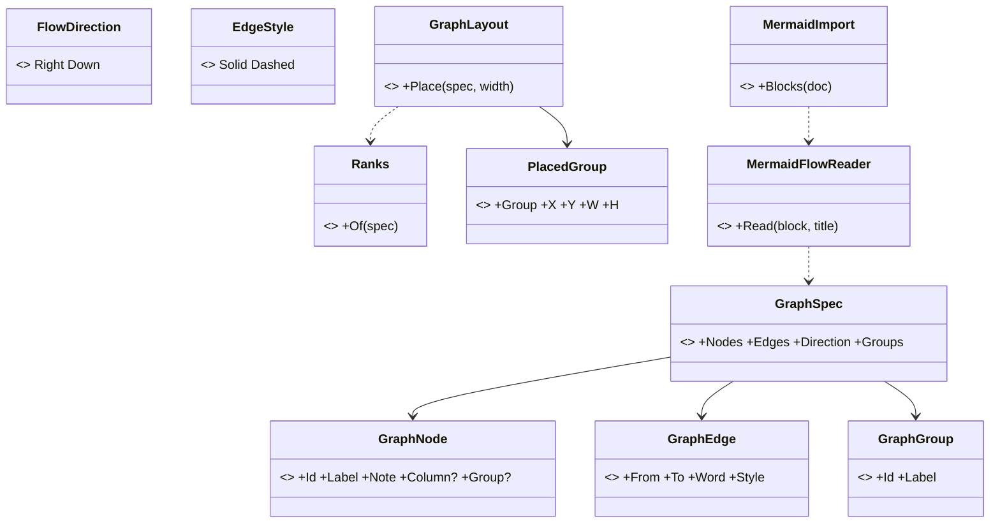
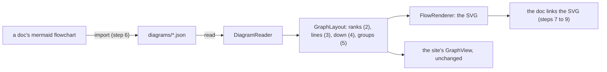
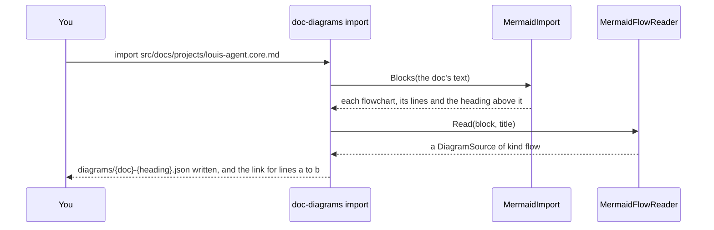
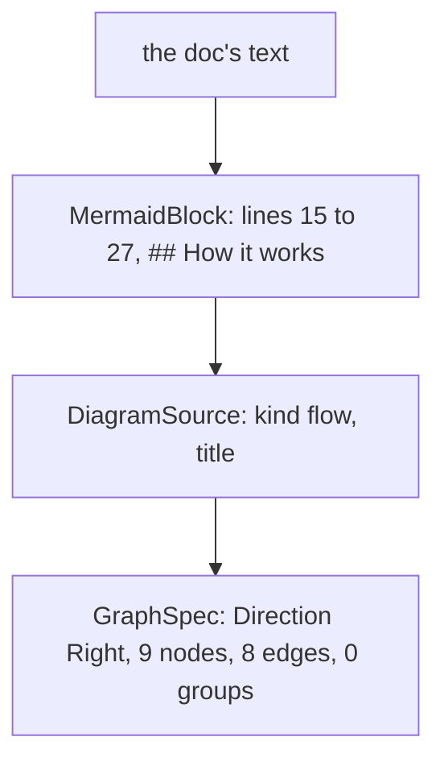

# CL60.2 The flows

> **Plan**, CL60's second child ([the parent](CL60-docs-diagrams-as-svg.md)), written 2026-11-11 while unattended
> (Louis: "continue unattended", "until CL60 is done"), so its picks are Claude's, each the recommended of three and
> recorded below. Branch `refactor/CL60.2-docs-flows`, from CL60.1's tip. It changes only under *Approved during
> the build*. Its four diagrams stay in Mermaid, as the plans' rule still asks until CL60.4 rewrites it; the plan is
> deleted when this child is done.

## Context

CL60.1 built the renderer, its flows on the site's layout (ADR 0103). The docs hold 75 Mermaid flowcharts in 58 files,
and they ask for what the site's diagrams never did: 40 run top to bottom, 201 labels break over lines, 19 files group
boxes in 42 subgraphs, 18 arrows are dashed, and none says which column a box stands in. This child grows the layout
for that, reads each flowchart once into a flow JSON, and swaps every block for its picture.

## Design

### What changes, in plain words

- **A box's column can come from the arrows.** Left out, it is one past the furthest box that points at it (the
  longest path, as layered drawing ranks), so a converted chart needs no hand-placed columns. The site's diagrams
  keep theirs, and draw exactly as before.
- **A label may hold lines.** A `\n` breaks it, and a column widens to its longest line, so nothing is cut.
- **A flow may run down.** `"direction": "down"` lays the chart out as if it ran right with every box turned, then
  turns every point back: one layout, one router, the ranks become rows.
- **Arrows may be dashed, and boxes grouped.** A group is a labelled frame around its boxes. When a chart has groups,
  each group owns a band of rows across the columns, so no box of another group can stand inside its frame.
- **A one-time import.** `louis-agent.doc-diagrams import <doc>` reads every flowchart in a doc into a JSON beside
  it and prints the link that replaces each block; the block is swapped by hand. Mermaid is read once and kept
  nowhere.

### Interface design



```csharp
public sealed record GraphSpec(IReadOnlyList<GraphNode> Nodes, IReadOnlyList<GraphEdge> Edges,
    FlowDirection Direction = FlowDirection.Right, IReadOnlyList<GraphGroup>? Groups = null);
public sealed record GraphNode(string Id, string Label, string? Note = null, int? Column = null, string? Group = null);
public sealed record GraphEdge(string From, string To, string? Word = null, EdgeStyle Style = EdgeStyle.Solid);
public sealed record GraphGroup(string Id, string Label);
public static class Ranks { public static IReadOnlyDictionary<string, int> Of(GraphSpec spec); }
internal static class MermaidFlowReader { public static DiagramSource Read(string block, string title); }
internal static class MermaidImport { public static IReadOnlyList<MermaidBlock> Blocks(string doc); }
```

### Architecture



### Communication: importing a doc



### Object diagram (one doc imported)



### Namespace map

| Type | Folder | Namespace | Step |
|---|---|---|---|
| `GraphSpec`, `GraphNode`, `GraphEdge` (moved) | `Flow/Spec/` | `LouisAgent.Diagrams.Flow.Spec` | 2 |
| `Ranks` | `Flow/` | `LouisAgent.Diagrams.Flow` | 2 |
| `FlowDirection` | `Flow/Spec/` | `LouisAgent.Diagrams.Flow.Spec` | 4 |
| `GraphGroup`, `EdgeStyle` | `Flow/Spec/` | `LouisAgent.Diagrams.Flow.Spec` | 5 |
| `PlacedGroup` | `Flow/Placed/` | `LouisAgent.Diagrams.Flow.Placed` | 5 |
| `MermaidFlowReader`, `MermaidImport`, `MermaidBlock` | `src/tools/louis-agent.doc-diagrams/Mermaid/` | `LouisAgent.DocDiagrams.Mermaid` | 6 |
| `RanksTests`, `FlowShapesTests` | `src/tests/web/louis-agent.diagrams.tests/Flow/` | `LouisAgent.Diagrams.Tests.Flow` | 2 to 5 |
| `MermaidFlowReaderTests` | `src/tests/tools/louis-agent.doc-diagrams.tests/Mermaid/` | `LouisAgent.DocDiagrams.Tests.Mermaid` | 6 |

### Folder tree (after)

```
src/web/louis-agent.diagrams/Flow/
├── Spec/      # GraphSpec, GraphNode, GraphEdge, GraphGroup, FlowDirection, EdgeStyle
├── Placed/    # PlacedGraph, PlacedNode, PlacedEdge, PlacedGroup
└── GraphLayout.cs, EdgeRouter.cs, FlowText.cs, Ranks.cs
src/tools/louis-agent.doc-diagrams/Mermaid/   # MermaidBlock, MermaidImport, MermaidFlowReader
```

## Steps

One commit each, test first, seen failing.

1. **This plan.**
2. **Columns from the arrows.** The spec types move to `Flow/Spec/` with Rider; `GraphNode.Column` becomes optional;
   `Ranks.Of` gives a box with none its longest-path rank, a cycle broken where it closes. Tests: a chain ranks
   0, 1, 2; a box two paths reach takes the longer; a cycle ends; the site's graphs place as before (their goldens).
3. **A label's lines.** `\n` breaks a label; a column is as wide as its longest line. Tests: a box holds every line;
   a one-line label keeps 170.
4. **Down.** `FlowDirection.Down`: laid out turned, then every point turned back. Tests: ranks are rows, a
   connector runs down, no overlap; a golden.
5. **Dashed arrows and groups.** `EdgeStyle.Dashed` draws dashed; a group is a labelled frame, its boxes in a band
   of their own. Tests: every member inside its frame, no other box inside it, frames apart; a golden.
6. **The import.** `MermaidFlowReader` reads the forms the docs use (shapes, `<br/>`, `|word|` and `-- word -->`,
   dotted, chains and `&`, subgraphs, directions; styles and clicks skipped, and a nested group flattened to the
   innermost); `import <doc>` writes the JSONs and prints each link. Tests: each form on a sample; a doc's two blocks.
7. **The project docs' flows** (`src/docs/projects/`), imported, looked at, the blocks swapped.
8. **The rest outside the plans** (architecture, ADRs, features, the packs', the demos', the README).
9. **The plans' flows.**
10. **No flowchart left.** A test that no doc holds a `flowchart` block; the how-to and the project doc; the work log;
    this plan deleted, its picks in the project doc.

## Verification

- **Each step:** the diagrams' tests, the tool's, `core.tests` when a folder or project changes, the site's when
  the layout changes (its goldens).
- **By eye, free:** a sample of each step's pictures in a headless Chrome, light and dark.
- No paid run.

## Concepts, and where they sit in GOAL.md

- **Testing and shipping** (skill 18): a one-time import checked by a test that nothing of the old form is left.
- **Extensibility** (skill 20): one layout grown by data (a direction, groups, a style), not a second layout.

## Claude's picks (2026-11-11, unattended), each of three

| # | Question | Picked | The other two |
|---|---|---|---|
| Q1 | How the 75 charts are converted | **A one-time import in the tool**, each JSON looked at, the block swapped by hand | Every JSON written by hand: 75 charts, slow and easy to get wrong · The renderer reads Mermaid itself: the source stays Mermaid, against Louis's "we must not use mermaid" |
| Q2 | How a chart runs down | **Laid out turned, then turned back** (one layout, one router) | Every chart drawn left to right: a tall chain becomes a long thin row · A second, vertical layout: two layouts to keep in step |
| Q3 | What a subgraph becomes | **A labelled frame, its boxes in a band of their own** | A tint on each grouped box and a legend: no frame, less like the source · Groups dropped: 42 lose what they say |
| Q4 | Where the import may write | **Only the JSON**; the doc's block is swapped by hand (ADR 0052's spirit) | The tool rewrites the doc too: fast, but a script editing 58 files · Both by hand: no import at all |

## Approved during the build

- **Columns from the arrows** (step 2): `GraphLayout.Place` gives every box its column first, so the router and the
  site's `GraphView` see a column on every box as before; the site's 443 tests and the web's 653, their goldens
  included, pass unchanged. `GraphNode`'s note and column are optional, so a converted chart writes neither.
- **A label's lines** (step 3): a column is as wide as its widest box, so the boxes of a column stay aligned; the
  site's `GraphView` still draws one line, since every label on the site is one, and none grew wider.
- **Down** (step 4): `Turn` turns the drawing back over its diagonal, a path's `M`, `L` and `Q` pairs swapped; a
  down chart is laid out at its own size rather than spread across the page's width, and an arrow's word sits on
  its upright piece. The golden `Flow/down.svg` was checked by eye.
- **Groups and dashed arrows** (step 5): `Bands` stands each group's boxes in a band of rows of its own (swimlanes)
  and frames it, the label's room on the side that is the top once turned back; the frame's fill is the code chip's
  shade, so a group reads as a quiet panel behind its boxes. The reader refuses a box in a group the diagram doesn't
  declare. The new style rules redrew all 44 docs pictures, a style-only change. `Grid` is a record nested in
  `Bands`, so `Flow/` keeps to six files. The golden `Flow/groups.svg` was checked by eye.
- **The import** (step 6): `MermaidChain` reads a statement, `MermaidFlowReader` a block, `MermaidImport` a doc;
  `import <doc>` writes each JSON with the library's new `DiagramWriter` (the one options object, now writing enums
  in camel case, leaving defaults out and indenting; the kind and a card's icon always written), draws it, and
  prints the link and the lines it replaces. Tried on copies of two docs, three findings, each taken as Claude's
  pick: **a chart that runs right through more than five ranks imports as down** (of A down, B keep it and let
  GitHub scale its words to about 5px, C a new wrapping layout), since a doc's column is about 900px; **a band's row
  is as tall as its own tallest box**, so one long label doesn't spread every other band; **down, a gap with words
  takes a line more, not the words' length**, since a word stands across its arrow. A quoted arrow word loses its
  quotes. The containers chart still stacks three equal words near one box; step 8 tunes its JSON by hand.
- **The import fits a doc's column** (after step 6, the project docs imported and looked at): a chart wider than
  1100px its own way turns the other way when that is narrower, a label's lines wrap at 30 characters, and a bend
  stands in the middle of a gap too narrow for its words' rooms (the accounts chart ran an arrow off its top).
  Louis, looking at the MCP and accounts charts: "you must look at each one". Every picture is looked at on its
  own, and the next commit adds checks that no word leaves the drawing or sits on a box, and no line crosses a box
  it doesn't join.
- **Clear words and lines** (Louis's "you must look at each one"): `DocsDiagramsTests` places every flow picture
  and fails naming each word off the drawing or on a box and each line through a box it doesn't join; the first
  run found 34 in 16 of the 24 project pictures. Fixed in the router: an arrow whose way would cross a box takes a
  detour (out into its gap, along a lane of its own under the drawing, up the gap by its target), so a clear arrow
  keeps its way and the site's diagrams are unchanged; down, a word starts just right of its line, in the gap
  between rows, and the drawing grows to hold it; a gap sized to its rooms exactly is no longer taken for too
  narrow in floating point. These fixes came before their tests while the faults were chased, so the tests were
  not seen failing first.
- **Louis's marks, chart by chart** (his screenshots of the CLI, accounts, API, telemetry, evals, runner, MCP,
  protocol, checks, usage probe and web.accounts charts), built into the layout: a long arrow runs through a
  waypoint in each column it passes (Sugiyama's dummy nodes), straightened in line with its target, or with its
  source when the target's line is blocked (Brandes and Köpf's alignment); four rounds of sweeps; several sources
  feeding several boxes bend on tracks of their own, ordered so one's line out never lies on another's line in
  (one track still where all feed one box: Louis's "conformity"); a band starts at the top beside bands it shares no
  column with; a back arrow drops straight from its source's bottom middle (in place of FX85's right side, low); down,
  a word is a block of short lines beside its arrow, on the left when a line runs through its right. The router
  moved to `Flow/Routing/` with `Detours` and `Plan`. The site's 443 and the web's 653 tests pass unchanged.
- **Louis's pick, "Ours plus hand-tuning"** (of three: MSAGL, Microsoft's graph layout, as a package; or growing our
  own layout until every chart passes): what still reads awkwardly after the layout is tuned in its JSON by hand
  (order, columns, a split, a redundant arrow dropped), each tune recorded here.
- **The look, Louis's pick "Both looks"** (2026-11-11, before step 7's swap). He showed three pictures of the
  accounts chart: ChatGPT's painted one (an icon and a colour per box), one another Claude session wrote as SVG by
  hand (a title and subtitle, word chips, soft curves), and a second hand-written SVG joining the two, which is the
  target. Of three (the joined look drawn by our renderer from the JSON; the hand-written look only, no colours or
  icons; Claude drawing every SVG by hand, which drops "drawn from data, checked by a test"), he picked the joined
  look from the renderer. Before that, of ChatGPT-style painted PNGs (paid, unchecked, different every run), a
  painted reference only, or our renderer with icons and colours, he picked the renderer. The target:
  - **a title bar**: dark navy, an icon and a divider, the title's part before its first colon in bold;
  - **a box**: an optional icon, white in a round badge of the box's tone; the box tinted in its tone with a tone
    border; its label from the left after the badge in the tone's dark shade, the first line bold;
  - **an arrow** in the tone of the box it leaves, corners rounded wide enough to read as a soft S; its words in a
    small code-font chip bordered and written in the arrow's tone;
  - **a note bar** under the drawing: an info icon, the caption's part before its colon in bold;
  - one-colour tints only (no rainbow: each element one tone).

  A box's tone and icon are optional, so the site's diagrams, drawn by their own Razor view, are unchanged. The
  steps after 6 become: **7** a box's icon and tone; **8** arrows and words in their tone, words in chips, wider
  bends for the docs only; **9** the title bar and the note bar, for flows and cards; **10** the project docs'
  JSONs given their tones and icons, each picture looked at, the blocks swapped (the old 7); **11** the rest
  outside the plans and the plans' flows (the old 8 and 9); **12** no flowchart left (the old 10). Twelve steps,
  two over the guide's ten, since the look came mid-build. Louis: "we must update them all with colors": every
  flow JSON gets its tones and icons when its picture is looked at (steps 10 and 11). Of the card overviews he said
  "this is good for tool cards" (the chat's tool cards will draw with this library later), so the cards keep their
  look, and what the docs add around a picture stays an option a caller picks.
- **A box's icon and tone** (step 7): `GraphNode` gains an optional `Icon` and a `Tone` (`DiagramTone`, plain by
  default, so neither is written when left out); a box with an icon is wider by the badge and its gap
  (`FlowText.IconRoom`); `SvgPalette` holds each tone's fill, line and ink, and the style writes one set of rules
  per tone. The style change redrew every docs picture, the drawings themselves unchanged. The reading test passed
  before any code, since the reader takes a record's new optional fields as they are: it pins the file's form.
- **Arrows in their tone** (step 8): an arrow wears the tone of the box it leaves, its head too (one marker per
  tone used); a word stands in a chip bordered in that tone, written as it is (no capitals), every chip drawn after
  every arrow so no line runs over one. `FlowText.WordBox` is a word's ground in one place, for the layout, the
  clearance checks and the chip; down, a word's room grew by the chip's few pixels. `GraphLayout.Place` takes the
  bend: the site keeps 8, the docs' renderer and their clearance checks ask for `SoftBend` (24, held to half a
  piece), so a jog reads as a soft S. The site's 443 and the web's 653 tests pass unchanged. The router's `Bend`
  went from private to internal by a `sed` line, against ADR 0052; the line was checked, and nothing else was.
- **Every project chart in the accounts look** (Louis: "all of them must look like accounts", with the ACP chart
  still grey): the 23 other project JSONs got an icon and a tone per box before the title bar, by role so a colour
  means the same in every chart: **blue** who starts it (a caller, a program, the browser), **green** this
  project's own parts, **violet** the engine and core, **teal** contracts, state and data shapes, **amber** files,
  databases and logs, **red** what runs outside the process (a model, Rider, the collector, another server). A
  read-only check against a copy taken first showed only `icon` and `tone` were added. Looking at each picture
  found two things: a down chart kept empty room on its right where a long arrow's waypoints had slots (README's
  web chart: 312 px of nothing), now trimmed to what it draws; and a chip stood 1 to 3 px from its line. One chart
  tuned by hand: the CLI's two arrows from ConsoleChat to the engine, one per method, are one arrow naming both
  (`StreamPromptAsync, HandleUserCommand`), so two chips no longer stand side by side on one line.
- **The title bar and the note bar** (step 9), of three (a Decorator round the finished picture; a flag on each
  renderer, the same bar in two places; the bar always in `SvgWriter`, leaving the chat no bare picture), Claude's
  pick: **the Decorator**, `TitledFrame`. `DiagramRenderers.RenderTitled` draws the picture without its caption
  and frames it: a navy bar (the theme's `Banner` tone) with Tabler's stack icon, a rule and the title, its part up
  to the first colon in bold; the drawing moved down whole; the caption as a note bar with an info icon, its lead
  in bold (a note without a colon stays plain, a title without one is all bold). The bar's and the note's words
  are in the system sans font, measured generously since no font is measured, and wrap to the drawing's width.
  Only the docs' tool asks for the frame, so a bare picture's bytes are as they were (the goldens unchanged) and
  the chat's tool cards will draw without it. The plain-note rule came before its test, which was added after.
- **A legend for the colours** (Louis: "can we have a legend for the color"), of three (a legend in the frame
  from the tones' fixed meanings; a legend written in each JSON, 24 copies that can drift; one table in the
  projects README, which a reader of one doc never sees), Claude's pick: **the frame's legend**. Under the drawing,
  one swatch for each tone the chart uses, in the tones' order, with its meaning (`DiagramMessage.LegendBlue` and
  the rest: starts it, this project, the engine, contracts and state, outside the process, files and data), on as
  many rows as the width needs; a chart without colours, and the cards, have none.
- **The rest outside the plans** (step 11): the 26 flowcharts in the README, the demos', the packs', the ADRs, the
  architecture and the features docs imported, each given a real title (the import's `…: Diagrams` ones), icons and
  tones by role (decision charts: the questions plain with a search icon, the answers toned; the milestones all
  green), and a note. Louis's picks during it: "we must also use colors here" and "they also need a legend" (the
  frame draws one for every toned chart), "we also still need this" (the note bar: every chart gets one, of three
  (every chart; only where it adds; the accounts only), **every chart**, its line moved out of the doc so nothing is
  said twice: the `**Architecture:**` lines under `## Diagrams` became the notes). Violet's legend reads "the
  framework", since core and the framework's web both wear it. Findings, Claude's picks: **the README's picture lives
  in `src/docs/diagrams/`** and the README links it by its path (of: that; a top-level `diagrams/` folder, against
  `TheTopLevelFolders_AreTheSolutionsGroups` and ADR 0074; no picture in the README), so the docs test counts a link
  from any doc (`EveryPicture_IsShownByADoc`); a test id `"web"` in the width test became `"shared"`, since a
  repeated name must be an enum (ADR 0043). Hand-tuned: the containers chart (3,070 px wide) lost its system frame,
  the four `Plugins.FromEnvironment()` words and the six "uses" arrows into one line through the composition root,
  said in its note (1,549 px); the Puls chart's long word broke at its parenthesis.
- **Notes on the project charts too** (Louis: "we missed this"): the 23 step 10 charts without a note got one, the
  nine `**Architecture:**` lines and the README's "The engine" and "The web" lines moved in, the other twelve a
  new one-line takeaway. The agents' big picture lost its two frames and runs down (2,654 to 1,617 px).
- **Every picture is drawn and checked** (finding): the Azure architecture's two pictures sit beside their deploy
  notes in `demos/puls/deploy/azure/`, outside the tool's roots, so the tool never redrew them and no test checked
  them. Of three (each demo scanned whole; the pictures moved under the demo's `docs/`, apart from their doc; the
  whole repo scanned, build output and all), Claude's pick: **each demo whole**, held by
  `EveryDiagramsFolder_IsOneTheToolDraws`, which failed first naming the two. Drawn at last, the what-runs-where
  chart was tuned by hand: the resource group's frame went (the note says everything sits in it), the second app's
  repeated words went, and the VM's label lost a literal `\n` from the Mermaid source.

---
[Docs index](../README.md) · [Plans](README.md) · Parent: [CL60](CL60-docs-diagrams-as-svg.md) · Next: CL60.3
