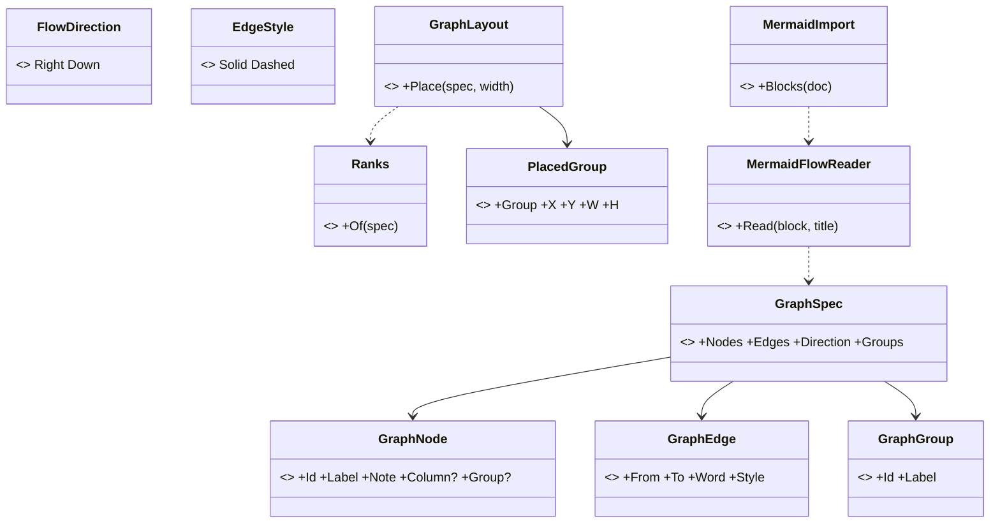
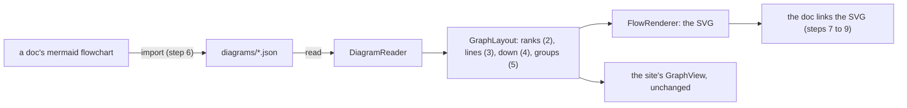
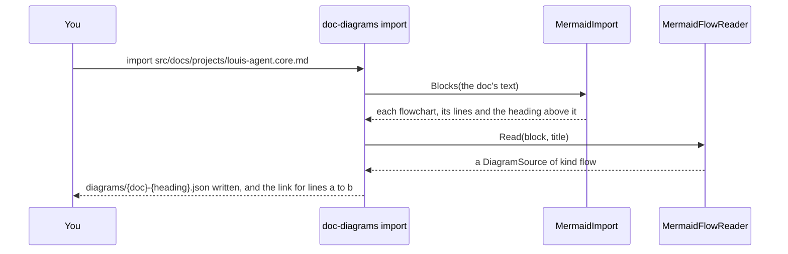
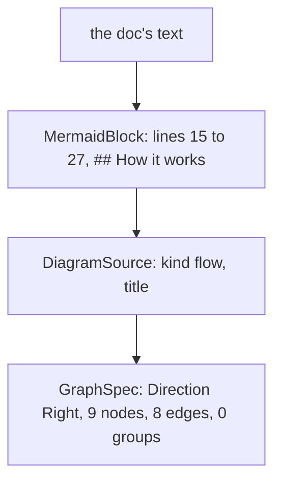

# CL60.2 The flows

> **Plan**, CL60's second child ([the parent](CL60-docs-diagrams-as-svg.md)), written 2026-11-11 while unattended
> (Louis: "continue unattended", "until CL60 is done"), so its picks are Claude's, each the recommended of three and
> recorded below. Branch `refactor/CL60.2-docs-flows`, from CL60.1's tip. It changes only under *Approved during
> the build*. Its four diagrams stay in Mermaid, as the plans' rule still asks until CL60.4 rewrites it; the plan is
> deleted when this child is done.

## Context

CL60.1 built the renderer, its flows on the site's layout (ADR 0103). The docs hold 75 Mermaid flowcharts in 58 files,
and they ask for what the site's diagrams never did: 40 run top to bottom, 201 labels break over lines, 19 files group
boxes in 42 subgraphs, 18 arrows are dashed, and none says which column a box stands in. This child grows the layout
for that, reads each flowchart once into a flow JSON, and swaps every block for its picture.

## Design

### What changes, in plain words

- **A box's column can come from the arrows.** Left out, it is one past the furthest box that points at it (the
  longest path, as layered drawing ranks), so a converted chart needs no hand-placed columns. The site's diagrams
  keep theirs, and draw exactly as before.
- **A label may hold lines.** A `\n` breaks it, and a column widens to its longest line, so nothing is cut.
- **A flow may run down.** `"direction": "down"` lays the chart out as if it ran right with every box turned, then
  turns every point back: one layout, one router, the ranks become rows.
- **Arrows may be dashed, and boxes grouped.** A group is a labelled frame around its boxes. When a chart has groups,
  each group owns a band of rows across the columns, so no box of another group can stand inside its frame.
- **A one-time import.** `louis-agent.doc-diagrams import <doc>` reads every flowchart in a doc into a JSON beside
  it and prints the link that replaces each block; the block is swapped by hand. Mermaid is read once and kept
  nowhere.

### Interface design



```csharp
public sealed record GraphSpec(IReadOnlyList<GraphNode> Nodes, IReadOnlyList<GraphEdge> Edges,
    FlowDirection Direction = FlowDirection.Right, IReadOnlyList<GraphGroup>? Groups = null);
public sealed record GraphNode(string Id, string Label, string? Note = null, int? Column = null, string? Group = null);
public sealed record GraphEdge(string From, string To, string? Word = null, EdgeStyle Style = EdgeStyle.Solid);
public sealed record GraphGroup(string Id, string Label);
public static class Ranks { public static IReadOnlyDictionary<string, int> Of(GraphSpec spec); }
internal static class MermaidFlowReader { public static DiagramSource Read(string block, string title); }
internal static class MermaidImport { public static IReadOnlyList<MermaidBlock> Blocks(string doc); }
```

### Architecture



### Communication: importing a doc



### Object diagram (one doc imported)



### Namespace map

| Type | Folder | Namespace | Step |
|---|---|---|---|
| `GraphSpec`, `GraphNode`, `GraphEdge` (moved) | `Flow/Spec/` | `LouisAgent.Diagrams.Flow.Spec` | 2 |
| `Ranks` | `Flow/` | `LouisAgent.Diagrams.Flow` | 2 |
| `FlowDirection` | `Flow/Spec/` | `LouisAgent.Diagrams.Flow.Spec` | 4 |
| `GraphGroup`, `EdgeStyle` | `Flow/Spec/` | `LouisAgent.Diagrams.Flow.Spec` | 5 |
| `PlacedGroup` | `Flow/Placed/` | `LouisAgent.Diagrams.Flow.Placed` | 5 |
| `MermaidFlowReader`, `MermaidImport`, `MermaidBlock` | `src/tools/louis-agent.doc-diagrams/Mermaid/` | `LouisAgent.DocDiagrams.Mermaid` | 6 |
| `RanksTests`, `FlowShapesTests` | `src/tests/web/louis-agent.diagrams.tests/Flow/` | `LouisAgent.Diagrams.Tests.Flow` | 2 to 5 |
| `MermaidFlowReaderTests` | `src/tests/tools/louis-agent.doc-diagrams.tests/Mermaid/` | `LouisAgent.DocDiagrams.Tests.Mermaid` | 6 |

### Folder tree (after)

```
src/web/louis-agent.diagrams/Flow/
├── Spec/      # GraphSpec, GraphNode, GraphEdge, GraphGroup, FlowDirection, EdgeStyle
├── Placed/    # PlacedGraph, PlacedNode, PlacedEdge, PlacedGroup
└── GraphLayout.cs, EdgeRouter.cs, FlowText.cs, Ranks.cs
src/tools/louis-agent.doc-diagrams/Mermaid/   # MermaidBlock, MermaidImport, MermaidFlowReader
```

## Steps

One commit each, test first, seen failing.

1. **This plan.**
2. **Columns from the arrows.** The spec types move to `Flow/Spec/` with Rider; `GraphNode.Column` becomes optional;
   `Ranks.Of` gives a box with none its longest-path rank, a cycle broken where it closes. Tests: a chain ranks
   0, 1, 2; a box two paths reach takes the longer; a cycle ends; the site's graphs place as before (their goldens).
3. **A label's lines.** `\n` breaks a label; a column is as wide as its longest line. Tests: a box holds every line;
   a one-line label keeps 170.
4. **Down.** `FlowDirection.Down`: laid out turned, then every point turned back. Tests: ranks are rows, a
   connector runs down, no overlap; a golden.
5. **Dashed arrows and groups.** `EdgeStyle.Dashed` draws dashed; a group is a labelled frame, its boxes in a band
   of their own. Tests: every member inside its frame, no other box inside it, frames apart; a golden.
6. **The import.** `MermaidFlowReader` reads the forms the docs use (shapes, `<br/>`, `|word|` and `-- word -->`,
   dotted, chains and `&`, subgraphs, directions; styles and clicks skipped, and a nested group flattened to the
   innermost); `import <doc>` writes the JSONs and prints each link. Tests: each form on a sample; a doc's two blocks.
7. **The project docs' flows** (`src/docs/projects/`), imported, looked at, the blocks swapped.
8. **The rest outside the plans** (architecture, ADRs, features, the packs', the demos', the README).
9. **The plans' flows.**
10. **No flowchart left.** A test that no doc holds a `flowchart` block; the how-to and the project doc; the work log;
    this plan deleted, its picks in the project doc.

## Verification

- **Each step:** the diagrams' tests, the tool's, `core.tests` when a folder or project changes, the site's when
  the layout changes (its goldens).
- **By eye, free:** a sample of each step's pictures in a headless Chrome, light and dark.
- No paid run.

## Concepts, and where they sit in GOAL.md

- **Testing and shipping** (skill 18): a one-time import checked by a test that nothing of the old form is left.
- **Extensibility** (skill 20): one layout grown by data (a direction, groups, a style), not a second layout.

## Claude's picks (2026-11-11, unattended), each of three

| # | Question | Picked | The other two |
|---|---|---|---|
| Q1 | How the 75 charts are converted | **A one-time import in the tool**, each JSON looked at, the block swapped by hand | Every JSON written by hand: 75 charts, slow and easy to get wrong · The renderer reads Mermaid itself: the source stays Mermaid, against Louis's "we must not use mermaid" |
| Q2 | How a chart runs down | **Laid out turned, then turned back** (one layout, one router) | Every chart drawn left to right: a tall chain becomes a long thin row · A second, vertical layout: two layouts to keep in step |
| Q3 | What a subgraph becomes | **A labelled frame, its boxes in a band of their own** | A tint on each grouped box and a legend: no frame, less like the source · Groups dropped: 42 lose what they say |
| Q4 | Where the import may write | **Only the JSON**; the doc's block is swapped by hand (ADR 0052's spirit) | The tool rewrites the doc too: fast, but a script editing 58 files · Both by hand: no import at all |

## Approved during the build

- **Columns from the arrows** (step 2): `GraphLayout.Place` gives every box its column first, so the router and the
  site's `GraphView` see a column on every box as before; the site's 443 tests and the web's 653, their goldens
  included, pass unchanged. `GraphNode`'s note and column are optional, so a converted chart writes neither.
- **A label's lines** (step 3): a column is as wide as its widest box, so the boxes of a column stay aligned; the
  site's `GraphView` still draws one line, since every label on the site is one, and none grew wider.
- **Down** (step 4): `Turn` turns the drawing back over its diagonal, a path's `M`, `L` and `Q` pairs swapped; a
  down chart is laid out at its own size rather than spread across the page's width, and an arrow's word sits on
  its upright piece. The golden `Flow/down.svg` was checked by eye.
- **Groups and dashed arrows** (step 5): `Bands` stands each group's boxes in a band of rows of its own (swimlanes)
  and frames it, the label's room on the side that is the top once turned back; the frame's fill is the code chip's
  shade, so a group reads as a quiet panel behind its boxes. The reader refuses a box in a group the diagram doesn't
  declare. The new style rules redrew all 44 docs pictures, a style-only change. `Grid` is a record nested in
  `Bands`, so `Flow/` keeps to six files. The golden `Flow/groups.svg` was checked by eye.
- **The import** (step 6): `MermaidChain` reads a statement, `MermaidFlowReader` a block, `MermaidImport` a doc;
  `import <doc>` writes each JSON with the library's new `DiagramWriter` (the one options object, now writing enums
  in camel case, leaving defaults out and indenting; the kind and a card's icon always written), draws it, and
  prints the link and the lines it replaces. Tried on copies of two docs, three findings, each taken as Claude's
  pick: **a chart that runs right through more than five ranks imports as down** (of A down, B keep it and let
  GitHub scale its words to about 5px, C a new wrapping layout), since a doc's column is about 900px; **a band's row
  is as tall as its own tallest box**, so one long label doesn't spread every other band; **down, a gap with words
  takes a line more, not the words' length**, since a word stands across its arrow. A quoted arrow word loses its
  quotes. The containers chart still stacks three equal words near one box; step 8 tunes its JSON by hand.
- **The import fits a doc's column** (after step 6, the project docs imported and looked at): a chart wider than
  1100px its own way turns the other way when that is narrower, a label's lines wrap at 30 characters, and a bend
  stands in the middle of a gap too narrow for its words' rooms (the accounts chart ran an arrow off its top).
  Louis, looking at the MCP and accounts charts: "you must look at each one". Every picture is looked at on its
  own, and the next commit adds checks that no word leaves the drawing or sits on a box, and no line crosses a box
  it doesn't join.

---
[Docs index](../README.md) · [Plans](README.md) · Parent: [CL60](CL60-docs-diagrams-as-svg.md) · Next: CL60.3
