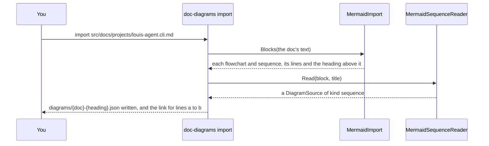

# CL60.3 The sequences

> **Plan**, CL60's third child ([the parent](CL60-docs-diagrams-as-svg.md)), written 2026-11-12 while unattended
> (Louis: "continue unattended", "until CL60 is done"), so its picks are Claude's, each the recommended of three and
> recorded below. Branch `refactor/CL60.3-docs-sequences`, from CL60.2's tip. It changes only under *Approved during
> the build*. Its sequence diagram stays in Mermaid until this child replaces it; the plan is
> deleted when this child is done.

## Context

CL60.2 turned every flowchart into a picture in Louis's joined look. The docs still hold 45 Mermaid
`sequenceDiagram` blocks in 44 files: 19 in the project docs, 16 in the architecture, the packs', the demos' and the
deploy notes, and 10 in plans. They use a small set of forms: `participant` and `actor` with an `as` name (221 and
10), calls `->>` (314), replies `-->>` (170), two plain `->`, five notes over one or two lifelines, `loop` (17),
`alt` with `else` (9 and 12), `opt` (3), `autonumber` (2), and nothing else. The biggest has 8 participants and 24
messages, and a message's words run to 106 characters. This child adds a third kind, `sequence`, to the library,
reads each block once into JSON, and swaps every block for its picture.

## Design

### What changes, in plain words

- **A sequence is data like a flow.** Its JSON names the participants (each with an icon and a tone, as a flow's
  boxes have) and lists its steps in order: a message, a reply, a note, or a block (`loop`, `opt`, `alt`) that holds
  steps of its own, with an `else` for each other case.
- **The layout** stands the participants in a row, each as wide as its name, with a dashed lifeline down from it. A
  gap between two neighbours is as wide as the longest message between them, its words wrapped at 40 characters;
  each step takes a row as tall as its words. A message to oneself turns back on its own lifeline. A block is a
  quiet frame round its steps and the lifelines they touch, its kind and label in a tab, nested frames inset.
- **The look is the flows' look:** heads as toned boxes with an icon badge, an arrow in its sender's tone, a reply
  dashed, a note as a plain panel. The docs' frame is unchanged: the title bar, the legend and the note bar.
- **The import** grows a second reader, so `import <doc>` reads sequence blocks as well as flowcharts.

### Interface design


```csharp
public sealed record SequenceSpec(IReadOnlyList<Participant> Participants, IReadOnlyList<SequenceStep> Steps,
    bool Numbered = false);
public sealed record Participant(string Id, string Label, DiagramIcon? Icon = null,
    DiagramTone Tone = DiagramTone.Plain, bool Actor = false);
[JsonPolymorphic(TypeDiscriminatorPropertyName = "step")]
[JsonDerivedType(typeof(MessageStep), "message")] [JsonDerivedType(typeof(ReplyStep), "reply")]
[JsonDerivedType(typeof(NoteStep), "note")] [JsonDerivedType(typeof(BlockStep), "block")]
public abstract record SequenceStep;
public sealed record MessageStep(string From, string To, string Text) : SequenceStep;
public sealed record ReplyStep(string From, string To, string Text) : SequenceStep;
public sealed record NoteStep(IReadOnlyList<string> Over, string Text) : SequenceStep;
public sealed record BlockStep(BlockKind Block, string Label, IReadOnlyList<SequenceStep> Steps,
    IReadOnlyList<ElseCase>? Else = null) : SequenceStep;
public sealed record ElseCase(string Label, IReadOnlyList<SequenceStep> Steps);
public enum BlockKind { Loop, Opt, Alt }
public static class SequenceLayout { public static PlacedSequence Place(SequenceSpec spec); }
internal static class MermaidSequenceReader { public static DiagramSource Read(string block, string title); }
```

### Architecture


### Communication: importing one sequence



### Object diagram (one chart in memory)


### Namespace map

| Type | Folder | Namespace | Step |
|---|---|---|---|
| `SequenceSpec`, `Participant`, `SequenceStep`, `MessageStep`, `ReplyStep` | `Sequence/Spec/` | `LouisAgent.Diagrams.Sequence.Spec` | 2 |
| `DiagramKind.Sequence`, `DiagramSource.Sequence` (changed) | `Sources/` | `LouisAgent.Diagrams.Sources` | 2 |
| `SequenceLayout`, `SequenceText` | `Sequence/` | `LouisAgent.Diagrams.Sequence` | 3 |
| `PlacedSequence`, `PlacedHead`, `PlacedRow`, `PlacedBlock` | `Sequence/Placed/` | `LouisAgent.Diagrams.Sequence.Placed` | 3 to 5 |
| `NoteStep` | `Sequence/Spec/` | `LouisAgent.Diagrams.Sequence.Spec` | 4 |
| `BlockStep`, `ElseCase`, `BlockKind` | `Sequence/Spec/` | `LouisAgent.Diagrams.Sequence.Spec` | 5 |
| `SequenceRenderer` | `Svg/` | `LouisAgent.Diagrams.Svg` | 6 |
| `MermaidSequenceReader` | `src/tools/louis-agent.doc-diagrams/Mermaid/` | `LouisAgent.DocDiagrams.Mermaid` | 7 |
| `SequenceReaderTests`, `SequenceLayoutTests`, `SequenceBlocksTests` | `src/tests/web/louis-agent.diagrams.tests/Sequence/` | `LouisAgent.Diagrams.Tests.Sequence` | 2 to 6 |
| `MermaidSequenceReaderTests` | `src/tests/tools/louis-agent.doc-diagrams.tests/Mermaid/` | `LouisAgent.DocDiagrams.Tests.Mermaid` | 7 |

### Folder tree (after)

```
src/web/louis-agent.diagrams/Sequence/
├── Spec/      # SequenceSpec, Participant, SequenceStep and its four kinds, ElseCase, BlockKind
├── Placed/    # PlacedSequence, PlacedHead, PlacedRow, PlacedBlock
└── SequenceLayout.cs, SequenceText.cs
```

## Steps

One commit each, test first, seen failing.

1. **This plan**, its two flow pictures drawn.
2. **The sequence source.** `DiagramKind.Sequence`, the spec records, messages and replies; the reader refuses a step
   naming a participant that isn't there, and an empty chart. Tests: each step read; the refusals; written back
   the same by `DiagramWriter`.
3. **The layout.** Heads in a row, gaps sized by the messages between neighbours, a row per step, words wrapped at
   40 characters, a message to oneself. Tests with numbers: no two heads overlap, every message's words inside its
   gap, rows in order, a self message beside its lifeline.
4. **Notes and numbers.** A note over one lifeline or across several; `numbered` puts 1, 2, 3 before each message.
   Tests: a note spans the lifelines it names; the numbers run in order through blocks.
5. **Blocks.** `loop`, `opt` and `alt` with its `else` cases, nested. Tests: a frame holds every step inside it and
   the lifelines they touch; a nested frame inside its parent; an `else` line between cases.
6. **The renderer.** `SequenceRenderer` in the flows' look; `RenderTitled` frames it unchanged. A golden
   `Sequence/sequence.svg`, looked at by eye.
7. **The import.** `MermaidSequenceReader` reads the forms above (`<br/>` and `#59;` too); `import` writes both kinds.
   Tests: each form on a sample; a doc with a flowchart and a sequence.
8. **The project docs' sequences** (19), imported, toned, noted, looked at, swapped; `DocsDiagramsTests` checks a
   sequence's words keep inside its drawing and off each other.
9. **The rest:** the 16 outside the plans and the 10 in plans, the same way.
10. **No sequence left.** A test that no doc holds a `sequenceDiagram` block; the how-to, the project doc, the work
    log; this plan deleted, its picks in the project doc.

## Verification

- **Each step:** the diagrams' tests, the tool's, `core.tests` when a folder or project changes.
- **By eye, free:** every picture in headless Edge, at its own size.
- No paid run.

## Concepts, and where they sit in GOAL.md

- **Extensibility** (skill 20): a third kind through the same reader, frame and tool, a Strategy per kind.
- **Testing and shipping** (skill 18): numbers a test can hold (inside, apart, in order) in place of a look.

## Claude's picks (2026-11-12, unattended), each of three

| # | Question | Picked | The other two |
|---|---|---|---|
| Q1 | How a step's kinds are held | **A Composite of records**: an abstract `SequenceStep`, one record per kind, a block holding steps; System.Text.Json's polymorphism reads them by a `step` field ([Refactoring.Guru: Composite](https://refactoring.guru/design-patterns/composite), [Microsoft: polymorphic serialization](https://learn.microsoft.com/dotnet/standard/serialization/system-text-json/polymorphism)) | One record with every field optional and a kind: the reader must police which fields go together · Separate lists of messages, notes and blocks with row numbers: the order lives in numbers a person must keep right |
| Q2 | How a long message reads | **Wrapped at 40 characters above its arrow**, the gap widened to the longest line | One line, the gap as wide as it needs: charts of 1,500 px and more · Cut with an ellipsis: words lost |
| Q3 | What a participant looks like | **A flow box**: an icon badge and a tone with the same meanings, so the legend reads the same | Plain grey heads: the docs' charts would look two ways · A head at the top and again at the bottom, as Mermaid does: twice the height for a long chart, little gain |
| Q4 | How a sequence is checked | **Numbers in the layout tests, and a docs-wide check** that words stay inside and apart, as the flows have | Layout tests only: a real chart's long words go unchecked · By eye only: what CL60.2 showed misses things |

## Approved during the build

- **The interface design is a picture too** (Louis: "we need to do the interface design also", 2026-11-12): the
  plan's class diagram is drawn as a flow picture, the types as boxes with their members and the step that builds
  them, the step's four kinds in a frame with dashed arrows, the C# signatures kept under it. CL60.4's class layout
  will draw such charts as classes; until then a plan's interface design may be a flow picture.

---
[Docs index](../README.md) · [Plans](README.md) · Parent: [CL60](CL60-docs-diagrams-as-svg.md) · Next: CL60.4
