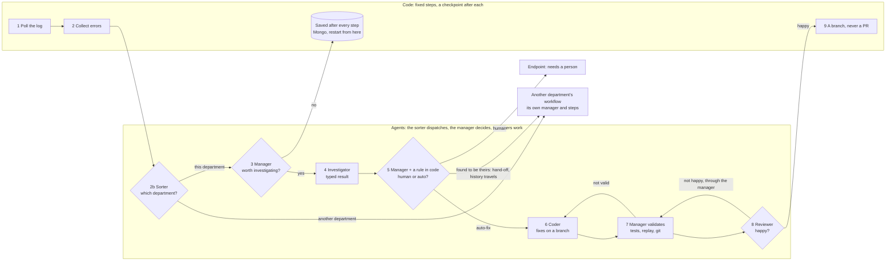

# Draft: F106 The framework's track, before the agents

> **Plan draft, not yet approved.** Written on 2026-11-07 from Louis's decision to "focus on the framework first then
> build the agents" (an hour earlier: "they must run in parallel"; the later word wins), and from a positioning page ChatGPT wrote for him (in the project files,
> `research/louis-agent-positioning-chatgpt-2026-11-07.md`). The open choices below go to Louis one at a time, three
> options each (the development guide, rules 10 and 11); when they are settled this becomes the parent plan he
> approves, and each child gets its own plan when it starts.

## Context

Until now the roadmap sold configured agents first and the engine only after Phase 10, which itself waited for every
engine feature (Louis, 2026-10-20). On 2026-11-07 Louis changed the order: **the framework first, then the agents**.
The framework's track runs now; the configured agents (the practice assistant, "get paid") are built afterwards, on
that framework, the way a developer who bought it would build them. Nothing in Phases 4 to 9 is dropped; they come
after this track's first children, and the demand check (F62) keeps running meanwhile.

What changes is *when* the framework work starts, not what the engine is. The split ChatGPT describes (the engine is
how, an identity is who, a pack is what, a composition root brings them together) is the split we already have
(ADR 0027, ADR 0076, ADR 0092), plus a fourth concept Louis named on 2026-11-07, the workflow (below).

## The positioning

- **In one line:** louis-agent is the application framework for AI agents in .NET. Build, extend, evaluate and run
  agents on a modular architecture with reusable packs, without assembling the infrastructure yourself.
- **The test for every framework feature:** does this make it easier for a .NET developer to build, extend, test or
  operate an agent application? If it only adds an abstraction, it needs a stronger reason (ADR 0055, keep it simple).
- **What we don't claim:** that we are the only framework with provider choice, local models, tools, multi-agent,
  telemetry or evals. Others have them. The claim is the whole path being simpler and more coherent, and that has to
  be shown, not said.
- **The comparison that matters** is Microsoft Agent Framework, because it targets the same .NET developers. The
  answer is a measured side-by-side, not a feature list.
- **"ABP for AI"** (ABP is a known .NET application framework with modules and conventions) describes the direction
  well, but leans on another product's name. Whether it is used in public is an open choice below.

## How it compares, and what stays

Louis asked ChatGPT how Microsoft Agent Framework and LangGraph organise the same job (2026-11-07). Its reading:
Microsoft centres on an *agent* (model, instructions, tools, a session) with *workflows* that connect agents and
functions; LangGraph centres on a *graph* (state, nodes, edges, checkpoints) that controls how work moves. Both give a
developer building blocks for executing agents and workflows; ours gives a way to package and compose whole agent
applications: the engine is how, an identity is who, a pack is what, and a pack is written once and used by several
identities. That split stays (ADR 0027); it is a convention the others could follow but don't make foundational,
and it is the scenario F106.4's side-by-side should build: one shopping or recipes pack used by two identities, in
both frameworks.

What that reading changes here:

- **Workflow is the fourth concept, and it is an engine capability** (Louis, 2026-11-07: "workflow to me means how
  multiple steps and agents coordinate", then: "how one agent can delegate to another, make decisions on that";
  "abandon the workflow identity idea"). The four: the **engine** is how an agent runs, an **identity** is who it is,
  a **pack** is what it can do, a **workflow** is how one agent delegates to another, hands off, and decides on what
  comes back. It is built into the engine (F39 Part A: one delegation function, typed results checked in code, one
  policy per turn tree, ADR 0031), never as an identity: F39's Part B, the `voorman` orchestrator as an identity, is
  dropped, and what remains of it is a demo of the engine's workflow.
- **The framework must demonstrate a real-world, complex workflow** (Louis, 2026-11-07), not only have the rungs: that is
  F106.3, triage and fix a service (below), chosen over a debtors chase and a cook-for-the-week.
- **Two things the framework must have** (Louis, 2026-11-07), pulled up the list to right after the builder:
  **hand-off**, one agent handing a conversation to another (F39 Part A's hand-off to a named peer), and
  **conversations saved to Mongo so a person can restart them** (F43's durable sessions). Both are what Microsoft's
  framework calls workflows, sessions and checkpointing, and F106.4 compares them.
- **The rungs to a workflow**, one small PR with its eval each: (1) one agent calls another and gets text back
  (built: specialists and minions); (2) a conversation is saved and picked up again, F43; (3) the result is typed, a C#
  record checked in code; (4) the parent decides on it in code: accept, retry, hand to a person; (5) hand-off, the
  whole conversation to a named peer, the person keeps talking; (6) one policy per turn tree: depth, rounds, money;
  (7) several of those in a row, saved at each step, is a workflow; a named type only if the chain repeats one shape.
  Rungs 3 to 6 are F39 Part A.

The triage workflow, drawn (the page: <https://claude.ai/artifact/46LjmREMUbUWrfNbwM6VSU>). Code runs the fixed steps
and saves after each; the manager decides and checks; the others work; a branch is left, never a PR:


- **What to study in Microsoft's framework** before F106.4 (its own docs, not a summary): its agent loop, session state
  and persistence, middleware pipeline, workflow execution, human-in-the-loop, checkpointing and tool permissions.
  Each maps to a phase of ours (F43, F41, F42, F39), so the comparison also tells us where our phases stand.

## Where we are and where the API should get to

Today a host composes by hand: it builds an `AgentCatalog` and `HostServices`, calls `AgentHost.Build`, and hands the
result to `AddLouisAgentApi` (see `demos/starter/hosts/louis-agent.starter-api/Program.cs`). The packs a demo uses are
named in one place (`demos/puls/hosts/louis-agent.host-packs`). It works, but a newcomer has to know four types before
their first agent answers.

The direction ChatGPT sketched, as an illustration only (no such API exists yet):

```csharp
var builder = AgentApplication.CreateBuilder(args);
builder.AddOllama("qwen3");
builder.AddPack<CalculatorPack>();
builder.AddIdentity<MyAssistant>();
await builder.Build().RunAsync();
```

This is roughly the registration API the Phase 10 draft already asks for (`AgentCatalog.Add`), pulled forward.

## Proposed children

Each its own plan, branch and pull request, about ten steps at most; the order is the first open choice.

| Child | What | Done when (proposed) |
|---|---|---|
| F106.1 | A builder for the common path: providers, packs and an identity registered in a few lines, on top of today's `AgentHost.Build`, which stays as the escape hatch | The starter's API program composes through it, and a test builds an agent with one pack in under ten lines |
| F106.2 | The framework's own docs: "your first agent in ten minutes", then "write a pack" and "write an identity", on the engine's site | Someone who isn't Louis follows the first guide to a working agent, timed |
| F106.3 | The real-world workflow the framework demonstrates (Louis's pick, 2026-11-07): **triage and fix a service**, as Louis described it: a job polls a log (or an error feed) and code collects the errors; a **sorter** (an identity) sends each error to the department it belongs to, each department a workflow of its own: the same identities and packs, configured once per department with its own repo, log and people, and its manager can reach only its own repo, held in code by the workspace boundary (Louis, 2026-11-07: "send this error to this department"; "each department has a manager agent coding their systems, but he has only access to his repo"); in the code department a **manager** (an identity) decides which are worth investigating; an **investigator** (an identity) digs into one and reports back a typed result; on it the manager decides human intervention (raised to people at an endpoint) or auto-handling, and what can be auto-fixed goes to the **coder** (the coding identity), which fixes on a branch; the manager validates the changes and hands them to a **reviewer** (an identity); a review that isn't happy goes back to the coder *through the manager*, and the loop runs until the reviewer is happy or the cap stops it. **Every result passes through the manager, who checks everyone** (a hub, never agent to agent). **A hand-off between two managers** (Louis, 2026-11-07): when the investigator finds the error isn't in the code but in another area (the database, the hosting), the code manager hands the case to that area's manager, who runs his own workflow on it; the saved conversation travels with it, so nothing is investigated twice. Delegation is "do this and report back", the case stays; a hand-off is "this is yours now", the case leaves with its history. **Built from identities and packs** (Louis, 2026-11-07: "we can do all this with identities and packs"): the four agents are identities, their abilities the git, dotnet, files and shell packs plus a small triage pack (the log feed, the human endpoint); the workflow is only the engine's part between them (who may call whom, typed results, hand-off with history, the save after each step, the cap), used by the manager's prompt and about a page of host code: **a branch is left with the fix, never a PR**. The agents decide (the "model where it depends" half); the polling, the collecting, the caps on the loops and the saved conversations are code (the "fixed steps" half; Louis's pick over code-only and agent-only). Built on F39 Part A's rungs and F43's saved conversations, from the framework's public parts only, as a simulation over a made-up service | It runs end to end as a C# eval (ADR 0029), survives a restart mid-way, raises at least one error to the human endpoint, runs at least one coder-reviewer round, hands at least one case out of this workflow into a second department's workflow (the same identities and packs on another repo), with its history, and a test shows a department's coder cannot touch another department's repo, leaves at least one fixed branch, and references no Puls project; the triage case in the [F39 draft](F39-orchestration.md) is its source |
| F106.4 | The side-by-side: the same small application built in louis-agent and in Microsoft Agent Framework, same model, tools, delegation case and eval set | A results page compares lines of code, setup, time to build, eval scores, cost, and what debugging was like; a paid run only on Louis's go |
| F39 | The workflow in the engine: delegation, hand-off to a named peer, the decision on a typed result (Part A; Part B's identity dropped) | A hand-off between two agents in one conversation, checked by an eval; see its [draft](F39-orchestration.md) |
| F43 | Conversations saved to Mongo, so a person can restart one after a restart or on another device | A session survives the API restarting and continues where it was |
| F74 | Packaging in place (the Phase 10 draft's Stage A): public surface declared, reproducible build, a package and a consumer test built from it | Moves into this track; Stage B (its own repo) stays after the engine features |

## Open choices, one at a time

1. **What the track builds first** (F106.1, F106.2, F106.3 or F106.4).
2. **The shape of the builder** (its pattern: a builder of its own like `WebApplication.CreateBuilder`, extension
   methods on the .NET generic host, or a fluent sub-builder like `AddIdentityCore`).
3. **"ABP for AI" in public or only as an internal compass.**
4. **When packaging (F74's Stage A) starts**, now in this track or after F106.1.

## Concepts

Framework design and developer experience (skill 18, testing and shipping: a package a stranger can use), the
composition root and dependency injection, and measuring a framework against another (skill 12, evaluation, applied
to the framework itself rather than an agent).
