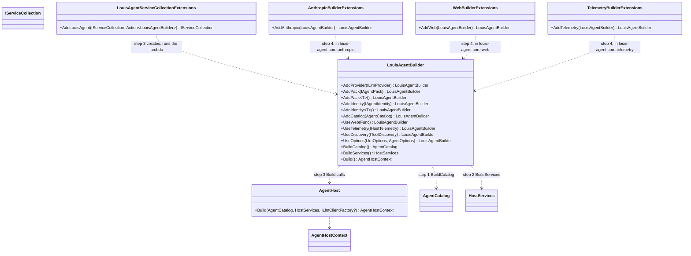

# F106.1 A builder for the common path

> **Plan, for Louis's approval** (2026-11-07). The first child of [F106 The framework's track](F106-framework-track.md).
> Louis's picks on the way here: the builder first (over the docs or the side-by-side), and its shape a **sub-builder
> on the .NET host**, the way `AddAuthentication().AddCookie()` works. Once approved it is copied onto its branch,
> `feature/F106.1-agent-builder`, and changes only under *Approved during the build*.

## Context

Today a host program composes by hand. It needs four of our types before an agent answers: an `AgentCatalog` (the
identities and packs), a `HostServices` (the web, the tracer, the discovery, the model providers), `AgentHost.Build`
(the bootstrap: settings, prices, the ledger, the engines) and the `AgentHostContext` it returns, which the API's
`AddLouisAgentApi(host)` and `MapLouisAgentApi(host)` then take by hand
(`demos/starter/hosts/louis-agent.starter-api/Program.cs`, `demos/puls/hosts/louis-agent.puls-api/Program.cs`). It
works, and it is what every .NET developer meets first. The framework's track is judged by one question, does this
make an agent application easier to build, extend, test or operate, and this is the first place a developer would
answer no.

**Done when:** the starter's API program composes through the builder, a test builds an agent with one pack in under
ten lines, and no behaviour changes: the golden files and every existing test stay as they are.

## Design

### The pattern, and why this one

A **sub-builder** (Microsoft's own convention for a library that plugs into dependency injection: `AddAuthentication`
returns an `AuthenticationBuilder`, `AddIdentityCore<T>` an `IdentityBuilder`, `AddMvc` an `IMvcBuilder`; the docs call
it the "builder pattern over `IServiceCollection`"), which is the Gang of Four's **Builder** (build a complex object
step by step, Refactoring.Guru's description) with Fowler's **Fluent Interface** for the calls. The two alternatives
Louis saw: an own `AgentApplication.CreateBuilder(args)` like `WebApplication` (reads best in a README, but we would
own a second start-up lifecycle beside the generic host's), and a catalogue builder alone (the smallest change, but a
first agent still needs four types). The sub-builder fits any .NET app shape, needs no lifecycle of its own, and the
`AgentApplication` wrapper can be laid over it later if the docs want it.

The rule it follows is ADR 0092: a plain name sits below core, a dotted name sits on the thing before the dot. So the
builder itself is in core, and each `Add…` for a provider or a service is an extension method in that provider's or
service's own project: `AddAnthropic()` in `louis-agent.core.anthropic`, `AddWeb()` in `louis-agent.core.web`,
`AddTelemetry()` in `louis-agent.core.telemetry`. Core keeps referencing no SDK.

### What the common path becomes

```csharp
var builder = WebApplication.CreateBuilder(args);
builder.Services.AddLouisAgent(agent => agent
    .AddAnthropic().AddOllama()
    .AddWeb().AddTelemetry()
    .AddPack<CalculatorPack>()
    .AddIdentity<PulsIdentity>());
builder.AddLouisAgentApi();           // takes the AgentHostContext from the services
var app = builder.Build();
app.MapLouisAgentApi();
app.Run();
```

`AddLouisAgent` collects what the lambda adds into a `LouisAgentBuilder`, then calls today's `AgentHost.Build` once
with the catalogue and the services it collected, and registers what came back as singletons: `AgentHostContext`,
`AgentEngine`, `AgentEngineFactory` and the `AgentCatalog`. `AgentHost.Build` stays public as the escape hatch, so a
host that wants the parts by hand keeps them. The settings still come from the environment and the `.env` files, as
`AgentHost.Build` reads them today; `UseOptions(LlmOptions, AgentOptions)` on the builder is for tests and for a host
that has its own settings source.

A pack is added by instance or by type: `AddPack(new RecipesPack(RecipesOptions.FromEnvironment()))` where a pack
takes settings, `AddPack<CalculatorPack>()` where it has a parameterless constructor. `AddCatalog(AgentCatalog)`
takes a catalogue built elsewhere, so Puls's `Plugins.FromEnvironment()` (names from `IDENTITIES` and `PACKS`) keeps
working unchanged on the builder.

### Interface design



The C# beside it:

```csharp
// louis-agent.core/Hosting/Builder/LouisAgentBuilder.cs (steps 1 to 3)
public sealed class LouisAgentBuilder
{
    public LouisAgentBuilder AddProvider(ILlmProvider provider);
    public LouisAgentBuilder AddPack(IAgentPack pack);
    public LouisAgentBuilder AddPack<TPack>() where TPack : IAgentPack, new();
    public LouisAgentBuilder AddIdentity(IAgentIdentity identity);
    public LouisAgentBuilder AddIdentity<TIdentity>() where TIdentity : IAgentIdentity, new();
    public LouisAgentBuilder AddCatalog(AgentCatalog catalog);           // a catalogue built elsewhere, whole
    public LouisAgentBuilder UseWeb(Func<AgentOptions, ReplayStore?, IWebAccess> web);
    public LouisAgentBuilder UseTelemetry(IHostTelemetry telemetry);
    public LouisAgentBuilder UseDiscovery(IToolDiscovery discovery);
    public LouisAgentBuilder UseOptions(LlmOptions llm, AgentOptions agent); // else from the environment
    public AgentCatalog BuildCatalog();   // the identities and packs added, checked as AgentCatalog checks today
    public HostServices BuildServices();  // the providers and services added, null where none
    public AgentHostContext Build();      // AgentHost.Build(BuildCatalog(), BuildServices()) once
}

// louis-agent.core/Hosting/Builder/LouisAgentServiceCollectionExtensions.cs (step 3)
public static IServiceCollection AddLouisAgent(this IServiceCollection services, Action<LouisAgentBuilder> configure);

// louis-agent.core.anthropic/AnthropicBuilderExtensions.cs (step 4), and the same for Ollama, OpenAI, web, telemetry
public static LouisAgentBuilder AddAnthropic(this LouisAgentBuilder builder) =>
    builder.AddProvider(AnthropicProvider.Instance);
```

### Architecture


### Communication, the main case


### Objects in memory, the main case


The builder itself is gone after `AddLouisAgent` returns: it is a recipe, not a service.

### Folder trees

Core's `Hosting/` today and after (only the new folder):

```
src/engine/louis-agent.core/Hosting/          src/engine/louis-agent.core/Hosting/
├── AgentEngineFactory.cs                     ├── AgentEngineFactory.cs
├── AgentHost.cs                              ├── AgentHost.cs
├── AgentHostContext.cs                       ├── AgentHostContext.cs
├── Discovery/                                ├── Builder/                              (new, steps 1 to 3)
├── Engines/                                  │   ├── LouisAgentBuilder.cs
├── EnvFiles/                                 │   └── LouisAgentServiceCollectionExtensions.cs
├── HostServices.cs                           ├── Discovery/
├── Messages/                                 ├── Engines/
├── Prompts/                                  ├── EnvFiles/
├── SessionLlms/                              ├── HostServices.cs
├── ToolsOnlyChatClient.cs                    ├── Messages/
└── UsageLedger.cs                            ├── Prompts/
                                              ├── SessionLlms/
                                              ├── ToolsOnlyChatClient.cs
                                              └── UsageLedger.cs
```

Each dotted project gets one file at its root: `AnthropicBuilderExtensions.cs`, `OllamaBuilderExtensions.cs`,
`OpenAiBuilderExtensions.cs`, `WebBuilderExtensions.cs`, `TelemetryBuilderExtensions.cs` (step 4). Tests mirror:
`src/tests/engine/louis-agent.core.tests/Hosting/Builder/`.

### What it does not do

- No new lifecycle: no `RunAsync`, no `AgentApplication`. The .NET host runs the app as it does today.
- No change to `AgentHost.Build`, `AgentCatalog` or `HostServices`: the builder calls them. Their tests stay.
- No settings redesign: `LLM_PROVIDER`, `IDENTITIES`, `PACKS` and the `.env` files are read as today.
- The CLI, the ACP host and the MCP host are not moved onto it in this plan; F47 and the next children decide that.
  They keep calling `AgentHost.Build` directly.

## Steps

One commit each, its test first and seen failing; the review stop after each. Core's new package reference is
`Microsoft.Extensions.DependencyInjection.Abstractions` only (the `IServiceCollection` contract; `CorePackagesTests`
lists it).

| # | Step | Test first | Commit |
|---|---|---|---|
| 1 | `LouisAgentBuilder` with `AddPack`, `AddPack<T>`, `AddIdentity`, `AddIdentity<T>`, `AddCatalog` and `BuildCatalog()` | A builder with one fake pack and one fake identity builds a catalogue whose toolsets are the pack's; `AddCatalog` and `AddPack` together refuse (one source or the other) | `feat(f106.1): step 1 - a builder collects the identities and packs` |
| 2 | `AddProvider`, `UseWeb`, `UseTelemetry`, `UseDiscovery`, `UseOptions`, `BuildServices()` | The `HostServices` built holds the provider added, and `None`'s parts where nothing was added | `feat(f106.1): step 2 - the builder collects the host's services` |
| 3 | `Build()` and `services.AddLouisAgent(configure)`: `AgentHost.Build` once, four singletons | `new ServiceCollection().AddLouisAgent(a => a.UseOptions(…).AddProvider(stub).AddPack(fake))` resolves an `AgentHostContext`, an `AgentEngine` and the `AgentCatalog`, the same instance twice | `feat(f106.1): step 3 - AddLouisAgent registers the host in DI` |
| 4 | `AddAnthropic()`, `AddOllama()`, `AddOpenAiCompatible()`, `AddWeb()`, `AddTelemetry()` in their own projects | Each test project (anthropic, ollama, openai, web, telemetry) has one test: the builder's services hold that provider or service | `feat(f106.1): step 4 - each provider and service adds itself to the builder` |
| 5 | The API: `AddLouisAgentApi()` and `MapLouisAgentApi()` overloads that take the context from DI; the old overloads stay | An API test host built through `AddLouisAgent` answers `GET /v1/info` as the hand-built one does | `feat(f106.1): step 5 - the API takes its host from DI` |
| 6 | The starter's and Puls's API programs on the builder; `host-packs` keeps `Plugins.FromEnvironment()` and hands it to `AddCatalog` | The site tests that start the programs stay green; the golden files unchanged | `refactor(f106.1): step 6 - the starter and Puls compose through the builder` |
| 7 | The first-agent test: one pack, one provider stub, under ten lines, in `louis-agent.core.tests/Hosting/Builder/FirstAgentTests.cs`, written as the sample a reader copies | The test itself; a convention test counts its statements (≤ 10) so the sample can't grow quietly | `test(f106.1): step 7 - a first agent in under ten lines` |
| 8 | Docs: ADR 0096 *A host composes through the builder*, the how-to in core's `CLAUDE.md` (*Adding a host*), the core design doc, the starter guide; the work-log row; this plan deleted | Docs only | `docs(f106.1): step 8 - ADR 0096, the how-to, the plan closed` |

## Verification

- **Tests:** `louis-agent.core.tests` after steps 1 to 3 and 7; the five provider and service test projects after step 4;
  `louis-agent.api.tests` after step 5; `louis-agent.code-review.tests` and `louis-agent.puls.tests` after step 6; the full
  suite once, after step 8. The golden files must not change at any step (no prompt, tool or text changes).
- **Free manual check:** `dotnet run` the starter API from the builder, open `/v1/info`, see the same catalogue as
  before; the same for Puls's API with `IDENTITIES=puls`.
- **No paid run:** nothing here talks to a model.

## Concepts

- **The composition root** (Mark Seemann's name for the one place an application wires its parts): `AddLouisAgent` is
  where a host's composition root meets ours. Skill 18 in [GOAL.md](../GOAL.md), testing and shipping: a framework a
  stranger can start.
- **The sub-builder over `IServiceCollection`**: how a .NET library joins an application's dependency injection without
  owning its lifecycle, the convention Microsoft Agent Framework and Semantic Kernel follow too (`AddKernel`,
  `AddAIAgent`), which F106.4's side-by-side will compare line for line.
- **Builder and Fluent Interface**: the Gang of Four's Builder for an object built step by step, Fowler's Fluent
  Interface for calls that read as a sentence; named in each class's `<remarks>` (ADR 0050).
- **The escape hatch** (ChatGPT's principle 4, "do not hide the escape hatches"): `AgentHost.Build` stays public, so
  the common path is short and the long path is still there.

---
[Plans](README.md) · Parent: [F106 The framework's track](F106-framework-track.md)
