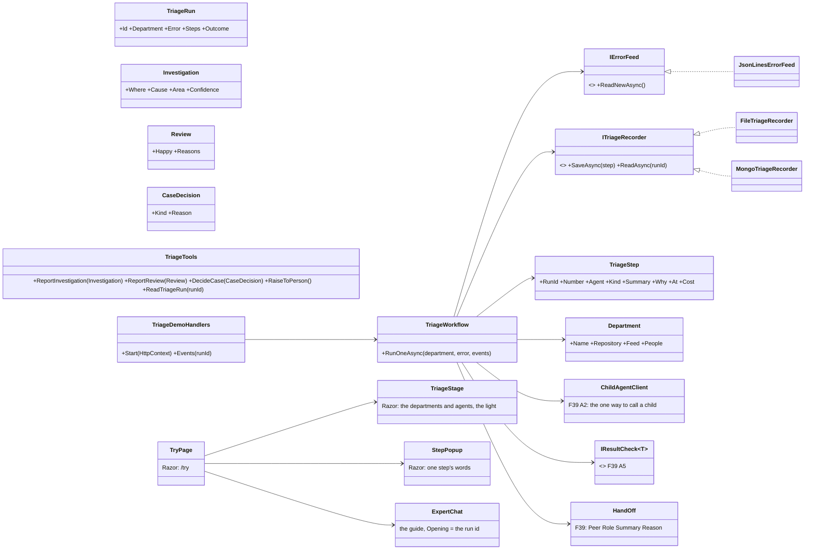

# F106.3 Triage and fix a service, and the demo a visitor watches

> **Plan, for Louis's approval** (drafted 2026-11-08, the night F109.4 merged). The third child of
> [F106 The framework's track](F106-framework-track.md): the real-world workflow the framework demonstrates, and its
> page on the site. It is a parent with five children, each its own plan, branch and PR when it starts. Nothing here
> is built; the one choice that spends money is at the end, three options, for Louis. Once approved it is copied onto
> `feature/F106.3-triage-and-fix-a-service` and changes only under *Approved during the build*.

## Context

**What Louis asked.** On 2026-11-07, the workflow: a job polls a log and code collects the errors; a **sorter** sends
each error to its department; in the code department a **manager** decides what is worth investigating; an
**investigator** digs into one and reports a typed result; the manager decides a person or an auto-fix; the **coder**
(the coding identity) fixes on a branch; the manager validates and hands the fix to a **reviewer**; an unhappy review
goes back to the coder through the manager until the reviewer is happy or a cap stops it; every result passes through
the manager, a hub, never agent to agent; a case found to be another area's is **handed off** to that area's manager
with its saved conversation; a branch is left, never a PR; "we can do all this with identities and packs". On
2026-11-08, the site: "this must just let the user see the demo, no real chat but it should actually do triage right
there, and the user must see it happen, the flow"; "and then it must be explained what is happening"; "with popups as
the process is going forward"; "our AI in right hand bottom must show there and must be able to explain what is
happening to the user".

**What exists.** The orchestrator proof of concept (`demos/louis-agent/hosts/louis-agent.orchestrator`): polls a
JSON-lines error log, triages with runbooks, has the coding agent fix on a branch over the API, checks the fix in code
(commit, replay, tests) and records the decision; its sample service went in CL10, so it watches nothing today. The
engine delegates to specialists and minions (`Delegation/`), answers come back as prose, limits live in seven places;
[the F39 draft](F39-orchestration.md) says what is wrong with that and plans Part A: one delegation function, typed
results checked in code, a hand-off to a named peer, one policy per turn tree. F43 plans conversations saved to Mongo.
The site has the guide in its corner behind the open door with a cap per address per day (ADR 0099), and its *Try it*
leads to the chat until this feature (ADR 0100).

**What it depends on, in order.** F106.1 (the builder, approved shape, not built) is what a developer reading the demo
should see it composed with; F39 Part A's rungs 3 to 6 (a typed result, the decision in code, the hand-off, the policy)
are what the workflow is made of; F43's checkpoints are what lets it survive a restart. The children below say which
of them each needs, and two of the five need none, so they can start first.

## Design

### The shape, in plain words

- **One identity, three roles, and the coder.** The triage identity (`louis-agent.identity.triage`) is the manager:
  its voice is the hub's. The sorter, the investigator and the reviewer are its roles, level-1 sessions with only the
  tools their job needs and a file that says how to work and what to report back. The coder is the coding identity
  as it is, reached as a peer with the fixing toolset. One identity with roles, not four identities, because the
  three only ever work for the manager and share its packs (ADR 0017, 0027).
- **A department is configuration, not code.** `Department(Name, Repository, Feed, People)`: the same identity and
  packs, once per department, with its own repository, its own error feed and its own human endpoint. The workspace
  boundary holds a department's coder to its repository in code, and a test proves a coder in one department cannot
  touch another's.
- **The triage pack holds the tools.** `louis-agent.pack.triage`: the error feed (`IErrorFeed`, JSON-lines first; a
  webhook is F100), the recorder of every step (`ITriageRecorder`, the F43 store when it lands, a file until then),
  the human endpoint (`RaiseToPerson`, which writes a case a person reads), the decision tools whose arguments are C#
  records checked in code (`ReportInvestigation`, `ReportReview`, `DecideCase`), and `ReadTriageRun`, which anyone
  with the toolset reads a run's steps with, the guide included.
- **The workflow is code between the agents.** `TriageWorkflow` runs the fixed steps: poll, collect, ask the sorter,
  per department ask the manager, run the investigation, decide, run the coder and reviewer rounds under a cap,
  validate in code (the commit is on the branch, the replay passes, the tests pass), record after every step, hand a
  case off with its history when the investigator says it is another area's. The agents decide; the loop, the caps,
  the checks and the saves are code (Louis's pick: fixed steps where the steps are known, a model where the next step
  depends on what was found).
- **The demo page is the workflow watched live.** `/try` on the site: a visitor presses *Start*, the API runs one
  triage of the made-up service's next error through the open door (ADR 0099's cap, a second open identity), and
  streams a `triage_step` event per step on the one event contract (ADR 0047). The page draws the departments and
  agents as a stage (the films' look, CSS), lights the agent at work, and opens a popup per step beside it that says in
  plain words what the agent is doing and why, then gives way to the next; the visitor types nothing. The guide in the
  corner stays on the page, its session opened with the run's id as its first message, and reads the run's steps with
  `ReadTriageRun` when asked, so it explains what is happening from the run itself (a tool, not a prompt rule,
  ADR 0080). The header's *Try it* and the hero's button lead here; the coding chat at `/chat` stays behind a sign-in.
- **A made-up service with real bugs.** `demos/louis-agent/samples/order-service`: a small ASP.NET Core service with
  ten seeded bugs and a log that writes `errors.jsonl` when a request fails (the POC's service, rebuilt), plus a second
  department's repository (an ops repository with a configuration bug) for the hand-off. Each visitor's triage takes the
  next error, so a day's visitors see different cases, and the fix lands on a branch of a throwaway clone.

### Interface design



The signatures beside it (the engine types are F39 Part A's, named as its draft names them):

```csharp
// packs/tools/louis-agent.pack.triage (F106.3.1)
public interface IErrorFeed { IAsyncEnumerable<ServiceError> ReadNewAsync(CancellationToken ct); }
public interface ITriageRecorder { Task SaveAsync(TriageStep step, CancellationToken ct); Task<TriageRun?> ReadAsync(string runId, CancellationToken ct); }
public sealed record ServiceError(string Id, DateTimeOffset At, string Service, string Method, string Message, string Stack);
public sealed record TriageStep(string RunId, int Number, TriageAgent Agent, TriageStepKind Kind, string Summary, string Why, DateTimeOffset At, decimal? Cost);
public sealed record Investigation(string Where, string Cause, DepartmentArea Area, Confidence Confidence);
public sealed record Review(bool Happy, IReadOnlyList<string> Reasons);
public sealed record CaseDecision(CaseDecisionKind Kind, string Reason);   // Ignore, Investigate, Person, AutoFix, HandOff
public sealed record Department(string Name, string Repository, string Feed, Uri People);
// demos/louis-agent/identity/louis-agent.identity.triage (F106.3.2, F106.3.3)
public sealed class TriageIdentity : IAgentIdentity;                           // voice: the manager; roles: sorter, investigator, reviewer
public sealed class TriageWorkflow(ChildAgentClient children, ITriageRecorder recorder, IResultCheck<FixResult> check, TriagePolicy policy)
{ public Task<TriageRun> RunOneAsync(Department department, ServiceError error, IProgress<TriageStep> events, CancellationToken ct); }
public sealed record TriagePolicy(int CoderReviewerRounds, TimeSpan PerCase, decimal MoneyPerCase);
// src/hosts/louis-agent.api (F106.3.4): a demo route behind the open door, events on the one contract
public sealed record TriageStartReply(string RunId);
public sealed record TriageStepEvent(string Type, TriageStep Step);          // type: "triage_step"; "triage_done" ends it
// src/web/louis-agent.web (F106.3.4): the widget gains an opening message a page hands it
[Parameter] public string? Opening { get; set; }                              // sent once when the session opens, shown as a note
```

### Architecture


### Communication: a visitor watches one triage

```mermaid
sequenceDiagram
    actor V as Visitor
    participant P as /try (the page)
    participant A as louis-agent.api
    participant W as TriageWorkflow
    participant S as Sorter / Manager / Investigator / Reviewer (roles)
    participant C as Coder (the coding identity, a peer)
    participant G as The guide (ExpertChat)
    V->>P: Start
    P->>A: POST /v1/demos/triage (no key; the door counts the address)
    A->>W: RunOneAsync(department, next error, events)
    A-->>P: 201 {run_id}; the page opens the event stream
    P->>G: open the guide's session with Opening = "run 7f3a on the triage demo"
    W->>S: sorter: which department? (typed: Department)
    W-->>P: triage_step 1 "Sorter: this is the code department's" + why
    P->>V: popup 1 beside the sorter
    W->>S: manager: worth investigating? (typed: CaseDecision)
    W-->>P: triage_step 2
    W->>S: investigator: where and why? (typed: Investigation)
    W-->>P: triage_step 3
    W->>W: in code: Area is ours, Confidence high -> AutoFix; else Person or HandOff
    W->>C: fix on a branch (ReportFixResult)
    W->>W: in code: commit on the branch, replay passes, tests pass
    W-->>P: triage_step 4, 5
    W->>S: reviewer: happy? (typed: Review); not happy -> back to the coder, through the manager, within the cap
    W-->>P: triage_step 6 .. n
    W-->>P: triage_done {outcome: fixed on branch fix/…, or raised to a person, or handed off}
    V->>G: "what just happened?"
    G->>A: ReadTriageRun(run_id)
    G-->>V: the steps, in plain words, naming the agents
```

### Objects in memory: one run


### Namespace map

| Type | Folder | Namespace | Child |
|---|---|---|---|
| `IErrorFeed`, `JsonLinesErrorFeed`, `ServiceError` | `packs/tools/louis-agent.pack.triage/Feed/` | `LouisAgent.Packs.Triage.Feed` | 3.1 new |
| `ITriageRecorder`, `FileTriageRecorder`, `TriageRun`, `TriageStep`, the enums | `packs/tools/louis-agent.pack.triage/Runs/` | `LouisAgent.Packs.Triage.Runs` | 3.1 new; `MongoTriageRecorder` 3.3, on F43 |
| `TriageTools` (`ReportInvestigation`, `ReportReview`, `DecideCase`, `RaiseToPerson`, `ReadTriageRun`), the records | `packs/tools/louis-agent.pack.triage/Tools/` | `LouisAgent.Packs.Triage.Tools` | 3.1 new |
| `TriagePack`, `TriageToolset`, `TriageOptions`, `TriageToolMessage` | `packs/tools/louis-agent.pack.triage/`, `Messages/` | `LouisAgent.Packs.Triage` | 3.1 new |
| `Department`, `Departments` (read from a yaml) | `packs/tools/louis-agent.pack.triage/Departments/` | `LouisAgent.Packs.Triage.Departments` | 3.1 new |
| `order-service` (the made-up service), `ops-config` | `demos/louis-agent/samples/` | `OrderService`, — | 3.1, 3.5 new |
| `TriageIdentity`, `TriageIdentityName`, `TriagePack` (its enum), `TriageRole` | `demos/louis-agent/identity/louis-agent.identity.triage/` | `LouisAgent.Identities.Triage` | 3.2 new |
| `Prompts/agent/triage/voice.md`, `Prompts/specialists/triage-sorter.md`, `-investigator.md`, `-reviewer.md` | the identity's `Prompts/` | — | 3.2 new |
| `TriageWorkflow`, `TriagePolicy`, `FixCheck : IResultCheck<FixResult>` | `demos/louis-agent/identity/louis-agent.identity.triage/Workflow/` | `LouisAgent.Identities.Triage.Workflow` | 3.3 new, on F39 A3 to A6 and F43 |
| `TriageDemoHandlers`, `TriageStartReply`, `TriageStepEvent` | `src/hosts/louis-agent.api/Endpoints/Demos/`, `louis-agent.api.contracts/` | `LouisAgent.Api.Endpoints.Demos`, `LouisAgent.Api.Contracts` | 3.4 new |
| `OpenDoorOptions` gains a second open identity and its own cap | `src/hosts/louis-agent.api/Config/` | `LouisAgent.Api.Config` | 3.4 changed |
| `ChatWidget.Opening` | `src/web/louis-agent.web/Components/Widget/` | `LouisAgent.Web.Components.Widget` | 3.4 changed |
| `TryPage`, `TriageStage`, `StepPopup`, `StepWords` (the plain words per step kind, tested alone) | `demos/louis-agent/web/louis-agent.code-review/Pages/Site/`, `Components/Triage/` | `LouisAgent.CodeReview.Pages.Site`, `…Components.Triage` | 3.4 new |
| `triage-demo` eval (the end-to-end run on the recorded service, replayable) | `demos/louis-agent/evals/louis-agent.identity.triage.evals/` | `LouisAgent.Identities.Triage.Evals` | 3.3, 3.5 new |
| Tests | `packs/tests/louis-agent.pack.triage.tests`, `demos/louis-agent/tests/louis-agent.identity.triage.tests`, the API's and the app's tests | — | each child |

### Folder trees (after)

```
packs/tools/louis-agent.pack.triage/        # F106.3.1: Feed/ Runs/ Tools/ Departments/ Messages/ Prompts/toolsets/triage.md
packs/tests/louis-agent.pack.triage.tests/
demos/louis-agent/
├── samples/order-service/                  # F106.3.1: the made-up service, ten seeded bugs, writes logs/errors.jsonl
├── samples/ops-config/                     # F106.3.5: the second department's repository
├── identity/louis-agent.identity.triage/   # F106.3.2: TriageIdentity, Prompts/ (voice, three roles); F106.3.3: Workflow/
├── evals/louis-agent.identity.triage.evals/   # F106.3.3, F106.3.5: the end-to-end eval, replayable for $0
├── config/departments.yaml                 # F106.3.1: code and ops, each its repository, feed and people
├── web/louis-agent.code-review/Pages/Site/TryPage.razor, Components/Triage/   # F106.3.4
└── hosts/louis-agent.orchestrator/         # F106.3.3: becomes the thin trigger (polls, calls the workflow), or goes
src/hosts/louis-agent.api/Endpoints/Demos/  # F106.3.4
```

## The children, in build order

Each is its own plan, branch `feature/F106.3.n-name`, PR to `main`, done-when and write-up, at most about ten steps.

| Child | What | Needs | Done when |
|---|---|---|---|
| **F106.3.1 The service and the pack** | The made-up service with ten seeded bugs and its error log; `departments.yaml`; the triage pack: the feed, the file recorder, the decision tools with their records, `RaiseToPerson`, `ReadTriageRun`; the pack stays convertible to MCP | nothing | The feed reads the service's errors; a recorder saves and reads a run; each decision tool refuses a bad record in code; a test shows a department's coder cannot touch another department's repository (the workspace boundary); `PackConvertibilityTests` hold |
| **F106.3.2 The identity** | `louis-agent.identity.triage`: the manager's voice, the sorter, investigator and reviewer roles, naming the triage, git, dotnet and files packs; an eval per role on recorded answers | 3.1 | Each role ends its answer with its typed tool and the eval scores it from the records, replayable for $0; the catalogue runs it beside the coding and expert identities |
| **F106.3.3 The workflow** | `TriageWorkflow` and `TriagePolicy` in code over F39 Part A's rungs: typed results checked in code, the decision in code, the coder and reviewer rounds under a cap, the checks (commit, replay, tests), a save after every step on F43's store, the hand-off with history; the orchestrator host becomes the thin trigger | 3.2, F39 A3 to A6, F43 | The end-to-end eval runs on the recorded service, survives a restart mid-way, raises one error to a person, runs one coder-reviewer round, leaves a fixed branch, never a PR |
| **F106.3.4 The demo page** | `/try`: the stage, the popups, the event stream, the demo route behind the open door with its own cap, the guide opened with the run id and reading the run with `ReadTriageRun`; *Try it* and the hero's button lead here; the words per step kind tested alone | 3.1 for the page on a recorded run (the eval's), 3.3 for a live run | A visitor on louis-agent.dev starts a triage within the cap, watches each step with its popup, asks the guide what is happening and gets the steps in plain words; past the cap the page plays the recorded run and says so; `/chat` stays behind a sign-in; checked on a phone |
| **F106.3.5 The second department** | The ops repository, the hand-off from the code manager to the ops manager with the saved conversation, the eval extended; the write-up (skill 10) | 3.3 | The eval hands one case out of the code department into the ops department's workflow with its history, nothing is investigated twice, and a test shows the ops coder cannot reach the code repository |

The page can be built on a recorded run before the workflow runs live (F106.3.4's first steps need only F106.3.1), so
the site shows the flow early; the live run arrives with F106.3.3.

## Verification

- **Per child:** its tests; the evals replay for $0 on recorded runs; `core.tests` when projects are added.
- **Free, by hand:** the service runs in Docker and writes an error when a seeded request fails; the page plays the
  recorded run with its popups at 1440 px and 390 px; the guide explains it from `ReadTriageRun`.
- **Paid, each on Louis's go:** one live triage against the seeded service for the eval's baseline (the POC measured
  $0.0625 a fix on Haiku with caching, so a run should cost under $0.20); then the live page on louis-agent.dev within
  its cap.

## Concepts, and where they sit in GOAL.md

- **Orchestration with a hub** (skill 10): the manager checks everyone; delegation keeps the case, a hand-off moves it
  with its history; why not agent to agent.
- **Structured outputs** (skill 5): a role ends with a typed tool whose record is checked in code; prose is a fallback.
- **Human in the loop** (skill 16): the manager raises what it should not fix; a person's endpoint is a tool.
- **Safety** (skill 15): a department's coder is held to its repository in code; the demo runs behind a door with a cap.
- **Evaluation** (skill 12): the whole workflow is an eval that replays for nothing, and the demo page plays the same
  recording.

## Open choices, for Louis

1. **What the visitor's run costs, and who pays.** Each live run spends the key (about $0.10 to $0.20 on Haiku, R2 to
   R4 at the rates file's rate).
   - **A. Live within a cap, the recording past it (recommended).** The door caps runs per address per day and a
     ceiling per day for the whole site; past either, the page plays the recorded run and says so. What Louis asked
     ("actually do triage right there") at a bounded cost; the key's spend cap stays the real ceiling.
   - **B. The recording for everyone, live for the signed-in.** Free for visitors, honest ("a recorded run"); a
     signed-in person presses *Run it live*. Cheapest, but a visitor never sees it actually happen.
   - **C. Live for the first N runs a day, then the recording.** One site-wide counter, no per-address cap. Simplest
     code, but one visitor can spend the day's N.
2. **One identity with three roles, or four identities.** The plan takes one identity with roles (ADR 0017's levels);
   four identities would let a department swap its reviewer for another product's, which nothing asks for yet.
3. **Where the workflow lives.** The plan puts `TriageWorkflow` in the identity's project, as the F39 draft allows an
   identity plain C# over its packs' public types; the alternatives are a `louis-agent.workflows` library in the
   engine (when a second workflow repeats the shape) or the orchestrator host (which keeps it out of the catalogue and
   off the demo page).

## Approved during the build

- **Approved** (Louis, 2026-11-08: "go"), with the recommended picks: **1A** a live run within a cap, the recording
  past it; **2** one identity with three roles; **3** the workflow in the identity's project. Built unattended on his
  word of that night, child by child, each on its own branch and PR; the picks of each child's findings are recorded
  in its plan. F106.3.1 started the same night ([its plan](F106.3.1-the-service-and-the-pack.md)).
- **F106.3.4 came before F106.3.3** (Louis, 2026-11-09, of three): the workflow waits on F39 Part A's typed delegation
  and F43's saved conversations, so `/try` plays one real triage recorded by a script that does what the workflow
  will (`demos/louis-agent/recordings/record-triage.sh`), and the hero's "Watch a triage" leads there. Recording it
  found FX107 (the git pack's SwitchBranch on git 2.43) and FX108 (a missing argument answered with its choices); the
  code commits the coder's change, since the coding agent leaves commits to a person. The live run replaces the
  recording when F106.3.3 lands.

---
[Docs index](../README.md) · [Plans](README.md) · Parent: [F106](F106-framework-track.md) · Related: [F39 draft](F39-orchestration.md), [ADR 0099](../adr/0099-the-guide-answers-without-a-sign-in-within-a-cap.md), [ADR 0100](../adr/0100-the-site-tells-the-whole-architecture.md), [the orchestrator](../../../demos/louis-agent/docs/projects/louis-agent.orchestrator.md)
